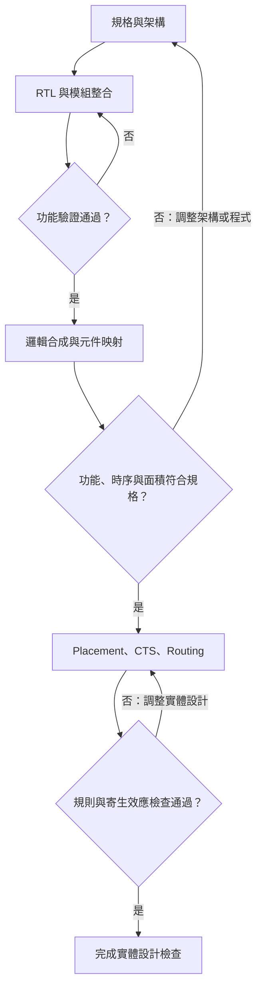
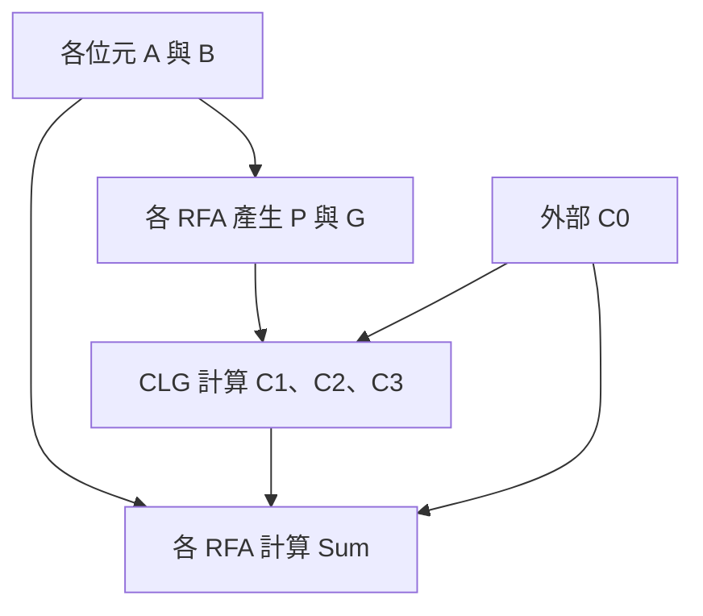
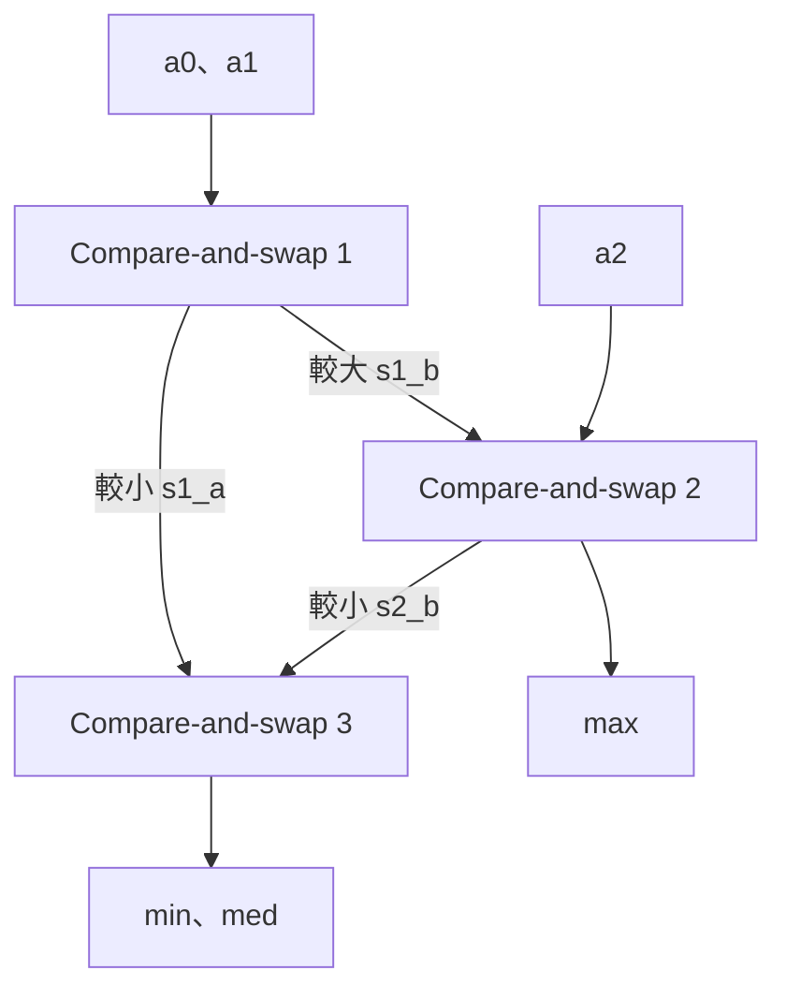

# 期中考前總覽

**課程：115-1 Practical Digital Systems Design（實用數位系統設計，PDSD）**  
**整理日期：2026-11-02｜依據：本次提供的 `1_上課資料_20261101_153048.tar.gz`**

這份總覽把「需要知道的規則、為什麼、如何計算、如何作答」放在同一份文件。程式與公式均以本課使用的 **Verilog 與組合邏輯設計**為主；先讀第 2 節建立全貌，再讀完整說明，最後用第 15、16 節檢查自己能否解題。

文中的 **「必背／必會」是複習建議**；只有標成「老師明示」或「正式公告」的內容才代表課程原始要求。題解是依教材、逐字稿、推導與實測整理的參考解，不冒稱教師公布的標準答案。

## 0. 目錄

| 節次 | 內容 | 你看完應該能做到 |
|---|---|---|
| [1](#sec1) | 範圍、規則與複習地圖 | 知道要讀到哪裡、考場如何作答 |
| [2](#sec2) | 考前速查與必背總表 | 快速找公式、語意與高頻陷阱 |
| [3](#sec3) | IC 設計與硬體基本觀念 | 解釋設計流程、合成、面積與速度 |
| [4](#sec4) | Module、net、邏輯閘與三態 | 看懂連線、寫出正確結構描述 |
| [5](#sec5) | 數字、位元寬度與運算子 | 正確手算 Verilog 表達式 |
| [6](#sec6) | 連續賦值、延遲與 timescale | 換算時間、判斷短脈衝是否傳遞 |
| [7](#sec7) | 程序區塊與模擬時序 | 追蹤 `=`、`<=`、事件與波形 |
| [8](#sec8) | 條件、迴圈與可合成性 | 從程式推電路，避免 latch 與錯誤優先權 |
| [9](#sec9) | Testbench 與工作站工具 | 說明驗證流程、工具與基本測試 |
| [10](#sec10) | 二進位算術、HA 與 FA | 從真值表推導 sum 與 carry |
| [11](#sec11) | RCA 與 Critical Path | 找路徑、算 gate count 與延遲 |
| [12](#sec12) | 加減器、overflow 與 saturation | 區分 signed overflow、carry、borrow |
| [13](#sec13) | CLA | 解釋為何變快，算出 41／42 gates、11Δ |
| [14](#sec14) | HW2 投票與排序 | 把規格、演算法、硬體與驗證連起來 |
| [15](#sec15) | 17 題 Zuvio 複習 | 掌握課堂測驗的答案與理由 |
| [16](#sec16) | 2017 考古題解題總覽 | 練習本次範圍內的典型題型 |
| [17](#sec17) | 英文術語與最後自我檢查 | 用英文說清楚核心概念 |
| [18](#sec18) | 來源、覆蓋範圍與驗證 | 回查頁碼、辨認資料限制與校正 |

---

<a id="sec1"></a>

## 1. 考試範圍、答題規則與複習地圖

### 1.1 已確認的正式規則

| 項目 | 本次已確認內容 | 依據 |
|---|---|---|
| 時間 | **2026/11/6（五）13:10–16:00**，臺灣時間 | 公告 2026/10/24〈Midterm Examination Information〉 |
| 地點 | **EC2010**；座位表在教室提供 | 同上 |
| 範圍 | **Unit 0 起，到 10/30 已授課內容，並包含 homework** | 同上 |
| 題型 | **True/False、essay／short-answer questions** | 同上 |
| 資料 | **Open book，只能使用實體文件**；現有公告與老師說明未訂「只能一張」的限制 | 同上；T1 L394；T3 L53 |
| 作答語言 | **以英文作答**；老師補充：偶爾真的不會表達時可用少量中文，文法錯誤本身不作扣分依據 | U0 pp.5、9；T6 L1019–1039、第二部分 00:38:39–00:38:57 |
| 是非作答 | **依當次題幹指定格式作答。**老師特別說明：要求 True／False 時，不要寫圈叉 | T4 L247 |
| 考古題 | 超過當前課程進度的部分可跳過 | 公告 2026/10/25〈Midterm exam reference has been uploaded〉 |

2017 考古題要求寫 **Y／N**，這是該張舊考卷的規則；2026 考試請讀當次題幹，不能直接沿用舊卷格式。

### 1.2 本次到底讀到哪裡？

**核心範圍：Unit 0、Unit 1、Unit 2-I／II、Unit 3-I／II、Unit 4 到 p.34，以及 EX1、HW1、HW2 的相關原理。**

本次資料沒有獨立課本全文；老師也說沒有固定指定課本。以下以實際提供的講義、六份逐字稿、測驗、作業與考古題建立完整複習內容，沒有把未取得的參考書當成已讀來源。〔U0 pp.24–25；T1 L390〕

10/23 停課自學公告指定 Unit 2-II p.20 起、Unit 4 pp.1–19；10/30 課堂再往後講至 **4-bit CLA 架構與分析**。T6 第三部分末段明說期中停在這裡，後面的 Block CLA 留到期中後。因此，**不能把 10/23 自學範圍誤認為最後考試範圍，也不能把整份 Unit 4 的 51 頁全部列成必考。**〔公告 10/23；T6 L3057–3077；A4 p.34〕

| 放進核心複習 | 本次不必延伸成完整題型 |
|---|---|
| HA／FA、RCA、加減器、overflow、saturation、CLG、4-bit CLA | Block CLA、Carry-Skip、Carry-Select 的完整架構與延遲推導 |
| `posedge`／`negedge`、組合與循序的基本辨識 | 完整 FSM 設計、狀態編碼與序列偵測器實作 |
| Critical path、clock 與 timing 的基本概念 | 尚未授課的 setup／hold violation 詳細計算 |
| 合成的用途、流程、與模擬的差異 | 尚未授課的完整合成工具操作流程 |

### 1.3 老師明示要準備的重點

1. **先想硬體架構，再寫 Verilog。**同一功能可以有不同面積與速度；要知道程式在描述什麼電路。〔T2 L346–358〕
2. **能區分模擬語意與可實作硬體。**`reg` 不一定是暫存器、`#10` 不代表做出 10 ns 硬體、`for` 不一定是循序電路。〔T2 L549；T6 第二部分 00:04:10–00:06:06〕
3. **Testbench 的目的與四項工作。**會考理解，不只是背名稱。〔T2 L69–73〕
4. **看程式推模擬結果／畫波形。**特別是 delay、blocking／nonblocking、不同程序的時間關係。〔T4 L161；T5 第二部分 00:22:38–00:23:31、第三部分 00:12:25–00:14:15〕
5. **能說明加法器架構與計算過程。**老師明說不只問「41 gates、11Δ」，更會問怎麼算出來、為什麼這樣接。〔T6 L3057、3065、3073、3077〕
6. **CLA 要懂 insight（核心想法）。**carry 可改寫成輸入所決定的 P、G 與初始 carry，不必逐級等待；老師說不必把所有展開式逐字死背，但要會由遞迴式推導。〔T6 第三部分 00:38:13–00:38:53〕

### 1.4 這份總覽的使用方式

- **完整複習：**第 3–14 節順讀；每個例題先自己算，再看答案。
- **檢查會不會考：**做第 15–16 節，遇到不會的題回到同一份總覽的對應章節。
- **考前快速翻閱：**第 2 節的總表、第 11／13 節的延遲與閘數表、第 17 節的檢查清單。
- **準備紙本：**務必保留表格、公式、程式的縮排與換行。正式考試只允許實體文件，不能把電子版當作可帶入的參考資料。

---

<a id="sec2"></a>

## 2. 考前速查與必背總表

### 2.1 先背觀念的「判斷規則」

| 題目關鍵字 | 必須立即想到的規則 | 詳解 |
|---|---|---|
| Hardware mindset | 先決定架構與介面，再用 Verilog 描述 | §3 |
| Good design | 功能正確，加上滿足 area／timing 等目標 | §3 |
| Logic synthesis | HDL → 邏輯最佳化與技術映射 → gate-level netlist | §3 |
| Module / instance | 定義／使用該定義的一份元件；instance 不是依序呼叫的軟體函式 | §4 |
| Named mapping | `.formal_port(actual_signal)`；點後是子模組的 port 名稱 | §4 |
| `wire` | 由 driver 持續驅動；無有效 driver 通常為 `z` | §4 |
| `reg` | 程序可賦值的變數；**不代表一定有硬體 register** | §5、§8 |
| `x` / `z` | 未知／高阻抗；都不能一律當 0 | §4、§5 |
| Two conflicting drivers | 一般 wire 上等強度 0 與 1 同時驅動 → `x` | §4 |
| `[m:n]` | 寬度 `abs(m-n)+1`；左邊界是 MSB | §4 |
| 位寬不足 | 宣告寬度固定；賦值太大會截掉高位，不會自動長出儲存位元 | §5 |
| `&` / `&&` / `&a` | 位元 AND／邏輯 AND／單運算元 reduction AND | §5 |
| `==` / `===` | 前者可能因未知而得 `x`；後者把 `x/z` 當狀態逐位比，結果是 0 或 1 | §5 |
| `sel ? a : b` | `sel=1` 選 a、0 選 b；未知條件時可能逐位合併 | §5 |
| `assign` | 持續驅動 net，RHS 改變時重新求值 | §6 |
| `#d` | 以所在 module 的 time unit 換算，再依 precision 量化 | §6 |
| `initial` / `always` | 起始執行一次／程序反覆執行；多個程序彼此並行 | §7 |
| `=` | 本句完成後才執行同程序下一句；無 intra-assignment delay 時立即寫入 | §7 |
| `<=` | 執行到該行時取 RHS，排程稍後更新 LHS；下一行立即繼續 | §7 |
| `wait(cond)` | 等「條件為真」；已經真就立即通過，不必等新的邊緣 | §7 |
| `always @(*)` | 組合描述常用；還必須所有輸出、所有分支都完整賦值 | §8 |
| `if` 缺 `else` | 組合程序中若存在需要保留舊值的路徑，可能推導 latch | §8 |
| `case` vs `if` | 先看是否存在優先權、完整賦值與未知值語意；不能只看關鍵字斷定速度 | §8 |
| `for` / `while` | 能在合成時確定有限展開、body 可合成，才可能成為硬體；不是寫 loop 就自帶 clock | §8 |
| Testbench | 例化 DUT、產生刺激、施加刺激、觀察並比對反應 | §9 |
| 100% statement coverage | 目標敘述都執行過；不等於所有功能與輸入都驗證過 | §3、§9 |
| Critical path | 在指定模型下，累積延遲最大的路徑；測試還要讓變化真的傳過去 | §11 |
| Carry vs overflow | Unsigned 看進位／借位；signed 看是否超出有號範圍 | §12 |
| Combinational stages | 有資料相依與傳播延遲，但沒有因此變成多個 clock cycles | §14 |

### 2.2 必會的公式

以下 `+` 若用在布林公式中表示 **OR**，相乘表示 **AND**；算術等式則使用一般加法。不要把布林式中的 `+` 誤讀成多位元算術相加。

| 主題 | 公式／結果 |
|---|---|
| N-bit unsigned 範圍 | `0` 到 `2^N−1` |
| N-bit two's complement 範圍 | `−2^(N−1)` 到 `2^(N−1)−1` |
| 二補數取負 | `~B + 1`，限定在所選 N-bit 寬度內 |
| Half Adder | `S=A⊕B`；`C=AB` |
| Full Adder | `S=A⊕B⊕Cin`；`Cout=AB+Cin(A⊕B)` |
| 加減共用硬體 | `B'=B⊕M`（每一位）；`Cin=M`；`M=0` 加法，`M=1` 減法 |
| Signed addition overflow | `V=~(Amsb⊕Bmsb) & (Smsb⊕Amsb)` |
| Signed subtraction overflow | `V=(Amsb⊕Bmsb) & (Smsb⊕Amsb)` |
| 二補數加法 carry 判法 | `V=C_into_MSB ⊕ C_out_of_MSB` |
| 本課 CLA 的 P／G | `p_i=a_i OR b_i`；`g_i=a_i AND b_i` |
| Carry 遞迴 | `c_(i+1)=g_i+p_i c_i` |
| 第一級展開 | `c1=g0+p0 c0` |
| 第二級展開 | `c2=g1+p1 g0+p1 p0 c0` |
| 第三級展開 | `c3=g2+p2 g1+p2 p1 g0+p2 p1 p0 c0` |
| 等效 gate count | `design area / NAND2 cell area` |
| HW2 輸入組合數 | voting：`3^5=243`；sorting：`8^3=512` |

### 2.3 加法器數字：先寫模型，才寫答案

**以下 Δ 模型來自 Unit 4 的展開閘電路：NOT／inverter 延遲 Δ，AND／OR 延遲 2Δ；XOR 由基本閘實作，最長路徑 5Δ。**它與 HW1 的 `xor #3; and #2; or #2;` 是不同模型。

| 元件／路徑 | 閘數或延遲 | 來源與條件 |
|---|---:|---|
| 本課圖中的 HA | 4 gates；sum 最長 5Δ | A4 p.10，使用展開電路 |
| 本課圖中的 FA | 9 gates | A4 pp.12–13 |
| FA：A／B → Sum | 10Δ | 兩個 HA 的 sum 路徑 |
| FA：A／B → Cout | 9Δ | 第一個 HA sum → AND → OR |
| FA：Cin → Sum／Cout | 5Δ／4Δ | 不能把完整 FA 延遲套到每一級 carry |
| N-bit RCA → 最高位 sum（N≥2） | `9+(N−2)×4+5 = 4N+6` Δ | 第一級、中央級、末級分開算 |
| N-bit RCA → 最終 carry | `9+(N−1)×4 = 4N+5` Δ | 同一 FA 實作模型 |
| 4-bit RCA | 36 gates；最長 22Δ | 最高位 sum 是較慢終點 |
| RFA | 8 gates；p／g 在 2Δ 後就緒 | 去掉原本產生 carry 的最後 OR |
| 本課 CLG | 9 gates；已有 p／g 後再等 4Δ | 只產生 `c1,c2,c3` 的圖 |
| 4-bit CLA | `4×8+9=41` gates；sum 最長 `2+4+5=11Δ` | A4 p.34 |
| CLA 額外輸出 c4 | 最後 RFA 改 FA →42 gates；該 carry 路徑 `2+4+4=10Δ` | 不是把新一整組 CLG 混入原圖計數 |

**老師要的是你能重建這張表的計算，不是只默寫數字。**不同輸出需求、閘實作、fan-in 或延遲模型，答案可能不同。完整推導在 §10、§11、§13。

### 2.4 必會手算的四個小例子

1. `` `timescale 10ns/100ps `` 下 `#3.2712`：`32.712 ns` 量化到 `0.1 ns` → **32.7 ns**。
2. 4-bit `0111 + 0011 = 1010`：unsigned 是 `7+3=10`，沒有 unsigned carry；signed 解讀成 `7+3→−6`，**有 signed overflow**。
3. 初值 `a=0,b=1`：`a=b; b=a;` → **a=1,b=1**；`a<=b; b<=a;` 在該時間槽 NBA 更新後 → **a=1,b=0**。
4. 3-bit one-hot 投票 `(001,001,010,010,100)`：票數 `(2,2,1)`，winner 可選 `001` 或 `010`，`count=010`。`count` 是二進位票數，不是 one-hot。

來源：V2 pp.6–8、32–39；A4 pp.10–34；H2 pp.1–3；本次手算及模擬驗證。

---

<a id="sec3"></a>

## 3. IC 設計與硬體基本觀念

### 3.1 Good design：功能正確之後，還要問什麼？

**功能正確是必要條件；「好電路」還必須符合規格中的時間、面積等限制，並做出合適的取捨。** 同樣算出 `A+B`，使用不同架構，可以得到不同的面積與最壞延遲。〔U0 pp.2、16–21；U1 pp.16、19、41；T1 L20–46〕

| 面向 | 需要回答的問題 | 衡量方式／關鍵詞 |
|---|---|---|
| Functionality（功能） | 所有合法輸入下是否做對？ | 與 specification、expected results 比對 |
| Speed / timing（速度／時序） | 最晚多久能取得有效輸出？ | Critical-path delay（關鍵路徑延遲） |
| Area / cost（面積／成本） | 需要多少硬體資源？ | Cell area、equivalent gate count |
| Power（功耗） | 消耗多少功率？ | Dynamic power、static power |
| Testability（可測試性） | 製造後能否找出缺陷？ | Design for testability，DFT |
| Reliability（可靠度） | 使用一段時間後能否持續正確工作？ | 長期可靠性 |

本課此階段主要比較 **area 與 speed**。功耗、DFT、可靠度需要知道意義，並不是此處要延伸計算的重心。〔T1 L46–64、L292〕

**Trade-off（取捨）例子：** RCA 讓 carry 逐級傳遞，結構規則、硬體較省，但位元數增加時延遲變長；CLA 增加 carry 計算邏輯，通常換得較短延遲。若設計已符合速度需求，增加面積去追求更高速度未必值得；若速度不合格，再小的面積也不代表符合規格。精確比較須依實際架構與題目的 gate-delay model 計算。〔T1 L314–358；V1 p.4〕

**必會英文短答：**

> A good design must be functionally correct and satisfy its timing and area constraints. The architecture should provide a suitable trade-off between performance and cost.

### 3.2 Y-chart：Behavioral、Structural、Physical

| Design domain（描述領域） | 回答的問題 | 以加法器為例 |
|---|---|---|
| Behavioral（行為） | 電路做什麼？ | 輸入兩個數，輸出它們的和 |
| Structural（結構） | 使用哪些元件，如何連接？ | 四個 Full Adder 串成 RCA |
| Physical（實體） | 元件在晶片上如何實現與擺放？ | Cell layout、placement、routing |

**Abstraction（抽象化）**是先隱藏暫時不需要的細節，使複雜電路容易處理；例如先想加法器架構，再處理各個閘與電晶體。這三個 domain 是同一設計的不同描述角度，必須能互相對應。〔U1 p.15；T1 L629–647〕

**老師反覆強調：抽象化不能讓你忘記最後要做成硬體。** `sum = a + b` 說明加法功能，單憑這一行還不能確定最後是哪一種加法器、需要多少面積或延遲。設計者要有架構意識，並核對合成結果。〔V1 pp.3–4；T2 L87–105〕

不要把 behavioral description 直接等同「不可合成」。能否合成取決於使用的語法、描述的行為及工具支援；講義的加法器也示範以程序描述組合功能，再交由合成流程實作。〔U1 pp.21、27；V1 p.6〕

### 3.3 Hardware mindset 與 Top-down design

**被問「如何以 hardware mindset 設計？」時，關鍵答案是：寫 Verilog 前先決定硬體架構與介面。** 老師明示這可能是期中問題。〔T2 L346–358〕

合理的思考順序如下：

1. **Specification（規格）：** 功能、輸入輸出、位寬、速度與面積限制是什麼？
2. **Architecture / algorithm（架構／演算法）：** 要用哪些運算元件？哪些工作平行執行？哪些訊號相依？
3. **Hierarchy / interface（階層／介面）：** 如何拆成子模組？每個 port 的名稱、方向、寬度及意義為何？
4. **Implementation（實作）：** 撰寫各模組，再透過 instantiation 連接。
5. **Verification / evaluation（驗證／評估）：** 檢查各模組與整合結果，再比較合成後的功能、面積與時序。

Top-down 是由大系統往下拆解；實作與驗證則可以先完成小模組，再逐步整合回較大系統。例如：四位元 RCA → 四個 FA → 每個 FA 由兩個 HA 與一個 OR 組成。〔U1 pp.20–22、26；V1 pp.4–7、27–28；T2 L95–119〕

**典型問答：每個子模組都測過，整合後為什麼還會錯？** 因為 port 接錯、位寬不一致、bit index 方向不同，或對訊號意義與時序的約定不一致。子模組通過不代表整合自動通過；必須事先協調介面，再做整合驗證。〔U1 p.26；T2 L137–173〕

**英文短答：**

> Determine the hardware architecture and module interfaces before writing Verilog. Then implement and verify the submodules, instantiate them, and verify the integrated design.

### 3.4 Cell-based design flow 與驗證回路

**Cell-based digital design（標準單元式數位設計）**使用 standard-cell library（標準單元元件庫）中的元件組成電路。經過 technology mapping（技術映射），邏輯才對應到目標製程的具體元件，進而取得面積與延遲資訊。〔U1 pp.18、27–28；T1 L617–619、L685–691〕

IC 複雜度從 SSI、MSI、LSI 發展到 **VLSI（Very Large Scale Integration，超大型積體電路）**；**SoC（System on Chip，系統單晶片）**可整合處理核心、記憶體與周邊。元件愈多，愈需要階層、抽象化及 **EDA（Electronic Design Automation，電子設計自動化）**工具協助，而不是逐顆手工處理。〔U1 pp.12–13、40；T1 L617–635〕



圖中每個檢查都可能使設計回到前一階段；**不是 RTL 模擬成功後就一路保證成功**。尤其合成後要檢查實際元件造成的延遲，layout 後還會增加連線等寄生效應。〔U1 pp.18、30–31、39–40〕

| 階段／術語 | 核心工作與產物 |
|---|---|
| RTL design | 用 HDL 描述資料處理與模組行為，完成程式與模組連接 |
| Simulation / functional verification | Testbench 施加輸入，觀察並比對輸出 |
| Logic synthesis | **Translation → optimization → mapping**，產生 gate-level netlist |
| Postsynthesis validation | 比較原本 RTL 與合成後 gate-level 的結果，確認功能仍符合預期 |
| Timing verification | 找出 critical path，確認延遲沒有違反規格 |
| Placement | 決定元件在有限晶片面積上的位置 |
| CTS：Clock tree synthesis | 建立時脈分配網路，控制各元件收到時脈的時間差 |
| Routing | 將已擺放元件依 netlist 連線 |
| DRC：Design rule check | 檢查材料寬度、間距、重疊等實體設計規則 |
| Parasitic extraction | 從 layout 萃取寄生效應，再確認電性及時序 |

**Front end（前端）與 Back end（後端）：** 本課圖中，RTL design 與 logic synthesis 屬前端；placement and routing 等實體設計屬後端。本課主要教前端。〔U1 pp.18、27、30–40；T1 L653–667〕

**英文短答：**

> Logic synthesis translates an HDL description into a gate-level netlist, optimizes the logic, and maps it to cells in the target technology library. After synthesis, the circuit must be checked for both functional correctness and timing.

### 3.5 IC 產業分工與實作方式

IC 生產的基本順序是：**IC design / DFT → wafer manufacturing → wafer testing → packaging → final testing → shipping**。〔U1 p.3〕

| 名詞 | 意義 |
|---|---|
| Design house | 負責 IC 設計 |
| Foundry | 負責晶片製造 |
| Testing house | 負責測試 |
| Packaging house | 負責封裝 |
| IDM：Integrated Device Manufacturer | 整合設計與製造的廠商 |
| Wafer（晶圓） | 上面製造許多 die 的圓片 |
| Die（晶粒） | 晶圓上的一顆晶片單位 |

製造後要測試，封裝後再測試，因為不同階段都可能引入缺陷。這和前端的功能驗證不同：**設計驗證找設計是否符合規格，製造測試找實體晶片是否有缺陷。**〔U1 pp.3、8；T1 L451–459〕

| 實作方式 | 課堂比較方向 |
|---|---|
| FPGA | 可快速做 prototype（原型）；受限於既有可程式化資源 |
| Standard-cell IC | 使用元件庫與 EDA 工具，兼顧設計效率與實體效能 |
| Full-custom IC | 可深入客製元件及 layout；設計投入與時間通常較高 |

**NRE（Nonrecurring engineering cost）**是產品開發的一次性工程成本，例如研發與測試準備，不是每生產一顆晶片就再付一次的單位製造成本。此處掌握比較方向，不把投影片中的公司排名或市場數字當成電路設計必背公式。〔U1 pp.4–8、17；T1 L649–653〕

### 3.6 面積與 Critical path 的基本計算

**Equivalent gate count（等效閘數）**將設計面積以一顆 NAND2 的面積正規化：

$$
N_{gate,eq}=\frac{A_{design}}{A_{NAND2}}.
$$

講義例：設計面積 $203.69\,\mu m^2$，同一基準下 NAND2 面積約 $5\,\mu m^2$：

$$
203.69/5\approx40.738\approx41\text{ NAND2-equivalent gates}.
$$

**這不代表 netlist 真的含 41 顆邏輯閘。** 它是面積的比較尺度；不同種類的 cell 面積不同，實際 cell 數可能不同。比較時必須使用一致的元件庫／基準。〔U1 p.28〕

**Critical path（關鍵路徑）**是在題目指定的起點、終點和延遲模型下，總延遲最大的路徑。組合電路題通常從輸入追到輸出：

$$
t_{path}=\sum_{g\in path}t_g,
\qquad
t_{critical}=\max_{path}t_{path}.
$$

若題目另給 wire delay，也要納入。**最多顆閘不一定最慢**：只有閘延遲相同等條件下，才可以直接比較經過的閘數。例如三顆 1 ns 閘共 3 ns，仍快於兩顆 2 ns 閘的 4 ns。老師要求先找出效能瓶頸，再考慮如何改架構。〔U1 p.31；T1 L691–693；T2 L63–67〕

### 3.7 Verification 與 Coverage

**Verification（驗證）不是只讓模擬跑完。** 必須先知道哪些功能要測、使用什麼輸入、預期輸出為何，再檢查實際結果。Coverage（覆蓋率）提供另一個角度：哪些程式或行為還沒有被測到？〔U1 pp.22–26〕

| 指標 | 在問什麼？ | 常見誤解 |
|---|---|---|
| Statement coverage | 目標可執行敘述有多少被執行？ | 不是計算空白、註解等所有文字行 |
| Branch coverage | 各個分支方向是否被走到？ | 執行到 `if` 判斷不等於兩個方向都測過 |
| Path coverage | 哪些執行路徑被走到？ | 各分支分別出現不等於所有組合路徑都出現 |
| Condition coverage | 條件中的各子條件是否得到所需真假結果？ | 不只看整個複合條件的最後結果 |
| Toggle coverage | 訊號是否發生所需的切換？ | 訊號曾出現不等於都切換過 |
| FSM state coverage | 每個目標狀態是否到達？ | 不等於每條狀態轉移都發生 |
| FSM transition / arc coverage | 每個目標狀態轉移是否發生？ | 不是只數狀態名稱 |

$$
\text{Statement coverage}
=\frac{\text{被執行的目標敘述數}}{\text{全部目標敘述數}}\times100\%.
$$

**講義的 $6/8=75\%$ 如何算？** 以下保留 p.24 的八個檢查項；`compute_parity` 表示計算 parity 的函式，這裡只分析哪些敘述有被執行，不需實作該函式：

```verilog
// 程序片段；[1]～[8] 是本題的 coverage 檢查項
if (parity == ODD || parity == EVEN) begin // [1]
    tx <= compute_parity(data, parity);    // [2]
    #(tx_time);                           // [3]
end
tx <= 1'b0;                               // [4]
#(tx_time);                               // [5]
if (stop_bits == 2) begin                  // [6]
    tx <= 1'b0;                           // [7]
    #(tx_time);                           // [8]
end
```

假設 `parity` 不等於 ODD 或 EVEN，且 `stop_bits=2`：

- 第一個 `if` 判斷 [1] 有執行，但結果是假，所以 [2]、[3] 未執行。
- [4]、[5] 一定執行；[6] 判斷為真，因此 [7]、[8] 也執行。
- 已執行集合是 **{1,4,5,6,7,8}**，共六項；未執行的是 **{2,3}**。
- 因此 coverage 是 **$6/8=75\%$**。增加使第一個條件為真的測試，才能涵蓋 [2]、[3]。

依題目標記的項目計算，不自行把 `begin`、`end`、空白行都算進去；不同工具對可執行 statement 的計數細節也可能不同。〔U1 pp.23–25；T1 L679–683〕

**100% statement coverage 不保證所有功能正確。** 例如加法只有一行敘述，只測 `0+0` 就可能跑到那一行，但 carry、最大值、overflow 等條件仍未測到。必須結合功能與邊界案例規劃，不能只追求一個百分比。〔U1 pp.22–25；依 coverage 定義推論〕

**英文短答：**

> Statement coverage measures the percentage of executable statements that have been executed. Full statement coverage does not by itself prove correctness for every input.

---

<a id="sec4"></a>

## 4. Verilog 模組、互連與閘級建模

### 4.1 Module、Instance、Port、Hierarchy

| 名詞 | 意義 | 例子 |
|---|---|---|
| Module（模組定義） | 一種可重複使用的硬體描述 | `module full_adder ... endmodule` |
| Instance（實例） | 使用某個 module 定義的一份元件 | 四位元 RCA 例化四份 FA |
| Port（連接埠） | 模組對外介面 | `input`、`output`、必要時 `inout` |
| Internal net（內部互連） | 模組內部的元件連線 | 前級 carry-out 接下一級 carry-in |
| Hierarchy（階層） | 哪個模組包含／例化哪些模組 | RCA → FA → HA 與 OR |

**例化不是呼叫軟體函式逐次計算。** 例化四個 FA 表達四份同時存在的硬體結構；各元件的輸出依輸入與延遲更新。模組內的文字先後順序不等於整個電路依序執行。〔V1 pp.4–7、27–28；T2 L95–119、L193–211〕

本課 Verilog 的子模組定義應各自放在 `module ... endmodule` 中，**不能把另一個 `module` 定義巢狀寫進 top module**。在 top module 裡面要放的是 instantiation。〔V1 p.10；T2 L393–395〕

**英文短答：**

> A module defines a reusable hardware block. An instance is one use of that module definition in a hardware hierarchy.

### 4.2 Positional mapping 與 Named mapping

假設被連接模組的 port 宣告順序是：

```verilog
module fulladd4(sum, c_out, a, b, c_in);
```

這裡 `sum`、`a`、`b` 是四位元，`c_out`、`c_in` 是一位元。兩種接法如下，**實際使用擇一**：

```verilog
// Positional mapping：完全依原本 port 順序
fulladd4 U0(SUM, C_OUT, A, B, C_IN);
```

```verilog
// Named mapping：明確指定 port，書寫順序可調換
fulladd4 U0(.a(A), .b(B), .c_in(C_IN),
            .sum(SUM), .c_out(C_OUT));
```

**`.a(A)` 的讀法：** 點後的 `a` 是被例化模組原本的 port；括號裡的 `A` 是目前這一層接過去的訊號。兩者不必同名，但方向、寬度與意義要對得上。〔V1 p.9；T2 L375–391〕

| 接法 | 依據 | 易錯處 |
|---|---|---|
| Positional | Port 宣告順序 | 少一個空位或改變順序，容易整串錯接 |
| Named | 原始 port 名稱 | 點後名稱須正確，不能把外層訊號名誤當 port 名 |

若某個 **output 不使用**，positional 要保留其位置，如 `T_FF T2(Q2, , T, Q_bar1);`；named 可寫 `.Q_bar()`。不要直接刪掉一個位置，讓後面的訊號全部移位。〔V1 p.7；T2 L229–281〕

老師建議 named mapping，因為介面很多、多人整合或 port 順序改動時較容易檢查；**這是設計建議，不代表 positional mapping 不合法**。同一模組可例化多次，但同一 scope 中各 instance 必須有不同名稱。〔V1 p.9；T2 L383–391〕

### 4.3 Identifier、Case sensitivity 與基本語法

本課的一般 identifier（識別字）可以包含英文字母、數字、`_`、`$`，但**不能以數字或 `$` 開頭，也不能直接使用保留字**。Verilog 大小寫有別，關鍵字使用小寫。〔V1 pp.11–12；T2 L427–441〕

| 寫法 | 判斷 | 原因 |
|---|---|---|
| `sum_0`、`_carry`、`data$1` | 合法一般名稱 | 字元與開頭符合規則 |
| `4bit_adder` | 不合法一般名稱 | 數字開頭 |
| `input`、`module`、`reg` | 不可直接當一般名稱 | Verilog 保留字 |
| `SUM` 與 `sum` | 是不同名稱 | Case-sensitive |
| `Sel` 寫成 `sel` | 不能假設是同一條線 | 可能拼錯，甚至產生另一條隱含線 |
| `// comment` | 單行註解 | 到該行結束 |
| `/* comment */` | 區塊註解 | 可跨行 |

Module header、port/net 宣告、元件例化及一般 statement 要留意分號 `;`；`endmodule` 本身不需要分號。名稱應表達意義，尤其介面和 carry 等跨模組訊號；這有助於核對架構與連線。〔V1 p.6；T2 L147–173〕

### 4.4 Net、Wire 與位元範圍

**Net（網路型別）表示電路互連，其值由 driver（驅動來源）決定。** Driver 改變時，模擬器依邏輯與指定 delay 自動傳遞更新；這就是 continuously driven。它不表示「物理上零延遲」，也不表示 net 自己儲存一份結果。〔V1 pp.15–18；T2 L451–477〕

```verilog
wire x;              // 1 bit
wire Cin, AddSub;     // 各 1 bit
wire [2:0] sum;       // 3 bits，sum[2] 是 MSB
wire [0:2] rev;       // 同樣 3 bits，rev[0] 是 MSB
wire [7:0] a, b;      // a、b 各 8 bits
```

$$
\text{width}=|\text{左索引}-\text{右索引}|+1.
$$

**宣告左端為 MSB，右端為 LSB；MSB 不是永遠比較大的索引。** 若 `sum=3'b100`，則 `sum[2]=1`；若 `rev=3'b100`，則 `rev[0]=1`。兩個都是三位元數，但索引方向不同。跨模組要一致理解，不要憑索引大小猜權重。〔V1 p.18；T2 L551–557〕

**Implicit net（隱含網路）陷阱：** 在允許隱含 net 的連線情境，未宣告的線名可能被視為單一位元 `wire`。少寫 vector 宣告或拼錯字，不一定立刻得到編譯錯誤，卻可能造成截斷或浮接；因此要明確宣告線名和位寬。這不是說所有未宣告變數在任何語法位置都合法。〔V1 p.18；T2 L557〕

| Net type | 本課要認識的用途 |
|---|---|
| `wire`、`tri` | 一般互連；`tri` 常用名稱表達三態連線意圖 |
| `wor`、`trior` | 多 driver 按 wired-OR 解析 |
| `wand`、`triand` | 多 driver 按 wired-AND 解析 |
| `trireg` | 電容儲存效果的模擬 |
| `tri1`、`tri0` | 無其他有效 driver 時的 pull-up／pull-down 行為 |
| `supply1`、`supply0` | 電源與地的模擬 |

老師此處以 `wire`、`tri` 為主要實作用途，其餘以模擬用途介紹。答題要能分辨**語言的模擬語意**與**本課工具的合成用途**，不要把課堂簡化變成「所有工具永遠不支援其餘型別」。另外，`wire` 也能呈現 `z`，不是只有宣告 `tri` 才能呈現高阻抗。〔V1 pp.16–18；T2 L477–549〕

### 4.5 Four-state logic：0、1、x、z

| 值 | 意義 | 典型情況 |
|---|---|---|
| `0` | Logic low（低邏輯位準） | 確定為0 |
| `1` | Logic high（高邏輯位準） | 確定為1 |
| `x` | Unknown（未知） | 未初始化、無法判定、相衝突的 driver |
| `z` | High impedance（高阻抗） | 三態元件關閉、無有效 driver |

**`x` 在一般模擬中代表未知，不是一律代表 don’t-care；`z` 不是0。** Unknown 是否傳到結果，還要看另一個輸入能否決定結果：〔V1 p.22；T2 L479–549〕

| 運算 | 結果 | 為什麼？ |
|---|---|---|
| `0 & x` | `0` | AND 只要一邊為0，就能確定輸出0 |
| `1 & x` | `x` | 結果取決於未知的另一邊 |
| `1 \| x` | `1` | OR 只要一邊為1，就能確定輸出1 |
| `0 \| x` | `x` | 結果取決於未知的另一邊 |

以本課等強度模型想像一條 shared bus：所有三態 driver 都關閉時通常得到 `z`；兩個 driver 同時開啟、分別推0和1時會衝突，得到 `x`。因此三態控制要確保需要時有正確來源在驅動，且避免不同來源互相衝突。〔V1 pp.21–22；T2 L529–549〕

### 4.6 Gate-level modeling 與常用 Primitives

**Structural modeling（結構式建模）**描述元件及連線；**gate-level modeling（閘級建模）**是以邏輯閘為元件的一種結構描述。例化 FA、MUX 等較大的模組也是結構描述，不一定已展開成最底層邏輯閘。〔V1 pp.7、14–15、27–28〕

本課常用單輸出 primitive 寫法：

```verilog
and U1(y, a, b);       // y = a & b
or  U2(z, a, b);       // z = a | b
xor U3(p, a, b);       // p = a ^ b
not U4(an, a);         // an = ~a
buf U5(q, a);          // q = a
```

**這些例子都把 output 放前面，再列 inputs。** 一般多輸入 AND、OR、XOR 等閘可增加輸入數，例如 `and U6(y,a,b,c,d);` 是四輸入 AND；`nand`、`nor`、`xnor` 是相應結果再反相。Primitive keyword 與自取的 instance name 要分清楚。講義的單輸出規則用來讀這些例子即可；`buf`、`not` 在完整語言中也有多輸出形式。〔V1 pp.19–20；T2 L571〕

**Buffer 的邏輯功能雖然是輸出等於輸入，實體上仍可改善驅動能力與訊號傳遞等電性問題。** 因此不能因真值表沒變，就判定 buffer 毫無用處；也不代表每個設計都需要額外放 buffer。〔T2 L503–525〕

**Conditional primitives（條件式基本元件）**採 `output, data, control` 的順序：

| Primitive | 啟用條件 | 啟用時輸出 | 關閉時輸出 |
|---|---|---|---|
| `bufif1(y,a,en)` | `en=1` | `a` | `z` |
| `bufif0(y,a,en)` | `en=0` | `a` | `z` |
| `notif1(y,a,en)` | `en=1` | `~a` | `z` |
| `notif0(y,a,en)` | `en=0` | `~a` | `z` |

記憶方式：`buf/not` 決定資料是否反相；`if1/if0` 決定哪個 control 值會啟用。〔V1 p.21〕

### 4.7 2-to-1 MUX：式子、電路與 Verilog 一起看

課堂電路的布林式為：

$$
out=(a\land\lnot sel)\lor(b\land sel).
$$

因此 **`sel=0 → out=a`；`sel=1 → out=b`**。如果看到相反的連線或式子，選擇關係就可能反過來，必須讀圖。這裡依講義圖與程式的實際連線解讀。〔V1 pp.15、26、32〕

```verilog
module mux2_1(out, a, b, sel);
    output out;
    input a, b, sel;
    wire sel_n, a_path, b_path;

    not U0(sel_n, sel);
    and U1(a_path, a, sel_n);
    and U2(b_path, b, sel);
    or  U3(out, a_path, b_path);
endmodule
```

**如何判斷？** `sel=0` 時，a 路徑的 AND 另一端為1，所以 a 可通過；b 路徑被0封住。`sel=1` 則相反。如果 `a=b`，改變 sel 不會改變穩定後的輸出值。〔V1 pp.15、26、32；依該電路推導〕

**延遲小題：假設每顆閘延遲都是 $d$。**

| 路徑 | 經過的閘 | 結構路徑延遲 |
|---|---|---:|
| `a → out` | AND → OR | $2d$ |
| `b → out` | AND → OR | $2d$ |
| `sel → sel_n → a_path → out` | NOT → AND → OR | $3d$ |

因此最長結構路徑為 $3d$。要用模擬觀察這條路徑，仍須選擇能讓該變化一路傳到輸出的輸入條件；不是任何 sel 變化都能量到 $3d$。〔T2 L535；依V1 p.15電路推導〕

### 4.8 Gate delay：Rise、Fall、Turn-off

Gate delay specification（閘延遲指定）在模擬中描述傳播時間。**寫 `#5` 不代表合成工具一定製造出剛好5ns的硬體。** 真實元件延遲與目標元件庫、負載等條件有關。〔V1 pp.24–25；T2 L467–471〕

| 寫法 | 解讀 |
|---|---|
| `and #(5) U0(y,a,b);` | Rise=5、fall=5 |
| `or #(4,6) U1(y,a,b);` | Rise=4、fall=6 |
| `bufif1 #(2.1,2.7,3.2) U2(y,a,en);` | Rise=2.1、fall=2.7、turn-off=3.2 |
| `bufif1 #(4,6) U3(y,a,en);` | Turn-off未另指定，採 `min(4,6)=4` |

上述數值都以所在 scope 的 time unit 計算，後面的 `timescale` 章節會說明如何換成 ns 等實際模擬時間。〔V1 pp.24–25、36〕

| Delay | 看的轉換 |
|---|---|
| Rise delay | **輸出變成1** |
| Fall delay | **輸出變成0** |
| Turn-off delay | **輸出變成z** |

**不能看輸入方向就選 rise/fall。** 例如 NOT 的輸入由0變1，輸出是1變0，應採 fall delay。三態 driver 被關閉，使輸出變z，才使用 turn-off delay。〔V1 p.24；依定義推導〕

### 4.9 Minimum、Typical、Maximum 與逗號的差別

**冒號 `:` 與逗號 `,` 的意義不同：**

- `min:typ:max`：同一種轉換延遲，在三種選用條件下的數值。
- `rise,fall,turnoff`：不同輸出轉換的延遲種類。

```verilog
and #(3:4:5, 5:6:7) U0(y, a, b);
```

| 選用模式 | Rise delay | Fall delay |
|---|---:|---:|
| Minimum | 3 | 5 |
| Typical（講義預設） | 4 | 6 |
| Maximum | 5 | 7 |

這不是同一個閘會依序延遲3、4、5；一次模擬依選用模式採其中一組數值。講義列出 `+mindelays`、`+typdelays`、`+maxdelays` 選擇方式。〔V1 p.25〕

若要同時示範三種轉換各自的 min/typ/max，可寫：

```verilog
bufif1 #(3:4:5, 5:6:7, 7:8:9) U1(y, a, en);
```

Typical 下為 rise=4、fall=6、turn-off=8。一般 `and`、`or` 等多輸入邏輯閘使用一組或兩組延遲；三組延遲用在可輸出z的三態元件。講義p.25的三組延遲例應以這類元件理解，不直接照抄成三組延遲的 `and`。〔V1 pp.24–25〕


<a id="sec5"></a>

## 5. 數字、位元寬度與運算子

**本章必熟：每個值的位元圖樣、位寬、signedness是三件事；先辨認運算種類，再算結果。** 老師把logical/bitwise差異、timescale與基本型別多次列入課堂問題。〔V2 pp8、13–18；T4 L247–325；T5 第一部分 00:03:22–00:15:19〕


### 5.1 常數與位元

格式：`[size]'[s][radix]value`；size始終是**binary bit數**，不是十進位位數。常用radix：`b`二進位、`o`八進位、`d`十進位、`h`十六進位。底線只是方便閱讀。〔V2 p8；T4 L70–74〕

| 常數 | 二進位內容 | 十進位意義 |
|---|---|---|
| `3'b101` | 101 | unsigned 5 |
| `8'b11` | 00000011 | 3 |
| `3'd6` | 110 | unsigned 6，不是三位十進位數 |
| `6'o42` | 100010 | 34 |
| `8'hAB` | 10101011 | unsigned 171 |
| `4'sb1110` | 1110 | signed two's complement -2 |

資料值不等於位元圖樣：同樣`1110`用unsigned讀是14，用4-bit signed讀是-2。寫常數時明確指定位寬，避免unsized值改變expression寬度/有號性。不能以主機Windows/Linux或CPU 32/64位元推定Verilog常數寬度。

### 5.2 變數型別

| 型別 | 典型大小／意義 | 複習要點 |
|---|---|---|
| `reg` | 預設1-bit；可宣告vector；預設unsigned | 程序可賦值；可另外宣告`reg signed` |
| `integer` | 32-bit signed | 常見loop index；不要把它誤當自動最小位寬 |
| `real` | double precision浮點模擬值 | 不等於寫了real就有IEEE754硬體 |
| `time` | 64-bit unsigned模擬時間 | `$time`回傳模擬時間，非真實晶片計時器 |

來源：V2 p23。`integer`能否合成要看用法/工具，固定界限迴圈的integer index很常見；real/time等模擬構造不能直接當課堂ASIC運算硬體。

### 5.3 vector與array

```verilog
reg [7:0] a;        // 1個8-bit vector
reg [3:0] port[0:7];// 8個元素，每個4-bit，共32個bit
integer count[0:15];// 16個32-bit integer，共512個bit的宣告容量
```

`port[5]`是第5索引元素（4-bit），`port[5][2]`才是該元素某個bit。`[3:0]`位於名稱前描述每個element的位寬；`[0:7]`位於名稱後描述array索引。宣告容量不是保證合成後一定有等量flip-flop：合成還取決於如何讀寫、是否組合、哪些值用得到及工具最佳化。〔V2 p24；T4 L593–632〕

### 5.4 運算子完整速查

| 類別 | 運算子 | 常考差異 |
|---|---|---|
| Arithmetic | `+ - * / %` | 位寬與signedness會影響結果；`%`是remainder（餘數） |
| Relational | `< <= > >=` | 比較結果1-bit；assignment左側的`<=`另有NBA意義 |
| Logical | `! && \|\|` | 以整個operand判真偽；結果1-bit，可能x |
| Bitwise | `~ & \| ^ ~^ ^~` | 對每一個bit操作；結果為vector |
| Reduction | `&a \|a ^a ~&a ~\|a ~^a` | 把單一vector所有bits化為1-bit |
| Equality | `== !=` | 可能產生x |
| Case equality | `=== !==` | x/z也當可比較狀態；結果只0或1 |
| Concatenation | `{a,b}` | 直接拼bits，不是相加 |
| Replication | `{N{a}}` | 重複拼N份，可做sign extension |
| Shift | `<< >>` | 左移/邏輯右移，補0；不自動擴大結果 |
| Conditional | `cond ? x : y` | 真選x、假選y；未知condition要按bit合併 |

來源：V2 pp13–18；replication與精確四態語意為本總覽的技術補充。

以`a=4'b1011, b=4'b0010`為例：〔V2 p16〕

| 運算 | 結果 |
|---|---|
| `a \|\| b` | `1'b1` |
| `a && b` | `1'b1` |
| `a \| b` | `4'b1011` |
| `a & b` | `4'b0010` |
| `\|a` | `1'b1` |
| `&a` | `1'b0` |
| `^a` | `1'b1`，因a有3個1 |
| `!a` | `1'b0` |
| `~a` | `4'b0100` |

非零已知vector視為true。若有x/z，不能直接斷言logical結果只0/1，例如`1'b1 && 1'bx`是x；但`1'b0 && 1'bx`是0，因一端已確定否定整體。

Reduction應用：`~|a`是「所有bit皆0」偵測；`&a`是「所有bit皆1」偵測；`^a`是奇偶檢查的核心。`a==0`也可能被合成為同樣的zero detector，不能保證`~|a`一定比`a==0`小。〔V2 p16；T4 L273–283〕

### 5.5 concatenation與carry

若`A=1'b1, B=2'b00, C=2'b10, D=3'b110`：〔V2 p15〕

```verilog
{B,C}                 // 4'b0010
{C,B}                 // 4'b1000，順序不同所以結果不同
{A,B,C,D,3'b001}       // 11'b10010110001
{A,B[0],C[1]}         // 3'b101
```

串接operand應具有確定位寬；不要把unsized數值任意放進串接。輸出寬度等於各operand寬度總和。

保留4-bit加法carry：

```verilog
wire [3:0] A,B,S;
wire Ci,Co;
assign {Co,S} = {1'b0,A} + {1'b0,B} + Ci;
```

例如15+1+0=16，`{Co,S}=5'b10000`，Co=1，S=0000。講義p14寫`assign {Co,S}=A+B+Ci;`，該賦值語境的5-bit目標可影響運算寬度；顯式延伸較易手算與避誤。

Sign extension：4-bit signed `a=4'b1101`表示-3，擴到8-bit用`{{4{a[3]}},a}=8'b11111101`；補0會成`8'b00001101`，即13，改變原本的有號值。〔T4 L241；replication為語言補充〕

### 5.6 equality與conditional常錯題

```verilog
3'bx1x ==  3'bx1x  // x，未知bit使相等與否無法確定
3'bx1x === 3'bx1x  // 1，所有四態符號相同
3'bx1x !== 3'bx1x  // 0
2'b0x  ==  2'b1x   // 0，已知最高位已不相同，不用等未知位
```

`if`只有condition可判true才進then；0、x、z不進then。故V2 p17的`if(a==b)`會走else，印出「not equal」，但**不是證明a與b必然不等**，而是條件結果x沒有被當true。`===`適合testbench比對包含x/z的輸出。〔V2 p17〕

對1-bit未知condition：`1'bx ? 4'b1010 : 4'b1001` → `4'b10xx`，兩支相同bit保留、不同bit成x。因此`?:`與`if/else`在0/1條件可同功能，但x條件不必同結果。

Precedence可附最常用順序：括號；一元；乘除餘；加減；shift；大小比較；等號比較；bitwise AND/XOR/OR；logical AND/OR；conditional。寫考試程式以括號消除疑慮。注意V2 p18表格把中間binary bitwise一欄標為Reduction，不能直接照抄分類。〔V2 p18；T4 L319〕

### 5.7 位寬題：照五個問題檢查

1. 每個operand幾bit？常數是否有指定位寬？
2. 每個operand是signed或unsigned？位元選取、串接是否改變解讀？
3. 此運算的結果寬度是否由operand及目標context共同決定？不要一律套「加法會自動多一bit」。
4. 賦值給較小目標時，哪些高位被截掉？賦值到較大目標時，補0還是符號延伸？
5. 最後是用signed還是unsigned讀出保存的bits？

**例一：截斷。** `reg [3:0] s;`，執行`s=4'd15+4'd1;`後s=0000。數學結果16超出4-bit unsigned範圍；高位被丟棄。若要carry，準備5-bit結果，不是只看sum四個bit。

**例二：算術與邏輯右移。** `reg signed [3:0] a=4'b1100;`代表-4：`a >> 1`補0得到0110（6）；`a >>> 1`在左operand為signed時複製符號位得到1110（-2）。`>>>`不是無條件補1；unsigned左operand仍補0。這是位寬/有號性補充，別把shift硬背成所有signed情況都等於精確除法。

**例三：宣告4-bit仍不代表4-bit unsigned與4-bit signed可表示同樣整數範圍。** unsigned範圍0～15，two's complement範圍-8～7；`4'b1111`的bits相同，unsigned讀15、signed讀-1。

**例四：計數器位寬。** 要計數0～4共5種結果，需要`ceil(log2(5))=3`bits。講義p23的2-bit count若把四個1全部累加，4會截成0；應用於真正popcount時要改3-bit。〔V2 p23；依位寬規則推導〕

**可用英文短答：** “Logical operators produce a one-bit truth value. Bitwise operators operate on corresponding bits, while reduction operators combine all bits of one operand into one bit.”

---


<a id="sec6"></a>

## 6. 連續賦值、延遲與 timescale

**Continuous assignment（連續賦值）會持續依driver/RHS變化更新net；`assign`不是只執行一次的initial賦值。** 本課傳統Verilog中，continuous assignment的左側是net；RHS可以讀取合法的net或variable。老師說dataflow處理nets，應抓住被驅動的LHS型別，不要誤解成RHS永遠不能讀reg。〔V2 pp11–12；T4 L139–151；T5 第一部分 00:09:53–00:15:19〕

```verilog
wire out;
assign out = a & b;

wire eq = (a == b); // net declaration assignment，仍持續計算
```

以上是module內片段；`reg q=...;`的宣告初始化不具有同樣的continuous assignment意義。


### 6.1 timescale必背公式

```verilog
`timescale 10ns/100ps
```

第一項time unit（時間單位）決定`#1`實際長度；第二項time precision（時間精度）決定最小可表達時間格。量值使用1、10、100搭配s/ms/us/ns/ps/fs，precision必須不比unit粗，例如`1ns/10ns`不合法。〔V2 pp6–7〕

$$
t_{actual}=\operatorname{round}\left(\frac{d\times unit}{precision}\right)\times precision
$$

| timescale | 指定delay | 換算與答案 |
|---|---|---|
| 10ns/1ns | `#2` | 20ns |
| 10ns/1ns | `#2.627` | 26.27ns → 26ns |
| 10ns/100ps | `#2.627` | 26.27ns → 26.3ns |
| 10ns/1ns | `#2.4` | 24ns |
| 10ns/10ns | `#2.4` | 24ns → 20ns |
| 10ns/100ps | `#3.2712` | 32.712ns → 32.7ns |

前五例V2 p7；最後一例T4 L84–99。**不是無條件砍小數，是四捨五入到precision格。** 小precision能表達更細事件，但不能推出每個程式必然按固定倍數變慢；精細事件可能增加模擬成本。〔T4 L28–67〕

### 6.2 Inertial delay（慣性延遲）：短脈衝為何消失

```verilog
wire #10 out = in1 & in2;
// 可理解為net declaration assignment帶延遲；本講義用它示範inertial delay。
```

重點：輸入變化會評估新值並安排輸出更新；若新值在該更新完成前又變回，過短脈衝可能被取消。不能用「每個輸入transition原封不動向右平移10」作答。〔V2 p12波形；T4 L153–219〕

講義波形讀法：

| 時刻 | in1 | in2 | out |
|---|---:|---:|---|
| 0 | 0 | 0 | 初期x，等待delay |
| 10 | 0 | 0 | 0 |
| 20 | 1 | 1 | 尚為0 |
| 30 | 1 | 1 | 1 |
| 60 | 0 | 1 | 尚為1 |
| 70 | 0 | 1 | 0 |
| 80 | 1 | 1 | 計畫稍後變1 |
| 85 | 0 | 1 | 高脈衝只有5，小於delay10，取消尚未生效的1 |
| 90後 | 0 | 1 | 一直0，沒有5-unit輸出高脈衝 |

講義/T4把慣性延遲口語化成「10後才重新讀輸入」可解釋這張簡單圖，但不是一般排程定義。程序式`y=#10 expr`也不是「所有事件皆能保留」的通用transport模型：blocking會使該程序等待，可能漏接中途事件。

### 6.3 模擬延遲與實際電路延遲

`#delay`是模擬模型，不會要求ASIC synthesis工具製造一顆「剛好延遲5ns」的閘。真實延遲取決於cell、製程/電壓/溫度、負載與連線。早期指定delay，是要測試架構在該延遲假設下是否仍滿足功能與timing。〔T3 L233–239、L312；T6 第一部分 00:10:21–00:11:05〕

畫波形時先看模型：primitive/continuous assignment的慣性延遲、程序前置delay、intra-assignment delay各有規則；不能只因都是`#10`就使用相同算法。

**可用英文短答：** “The time unit scales delay values, and the time precision determines how those delays are rounded. A specified simulation delay does not directly impose the same delay on synthesized hardware.”

---


<a id="sec7"></a>

## 7. 程序區塊與模擬時序

**本章是老師反覆點名的期中題型：填simulation time、求結果、畫waveform、修正sensitivity list。** 解題時明確分開「何時讀RHS」「何時寫LHS」「下一行何時執行」。〔T5 第二部分 00:22:38–00:23:31、第三部分 00:12:25–00:14:15；T6 第一部分 00:12:52–00:13:48、00:30:41–00:31:35〕


### 7.1 initial、always與concurrent processes

1. 不同`initial`、`always`是concurrent processes（並行程序）。
2. 同一`begin/end`中的statements按程式順序執行。
3. `<=`在執行時先評估RHS、排程LHS更新，不等於所有RHS毫無順序地一起讀。

`initial`從模擬開始執行一次；一次不代表只做一行或只花0時間。`always`反覆執行其statement；常用`@`或`#`讓它等待，否則無時間控制的無窮迴圈會卡在同一模擬時間。〔V2 pp30–37〕

```verilog
initial clk = 1'b0;
always #5 clk = ~clk;
```

每5 time units翻轉一次，**週期是10**，不是5。這是testbench時脈刺激，不是能直接合成出5ns振盪器。

### 7.2 begin/end vs fork/join

以下兩段是分別執行的替代範例：x、y 為 1-bit reg，z、w 為 2-bit reg。不要將兩段同時放入同一個測試而讓它們共同改寫相同變數。

```verilog
initial begin
    x=0;
    #5  y=1;
    #10 z={x,y};
    #20 w={y,x};
end
```

完成時刻依序0、5、15、35，延遲累加。z=01、w=10。〔V2 p35〕

```verilog
initial fork
    x=0;
    #5  y=1;
    #10 z={x,y};
    #20 w={y,x};
join
```

四個分支同時起跑，完成時刻0、5、10、20；`join`等所有分支完成後才繼續。此例z=01、w=10，但若分支在同一時刻互相讀寫，需檢查race condition（競爭條件）。〔V2 pp34、36〕

**Sequential block（順序區塊）不等於sequential circuit（循序電路）。** 前者是模擬程序執行順序，後者是硬體是否有狀態。

### 7.3 四種delay位置：取值、寫入、下一行時間

假設目前t，`expr`可能隨其他程序改變：

| 語句 | 評估RHS的時刻 | LHS更新 | 本程序何時繼續下一句 |
|---|---|---|---|
| `#5 a = expr;` | t+5 | t+5的active execution | t+5，寫完再往下 |
| `a = #5 expr;` | t | t+5，寫入t時刻算好的值 | t+5，寫完再往下 |
| `#5 a <= expr;` | t+5 | 排到t+5的NBA更新 | t+5，排程後就往下 |
| `a <= #5 expr;` | t | 排到t+5的NBA更新 | t，立刻往下 |

來源：V2 pp32–33、37–39。**nonblocking不代表前置`#5`不用等；delay在assignment左邊或右邊很重要。**

### 7.4 最小例子：兩個變數交換

初值`a=1,b=2`（足夠位寬）：

```verilog
a = b;
b = a;
```

第一句使a=2；第二句讀新a，所以b=2。最後a=2,b=2。

```verilog
a <= b;
b <= a;
```

第一句讀舊b=2排a←2；第二句讀尚未更新的a=1排b←1；NBA後a=2,b=1。〔V2 pp32–33原理推導〕

再看混用：初值a=1,b=2,c=3：

```verilog
a = c;
b <= a;
```

先a變3，再排b←3；b不是讀到舊a=1。NBA只是延後LHS寫入，不會把整個區塊所有RHS凍結成一開始的值。

### 7.5 講義p32與p33差異

```verilog
// 初始化 x=0,y=1,z=1,count=0,reg_a=reg_b=0
#15 reg_a[2] = 1'b1;
#10 reg_b[15:13] = {x,y,z};
count = count + 1;
```

reg_a[2]於15變1；reg_b[15:13]於25變011；count於25變1。整段begin內等待累加。〔V2 p32〕

```verilog
// 相同初始化
reg_a[2] <= #15 1'b1;
reg_b[15:13] <= #10 {x,y,z};
count <= count + 1;
```

在t0三句依序排程；count在t0的NBA變1、reg_b在10變011、reg_a[2]在15變1。〔V2 p33〕

### 7.6 講義p39：為何右邊y一直x

```verilog
initial begin
    x = 0;
    z = 1;
    y <= #5 x+z;
end
```

前兩句blocking立即設定；第三句當下算0+1=1，t5才寫y=1。t0 monitor看到x=0,z=1,y=x；t5看到y=1。

```verilog
initial begin
    x <= 0;
    z <= 1;
    y <= #5 x+z;
end
```

第三句執行時，x、z的NBA尚未寫入，仍是未初始化x；此刻RHS算出x，排到t5寫入y。因此t0結束x=0,z=1，但y仍x；t5寫入的仍是x，若只monitor這些值，沒有值變化就不多印一行。〔V2 p39〕

### 7.7 畫waveform固定解題法

1. 寫每個訊號初值；未初始化reg先標x，不自行補0。
2. 為每個concurrent process保留自己的執行位置/目前時間。
3. 遇到statement先問：何時取RHS？何時更新LHS？下一句能否現在執行？
4. 把NBA更新另外記入待處理表；不要提早讓後續RHS看到它。
5. 所有同一時間事件處理完，再填穩定值或monitor輸出；若跨程序同時讀寫有race，要指出不唯一而非捏造順序。

這是教學解題策略，非老師規定格式。

### 7.8 Event control、wait與sensitivity list

| 寫法 | 語意 | 常見誤讀 |
|---|---|---|
| `@(a)` | 等下一次a發生值變化 | 不是等a=1 |
| `@(posedge clk)` | 等上升事件 | 不是clk保持1就一直執行 |
| `@(negedge clk)` | 等下降事件 | 不是等clk為0 |
| `@(a or b)`或`@(a,b)` | 任一事件發生可喚醒 | 這裡`or`不是Boolean OR運算 |
| `@(*)`或`@*` | 自動推導讀取訊號的敏感度 | 不會自動補上漏賦值 |
| `wait(en)` | en已true則立刻通過，否則等條件變true | 與`@(en)`不同，後者要等變化 |

來源：V2 pp37、40。

`always @(reset or clock or d)`搭配`if(reset)q=0; else if(clock)q=d;`，clock維持1時d變也更新q，故**不是DFF**；沒有else保持q的部分具有level-sensitive latch語意。〔V2 p40左例〕

```verilog
always
    wait (count_enable) #20 count = count + 1;
```

若一開始enable=0，程序停在wait；enable於t5變1，開始等20；即使enable於t10變0，t25仍會執行那次count+1，然後迴圈回到wait再次檢查enable。wait只控制通過關卡的當下，不會持續撤銷已開始的後續delay。〔V2 p37原理推導〕

四態補充：posedge包括0→1/x/z、x/z→1；negedge包括1→0/x/z、x/z→0；x↔z本身不算posedge/negedge。這是語言精確補充，老師逐字稿多用0→1簡化說明。

### 7.9 缺sensitivity與缺assignment是不同問題

```verilog
// 錯誤示例：b改變不會喚醒這個程序
always @(a)
    y = a & b;
```

若a維持1、b由0變1，模擬中的y可能仍停在舊0；synthesis從邏輯式推導的AND gate卻會對b變化反應，形成simulation/synthesis mismatch。改成`always @(*)`或`always @(a or b)`。〔T6 第一部分 00:27:16–00:31:35；V2 p40〕

**缺敏感訊號不等於一定合成latch；漏賦值才是保持歷史值的關鍵。** 反過來，`always @(*) if(en) y=d;`的敏感度完整，仍因en=0沒有assignment而需要保存舊y。

**可用英文短答：** “A blocking assignment completes before the next statement in the same process. A nonblocking assignment evaluates its right-hand side when encountered and schedules the update without blocking subsequent statements.”

---


<a id="sec8"></a>

## 8. 條件、迴圈與可合成性

**先想出所需硬體，再選寫法。** Priority、資料相依、是否需要保存舊值與是否跨clock，是決定架構的條件；`if`、`case`、`for`這些字本身不能替代架構分析。〔V2 pp43–48；T6 第一部分 00:24:43–00:25:01、第二部分 00:04:10–00:06:06〕


### 8.1 Priority encoder（優先編碼器）

本章程序片段中被賦值的目標，例如 a1、a0、v、y、o，須宣告為 `reg`；若是輸出 port，可使用 `output reg`。完整描述組合功能時，實作仍是組合邏輯，不會因為 `reg` 字樣就多出實體暫存器。

```verilog
always @(*) begin
    if      (d3) {a1,a0,v}=3'b111;
    else if (d2) {a1,a0,v}=3'b101;
    else if (d1) {a1,a0,v}=3'b011;
    else if (d0) {a1,a0,v}=3'b001;
    else         {a1,a0,v}=3'bxx0;
end
```

最高priority是d3，再d2、d1、d0；v表示至少一個有效輸入。例d=1011，雖然d1/d0也1，答案仍選d3：a1a0=11、v=1。d=0000時v=0，地址無效所以講義給xx，不能把xx當某個固定二進位值。〔V2 p44〕

由圖可得：`v=d3|d2|d1|d0`、`a1=d3|d2`、`a0=d3|(~d2&d1)`。這正是priority功能。

### 8.2 if/else與case的正確比較

`if/else if`明確按照前面條件優先；`case(sel)`常用列出互斥選擇值，適合mux/decoder。相同完整truth table可以被合成成相同電路，**不能說case一定比較快，或每個if必然變一顆mux**。對具真實priority需求的encoder，if/else是直接的表達；對互斥selection，case清楚易查。〔V2 pp43–46；T4 L289–299有教學上的priority討論，但不應把軟體測試順序直接等同最終閘延遲〕

4-to-1 mux若限制只用2-to-1 mux，單bit可做3個：第一層2個選a/b與c/d，第二層1個再選；深度2。n-bit資料用3個n-bit mux，或以1-bit mux計為3n個。若實體cell有4-to-1 mux或綜合以AND/OR實作，實際元件數不同。

### 8.3 ordinary case與完整賦值

普通`case`按四態精確比對，`x`、`z`不是自動don't-care；`casez`/`casex`才有wildcard規則（若超過課堂進度只作補充）。每個combination都要讓所有輸出獲得賦值。只有`default:$display(...)`沒有幫輸出賦值，仍可能保留舊值。〔V2 p45〕

```verilog
always @(*) begin
    case (sel)
        2'b00: y=a;
        2'b01: y=b;
        2'b10: y=c;
        2'b11: y=d;
        default: y=1'bx;
    endcase
end
```

這裡default x是教學時明確標示未知selection，不等於正式硬體「製造unknown」。若規格要求可預測輸出可用確定default值。

### 8.4 講義3-to-8 decoder

V2 p46的實際功能為：enb=0→o=11111111（停用）；enb=1→只有被sel選到的bit變0，其他1。因此**enable是active-high，output是active-low**，不能只看到enb名字就判低有效。

| enb | sel | o[7:0] |
|---:|---|---|
| 0 | 任意已知值 | 11111111 |
| 1 | 000 | 11111110 |
| 1 | 001 | 11111101 |
| 1 | 010 | 11111011 |
| 1 | 011 | 11110111 |
| 1 | 100 | 11101111 |
| 1 | 101 | 11011111 |
| 1 | 110 | 10111111 |
| 1 | 111 | 01111111 |

原例sensitivity寫`enb_`但只宣告`enb`，應改`always @(*)`或`always @(enb or sel)`。這是已核對的講義typo，不應抄進複習答案。

### 8.5 for／while的模擬執行

```verilog
integer count;
initial begin
    count=0;
    while (count<128) begin
        $display("count=%d",count);
        count=count+1;
    end
end
```

印出0到127，共128次，離開後count=128。因沒有`#`/`@`/wait等時間控制，這些迭代不自動耗128個clock，都在同一simulation time內進行；實際電腦CPU仍需要執行時間。〔V2 p47，已修正原投影片negin與display逗號typo〕

for順序：初始設定一次→檢查條件→執行body→更新index→再檢查。〔V2 p48〕

```verilog
for (i=0;i<32;i=i+2) state[i]=0;
for (i=1;i<32;i=i+2) state[i]=1;
```

偶數索引全0，奇數索引全1；若state是`[31:0]` vector則`state=32'hAAAAAAAA`。

### 8.6 hardware不會替你按C迴圈逐clock執行

固定有限次數的組合迴圈常由synthesis展開為重複硬體/邏輯運算。N次迭代不是N-cycle；若需要跨clock重複操作，要寫clocked state/counter等明確架構。〔V2 pp47–48與本課combinational目標〕

`while`語法本身不能一概說不可合成：工具若能靜態求出有限界限可處理某些用法；資料決定停止條件且無法證明上限時，通常不能直接展開為固定組合電路。V2 p47含`initial`與`$display`的整段是模擬示例，不是可直接當作硬體counter的範本。

常見bug：忘記更新index造成無窮迴圈；index位寬太小在上限前wrap around；`i=i<<1`卻從0開始永遠0；array越界；每次combination沒有初始化累加器造成舊值參與；以`<=`在combination的累加迴圈中想每次讀到立即新值。

### 8.7 可合成判斷：回答「這種用法」而非只背關鍵字

| 描述 | 本課ASIC設計應如何判斷 |
|---|---|
| `assign y=a&b;` | 可描述組合邏輯 |
| `always @(*)`且全部輸出完整賦值 | 可描述組合邏輯 |
| 組合程序某分支不賦值 | 要保留歷史值，通常推導latch；若題目只准combinational則不符 |
| `always @(posedge clk)` | 可描述edge-triggered sequential logic，典型用`<=` |
| 固定/靜態可確定界限的for/while，body可合成 | 可展開為有限硬體；不自動多clock |
| 無法靜態界定停止的資料相依無界while | 不能直接要求工具變出有限組合電路；需另定架構 |
| `$display`、`$monitor`、`$finish`、波形dump | 模擬/驗證用途 |
| `#5`等待指定的相對模擬時間 | 模擬timing control，不是ASIC精準delay元件 |
| `initial`產生測試pattern／clock | 本課testbench用途；不能直接當ASIC內部stimulus generator |
| `fork/join`、課堂`wait(en) #20 ...` | 本課simulation用法；若想做硬體等待條件需另外設計enable/counter/FSM |
| `integer`作靜態loop index | 可見於可合成程式；不能以integer字樣就判不合成 |
| `real`或`time`直接當模擬量 | 不等於自動得到浮點硬體或實體時鐘 |

來源：〔V2 pp23、30–40、47–48；T5 第三部分 00:00:30–00:11:38；T6 第一部分 00:23:39–00:25:01、第二部分 00:04:10–00:06:06〕。此表限課堂ASIC語境；特定FPGA對initial/memory initialization的支援另有規則，無須把課堂結論推到所有平台。

老師在較早逐字稿曾以simulation談for/while，T6第二部分 00:04:10–00:06:06又明確補充可合成。應記住完整條件：「有限、可靜態界定且body可合成」，不要只背早期簡化句。

**可用英文短答：** “A loop with a statically bounded iteration count can be unrolled into hardware. A combinational loop does not automatically execute one iteration per clock cycle.”

---


<a id="sec9"></a>

## 9. Testbench、工具流程與驗證

**Testbench是產生刺激與判斷DUT對錯的模擬環境；波形有跑出來，不等於功能已驗證。** 老師明示可能問四項功能、`$monitor`與`$display`、程式找錯及驗證策略。〔T3 L312–352〕


### 9.1 Testbench四大功能

1. Module instantiation：接上DUT（Design under test，待測設計）。
2. Stimulus specification and generation：規劃並產生測試輸入。
3. Stimulus application：在指定時刻把輸入加到DUT。
4. Response observation and verification：收集輸出，對照預期值判定正誤。

老師明示可能問，來源T3 L312。一般self-contained testbench本身無外部I/O，DUT的inputs由testbench reg等變數提供、DUT outputs接testbench wire。`module tb;`與`module tb();`都可表達無ports，不能把空括號誤判成語法錯。

### 9.2 最小自足testbench範例

```verilog
`timescale 1ns/1ps
module tb;
    reg a,b,sel;
    wire y;
    mux2_1 dut(.out(y),.a(a),.b(b),.sel(sel));

    initial begin
        $timeformat(-9,0," ns",0);
        a=0; b=1; sel=0;
        #5 b=0;
        #5 b=1; sel=1;
        #5 a=1;
        #5 $finish;
    end

    initial
        $monitor("t=%0t a=%b b=%b sel=%b y=%b",$time,a,b,sel,y);
endmodule

module mux2_1(output out,input a,b,sel);
    assign out=sel?b:a;
endmodule
```

此例`$timeformat`讓時間印成ns；四組刺激時刻是0ns、5ns、10ns、15ns，結束20ns；若DUT無gate delay，對應穩定y是0、0、1、1。任何正確性檢查須給DUT足夠settle time，不可在輸入改變的同一個active execution立即讀組合輸出就當它一定已更新。〔T3 L312–340；V2 pp30、37〕

### 9.3 系統工作與波形

| 構造 | 意義 |
|---|---|
| `$display(...)` | 每次執行此statement印一次；放loop可印多次，不是整場模擬最多一次 |
| `$monitor(...)` | 設定一組被監看參數，值改變時於該time slot末端顯示；同時刻多次變動不應直覺算多行 |
| `$time` | 模擬時間 |
| `$finish` | 結束模擬 |
| `$stop` | 暫停進入互動除錯，與finish不同 |
| `%b/%h/%d/%o` | 二/十六/十/八進位輸出格式 |
| `\n,\t,\\,\"` | 換行、tab、反斜線、雙引號escape |
| `%%` | formatted output中的百分比字元 |

來源T3 L318–340；V2 pp5、49。課程FSDB：`$fsdbDumpfile("wave.fsdb"); $fsdbDumpvars; $fsdbDumpMDA;`，最後一個用來記錄多維陣列等。`.fsdb`是模擬資料；nWave用來看資料，不替代期望值比對。〔W2 pp8、12、14–20〕

VCD語言標準常用：`$dumpfile("wave.vcd"); $dumpvars(0,tb);`；depth=0代表從指定scope往下全部階層，不是「不記錄」。這是VCD的標準語意，與FSDB工具工作不同。

### 9.4 驗證策略申論

Exhaustive（窮舉）跑所有輸入：兩個n-bit operand加1-bit carry，共`2^(2n+1)`組；n=8為`2^17=131072`。輸入bit多時成本指數成長。Directed test（定向測試）針對一般與特定情境；corner cases（邊界案例）含全0、全1、carry propagate、最大/最小、有號overflow等；random test（隨機測試）增加覆蓋但不能保證無bug。對有限小輸入空間，窮舉可行且有力；大輸入空間用有理由的定向/邊界加隨機。不要說「隨便幾個例子正確，所以全部正確」。〔T3 L338–352〕

設計測試須同時有input、expected output、actual output、comparison及適當等待。判斷功能與timing是兩件事：某pattern算出正確sum不代表激發critical path；量到某次delay也不代表已證明worst case。〔T3 L254、L312–352〕

### 9.5 Compiler directives與程式找錯

```verilog
`define WORD_SIZE 32
`include "adder_4.v"
reg [`WORD_SIZE-1:0] data;
```

反引號是backtick，不是單引號；`define`做文字macro，使用macro也要backtick；`include`在編譯時納入檔案內容，檔名加雙引號。`'`主要出現在數值常數。〔V2 p49〕

找錯時建議順序：module/endmodule與begin/end成對、關鍵字大小寫、semicolon與逗號、wire/reg與procedural LHS、port順序/名稱、gate的output-first、constant位寬、array範圍、sensitivity是否完整、每條分支是否賦值、blocking/NBA與delay取樣時間、simulation-only語法是否放進DUT。不用以工具訊息背答案；說出哪條規則被違反與如何修正。

### 9.6 工作站工具與模擬流程

複習工具的角色與資料流：編輯design/TB→ncverilog編譯/模擬→收集文字結果與fsdb→nWave觀察與量測→對照預期值。

| 工具 | 課程中用途 |
|---|---|
| VPN（Pulse Secure相關課程指引） | 連上可存取工作站的校方網路；W1 p4特別說校內Wi-Fi也需VPN，不能照學生雜談一概說校內不用 |
| Xshell／SSH | 遠端登入、執行命令 |
| Xming／X11 | 在Windows顯示遠端GUI，先啟動Xming再連Xshell，`xclock &`測試顯示 |
| Notepad++／NppFTP | 編輯及存取遠端程式 |
| FileZilla | 本機與工作站檔案傳輸 |
| MobaXterm | 課程補充的遠端終端與檔案傳輸整合工具 |
| ncverilog | 編譯、展開、模擬Verilog |
| nWave | 讀取並觀察模擬波形、radix、cursor與時間差 |

來源W1 pp2–30、W2 pp2–20、M pp3–8。

```text
ncverilog yourdesign.v -c      課程範例：檢查/編譯語法
ncverilog testbench.v +access+r 課程範例：執行TB並提供讀取訊號存取
nWave &                       開啟波形工具，&為背景執行
```

`ncverilog`沒有error不等於設計功能正確，還須看預期值比較與waveform。使用nWave：開fsdb→選scope和訊號→設定radix→以cursor/marker量時間差→可儲存signal設定，日後載入同樣顯示配置。〔W2 pp9–20〕

Linux速查：`pwd`看位置；`ls`列檔；`ls -a`含隱藏檔；`cd`換目錄；`mkdir`建資料夾；`cp`複製；`mv`移動/改名；`rm`刪除；`passwd`改密碼；`&`是背景執行，不是Verilog的AND。〔W1 pp23、31–32，pwd為常用補充〕

### 9.7 本次課程的環境修正與共享資源

`環境問題設定.pdf`（2026/10/3助教回信）修正舊講義：首次環境來源為`/mnt3/.tcshrc`，並透過課程`tars`的tool chain選擇ncverilog與nWave；單做`source .tcshrc`不等於載入兩套工具。這是核對既有工作流程的記錄，現在不需要重跑初始化或更動環境。

工作站帳號只限本人；重要資料自行備份；不得修改/挪用EDA工具與製程資料。Testbench以`$finish`結束，避免持續占用共享資源。〔重要_PDSD Workstation Account Application.txt；T3 L314–318〕

**可用英文短答：** “A testbench instantiates the DUT, generates and applies stimuli, and observes and verifies the responses. Directed corner cases and random tests complement each other; a few passing cases do not prove that all inputs are correct.”

### 9.8 本總覽範例的實測範圍

已用本機 **Icarus Verilog 12.0、Verilog-2005與嚴格expression width設定**，實際檢查：第7章兩種初始化的unknown結果、四種delay位置的取樣/更新時刻、第5章equality與未知condition合併、第6章短脈衝濾除與timescale rounding、第7章wait已通過後的後續delay，以及第9.2節完整MUX testbench。`module tb();`的空port list亦已實際編譯確認合法。這些檢查不代表已執行NC-Verilog或nWave。

---

<a id="sec10"></a>

## 10. 二進位算術、Half Adder 與 Full Adder

### 10.1 先確認「位元」代表哪一種數

同一串 bits 可以用 Unsigned（無號數）或 Two's complement（二補數有號數）解讀。加法器處理的是位元；**範圍、溢位判斷及最後十進位解釋，取決於你採用的表示法。**〔A4 p.5、21–25〕

| n-bit 表示法 | 範圍 | 最高位元的意義 |
|---|---|---|
| Unsigned | $0$ 到 $2^n-1$ | 權重 $+2^{n-1}$ |
| Two's complement | $-2^{n-1}$ 到 $2^{n-1}-1$ | 權重 $-2^{n-1}$；也是 sign bit |

例如 `1110`：以 4-bit unsigned 解讀是 14，以 4-bit two's complement 解讀是 $-8+4+2=-2$。若 n-bit 位元串的 unsigned 數值為 U，且最高位為 1，二補數的 signed 數值就是 $U-2^n$。

二補數取負數的做法是「每一位反相，再加 1，保留 n bits」。例如 4-bit 的 +3=`0011`，反相 `1100`，加 1 得 `1101`，就是 −3。最小負數是特例：4-bit −8=`1000`，取負仍得到 `1000`，因為 +8 超出 4-bit signed 範圍。

**擴位規則：** unsigned 用 Zero extension（補 0）；signed 用 Sign extension（複製 sign bit）。4-bit `1110` 若是 +14，擴成 8-bit 是 `0000_1110`；若是 −2，擴成 8-bit 是 `1111_1110`。做寬度較大的算術前，要先用正確的方式擴位。

### 10.2 Half Adder（HA，半加器）

HA 加兩個 1-bit 輸入 A、B，輸出 Sum S 與 Carry C；**沒有 carry-in**。〔A4 p.10–11〕

$$
S=A\oplus B=(A+B)\overline{AB},\qquad C=AB.
$$

布林式裡的 `+` 表示 OR，並列表示 AND；算術加法則由上下文辨別。

| A | B | Carry C | Sum S |
|---:|---:|---:|---:|
| 0 | 0 | 0 | 0 |
| 0 | 1 | 0 | 1 |
| 1 | 0 | 0 | 1 |
| 1 | 1 | 1 | 0 |

最後一列的 `C,S=10` 是二進位的 2。Sum 只放這一位的結果，超出的 2 留給更高位的 carry。

### 10.3 Full Adder（FA，全加器）

FA 加三個 1-bit 輸入：A、B、Cin，其中 Cin 是較低位送來的進位。兩個輸出必須滿足：〔A4 p.12–14〕

$$
A+B+C_{in}=2C_{out}+S.
$$

令 $X=A\oplus B$，則：

$$
S=X\oplus C_{in},\qquad C_{out}=AB+XC_{in}.
$$

Carry 也能寫成 Majority function（多數決函數）：

$$
C_{out}=AB+AC_{in}+BC_{in}.
$$

三個輸入中，至少兩個為 1 就產生 carry。

| A B Cin | Cout S | 算術檢查 |
|---|---|---|
| `000` | `00` | 0 |
| `001`、`010`、`100` | `01` | 1 |
| `011`、`101`、`110` | `10` | 2 |
| `111` | `11` | 3 |

**FA = 兩個 HA 加一顆 OR。** 第一個 HA 計算 A+B；第二個 HA 計算第一個 sum 加 Cin；兩個 HA 的 carry 經 OR 合成 Cout。不是單純把兩個 HA 放在一起而不接最後的 OR。

### 10.4 必須會讀的結構式程式

下例把講義的 HA/FA 架構完整寫出。`ha` 的 port 順序是 Cout、Sum、A、B；`fa` 則多一個 Cin。程式中的實例是硬體連接，並非依序呼叫的軟體函式。〔A4 p.11、14；下例整理並明確宣告內部 wires〕

```verilog
module ha (Cout, Sum, A, B);
    input  A, B;
    output Cout, Sum;
    wire cbar, p;

    and a1 (Cout, A, B);
    not n1 (cbar, Cout);
    or  o1 (p, A, B);
    and a2 (Sum, cbar, p);
endmodule

module fa (Cout, Sum, A, B, Cin);
    input  A, B, Cin;
    output Cout, Sum;
    wire g1, g2, partial_sum;

    ha h1 (g1, partial_sum, A, B);
    ha h2 (g2, Sum, partial_sum, Cin);
    or o1 (Cout, g1, g2);
endmodule
```

### 10.5 本章的 Gate count 與 Delay model

**以下所有以 Δ 表示的數值，都屬於講義指定的基本閘分析模型。**〔A4 p.7、10、13；T6 第二部分 00:24:25–00:30:57〕

| 邏輯閘 | 延遲 | 面積計數 |
|---|---:|---:|
| NOT | $1\Delta$ | 1 gate |
| AND | $2\Delta$ | 1 gate |
| OR | $2\Delta$ | 1 gate |

講義 HA 的 XOR 功能以 AND、NOT、OR、AND 共 4 個基本閘實現，第一個 AND 同時提供 carry。因此 HA 是 **4 gates**，FA 是 **$2\times4+1=9$ gates**。這裡不把整個 XOR 功能算成單一基本閘。

HA 的延遲：A/B→Carry 是 $2\Delta$；最慢的 A/B→Sum 支路經 AND→NOT→AND，共 $2+1+2=5\Delta$。

**FA 有四種不同的入口到出口延遲，必須分開：**

| 起點→終點 | 經過的關鍵部分 | 延遲 |
|---|---|---:|
| A/B→Sum | HA1 的 sum 路徑，再走 HA2 的 sum 路徑 | $5+5=10\Delta$ |
| A/B→Cout | HA1 sum，再經 AND、OR | $5+2+2=9\Delta$ |
| Cin→Sum | 第二個 HA 的 sum 路徑 | $5\Delta$ |
| Cin→Cout | AND、OR | $4\Delta$ |

**必記：HA 4 gates；FA 9 gates；FA 四個延遲是 10、9、5、4 Δ。** 真正要理解的是每個數字對應哪個入口、出口及內部路徑。

面積估算中的基本閘數、Verilog primitive 數、電晶體數及合成後 cell 面積是不同尺度。例如使用單顆 `xor` primitive 描述 XOR，不能直接與本章展開後的 AND/OR/NOT 數混算。老師也說，把 AND、OR、NOT 同樣當 1 gate 只是方便比較的簡化模型。

**英文短答：** A half adder adds two input bits. A full adder adds two input bits and a carry-in. A full adder can be built from two half adders and an OR gate.

---

<a id="sec11"></a>

## 11. RCA 與 Critical Path：從架構算出延遲

### 11.1 RCA 的連接與運作

Ripple-Carry Adder（RCA，漣波進位加法器）把 n 個 FA 依位元串接：bit i 的 Cout 接到 bit i+1 的 Cin。令位元編號為 0 到 n−1，則 C0 是外部 carry-in，Cn 是最後的 carry-out。〔A4 p.16–19；T6 第二部分 00:30:57–00:33:59〕

較高位元可以先算自己的局部邏輯，但其最終 sum 可能必須等較低位 carry 一級一級傳來。這種相依性就是 RCA 的主要延遲來源。

**完整手算：** 4-bit A=`1011`（11）、B=`0011`（3）、C0=0。

| 位元 i，由低到高 | Ai | Bi | Ci | Si | Ci+1 |
|---:|---:|---:|---:|---:|---:|
| 0 | 1 | 1 | 0 | 0 | 1 |
| 1 | 1 | 1 | 1 | 1 | 1 |
| 2 | 0 | 0 | 1 | 1 | 0 |
| 3 | 1 | 0 | 0 | 1 | 0 |

讀回高位到低位，Sum=`1110`（14），C4=0。

### 11.2 正確的 4-bit 結構式連接

以下 `rca4` 使用上一章定義的 `fa`；每個 `fa` 恰好接五個 ports，最後一級直接驅動 Cout。

```verilog
module rca4 (Sum, Cout, A, B, Cin);
    input  [3:0] A, B;
    input        Cin;
    output [3:0] Sum;
    output       Cout;
    wire c1, c2, c3;

    fa f0 (c1,   Sum[0], A[0], B[0], Cin);
    fa f1 (c2,   Sum[1], A[1], B[1], c1);
    fa f2 (c3,   Sum[2], A[2], B[2], c2);
    fa f3 (Cout, Sum[3], A[3], B[3], c3);
endmodule
```

〔A4 p.14、19；上例修正 p.19 的重複引數與 Cout 未連接問題〕

### 11.3 Critical Path 的定義與通用算法

Critical path（關鍵路徑）是**累積傳播延遲最大的訊號路徑**；其延遲決定組合電路最壞情況的輸出穩定時間。不是圖上線段最長，也不一定是閘數最多。〔A4 p.17–18；T6 第二部分 00:26:49–00:27:30、00:37:24–00:38:39〕

分析新架構時依下列順序：

1. 寫清楚每個 gate 或模組的延遲、所有起點與終點。
2. 從輸入到達時間 0 開始，每個閘的輸出到達時間 =「各輸入到達時間最大值」＋「該閘延遲」。
3. 在所有指定輸出中找最晚到達者，沿造成最晚到達的前驅回推。
4. 寫下完整起點、所經元件、終點，列式計算。
5. 面積另外數實際元件；共用的同一顆 gate 只算一次。

例如一個 AND 的兩輸入分別在 3Δ、7Δ 到達，AND 延遲 2Δ，則其輸出最晚是 $\max(3,7)+2=9\Delta$，不是把兩條平行路徑相加。

老師明示：期中可能給**稍微不同的架構**，要求找 critical path、算延遲；也可能改位元數，不能只背原圖的答案。〔T6 第二部分 00:34:14–00:37:24〕

**英文短答：** The critical path is the signal path with the largest propagation delay. It determines the worst-case settling time of the circuit.

### 11.4 n-bit RCA 延遲：為什麼是 $4n+6$？

先固定本章的 **9-gate FA、AND/OR/NOT 延遲模型**。

到最高位 sum 的最慢路徑分三段：〔A4 p.17–18〕

| 部分 | 路徑 | 延遲 |
|---|---|---:|
| 第一級 | A0/B0→FA0 的 C1 | $9\Delta$ |
| 中間 n−2 級 | 每級 Cin→Cout | $(n-2)\times4\Delta$ |
| 最後一級 | Cin→最高位 Sum | $5\Delta$ |

對 n≥2：

$$
\boxed{T_{sum}=[9+4(n-2)+5]\Delta=(4n+6)\Delta}
$$

到最終 carry-out，則是第一級產 carry 加上後面 n−1 級傳 carry：

$$
\boxed{T_{carry}=[9+4(n-1)]\Delta=(4n+5)\Delta}
$$

因此這個模型裡，最高位 sum 比最終 carry 慢 $1\Delta$。面積為 n 個 FA：

$$
\boxed{A_{RCA}=9n\text{ gates}}
$$

| n | 最高位 Sum 最長延遲 | 最終 Carry 最長延遲 | 基本閘數 |
|---:|---:|---:|---:|
| 4 | $9+2\times4+5=22\Delta$ | $9+3\times4=21\Delta$ | 36 |
| 16 | $9+14\times4+5=70\Delta$ | $9+15\times4=69\Delta$ | 144 |
| 32 | $9+30\times4+5=134\Delta$ | $9+31\times4=133\Delta$ | 288 |

若起點改成**外部 C0**，沒有第一級 A/B→Cout 的 9Δ：C0→Cn 為 $4n\Delta$，C0→Sn−1 為 $[4(n-1)+5]\Delta$。看到不同答案，先檢查起點、終點與 delay model。

**常見錯誤：** 每經過一個 FA 都加 10Δ。10Δ 是 A/B→Sum；中間 carry chain 走的是 Cin→Cout，只要 4Δ。

### 11.5 RCA 的優缺點應怎麼回答？

RCA 的優點是結構規則、容易理解與擴充、硬體成本低。缺點是較高位可能要等 carry 逐級傳遞，因此最壞延遲隨位元數 **linearly（線性）** 增加。〔T6 第二部分 00:21:22–00:23:49、00:45:12–00:46:44〕

只寫「RCA is slow」不充分；要說明原因。

**英文短答：** In an RCA, each stage may have to wait for the carry from the previous stage. Therefore, the worst-case delay grows linearly with the number of full-adder stages. Its regular structure keeps the hardware cost low.

一個電路可能有多條等延遲的 critical paths。老師用「一條 carry chain」描述 RCA 的主要瓶頸，不應延伸成每一種 RCA 在實體層級都只有唯一的起點與唯一路徑。

### 11.6 連回自己的 HW1：96 gates、70 ns 與 67 ns

你後一份 HW1 實作以一顆 `xor` primitive 直接表示 XOR，指定 XOR=3 ns、AND=2 ns、OR=2 ns，且沒有外加 buffer。每位有 1 顆補數 XOR，再加 FA 本體的 2 XOR、2 AND、1 OR，共 6 primitives；16 位為 **96 primitives**。〔MY1 `RCA_unsigned_without_overflow/top.v`；現有報告 p.2–3〕

因此它與講義的「一個 FA=9 個 AND/OR/NOT、XOR 功能路徑 5Δ」是不同模型。這份 HW1 的最慢輸出是 Cout，不能直接套講義的 $4n+6$ 公式。

本 HW1 每位的邏輯為：

$$
B'_i=B_i\oplus M,\quad P_i=A_i\oplus B'_i,
$$
$$
G_i=A_iB'_i,\quad T_i=P_iC_i,\quad C_{i+1}=G_i+T_i.
$$

從 B[0] 啟動最長 carry 支路：補數 XOR→propagate XOR→第 0 級 AND/OR→其餘 15 級 AND/OR。

$$
T_{B[0]\to Cout}=3+3+16(2+2)=\boxed{70\text{ ns}}.
$$

同一起點到 Sum[15]：

$$
T_{B[0]\to Sum[15]}=3+3+15(2+2)+3=\boxed{69\text{ ns}}.
$$

**為什麼有時只量到 67 ns？** 實際輸入變化不一定啟動最長支路；這叫 Path sensitization（路徑啟動）。

| 輸入轉換 | bit 0 發生什麼 | Sum[15] | Cout |
|---|---|---:|---:|
| A=`0000h`、M=1 固定，B：`0001h`→`0000h` | C0=1，P0 的變化能通過 `P0 & C0`，啟動較長支路 | 69 ns | 70 ns |
| A=`FFFFh`、M=0 固定，B：`0000h`→`0001h` | C0=0 把 `P0 & C0` 遮住；由較短的 G0 支路產生 carry | 66 ns | 67 ns |

第二列的 Cout 路徑是：

$$
3+2+2+15(2+2)=67\text{ ns}.
$$

少的 3 ns 是首級 **propagate XOR**；不是漏掉後面的某一級 FA。後面 15 級仍有 carry 傳遞，但首級 carry 的產生方式不同。

以上兩組轉換已以這份現有 `top.v` 在 **Icarus Verilog 12.0** 重新模擬，結果符合表中數值。這是指定 gate delays 下的模擬結果，不是實體晶片速度；也不代表本次重新執行了 NC-Verilog 或 nWave。

### 11.7 功能驗證與時序驗證要分開

功能驗證問「穩定後的結果是否正確」；時序驗證問「從指定輸入變化到指定輸出穩定，花了多久」。HW1 要求分析最長路徑、找能啟動的輸入 pattern、先預測再用波形驗證。〔H1 p.2〕

測試應涵蓋零、一般加減、進位、借位、相等相減、邊界與不同位元位置；單看一組正常加法不能證明所有角落條件。Gate-level 波形中可能出現 Glitch（短暫毛刺），因此 functional check 必須等待足夠 settling time；但等待很久才比答案，也不能取代 propagation-delay 測量。

---

<a id="sec12"></a>

## 12. 加減器、Overflow、Saturation 與硬體共用

### 12.1 一個 Adder 同時做加法與減法

二補數運算的關鍵：

$$
A-B=A+\overline{B}+1\pmod{2^n}.
$$

讓控制 M 同時接到每位 B 的 XOR，以及最低位 carry-in：

$$
\boxed{B'_i=B_i\oplus M,\qquad C_0=M,\qquad S=A+B'+M.}
$$

| M | $B\oplus M$ | C0 | 完成的運算 |
|---:|---|---:|---|
| 0 | B | 0 | A+B |
| 1 | $\overline B$ | 1 | $A+\overline B+1=A-B$ |

〔A4 p.25–26；T6 第三部分 00:21:19–00:22:55〕

XOR 做的是 **Conditional complement（條件式反相）**；光反相還不是二補數。額外的 +1 直接由 C0=M 提供，不用另外加一個加法器。

**4-bit 手算：**

- 7−3：`0111 + 1100 + 1 = 1_0100`，Sum=`0100`=4，Cout=1。
- 3−5：`0011 + 1010 + 1 = 0_1110`，Sum=`1110`；以 unsigned 解讀是 14 且發生借位，以 two's complement 解讀則為 −2。
- 3−3：`0011 + 1100 + 1 = 1_0000`，Sum=0，Cout=1。

**英文短答：** The XOR gates conditionally complement B. Connecting the mode signal to the first carry-in supplies the extra one required for two's-complement subtraction.

### 12.2 Carry、Borrow 與 Signed overflow 不是同一件事

〔A4 p.21–22、25〕

| 運算／旗標 | 判斷方法 | 意義 |
|---|---|---|
| Unsigned addition overflow | $C_n=1$ | 結果超過 $2^n-1$ |
| Unsigned subtraction borrow | $\overline{C_n}=1$，即 Cout=0 | A<B，需要借位；限上述補數加法架構 |
| Signed overflow | 超出 $[-2^{n-1},2^{n-1}-1]$ | 結果不在 signed 可表示範圍 |
| Signed overflow 硬體偵測 | $V=C_n\oplus C_{n-1}$ | MSB 那一級的 carry-in、carry-out 不同 |

本總覽把 n 定義為**總位元數**，carry 編號 C0..Cn，所以 signed overflow 寫 $C_n\oplus C_{n-1}$。講義 p.21 的 n/n+1 使用不同索引；記住要比較的是 **最高位元那一級的兩條 carry**。

### 12.3 Signed overflow：符號法與 Carry XOR 法

相同符號的兩數相加，卻得到相反符號，才可能 signed overflow。

$$
\boxed{V_{add}=\overline{(A_{n-1}\oplus B_{n-1})}(A_{n-1}\oplus S_{n-1})}
$$

也就是：正＋正→負，或負＋負→非負。正＋負不會發生 signed addition overflow。

減法則是不同符號相減，且結果符號與 A 不同：

$$
\boxed{V_{sub}=(A_{n-1}\oplus B_{n-1})(A_{n-1}\oplus S_{n-1})}
$$

使用同一個 $A+\overline B+1$ 的 carry chain 時，加、減都可用：

$$
\boxed{V=C_n\oplus C_{n-1}}.
$$

〔A4 p.21–22、25；T6 第二部分 00:57:54–01:03:45〕

老師強調：觀察問題的布林特性，可以用一個 XOR 偵測，不必先想一大段比較數值的程式。但合成工具可能把等價的 `if` 或比較式化簡成同樣邏輯，不能斷言所有不同寫法一定有固定的面積差。

**8-bit 範例：**

| 運算 | 低 8 bits | Signed 解讀 | Cout | Overflow V |
|---|---|---:|---:|---:|
| 70+80 | `1001_0110`=`96h` | −106 | 0 | 1 |
| −70+(−80) | `0110_1010`=`6Ah` | +106 | 1 | 1 |
| −1+1 | `0000_0000` | 0 | 1 | 0 |
| 100+(−20) | `0101_0000`=`50h` | 80 | 1 | 0 |

第一列證明 **沒有 Cout 也可能 signed overflow**；第三列證明 **有 Cout 也不一定 signed overflow**。

**英文短答：** Signed overflow occurs when the result is outside the representable signed range. It can be detected by XORing the carry into and the carry out of the most significant bit.

### 12.4 Negative 與 Zero detection

Two's-complement 結果的 Negative flag 是最高位元：

$$
N=S_{n-1}.
$$

Zero flag 要檢查全部結果 bits：

$$
Z=\overline{S_{n-1}+S_{n-2}+\cdots+S_0}.
$$

也就是 Reduction NOR（縮減 NOR）：

```verilog
assign negative = sum[7];
assign zero     = ~(|sum);
assign overflow = carry[8] ^ carry[7];
```

這是旗標的資料流示例；若題目限定 gate-level，應換成對應 gate primitives。只看 `sum[0]` 不能判斷 zero，例如 `1000` 的最低位是 0，但整個數不是 0。〔A4 p.22；T6 第三部分 00:08:23–00:11:25〕

老師比較 2-input NOR 的 4 顆電晶體與 2-input OR 的 6 顆，說明直接使用反相邏輯的價值。這是 **2-input 靜態 CMOS** 的例子；不能把任意 n-bit zero detector 都算成 4 顆電晶體。

### 12.5 Saturating arithmetic（飽和算術）

Wraparound（回繞）會保留低 n bits，超界後看起來跳到另一端；Saturation（飽和）則把結果限制在可表示的最大值或最小值。〔A4 p.23；T6 第三部分 00:11:32–00:17:25〕

| 類型 | 正向超界輸出 | 負向超界輸出 |
|---|---|---|
| n-bit unsigned addition | $2^n-1$，全 1 | 此加法情境無負數 |
| n-bit two's complement | $2^{n-1}-1$，0 後接全 1 | $-2^{n-1}$，1 後接全 0 |

8-bit signed 的範圍是 −128 到 +127：

- 120+26=146，普通低 8 bits 為 `1001_0010`，signed 解讀是 **−110**；飽和結果是 **127**。
- −100−50=−150，低 8 bits 是 `0110_1010`，signed 解讀是 **106**；飽和結果是 **−128**。

**教材勘誤：講義 p.23 把 8-bit two's-complement 的 120+26 回繞結果寫成 18；正確是 −110。** 146 的低 8 bits 是 `92h`，而 $146-256=-110$。18 是低 7 bits 的數值，不是此題的 8-bit signed 結果。

基本飽和架構是 **Adder＋Overflow detection＋MUX**：沒有 overflow 時輸出正常 sum；有 overflow 時選擇飽和值。Signed 版本還須區分正向、負向超界；對加法可在 overflow 發生時依輸入 A 的 sign 選擇最大正值或最小負值。

額外 MUX 會增加輸出路徑延遲。若題目要求精算，要分別追蹤正常 sum 的資料路徑與 overflow 的選擇路徑；2:1 MUX 的 data→output 與 select→output 可能有不同延遲，不能不看入口就任意加同一個數。

### 12.6 用既有 FA 實現 AND、OR、NOT

由 $C_{out}=AB+AC_{in}+BC_{in}$、$S=A\oplus B\oplus C_{in}$ 可直接推得：〔A4 p.24；T6 第三部分 00:17:25–00:20:46〕

| 固定某些輸入 | 讀取輸出 | 得到的邏輯 |
|---|---|---|
| 任一輸入設為 0 | Cout | 其他兩輸入 AND |
| 任一輸入設為 1 | Cout | 其他兩輸入 OR |
| 一輸入設 0、另一輸入設 1 | Sum | 第三輸入 NOT |

**課堂完整例：用 4-bit adder 實現 $f=w+xyz$ 與 $\overline f$。**

| 位元 | 三個 FA 輸入 | Carry 結果 | 用途 |
|---:|---|---|---|
| 0 | x、y、C0=0 | C1=xy | 先做 x AND y |
| 1 | 0、z、C1 | C2=xyz | 再 AND z |
| 2 | 1、w、C2 | C3=w+xyz=f | 再 OR w |
| 3 | 0、1、C3 | C4=f；S3=$\overline f$ | 同時取得 f 與反相 |

這是 Hardware reuse（硬體重用）。限制是原本的加法工作與這項邏輯工作不能同時占用同一個 adder，還要考慮切換輸入的控制成本。

**英文短答：** Existing hardware can be reused by controlling its inputs, provided that the two operations do not require the same resource at the same time.

### 12.7 隨堂題：NAND 能不能做 Complement logic？

題句：*NAND gates can be used as complement logic in a binary adder-subtractor design.*

**就「多顆 NAND 能否實作所需邏輯」而言，答案是 True。** NAND 可組出 XOR，所以能實作 $B\oplus M$。四顆 NAND 的連接可寫成：

$$
t=\overline{BM},\quad u=\overline{Bt},\quad v=\overline{Mt},\quad Y=\overline{uv}=B\oplus M.
$$

但若問「能否把每位的 XOR 直接換成一顆 NAND(B,M)」，答案是 False：M=0 時該 NAND 永遠輸出 1，不能原樣通過 B。

原隨堂系統顯示 False，老師課堂指出 NAND 可組 XOR，認為 True 有道理，並承認兩種理解的差異。因此要記住**題句的範圍及理由**，不能只背一個沒有條件的選項。〔T6 第三部分 00:26:59–00:29:41；Z 相關是非題〕

---

<a id="sec13"></a>

## 13. CLA：本次期中的最後重點

### 13.1 為什麼需要 Carry Lookahead？

RCA 的瓶頸是 $C_{i+1}$ 要等 $C_i$。Carry Lookahead Adder（CLA，前瞻進位加法器）將 carry 方程展開，直接依原始輸入的 Generate/Propagate 資訊與外部 C0 計算各個 carry，減少逐級等待。〔A4 p.29；T6 第三部分 00:29:53–00:34:37〕

**重點不是取消 carry，而是改用並行邏輯計算 carry。**

### 13.2 本課使用 OR-propagate

本講義定義：

$$
\boxed{P_i=A_i+B_i,\qquad G_i=A_iB_i,\qquad C_{i+1}=G_i+P_iC_i.}
$$

其中 `+` 是 OR；P 叫 Carry propagate（進位傳遞），G 叫 Carry generate（進位產生）。〔A4 p.29–31〕

| Ai Bi | Pi=Ai OR Bi | Gi=Ai AND Bi | carry 的行為 |
|---|---:|---:|---|
| 00 | 0 | 0 | Cout=0，阻斷 carry |
| 01 或 10 | 1 | 0 | Cout=Cin，傳遞 carry |
| 11 | 1 | 1 | Cout=1，本位自行 generate |

這種定義下 P、G 可以同時為 1。P=1 代表 Cin=1 時足以使 Cout=1；不表示 Cout 一定只能由 Cin 決定。當 G=1，Cout 已經固定為 1。

**不能混用的細節：** 某些課本及你的 HW1 使用 $P_x=A\oplus B$，也有 $C_{i+1}=G_i+P_{x,i}C_i$，這種寫法同樣正確。但是本課 P 是 OR，所以不能直接寫 $S_i=P_i\oplus C_i$。Sum 應為：

$$
S_i=(A_i\oplus B_i)\oplus C_i=(P_i\overline{G_i})\oplus C_i.
$$

### 13.3 Carry 方程如何展開？

只需抓住 $C_{i+1}=G_i+P_iC_i$，逐次代入：

$$
\boxed{C_1=G_0+P_0C_0}
$$

$$
\begin{aligned}
C_2&=G_1+P_1C_1\\
&=\boxed{G_1+P_1G_0+P_1P_0C_0}
\end{aligned}
$$

$$
\boxed{C_3=G_2+P_2G_1+P_2P_1G_0+P_2P_1P_0C_0}
$$

延伸一次得到：

$$
\boxed{C_4=G_3+P_3G_2+P_3P_2G_1+P_3P_2P_1G_0+P_3P_2P_1P_0C_0}.
$$

〔A4 p.29；C4 為同式代入延伸〕

以 C3 為例，每一項都是 carry 的一種來源：

- G2：bit 2 自己產生。
- P2G1：bit 1 產生，通過 bit 2。
- P2P1G0：bit 0 產生，通過 bit 1、2。
- P2P1P0C0：外部 carry 通過 bit 0、1、2。

展開後右邊只用 P、G、C0，沒有尚未算好的 C1、C2，所以不必逐級等待。

老師明說**不必死背整串展開式**，重點是理解這個相依性如何改變；但要會由遞迴式代入，並能說明每個乘積項的意義。〔T6 第三部分 00:38:13–00:39:08〕

### 13.4 RFA 與 CLG 分工

Reduced Full Adder（RFA，精簡全加器）保留原 FA 的 sum 計算，並提供 P、G；原本合成 Cout 的最後一顆 OR 被移除，因 carry 改由 CLG 計算，所以 **9 gates 減為 8 gates**。RFA 不是只剩 P/G 產生器，仍負責自己那一位的 sum。〔A4 p.30–31〕

Carry Lookahead Generator（CLG，前瞻進位產生器）接收 P、G、C0，並行計算各個 carry，再把對應的 carry 送回各 RFA。



圖中 A/B→P/G 各位可同時計算；CLG 的輸出分別送到 bit 1、2、3；bit 0 直接使用外部 C0。RFA 裡的 sum 路徑仍要等自己的 carry，省下的是 RCA 原本一級一級等 carry 的過程。

### 13.5 為什麼 CLG 是 9 gates、4Δ？

講義 p.32 的 CLG **只產生 C1、C2、C3**，不是額外產生 C4。〔A4 p.32–33〕

| 輸出 | 需要的 AND gates | 合併各項的 OR | 合計 |
|---|---:|---:|---:|
| C1 | 1 | 1 | 2 |
| C2 | 2 | 1 | 3 |
| C3 | 3 | 1 | 4 |
| 合計 | 6 | 3 | **9** |

例如 C3 的 G2 是直接送入 OR，不需再替單一 G2 加一顆 AND；其他三個 product terms 各需一顆多輸入 AND。

在講義簡化模型中，最長支路是 AND→OR，只有兩層：

$$
\boxed{T_{CLG}=2\Delta+2\Delta=4\Delta}.
$$

這是 **P/G 已就緒後**起算。若從原始 A/B 起算，還要加生成 P/G 的 2Δ。

### 13.6 四位元 CLA：41、42、11Δ 與圖上的虛線

講義 p.34 的主架構有 4 個 RFA 與 1 個 CLG：

$$
\boxed{4\times8+9=41\text{ gates}}.
$$

這個計數對應 S0..S3，CLG 負責 C1..C3。若還需要最終 carry-out C4，講義旁註把最高位 RFA 換回 FA，多一顆 OR：

$$
\boxed{41+1=42\text{ gates，包含最後 C4}}.
$$

〔A4 p.34〕

完整 A/B→最高位 Sum 路徑：

| 步驟 | 功能 | 延遲 |
|---|---|---:|
| 1 | A/B 產生 P、G | 2Δ |
| 2 | P/G 經 CLG 產生 carry | 4Δ |
| 3 | carry 送入對應 RFA，產生 Sum | 5Δ |
| 合計 | A/B→P/G→CLG→高位 Sum | **11Δ** |

$$
\boxed{T_{CLA,sum}=2+4+5=11\Delta}.
$$

若最後一級使用 FA 產 C4，其 carry 支路為 $2+4+4=10\Delta$，仍比 sum 的 11Δ 快。

**圖上的虛線是延遲分析路徑的標記，不是額外連線或元件。** p.34 實際畫的虛線由 C0 向下進 CLG，再經 C3 向上進 RFA3，到 S3。若嚴格從外部 C0 起算，這條後段路徑只有：

$$
C_0\to CLG\to C_3\to S_3:\quad4+5=9\Delta.
$$

要得到投影片標示的 **A/B→S3=11Δ**，還須包含 **A/B→P/G 的 2Δ**。所以讀圖時要把「虛線畫出的後段」與「公式從 A/B 起算的完整路徑」分清楚，不能說 C0 本身到 S3 也花 11Δ。

老師特別說，期中不只問這些數字，還可能要求寫出計算理由與畫四位元 CLA 架構。〔T6 第三部分 00:41:25–00:41:36 含逐字稿末段〕

### 13.7 完整 CLA 手算：與 RCA 功能相同

同樣計算 A=`1011`、B=`0011`、C0=0。由低位到高位：

| i | Ai | Bi | Pi=Ai OR Bi | Gi=Ai AND Bi |
|---:|---:|---:|---:|---:|
| 0 | 1 | 1 | 1 | 1 |
| 1 | 1 | 1 | 1 | 1 |
| 2 | 0 | 0 | 0 | 0 |
| 3 | 1 | 0 | 1 | 0 |

代入展開式：

$$
C_1=1+1\cdot0=1,
$$
$$
C_2=1+1\cdot1+1\cdot1\cdot0=1,
$$
$$
C_3=0+0\cdot1+0\cdot1\cdot1+0\cdot1\cdot1\cdot0=0.
$$

再得 C4=G3+P3C3=0。A XOR B=`1000`；各位 carry 按 C3,C2,C1,C0 排列是 `0110`；兩者 XOR 得 Sum=`1110`，即 14。

RCA 和 CLA 的算術結果相同；差異在 carry 生成架構、delay 與 area。

### 13.8 RCA 與 CLA 最後比較

在同一個講義基本閘模型、同樣包含最終 carry-out 的條件下：

| 比較項目 | 4-bit RCA | 4-bit CLA |
|---|---:|---:|
| 基本閘數 | 36 | 42 |
| 最高位 Sum 最長延遲 | 22Δ | 11Δ |
| 最終 Carry 最長延遲 | 21Δ | 10Δ |
| Carry 的生成 | 沿 FA chain 逐級傳遞 | 由 P/G 與 C0 展開計算 |
| 主要優點 | 結構簡單、成本低 | 減少逐級 carry dependency |
| 主要代價 | 延遲隨位元數增長 | 額外邏輯、較大 fan-in |

〔A4 p.18、29–34〕

Fan-in（輸入數）是單個邏輯閘的輸入個數。例如 C4 的最後一個 product $P_3P_2P_1P_0C_0$ 需要 5-input AND。位元越多，直接展開會增加 product terms、fan-in、負載與佈線成本。因此「兩層邏輯、固定延遲」是此簡化模型的洞見，不能無限外推成任何位元數、任何真實製程的 CLA 都一樣快。

**英文短答：** A CLA expands the carry equations and computes carries from generate and propagate signals. It reduces the serial carry dependency at the cost of extra logic and larger fan-in.

本次期中進度停止於這個四位元 CLA 架構與分析；講義 p.36 起的 Block CLA、後續 Carry-Skip 與 Carry-Select 已由老師明說留到期中後。複習時應先把本章的 P/G、展開原理、RFA/CLG 分工、41/42 gates 與 11Δ 的理由掌握完整。〔T6 第三部分 逐字稿第3077行末段；A4 p.34–36〕

<a id="sec14"></a>

## 14. HW2：把規格、演算法、硬體與驗證串起來

正式考試範圍包含 homework。HW1 已在 §11 的 RCA、§12 的加減器中整理；EX1 的工作站／驗證觀念在 §9。本節整理 HW2 的兩個組合電路，讓你能回答「為什麼正確、由哪些元件組成、如何驗證」，不只是記得程式長相。〔正式期中公告；H1；H2〕

### 14.1 先分清 one-hot 與 binary count

**One-hot（獨熱碼）**：一組位元中，恰好一個 bit 為 1。

| 物件 | 合法值／範圍 | 意義 |
|---|---|---|
| 3-bit one-hot | `001,010,100` | 三種候選者／類別 |
| 8-bit one-hot | `00000001` 到 `10000000`，每次只有一個 1 | 八個合法資料值：1、2、4、8、16、32、64、128 |
| 3-bit binary count | 此題計數範圍 0–5 | 一般二進位數值；例如 `101` 是 5 |

同樣是 3 bits，`out=010` 的意思是第二種候選者，`count=010` 的意思是兩票。**位寬相同，不代表編碼意義相同。**

這兩題都只能使用組合 building blocks，例如 adder、comparator、MUX、decoder／encoder 與邏輯閘。不能用 flip-flop、clocked counter 等循序元件。所謂「票數加總」是當前五個輸入的組合運算，不是每過一個 clock 累加一票。〔H2 pp.1–3〕

### 14.2 Voting：如何得到票數與贏家？

令 `a0` 到 `a4` 為五個輸入。因為每個輸入都是 3-bit one-hot：

- 把各輸入的 bit 0 相加，就是 `001` 得到的票數。
- 把各輸入的 bit 1 相加，就是 `010` 得到的票數。
- 把各輸入的 bit 2 相加，就是 `100` 得到的票數。

對任意一種候選者，票數可能為 0 到 5，因此至少需要：

$$
\lceil\log_2(5+1)\rceil=3\text{ bits}.
$$

接著找出三個票數的最大值作為 `count`，再選出票數等於 `count` 的候選者作為 `out`。有最高票平手時，**只要選到其中一個最高票者就合法**；不需要硬體亂數。你的實作採固定優先順序 `001 → 010 → 100`。〔H2 p.2；H2 Guidelines 第 4 點；MY2 `voting.v`〕

**完整核心程式：**

```verilog
module voting(a0, a1, a2, a3, a4, out, count);
    input [2:0] a0, a1, a2, a3, a4;
    output [2:0] out, count;
    wire [2:0] v001, v010, v100, greater;

    assign v001 = {2'b00,a0[0]} + {2'b00,a1[0]}
                + {2'b00,a2[0]} + {2'b00,a3[0]} + {2'b00,a4[0]};
    assign v010 = {2'b00,a0[1]} + {2'b00,a1[1]}
                + {2'b00,a2[1]} + {2'b00,a3[1]} + {2'b00,a4[1]};
    assign v100 = {2'b00,a0[2]} + {2'b00,a1[2]}
                + {2'b00,a2[2]} + {2'b00,a3[2]} + {2'b00,a4[2]};

    assign greater = (v001 >= v010) ? v001 : v010;
    assign count = (greater >= v100) ? greater : v100;
    assign out = (v001 == count) ? 3'b001 :
                 (v010 == count) ? 3'b010 : 3'b100;
endmodule
```

`{2'b00,a0[0]}` 把每個 indicator 明確擴成 3 bits，使算術意圖清楚；不要把它解釋成「不管任何上下文，1-bit 相加一定只有 1-bit 結果」——運算寬度還受表達式與賦值上下文影響，見 §5。

**手算例題：**輸入 `(100,100,100,010,001)`。

1. `v001=1`、`v010=1`、`v100=3`。
2. `greater=max(1,1)=1`，`count=max(1,3)=3=3'b011`。
3. 只有 `v100` 等於最高票，所以 `out=3'b100`。

**邊界：**

| 情況 | 必須得到的結果／判斷 |
|---|---|
| 五個輸入全部相同 | 該候選者勝出；`count=101`，即 5 |
| `(001,001,010,010,100)` | 最高票 2；`001` 或 `010` 都合法，`100` 不合法 |
| 三方最高票平手 | 五票無法等分成三份，不會出現 |
| 合法輸入下的最高票數 | 只可能為 2、3、4、5；至少有人拿到 `ceil(5/3)=2` 票 |

**硬體對應：**三條票數加總路徑可並行；兩次比較與 MUX 找最大值；再由相等比較器與選擇邏輯產生 winner。不要把「有三種候選者」誤畫成三個輪流更新的 clocked counters。

**英文短答：** The circuit counts each one-hot category by summing the corresponding input bits. It reports the largest count and selects one category with that count. A fixed priority is a valid way to break ties.

### 14.3 Sorting：為什麼三次 compare-and-swap 就夠？

每次 **Compare-and-swap（比較並交換）**接收兩個數，輸出較小者與較大者。三個數可使用以下固定網路：

| Stage | 輸入 | 小的輸出 | 大的輸出 |
|---|---|---|---|
| 1 | `a0, a1` | `s1_a` | `s1_b` |
| 2 | `s1_b, a2` | `s2_b` | `max` |
| 3 | `s1_a, s2_b` | `min` | `med` |



圖中的箭頭是資料連線；三個 stage 都是同時存在的組合電路。`max` 取決於前兩個 stage；`min`、`med` 的最長資料相依可能經過三個 stage。**這是組合邏輯深度，不是三個 clock cycles。**

**正確性推導：**

1. Stage 1 後，`s1_a ≤ s1_b`。
2. Stage 2 的 `max=max(s1_b,a2)`，既不小於 `s1_b`，也不小於 `s1_a`，當然也不小於 `a2`；所以已找到三者最大值。
3. 剩下的數值恰好是 `s1_a` 與 `s2_b`。把它們排序後，就得到 `min` 與 `med`。
4. 每個 stage 只交換、路由原本數值，沒有改寫數值，因此保留 one-hot 編碼，也保留重複值。

**完整核心程式：**

```verilog
module sorting(a0, a1, a2, max, med, min);
    input [7:0] a0, a1, a2;
    output [7:0] max, med, min;
    wire [7:0] s1_a, s1_b, s2_b;

    assign {s1_a,s1_b} = (a0 >= a1) ? {a1,a0} : {a0,a1};
    assign {s2_b,max}  = (s1_b >= a2) ? {a2,s1_b} : {s1_b,a2};
    assign {min,med}   = (s1_a >= s2_b) ? {s2_b,s1_a} : {s1_a,s2_b};
endmodule
```

這是固定的三個 comparator 與相應 MUX。若直接用兩個 8-bit MUX 實現每個 stage 的兩個輸出，可理解成每級「1 個 8-bit 比較器＋2 個 8-bit MUX」；實際合成仍可進一步最佳化。〔H2 p.3；MY2 `sorting.v`、報告 I.2／II.2／III.2〕

**手算例題一：**`(a0,a1,a2)=(8,2,4)`。

| 步驟 | 結果 |
|---|---|
| Stage 1 | `s1_a=2, s1_b=8` |
| Stage 2 | `s2_b=4, max=8` |
| Stage 3 | `min=2, med=4` |
| 最後 | `(min,med,max)=(2,4,8)` |

**手算例題二：**`(1,4,1)` → Stage 1 得 `(1,4)` → Stage 2 得 `(1,max=4)` → Stage 3 得 `(min=1,med=1)`。重複的兩個 `1` 都要留下，不能把它們合併成一個。

### 14.4 為什麼是 243 與 512 組？

Voting 有五個獨立輸入，每個只有三個合法值，因此：

$$
N_{voting}=3\times3\times3\times3\times3=243.
$$

Sorting 有三個獨立輸入，每個只有八個合法 one-hot 值，因此：

$$
N_{sorting}=8\times8\times8=512.
$$

不是 `2^(3×5)` 與 `2^(8×3)`，因為那些還包含本題規格以外的非 one-hot 組合。不同輸入位置分別計數，例如 `(1,2,4)` 和 `(4,2,1)` 是不同測試向量。

**Reference model（參考模型）應檢查規格：**

- Voting：檢查 `count` 是真正最高票，`out` 是具有該票數的合法候選者；平手不要只接受單一指定 winner。
- Sorting：檢查 `min≤med≤max`，並且輸出的數值及重複次數與輸入相同。只看順序還不夠，例如永遠輸出 `(1,1,1)` 雖有排序，卻丟失資料。
- Testbench 的 `#10` 是留給模擬更新與檢查的間隔；**沒有指定閘延遲的 RTL 測試，不能把它當成量測到的 10 ns 硬體延遲**。

本次使用獨立產生的預期答案，對提供的 `voting.v` 與 `sorting.v` 重新執行 Icarus Verilog 12.0 模擬，結果分別為 **243／243、512／512，失敗數均為 0**。這是本次本機檢查，與原報告所記載的 NC-Verilog／nWave 操作分開記錄。〔H2 Rubric p.2；MY2；本次驗證紀錄〕

### 14.5 從作業最值得帶進考場的五件事

1. 先寫出每個訊號的 **encoding 與 width**，再寫運算式。
2. 組合運算的中間變數，不會只因為名字叫 `count` 就變成循序 counter。
3. 多個 stage／迴圈展開代表硬體與相依關係，不自動等於多個 clock。
4. 邊界輸入包含最大值、重複值與平手；正確的 checker 必須接受規格允許的所有答案。
5. 功能與介面都要對：本次 10/29 公告把 `sorting.v` 中 module name 從 `median` 改成 `sorting`；舊模板名稱不可再當成最新規定。這是介面一致性的實際例子。〔公告 10/29；MY2 報告 VI.1〕

---

<a id="sec15"></a>

## 15. Zuvio：17 題原文、答案與觀念

本節涵蓋提供的 `zovio測驗(到 10-30).md` 所整理的全部 17 題。該檔是先前整理稿，並非教師公布的答案卷；本次再對照講義與逐字稿，其中 **NAND 題必須一併讀老師在課堂上的修正說明**。以下編成 Z1–Z17，並保留原整理題號。〔Z；V1；V2；A4；T6〕

### 15.1 Net、delay 與 Testbench

**Z1〔原 1.1〕**  
*When two different high and low-level signals simultaneously drive a node, the node tends to become a high-level.*

**答案：False。**兩個相反的高低位準同時驅動同一節點，不會一般性地「高電位勝出」。一般 Verilog `wire` 上，等強度 0／1 衝突解析為 `x`。硬體上也不應把不受控的 bus contention 當成合法邏輯選擇。〔V1 pp.16–22；T3 開頭測驗檢討〕

**Z2〔原 1.2〕**  
*When the drivers on a net change their value, a new value is automatically propagated onto the net.*

**答案：True。**Net 由 driver 持續驅動；driver 改變後，模擬器依解析規則與延遲設定更新 net。這不表示所有 net 都是零延遲。〔V1 pp.16–18〕

**Z3〔原 1.3〕**  
*Why would we want to specify gate delays and simulate the overall circuit delay when we are in the stage of writing Verilog codes?*

**答題核心：**設計早期就估計 propagation delay、找 critical path、比較架構、檢查能否達到 timing requirement。

**英文參考答法：** Specifying gate delays helps us estimate propagation delay, identify the critical path, and compare architectures early. We can then check whether the design can meet its timing requirements before physical implementation.

這是指定模型下的估算；實體延遲還受 cell、負載與 routing 等因素影響。〔V1 pp.24–25；U1 pp.27–31；T3 第一部分 gate-delay 測驗檢討〕

**Z4〔原 1.4〕**  
*The testbench achieves verification through module instantiation, stimulus generation, stimulus application, and response observation.*

**答案：True。**四項依序對應「接入 DUT、準備測資、施加測資、觀察反應」。要真的判定正確，還須將反應與預期結果比較。〔V1 p.30〕

### 15.2 位寬、時間、運算與 reg

**Z5〔原 1.5〕**  
*It doesn't matter if the size of variable is too small when declaring the variable, because the compiler will automatically add more bits when more digits are needed.*

**答案：False。**已宣告的儲存寬度不會自動增加。`reg [3:0] a;` 接收 `5'b10000`，最後只保留低四位 `0000`。不要把「表達式可能受到寬上下文影響」混成「左側變數會長大」。〔V2 pp.8、22–24〕

**Z6〔原 1.6〕**  
*The time delay for the delay specification #3.2712 under the `timescale 10ns/100ps is 32.71 ns. (Y/N)*

**答案：No。**原始時間 `3.2712×10=32.712 ns`；precision `100 ps=0.1 ns`，因此為 **32.7 ns**。本題要求 Y／N 就寫 N，不要把小數位數當成 precision。〔V2 pp.6–7；本次模擬驗證〕

**Z7〔原 1.7〕**  
*The output of logical operation is always 1 bit.*

**答案：True。**本題指 logical operators `!`、`&&`、`||`，結果為 1 bit，可能是 0、1、x。Bitwise operators 是另一類，例如兩個 4-bit 向量做 `&` 可得到 4-bit 結果。〔V2 pp.13–17〕

**Z8〔原 1.8〕**  
*It is recommended to use parentheses when there are several operators in a statement.*

**答案：True。**括號讓計算順序清楚，降低 precedence 誤判。例如要表達先 AND 再 OR，就清楚寫成 `(a & b) | c`。〔V2 p.18〕

**Z9〔原 1.9〕**  
*Registers that are extensively used in behavioral modeling will always be synthesized into hardware registers.*

**答案：False。**這裡說的 register variables，例如 `reg`，是語言資料型態。完整的 `always @(*)` 可以合成組合電路；有保留舊值的條件可能推導 latch；符合時脈樣式的程序才可能推導 flip-flop。**看行為與觸發方式，不只看宣告。**〔V2 pp.21–23、31、40–41〕

### 15.3 加法器與本次有歧義的 NAND 題

**Z10〔原 1.10〕**  
*For signed numbers, overflow can occur when the addition of two positive numbers results in a negative number.*

**答案：True。**固定 N-bit 二補數的兩個正數相加，若結果符號變負，就超出正數範圍。例如 4-bit：`0111+0011=1010`，實際數學結果 10 超過最大值 7。〔A4 pp.21–22〕

**Z11〔原 1.11〕**  
*NAND gates can be used as complement logic in a binary adder-subtractor design.*

**答案與解讀：True，若指可用多顆 NAND 組成 conditional-complement XOR；單顆 NAND 不能直接取代每位的 XOR。**考場是否附理由，仍依題目要求；要求 True／False 時就使用該格式。

老師在 T6 第三部分約 **00:26:59–00:29:41** 看到系統顯示 False 後，表示 reference answer 可能設定錯誤，因為可用 NAND 組出 XOR，並承認不同解讀的問題。不能只沿用畫面上的 False，也不能只寫「NAND 能反相」就當作完成可切換加減的解釋。〔T6 L2689–2749 附近；A4 pp.24–26〕

題目的真正功能是：

| 模式 M | 應提供給加法器的位元 |
|---:|---|
| 0 | `B` |
| 1 | `~B` |

這就是 `B ^ M`。四個 NAND 可以實作 XOR：

```verilog
module xor_with_nand(y, b, m);
    output y;
    input b, m;
    wire n1, n2, n3;
    nand U1(n1, b, m);
    nand U2(n2, b, n1);
    nand U3(n3, m, n1);
    nand U4(y, n2, n3);
endmodule
```

四種 `(B,M)` 得到 `Y=0,1,1,0`，符合 XOR。相對地，若只有 `Y=~(B&M)`，當 `M=0` 時 Y 永遠為 1，並不能通過 B。

**可寫的英文句子：** True. An XOR-based conditional complement can be implemented using NAND gates. However, a single NAND gate cannot directly replace the XOR because it does not pass B unchanged when M is zero.

### 15.4 Port、事件控制、模型與 RCA

**Z12〔原 2.1〕**  
*It is allowed to declare both input and output of a module as registers.*

**答案：False，依本課傳統 Verilog 規則。**Module 的 input port 本身是 net；output 若由程序賦值，可以宣告 `output reg`。上層 TB 用 `reg` 餵入 DUT input 是合法的，並不等於 DUT 內把 input port 宣告成 reg。不要混入 SystemVerilog 的 port 型別規則。〔V2 pp.26–28〕

**Z13〔原 2.2〕**  
*The execution of a block of statements can be triggered by just a transition on any one of multiple signals or events in the sensitivity list.*

**答案：True。**例如 `@(a or b)` 是 a 或 b 任一個變動就可觸發；`@(posedge clk or negedge rst_n)` 是任一個指定邊緣。觸發事件是 OR 關係，不是要全部同時變化。〔V2 p.40〕

**Z14〔原 2.3〕**  
*What are the appropriate usage scenarios for the three different models of Verilog we talked about during the class?*

| 模型 | 適用時機 | 需要說清楚的理由 |
|---|---|---|
| Gate-level | 要明確描述閘與連線、分析指定架構與閘延遲 | 結構清楚，但大型電路撰寫成本高 |
| Dataflow | 能自然寫成 Boolean／arithmetic expressions 的組合電路 | 使用 `assign` 表達持續的資料關係 |
| Behavioral | 以程序、條件與迴圈清楚描述功能；也用於 TB 與循序行為 | 抽象程度較高；可合成性仍取決於所用構造 |

**英文參考答法：** Gate-level modeling is useful when the gate structure and interconnections must be explicit. Dataflow modeling is convenient for combinational Boolean and arithmetic expressions. Behavioral modeling describes functions using procedural statements and is useful for complex behavior and testbenches. Synthesizability depends on the constructs used.

不要把 behavioral 說成「只有循序電路」，也不要把任意 behavioral code 一律說成可合成。〔V2 p.51；T4 模型選擇段落〕

**Z15〔原 2.4〕**  
*The ALU within the CPU plays a crucial role in the performance, as it often determines the operating frequency of the circuit.*

**答案：True，注意 often。**ALU 可能包含限制時脈週期的較長運算路徑，因此其速度經常影響 CPU 頻率；不是說每一種 CPU 的 critical path 必定在 ALU。〔A4 pp.2–3〕

**Z16〔原 2.5〕**  
*A full adder accepts three inputs: two single-bit binary numbers to be added (A and B) and a carry input (Cin).*

**答案：True。**三個輸入是 A、B、Cin；兩個輸出是 Sum、Cout。Half adder 則沒有 Cin。〔A4 pp.10–13〕

**Z17〔原 2.6〕**  
*The delay of the critical path in an N-bit RCA is linearly correlated to the number of full adder stages and the time it takes for the carry propagation.*

**答案：True。**RCA 的 carry 逐級傳遞；每級 carry propagation delay 固定時，總延遲對 N 為線性成長。完整計算還包含起點的 carry 產生與最後輸出路徑，所以要寫成「第一級＋中間級＋末級」，不是不分路徑直接用 `N×完整FA延遲`。〔A4 pp.16–18〕

### 15.5 17 題答案速查

| 題號 | 答案／答題核心 |
|---|---|
| Z1 | False：相反等強度 driver → x |
| Z2 | True：driver 變動後自動傳遞 |
| Z3 | 估延遲、找 critical path、比架構、檢查 timing |
| Z4 | True：TB 四項工作 |
| Z5 | False：宣告寬度不會自動增加 |
| Z6 | No：32.7 ns |
| Z7 | True：logical result 為 1 bit |
| Z8 | True：用括號明確表達順序 |
| Z9 | False：reg 不一定是實體 register |
| Z10 | True：同號相加異號結果是 overflow |
| Z11 | True（多顆 NAND 組 XOR）；單顆 NAND 直接替代則不行 |
| Z12 | False：本課 Verilog 的 input port 不能宣告 reg |
| Z13 | True：sensitivity list 任一指定事件即可觸發 |
| Z14 | Gate-level／dataflow／behavioral 的用途與取捨 |
| Z15 | True：ALU 經常影響 critical path／工作頻率 |
| Z16 | True：A、B、Cin |
| Z17 | True：RCA 延遲約隨 N 線性成長 |

---

<a id="sec16"></a>

## 16. 2017 考古題：本次範圍內的完整解題重點

來源是 **2017/04/26《Midterm Examination of Practical Digital Systems Design》兩頁**。資料夾中兩份副本經內容雜湊核對為相同檔案，只算一份考古題。2017 舊卷的配分、Y／N 格式、FSM 與後段加法器範圍，都不能直接當成 2026 的規定。以下按原卷題號整理；超出本次進度的題目依正式公告跳過。〔P17；公告 10/25〕

### 16.1 第 1 題：是非題

| 小題 | 原題核心 | 解答與理由 |
|---|---|---|
| i | Hold time violation is easier to be solved by setup time violation. | 原文 `by` 也有語病，可能欲比較兩種 violation。Setup／hold 的修正策略未見於本次已確認的授課範圍，不列成此次必背判斷題。 |
| ii | A flip-flop will always be synthesized when `@(posedge clk or reset)` is synthesized. | **N。**不能只憑這段 sensitivity list 保證一定合成 FF；還要看程序本體與可合成樣式。標準的非同步 reset 樣式也需明確指定 reset 的有效邊緣。 |
| iii | `` `timescale 10ns/100ps `` 下 `#2.15378` 是 21.5 ns。 | **Y。**`2.15378×10=21.5378 ns`，量化至 `0.1 ns` 得 **21.5 ns**。 |
| iv | Non-blocking assignments are usually used to design sequential circuits. | **Y。**關鍵字是 usually；時脈觸發的暫存器描述通常用 `<=`。不是說 `<=` 本身一定合成 FF。 |
| v | A testbench can contain some input/output ports. | **最可能判斷：以本課 self-contained top-level TB 模型，預期答 N**，因為刺激與觀察都在內部完成。從完整 Verilog 語法解讀「can」則測試用 module 並非被禁止有 ports；這題要把課堂架構與語法能力分清。 |

第 v 題沒有教師正式答案檔可供核對，因此這裡明確交代課堂預期及語意界線。`module tb;` 和 `module tb();` 都能表示沒有 ports；空括號本身不是錯誤。〔V1 p.33；T3 L312；本次編譯驗證〕

### 16.2 第 2 題：五種短答

**i. What is a testbench? What information should it contain?**

Testbench 是模擬環境，包含 DUT instance、輸入刺激／時間安排、輸出觀察與預期結果比較，通常還會控制模擬何時停止。

**英文參考答法：** A testbench is a simulation environment for verifying a design. It instantiates the DUT, generates and applies input stimuli, and observes and checks the responses against expected results.

**ii. 工具名稱與公司。**以本次課程工具來回答：

| 工作 | 工具 | 公司 |
|---|---|---|
| Logic simulation | NC-Verilog | Cadence |
| Waveform observation | nWave，Verdi 工具中的波形檢視 | Synopsys |
| Logic synthesis | Design Compiler | Synopsys |

工作站、遠端登入工具與 EDA 軟體不要混為一談。Xshell／MobaXterm 是用來登入或提供圖形環境，不是 logic simulator；FileZilla 用來傳檔。〔W1；W2；U1 pp.27–28〕

**iii. 用程式例子說明 blocking 與 nonblocking。**

分別從 `a=0,b=1` 開始，執行以下兩個**替代片段**：

```verilog
// 片段 A：blocking
 a = b;  // a立刻變1
 b = a;  // 讀到新的a=1，故b也為1
```

```verilog
// 片段 B：nonblocking
 a <= b; // 取舊b=1，排程a=1
 b <= a; // 此時a仍是0，排程b=0
```

A 結果為 `(1,1)`；B 在 NBA 更新後為 `(1,0)`。這裡未加入 delay，並假設沒有其他程序同時改寫 a、b。

**英文參考答法：** A blocking assignment updates its destination before the next statement proceeds. A nonblocking assignment evaluates the right-hand side when executed and schedules the update for later, allowing subsequent statements to proceed immediately.

**iv. 解釋 `$monitor($time, "a=%b, b=%h", a, b);`。**

監看 a、b；被監看的數值改變時，在該時間槽適當的監看階段輸出一次穩定結果。`$time` 是目前模擬時間，`%b` 將 a 印成二進位，`%h` 將 b 印成十六進位。**只有時間前進但其他監看值不變，不會因此每個 time unit 都印一次。**實際時間數字格式還要看 time unit／precision 與格式設定。詳見 §9 的 `$display`／`$monitor`／`$strobe` 比較。

**v. What is RTL design style?**

RTL 是 **Register Transfer Level（暫存器傳輸層級）**，描述暫存元件之間的資料處理與傳送；本課也用 RTL 表達可合成的組合邏輯，常混合 dataflow 與 behavioral 寫法。

**英文參考答法：** RTL describes data transfers and operations between registers at an abstraction level suitable for synthesis. In this course, RTL designs may combine dataflow and behavioral descriptions, including combinational logic.

「RTL」不代表每個 module 都一定有 register，也不是所有使用 `initial` 的 behavioral model 都可直接合成成 RTL 硬體。〔V1 p.30；V2 pp.31–39、51〕

### 16.3 第 3 題：Decoder 三個語法／宣告錯誤

原題給 3-to-8 decoder：`enb=0` 時全部輸出為 1；`enb=1` 時依 `sel` 讓選中的輸出為 0。要找的三個錯誤是：

1. **Module 的 port list 漏掉 `sel`。**內部宣告 input 仍必須與對外介面一致。
2. **`o` 由 `always` 程序賦值，卻未宣告 `reg`。**本課 Verilog 應改成 `output reg [7:0] o`，或分開 `output` 與 `reg` 宣告。
3. **`case` 缺少 `endcase`。**

**修正後完整程式：**

```verilog
module decoder(o, enb, sel);
    output reg [7:0] o;
    input enb;
    input [2:0] sel;

    always @(*) begin
        if (!enb)
            o = 8'b1111_1111;
        else begin
            case (sel)
                3'b000: o = 8'b1111_1110;
                3'b001: o = 8'b1111_1101;
                3'b010: o = 8'b1111_1011;
                3'b011: o = 8'b1111_0111;
                3'b100: o = 8'b1110_1111;
                3'b101: o = 8'b1101_1111;
                3'b110: o = 8'b1011_1111;
                default: o = 8'b0111_1111;
            endcase
        end
    end
endmodule
```

用 `enb=1,sel=3` 檢查：`o=11110111`，正好 bit 3 為 0。這是 **active-low outputs（低有效輸出）**；`enb` 本身則在 1 時啟用。不要看到名稱就猜有效位準，要讀條件。

### 16.4 第 4 題：逐行追出六次 monitor 輸出

原題的 ALU 控制如下：

| `op` | 計算 | 結果位寬 |
|---|---|---:|
| 000 | `a \|\| b` | 1 |
| 001 | `\|a`（reduction OR） | 1 |
| 010 | `\|b`（reduction OR） | 1 |
| 011 | `(a == b) ? 1 : 0` | 最後賦值到 1-bit result |
| 100 | `(a === b) ? 1 : 0` | 最後賦值到 1-bit result |
| 其他 | `4'bxxxx` | 截成 1-bit，仍是 x |

下面依考卷可見程式整理成完整可編譯版本，補齊影像右緣截斷的 module header：

```verilog
`timescale 10ns/1ns
module alu(input [3:0] a, b,
           input [2:0] op,
           output reg result);
    always @(a or b or op) begin
        case (op)
            3'b000: result = a || b;
            3'b001: result = |a;
            3'b010: result = |b;
            3'b011: result = (a == b) ? 1 : 0;
            3'b100: result = (a === b) ? 1 : 0;
            default: result = 4'bxxxx;
        endcase
    end
endmodule

`timescale 10ns/1ns
module testbench;
    reg [3:0] A, B;
    reg [2:0] OP;
    wire RESULT;
    alu a1(A, B, OP, RESULT);

    initial begin
        A = 4'b0101; B = 4'b0000; OP = 3'b000;
        #2 OP = 3'b001;
        #2 OP = 3'b010;
        #2 A = 4'b1x0x; B = 4'b1x0x; OP = 3'b011;
        #2 OP = 3'b100;
        #2 OP = 3'b111;
        #1 $finish;
    end

    initial
        $monitor("a=%b,b=%b,op=%b,result=%b", A, B, OP, RESULT);
endmodule
```

**先建立事件表，再寫輸出：**

| 累積 time units | 實際時間 | A | B | OP | RESULT | 理由 |
|---:|---:|---|---|---|---|---|
| 0 | 0 ns | 0101 | 0000 | 000 | 1 | A 非零，所以 `A \|\| B` 為真 |
| 2 | 20 ns | 0101 | 0000 | 001 | 1 | A 裡至少一個 bit 是 1 |
| 4 | 40 ns | 0101 | 0000 | 010 | 0 | B 所有 bits 都是 0 |
| 6 | 60 ns | 1x0x | 1x0x | 011 | x | `==` 無法確定相等；`x ? 1 : 0` 的相異位合併成 x |
| 8 | 80 ns | 1x0x | 1x0x | 100 | 1 | `===` 把 x 也逐位比對，兩個 bit patterns 相同 |
| 10 | 100 ns | 1x0x | 1x0x | 111 | x | 進入 default |
| 11 | 110 ns | — | — | — | — | `$finish` |

**實際六行 `$monitor` 輸出：**

```text
a=0101,b=0000,op=000,result=1
a=0101,b=0000,op=001,result=1
a=0101,b=0000,op=010,result=0
a=1x0x,b=1x0x,op=011,result=x
a=1x0x,b=1x0x,op=100,result=1
a=1x0x,b=1x0x,op=111,result=x
```

原題 `$monitor` 沒有寫 `$time`，因此這六行**不應自行加上時間欄**；上面的事件表只是用來解題。結束時間：

$$
T_{finish}=(2+2+2+2+2+1)\times10\text{ ns}=110\text{ ns}.
$$

即使 0 ns 與 20 ns 的 RESULT 都是 1，因 OP 改變且也被 monitor 監看，20 ns 仍會印一行。同一時間 A、B、OP 一起變動，也不需要把每個中間狀態各印一遍。這組輸出及結束時間已以 Icarus Verilog 12.0 實測核對。

### 16.5 第 5 題：Logic synthesis 是什麼，為什麼要做？

**定義：**將 HDL 描述轉成 gate-level netlist，進行邏輯最佳化，並映射到目標 technology library 中可用的 cells。

**為什麼 RTL coding 之後還需要？**RTL 模擬主要檢查描述的功能；還需要把描述對應到實際硬體元件，評估 area／timing，並供後續實體實現使用。`assign sum=A+B;` 只給加法運算關係，不能單看這一行就知道 cell 數與實際 critical path。

**英文參考答法：** Logic synthesis translates an HDL description into a gate-level netlist, optimizes the logic, and maps it to the target cell library. It connects the RTL description to a hardware implementation and allows area and timing evaluation.

回答後可用 RTL → synthesis → gate-level netlist 的關係補圖，再說明不符目標就回到 architecture／RTL 修改。詳見 §3 的完整流程。〔U1 pp.27–31〕

### 16.6 第 6 題：3-to-1 MUX 的兩種描述與比較

**行為式 case：**

```verilog
module mux3_case(y, a, b, c, sel);
    output reg y;
    input a, b, c;
    input [1:0] sel;
    always @(*) begin
        case (sel)
            2'b00: y = a;
            2'b01: y = b;
            default: y = c;
        endcase
    end
endmodule
```

**Dataflow nested conditional assignment：**

```verilog
module mux3_assign(y, a, b, c, sel);
    output y;
    input a, b, c;
    input [1:0] sel;
    assign y = (sel == 2'b00) ? a :
               (sel == 2'b01) ? b : c;
endmodule
```

本例明確規定：`sel=00` 選 a、01 選 b、10／11 選 c。因此在 sel 是確定的 0／1 bits 時兩者功能一致。

| 比較面向 | 應回答的重點 |
|---|---|
| Simulation speed | 模擬程式在電腦上運行的速度；受 simulator、事件數、編譯最佳化與描述層級影響。不能由 `case` 這個字就保證一定比較快。 |
| Hardware structure | Nested conditional 可直觀理解成選擇鏈；互斥的 case choices 可清楚表示多選一功能。 |
| Synthesis result | 工具可以把等價邏輯最佳化成相同或相近電路；真正面積與速度要看合成結果、cell library 與限制。 |
| Unknown inputs | case 是四態精確匹配；conditional 遇 x 條件可能逐位合併。兩段對未知 sel 不一定完全相同。 |

**考試核心：分清「模擬速度」與「合成後電路延遲」。**前者是軟體執行時間，後者是硬體訊號傳播時間。若題目指定某個 MUX chain，就沿該結構計算；若只給兩個等價 RTL 描述，不能聲稱它們必定產生不同電路。〔V2 pp.43–45；T6 第一部分；外部技術核對 R2／R3〕

**英文參考答法：** The descriptions implement the same selection function for the specified binary select values. Nested conditionals suggest a selection chain, while a case statement makes the alternatives explicit. Synthesis may optimize both into the same circuit, so hardware delay must be evaluated from the implementation. Simulation speed also depends on the simulator and event processing.

### 16.7 第 7 題：Tri-state buffer 與 MUX 的取捨

兩者都能在多個資料來源中選擇一個送到輸出，但控制方式不同。

| 面向 | Tri-state bus | MUX |
|---|---|---|
| 選擇方法 | 啟用一個 driver，其餘關閉成 z，共用一條 bus | 透過組合選擇邏輯把某一路資料送到輸出 |
| Area | 在適合三態匯流排的實作中，可減少選擇邏輯；仍需 buffer 與 enable 控制 | 需要選擇網路，輸入數／資料寬度增加時硬體增加 |
| Delay | 可能只有少數元件級數，但受 bus 負載、驅動能力與連線影響 | 受 MUX 階層、fan-in 與實作元件影響 |
| Reliability／正確控制 | 必須避免衝突；全關閉可能浮接 z，多個相反 driver 同開可能造成 contention | 正確設計的選擇網路較容易避免多 driver 互相衝突 |

**結論要有條件：**不能不看實作就說 tri-state 永遠更小、更快。這題主要考「省選擇邏輯的可能性」與「多 driver 控制風險」之間的取捨。〔V1 pp.21–22；V2 dataflow tri-state 範例〕

**英文參考答法：** Tri-state buffers can share a bus with relatively little selection logic, but the enables must prevent contention and floating values. A multiplexer provides explicit selection and avoids conflicting drivers. The actual area and delay depend on the implementation and loading.

### 16.8 第 8 題：四種加法器，這次要練哪些？

原卷要求 RCA、CLA、Carry-Skip、Carry-Select 的運作圖與 critical path。**本次只把已教的 RCA、4-bit CLA 當作完整必練題**；後兩種及 Block CLA 留在期中後範圍。

回答 RCA 時，至少完整寫出：

1. N 個 FA 串接，低位的 carry-out 接高位的 carry-in。
2. carry 逐級傳遞，所以延遲隨 N 增長。
3. 依指定 FA 模型分別計算起始、中央、末級路徑。
4. 本課 4-bit 圖：36 gates；到最高位 sum 的最長延遲 22Δ。

回答 CLA 時，至少完整寫出：

1. 各位元輸入同時產生 p、g。
2. CLG 用 p、g、c0 直接計算 c1、c2、c3。
3. carry 回到各 RFA 產生 sum，沒有依序穿過所有 RFA 的 carry chain。
4. 本課圖：4 個 RFA＋9-gate CLG＝41 gates；2Δ＋4Δ＋5Δ＝11Δ。
5. 若還要 c4，最後一個 RFA 改成 FA，變成 42 gates；說清楚輸出需求與閘數條件。

完整圖與推導已放在 §11、§13，直接練習遮住那兩節的答案重畫即可。不要只背「RCA 慢、CLA 快」兩句。

### 16.9 第 9、10 題：不要照舊卷擴大本次範圍

- **第 9 題：非同步 reset、負緣觸發 FSM、累積計數與序列偵測。**未列入本次已確認的授課範圍，不在此加入完整 FSM 設計，以免把複習時間用到期中後內容。
- **第 10 題：對當年 Kahoot／Facebook 授課方式的建議。**屬 2017 當年度回饋題，不能推成 2026 也有同樣題目或配分。若本次有回饋題，依自己實際經驗作答。

---

<a id="sec17"></a>

## 17. 英文術語與最後自我檢查

### 17.1 核心術語：要能認得，也要能用簡單英文解釋

本表整合兩份 Unit 2 vocabulary、Unit 4 keywords 的本次範圍，以及講義常用語。重點是讀題不被詞彙卡住；不需要逐字背英文字典定義。〔K1；K2；K4 pp.1–3；U1〕

| English | 臺灣常用中文／讀題時的意思 |
|---|---|
| Specification / requirement / constraint | 規格／要求／限制條件 |
| Architecture | 架構；用什麼元件、如何連接與分工 |
| Hardware description language, HDL | 硬體描述語言 |
| Electronic design automation, EDA | 電子設計自動化 |
| Abstraction | 抽象化；隱藏某層細節，聚焦目前要處理的層級 |
| Module / component / instance | 模組定義／元件／一份實例 |
| Instantiation | 例化；把某個 module 當成元件接入 |
| Port / interface / interconnection | 連接埠／介面／互連 |
| Identifier / keyword / primitive | 識別字／保留關鍵字／內建基本元件 |
| Hierarchical design | 階層式設計；大模組拆成較小子模組 |
| Net / driver / drive | 互連網路／驅動來源／驅動 |
| Propagate / propagation delay | 傳遞／傳播延遲 |
| High impedance / contention | 高阻抗／多個 driver 的驅動衝突 |
| Combinational circuit | 組合電路；邏輯輸出取決於當前輸入 |
| Sequential circuit | 循序電路；含狀態／儲存，輸出可能與過去有關 |
| Sequential block | 按順序執行的程序區塊；不直接等於循序電路 |
| Concurrent / parallel | 並行；多個程序或硬體可以同時作用 |
| Behavioral / structural / physical | 行為／結構／實體三種描述角度 |
| Gate-level / dataflow / RTL | 閘級／資料流／暫存器傳輸層級 |
| Procedural block / assignment | 程序區塊／賦值 |
| Blocking / nonblocking | 阻塞式／非阻塞式賦值 |
| Time unit / time precision | 時間單位／時間精度 |
| Inertial delay | 慣性延遲；短脈衝可能不傳到輸出 |
| Edge-triggered / level-sensitive | 邊緣觸發／位準敏感 |
| Sensitivity list | 敏感度列表；列出會喚醒程序的事件 |
| Operand / operator | 運算元／運算子；`a+b` 的 a、b 是 operands，+ 是 operator |
| Logical / bitwise / reduction | 邏輯真偽運算／逐位運算／縮減運算 |
| Concatenation / replication | 串接／重複串接 |
| Signed / unsigned | 有號／無號 |
| MSB / LSB | 最高有效位／最低有效位 |
| Sign extension / zero extension | 符號延伸／零延伸 |
| Truncation | 截斷；超出目標位寬的高位被丟棄 |
| Augend / addend / sum | 被加數／加數／和；兩輸入數值相加得到 sum |
| Minuend / subtrahend / difference | 被減數／減數／差；`A−B` 中 A 是 minuend、B 是 subtrahend |
| Dividend / divisor / quotient / remainder | 被除數／除數／商／餘數；`A/B` 中 A 是 dividend、B 是 divisor |
| Half adder / full adder | 半加器／全加器 |
| Carry-in / carry-out / borrow | 進位輸入／進位輸出／借位 |
| Ripple / cascade connection | 逐級漣波傳遞／串接 |
| Generate / propagate | 本位產生 carry／允許 carry 傳遞 |
| Carry lookahead | 前瞻進位；先用輸入推導 carry，減少逐級相依 |
| Reduced full adder, RFA | 精簡全加器；本課移除原 carry 輸出合成閘 |
| Carry lookahead generator, CLG | 前瞻進位產生器 |
| Critical path / worst-case delay | 關鍵路徑／最壞情況延遲 |
| Logic level / fan-in / fan-out | 邏輯層級／單顆閘輸入數／一個輸出所驅動的負載數 |
| Area / gate count / trade-off | 面積／閘數／不同目標之間的取捨 |
| Complement / two's complement | 補數或位元反相（看語境）／二補數 |
| Overflow / wraparound / saturation | 溢位／回繞／飽和 |
| Multiplexer, MUX / decoder / encoder | 多工器／解碼器／編碼器 |
| Priority / selection signal | 優先權／選擇訊號 |
| One-hot / binary count | 獨熱碼／一般二進位計數 |
| Compare-and-swap | 比較並交換；將兩值送到較小、較大兩輸出 |
| Testbench / DUT | 測試平台／待測設計 |
| Stimulus / response / expected result | 測試刺激／輸出反應／預期結果 |
| Verification / coverage | 驗證／覆蓋率 |
| Exhaustive / directed / random test | 窮舉／定向／隨機測試 |
| Boundary / corner case | 邊界／特別容易出錯的極端情境 |
| Waveform / glitch / settling time | 波形／毛刺／等待訊號穩定的時間 |
| Logic synthesis / netlist / technology mapping | 邏輯合成／元件與連線清單／技術映射 |
| Standard-cell library | 標準單元元件庫 |

讀題時也要注意 **always、only、must、can、usually、often** 的不同。是非題常把「常用做法」改成「永遠如此」，例如 `reg` **always** becomes a hardware register 就錯；ALU **often** affects operating frequency 則不是宣稱每顆 CPU 都如此。

### 17.2 短答題最穩定的組織方式

用四個部分寫清楚即可，不需寫很長：

1. **Definition：**它是什麼。
2. **Mechanism：**怎麼運作，關鍵因果是什麼。
3. **Consequence：**對功能、速度或面積的影響。
4. **Evidence：**題目需要時附電路／程式／公式／小例子。

例如問「Why is an RCA slower as the number of bits increases?」：

> An RCA connects full adders through a carry chain. A higher stage may have to wait for the carry from the previous stage. As the number of stages increases, the worst-case carry propagation delay grows approximately linearly.

若題目要 calculation，再接上指定模型的 `first stage + middle stages + last stage`，而不是只寫一個延遲數值。這是依老師重視因果與推導的提醒整理的作答建議。〔T6 L3065〕

### 17.3 最後自我檢查：這些能自己說出來就抓到核心了

| 自問 | 合格答案的核心 | 不熟時回看 |
|---|---|---|
| 寫 Verilog 前第一件事是什麼？ | 確認規格、決定硬體架構與介面 | §3 |
| 功能一樣的兩個設計，為何可能有不同優劣？ | Area、delay、power 等不同，需依限制取捨 | §3 |
| `reg` 和實體 register 是否相同？ | 不是；實體元件由完整行為推導 | §5、§8 |
| `a & b`、`a && b`、`&a` 差在哪？ | 逐位、整體真偽、縮減成一位 | §5 |
| 相同 x 圖樣為何 `==` 不一定為 1？ | x 表未知數值；`===` 才把四態符號逐位匹配 | §5 |
| `#2.15378` 在 10ns/100ps 下是多少？ | 21.5378ns 量化成 21.5ns | §6、§16 |
| 四種 `#5`／`=`／`<=` 寫法各何時讀、寫、往下？ | 能重建 §7.3 的四列表 | §7 |
| 為何 `always @(*)` 還可能推導 latch？ | 不會替你補上漏掉分支的賦值 | §8 |
| `case` 一定比 `if` 快嗎？ | 不是；看功能優先權、合成實作與比較的是哪種速度 | §8、§16 |
| loop 是否等於多個 clock？ | 不；固定組合迴圈可展開，跨 clock 必須明確設計 | §8 |
| Testbench 的四項工作？ | 例化、產生刺激、施加刺激、觀察並比對 | §9 |
| 4-bit RCA 為何是 22Δ？ | 9＋2×4＋5；起點終點與模型明確 | §11 |
| 為何 HW1 有時量到 67ns，不是 70ns？ | 第一級走 generate 支路，沒有啟動 propagate XOR 的較長支路 | §11 |
| `Cout=1` 就是 signed overflow 嗎？ | 不是；看符號關係或 MSB carry-in XOR carry-out | §12 |
| 減法為何除了反相 B 還要 Cin=1？ | 二補數是反相再加 1 | §12 |
| Saturation 與 wraparound 差在哪？ | 超界時夾到最大／最小值，而非只保留低位 | §12 |
| CLA 為何不需要等 C1 才算 C2？ | 展開後 C2 只由 P/G/C0 決定 | §13 |
| 本課 P 是 OR，為何不能直接拿 P XOR Cin 算 sum？ | OR 與 XOR 不同；需先恢復 `A XOR B = P & ~G` | §13 |
| 41、42 gates 差在哪？ | 最後是否加回產 C4 的 OR，RFA 是否換成 FA | §13 |
| 11Δ 分別是哪三段？ | 產 P/G 2Δ、CLG 4Δ、carry→sum 5Δ | §13 |
| Voting 平手為何可固定優先權？ | 規格允許任一最高票者，不要求隨機 | §14 |
| Sorting 為何可保留重複值？ | 每次只交換／路由兩個輸入，沒有丟掉其中一個 | §14 |
| 243、512 怎麼來？ | 每個輸入合法值數目的乘積 | §14 |
| 能不能寫出考古題 Q4 六行輸出與結束時間？ | 1、1、0、x、1、x；110ns | §16 |

---

<a id="sec18"></a>

## 18. 來源、閱讀覆蓋與驗證說明

### 18.1 原始來源對照

正文來源代碼只為方便回查；**複習所需的概念、公式與解法已在正文中說明，不需要為了理解某段而另開原檔。**講義 `p.`／`pp.` 以 PDF 頁序計；逐字稿 L 是文字檔行號。T5／T6 有分堂時間戳，同一天的不同部分會從 00:00 重新起算。

| 代碼 | 原始檔案／來源 | 本次使用方式 |
|---|---|---|
| U0 | `講義_00_Overview.pdf`，33頁 | 課程目標、考試語言、評量與參考書資訊 |
| U1 | `講義_01_Introduction.pdf`，41頁 | 設計流程、合成、verification／coverage、area／timing |
| V1 | `講義_ch02_02-I_Basic Verilog Coding _Combinational Logic.pdf`，36頁 | Module、階層、net、primitive、gate delay、TB |
| V2 | `講義_ch02_02-II_Basic Verilog Coding _Combinational Logic.pdf`，52頁 | 資料型別、運算、時序、程序、條件與迴圈 |
| W1 | `講義_ch03-I_SOC Server Overview.pdf`，32頁 | 工作站角色、遠端登入與工具環境 |
| W2 | `講義_ch03-II_Operation in Workstation.pdf`，21頁 | NC-Verilog、FSDB、nWave、模擬操作 |
| M | `作業指引_MobaXterm_introduction.pdf`，9頁 | 遠端工具用途；未把安裝畫面寫成考試必背 |
| E | `環境問題設定.pdf`，1頁 | 助教 2026/10/3 環境設定修正 |
| A4 | `講義_ch04_Adder designs.pdf`，51頁 | 全份檢查以確認界線；核心整理 pp.1–34，後段依老師指示排除 |
| K1 | `講義_ch02_vocabulary_02-1.pdf`，1頁 | 第一部分術語 |
| K2 | `講義_ch02_vocabulary_02-2.pdf`，1頁 | 第二部分術語 |
| K4 | `講義_ch04_PDSD_Unit4_Adder_Designs_Keywords.pdf`，4頁 | 加法器術語；按本次實際進度篩選 |
| T1 | `逐字稿_01_第一堂.txt` | 全文讀取；課程目標、規則、設計流程 |
| T2 | `逐字稿_02.txt` | 全文讀取；硬體思維、Module／net、老師重點 |
| T3 | `逐字稿_03.txt` | 全文讀取；Gate delay、TB、工具與測驗檢討 |
| T4 | `逐字稿_04.txt` | 全文讀取；Timescale、資料流、運算、behavioral |
| T5 | `逐字稿_05.txt` | 全文讀取；程序、賦值、波形、條件／迴圈與加法器入門 |
| T6 | `逐字稿_06.txt` | 全文讀取；期中邊界、Verilog 釐清、RCA／overflow／CLA、教師補充 |
| Z | `zovio測驗(到 10-30).md` | 全文讀取，17題逐一整理；答案再與授課內容核對 |
| P17 | `考古題_20170426_Midterm Examination.pdf`，2頁 | 全文及兩頁影像核對；Q4 程式影像另作視覺閱讀 |
| H1 | `作業說明/HW1_說明/HW1 (1).pdf` 及 Guidelines／Rubric／reference report | 擷取作業的加減器、架構、delay、測試要求；不把他人額外設計當考試規則 |
| MY1 | `0_我寫作業/HW1/HW1_B153040037_v2/HW1_B153040037/RCA_unsigned_without_overflow/top.v` 及對應報告 | 核對你的實際 FA 結構、primitive 數、70／67ns 路徑；這個路徑是本次引用的明確版本 |
| H2 | `作業說明/HW2_說明/HW2.pdf`、`HW2_Guidelines.pdf`、`HW2_Rubric.pdf`、`HW2_YourID.zip` | 兩題原始規格、合法輸入、平手／重複值與驗證空間 |
| MY2 | `0_我寫作業/HW2/HW2_B153040037.zip` 與 `HW2_B153040037_v0.0.1.docx` | 四個 .v、投票／排序架構與原報告；本次另用獨立預期答案檢查 DUT |
| 公告 | 根目錄及 HW2 子目錄的 `課程公告_實用數位系統設計-EE3705 - 國立中山大學.html` | 核對日期與更新；根目錄版本包含較新的 10/29 module 名稱修正、10/30 公告 |
| 工作站規範 | `重要_PDSD Workstation Account Application.txt` | 帳號本人使用、備份、不得修改工具／製程資料 |
| 基本作業指引 | `作業指引_Basic Homework Guidelines for PDSD.pdf` 等課程指引 | 區分作業交付規則與本次考試規則；不把報告格式移植成考試限制 |

講義文字已逐份讀取；電路、公式、程式、波形及重要標記另作視覺核對。逐字稿包含學生交談、語音辨識錯字及部分過短或重複時間戳，引用老師重點時同時與講義／公告交叉核對。尤其 T6 最後一大段全部落在極短時間戳內，因此範圍依 **末段完整語意及 L3077** 定位，不假裝那個時間戳能精確對應每一句話。

### 18.2 課本與其他資料的界線

- **本次壓縮檔沒有獨立的課本全文。**U0 pp.24–25 列出參考書與書封；T1 L390 說沒有固定指定課本。因此本總覽沒有宣稱通讀未提供的課本，也沒有拿其他課程的課本／舊總覽代替本課規格。
- 同一份考古題在根目錄與 HW2 說明資料夾各有一份，內容相同；沒有把兩個副本計成兩年考古題。
- Zuvio 本次可取得的是先前整理的 Markdown，原始手機截圖／獨立測驗 PDF 不在這個壓縮檔；本次以逐字稿與講義重新核對重點及 NAND 歧義。
- 分數試算表、同學作業、重複版本、環境截圖、網頁程式資源不是本次考試範圍的權威依據；未將它們逐件重製進總覽。作業範例僅在有助於本次範圍的功能、架構與驗證時使用。

### 18.3 特別校正、避免背錯的地方

| 原資料容易誤讀處 | 本總覽採用的正確讀法 |
|---|---|
| Unit 4 後面還有更多加法器 | 本次停止在 p.34 的 4-bit CLA；後段不列核心 |
| 英文作答要求 | 原則英文；T6 補充，偶爾真的不會表達時少量中文可以，文法錯誤本身不作扣分依據 |
| `reg` 一律是 register | 型別不是實體元件保證，要讀完整行為 |
| 含 x 的 `==` 永遠為 x | 只有相等關係仍有歧義時才是 x；已知位已不等可得 0 |
| `for`／`while`／`integer` 一律不能合成 | 要看能否靜態有限展開與可合成 body；T6 有明確補充 |
| `case` 必然比 `if` 快 | 功能優先權、合成結果與模擬速度分開看 |
| Testbench 不能寫空括號 | `module tb;`、`module tb();` 都合法；本課重點是 top-level TB 通常無外部 I/O |
| 單顆 NAND 直接替換 XOR | 不成立；多顆 NAND 可組 XOR，老師承認原測驗答案歧義 |
| 8-bit signed 的 120+26 回繞成18 | 正確低8bits為 `92h`，signed為−110；飽和為127 |
| 4-bit CLA 41 gates 已包含所有 carry 輸出 | 本課圖的 CLG 只算 c1–c3；最後改FA產c4則為42 gates |
| CLA 虛線 C0→S3 直接是11Δ | 該後段為9Δ；A/B起算還有P/G的2Δ，合為11Δ |
| 講義 primitive／module 範例中的拼字、port、delay 筆誤 | 正文改用符合語法與預期功能的版本，並在相關小節說明 |

### 18.4 本次實際驗證了什麼？

**工具：Icarus Verilog 12.0 用於 HDL 編譯與模擬，Python 用於數學公式窮舉。HDL 模擬採 Verilog-2005 模式及嚴格 expression-width 設定。**以下是本次整理過程實際執行的檢查；未把它寫成重新使用課程工作站的 NC-Verilog／nWave。

| 驗證項目 | 本次結果 |
|---|---|
| 考古題 Q4 | 六次 monitor 輸出與 110ns 結束時間符合手算 |
| Blocking／NBA 初始化、四種 delay 位置 | RHS 取樣、LHS 更新與下一句執行時間符合正文 |
| `==` 未知值、`?:` 逐位合併 | 已知位不等得0；未知選擇的例子得 `10xx` |
| Timescale | `10ns/100ps`、`#3.2712` 得32.7ns |
| Inertial delay | 10-unit delay 濾掉5-unit短脈衝；符合事件表 |
| `wait` | 通過後 enable 下降，不取消已開始的後續 delay |
| 位寬與 signed shift | 截斷、寬目標、串接上下文、`>>`／`>>>` 例子符合結果 |
| HW1 實際 `top.v` | 兩組輸入轉換分別量到 Sum15/Cout 的66/67ns與69/70ns |
| HW2 實際 DUT 與正文完整程式 | 兩者均以獨立預期答案驗證：Voting 243／243、Sorting 512／512，皆0個失敗 |
| 4-bit CLA 展開公式（Python） | 採本課 OR-propagate；所有512組 A/B/Cin 的 sum／carry 與算術加法一致 |
| 8-bit signed overflow 公式（Python） | 加法及減法共131,072組，與整數範圍判斷一致 |
| 正文完整 module 範例 | 14個 module 宣告編譯通過；HA、FA、RCA4、MUX、decoder、NAND-XOR 的適用功能測試通過 |

完整 module 範例另以編譯及適用的功能測試檢查；標為「片段」的程式用來說明語意，需放進對應 module 並宣告訊號才能獨立執行。錯誤示例則刻意保留錯誤，供辨識原因。查證的目的在於確保總覽的具體例子可重算，不代表任何 simulator 都完全相同，也不代表完成實體晶片時序分析。

### 18.5 外部技術核對資料

下列只補充語言與工具語意，**沒有用來擴張本次考試範圍**。檢索日期：2026-11-02。

- **R1：IEEE Std 1364-2005，§5.1.8 Equality operators。**查得標準中關於 ambiguous equality 與 case equality 的條文片段，並以本機模擬交叉驗證；完整標準 PDF 的公開鏡像未能成功開啟，因此沒有宣稱通讀。正式標準資訊：[IEEE 1364-2005](https://ieeexplore.ieee.org/document/1620780)。
- **R2：[AMD Vivado Synthesis UG901 — Avoiding Priority Processing](https://docs.amd.com/r/en-US/ug901-vivado-synthesis/Avoiding-Priority-Processing)**，所讀頁標示2026.1、2026/07/08。用於確認不能把 `case` 一概理解成沒有 priority 的保證。
- **R3：[Microchip HDL Coding Style — Multiplexors Using Case](https://onlinedocs.microchip.com/oxy/GUID-6BACC19D-0959-4B51-87AC-AD97B0E07E35-en-US-1/GUID-F7078413-7EF6-42EA-B858-0CB6395D16C5.html)**。用於交叉核對 case／priority 的合成語境與工具差異。
- **R4：[Icarus Verilog — Command Line Flags](https://steveicarus.github.io/iverilog/usage/command_line_flags.html)**。用於確認 Verilog-2005 語言模式與嚴格 expression-width 選項；本次使用的是實際已安裝的12.0版本，不把網站的新版本標記當成本機版本。

---

**最後要抓住的能力：看到程式能追出模擬結果；看到規格能想出組合電路；看到電路能算出路徑與成本；看到答案能解釋它為什麼成立。**
