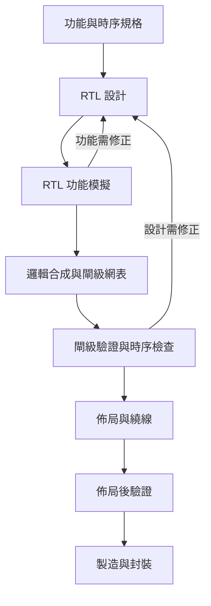
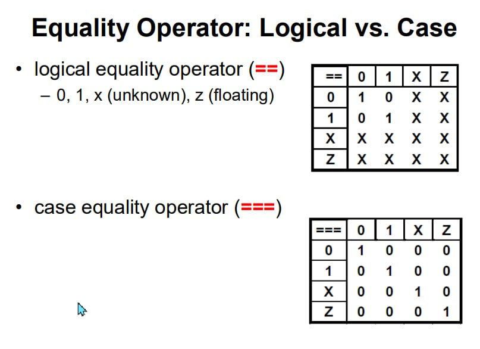
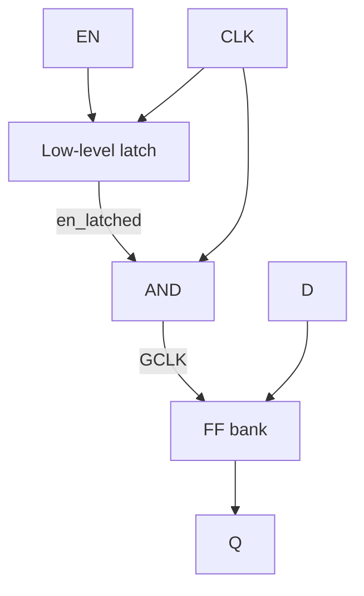
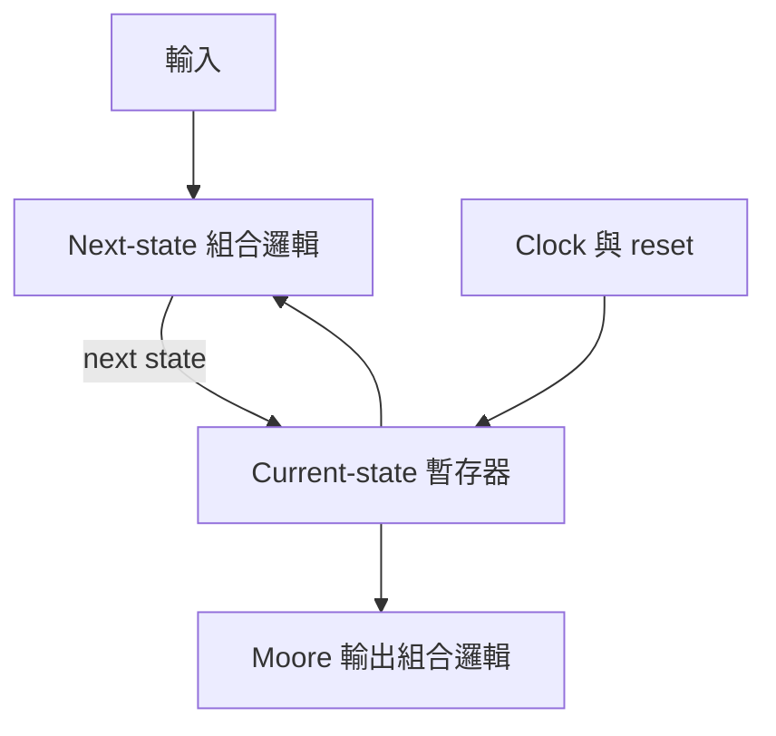

# 硬體描述語言期中考前總覽

[GPT 網址](https://chatgpt.com/g/g-p-6a9f9785bb048191a27bcde8a4ee2e4c-pecid-ying-ti-miao-shu-yu-yan/c/6ad85a07-9b24-83ee-8292-4cbb560b27da)


整理日期：2026-10-21。適用於本次附件中的 HDL 課程 ch00～ch03、期中複習投影片、七份逐字稿與考古題 A／B。程式以課堂使用的 **Verilog-2001** 為主；完整模組與局部片段會明確區分。

<a id="sec-0"></a>

## 0. 複習導航與範圍

### 0.1 這次要準備到什麼程度

老師在 10/20 複習說明中，將重點放在 **ch01、ch02、ch03**：同一個功能的三種 Modeling、程式對應的硬體、Clock 與 Reset、Pipeline／Clock Gating，以及 Signed、位寬、Overflow 和邊界情況。[T7, L121–129]

你的準備目標是：**看到規格能寫程式；看到程式能畫硬體；看到輸入能追出位元與每一拍輸出。** 只記住名詞，無法完成後面兩項。

| 複習層次 | 要掌握的內容 | 本文位置 |
|---|---|---|
| 第一層：必背與高優先核心 | 三種寫法、wire/reg、組合／時序、位寬與 Signed、Reset、NBA、Shift Register、Clock Gating、Pipeline | 第 1、3～7 章 |
| 第二層：會套用與變形 | Decoder／Encoder、Parity、ALU、LZC、Counter、FSM、參數化、Function、Dot Product | 第 4、8～9 章 |
| 第三層：補齊教材 | 設計流程、模擬與合成、Timing／Power、ROM／RAM、Testbench、較少出現的語法 | 第 2、7～9 章 |
| 考古題整合 | A 組六大題、B 組八大題的解法、計算答案與錯誤修正 | 第 10 章 |
| 考場最後檢查 | 易錯表、寫完程式後的檢查順序 | 第 11 章 |

以上是依老師強調與附件題型整理的**複習優先順序，不是本次考卷的配分預測**。10/20 口述提到移除部分 further practice，但附件複習檔仍包含 Encoder、Parity、ALU、LZC、FSM；本文保留這些內容，不自行判定它們不考。VHDL 在 10/06 逐字稿中明說不列入期中，因此不放入本文。[R, p.2、21–24、44–47；T7, L127–129；T5, L234–241]

### 0.2 怎麼讀最快

| 手上時間 | 閱讀方式 |
|---|---|
| 首次完整複習 | 先讀第 1 章建立骨架，再依第 2～9 章理解規則與範例，最後讀第 10 章把題目和模板連起來 |
| 已學過、剩半天 | 第 1 → 3 → 4 → 5 → 6 → 7 → 10 → 11 章；第 8～9 章補自己不熟的元件與參數化 |
| 考前最後一小時 | 第 1 章必背表、第 10 章各題關鍵答案、第 11 章易錯表；優先重看自己無法解釋原因的規則 |

文中寫「必背」是應能直接寫出或判斷；寫「理解」是要知道為什麼。完整程式已放在本文，不需要回原講義找程式。題目有特定埠名、位寬、Modeling、Reset 或指定 Primitive 時，考場仍須依題目調整。

### 0.3 來源與頁碼讀法

`[C1, p.19]` 代表講義 ch01 的投影片內頁碼；`[R, PDF p.31／頁33]` 代表該複習檔 PDF 第 31 頁、頁面印 33。`[A5.4]`、`[B8.2]` 是附件考古題的組別與題號。來源完整檔名列在第 12 章，引用只是供追溯，正文已包含複習所需內容。

### 0.4 章節快速跳轉

| 章節 | 內容 |
|---|---|
| [1. 考前必背總表](#sec-1) | 關鍵字、公式與最容易失分的判斷 |
| [2. 硬體觀念與基本語法](#sec-2) | 流程、Module、Ports、wire／reg、Parameter |
| [3. 運算子、位寬與 Signed](#sec-3) | 數字、四態、延伸、截位、Overflow、Shift |
| [4. 三種 Modeling 完整模板](#sec-4) | Adder、RCA、MUX、Decoder、Rotate |
| [5. Behavioral 與硬體推論](#sec-5) | Latch、Sensitivity、if／case、NBA、Race |
| [6. FF、Reset 與 Shift Register](#sec-6) | 四種 Reset、事件表、參數化移位暫存器 |
| [7. Clock Gating、Pipeline 與 Timing](#sec-7) | 安全 Gate、MAD、資料對齊、Setup／Hold、PPA |
| [8. 常用元件與 FSM](#sec-8) | Encoder、Parity、ALU、LZC、Counter、FIR、Memory |
| [9. Loop、Function、Task 與 Testbench](#sec-9) | 內積、Automatic、模擬控制、Delay |
| [10. 兩組考古題完整解答](#sec-10) | A1～A6、B1～B8，含每個小題 |
| [11. 易錯表與考場檢查](#sec-11) | 修正講義／原答，最後作答檢查 |
| [12. 來源與核對紀錄](#sec-12) | 完整檔名、涵蓋範圍、程式驗證 |

---

<a id="sec-1"></a>

## 1. 考前必背總表

### 1.1 最重要的三列

| 你要描述的東西 | 課堂標準寫法 | 左側宣告 | 指派 | 硬體意義 |
|---|---|---|---|---|
| 組合邏輯，Dataflow | `assign y = expr;` | `wire` | continuous assignment 的 `=` | 輸入變化後，輸出隨組合邏輯改變 |
| 組合邏輯，Behavioral | `always @(*) begin ... end` | `reg` | Blocking `=` | 所有路徑均賦值時，描述組合邏輯 |
| 正緣觸發的暫存器 | `always @(posedge clk) q <= d;` | `reg` | Nonblocking `<=` | 在有效時脈邊緣取樣並保存資料 |

**`reg` 是語言中的變數型別；真正的儲存硬體，要看何時更新、何時必須保留舊值。** `always @(*)` 不會自動保證沒有 Latch；還要檢查賦值是否完整。[C1, p.19；C2, p.2–7；R, p.7、25]

### 1.2 看到關鍵字，立刻想到什麼

| 關鍵字／題目線索 | 立即聯想 |
|---|---|
| Structural | Gate primitive 或子模組 instance；把線接對；不能在執行中的 `always` 內實體化模組 |
| Dataflow | `assign`、運算式、`?:`；左側通常 `wire` |
| Behavioral | `always`／`initial` 裡的程序敘述；左側變數要可作 procedural assignment |
| `bufif1` | `(out, in, control)`；control=1 傳資料，=0 輸出 Z |
| `parameter` | Elaborate 時確定的常數；每個 instance 可有不同設定；不是 runtime input |
| `genvar` + `generate for` | Elaborate 時展開多份硬體 |
| 組合 block 少一路賦值 | 輸出須保留舊值，可能推得 Latch |
| Clocked block 的 `if (en)` 沒 `else` | DFF 保持；通常可理解為輸出回授 MUX／clock enable |
| `posedge clk or negedge rst_n` | 正緣 DFF、低有效非同步 Reset |
| `posedge clk` 且內部 `if (!rst_n)` | 正緣 DFF、低有效同步 Reset |
| `<=` | 執行到該行時先算 RHS，稍後於 NBA 更新 LHS；不是等到下一個 clock 才更新 |
| `wire signed` | net 型別與數值 signedness 是兩件事；wire 也能 Signed |
| `{a,b}`、`{N{a}}` | 串接、重複；不是算術相加 |
| `>>>` | 左運算元／相關運算式是 Signed 才能補符號位；不能只看接收端宣告 |
| `clk & en` | AND 接在 clock 路徑；en 在高相位變動會破壞 clock 脈衝 |
| Pipeline | 保存同一筆資料的中間結果與旁路資料／控制旗標；逐拍檢查對齊 |
| Moore／Mealy | Moore：輸出只由目前狀態決定；Mealy：目前狀態＋輸入 |

來源：[C1；C2；C3；R, p.4–10、25–35、44–47]。細部條件與例外在各章說明。

### 1.3 必背公式

| 項目 | 公式／規則 |
|---|---|
| N-bit Unsigned 範圍 | $0\sim2^N-1$ |
| N-bit Two's Complement 範圍 | $-2^{N-1}\sim2^{N-1}-1$ |
| 負的 Two's Complement 值 | 無號解讀值減 $2^N$ |
| Sign extension | 複製原最高位；Zero extension 補 0 |
| 完整 N-bit＋N-bit 加法 | 最多需要 N+1 bits；保留 carry 時先擴展 |
| 完整 M-bit×N-bit 乘法 | 最多需要 M+N bits |
| 同寬 Signed 加法 Overflow | 兩輸入同號，截斷結果異號：`(a[N-1]==b[N-1]) && (s[N-1]!=a[N-1])` |
| Full Adder | `s=a^b^ci`；`co=(a&b)\|(a&ci)\|(b&ci)` |
| 減法 | $a-b=a+\sim b+1$，須在明確相同位寬中運算 |
| Even parity bit | `p = ^data`，讓 `{data,p}` 的 1 總數為偶數 |
| N 個狀態的 Binary encoding | 至少 $\lceil\log_2 N\rceil$ bits；One-hot 通常 N bits |
| N-bit LZC 計數器位寬 | 要表示 0 到 N，因此至少 $\lceil\log_2(N+1)\rceil$ bits |
| Setup 檢查，忽略 skew／jitter | $T_{clk}\ge t_{cq,max}+t_{comb,max}+t_{setup}$ |
| Hold 檢查，同上 | $t_{cq,min}+t_{comb,min}\ge t_{hold}$ |
| Setup slack | `required time - arrival time`；≥0 為滿足 |
| 頻率換算 | $f_{max}[\mathrm{MHz}]=1000/T_{min}[\mathrm{ns}]$ |
| 動態切換功耗的概念式 | $P_{switch}\propto\alpha C V^2 f$；活動率降低通常可降低此部分功耗 |

來源：[C1, p.90–93；C2, p.27–29；C3, p.12–16、57、71；R, p.11–12、22、24、36–43；CG, p.30]。Timing 與功耗的前提、作業中不同 Latency 定義見第 7 章。

### 1.4 五個最容易失分的判斷

1. **Carry 不等於 Signed overflow。** `0111+0001=1000` 有 Signed overflow，卻沒有第 5 位 carry。
2. **高有效／低有效，和同步／非同步是兩條獨立軸。** 不可把低有效自動當成非同步。
3. **同一 edge、全用 NBA 更新的暫存器鏈，後級讀前級舊值。** 有四級暫存器時，不能一拍全部灌到底。
4. **Clock 關閉只代表保持。** 若規格要求 `c=0` 時輸出 0，要有與該筆資料對齊的零值選擇／控制。
5. **同一數學式，不保證位元運算等價。** 中間訊號若先截斷、Signedness 不同，結果就可能不同。

---

<a id="sec-2"></a>

## 2. 硬體觀念、設計流程與 Verilog 基本語法

### 2.1 先建立正確觀念：Verilog 描述一個持續存在的電路

**寫 Verilog 時，要先問「有哪些元件、線怎麼接、什麼時候取樣」，再問程式怎麼寫。** Software（軟體）通常由處理器依序執行指令；HDL（硬體描述語言）則用程式描述同時存在、互相連接的硬體。Module instance、不同 `assign`、不同 `always` block 都具有並行性；同一個 procedural block 內仍須依語句與 assignment（賦值）規則理解先後。[C0, p.19、27；C1, p.6、18–19、100]

```verilog
wire [7:0] a, b, c;
wire [15:0] y;

assign c = a + b;
assign y = c * 8'd3;
```

這描述加法結果接到乘法運算。`a` 或 `b` 改變後，變化會經 `c` 傳到 `y`，直到電路穩定。交換這兩條 `assign` 的書寫順序，穩定功能不變；**並行不會消除資料相依，也不是永遠拿「舊 c」計算。** 另一方面，這裡 `c` 只有 8-bit，因此先在 `c` 截斷高位，再乘 3；如果要保留完整加總，必須先把 `c` 擴成 9-bit。硬體的連接與位寬都會影響答案。[C1, p.92–93、100、142–143]

#### 2.1.1 Combinational 與 Sequential

| 類型 | 輸出取決於什麼 | 是否保存狀態 | 常見電路 |
|---|---|---|---|
| Combinational logic（組合邏輯） | 目前的輸入 | 不保存過去的值 | Adder、MUX、decoder、比較器 |
| Sequential logic（循序邏輯） | 目前輸入與先前保存的狀態 | 有 storage element（儲存元件） | DFF、register、counter、FSM |

**「組合」不等於沒有延遲；「循序」也不等於程式由上到下執行。** 組合電路在真實硬體有 propagation delay（傳播延遲），但沒有為了保存前一筆資料而設的狀態。循序電路有 latch 或 flip-flop，能讓資料跨時間保存。[C0, p.14；C1, p.17、27–30]

生活例子：組合電路像即時計算機，輸入變了，答案經過運算時間跟著變；register 像按下快門後保存的照片，下一次取樣前都保持原值。

### 2.2 三種 Modeling 必背對照

**同一個功能可以用三種 modeling style（建模方式）描述。** 差別在描述角度，不是功能一定不同。老師在 0908、0922 課堂明確提醒：期中可能要求用紙筆把同一功能寫成三種版本，必須會 gate primitive 的呼叫方式與接線。[T1,「用三種不同 modeling technique 分別寫出來」段；T3,「in our midterm exam」與「用紙筆把這個東西寫出來」段]

| 方式 | 你在描述什麼 | 代表語法 | 本課程 Verilog 常用 LHS 型別 |
|---|---|---|---|
| Structural modeling（結構式） | 哪些元件、元件之間如何接線 | `and g0(y,a,b);`、module instance | `wire` |
| Dataflow modeling（資料流式） | 輸入與輸出的持續運算關係 | `assign y = a & b;` | `wire` |
| Behavioral modeling（行為式） | 在事件／條件下，變數如何更新 | `always @(*)`、`if`、`case` | `reg` |

Behavioral 還要分成兩種常用模板：[C1, p.18–19]

```verilog
// 組合邏輯：每個輸出在每種情況都有賦值
always @(*) begin
    y = a & b;
end

// 循序邏輯：在時脈正緣取樣
always @(posedge clk) begin
    q <= d;
end
```

**考前記法：** `assign → wire`；`always @(*) → reg、blocking =、完整賦值`；`always @(posedge/negedge clk) → reg、nonblocking <=`。這是課程採用的清楚寫法；是否產生 FF，仍須看事件控制及保存行為，不能只看到 `reg` 或 `<=` 就認定有 FF。

### 2.3 RTL、Simulation、Synthesis、P&R 各做什麼

來源：[C0, p.12、17–18、28、30–35]

| 階段／名詞 | 核心目的 | 你應能回答的問題 |
|---|---|---|
| Specification（規格） | 決定功能、I/O、位寬、時序、限制 | 電路到底要做什麼？ |
| RTL（Register Transfer Level，暫存器轉移層次） | 描述 register 與資料運算、控制關係 | 哪裡保存資料？兩級之間算什麼？ |
| Simulation（模擬） | 對指定 stimulus 觀察設計反應 | 這些輸入下，輸出與波形是否正確？ |
| Logic synthesis（邏輯合成） | 將可合成 RTL 映射到目標元件 | 這段 RTL 對應哪些邏輯元件？ |
| Gate-level netlist（閘級網表） | 列出 cell instances 與互連 | 元件與元件如何接在一起？ |
| STA（Static Timing Analysis，靜態時序分析） | 依路徑延遲及 constraints 檢查時序 | 是否符合 setup、hold 等時序限制？ |
| P&R（Placement and Routing，佈局與繞線） | 放置元件並安排實際連線 | 元件放哪裡？線怎麼走？ |

**Simulation 不會自動替你合成電路；Synthesis 成功也不等於功能已驗證。** 能在 testbench 跑的語法，不一定能映射成目標硬體；例如螢幕顯示、檔案操作、任意 `#10` 模擬延遲，不是一般 ASIC RTL 的硬體功能。

ASIC 的主要流程可這樣理解：



這些節點代表不同層次：RTL 描述功能與狀態；合成後看元件及其接線；佈局後還要考慮實際放置與繞線的影響。因此，同一個 testbench 可在不同設計階段檢查功能，但延遲、輸出觀察時間與相關模型必須配合該階段。[C0, p.30、33]

#### 2.3.1 ASIC 與 FPGA

| 比較 | ASIC（Application-Specific Integrated Circuit） | FPGA（Field-Programmable Gate Array） |
|---|---|---|
| 目標 | 針對特定需求製作晶片 | 配置既有可程式化晶片 |
| 映射資源 | 製程相關 standard-cell library 等 | 晶片既有的 logic、register、memory、routing resources |
| 實體實作 | 形成新晶片佈局並交付製造 | 在既有晶片資源內 placement/routing，再載入配置 |
| 修改硬體功能 | 已製造固定邏輯不能靠重新燒錄任意改線 | 可重新配置受支援的硬體功能 |

**FPGA 不必為每個設計重新製造晶片，但仍有 placement/routing。** 課堂口語「不用 layout」應理解為不用替新 ASIC 製作製造佈局，不能背成 FPGA 沒有實體資源配置。[C0, p.15、30、35]

#### 2.3.2 PPA 與合成結果

**PPA = Power（功耗）、Performance（效能）、Area（面積）。** 同一份 RTL，使用不同 library、timing/area constraints，可能得到不同 gate-level 實作。`assign s=a+b;` 描述加法功能，並沒有直接指定一定是 Ripple Carry Adder 或 Carry Lookahead Adder。[C0, p.34、36；C1, p.22、153；T1,「PPA is the metric」段]

看見程式中寫了兩次 `+`，也不能直接保證最後一定有兩顆獨立加法器：工具可能做共享或最佳化。考試畫概念電路時，先畫語法對應的組合邏輯、MUX 與儲存元件；若題目問「最後合成的面積」，還需要具體工具結果。

### 2.4 Module 的完整骨架與接線

本總覽以本課程使用的 Verilog 寫法為主。`module` 後先寫 module 名稱，再寫參數與 ports，最後一定用 `endmodule` 結束。[C1, p.20、107–110]

```verilog
module bit_and #(parameter N = 8) (
    input  [N-1:0] a,
    input  [N-1:0] b,
    output [N-1:0] y
);
    assign y = a & b;
endmodule
```

逐項解讀：`bit_and` 是元件種類名稱；`N` 決定位寬；`a、b` 是輸入，`y` 是輸出；`[N-1:0]` 共 N 個 bit。輸出由 `assign` 驅動，採 net，沒有寫 `wire` 時這裡的 output 預設為 wire。

#### 2.4.1 Named 與 Positional connection

```verilog
wire [7:0] a_bus, b_bus, y_bus;

// Named connection：.子模組port名稱(外部訊號)
bit_and #(.N(8)) u_and (
    .a(a_bus),
    .b(b_bus),
    .y(y_bus)
);

// 同樣接線的 positional 寫法如下；使用時擇一，不要重複驅動 y_bus。
// bit_and #(8) u_and (a_bus, b_bus, y_bus);
```

`u_and` 是這顆 instance 的名稱。Named connection 可以調整 `.a/.b/.y` 的書寫順序；positional connection 必須依 module 宣告順序。**Module instance 是在這裡放一顆元件，不是像軟體 function call 一樣執行完便消失。** 放兩個 instances，就描述兩份硬體，之後工具仍可能依可觀測行為做最佳化。[C1, p.110–111]

#### 2.4.2 Primitive 的腳位順序

```verilog
and    g0(y, a, b);        // output, input, input
not    g1(n_a, a);         // output, input
buf    g2(y_buf, a);       // output, input
bufif1 g3(bus, data, en);  // output, input, control
```

**Built-in gate primitive 的 output 在前。一般 module 的順序則由它自己的宣告決定。** `bufif1` 在 `en=1` 時驅動 data，在 `en=0` 時輸出 `z`；`bufif0` 相反，為低有效。`notif1/notif0` 是有條件的反相驅動。[C1, p.118]

### 2.5 `wire`、`reg`、Vector、Array

#### 2.5.1 `wire` 與 `reg` 的真正差別

來源：[C1, p.18–19、87、108–109]

| 宣告 | 主要語意 | 課程典型用途 | 不能誤背成 |
|---|---|---|---|
| `wire` | net（連線），值由 driver 驅動 | `assign`、gate output、接收子模組輸出 | 只能接不能有邏輯 |
| `reg` | procedural variable（程序變數） | `always/initial` 裡被賦值的變數 | 一定是一顆 FF |

以下都宣告 `reg q`，但電路不同：

```verilog
always @(*) q = a & b;             // 完整賦值：組合邏輯
always @(*) if (en) q = d;         // 沒有 en=0 賦值：latch
always @(posedge clk) q <= d;      // clock edge 取樣：DFF
```

這三行是**三個互相替代的範例**，不能把它們一起放進同一個 module 驅動同一個 q。判斷硬體的關鍵是「什麼事件使它更新、其他時候是否需要保留」，不是變數取名 `q` 或宣告 `reg`。

傳統 Verilog 的 port 接線可記成：[C1, p.108]

| Port | 子模組內 | 外部如何連接 |
|---|---|---|
| `input` | net | 可接外部的 wire 或 reg 作為來源 |
| `output` | 依驅動方式為 wire 或 reg | 上層以 wire 接收 |
| `inout` | net | 兩側都用 net |

這張表針對本課程傳統 Verilog；不要將 SystemVerilog 的 `logic` 用法直接混入這裡的型別限制。

#### 2.5.2 Vector 的位數與索引

```verilog
wire [7:0]   bus;     // 8-bit，bus[7] 是 MSB，bus[0] 是 LSB
reg  [0:7]   rev;     // 仍是 8-bit，但 rev[0] 是 MSB
reg  [255:0] data;    // 256-bit
```

**位數 = |左索引 − 右索引| + 1；宣告左邊那端是 MSB。** MSB（Most Significant Bit）是數值權重最高位，LSB（Least Significant Bit）是最低位；不能只看「索引比較大」來判斷。[C1, p.88]

```verilog
data[7]       // bit-select，選 1-bit
data[31:24]   // part-select，選 8-bit
data[24 +: 8] // 從 index 24 向 index 增加方向選 8-bit
data[31 -: 8] // 從 index 31 向 index 減少方向選 8-bit
```

對 `reg [255:0] data`，最後三種都得到 `data[31:24]`。Indexed part-select 的起點可以是變數，**選取寬度必須固定**；例如 `data[i*8 +: 8]` 可選不同 byte，但不能把 `8` 換成任意 runtime 寬度。[C1, p.88]

#### 2.5.3 Array 與 Memory

```verilog
reg [7:0] mem [0:15];
```

前面的 `[7:0]` 決定每個元素是 8-bit；後面的 `[0:15]` 決定有 16 個元素。因此總容量為 **16 × 8 = 128-bit**，`mem[3]` 取得第 3 號的整個 8-bit word。`reg [7:0] mem[0:1023]` 則為 1024 bytes，也就是 8192 bits。[C1, p.94]

**Array 宣告不保證合成後就是一塊 SRAM。** 可能映射成 FF、平台支援的記憶體或其他結構，要看 RTL 讀寫模式、平台及工具。課程因此介紹 Memory Compiler，避免大容量儲存都以大量 FF 實現。

傳統 Verilog module ports 可用 packed bit-vector，例如 `input [31:0] d`；不能直接套用 SystemVerilog 的 unpacked array port 語法。需要傳入四個 8-bit 資料時，可攤平成 32-bit 再切片：[C1, p.112–114]

```verilog
wire [31:0] in_flat;
wire [7:0] d0, d1, d2, d3;
assign {d3, d2, d1, d0} = in_flat;
```

### 2.6 `parameter`、`localparam`、Macro 與 Elaboration

**Parameter 是建構電路前決定的常數，不是可以隨 clock 改變的輸入。** Elaboration（展開）會根據參數建立 instances、位寬與 generate 結構；模擬執行時，這些結構已經決定。[C1, p.95、124–126]

```verilog
module example #(parameter W = 8) (
    input  [W-1:0] d,
    output [W-1:0] y
);
    localparam DOUBLE_W = 2 * W;
    assign y = d;
endmodule

// 建立時決定這一顆的 W=16
// example #(.W(16)) u_example (...);
```

| 寫法 | 意義 | 能否由 instance 覆寫 | 取值時間 |
|---|---|---|---|
| `parameter W=8` | 模組參數常數 | 可以，常用 `#(.W(16))` | Elaboration |
| `localparam K=2*W` | 模組內部常數 | 不可直接由 instance 覆寫 | Elaboration |
| `` `define WIDTH 8`` | 前處理器文字替換 | 不是同一種 instance 參數機制 | Preprocessing |
| `input [3:0] sel` | 真正的電路輸入 | 由外部訊號驅動 | Runtime 可改變 |

Macro 使用時要有反引號：

```verilog
`define WIDTH 8
wire [`WIDTH-1:0] bus;
```

**`parameter` 與 `` `define`` 都能提供常數，但不是同一種東西。** 前者有模組作用域、可讓不同 instances 使用不同參數；後者是文字替換。`localparam` 常用來定義 state encoding 或由其他參數推算的內部寬度。課程也介紹 `defparam`，但建議優先使用 instance 旁的 `#(.名稱(值))`，連同用途一起看較清楚。[C1, p.67–68、95；C1, PDF p.93–95]

**Generate 的核心：在 elaboration 產生硬體，不是在每個 clock 跑一次。** 產生 N 顆 Full Adder 串起來，仍是一條 N-bit 組合進位鏈；只有加入 clocked registers，才形成跨多個 clock 的資料傳遞。[C1, p.123–127]

---

<a id="sec-3"></a>

## 3. 運算子、位寬與 Signed 數值

### 3.1 每次計算都先寫三件事

**同一串 bits，可能因位寬與 signedness 不同，代表完全不同的數值。** 解題前先寫：①幾個 bit；②signed 還是 unsigned；③完整結果要幾個 bit、最後存在哪個寬度。這三件事沒有確認，先做十進位運算很容易掉進陷阱。[C1, p.84、90–93]

例如 `4'b1010`：當 unsigned 讀是 10；當 4-bit two's complement（2 的補數）讀是 −6。這兩種解釋的 bits 一樣，只有解讀規則不同。

### 3.2 數字 Literal 與四態值

#### 3.2.1 數字寫法

```text
<位數>'[s]<進位制><數字>
```

| Literal | 位數／解讀 | 值或 pattern |
|---|---|---|
| `4'b1010` | 4-bit binary，未標 signed | unsigned 10 |
| `4'sb1010` | 4-bit signed binary | −6 |
| `8'hA5` | 8-bit hexadecimal | `1010_0101`，unsigned 165 |
| `8'd10` | 8-bit decimal | `0000_1010` |
| `6'o17` | 6-bit octal | `00_1111`，unsigned 15 |
| `2'd11` | 十進位 11 截成 2-bit | `11`，即 unsigned 3 |

**`b/d/h/o` 決定後面的字串用什麼進位制讀，不會替你增加前面指定的 bit 數。** `_` 只方便閱讀，不改變數值。`8'b1010_0101` 與 `8'b10100101` 相同。數字中的單引號 `'` 與 compiler directive 的反引號 `` ` `` 不同。[C1, p.83–84]

沒有寫尺寸的普通十進位常數如 `1`，通常會引入至少 32-bit 的 signed 整數語意。考試手寫硬體運算時，**盡量明寫必要位寬及 signedness**，例如 `1'b1`、`8'd1`、`16'sd32`，避免無意影響整個 expression。

#### 3.2.2 0、1、X、Z

| 值 | 意義 | 常見來源 |
|---|---|---|
| `0` | 確定的邏輯低 | 已知輸入／運算結果 |
| `1` | 確定的邏輯高 | 已知輸入／運算結果 |
| `x` | Unknown（未知） | 未初始化、無法判定、相同強度衝突等 |
| `z` | High impedance（高阻抗、不驅動） | tri-state 停用、沒有 driver 的 net 等 |

**X 不是隨機選 0 或 1；Z 也不是 0。** X 表示模擬器無法決定邏輯值，Z 表示這一路不在驅動。沒有初始化的 `reg` 通常起始為 X；無驅動的 `wire` 通常是 Z。真實硬體不會輸出一個叫做字母 X 的電壓；X 是模擬中的不確定表示。[C1, p.85–87]

### 3.3 運算子總表：先看幾個 Operand、結果多寬

來源：[C1, p.77–83、145–149]

| 類別 | Operators | 核心規則 |
|---|---|---|
| Arithmetic（算術） | `+ - * / % **` | 加減乘除、餘數、次方；需檢查位寬、signedness |
| Relational（大小比較） | `< <= > >=` | 結果 1-bit，signed/unsigned 決定如何比較 |
| Logical equality（邏輯相等） | `== !=` | 結果 0、1 或 X |
| Case equality（四態完全比較） | `=== !==` | 連 X/Z 都比較，結果一定 0 或 1 |
| Logical（邏輯） | `! && \|\|` | 把整個 operand 看成真假，結果 1-bit |
| Bitwise（逐位元） | `~ & \| ^ ~^ ^~` | 逐 bit NOT、AND、OR、XOR、XNOR |
| Reduction（縮減） | `& ~& \| ~\| ^ ~^ ^~` | 對單一 vector 全部 bits 運算，結果 1-bit |
| Shift（移位） | `<< >> <<< >>>` | 移動 bits，補位及 signedness 有差別 |
| Concatenation（串接） | `{a,b}` | 接成較長 vector，左 operand 放高位 |
| Replication（重複） | `{N{a}}` | 將 a 複製 N 次再串接 |
| Conditional（條件） | `cond ? a : b` | cond 真選 a，假選 b |

`<=` 要看位置：`if (a <= b)` 是「小於或等於」比較；`q <= d;` 是 nonblocking assignment。`=` 是 assignment，不是相等比較；判斷相等要用 `==`。

#### 3.3.1 `&`、`&&`、Reduction `&` 不同

令 `a=4'b1010`、`b=4'b1100`：

| Expression | 結果 | 原因 |
|---|---|---|
| `a & b` | `4'b1000` | 對應位置逐 bit AND |
| `a && b` | `1'b1` | a、b 都非零，所以兩者皆真 |
| `&a` | `1'b0` | `1 & 0 & 1 & 0 = 0` |
| `a \| b` | `4'b1110` | 逐 bit OR |
| `a \|\| b` | `1'b1` | 至少一個 operand 非零 |
| `\|a` | `1'b1` | a 中至少有一個 1 |
| `a ^ b` | `4'b0110` | 對應位元不同為 1 |
| `^a` | `1'b0` | a 有偶數個 1 |
| `~a` | `4'b0101` | 每個 bit 反相 |
| `!a` | `1'b0` | a 非零為真，邏輯 NOT 得假 |

**背法：兩個 operands 中間一個 `&` 是逐 bit；兩個 `&&` 是真假；放在單一 operand 前的 `&` 是把全部 bits 合成 1-bit。** OR、XOR 類似，但 Verilog 沒有「logical XOR `^^`」這個對應寫法。

X 不一定使所有運算結果都未知。例如 `1'b0 & 1'bx = 0`，因為 AND 只要有確定的 0，結果就確定；`1'b1 | 1'bx = 1`。反之 `1'b1 & 1'bx = x`。[C1, p.85–86；運算規則]

#### 3.3.2 優先序：最安全是把想先算的部分括起來

以下由高到低列主要層級；同列的二元運算應依語言的結合規則理解，考試不必用省括號挑戰可讀性。

| 優先層級 | Operators |
|---|---|
| 最高 | 括號內的 expression；bit/part select 等先形成 operands |
| Unary | 一元 `+ - ! ~` 與 reduction |
| Power | `**` |
| Multiply | `* / %` |
| Add | 二元 `+ -` |
| Shift | `<< >> <<< >>>` |
| Relational | `< <= > >=` |
| Equality | `== != === !==` |
| Bitwise AND | `&` |
| Bitwise XOR/XNOR | `^ ~^ ^~` |
| Bitwise OR | `\|` |
| Logical AND | `&&` |
| Logical OR | `\|\|` |
| Conditional | `?:` |

例如 `a & b == c` 會先做 `b == c`，不是先做 `a & b`。如果你想比對 AND 結果，寫 **`(a & b) == c`**。想表示 `(a+b)` 再右移，寫 **`(a+b) >> 1`**；想讓 b 右移再加 a，寫 **`a + (b >> 1)`**。條件運算也寫清楚巢狀括號，避免誤讀 MUX 選擇順序。[C1, p.145–146；E1, §12.3]

### 3.4 `==` 與 `===`：Testbench 為什麼常用 `!==`
/// danger | !==
來源：[C1, p.80–81、147–148]

| Expression | 結果 | 解釋 |
|---|---|---|
| `4'b1010 == 4'b1010` | 1 | 全部已知且相同 |
| `4'b1010 == 4'b1011` | 0 | 有確定不同位 |
| `4'b1x0z == 4'b1x0z` | X | 未知位使邏輯相等無法確定 |
| `4'b1x0z === 4'b1x0z` | 1 | 四態 pattern 完全一樣 |
| `4'b1x0z === 4'b1x0x` | 0 | 最後一位 z 與 x 不同 |
| `2'b0x == 2'b1x` | 0 | MSB 已經確定不同，不需知道 LSB |

最後一行是重要反例：**不能背成「只要含 X/Z，`==` 就一定是 X」；正確是「X/Z 使比較結論無法確定時，才得到 X」。**


///

Testbench 若寫：

```verilog
if (actual != expected)
    errors = errors + 1;
```

當比較結果是 X，`if` 不會把 X 當成 true，可能漏報未知輸出。若要求 output 與預期 pattern 必須完全一致，常用：

```verilog
if (actual !== expected)
    errors = errors + 1;
```

本課程將 `===/!==` 主要用於模擬驗證；在可合成設計中，依題目與工具支援使用一般邏輯條件，不把硬體的 X/Z 偵測當成普通數位比較器功能。

### 3.5 Unsigned 與 Two's Complement

#### 3.5.1 範圍公式必背

對 N-bit：[C1, p.90–92]

$$
\text{Unsigned range}=0\sim 2^N-1
$$

$$
\text{Signed range}=-2^{N-1}\sim 2^{N-1}-1
$$

4-bit unsigned 為 0～15，4-bit signed 為 −8～+7。Signed 的正負範圍不對稱，最負值 −8 沒有可用相同 4-bit 表示的正對應 +8。

對 `b[N-1:0]`，二補數數值為：

$$
-b_{N-1}2^{N-1}+\sum_{i=0}^{N-2} b_i2^i
$$

所以 4-bit `1010` = −8 + 0 + 2 + 0 = −6。另一種快速算法：若最高位為 1，先當 unsigned 算出 U，再算 **U−2^N**；1010 的 U=10，因此 10−16=−6。

| 4-bit pattern | Unsigned | Signed |
|---|---:|---:|
| `0000` | 0 | 0 |
| `0111` | 7 | 7 |
| `1000` | 8 | −8 |
| `1010` | 10 | −6 |
| `1111` | 15 | −1 |

#### 3.5.2 如何把負數寫成 bits

以 4-bit −5 為例：先寫 +5=`0101`，逐位反相成 `1010`，加 1 得 `1011`。檢查：unsigned 11−16=−5。**取反加一是在固定 N-bit 內操作，超過 N-bit 的進位捨去。**

```verilog
wire        [3:0] u;  // 預設 unsigned
wire signed [3:0] s;  // 明確 signed
```

`signed` 不會讓電路多一個「符號 bit」；4-bit signed 仍只有 4 bits，最高位改用負權重解讀。型別會影響擴寬、比較、右移等行為。

### 3.6 Extension、Truncation 與 Mixed Signedness

#### 3.6.1 Zero extension 與 Sign extension

來源：[C1, p.90–93]

| 操作 | 原始 4-bit | 擴成 8-bit | 保存的是什麼 |
|---|---|---|---|
| Zero extension（補零） | `1010` | `0000_1010` | unsigned 10 |
| Sign extension（補符號位） | `1010` | `1111_1010` | signed −6 |

```verilog
wire [3:0] a;
wire [7:0] zero_ext;
wire signed [7:0] sign_ext;

assign zero_ext = {4'b0000, a};
assign sign_ext = {{4{a[3]}}, a};
```

**負數擴寬時複製 sign bit，才能保持原本的數值。** 把 −6 的 `1010` 前面補 0，會變成 +10，不是「更寬的 −6」。正數的 sign bit=0，所以它的 sign extension 看起來與補零相同。

#### 3.6.2 截斷是丟 bits，不是保持原數值

```verilog
wire [7:0] wide;
wire [3:0] narrow;
assign narrow = wide[3:0];
```

這只保留低 4-bit。若原數值超出新型別範圍，截斷後的數值會變。例如 5-bit signed −9=`10111`，截成 4-bit `0111`，若再當 signed 讀，已經是 +7。**後面再 sign-extend 也只能保留 +7，無法找回已丟掉的 −9。**

Unsigned 保留低 N-bit 可用 `value mod 2^N` 檢查；若最後當 signed 讀，還要把最高位為 1 的結果解釋成負數。

#### 3.6.3 Signed 與 Unsigned 混用

**對本節的加減與大小比較，兩個 operands 中只要有一個 unsigned，就會採 unsigned 規則處理。** 因此「輸出宣告 signed」並不足以保證 RHS 運算已按 signed 進行。可靠做法是先把 operands 擴成需要的寬度，並讓它們都有預期 signedness，再運算。[C1, p.90–93；T3,「unsigned跟signed的訊號把它混在一起用」段]

```verilog
wire signed [3:0] a;
wire signed [7:0] b;
wire signed [8:0] a_ext, b_ext;
wire signed [8:0] sum_full;

assign a_ext = {{5{a[3]}}, a};
assign b_ext = {b[7], b};
assign sum_full = a_ext + b_ext;
```

先把兩個二補數 pattern 都正確擴成 9-bit，接到 signed 變數，再相加。這樣能保存本例完整結果，也能讓後續大小比較與 arithmetic shift 使用預期的 signed 規則。**先整理位寬與型別，再運算，比事後猜結果可靠。**

`$signed(x)` 與 `$unsigned(x)` 是**改變解讀型別，不會改變 x 的 bit pattern 或自動多補位**。例如 `$signed(4'b1111)` 是 4-bit −1；若希望某個 unsigned 數完整變成較寬的正 signed 數，要先補 0 再轉型，例如 `$signed({1'b0,u})`。[E2]

#### 3.6.4 Signedness 也會改變比較答案

/// danger|signed、unsigned 計算

假設 a 的 pattern 為 `4'b1111`，b 的 pattern 為 `4'b0001`：[C1, p.90–93；R, p.36]

| Operand 宣告 | 如何解讀 | `a < b` |
|---|---|---:|
| a、b 都 unsigned | 15 與 1 | 0 |
| a、b 都 signed | −1 與 +1 | 1 |
| a signed、b unsigned | 混合比較採 unsigned 規則 | 0 |

要保留兩邊原本的數值來比較，可以把 signed a 做 sign extension、unsigned b 做 zero extension，接到**相同較寬位數的 signed 變數**，再比較。不能只對任意 unsigned b 寫 `$signed(b)` 就說數值不變；例如4-bit unsigned15的 `1111`，一轉signed就成−1。先補成 `0_1111` 再當5-bit signed，才仍是+15。

///

### 3.7 考古題數值題：相同輸入，Unsigned 得 42、Signed 得 26

題目給 `a=4'b1010`、`b=8'b0010_0000`，兩者相加。先確認題目分別將**兩個 operands 都當 unsigned**或**兩個 operands 都當 signed**。本例最大結果未超出所用輸出範圍。[考古題 B1]

#### 3.7.1 Unsigned 版本

`a`=10，`b`=32。把 a 補零到 8-bit：

$$
0000\_1010 + 0010\_0000 = 0010\_1010
$$

結果 `0010_1010`=32+8+2=**42**。

#### 3.7.2 Signed 版本

4-bit signed `1010`=−6；8-bit signed `0010_0000`=+32。把 a sign-extend：

$$
1111\_1010 + 0010\_0000 \longrightarrow 0001\_1010
$$

保留 8-bit 的結果 `0001_1010`=16+8+2=**26**。原始十進位計算 −6+32 也等於 26，因此沒有 signed overflow。

| 情況 | a 的解讀 | 擴成 8-bit 的 a | b | 結果 |
|---|---:|---|---:|---:|
| 兩者 unsigned | +10 | `0000_1010` | +32 | 42 |
| 兩者 signed | −6 | `1111_1010` | +32 | 26 |

**錯誤來源不是「signed 加法器用另一套加法」；而是運算前的延伸與運算後的數值解讀不同。** 同樣寬度的低位加法仍遵循相同的二進位加法規則。

### 3.8 加法／乘法位寬、Carry 與 Overflow

#### 3.8.1 完整結果需要多寬

來源：[C1, p.92–93]

| 運算 | 要保留完整範圍的常用位寬 |
|---|---|
| N-bit unsigned + N-bit unsigned | N+1-bit |
| N-bit signed + N-bit signed | N+1-bit，先 sign-extend |
| N-bit + N-bit + 1-bit carry-in | N+1-bit |
| N-bit × M-bit | N+M-bit |

這張表是**數學上完整結果所需位寬**，不是說 Verilog 看到 `*` 就永遠自動產生 N+M-bit expression。Verilog expression 位寬還會受 operands、assignment context、concat/cast/中間變數等影響。考試最穩的方法是把需要的完整寬度明確寫出來。

例如 8-bit unsigned 最大值 255+255+1=511，需要 9-bit；255×255=65025，需要 16-bit。若 `(a+b)` 先被 8-bit 中間變數截斷，後面接到 16-bit output 也不會把丟掉的 carry 救回來。

#### 3.8.2 Carry-out 與 Signed overflow 完全不同

**Carry-out** 看加法是否從最高位再進一位；**Signed overflow** 看真正的數值是否超出 N-bit signed 可表示範圍。

| 4-bit 加法 | 4-bit 結果 | Carry-out | Signed overflow |
|---|---|---:|---:|
| `0111 + 0001`：7+1 | `1000`，signed −8 | 0 | 1，因 +8 超過 +7 |
| `1111 + 0001`：−1+1 | `0000`，signed 0 | 1 | 0，因真正結果0可表示 |
| `1101 + 0010`：−3+2 | `1111`，signed −1 | 0 | 0 |

表中的 carry 是對原始 N-bit bit patterns 相加時產生的第 N+1 位；它不是把 operands sign-extend 後「全精度 signed 結果的符號位」。

/// danger|Overflw


**Signed 加法 overflow 必背判斷：同號相加，結果變異號。**

```verilog
overflow = (a[N-1] == b[N-1]) && (sum[N-1] != a[N-1]);
```

- 正+正變負：positive overflow。
- 負+負變正：negative overflow。
- 一正一負相加：不會超出兩者原本共同的 signed 範圍。

若題目改成 subtraction，判斷是**兩輸入異號，差的 sign 與 a 不同**：

```verilog
overflow_sub = (a[N-1] != b[N-1]) && (diff[N-1] != a[N-1]);
```

上述判斷都假設 a、b、sum/diff 採相同 N-bit 二補數寬度。

///

#### 3.8.3 Saturation（飽和）與 Wrap-around（回捲）

4-bit signed 範圍是 −8～+7。直接截位的結果可能回捲；Saturation 會在超出範圍時，夾到最接近的邊界。[R, p.41]

| 真正運算 | 直接保留低4-bit | Saturation 結果 |
|---|---|---|
| 6+3=9 | `1001`，讀成−7 | `0111`，+7 |
| −6+(−5)=−11 | `0101`，讀成+5 | `1000`，−8 |

4-bit signed 的核心邏輯：

```verilog
// a、b、raw、y 皆為 signed [3:0]
always @(*) begin
    raw = a + b;
    overflow = (a[3] == b[3]) && (raw[3] != a[3]);
    if (overflow)
        y = a[3] ? 4'b1000 : 4'b0111;
    else
        y = raw;
end
```

若 overflow，a 的 sign 能指出原本相加的是兩個負數還是兩個正數，據此選最小值或最大值；沒有 overflow 時保留 raw。

### 3.9 Shift：補什麼、先截斷還是先移位

#### 3.9.1 四種 Shift 必背

來源：[C1, p.149–150；T4,「left shift, logical shift is totally identical」與「這一頁投影片其實我覺得有一點誤導」段；R, p.39–40]

| Operator | 方向 | 新空位填入 |
|---|---|---|
| `<<` | 左移 | 右側補0 |
| `<<<` | 左移 | 右側補0，同寬 bit 行為與 `<<` 相同 |
| `>>` | 右移 | 左側補0 |
| `>>>` | 右移 | 左 operand 為 signed 時補 sign bit，unsigned 時仍補0 |

**`>>>` 不是無條件補1；也不是只要 output signed 就能補 sign bit。** 要看正在被移位的左 operand 是不是 signed。**`<<<` 不會自動產生 overflow flag，`<<` 與 `<<<` 都可能丟失高位。** 原講義左移 overflow 敘述容易誤導，老師已在 0929 課堂指出該頁不適合作為判斷依據。

對固定寬度、可表示範圍內的非負整數，左移 k 位相當於乘 2^k；超出位寬時須考慮截斷。Signed arithmetic right shift k 位，等效於除以 2^k 後向負無限方向取整；例如 −9 `>>> 1` 得 −5，不能寫成 −4。[R, p.43]

#### 3.9.2 考古題 B2：16-bit 的 +32 與 −32 右移3位

題目使用 16-bit signed a=32、b=−32：[考古題 B2]

```verilog
reg signed [15:0] a, b;
// a = 16'sd32;
// b = -16'sd32;
```

先寫二補數：

- +32 = `0000_0000_0010_0000`。
- −32：把 +32 反相加一，得到 `1111_1111_1110_0000`。

| Expression | 16-bit 結果 | 解讀 |
|---|---|---:|
| `a >> 3` | `0000_0000_0000_0100` | +4 |
| `a >>> 3` | `0000_0000_0000_0100` | +4，正數sign bit本來是0 |
| `b >> 3` | `0001_1111_1111_1100` | **+8188**，左側補了3個0 |
| `b >>> 3` | `1111_1111_1111_1100` | **−4**，左側複製3個1 |

檢查 `b >> 3`：−32 的 16-bit pattern 若當 unsigned 是 65504；logical shift 後為 65504÷8=8188。檢查 `b >>> 3`：保留 signed 數值語意，−32÷8=−4。

如果同一題問左移3位，在這些值都未超出16-bit signed範圍的前提下：[C1, p.149]

| Expression | 結果 pattern | 數值 |
|---|---|---:|
| `a << 3`、`a <<< 3` | `0000_0001_0000_0000` | +256 |
| `b << 3`、`b <<< 3` | `1111_1111_0000_0000` | −256 |

#### 3.9.3 Part-select 與 Concatenation 的 Signed 陷阱

**Bit-select、part-select、concatenation 的結果是 unsigned，即使原變數是 signed。** 若你要截成較小的 signed 數後再 arithmetic shift，先存進 signed 變數，或明確轉型。[R, p.39–40]

/// danger|signed 和 Part-select

```verilog
reg signed [4:0] full_sum;
reg signed [3:0] narrow;
reg signed [4:0] arithmetic_right;
reg signed [3:0] trunc_then_shift;

always @(*) begin
    arithmetic_right = full_sum >>> 1;  // 11010 = -6
    narrow = full_sum[3:0];             // 0101 = 5 ,變成 unsigned 了
    trunc_then_shift = narrow >>> 1;    // 0010 = 2 
end
```

若 `full_sum=5'b10101`，表示 −11：

| 步驟 | 結果 | 數值 |
|---|---|---:|
| 直接 `full_sum >> 1` | `01010` | +10 |
| 直接 `full_sum >>> 1` | `11010` | −6 |
| 先存 `narrow=full_sum[3:0]` | `0101` | +5 |
| 再 `narrow >>> 1` | `0010` | +2 |

**先截斷、再移位，通常不等於先移位。** 兩條路徑在截位時可能已經變成不同的數值，因此不能把它們當成單純的語法替換。

///

### 3.10 串接、複製、Shift 與 Rotate

來源：[C1, p.83；R, p.19–20]

```verilog
{2'b10, 2'b01}       // 4'b1001
{4{1'b1}}           // 4'b1111
{{4{1'b1}},2'b01}   // 6'b111101
```

**Concat 的總位寬是各部分位寬相加；Replication 是重複次數乘以 operand 位寬。** `{4{a}}` 若 a 是 2-bit，結果是 8-bit，並非4-bit。

Shift（移位）會把移出邊界的 bits 捨去；Rotate（循環旋轉）會把它們接回另一端。例如4-bit `data=1001`：

| 操作 | Verilog 核心寫法 | 結果 |
|---|---|---|
| Logical left shift 1 | `data << 1` | `0010` |
| Logical right shift 1 | `data >> 1` | `0100` |
| Rotate left 1 | `{data[2:0],data[3]}` | `0011` |
| Rotate right 1 | `{data[0],data[3:1]}` | `1100` |

解 rotate 接線題時，不要只背整串式子：先列每個 `y[i]` 要從哪個 input bit 來，再接 MUX。例如向左旋轉時 `y[3]=data[2]`、`y[2]=data[1]`、`y[1]=data[0]`、`y[0]=data[3]`。

### 3.11 Fixed-point（定點數）用同一組 bits 表示小數

來源：[C1, p.91]

Fixed-point 是先約定 binary point（小數點）位置。硬體仍保存整數 bits，你把它解讀成「整數 × 2^−F」，其中 F 是小數位數。這不同於 floating-point（浮點數）的 exponent/mantissa 表示。

例：4-bit unsigned `1010` 若約定 F=2，解讀為10×2^−2=**2.5**；4-bit signed 同樣 `1010`、F=2，解讀為−6×2^−2=**−1.5**。

| N-bit、F個小數位 | 可表示範圍 | 最小間隔 |
|---|---|---|
| Unsigned | 0～2^(N−F)−2^−F | 2^−F |
| Signed | −2^(N−F−1)～2^(N−F−1)−2^−F | 2^−F |

**加減前先對齊 binary point；乘法結果的小數位數相加。** 例如兩個 F=2 的數相乘，完整乘積相對應 F=4。若要存回 F=2，必須依規格做移位與取位，並考慮範圍／精度；不能只把乘積丟進原寬度，就認為數值比例仍然一樣。

### 3.12 綜合手算：−5 + (−4)

這一題同時驗證 signed、extension、truncation、overflow、shift。設 a、b 都是4-bit signed，完整和使用5-bit signed。[R, p.42–43]

1. **寫原始 bits：** a=−5=`1011`，b=−4=`1100`。
2. **先擴寬再加：** a→`11011`，b→`11100`，5-bit和=`10111`，數值−9。
3. **截回4-bit：** `0111`，變成+7；兩個負數加出正數，signed overflow=1。
4. **在完整5-bit和上右移：** `>>1`→`01011`=+11；`>>>1`→`11011`=−5。
5. **先截成signed4-bit再移：** `0111`=+7，`>>>1`→`0011`=+3。

這裡有三個不同答案 +11、−5、+3，不是矛盾；它們分別執行「logical shift」、「完整 signed arithmetic shift」、「截斷後再 arithmetic shift」三種不同操作。

**數值題最後檢查：bit pattern、位寬、signed數值三者都寫出來；進位與overflow分開；中途任何截位都不能省略。**

### 3.13 把延伸、截斷、Overflow、移位放在同一份答案

以下將複習投影片的數值流程整合成一個完整的 Verilog-2001 behavioral module。a、b 都是 **4-bit signed**；先將兩者 sign-extend 成 5-bit，再相加得到完整和；接著截回 4-bit、判斷 signed overflow，最後分別計算三種右移結果。[R, p.37–40]

```verilog
module numeric4 (
    input signed [3:0] a, b,
    output reg signed [4:0] full_sum,
    output reg signed [3:0] sum4,
    output reg overflow,
    output reg [4:0] logical_right,
    output reg signed [4:0] arithmetic_right,
    output reg signed [3:0] trunc_then_shift
);
    always @(*) begin
        full_sum = {a[3], a} + {b[3], b};
        sum4 = full_sum[3:0];
        overflow = (a[3] == b[3]) && (sum4[3] != a[3]);
        logical_right = full_sum >> 1;
        arithmetic_right = full_sum >>> 1;
        trunc_then_shift = sum4 >>> 1;
    end
endmodule
```

**這段必須按順序使用 blocking `=`：** 後面的運算要讀到本次剛算出的 `full_sum`、`sum4`。所有輸出在每次執行時都有值，所以描述的是組合電路，沒有新增 FF 或 latency。`{a[3],a}`、`{b[3],b}` 明確保留延伸後的 5-bit 二補數圖樣；加總結果存入 signed `full_sum`。截位結果先存入 signed `sum4`，再對它做 `>>>`，避免直接對 unsigned part-select 移位。[R, p.25、37–40]

|a、b|full_sum：完整5-bit和|sum4：低4-bit|overflow|logical_right|arithmetic_right|trunc_then_shift|
|---|---|---|---:|---|---|---|
|−5、−4|`10111`，−9|`0111`，+7|1|`01011`，+11|`11011`，−5|`0011`，+3|

此處的 `overflow` 判斷「完整數學和能否放進 4-bit signed」，不是 5-bit 完整和的 carry-out；兩個 4-bit signed 數相加的範圍為 −16～+14，5-bit signed 足以完整保存。[R, p.38、42–43]

---

<a id="sec-4"></a>

## 4. 三種 Modeling 與組合電路必會模板

### 4.1 解題固定順序

先寫出 **I/O 名稱與位寬 → 真值表或數學式 → 指定 Modeling → 中間訊號 → 完整賦值 → 邊界檢查**。例如同樣是 MUX，題目若指定 `bufif1`，只寫 AND／OR 邏輯雖然對二值輸入功能相同，仍沒有完成指定的實作方式。[A1–A3；R, p.4–20]

以下完整模組的名字刻意不同，便於辨識。考卷若指定名稱就換成題目的名稱。三種版本是替代方案，不要把它們同時接到同一個輸出。

### 4.2 Half Adder 與 Full Adder

Half Adder（半加器）沒有 Carry-in：`s=a^b`、`co=a&b`。Full Adder（全加器）把 a、b、ci 三個 1-bit 值相加，用 `{co,s}` 兩位表示結果。

| a | b | ci | co | s |
|---:|---:|---:|---:|---:|
| 0 | 0 | 0 | 0 | 0 |
| 0 | 0 | 1 | 0 | 1 |
| 0 | 1 | 0 | 0 | 1 |
| 0 | 1 | 1 | 1 | 0 |
| 1 | 0 | 0 | 0 | 1 |
| 1 | 0 | 1 | 1 | 0 |
| 1 | 1 | 0 | 1 | 0 |
| 1 | 1 | 1 | 1 | 1 |

**Sum 是三輸入 XOR；Carry 是至少兩個輸入為 1。** 例如 1+1+1=3，所以 `{co,s}=2'b11`。[C1, Full Adder 相關頁；R, p.11]

#### 4.2.1 Structural Full Adder：Gate primitive

```verilog
module FA (
    output cout, sum,
    input x, y, cin
);
    wire xy, xc, yc;
    xor g0(sum, x, y, cin);
    and g1(xy, x, y);
    and g2(xc, x, cin);
    and g3(yc, y, cin);
    or  g4(cout, xy, xc, yc);
endmodule
```

Gate primitive 的第一個埠是輸出。這個 `FA(cout,sum,x,y,cin)` 的介面也用於下方 Ripple Carry Adder。

#### 4.2.2 Dataflow 與 Behavioral Full Adder

```verilog
module FA_df(output cout, sum, input x, y, cin);
    assign sum  = x ^ y ^ cin;
    assign cout = (x & y) | (x & cin) | (y & cin);
endmodule

module FA_bh(output reg cout, sum, input x, y, cin);
    always @(*) begin
        sum  = x ^ y ^ cin;
        cout = (x & y) | (x & cin) | (y & cin);
    end
endmodule
```

兩個 Half Adder 也能組成一個 Full Adder：第一個算 a+b，第二個算前一個 sum+ci，兩個 carry 再 OR。只有題目不需要 Carry-in 的最低位才可直接用 Half Adder。

### 4.3 N-bit Adder：三種完整寫法

規格：a、b、s 各 n bits，ci／co 各 1 bit，預設 n=16；功能是 `{co,s}=a+b+ci`。[A1；R, p.12–13]

#### 4.3.1 Dataflow

```verilog
module add_df #(parameter n=16) (
    input [n-1:0] a, b,
    input ci,
    output [n-1:0] s,
    output co
);
    assign {co,s} = {1'b0,a} + {1'b0,b} + ci;
endmodule
```

**為什麼先補 0？** 把兩個操作數明確變成 n+1 位，完整保留進位，寫法容易檢查。對此簡單賦值，Verilog 的左側位寬也會參與運算寬度，因此原題 `assign {co,s}=a+b+ci;` 並不必然漏 carry；顯式擴展讓意圖更清楚。

#### 4.3.2 Structural：n 顆 Full Adder 串接

```verilog
module add_str #(parameter n=16) (
    input [n-1:0] a, b,
    input ci,
    output [n-1:0] s,
    output co
);
    wire [n:0] carry;
    assign carry[0] = ci;
    assign co = carry[n];

    genvar i;
    generate
        for (i=0; i<n; i=i+1) begin : G_FA
            FA u_fa(carry[i+1], s[i], a[i], b[i], carry[i]);
        end
    endgenerate
endmodule
```

`carry` 需要 **n+1 個接點**：`carry[0]` 為初始 ci，`carry[n]` 為最後 co。第 i 顆吃 `carry[i]`、吐 `carry[i+1]`。這是同一條組合 carry chain，沒有 Clock，不是每顆花一個 Clock cycle。

#### 4.3.3 Behavioral

```verilog
module add_bh #(parameter n=16) (
    input [n-1:0] a, b,
    input ci,
    output reg [n-1:0] s,
    output reg co
);
    always @(*) begin
        {co,s} = {1'b0,a} + {1'b0,b} + ci;
    end
endmodule
```

檢查範例：n=8、a=250、b=10、ci=1，總和 261=256+5，所以 co=1、s=5。**不能因 Behavioral 裡宣告 reg，就在答案圖多畫 FF。**

### 4.4 題目指定「純 Procedural RCA」時

考古題 B5.1 要用 `always` 裡的 procedural 敘述描述 32-bit Ripple Carry Adder。為了呈現 RCA 架構，逐位計算 sum 與 carry；不要在 `always` 裡呼叫 `FA` instance，也不要只用一句 `S=A+B` 略掉題目要考的 carry chain。[B5.1；C2, p.62]

```verilog
module RCA32_beh (
    output reg Cout,
    output reg [31:0] S,
    input Cin,
    input [31:0] A, B
);
    reg [32:0] c;
    integer i;
    always @(*) begin
        c[0] = Cin;
        for (i=0; i<32; i=i+1) begin
            S[i] = A[i] ^ B[i] ^ c[i];
            c[i+1] = (A[i] & B[i]) |
                     (A[i] & c[i]) |
                     (B[i] & c[i]);
        end
        Cout = c[32];
    end
endmodule
```

**這裡必須依本模板用 Blocking `=`。** 第 i+1 次迭代要用本次已算好的 carry。`for` 所有迭代在一次觸發中完成，合成時形成組合邏輯；並非 32 拍運算。

B5.2 的 Structural 解答就是 §4.3.2 令 n=32，並依題目將埠改為 `Cout,S,Cin,A,B`、使用它給定的 FA 埠順序。

### 4.5 Carry Lookahead Adder 與加減共用

RCA 的長路徑來自 carry 必須逐級傳遞。Carry Lookahead Adder（CLA）先定義每位的 Generate／Propagate：

$$
g_i=a_i b_i,\qquad p_i=a_i\oplus b_i,\qquad c_{i+1}=g_i+p_i c_i
$$

此處乘號代表 AND，加號代表 OR。展開四位進位：

$$
\begin{aligned}
c_1&=g_0+p_0c_0\\
c_2&=g_1+p_1g_0+p_1p_0c_0\\
c_3&=g_2+p_2g_1+p_2p_1g_0+p_2p_1p_0c_0\\
c_4&=g_3+p_3g_2+p_3p_2g_1+p_3p_2p_1g_0+p_3p_2p_1p_0c_0
\end{aligned}
$$

最後 `s[i]=p[i]^c[i]`。**CLA 用更多平行 carry 邏輯縮短逐級等待；不是完全沒有延遲。** 實際面積與速度仍看映射結果。[C1, p.153；RCA 對照見 C3, p.12–15]

N-bit 加減共用的核心是 `a + (b ^ {N{sub}}) + sub`：sub=0 加 b；sub=1 加 ~b 再加 1。先決定中間寬度，以及結果是 Unsigned 模數值還是 Signed；carry／borrow／signed overflow 不能混為一個旗標。[HW2, p.1–2 的加減需求；此式由二補數減法推導]

### 4.6 MUX2：三種完整寫法

規格：s=0 選 in0；s=1 選 in1。[A2；R, p.5–8]

```verilog
module mux2_df(input in0, in1, s, output out);
    assign out = s ? in1 : in0;
endmodule

module mux2_bh(input in0, in1, s, output reg out);
    always @(*) begin
        if (s) out = in1;
        else   out = in0;
    end
endmodule

module mux2_tri(input in0, in1, s, output out);
    wire ns;
    not u_not(ns, s);
    bufif1 u0(out, in0, ns);
    bufif1 u1(out, in1, s);
endmodule
```

| s | u0 對 out 的驅動 | u1 對 out 的驅動 | out |
|---:|---|---|---|
| 0 | in0 | Z | in0 |
| 1 | Z | in1 | in1 |

兩個 tri-state buffer 同時存在，共用一條 `wire out`。不需要也不能用 runtime `if (out===z)` 來決定是否建立第二顆 buffer。Z 是高阻抗，不是 0。

若題目只指定一般 Gate Structural，可用：

```verilog
module mux2_gate(input in0, in1, s, output out);
    wire ns, t0, t1;
    not g0(ns, s);
    and g1(t0, in0, ns);
    and g2(t1, in1, s);
    or  g3(out, t0, t1);
endmodule
```

上述版本在 s 為 0／1 時有相同選擇功能。遇到 X／Z 時，`if`、`?:` 與 gate-level 模型的模擬結果可能不同；不能拿二值真值表宣稱它們的四值行為完全等價，見 §3 與 §5。

### 4.7 MUX4：16-bit 資料，三種完整寫法

| s | out |
|---|---|
| 00 | in0 |
| 01 | in1 |
| 10 | in2 |
| 11 | in3 |

#### 4.7.1 Dataflow：Nested conditional operator

```verilog
module mux4_df (
    input [15:0] in0, in1, in2, in3,
    input [1:0] s,
    output [15:0] out
);
    assign out = s[1] ? (s[0] ? in3 : in2)
                      : (s[0] ? in1 : in0);
endmodule
```

#### 4.7.2 Structural：三顆資料寬度為 16 的 MUX2

```verilog
module MUX2 #(parameter N=16) (
    output [N-1:0] out,
    input [N-1:0] in0, in1,
    input s
);
    assign out = s ? in1 : in0;
endmodule

module mux4_str (
    input [15:0] in0, in1, in2, in3,
    input [1:0] s,
    output [15:0] out
);
    wire [15:0] lo, hi;
    MUX2 #(.N(16)) u0(lo, in0, in1, s[0]);
    MUX2 #(.N(16)) u1(hi, in2, in3, s[0]);
    MUX2 #(.N(16)) u2(out, lo, hi, s[1]);
endmodule
```

低層兩顆用 `s[0]` 選同一組裡的前／後輸入；最後一顆用 `s[1]` 選低組／高組。**每顆 MUX2 必須處理完整 16-bit 資料**；若只有 1-bit MUX2，須每個 bit 各建一組。

#### 4.7.3 Behavioral：case

```verilog
module mux4_bh (
    input [15:0] in0, in1, in2, in3,
    input [1:0] s,
    output reg [15:0] out
);
    always @(*) begin
        case (s)
            2'b00: out = in0;
            2'b01: out = in1;
            2'b10: out = in2;
            2'b11: out = in3;
            default: out = 16'b0;
        endcase
    end
endmodule
```

記住：**module instance 要有名字**，如 `u0`；module 的位置式埠順序依其宣告，不像 gate primitive 有固定「輸出先」規定。題目若另給 MUX2 介面，要照它接。[A3；R, p.14–15]

### 4.8 2-to-4 Decoder：三種寫法

規格：en=0 時 y=0000；en=1 時 a 選出的那一位為 1。a=00／01／10／11 分別產生 y=0001／0010／0100／1000。[R, p.16–18；C3, p.9–11]

```verilog
module dec24_df(input en, input [1:0] a, output [3:0] y);
    assign y[0] = en & ~a[1] & ~a[0];
    assign y[1] = en & ~a[1] &  a[0];
    assign y[2] = en &  a[1] & ~a[0];
    assign y[3] = en &  a[1] &  a[0];
endmodule

module dec24_str(input en, input [1:0] a, output [3:0] y);
    wire n1, n0;
    not u0(n1, a[1]);
    not u1(n0, a[0]);
    and g0(y[0], en, n1, n0);
    and g1(y[1], en, n1, a[0]);
    and g2(y[2], en, a[1], n0);
    and g3(y[3], en, a[1], a[0]);
endmodule

module dec24_bh(input en, input [1:0] a, output reg [3:0] y);
    always @(*) begin
        y = 4'b0000;
        if (en) begin
            case (a)
                2'b00: y = 4'b0001;
                2'b01: y = 4'b0010;
                2'b10: y = 4'b0100;
                2'b11: y = 4'b1000;
                default: y = 4'b0000;
            endcase
        end
    end
endmodule
```

重點是**先把整個 y 清為 0**。只寫 `if(en) y[a]=1'b1;` 會讓其他位或 en=0 時的 y 留住前值，這就不是完整組合 Decoder。

### 4.9 Rotate4：三種寫法怎麼轉

規格：left=1 左旋一位；left=0 右旋一位。它是組合接線，沒有保存歷史樣本。[R, p.19–20]

```verilog
module rotate4_df(input [3:0] data, input left, output [3:0] y);
    assign y = left ? {data[2:0],data[3]}
                    : {data[0],data[3:1]};
endmodule

module rotate4_bh(input [3:0] data, input left, output reg [3:0] y);
    always @(*) begin
        if (left) y = {data[2:0],data[3]};
        else      y = {data[0],data[3:1]};
    end
endmodule

module rotate4_str(input [3:0] data, input left, output [3:0] y);
    mux2_gate u3(data[0], data[2], left, y[3]);
    mux2_gate u2(data[3], data[1], left, y[2]);
    mux2_gate u1(data[2], data[0], left, y[1]);
    mux2_gate u0(data[1], data[3], left, y[0]);
endmodule
```

這裡使用 §4.6 的 `mux2_gate(in0,in1,s,out)`。以 `1001` 為例：左移 `0010`、右移 `0100`、左旋 `0011`、右旋 `1100`。**Shift 丟掉移出的位元，Rotate 把它接回另一端。**

---

<a id="sec-5"></a>

## 5. Behavioral 與硬體推論

> **本章必背：組合邏輯 `always @(*)`＋blocking `=`＋每條路徑完整賦值；時序暫存器 `always @(posedge clk...)`＋nonblocking `<=`。`reg` 不代表一定有暫存器，`<=` 也不是單獨判定 Flip-Flop 的依據。** [C2, p6、11–24、36–42]

### 5.1 先分清楚「硬體同時存在」與「敘述如何執行」

Verilog 描述的是電路。Module instances（模組實體）、不同 `assign`、不同 `always` 都同時存在；原始碼寫在上面或下面，不表示硬體先做完上一塊才啟動下一塊。

但進入同一個 `begin ... end` 後，模擬器會按照敘述順序執行。這兩件事不衝突：可以把不同 `always` 想成不同工作桌，各桌同時工作；每張桌子自己的操作步驟，仍有先後順序。[C2, p4–10、79–82]

```verilog
always @(*) begin
    u = a & b;
    v = u | c;
end
```

這裡先用 `a`、`b` 算 `u`，再拿**剛算出的 `u`** 算 `v`。硬體是 AND 後接 OR 的組合路徑；兩行不代表兩個 clock cycles，也沒有因為 `u` 是 `reg` 就多出一級 Flip-Flop。

| 寫法 | 啟動與更新方式 | 常見用途 |
|---|---|---|
| `assign y = expr;` | RHS 改變時重新計算、持續驅動 LHS | Dataflow 組合邏輯 |
| `always @(*) ...` | 所讀訊號改變時重新執行程序 | Behavioral 組合邏輯或刻意描述的 Latch |
| `always @(posedge clk) ...` | 每次 clock 上升緣執行 | 上升緣觸發 Flip-Flop |
| `initial ...` | 模擬從 time 0 啟動，整個 block 只執行一次 | Testbench 初始化、刺激、結束控制 |
| `always #5 clk = ~clk;` | 每隔 5 個時間單位反轉一次、反覆執行 | Testbench clock；週期為 10 |

`initial` 與 `always` 沒有「initial 必定先做完」的全域保證。各程序各自開始；遇到 `@` 或 `#` 就等待。`always @(*)` 是等待所讀訊號的變化，不應把它當成保證自動在 time 0 執行一次的特殊初始化語法。沒有任何等待的 `always begin ... end` 可能一直卡在同一模擬時間。[C2, p7–10、31–38]

明列敏感清單時，`always @(a or b or sel)` 表示 a、b、sel **任一個**改變，就執行程序一次；這裡的 `or` 是事件清單分隔，不是先把三條線做 OR gate 再等結果。`@(posedge clk)` 等的是上升事件，`@(clk)` 則對 clock 的一般變化敏感，兩者不能互換來寫同一個 edge-triggered DFF。[C2, p33–37]

### 5.2 `wire`、`reg` 與硬體名稱不是一對一

本課程 Verilog 寫法中，`assign` 或 primitive／module output 驅動的連線通常宣告 `wire`；在 `always`／`initial` 中程序賦值的變數宣告 `reg`。`reg` 的語言意義是「程序變數會保留最後被賦予的值」，真正映射成什麼硬體，要再看更新條件。[C2, p6、11–12、18–24]

| RTL | 為什麼 | 推論的主要硬體 |
|---|---|---|
| `assign y = a & b;` | 輸出永遠由目前輸入決定 | AND 組合邏輯 |
| `always @(*) y = a & b;` | 每次都重新算出完整輸出 | AND 組合邏輯；`y` 雖是 `reg`，仍不是 FF |
| `always @(*) if (en) q = d;` | `en=0` 時需要記住先前 `q` | Level-sensitive Latch |
| `always @(posedge clk) q <= d;` | 只在上升緣擷取，其他時間保持 | D Flip-Flop |
| `always @(posedge clk) if (en) q <= d;` | 上升緣決定更新或保持 | 有 Clock Enable 的 DFF |

**判題順序：先看 event control，再看每條路徑是否賦值，最後追蹤 `=`／`<=` 的資料相依。** 不要只看到缺 `else` 就立刻寫 Latch：clocked block 缺 `else`，一般是原本的 Flip-Flop 保持內容。

### 5.3 漏敏感訊號與漏輸出賦值，是不同錯誤

#### 5.3.1 漏 Sensitivity List（敏感清單）

```verilog
always @(a)
    y = a & b;
```

`b` 明明影響結果，但沒有列入敏感清單。當 `a=1` 固定、`b` 從 0 變 1，RTL 模擬不會因為 `b` 改變而重跑，`y` 可能仍留在 0；綜合卻可能得到普通 AND gate，gate-level 結果會變 1。這是 **simulation/synthesis mismatch（模擬與綜合不一致）**。[C2, p35–37]

修正：

```verilog
always @(*)
    y = a & b;
```

#### 5.3.2 漏 Assignment（賦值路徑）

```verilog
always @(*) begin
    if (en)
        y = d;
end
```

敏感清單已經完整，但 `en=0` 時沒有指定新的 `y`。為了保留舊值，硬體需要儲存，因此推論 Latch。**加上 `@(*)` 只能處理敏感清單，不能自動補齊輸出。** [C2, p18、40–42]

若規格要 `en=0` 時輸出 0，可用下列兩種等價寫法：

```verilog
// 寫法 A：完整 if/else
always @(*) begin
    if (en) y = d;
    else    y = 1'b0;
end

// 寫法 B：先給預設值，再覆蓋特定條件
always @(*) begin
    y = 1'b0;
    if (en) y = d;
end
```

兩段是替代方案，不要同時拿來驅動同一個 `y`。若 block 有 `y`、`valid`、`carry` 三個輸出，就要**逐一**確保它們在每條路徑都有定義；不能只補 `y`。老師也明確承認「先設預設值」是合法避免 Latch 的寫法。[T5, 行211–227]

**`else y = y;` 不能修好本來不想要的 Latch。** 這句的意思仍然是「保留舊 y」；只是把儲存需求寫得更明白。如果規格要求純組合電路，所有輸出都必須由目前輸入、常數及本次已算出的中間結果決定，不能依賴前一次的 y。相對地，clocked FF 的 `q<=q` 是正常保持原有狀態，兩者要配合 event control 判讀。

若只更新 vector 的一部分，也要看其他 bit 是否被指定：

```verilog
always @(*) begin
    y = 8'b0000_0000;
    y[index] = 1'b1;
end
```

這是 Decoder 的常用形式：先清所有位元，再將選中的位元設成 1。若只寫 `y[index]=1'b1`，其他位元可能持續保留上一次的 1。[T6, 行205–209]

### 5.4 `if/else` 與 Priority（優先順序）

同一串 `if ... else if ... else`，只執行第一個成立的分支：

```verilog
always @(*) begin
    if      (req[3]) code = 2'd3;
    else if (req[2]) code = 2'd2;
    else if (req[1]) code = 2'd1;
    else            code = 2'd0;
end
```

`req=4'b1010` 同時有 bit 3 與 bit 1 為 1，結果仍是 3，因為 bit 3 的條件先成立。這就是 Priority Encoder 的行為。[C2, p40、51、54]

別把下面寫法誤認成同一件事：

```verilog
always @(*) begin
    code = 2'd0;
    if (req[3]) code = 2'd3;
    if (req[2]) code = 2'd2;
    if (req[1]) code = 2'd1;
end
```

這是三個獨立 `if`，可能執行多次，後面的 blocking assignment 會覆蓋前面結果。`req=1010` 時最後變成 1。**先確認哪些 `if` 是互斥分支、哪些是獨立敘述，再判斷誰的優先權較高。**

### 5.5 `case`、`casez`、`casex` 與 full／parallel

| 語法／術語 | 準確意義 | 考試注意點 |
|---|---|---|
| `case` | 逐 bit 比對，包含 X 與 Z | 正常二進位控制通常用它 |
| `casez` | Z／`?` 作為 wildcard | selector 與 case item 兩側的 Z 都會被忽略 |
| `casex` | X、Z／`?` 作為 wildcard | 可能把真實的未知狀態遮掉 |
| Full case | 所考慮的輸入條件都有對應行為 | 缺分支但先給 default assignment，仍可避免 Latch |
| Parallel case | 不同分支不重疊 | 若會同時符合多個項目，實際採第一個符合的項目 |

本課程建議 Priority Encoder 用明確 `if/else`，一般選擇器用 `case`。要認得 `casex/casez`，但不要把未知值 X 當成永遠可以任意取代的 0 或 1。[C2, p44–55；T5, 行267–300]

```verilog
always @(*) begin
    case (sel)
        2'b00: y = d0;
        2'b01: y = d1;
        2'b10: y = d2;
        2'b11: y = d3;
        default: y = 8'b0000_0000;
    endcase
end
```

這裡假設 `d0`～`d3`、`y` 都是 8-bit，`y` 為 `reg`。

**三個容易失分的細節：**

1. `default: $display("error");` 只印訊息，沒有指定 `y`。若有合法二進位條件沒涵蓋，就仍有保持舊值的路徑。
2. 2-bit selector 的 `00/01/10/11` 都有指定，二進位功能已完整；但模擬的 X/Z 狀況仍可能沒有符合項目。考試範本保留合理 `default` 較清楚。
3. `2'b11` 是二進位 3；`2'd11` 是十進位 11 再截成 2-bit，結果碰巧也為 `11`。這不能當成正確寫二進位常數的習慣。[C2, p46、48–56]

考題問 full／parallel 時，分成兩題回答：**覆蓋範圍夠不夠？同一輸入會不會同時符合兩個項目？** 這兩件事互相獨立。

| 條件安排 | Full？ | Parallel？ | 實際注意點 |
|---|---|---|---|
| `00、01、10、11` 各列一次 | 對二進位輸入是 | 是 | 一般 4-to-1 MUX |
| 只列 `00、01`，也沒有 default item | 否 | 是 | `10/11` 要看輸出是否先有預設值 |
| wildcard 項目 `1xxx、x1xx、xx1x` 加 default | 有 default 處理剩餘情況 | 否 | 多個 1 時按項目順序產生 priority |

這張表的 full 是在說 `case` 項目的覆蓋；**有沒有 Latch，最後仍須逐一檢查輸出的全部賦值路徑**。即使 case 項目不 full，若 block 一開始先令 `y=0`，未符合的情況也有 y=0；反之，`default` 只印錯誤訊息，便沒有提供輸出值。[C2, p46–51]

Wildcard 造成 priority 的例子：

```verilog
casex (req)
    4'b1xxx: code = 2'd3;
    4'bx1xx: code = 2'd2;
    4'bxx1x: code = 2'd1;
    default: code = 2'd0;
endcase
```

輸入 `1100` 同時符合前兩項，採第一項，所以 `code=3`。這個行為有明確規則，不是模擬器任意選一個；真正的風險是你可能誤以為分支互斥，或讓 X 被 wildcard 吞掉。

### 5.6 Blocking `=` 與 Nonblocking `<=`：用「何時讀、何時寫」理解

| 賦值方式 | 執行該敘述時 | 後續同 block 敘述讀到什麼 |
|---|---|---|
| Blocking `a = b;` | 算 RHS，當下更新 LHS，再做下一句 | 可以讀到剛更新的 `a` |
| Nonblocking `a <= b;` | 先算 RHS，把 LHS 更新排入 NBA 區域 | 在一般同 edge、全用 NBA 的暫存器鏈中，讀到更新前的 `a` |

NBA 是 **Nonblocking Assignment（非阻塞賦值）**。`<=` 不表示「下一個 clock 才更新」；沒有額外 delay 時，它在**同一模擬時間的較後排程區域**更新。多級 pipeline 之所以逐拍傳資料，是下一級在當次 edge 讀到上一級的舊值。[C2, p13–17、21–24]

#### 5.6.1 同一個 clock edge，四級鏈如何更新

```verilog
always @(posedge clk) begin
    q1 <= d;
    q2 <= q1;
    q3 <= q2;
    q4 <= q3;
end
```

每次 edge 的規則是：

$$
(q_1,q_2,q_3,q_4)_{\text{new}}
= (d,q_1,q_2,q_3)_{\text{old}}
$$

假設初值全 0，連續四個 edge 取樣的輸入為 `A、B、C、D`：

| Edge | 當次取樣 `d` | 更新後 `q1` | 更新後 `q2` | 更新後 `q3` | 更新後 `q4` |
|---|---|---|---|---|---|
| 初始 | — | 0 | 0 | 0 | 0 |
| 1 | A | A | 0 | 0 | 0 |
| 2 | B | B | A | 0 | 0 |
| 3 | C | C | B | A | 0 |
| 4 | D | D | C | B | A |

如果四行改成 `=`，而順序仍是 `q1=d; q2=q1; q3=q2; q4=q3;`，第 1 個 edge 四個輸出都會變 A。**它們仍只在 edge 更新，不能說整塊變成純 wire；只是失去四級延遲鏈的功能。** 相同輸入、相同控制的重複 FF 也可能在綜合最佳化時合併。[C2, p21–23]

#### 5.6.2 交換兩個暫存器

```verilog
always @(posedge clk) begin
    a <= b;
    b <= a;
end
```

初始 `a=3,b=7`，更新後 `a=7,b=3`。若改 `a=b; b=a;`，第一句把 `a` 變 7，第二句再讀新 `a`，因此兩者都是 7。[C2, p17、22]

#### 5.6.3 NBA 不是「敘述完全沒有順序」

```verilog
always @(posedge clk) begin
    q <= 1'b0;
    if (en) q <= 1'b1;
end
```

同一 block 中，若 `en=1`，兩個賦值都排到同次 NBA 更新，後執行的賦值決定最終值，因此 `q=1`；若 `en=0`，則 `q=0`。正確說法是 **NBA 延後寫入，不阻擋後面敘述執行**，不能把它背成「所有行任意順序、一定沒差」。

### 5.7 Race Condition（競爭條件）與單一 Writer

```verilog
always @(posedge clk) a = b;
always @(posedge clk) b = a;
```

兩個 block 同時被 clock edge 喚醒，但它們的執行先後沒有你可以依賴的保證。若先做第一個，兩者變舊 `b`；若先做第二個，兩者變舊 `a`。這就是結果依賴執行順序的 race。[C2, p22–24]

改成兩個 NBA，可讓兩邊先取舊值，再更新，得到交換效果。不過更直觀的寫法是上一節同一個 clocked block 內交換。

考試與本課程實作，固定遵守：

- **組合邏輯用 `=`；clocked register 用 `<=`。**
- **同一個 register 只由一個程序 block 寫入。**
- 不把同一個訊號同時交給 `assign` 與 `always` 驅動。
- 不在同一個 block 混用 blocking 與 NBA 來描述同一組狀態更新。
- Testbench 不要剛好在 DUT 取樣 edge，用 blocking 改其 input 又立即判答案；應事先安排 input，並在適當時機觀察。

### 5.8 看程式畫電路的固定方法

1. 列出輸出與中間訊號的 width、signedness。
2. 每個 `assign`／組合 block 畫成運算與選擇器：`+` 是加法、條件選值是 MUX、完整條件由輸入決定輸出。
3. 每個 clocked 狀態變數找出自己的 next-value equation，畫 DFF；`if(en)` 的保持路徑接回舊 Q。
4. 每個未受 clock edge 控制、卻必須保留舊值的輸出，檢查是不是 Latch。
5. 最後接線並核對控制與資料。若有 pipeline，每條同筆資料的支線必須延遲對齊。

例如 `always @(posedge clk) if(en) q<=a+b;`：加法器輸出 `a+b` 與回授 `q` 進入 MUX，由 `en` 選擇，再接 DFF 的 D。這一題中的 clock 仍是原本的 `clk`。

---

<a id="sec-6"></a>

## 6. Flip-Flop、Reset 與 Shift Register

> **本章必背：Latch 看「有效電位期間」，Flip-Flop 看「有效邊緣瞬間」；active-low/high 決定控制何時有效，synchronous/asynchronous 決定是否要等 clock。這是兩個獨立維度。** [C2, p18–27；T6, 行307–365]

### 6.1 Latch 與 Flip-Flop 的根本差異

| 元件 | 何時能改變 Q | 何時保持 Q | 典型 RTL |
|---|---|---|---|
| High-level Latch | `gate=1` 的整段時間，D 變則 Q 跟著變 | `gate=0` | `always @(*) if(gate) q=d;` |
| Low-level Latch | `gate=0` 的整段時間 | `gate=1` | `always @(*) if(!gate) q=d;` |
| Rising-edge DFF | `posedge clk` 取樣 | 其他時間 | `always @(posedge clk) q<=d;` |
| Falling-edge DFF | `negedge clk` 取樣 | 其他時間 | `always @(negedge clk) q<=d;` |

生活比喻：Latch 像門開著時可以持續通行；FF 像只在指定瞬間拍一張照片。**`clk=1` 持續 5 ns，並不代表 rising-edge DFF 在這 5 ns 都跟著 D 改變。** [C2, p20]

假設一開始 `gate=0、D=0、Q_latch=Q_ff=0`：

| 事件 | High-level Latch | Rising-edge DFF |
|---|---|---|
| clock/gate 由 0→1，D=0 | 開始透明，Q=0 | 取樣 D=0 |
| clock/gate 保持 1，D 由 0→1 | Q 跟著變 1 | Q 保持 0 |
| clock/gate 保持 1，D 由 1→0 | Q 跟著變 0 | Q 保持 0 |
| clock/gate 變 0，之後 D 變 1 | 保持關門前的 Q=0 | Q 保持 0 |
| 下一個 0→1，D=1 | 再次透明，Q=1 | 取樣 D=1 |

RTL 的零延遲理想模型通常將輸出變化畫在事件所在時刻；真實元件仍有 propagation delay、clock-to-Q、setup/hold 等限制，時序計算見第 7 章。

### 6.2 Reset 的四種組合，必須能直接寫出來

下列均是 rising-edge DFF，`q` 與 `d` 為 1-bit；reset 值為 0。四段是不同設計的替代模板。[C2, p11、25–26、35]

| Reset 規格 | Event control | Block 內判斷 |
|---|---|---|
| Synchronous、active-high | `@(posedge clk)` | `if (rst)` |
| Synchronous、active-low | `@(posedge clk)` | `if (!rst_n)` |
| Asynchronous、active-high | `@(posedge clk or posedge rst)` | `if (rst)` |
| Asynchronous、active-low | `@(posedge clk or negedge rst_n)` | `if (!rst_n)` |

```verilog
// 1. 同步、高有效
always @(posedge clk) begin
    if (rst) q <= 1'b0;
    else     q <= d;
end

// 2. 同步、低有效
always @(posedge clk) begin
    if (!rst_n) q <= 1'b0;
    else        q <= d;
end

// 3. 非同步、高有效
always @(posedge clk or posedge rst) begin
    if (rst) q <= 1'b0;
    else     q <= d;
end

// 4. 非同步、低有效
always @(posedge clk or negedge rst_n) begin
    if (!rst_n) q <= 1'b0;
    else        q <= d;
end
```

如何由英文題目一步步翻成 RTL：

- **Active-low**：控制訊號等於 0 才有效，所以用 `if(!rst_n)`。
- **Asynchronous**：reset 開始有效時，不必等 clock，所以加入 `negedge rst_n`。
- **Positive-edge triggered**：clock 仍寫 `posedge clk`。
- **Reset to zero**：有效時 `q <= 0`。若指定重設為某個 pattern，就寫那個 pattern，不是所有 reset 都必須重設成 0。

後綴 `_n` 只是命名慣例；真正功能由 sensitivity list 與 `if` 決定。把訊號取名 `reset_n`，卻寫成 `if(reset_n)`，它仍是高有效行為。

### 6.3 為什麼 asynchronous reset 要把 reset 放進事件清單

把 `always @(posedge clk or negedge rst_n)` 想成兩種「叫醒程序」的事件：clock 上升，或 reset 下降。程序醒來後，先看 `if(!rst_n)`：reset 有效便優先清零；否則擷取 D。

同步 reset 只列 `posedge clk`，所以 reset 在兩個 clock edge 之間如何變化，都不會單獨喚醒該 block。[C2, p25–26、35]

**不要寫成 `@(posedge clk or rst_n)`。** 這把 edge event 與普通訊號變化混在一起，不能表達上述標準 DFF reset 模板。

**Reset 解除，也不等於立即重新取樣 D。** 例如 active-low asynchronous reset 的模板只對 `negedge rst_n` 觸發，解除是 `rst_n:0→1`，通常要等下一個 clock 上升緣才載入 D。

### 6.4 Reset 波形題：先列事件，再逐格更新

範例條件：`D=1` 固定，兩個 Q 初始都是 1；clock 上升緣在 5、15、25、35、45 ns。`rst_n` 在 12 ns 拉低，28 ns 拉高。比較 active-low 的 asynchronous 與 synchronous reset。

| 時刻／事件 | `rst_n` | Async Q | Sync Q | 原因 |
|---|---:|---:|---:|---|
| 初始 | 1 | 1 | 1 | 題目給初值 |
| 5 ns：clock ↑ | 1 | 1 | 1 | 都擷取 D=1 |
| 12 ns：reset ↓ | 0 | **0** | 1 | Async 立即清零；Sync 還沒等到 clock |
| 15 ns：clock ↑ | 0 | 0 | **0** | 此時 Sync 也清零 |
| 25 ns：clock ↑ | 0 | 0 | 0 | reset 持續有效 |
| 28 ns：reset ↑、解除 | 1 | 0 | 0 | 都還沒重新取樣 D |
| 35 ns：clock ↑ | 1 | **1** | **1** | 恢復擷取 D |

若 reset 只在 **12～14 ns** 短暫為 0：

- Async Q 在 12 ns 清成 0，15 ns 才重新擷取 D=1。
- Sync Q 不會變 0，因為 5 ns 與 15 ns 兩次取樣時，reset 都是無效的 1。

這是「短 reset pulse 可能被同步 reset 漏掉」的直接推導。畫圖時不要看見 reset 下降，就把所有 Q 一律畫成 0。

### 6.5 Set、Reset 與優先權

Set 通常表示把 Q 設成 1；Reset/Clear 通常表示清成 0。若題目同時給 set 與 reset，就先找規格有沒有說兩者能否同時有效、誰優先。[T6, 行361–415]

```verilog
always @(posedge clk or posedge rst or posedge set) begin
    if      (rst) q <= 1'b0;
    else if (set) q <= 1'b1;
    else          q <= d;
end
```

就這段 RTL 而言，reset 在上面，所以兩者都為 1 時模擬會選 reset。**但某個實體 cell 是否允許兩者同時有效，仍取決於 cell 的規格。** 如果題目明定同時有效是非法條件，就不能只以 RTL 有優先權為理由宣稱該使用方式合法。

期中複習重點是能根據文字規格寫對事件、極性與優先權，不必逐個背完所有 cell-library 名稱或電晶體接線。[T6, 行325–365]

### 6.6 Clock Enable：不寫 `else`，Q 如何保持

```verilog
always @(posedge clk or negedge rst_n) begin
    if (!rst_n)
        q <= 1'b0;
    else if (en)
        q <= d;
end
```

這是有 reset 與 enable 的 DFF。當 reset 無效、`en=0`，沒有更新命令，原來的 FF 保持 Q。先檢查 reset，再檢查 enable，表示 reset 優先：即使 en=0，只要 asynchronous reset assertion 發生，Q 仍必須清零。若把 reset 判斷放進 `if(en)` 裡，會改掉這個規格。

| reset 狀態 | en | 觸發條件 | Q 的動作 |
|---|---:|---|---|
| 有效 | 0 或 1 | reset assertion 或 clock 有效 edge | 清零 |
| 無效 | 1 | clock 有效 edge | 載入 d |
| 無效 | 0 | clock 有效 edge | 保持舊 q |

忽略 reset、只看一般運作時，等價的 next-value equation 是：

$$
D_{\text{FF}}=\begin{cases}
d,&en=1\\
Q,&en=0
\end{cases}
$$

因此概念硬體是 **MUX 在 DFF 的資料輸入前，另一個 MUX input 由 Q 回授**。`else q<=q;` 可以明寫，但這裡省略也能表達保持；它不會因為少 `else` 就變 Latch。[C2, p88–90]

這段 RTL 中 clock 仍然送進 FF，不等於已經把 clock gate 掉。要區分 Clock Enable 與 Clock Gating，見第 7 章。

### 6.7 Shift Register：N 個 stage 的完整標準答案

題意：資料寬度 `bw=16`，有 `n=8` 級，每次 clock 上升緣讓資料往下一級移動。以下是 Verilog-2001 完整 module；假設 `n>=1、bw>=1`。[C2, p21、73；T5, 行374–397]

```verilog
module shift_reg_n #(
    parameter n  = 8,
    parameter bw = 16
) (
    input               clk,
    input  [bw-1:0]      din,
    output [bw-1:0]      dout
);
    reg [bw-1:0] stage [0:n-1];
    integer i;

    always @(posedge clk) begin
        stage[0] <= din;
        for (i = 1; i < n; i = i + 1)
            stage[i] <= stage[i-1];
    end

    assign dout = stage[n-1];
endmodule
```

**逐行看懂：**

- `stage` 有 n 筆，每筆 bw bits。當 n=8、bw=16，邏輯上儲存 128 bits 的歷史資料。
- `stage[0]` 擷取當次輸入；其他 stage 全部讀前一級的**舊值**。
- `for` 在同一個 edge 中安排所有 NBA，並不花 7 個 cycles 才跑完整個迴圈。
- `assign dout=stage[n-1]` 只是把最後一級接到輸出，**沒有再增加一級 FF**。
- 沒有 reset，因此初始內容未指定；連續收到 n 筆有效取樣後，對應輸出才有完整意義。

如果題目要求 reset，再依題意將各 stage 的 reset 加入；不要在未要求時擅自改動 module interface。

#### 6.7.1 到底算 8 拍，還是差 7 個週期

以某筆資料 A 為例：第一次被擷取時進 `stage[0]`；第八次擷取 edge 後出現在 `stage[7]`／`dout`。

| A 經歷的取樣 edge | 所在位置 |
|---:|---|
| 1 | stage[0] |
| 2 | stage[1] |
| 3 | stage[2] |
| … | … |
| 8 | stage[7] = dout |

所以硬體有 **8 級暫存器、8 次擷取事件**。若從「A 已在第一個 edge 被 stage[0] 擷取」的那一刻開始計時，到第八個 edge，兩時刻相隔 **7 個完整 clock periods**。若從外部前一拍已提供 A 的時點計算整條輸入到輸出的延遲，又會多包含第一級的等待。考試應標清你以哪個 edge 為起點，避免只寫含糊的「8-cycle latency」。

#### 6.7.2 最常見的多一級錯誤

若把原本連線改成：

```verilog
always @(posedge clk)
    dout_reg <= stage[n-1];
```

`dout_reg` 在同次 edge 讀到的是最後一級舊值，因而又加一級 FF。原本 n=8 的設計會變成 9 級鏈；這不是單純換一種寫法。

#### 6.7.3 不要用不明確的整個 array 串接取代逐元素移動

`reg [bw-1:0] stage[0:n-1]` 的第二個範圍是 array，不能把它當成普通單一 packed vector 直接亂做範圍串接。用上面的逐元素 `for`，索引、寬度、級數都清楚，也符合老師推薦。[C2, p73；T5, 行391–397]

---

<a id="sec-7"></a>

## 7. Clock Gating、Pipeline 與 Timing

### 7.1 先分清 Clock Enable 和 Clock Gating

```verilog
// Clock enable：CLK 持續送到 FF。
always @(posedge CLK)
    if (EN) Q <= D;
```

這段的資料端可理解為 `EN ? D : Q`：EN=1 選新資料，EN=0 把舊 Q 回授。**FF 仍收到 CLK；不等於 clock 已停止。** 實際工具可能映射成帶 enable 的 cell，或在指定 clock-gating 最佳化後改用 ICG；考題問原本預期結構時，先畫「回授 MUX＋FF」。[A5.2；R, PDF p.31／頁33；CG, p.11]

```verilog
// 裸 AND clock gating：GCLK 直接接 FF 的 clock pin。
assign GCLK = CLK & EN;
always @(posedge GCLK)
    Q <= D;
```

這段則畫「CLK 與 EN 經 AND → FF 的 clock pin」，D 接 FF 的 data pin。EN=0 時 GCLK 固定 0，Q 保留最後一次取樣值。[A5.1；R, PDF p.31／頁33]

| 比較 | Clock enable | Clock gating |
|---|---|---|
| 控制位置 | 資料輸入／enable pin | Clock 路徑 |
| EN=0 時 Q | 保持 | 保持 |
| EN=0 時 FF 的 Clock | 仍切換 | 被阻斷 |
| 考卷基本電路 | MUX 回授＋FF | AND／ICG＋FF |
| 主要陷阱 | 不能只因 Q 不動就說 clock 不動 | EN 的時序可能製造假 clock 邊緣 |

### 7.2 為什麼直接 `clk & en` 可能出錯

假設 clk 在 5 ns 上升、10 ns 下降，而 en 原本為 0：

| 時間 | clk | en | 裸 AND 的 gclk | 結果 |
|---:|---:|---:|---:|---|
| 5 ns | 0→1 | 0 | 0 | 沒有 clock 脈衝 |
| 8 ns | 1 | 0→1 | 0→1 | **出現原 clock 沒有的正緣** |
| 10 ns | 1→0 | 1 | 1→0 | 只剩 2 ns 的窄脈衝 |

對 `always @(posedge gclk)` 而言，8 ns 的正緣就會觸發取樣。若 en 在 clk=1 時由 1→0，則會提前截短高脈衝。若 en 有短暫 Glitch，更可能製造多餘邊緣。[R, PDF p.32／頁31；CG, p.6]

**Glitch（毛刺）**是短暫、非預期的訊號變化。資料路徑上的毛刺可能在取樣前消失；Clock 路徑上的毛刺可能被當成真正的時脈事件，後果不同。

### 7.3 安全原理：低相位更新 Enable，高相位鎖住



Latch 的控制端是低有效：CLK=0 時，Latch 可以追蹤 EN；CLK=1 時，Latch 固定 en_latched。AND 的另一個輸入是 CLK。資料 D 仍接 FF 的資料端，**Latch 保存的是 Enable，不是整份 D**。

以下是完整 16-bit 範例，也能回答考古題 B4；若 A5.3 只要單 bit，把 W 改成 1。[A5.3；B4；R, PDF p.33／頁32；CG, p.8]

```verilog
module gated_reg #(parameter W=16) (
    input CLK, EN,
    input [W-1:0] D,
    output reg [W-1:0] Q
);
    reg en_latched;
    wire GCLK;

    always @(*) begin
        if (!CLK)
            en_latched = EN;
    end

    assign GCLK = CLK & en_latched;

    always @(posedge GCLK) begin
        Q <= D;
    end
endmodule
```

這裡少 `else` 是**刻意推得 Latch**：需要它在 CLK=1 時保持。它是「要避免非預期 Latch」的明確例外，不能補成 `else en_latched=0;`。

| CLK 狀態 | en_latched | GCLK |
|---|---|---|
| 0，Low phase | 追蹤 EN | 因 AND 的 CLK=0，永遠為 0 |
| 0→1 | 保存關閉前的 Enable | 保存值為 1 才產生這一拍正緣 |
| 1，High phase | 保持；外部 EN 改變也不跟著變 | 不受高相位中途的 EN 變化影響 |

**能不能在 clk=1 時把 EN 從 0 改成 1？可以改外部 EN，但這次已開始的高相位不會突然被接通；它會在下一個低相位被接受，用來決定下一拍。** 正是為了避免把半個脈衝當成完整 clock。

理想 RTL 圖方便理解；實體 ICG 還有 Enable 的 setup／hold 等要求，並非 EN 可以任意貼著關閉邊緣變動。題目指定專用 clock-gating cell 時，依該 cell 的規格使用。

### 7.4 Pipeline：把一條長路徑分成數個儲存邊界

Pipeline（管線化）把中間結果存在 Register，使多筆資料能同時位於不同 stage。像洗衣流程分成洗、烘、摺：每件衣服仍要走完所有站，但不同批次可以同時在不同站處理。

要分三個量：

| 量 | 問的問題 | 典型兩級 pipeline |
|---|---|---|
| Clock period | 兩次取樣邊緣間隔多少時間？ | 受最慢 stage 加上暫存器時序限制 |
| Throughput（吞吐量） | 填滿後每秒產生多少筆？ | 無停頓時每拍一筆，約 `1/Tclk` |
| Latency（延遲） | 一筆資料從定義的輸入時點到輸出要多久？ | 依起訖點與暫存器級數計算，不能只用 Throughput 推回 |

**Pipeline 通常提高 Throughput，不保證降低單筆 Latency。** 額外 Register 也會增加面積、Clock 負載與功耗。[C2, p.29、74–77；HW2, p.2–4]

### 7.5 必守不變量：同一筆資料永遠一起走

以考古題 B3 的 `d=a*b+c` 為例，Stage 1 做乘法，Stage 2 做加法。a、b 為 8-bit；c、d 為 16-bit；所有 pipeline registers 低有效非同步 Reset。

錯誤做法是先保存 `a*b`，下一拍直接加「現在輸入的 c」。這會變成前一筆乘積＋下一筆 c。

正確做法是 **product 與 c 一起延遲一級**：[B3；C2, p.29、74–77；R, p.34–35 的資料對齊原理]

```verilog
module MAD (
    input [7:0] a, b,
    input [15:0] c,
    input clk, reset_n,
    output reg [15:0] d
);
    reg [15:0] product_q, c_q;

    always @(posedge clk or negedge reset_n) begin
        if (!reset_n) begin
            product_q <= 16'b0;
            c_q <= 16'b0;
        end else begin
            product_q <= a * b;
            c_q <= c;
        end
    end

    always @(posedge clk or negedge reset_n) begin
        if (!reset_n)
            d <= 16'b0;
        else
            d <= product_q + c_q;
    end
endmodule
```

題目要求 d 為 16-bit，17-bit 的完整加總若超出範圍，保留低 16 bits。若題目另要求 carry，才增加輸出或中間結果位寬。

Reset 後，依序提供 A=(2,3,10)、B=(4,5,7)、C=(1,8,1)：

| Clock 正緣 | 當拍輸入 | 邊緣後 product_q | 邊緣後 c_q | 邊緣後 d |
|---:|---|---:|---:|---|
| 1 | A | 6 | 10 | 0，尚未產生 A 的結果 |
| 2 | B | 20 | 7 | 16，對應 A |
| 3 | C | 8 | 1 | 27，對應 B |
| 4 | 下一筆 | 下一筆乘積 | 下一筆 c | 9，對應 C |

因 NBA，Stage 2 在每個正緣使用的是該邊緣前的 product_q、c_q。**在第 1 個正緣採進 Stage 1 的樣本，第 2 個正緣才到 Stage 2。** 這叫經過兩個 capture edges；從第一個 capture edge 到第二個 edge 的實際間隔是一個 Tclk。若把輸入在前一拍就準備好的時刻當起點，Latency 的數字又不同，所以作答時要明示起訖點。

### 7.6 `(a+b)*c` 的兩級 Pipeline 加上 Clock Gating

先確認三個規格：

1. Stage 1 要保存 `a+b`，也要保存同筆 c。
2. Stage 2 的 gate Enable 必須對應 **Stage 2 正在處理的那筆 c**。
3. c=0 時若停止 product register 的 clock，它會保持舊乘積；輸出仍須依該筆資料選 0。

a、b 各 8-bit，完整和需要 9-bit；9-bit×8-bit 的完整乘積可能需要 17-bit。以下依考古／複習規格輸出 16-bit，保留低 16 bits。[A5.4；R, p.34–35]

/// danger|Clock Gating

```verilog
module addmul_gated (
    input [7:0] a, b, c,
    input clk,
    output [15:0] d
);
    reg [8:0] sum_q;
    reg [7:0] c_q;
    reg [15:0] product_q;
    reg en_latched, zero_out;
    wire gclk;

    always @(posedge clk) begin
        sum_q <= {1'b0,a} + {1'b0,b};
        c_q <= c;
        zero_out <= (c_q == 8'b0);
    end

    always @(*) begin
        if (!clk)
            en_latched = (c_q != 8'b0);
    end

    assign gclk = clk & en_latched;

    always @(posedge gclk) begin
        product_q <= sum_q * c_q;
    end

    assign d = zero_out ? 16'b0 : product_q;
endmodule
```

///

這份與複習資料一致，**沒有 Reset**；啟動後先讓有效樣本填入 pipeline，再解讀輸出。若題目指定 Reset，必須補上它要求的極性與同步方式。

為何 `zero_out <= (c_q==0)` 讀 c_q，不讀 c？因為 product_q 在這一拍處理舊的 sum_q、c_q；旗標也必須描述同一筆。它雖然和 `c_q<=c` 寫在同一個 block，仍因 NBA 讀舊 c_q。

用三筆輸入來看：A=(2,3,4)、B=(4,5,0)、C=(1,2,6)。表內皆為該 edge 相關 NBA 與組合更新完成後的值。

| 正緣 | Stage 1 收到 | Stage 2 處理 | product_q | zero_out | d |
|---:|---|---|---|---:|---:|
| 1 | A | 尚無有效前筆 | 未定 | 未定 | 未定 |
| 2 | B | A | 更新為 20 | 0 | 20 |
| 3 | C | B | Clock 關閉，保持 20 | 1 | **0** |
| 4 | 下一筆 | C | 更新為 18 | 0 | 18 |

**三個常見錯誤：**

- 用 `|c` 控制 Stage 2，卻拿前一拍的 sum_q、c_q 相乘：新舊資料混在一起。
- 直接讓 `gclk=clk & (|c_q)`：c_q 在主 clock 正緣後更新，可能在 clk 已為高時改動 gate Enable，形成假邊緣／短脈衝。
- 只關乘積 Register，不處理輸出 0：零樣本會看到上一筆非零乘積。

考古 A5.4 題面要求使用 A5.1 的 AND clock gate；上面保留 `gclk=clk & enable` 的核心，並用低相位 Latch 準備 Enable，使它符合 A5.3 與本次複習檔的 robust 原理。若考場只問裸 AND 的合成圖，回答 §7.1 的裸 AND 圖即可；不要把題目的簡化模型和安全實作混為同一件事。

### 7.7 「停 product register」與「讓乘法器輸入不變」的差別

§7.6 停的是 **乘積輸出 Register 的 clock**。它的 sum_q、c_q 仍可能每拍變化，前面的乘法組合邏輯仍可能切換。

HW2 第 9 點的更具體要求是：**當 c=0，保持乘法器的兩個輸入不變**，以減少乘法器本體的切換。這需要保持餵入乘法器的 operand registers，並另保存同筆是否為零的旗標，讓最終輸出選 0。**零值旗標仍須由未被 gate 的主 Clock 逐拍保存，不能和 operand registers 一起停止更新。** 這與只停乘積輸出 Register 是不同的 gating 位置。[HW2, p.3；R, p.35]

| 停在哪裡 | 直接減少的活動 | 尚須注意 |
|---|---|---|
| 乘積輸出 Register 的 clock | 該 FF bank／局部 clock 切換 | 乘法器輸入變動時，乘法器仍會切換 |
| 乘法器輸入 Registers 的 clock | 輸入 Registers 與後續組合乘法器的活動 | 零值旗標與結果對齊；不能讓舊值成為該筆輸出 |

增加 Latch、Gate、旗標 FF、輸出 MUX 確實有額外成本。要看省下的大量切換，是否超過控制電路的代價；不能只數多一個旗標就斷言比較耗電。

HW2 TA 指定的是「先寫 non-latch AND 版本，再由 `replace_clock_gates` 轉成 Latch-based」的作業流程；手寫 robust 電路題則要能說清 Latch 本身。**TA 作業指令只適用該作業流程，不代表裸 AND 在所有 RTL 條件下都天然安全。**[HW2補充, p.11；CG, p.12]

### 7.8 Setup、Hold、Clock-to-Q

把 FF 取樣想成拍照：**Setup 是快門前先站穩，Hold 是快門後還要維持一下，Clock-to-Q 是拍完到照片能讀出的延遲。** 這三個位置不同。

| 量 | 定義 | 看哪一側 |
|---|---|---|
| Setup time，$t_{setup}$ | D 在有效取樣邊緣前，必須已穩定的時間 | 接收 FF 前方 |
| Hold time，$t_{hold}$ | D 在有效取樣邊緣後，還必須維持的時間 | 同一接收 FF 邊緣後方 |
| Clock-to-Q，$t_{cq}$ | 發射 FF 收到 clock 邊緣後，到 Q 改變／穩定的時間 | 發射 FF 輸出 |
| Combinational delay | 資料經中間邏輯與連線所花時間 | 兩級 FF 之間 |

假設同一個 Clock、忽略 skew／jitter／uncertainty，Register-to-register 路徑的 Setup 條件為：

$$
T_{clk}\ge t_{cq,max}+t_{comb,max}+t_{setup}
$$

不能只算組合邏輯而忘記前後 FF 的需求。**Setup time 不是多等一個 Clock，也不是用來計算加法／乘法的時間；它是接收端正確取樣的時間條件。**[C2, p.27–29；T4, Setup／Hold 講解段]

同樣理想假設下，Hold 條件為：

$$
t_{cq,min}+t_{comb,min}\ge t_{hold}
$$

資料走得太快，會在接收 FF 還需要保持舊資料時就變動。Hold 通常不是把 Clock period 加長就能修好，因為它在看同一取樣邊緣附近的最短路徑。不能把 Hold violation 直接當成「一定有 Latch」；要查真正的最短路徑與約束。

### 7.9 Timing Report 怎麼讀

| 欄位 | 意義 |
|---|---|
| Startpoint | 資料路徑起點，例如 input port 或發射 FF |
| Endpoint | 路徑終點，例如接收 FF 的 D 或 output port |
| Data arrival time | 資料依該報告的起點、clock／input delay 設定，到達終點的時間 |
| Data required time | 要滿足指定 Timing constraint，資料最晚／最早應到達的界線 |
| Slack | 對 Setup／max path：required − arrival |
| MET／VIOLATED | Slack ≥0／Slack <0 |

**先看 Startpoint／Endpoint 和報告已列入哪些項目，不能把 Data arrival time 一律當成純組合 delay，也不能把已計入的 Clock-to-Q 重複相加。** Setup report 的 required time 通常已扣接收端 setup；要從報告計最小 period，需一致處理 arrival、setup、clock path、uncertainty 等。[C2, p.27–29；CG, p.20–25；HW1指引, §9]

教學算例：忽略 skew／jitter，`tcq=0.08 ns`、`tcomb=1.60 ns`、`tsetup=0.12 ns`，則 `Tmin=1.80 ns`，`fmax≈555.6 MHz`。若要求 `T=1.50 ns`，Setup slack 為 `1.50−1.80=−0.30 ns`，不滿足。

若把組合邏輯分成 0.70 ns 和 0.90 ns 兩級、各級 FF 負擔仍為 0.20 ns，則共同 Clock 至少 1.10 ns，填滿後每 1.10 ns 一筆。這只是示範計算，不是本次作業的量測值。

### 7.10 課堂 Latency 公式和波形週期要分開

HW2 原題以 stage delay `T1、T2` 定義 `T=max(T1,T2)`、`fmax=1/T`、`throughput=1/T`，並把表中的 Latency 記為 `T1+T2`。這是該作業表格的定義。[HW2, p.3–4]

| 題目在問 | 應使用的量 |
|---|---|
| HW2 表格依題目定義的 Latency | `T1+T2`，兩個 Ti 的量測定義須一致 |
| 某筆輸入第幾個 Clock 後出現在輸出 | 逐拍列 Register 狀態，明確數 capture edges |
| 輸入某個實際時間到輸出某時間的差 | 直接從波形起訖事件計算，含實際 Clock period 與 propagation |
| 最快允許的 Clock period | 最限制的 stage timing constraint，含必要的 FF／clock 項目 |

**不要把 `T1+T2`、兩倍共同 Tclk、兩個 capture edges、第一到第二個 edge 的時間差直接畫等號。** 考試明定定義時照題意；沒有明定時先交代量測起點與終點。

### 7.11 PPA、Common Factor 與功耗

PPA 是 Power（功耗）、Performance（效能，常看 delay／frequency）、Area（面積）。三者經常需要取捨，不能只因程式較短就判定硬體一定更小或更快。[C0；T2；HW2, p.1–4]

- `a*c+b*c` 在直觀架構中是兩個乘法器再相加；`(a+b)*c` 可共用 c、只用一個乘法器。工具可能進一步最佳化；位寬與 Signedness 需一致，才能談功能等價。
- 8-bit 的 a+b 要完整保存需 9-bit；先存入 8-bit 暫存變數就可能截掉 carry。例如 a=255、b=1、c=1，完整和再乘為 256，先截成 8-bit 和再乘卻為 0。
- `s ? b : -b` 若先放進 **8-bit unsigned tmp**，和在 16-bit 寬度直接做 `a-b` 不一定相同。像 a=1、b=2：8-bit `-b` 變成 254，再擴展相加得到 255；16-bit `a-b` 的模數結果是 65535。不能只用代數外觀判斷。

功耗分別看：

| 項目 | 概念 |
|---|---|
| Switching power | 充放電活動；常用 $\alpha C V^2 f$ 表示關係 |
| Internal power | cell 內部切換的能量消耗 |
| Leakage power | 不切換時也可能有的漏電，與 cell／製程／狀態等相關 |
| Total power | 依工具報告定義加總上述部分 |

CG p.30 使用的 `Tr` 把上升、下降都計入，所以寫 `0.5*Cload*Vdd²*Tr`；它和以充電活動率定義的 α 公式不是互相矛盾，先看活動率怎麼計數。

Clock Gating 的關鍵是降低活動率。若要比較 Pipeline 與 Gated Pipeline，應用相同的輸入序列、Clock、約束與量測區間。c=0 的比例會影響可停止多少活動；控制電路本身也有功耗。[CG, p.29–32；HW2補充, p.9、14]

**PrimeTime 的 Timing 核心是 Static Timing Analysis（STA）；給 VCD 活動資料做功耗分析，不代表 STA 變成逐筆資料的功能模擬。** RTL／Gate-level simulation 檢查功能，STA 檢查路徑約束，PrimeTime PX 的活動資料用來估算功耗，三件事分開。[CG, p.28–36；E3]

---

<a id="sec-8"></a>

## 8. 常用元件與 FSM

這一章把語法對應回電路功能。做題時先回答三件事：**輸入各代表什麼、輸出何時有效、每一種條件下輸出是多少**。接著才選擇 dataflow、structural 或 behavioral 描述。相同名稱的元件，仍可能有不同的 enable 極性、優先順序、資料寬度與無效輸入規格。[C3,p.4–24、27–71]

### 8.1 元件功能與位元數速查

|元件|要解決的問題|輸入與輸出的核心關係|最容易錯的地方|
|---|---|---|---|
|MUX（多工器）|從多筆資料中選一筆|N選1通常需 `ceil(log2 N)` 個選擇位元|選擇碼與資料順序接反；資料寬度不合|
|DEMUX（解多工器）|把一筆資料送到指定輸出|選擇碼決定哪一條線接到 data|未選輸出是0或Z，必須看題設|
|Decoder（解碼器）|把二進位編號轉成選中線|N位元通常對應至最多 `2^N` 條線|只改選中bit，忘記清其他bit|
|Encoder（編碼器）|把選中線轉成編號|一般版本先假設輸入 one-hot|多個1時，普通encoder不一定有定義|
|Priority encoder（優先編碼器）|多個請求同時來時選一個|依規定優先順序產生編號|MSB優先與LSB優先相反|
|Parity generator（同位元產生器）|補一個bit，讓總1數為偶數或奇數|偶同位元 `p=^data`|把 parity bit 誤寫成想要的總奇偶值|
|ALU（算術邏輯單元）|依 opcode 選一種運算|多種運算結果經選擇輸出|`zero` 是結果為零；不是「opcode錯誤」|
|LZC（前導零計數器）|數MSB起連續幾個0|N位元輸入可輸出0到N|全0結果是N，輸出可能多需一bit|
|Counter（計數器）|保存並更新計數狀態|指定edge更新；達上限回起點|NBA的if判斷讀舊counter|
|FSM（有限狀態機）|依狀態與條件控制行為|state暫存、next-state計算、output計算|把next state當已更新state；漏掉hold|
|ROM／RAM|以address存取固定／可寫資料|地址選word；每word有Wbits|把同步寫入誤認為同步讀取|

**`parameter` 是建立某個 instance 時決定的常數，並不是每個 clock 都能改的輸入。** 例如 `parameter W=8` 決定資料寬度，`parameter DEPTH=16` 決定word數；若要執行中切換運作方式，通常需要 input，例如 `mode`、`sel`、`en`。[R,p.4；C3,p.5、10、15、68、77]

### 8.2 Decoder 與 DEMUX：選一條線，和傳一筆資料

#### 8.2.1 Decoder 的不變量

對 active-high、帶 `en` 的2-to-4 decoder：

|en|a|y[3:0]|
|---|---|---|
|0|任意二進位值|0000|
|1|00|0001|
|1|01|0010|
|1|10|0100|
|1|11|1000|

有效時「恰好一個bit為1」，關閉時全部為0。第4章已給三種完整寫法；這裡必須理解索引版的兩行為何都需要：[C3,p.9–11；R,p.16–17]

```verilog
always @(*) begin
    y = 4'b0000;
    if (en)
        y[a] = 1'b1;
end
```

`y=0` 先讓全部線解除選擇，再把指定線設1。如果只寫 `y[a]=1`，當地址從0換到1，原本的 `y[0]` 沒有被清掉，便不再是正確的decoder。

另一種解讀是「one-hot mask 向左移動」：`0001 << a`。但位移運算不會自動保證你心中想要的任意寬度；寫明常數或中間訊號寬度更容易檢查。對2-to-4可直接寫 `assign y = en ? (4'b0001 << a) : 4'b0000;`。[C3,p.11；R,p.16–17]

#### 8.2.2 DEMUX 的未選輸出有兩種規格

若題目要**未選線輸出0**，則下列behavioral片段使 `sel` 選中的bit等於 `d`：[R,p.18]

```verilog
always @(*) begin
    y = 4'b0000;
    y[sel] = d;
end
```

若 `d=0`，所有輸出皆為0；它不像decoder必定有一條1。若題目要求**未選線為高阻抗Z**，便要改成相對應的三態規格；例如所有線先設 `4'bzzzz`，再將選中線設為 `d`。講義ch03的DEMUX採Z，複習投影片示範零填充版本，二者不可混抄。[C3,p.6；R,p.18]

**必背：Z表示此驅動端不驅動該線，不能當成邏輯0。** `bufif1(out,in,control)` 在control=1時驅動in，在control=0時輸出Z。[R,p.6、8、18]

### 8.3 Encoder 與 priority encoder：先看有效輸入，再看優先方向

#### 8.3.1 普通 encoder 需要輸入契約

4-to-2普通encoder常見規格如下：[C3,p.7]

|in[3:0]|code[1:0]|valid|
|---|---|---|
|0001|00|1|
|0010|01|1|
|0100|10|1|
|1000|11|1|
|0000或多個1|依題設，常給00|0|

如果題目**保證one-hot**，就不必自行擴增多重請求功能；若題目要求辨識無效輸入，則 `valid` 不能無條件設1。原講義p.7的 `valid=1` 沒有在default清零，不能用它判斷全部輸入是否合法。[C3,p.7]

#### 8.3.2 Priority encoder 能處理多個1

下面規格是「最高bit優先」，`valid=1` 表示至少有一個請求。`code=0`可能代表bit0被選中，也可能是完全沒有輸入，因此必須搭配valid判斷。[R,p.21]

```verilog
module priority_encoder4 (
    input  [3:0] in,
    output reg [1:0] code,
    output reg valid
);
    always @(*) begin
        valid = |in;
        if      (in[3]) code = 2'd3;
        else if (in[2]) code = 2'd2;
        else if (in[1]) code = 2'd1;
        else           code = 2'd0;
    end
endmodule
```

|in|最高bit優先code|valid|推理|
|---|---|---|---|
|1010|3|1|bit3先成立，不再選bit1|
|0110|2|1|bit3=0，bit2=1|
|0001|0|1|唯一的1位於bit0|
|0000|0|0|code給預設值，但沒有有效請求|

對已知二進位輸入，同一功能可用布林式表示：

```verilog
assign code[1] = in[3] | in[2];
assign code[0] = in[3] | (~in[2] & in[1]);
assign valid   = |in;
```

這是上面module的替代實作片段，`code`／`valid`需改為wire；不要把兩種實作同時接到同一輸出。[R,p.21]

**重要陷阱：ch03 p.8左邊的4:2範例是MSB優先，右邊8:3範例卻是LSB優先。** 面對題目先寫出誰優先，再決定if順序。`casex`可用wildcard簡寫，但會把未知X也當don't-care；老師複習時建議用清楚的if-else表達此類功能。[C3,p.8；T7,第204–207行附近之priority encoder複習段]

### 8.4 Parity：XOR 算的是「1 的個數是否為奇數」

**Reduction XOR `^data` 不是輸出1的數量，而是輸出其奇偶性：奇數個1得到1，偶數個1得到0。** 若要求 `{data,p}` 的1總數為偶數，當data有奇數個1時就補 `p=1`；若data已是偶數個1，就補 `p=0`。[R,p.22；T7,第203–205行，even parity複習段]

$$
p_{even}=\bigoplus_i data[i],\qquad
p_{odd}=\overline{\bigoplus_i data[i]}
$$

|data|data內1的個數|even parity的p|加入p後的1總數|
|---|---:|---:|---:|
|00000000|0|0|0|
|00000111|3|1|4|
|10101010|4|0|4|
|11111111|8|0|8|

三種modeling的核心對應：[R,p.22]

- Dataflow：`assign p = ^data;`。
- Structural：串接或樹狀連接XOR gates。8個輸入若使用二輸入XOR gate，需要7個gate。
- Behavioral：每次先清零，再以blocking assignment逐bit XOR。

```verilog
integer i;
always @(*) begin
    p = 1'b0;
    for (i = 0; i < 8; i = i + 1)
        p = p ^ data[i];
end
```

這裡 `p` 是reg，整體仍是組合電路。`p=0` 是**每次計算的起點**；移到always外或只在initial做一次，就不再保證每次都由零開始。若要檢查接收的even parity字，`^{data,p}` 應為0；它可檢出奇數次bit翻轉，但不保證檢出所有偶數次翻轉。最後一句是由XOR奇偶性直接推得。

### 8.5 ALU：運算本身與旗標必須分開看

以下採複習投影片的4bit、四種opcode規格。輸出只保留低4bit，因此加減可能發生截斷；若題目要求carry或signed overflow，才另外定義那些旗標。[R,p.23]

|op|運算|例：a=1010、b=0011|
|---|---|---|
|00|AND|0010|
|01|OR|1011|
|10|加法|1101|
|11|減法|0111|

```verilog
module alu4 (
    input  [3:0] a, b,
    input  [1:0] op,
    output reg [3:0] y,
    output reg zero
);
    always @(*) begin
        case (op)
            2'b00: y = a & b;
            2'b01: y = a | b;
            2'b10: y = a + b;
            2'b11: y = a - b;
            default: y = 4'b0000;
        endcase
        zero = (y == 4'b0000);
    end
endmodule
```

`zero` 放在y計算後面，且使用 `=`，所以它會根據這次新算出的y產生。假設 `a=b=3` 且op為減法，合法運算得到0，zero便是1。**因此zero不是「錯誤opcode」旗標。** 同理carry、overflow、zero各回答不同問題，不能互相代用。[R,p.23、38、41]

ch03的較大ALU另含less-than與NOR，其表為：`0→AND`、`1→OR`、`2→加`、`6→減`、`7→小於`、`12→NOR`。這是另一組opcode，考題給哪個mapping就用哪個；不要把兩份表混成固定標準。若a、b沒有宣告signed，`a<b`依unsigned解讀。[C3,p.20]

### 8.6 Shifter 與 rotate：補零和繞回是不同功能

對4bit `data=1001`：[R,p.19–20]

|操作|結果|從哪裡補進新bit|
|---|---|---|
|邏輯左移1|0010|右端補0|
|邏輯右移1|0100|左端補0|
|循環左轉1|0011|原MSB回到LSB|
|循環右轉1|1100|原LSB回到MSB|

```verilog
assign left_shift  = data << 1;
assign right_shift = data >> 1;
assign rotate_left = {data[2:0], data[3]};
assign rotate_right = {data[0], data[3:1]};
```

若題目說 `left=1` 向左轉，`left=0` 向右轉，則 `assign y = left ? {data[2:0],data[3]} : {data[0],data[3:1]};`。要改成structural，就把每個y[i]可能來自的兩條輸入先列出，再接四個1bit MUX2。[R,p.20]

|輸出bit|left=0，右轉時的來源|left=1，左轉時的來源|
|---|---|---|
|y[3]|data[0]|data[2]|
|y[2]|data[3]|data[1]|
|y[1]|data[2]|data[0]|
|y[0]|data[1]|data[3]|

**Rotate是接線的重新排列，不會消失一個bit，也不一定需要FF。** 若外面沒有clocked register，它就是組合電路；Shift register則是有儲存、每個指定edge推進資料的時序電路。兩個名稱不能混用。[C3,p.17–19、67–69；R,p.19–20、30]

對可變位移量 `shift_amt`，講義以 `data << shift_amt`、`data >> shift_amt`描述shifter；wrap-around barrel shifter把被移出來的bit接回另一端。Arithmetic right shift另須檢查左操作數是不是signed，詳細數值規則見第3章。[C3,p.17–19]

### 8.7 LOD 與 LZC：找到第一個1，或數前面幾個0

以MSB為搜尋起點，常見結果包括三種：第一個1的**one-hot位置**、第一個1的**bit index**、第一個1之前的**0數量**。題目所稱LOD（Leading-One Detector，前導1偵測器）可能以one-hot或編號輸出，必須看I/O規格；LZC（Leading-Zero Count，前導零計數）則輸出數量。[R,p.21、24]

|data[3:0]|第一個1的one-hot位置|bit index|LZC|valid|
|---|---|---|---:|---:|
|1001|1000|3|0|1|
|0101|0100|2|1|1|
|0011|0010|1|2|1|
|0001|0001|0|3|1|
|0000|0000|無；可指定預設0|4|0|

非全0時，4bit的關係是 `LZC=3-index`；Nbit時是 `LZC=N-1-index`。全0時沒有第一個1，因此必須獨立處理，不能把預設index0代入後誤得N−1。[R,p.21、24；以上關係由索引定義推導]

**位元數必背：** Nbit輸入的priority index只需表示0到N−1；LZC還要表示全0時的N，因此要能容納N+1種結果，即 `ceil(log2(N+1))` bits。4bit輸入的LZC需3bit，`2'b00`無法表示4。[R,p.24]

下面將三種結果放在一起，便於比對；考題只要求哪個輸出，就只實作那個輸出。

```verilog
module leading4 (
    input [3:0] data,
    output reg [3:0] onehot,
    output reg [1:0] index,
    output reg [2:0] count,
    output reg valid
);
    always @(*) begin
        valid = |data;
        if (data[3]) begin
            onehot = 4'b1000; index = 2'd3; count = 3'd0;
        end else if (data[2]) begin
            onehot = 4'b0100; index = 2'd2; count = 3'd1;
        end else if (data[1]) begin
            onehot = 4'b0010; index = 2'd1; count = 3'd2;
        end else if (data[0]) begin
            onehot = 4'b0001; index = 2'd0; count = 3'd3;
        end else begin
            onehot = 4'b0000; index = 2'd0; count = 3'd4;
        end
    end
endmodule
```

這是把[R,p.21、24]的priority選擇與LZC規則整合的教學例，假設輸入為已知0／1。不要把它改成「把所有0加起來」：例如 `1010` 有兩個0，但leading zero是0；`0101`也有兩個0，leading zero卻是1。

### 8.8 Counter、shift register 與資料保存

#### 8.8.1 Counter 是保存數值的時序電路

Modulo-M counter循環保存0到M−1。一般狀態暫存器需要能表示M個狀態，即至少 `ceil(log2 M)` bits。到終點時回0，不等於依靠位元溢位就能得到任意M；3bit自然溢位是modulo8，不會自動變modulo5。[C3,p.65–66、71]

下面完整例規格：同步active-high reset；每個posedge前進；count依序0、1、2、3、4、0；`pulse`在count0為1，`wide`在count2／3／4為1。

```verilog
module mod5_counter (
    input clk, reset,
    output reg [2:0] count,
    output pulse,
    output wide
);
    always @(posedge clk) begin
        if (reset)
            count <= 3'd0;
        else if (count == 3'd4)
            count <= 3'd0;
        else
            count <= count + 3'd1;
    end
    assign pulse = (count == 3'd0);
    assign wide  = (count >= 3'd2) && (count <= 3'd4);
endmodule
```

|count|0|1|2|3|4|
|---|---:|---:|---:|---:|---:|
|pulse|1|0|0|0|0|
|wide|0|0|1|1|1|

穩定循環後，兩個輸出圖樣的週期都是5T；pulse duty cycle是1/5，wide是3/5。這是把講義p.71練習寫完整的一種方式；此例使用同步reset是本例明定條件。[C3,p.66、71]

**NBA陷阱：** 在同一個posedge block寫 `counter<=counter+1; if(counter==2)...`，if讀的仍是edge前的counter。不能先在紙上把counter加1，再拿新值判斷if。ch03 p.66左側counter寫法與右側FSM的高電位長度也不相同：左側M=5的code高2拍，右側S2／S3／S4高3拍；手算以各自程式為準。[C3,p.66]

#### 8.8.2 Shift register 每拍移一格；for 不會自動增加週期

若有N級、每級Wbit，共需保存N×Wbits的資料狀態。`q[0]<=d; q[1]<=q[0]; ...`在同一edge讀各自舊值，才會每拍只移一級。將 `<=` 全改成依序的 `=`，就可能讓後級在同一event看到前級新值，破壞原本pipeline功能。[C3,p.67；R,p.29–30]

|模式|優先條件的典型行為|判讀重點|
|---|---|---|
|一般shift|新資料進第0級，每級接前一級舊值|固定N級不是for跑N個clock|
|Parallel load（平行載入）|load時一次將整個vector載入|可以一拍填滿，不必逐bit推入|
|Left/right shift|由方向控制新bit插入哪端|left：`{q[N-2:0],sin}`；right：`{sin,q[N-1:1]}`|
|Hold（保持）|clocked block沒有更新q的分支|保存舊q，通常對應FF的enable／回授選擇|

講義p.69的優先順序是 **reset > left > right > load > hold**。多個控制同時1時，前面的條件勝出；若考題換順序，功能也會跟著改變。[C3,p.68–69]

**兩個不能照抄的地方：**[C3,p.67–70；T7,42:36–44:03]

1. Packed vector與單bit可以串接，例如 `{q,so}<={si,q}`；本課Verilog中不要把unpacked array範圍直接當成一個vector串接。陣列shift以逐元素for書寫。
2. p.68的reset／load分支只有更新q，沒有更新so，所以so在那兩個分支保持原值。畫波形時不能自行把so也清零。

#### 8.8.3 FIR：Shift Register 加上係數乘法與加總

FIR（Finite Impulse Response，有限脈衝響應濾波器）將目前與過去的輸入樣本乘上係數後加總：[C3, PDF p.70]

$$
y[n]=\sum_{k=0}^{N-1} b[k]x[n-k]
$$

圖上的 $z^{-1}$ 或 $D^{-1}$ 表示一拍延遲，可由 Register 實現。各級 Shift Register 保存不同時間的樣本；各乘法器乘上對應係數；加法器將乘積加總。例如三項 FIR 是 `b0*x[n] + b1*x[n-1] + b2*x[n-2]`。

和 Dot Product 的關係是：內積一次對一組向量成對相乘；FIR 的樣本向量由連續時間的歷史資料組成。若用組合 `for` 累加，**每次計算前仍須把累加值清零**。是否再在輸出加入 Register，會改變 Latency，須依題圖確認；不能看到 N 個乘法器就說有 N 級 Pipeline。

#### 8.8.4 Ripple Counter 不等於 Ripple Carry Adder

Ripple Carry Adder 的「ripple」是組合 carry 逐級傳遞；Ripple Counter 則是前一級 FF 的輸出接到後一級的 clock，各級時脈事件依序傳遞。講義用 TFF 建立 Ripple Counter，TFF 在指定 edge 翻轉，可用 DFF 的 `D=~Q` 表達。[C1, p.128–131]

`always @(posedge clk) q<=q+1;` 則讓整個 q 使用共同 clock，是同步 Counter 的描述。兩者可能產生相同的穩定計數序列，實際暫態與 clock 結構仍不同。判圖先確認後級吃的是「carry 資料線」還是「前級 Q 當 clock」。

### 8.9 FSM：用狀態保存「現在做到哪一步」

#### 8.9.1 先分清 current state、next state 與 output

FSM（Finite State Machine，有限狀態機）把需要記住的進度編成有限個state。現在處於哪個state、此刻輸入是什麼，決定下一步；到了有效clock edge，再把next state存成current state。[C3,p.51–55；T7,00:00–16:47]



圖中的回授不是不受控的組合迴路：next state經過暫存器後，才成為下一拍的current state。Next-state logic在拍與拍之間計算，state register在edge保存它；Moore output再由目前state解碼。[C3,p.54–55；R,p.44]

|類型|輸出依據|例子|畫波形時注意|
|---|---|---|---|
|Moore|只由current state決定|`assign y=(state==S2);`|state未換，單改input不會直接改變此輸出|
|Mealy|由current state與當前input決定|`assign y=(state==S1) && in;`|input改變時可能在clock edge以外改變輸出|

**分類看輸出依賴，不看有幾個always，也不看圖把輸出文字畫在圓內或箭頭上。** 若輸出另加register，還需要再計入該register的取樣時點，不能僅靠Moore／Mealy名稱推定全部延遲。[C3,p.54–55；R,p.44]

#### 8.9.2 狀態編碼與區塊數

|編碼|4個state的例子|state register位元數|
|---|---|---:|
|Binary encoding|00、01、10、11|2|
|One-hot encoding|0001、0010、0100、1000|4|

一般S個state，binary至少 `ceil(log2 S)` bits；one-hot通常Sbits。State名稱與實際編碼要分開：`S10`在售報機是「已收到10 cents」的名稱，其二進位編碼可以是 `2'b10`，不是十進位10存在2bit暫存器中。[C3,p.57、71；T7,24:14–25:47]

一／二／三區塊常見描述方式可這樣理解；區塊數是程式組織方式，功能仍由賦值對象與時序決定：[C3,p.55、58–63；R,p.46]

|描述方式|常見配置|檢查重點|
|---|---|---|
|一個clocked block|在同一always內更新state，必要時也更新registered output|輸出也用 `<=` 時要追蹤它讀到的舊state／input|
|兩區塊|一個clocked block存state；一個comb block算next與output|comb用 `=` 且每個輸出完整賦值|
|三區塊|state register、next-state logic、output logic各自分開|最容易分辨哪個是狀態、哪個是組合計算|

**標準解題順序：** 先列state的意義與reset state，再列每個state遇各輸入的轉移，接著定義output，最後寫clocked與comb區塊。State register用 `<=`；comb的next/output用 `=`。`next=state`是「預設保持目前state」，`default: next=S0`是「未使用編碼回初始state」，兩句回答不同問題。[R,p.44–46]

### 8.10 售報機：完整規格、程式與逐拍推演

#### 8.10.1 題設與狀態轉移表

講義的Newspaper Vendor Machine（售報機）規格：[C3,p.56–63；T7,17:34–35:36]

- 一份報紙15 cents，只接受5 cents及10 cents；超額不找零。
- `coin=2'b01`代表投5，`coin=2'b10`代表投10，`00`代表沒有投幣。
- S0／S5／S10代表目前累積0／5／10；S15代表金額已足，可出報紙，也包括10+10的情況。
- 在S15時 `newspaper=1`，下一拍無條件回S0；該階段投入的硬幣不會保留至下一次交易。
- Reset是**同步、active-high**：只有在posedge clock時看到reset=1，才把state設成S0。

|現在state|coin=00，或本例未接受碼11|coin=01，投5|coin=10，投10|此state的newspaper|
|---|---|---|---|---:|
|S0|S0|S5|S10|0|
|S5|S5|S10|S15|0|
|S10|S10|S15|S15|0|
|S15|S0|S0|S0|1|

此表是 **Moore FSM**：同一state內newspaper固定，不因coin改變。不能把「投下最後一枚幣的組合瞬間」直接等同出報紙；要等state register進入S15，輸出才由該state產生。[C3,p.59–63]

#### 8.10.2 符合題設的完整實作

以下使用三區塊表達同一狀態表。只有state需要儲存；next是組合邏輯的結果，雖宣告reg，也不需要額外FF。[C3,p.56–63；本例將原function形式改寫為相同功能的case]

```verilog
module newspaper_vend (
    input [1:0] coin,
    input clock,
    input reset,
    output newspaper
);
    localparam S0  = 2'b00;
    localparam S5  = 2'b01;
    localparam S10 = 2'b10;
    localparam S15 = 2'b11;

    reg [1:0] state, next;

    always @(posedge clock) begin
        if (reset)
            state <= S0;
        else
            state <= next;
    end

    always @(*) begin
        next = state;
        case (state)
            S0: begin
                if      (coin == 2'b10) next = S10;
                else if (coin == 2'b01) next = S5;
            end
            S5: begin
                if      (coin == 2'b10) next = S15;
                else if (coin == 2'b01) next = S10;
            end
            S10: begin
                if ((coin == 2'b01) || (coin == 2'b10))
                    next = S15;
            end
            S15: next = S0;
            default: next = S0;
        endcase
    end

    assign newspaper = (state == S15);
endmodule
```

**逐拍讀法：** edge前用「舊state＋當前coin」算next；edge時state取next；NBA更新後再看newspaper。下表假設先以一個有效posedge完成reset，之後reset=0；coin在取樣edge前已穩定。

|有效posedge|edge前state|coin|edge後state|edge後newspaper|
|---|---|---|---|---:|
|1|S0|01，投5|S5|0|
|2|S5|10，投10|S15|1|
|3|S15|10，再投10|S0|0|
|4|S0|10，投10|S10|0|
|5|S10|10，再投10|S15|1|
|6|S15|00|S0|0|

第3拍雖然投了10，S15仍無條件回S0；這枚幣沒有累積到新交易。第5拍總共20仍只出一份，不找零。這兩點是題設行為，不應自行改成會存新硬幣或找零的販賣機。[C3,p.56、61–63；T7,21:14–22:49]

#### 8.10.3 原講義的 `fsm={...}` 是什麼

原碼宣告一個3bit的function：

```verilog
function [2:0] fsm;
    // 輸入、區域變數及case省略；此處只說明回傳機制
    // ...
    fsm = {fsm_newspaper, fsm_NEXT_STATE};
endfunction
```

Verilog function把結果賦值給**function名稱本身**，相當於設定其回傳值。`fsm_newspaper`是1bit，`fsm_NEXT_STATE`是2bits，串接成3bits：最高bit是出報紙，低2bits是下一狀態。呼叫端再拆開：[C3,p.58、62–63]

```verilog
assign {newspaper, NEXT_STATE} = fsm(coin, PRES_STATE);
```

Function只做這次組合計算；真正保存狀態的是另一段 `always @(posedge clock)`。所以它不會因為叫做 `fsm` 就自動產生state register，也不會因為回傳NEXT_STATE就立即改掉PRES_STATE。

### 8.11 三個state加enable：停在輸出狀態，輸出就持續有效

題設：reset回S0；en=1才前進 `S0→S1→S2→S0`；en=0保持；Moore輸出在S2時為1。本題reset與售報機不同，採**非同步、active-low**。[R,p.44–47]

```verilog
module fsm3_en (
    input clk,
    input rst_n,
    input en,
    output y
);
    localparam S0 = 2'd0;
    localparam S1 = 2'd1;
    localparam S2 = 2'd2;
    reg [1:0] state, next;

    always @(posedge clk or negedge rst_n) begin
        if (!rst_n)
            state <= S0;
        else
            state <= next;
    end

    always @(*) begin
        next = state;
        case (state)
            S0: if (en) next = S1;
            S1: if (en) next = S2;
            S2: if (en) next = S0;
            default: next = S0;
        endcase
    end

    assign y = (state == S2);
endmodule
```

|reset後posedge|1|2|3|4|5|6|
|---|---|---|---|---|---|---|
|en|1|1|0|0|1|1|
|edge後state|S1|S2|S2|S2|S0|S1|
|edge後y|0|1|1|1|0|0|

第3、4拍停在S2，所以y保持1。**「每三次有效前進繞一圈」不等於「每三個clock產生一拍脈衝」。** 若題目要只在進入S2那一拍輸出pulse，需要另定義進入事件或registered pulse，不能把這份Moore輸出直接說成單拍pulse。[R,p.47]

ch03 p.65的divide-by-3範例則沒有en，且是 `y=(state==S0)`，所以reset回S0後y為1。兩題使用相似的三個state，但輸出狀態不同，必須分別畫表。[C3,p.65；R,p.45–47]

### 8.12 ROM、RAM 與 register file

#### 8.12.1 先算容量、地址與每次存取量

```verilog
reg [31:0] mem [0:15];
```

這表示16個word，每word32bits，容量 `16×32=512bits=64bytes`；索引0到15需4bit地址。`[31:0]`是每個word的位元寬，`[0:15]`是word的索引範圍，兩者不能交換解讀。[C3,p.73、77、92–93]

$$
\text{容量(bits)}=\text{word數}\times\text{bits/word}
$$

$$
\text{地址位元數}=\lceil\log_2(\text{word數})\rceil
$$

|種類|資料如何改變|課堂常見描述|主要辨識點|
|---|---|---|---|
|ROM（唯讀記憶體）|表格內容預先決定，使用時查詢|case、initial初始化array、讀檔初始化|address決定回傳的固定word|
|RAM（隨機存取記憶體）|可依控制訊號讀寫指定地址|array＋write控制＋read邏輯|寫入時機與讀出時機分別確認|
|Register file（暫存器檔）|由多word儲存組成|array，常含多個read port|可同時讀幾筆由port數與實作決定|

`reg`是Verilog變數型態；`reg [...] mem[...]`不保證一定以逐bit FF實現。實際映射仍取決於coding style、合成工具、target resources與記憶體巨集。課堂ASIC流程會用memory compiler建立指定記憶體，再instantiate到top。[C3,p.73–87、94]

#### 8.12.2 ROM：case、initial、讀檔三種表達

下例採講義p.77表格的前四個word，縮成4×8bit ROM以清楚展示完整介面；地址2bit、輸出8bit。[C3,p.77–81]

```verilog
module rom4x8 (
    input [1:0] addr,
    output reg [7:0] data
);
    always @(*) begin
        case (addr)
            2'd0: data = 8'h00;
            2'd1: data = 8'h11;
            2'd2: data = 8'h22;
            2'd3: data = 8'h33;
            default: data = 8'h00;
        endcase
    end
endmodule
```

地址變動時組合邏輯重新計算，不需要等待clock。這段描述的是固定查表功能；它可能映射為組合邏輯或適合的ROM資源，不能只因module叫rom就推定實體cell種類。[C3,p.74–81]

Array加初始化的重點寫法如下；這是替代實作片段：[C3,p.77、80–81]

```verilog
reg [7:0] mem [0:15];
initial $readmemb("rom_data.txt", mem);
assign data = mem[addr];
```

- `$readmemb`讀binary資料；`$readmemh`讀hexadecimal資料。
- 資料檔中的 `@002` 是指定接下來的寫入地址，地址標記以hexadecimal表示；它不因使用readmemb就變成binary地址。
- 沒有指定的word在一般模擬中可能仍是X；不要假設未寫內容自動為0。
- 初始化可否映射為目標硬體，要配合指定工具／資源；考試先分清楚此段的模擬與查表功能。[C3,p.77–81]

#### 8.12.3 RAM：同步寫入不代表同步讀取

以下規格是16×8bit RAM，posedge寫入、`we=1`才寫；讀出為非同步的comb read。這是講義edge-sensitive write範例的縮小版本。[C3,p.83、87]

```verilog
module ram16x8 (
    input clk,
    input we,
    input [3:0] addr,
    input [7:0] din,
    output [7:0] dout
);
    reg [7:0] mem [0:15];

    always @(posedge clk) begin
        if (we)
            mem[addr] <= din;
    end

    assign dout = mem[addr];
endmodule
```

|事件|是否寫入mem|dout如何反應|
|---|---|---|
|沒有posedge，僅din改變|否|不因din本身改變；讀的是mem|
|沒有posedge，addr換到另一地址|否|組合讀取另一個word|
|posedge且we=0|否|仍讀目前addr的word|
|posedge且we=1|該addr於NBA更新為din|若仍讀同一addr，更新後反映新word|

若改成 `always @(posedge clk) dout<=mem[addr];`，才是以clock取樣的registered read；若同一edge也寫同一地址，這段RTL的NBA讀取會看到更新前的word。實體RAM的read-during-write模式仍依該記憶體規格，不能用一個模擬範例替所有memory下結論。[C3,p.83–87；NBA規則見第6章]

Level-sensitive write則在 `we`有效期間即可依模型更新，不用等clock edge；講義p.84的 `always @(*) if(we) mem[a]<=d;` 是這一類儲存行為。不要把它當成「所有always @(*)都一定是無記憶的組合電路」。[C3,p.84]

#### 8.12.4 Register file、多port與雙向bus

講義register file範例有兩個組合read port、一個clocked write port：[C3,p.49]

```verilog
assign data1 = RF[r_adr1];
assign data2 = RF[r_adr2];
always @(posedge clk)
    if (w_cntl) RF[w_adr] <= w_data;
```

兩個read address各選一個word，因此能同時讀兩筆。若RF是32words，合法地址0到31，用5bits即可；原p.49的6bit地址必須限制範圍，不能把32到63當作存在的word。[C3,p.49]

|名稱|常見含義|作答時應寫清楚|
|---|---|---|
|Single-port|共用一個存取port|同一時段如何讀或寫|
|1R/1W|一個專用read port、一個專用write port|read／write address可不同|
|Dual-port|有兩個port|每個port能否讀、寫，以及同地址衝突規則|

課堂提醒two-port、dual-port用語可能依文件不同；只看到名稱還不能推定一定支援「同時兩讀」或「同時兩寫」，要看實際I/O和說明。[C3,p.85、89；T7,1:20:18及後續dual-port段]

雙向data bus的核心片段：[C3,p.86]

```verilog
always @(posedge clk)
    if (we) mem[addr] <= data;

assign data = we ? {W{1'bz}} : mem[addr];
```

`data`在介面宣告為 `inout [W-1:0] data`。寫入時，記憶體這一端放Z，讓外部驅動待寫資料；讀取時，記憶體端驅動讀出的word，外部應釋放bus。Z的作用是讓開驅動權，不是「把記憶體寫成Z」。純Verilog寫多bit高阻抗可用 `{W{1'bz}}`。[C3,p.86；T7,第65–75行，雙向bus段]

#### 8.12.5 Memory compiler 與腳位：抓住用途即可

課堂ASIC流程為：選RAM／ROM／register file、word數、bits/word及port配置，memory compiler產生模型；把記憶體module instantiate到RTL，並提供合成與模擬所需檔案。[C3,p.88–94]

|項目|必須知道的用途|
|---|---|
|`.lib`／課堂轉換後的`.db`|記憶體的library／時序等資訊，供課堂DC流程使用|
|Memory `.v`|記憶體的Verilog模擬模型；simulation時要一起提供|
|A|Address，地址|
|D|Data input，寫入資料|
|Q|Data output，讀出資料|
|CLK|Clock|
|CEN|講義示例為active-low：0使能、1停用|
|WEN|講義示例為active-low：0允許寫入、1不寫入|

**Enable不一定是1才有效。** 自己RTL用的 `we` 可是active-high，記憶體macro的 `WEN` 卻可能active-low；接線時須依極性轉換。CEN／WEN的上表適用於講義提供的TSMC示例，不是所有memory統一規定。[C3,p.90–91]

其他test／bypass／EMA腳位與compiler容量範圍屬特定產品細節；老師在本次課堂說明目前不需逐一背特殊mode腳位，後續作業會依文件處理。此階段要理解的是**容量＝words×bits、每個port可存取的word數、讀寫時序、enable極性、模型檔用途**。[T7,第91–115行；C3,p.90–94]

---

<a id="sec-9"></a>

## 9. Loop、Function、Task 與 Testbench

> **本章必背：Loop 本身不代表時間；跨 clock 的狀態才代表多週期。Function 透過函式名稱回傳值，Task 可有多個 output 與時間控制。Testbench 負責產生刺激並檢查結果，不能把 `#delay` 當成硬體延遲器。** [C2, p58–62、79–84、95–105]

### 9.1 `for`、`while`、`repeat`、`forever` 的差別

| 語法 | 核心規則 | 本課程常見用途 |
|---|---|---|
| `for(init; condition; update)` | 初始化一次；每輪檢查條件、做 body、再 update | 固定次數展開、RCA、Shift Register |
| `while(condition)` | 每輪開始前檢查；可能 0 次 | 條件式搜尋／模擬流程 |
| `repeat(count)` | 進入時取 count，執行該次數 | Testbench 等待指定拍數 |
| `forever` | 無限重複，需等待或結束模擬 | Testbench clock generation |

Verilog-2001 的常見迴圈寫法是 `i = i + 1`，不要混入課程未指定的 `i++` 語法。[C2, p58–61；T5, 行305–328]

```verilog
// 同一次事件就算完，不會自己跨四個 clock
always @(*) begin
    parity = 1'b0;
    for (i = 0; i < 4; i = i + 1)
        parity = parity ^ data[i];
end
```

這段功能是四個 bit 的 XOR reduction；合成後可形成 XOR 邏輯。它不是「用一個 XOR 元件花四拍算完」，因為沒有 clocked state 去記住每一拍的中間結果。

相對地，以下**模擬流程**真的等待四個 clock edges，是因為有 event control：

```verilog
repeat (4) @(posedge clk);
```

關鍵是 `@(posedge clk)`，不是 `repeat`。同理，`repeat(4) count=count+1;` 如果沒有等待，會在同一模擬時間完成四次累加。[C2, p60]

#### 9.1.1 Loop 的停止條件與時間控制

```verilog
// 例 A：while 逐次改變控制變數，最後能停止
count = 0;
value = 8'b0010_0000;
while (value != 0) begin
    value = value >> 1;
    count = count + 1;
end
// 此例 count 最後為 6：這是在數右移到 0 所需次數。
```

這是程序片段，需先宣告 `integer count; reg [7:0] value;`。`while` 會先檢查條件；若一開始 `value=0`，body 一次也不做。若忘記更新 `value`，條件永遠不會變，且 body 沒有等待，就可能形成同一模擬時間內的無限迴圈。能否合成還要看工具能否決定固定、有限的硬體；不要把任意 input 決定的無上限迴圈當成保證可合成。[C2, p58–59]

```verilog
// 例 B：Testbench 的 forever clock generator
initial begin
    clk = 1'b0;
    forever #5 clk = ~clk;
end
```

這裡每一輪都有 `#5`，模擬時間才會前進；clock 每 5 單位反相一次，完整週期是 10。它與 `initial clk=0; always #5 clk=~clk;` 表達相同的基本 clock 刺激。不要把初始化省略：若 clk 起始為 X，`~X` 仍是 X。[C2, p61]

`repeat(n)` 會在進入迴圈時決定重複次數，不是在每輪都重新以 n 決定是否繼續。`for` 則每輪重新評估 condition。另要檢查 `for (...)` 後是否不小心放了分號：`for (...);` 的 body 是空敘述，後面的 `begin/end` 已不屬於迴圈。這是原講義 constant function 範例中需要修正的地方。[C2, p60、104]

### 9.2 Procedural loop 與 Generate loop：一個執行敘述，一個建立結構

| 比較 | Procedural `for` | Generate `for` |
|---|---|---|
| 所在位置 | `always`、`initial`、task／function 內 | Module 層的 `generate` 區域 |
| 典型索引 | `integer i` | `genvar g` |
| 主要描述 | 重複執行程序敘述、對變數計算／賦值 | 展開 module／primitive instances、連線等結構 |
| 決定時機 | 模擬程序被觸發時執行；可綜合固定迴圈常展開為硬體 | Elaboration（展開設計）時決定 |
| 例子 | `stage[i] <= stage[i-1]` | 建立 N 個 Full Adder instances |

```verilog
genvar g;
generate
    for (g = 0; g < N; g = g + 1) begin : G_FA
        FA u_fa (
            .x(a[g]), .y(b[g]), .cin(c[g]),
            .sum(s[g]), .cout(c[g+1])
        );
    end
endgenerate
```

這是 structural 片段，使用第 4.2 節已定義的 `FA(cout,sum,x,y,cin)`，此處改用具名連接。Generate 讓你不用手寫 N 份實體。`N` 必須在 elaboration 時可決定；不能用一個執行中變動的 input，期待硬體即時多長出或消失幾顆加法器。[C2, p62、76–77；T6, 行221–229]

兩種 `for` 都不能只因為「寫了一個 body」就推論只有一套硬體。要重複利用一個運算器跨多拍計算，還需要計數器、狀態、暫存與控制；普通 combinational loop 本身沒有提供這些。

### 9.3 Array、Packed bus 與位元切片

```verilog
reg [15:0] data [0:7];
```

讀法是 **8 筆資料，每筆 16-bit**。`data[3]` 是第 3 筆 16-bit word；`data[3][5]` 是那一筆的 bit 5。不要把這個宣告看成「16 筆 8-bit」。[C2, p73、76–77]

本課程常把 array 資料在 module 邊界打包成一條長 vector：

```verilog
wire [63:0] packed_data;
wire [15:0] w0, w1, w2, w3;

assign packed_data = {w3, w2, w1, w0};
```

| Word | 在 packed_data 的位置 |
|---|---|
| w0 | `[15:0]`，最低 16 bits |
| w1 | `[31:16]` |
| w2 | `[47:32]` |
| w3 | `[63:48]`，最高 16 bits |

Concatenation（串接）最左邊放最高位。若題目用 `{a0,a1,a2,a3}`，那 a0 才在最高位；**不要憑名稱猜你應該從哪邊拆，必須看打包規格。**

#### 9.3.1 Indexed part-select（索引式切片）

```verilog
word = packed_data[16*i +: 16];
```

`+: 16` 的意思是「從指定低位索引開始，取連續 16 bits」；寬度 16 是常數，起點可由 i 決定。

| i | `packed_data[16*i +: 16]` |
|---:|---|
| 0 | `[15:0]` |
| 1 | `[31:16]` |
| 2 | `[47:32]` |
| 3 | `[63:48]` |

`packed_data[31 -: 16]` 則從 index 31 向低位取 16 bits，等於 `[31:16]`。`+:`／`-:` 表示選取範圍的方向，不是把資料做算術加減。[C2, p77]

### 9.4 Dot Product：完整 DPn 與 DP4

Dot Product（內積）定義為：

$$
y=\sum_{i=0}^{n-1}a_i b_i
$$

這個 n 是**項數／向量維度**，不是資料 bit width，也不等於 pipeline stage 數。例如 DP4 可包含四組各 16-bit 的 a、b。

下面先固定規格：a、b 的各元素都是 **unsigned、bw bits**；第 i 項放在 `[bw*i +: bw]`；輸出保留總和的低 `2*bw` bits。整體為組合電路。[C2, p74、76–77；T6, 行257–280]

```verilog
module dpn_comb #(
    parameter n  = 4,
    parameter bw = 16
) (
    input  [n*bw-1:0]   in_a,
    input  [n*bw-1:0]   in_b,
    output reg [2*bw-1:0] out
);
    reg [bw-1:0]   a [0:n-1];
    reg [bw-1:0]   b [0:n-1];
    reg [2*bw-1:0] p [0:n-1];
    integer i;

    always @(*) begin
        out = {2*bw{1'b0}};
        for (i = 0; i < n; i = i + 1) begin
            a[i] = in_a[bw*i +: bw];
            b[i] = in_b[bw*i +: bw];
            p[i] = a[i] * b[i];
            out  = out + p[i];
        end
    end
endmodule

module dp4_comb (
    input  [63:0] in_a,
    input  [63:0] in_b,
    output [31:0] out
);
    dpn_comb #(.n(4), .bw(16)) u_dpn (
        .in_a(in_a), .in_b(in_b), .out(out)
    );
endmodule
```

兩個 module 要一起提供。`dp4_comb` 使用上面同一個 `dpn_comb`，只把參數固定為 n=4、bw=16。

手算例：`a=(1,2,3,4)`、`b=(5,6,7,8)`，依上述打包規格輸入是 `{16'd4,16'd3,16'd2,16'd1}` 與 `{16'd8,16'd7,16'd6,16'd5}`，結果：

$$
1\cdot5+2\cdot6+3\cdot7+4\cdot8=5+12+21+32=70
$$

**這個 loop 為什麼沒有 Latch 或組合回授？** 每次 block 執行都先把 `out` 設成 0，再在同一次計算中逐項累加，因此最後 `out` 只依賴目前 input。相反地，若漏掉 `out=0`，每次再由舊 `out` 開始加，就把先前結果混進來，已經不是這個純組合內積。[C2, p74]

#### 9.4.1 32-bit 輸出不等於四項總和永遠精確

兩個 unsigned 16-bit 相乘，需要最多 32 bits；四個 32-bit 乘積相加，要保留完整最大值，最多需 **34 bits**。

一般安全的全精度加總寬度為：

$$
W_{sum}=2bw+\lceil\log_2 n\rceil
$$

上面的 32-bit DP4 明確實現 modulo $2^{32}$ 的低位結果。例如四項都等於 `65535×65535`：完整和是 `17,179,344,900`，低 32-bit 為 `4,294,443,012`，即 `32'hFFF8_0004`。如果題目要完整和，就將累加／輸出改成 34-bit，不能只增加最後 output 的宣告，而讓前面的中間累加仍只有 32-bit。

如果要求 pipelined DP，原理是將同一筆資料的平行乘積存入第一級，再把該筆乘積的加總存入下一級。**四個平行乘法器不代表四級 pipeline。** 前面的完整範例是組合版，下節補上兩級 Pipeline 版；時序分級與對齊原理見第 7 章。不要照抄原講義 p76 混用 `=`／`<=` 的片段來當完整 pipeline 答案。

#### 9.4.2 Pipelined DP：兩級與同筆乘積對齊

若題目要求兩級 Pipeline，可以把 **n 個平行乘積各存入第一級 FF，再把這一組乘積的總和存入第二級 output FF**。下面採同樣的 unsigned、packed input 與低 `2*bw` bits 輸出規格；假設 `n>=1、bw>=1`。[C2, p77；C3, p24]

```verilog
module dpn_pipe #(
    parameter n  = 4,
    parameter bw = 16
) (
    input                 clk,
    input  [n*bw-1:0]      in_a,
    input  [n*bw-1:0]      in_b,
    output reg [2*bw-1:0]  out
);
    reg [2*bw-1:0] product_q [0:n-1];
    reg [2*bw-1:0] sum_d;
    integer i, j;

    always @(*) begin
        sum_d = {2*bw{1'b0}};
        for (j = 0; j < n; j = j + 1)
            sum_d = sum_d + product_q[j];
    end

    always @(posedge clk) begin
        for (i = 0; i < n; i = i + 1)
            product_q[i] <= in_a[bw*i +: bw] * in_b[bw*i +: bw];
        out <= sum_d;
    end
endmodule
```

同一 edge 的 `out<=sum_d` 讀到**更新前的 product_q 所算出的總和**；該 edge 剛擷取的新乘積，要等下一個 edge 才進 out。組合累加用 `=`，暫存狀態用 `<=`，兩者分在不同 block，資料批次清楚。

| 上升緣 | 第一級 product_q | 第二級 out |
|---:|---|---|
| 1 | 保存樣本 A 的全部乘積 | 尚未有有效前筆 |
| 2 | 保存樣本 B 的全部乘積 | A 的內積 |
| 3 | 保存樣本 C 的全部乘積 | B 的內積 |

因此是**兩級 Register 邊界，填滿後每拍一筆**，不是 n 個乘法器就叫 n 級 Pipeline。第 1 次 capture 至第 2 次 capture 相隔一個 Tclk；Latency 起訖點仍依第 7 章的規則標清楚。此模板未加 Reset，啟動初值未指定，第一個 out 不應視為有效樣本。若題目要求 Reset，兩級狀態都要按其極性與同步方式處理。

這一版的累加與輸出仍是 `2*bw` bits，故與組合版具有相同的 modulo 截斷規格；加 Pipeline 不會自行增加算術精度。

### 9.5 Function（函式）：名稱本身就是回傳位置

以下為本課程使用的 Verilog function 規則：[C2, p97、101–105]

- 可放進 expression，例如 `p=calc_parity(data);`。
- 透過**函式名稱**指定回傳值，不需要 C/C++ 的 `return` 寫法。
- 可有多個 input；傳統 Verilog function 產生一個回傳值，該值可以是多 bit。
- 不能在其中等待 `#delay`、`@event` 或 `wait`，不消耗模擬時間。
- 要確保回傳值在所有使用情況都有賦值；要實現組合函式，就不能暗中依賴未初始化或先前呼叫留下的狀態。

```verilog
function calc_parity;
    input [7:0] data;
    begin
        calc_parity = ^data;
    end
endfunction
```

放在某個 module 內後，就可寫：

```verilog
assign even_parity_bit = calc_parity(data_in);
```

沒有宣告回傳 range 時，這個 function 的回傳值是 1-bit。`^data` 為 1 表示 data 的 1 的個數是奇數；再補 parity bit=1，總數就變成偶數。

多 bit 回傳範例：

```verilog
function [7:0] rotate_left_one;
    input [7:0] data;
    begin
        rotate_left_one = {data[6:0], data[7]};
    end
endfunction
```

**`function_name = {...};` 就是在指定函式回傳值。** 它本身不是額外一個 FF；是否要把回傳值存進 FF，由呼叫端的 clocked assignment 決定。

若 function 宣告為 `function signed [7:0] ...;`，其回傳值帶 signed 性質。函式輸入參數也要依題意宣告 signed，不能以為只把回傳加上 signed，就自動修好函式內所有 unsigned 運算。

### 9.6 Task（工作程序）：多個結果與時間控制

Task 是一段可重複呼叫的程序；呼叫本身是一個 statement，不能像 function 一樣直接當加法運算元。[C2, p97–100；T6, 行91–134]

```verilog
task bitwise_oper;
    input  [7:0] a, b;
    output [7:0] y_and, y_or, y_xor;
    begin
        y_and = a & b;
        y_or  = a | b;
        y_xor = a ^ b;
    end
endtask
```

呼叫：

```verilog
bitwise_oper(a, b, r_and, r_or, r_xor);
```

這個 task 依序宣告兩個 input、三個 output，因此呼叫的五個實參也依相同順序對應。它可以輸出三個獨立結果。

| 比較項目 | Function | Task |
|---|---|---|
| 呼叫位置 | 可放 expression | 獨立程序敘述 |
| 回傳方式 | 對函式名稱賦值 | 透過 output／inout arguments |
| 參數種類 | 本課程 Verilog-2001 function 至少一個 input，沒有 output／inout 參數 | 可有 input／output／inout，也可不帶參數 |
| 多個輸出參數 | 本課程傳統 Verilog function 不使用 | 可以 |
| 呼叫其他程序 | 可呼叫其他 function，不能呼叫 task | 可呼叫 function 或其他 task |
| `#`、`@`、`wait` | 不可用來耗時等待 | 可以 |
| 一定可合成嗎 | 仍要看內容是否可映射硬體 | 仍要看內容是否可映射硬體 |
| 典型用途 | parity、位移、純計算 | Testbench 重複刺激／檢查流程，多結果操作 |

**Task 不等於不能合成。** 上面的純位元運算 task 可以描述組合計算；加入 `#10` 等時間等待後，便應歸入本課程 Testbench 用途。老師在課堂有特別說明，判斷依據是 task 內容，不是看到 `task` 這個字就一律判不能合成。[T6, 行121–134]

### 9.7 `automatic`、遞迴與 constant function

#### 9.7.1 `automatic` 的作用

普通 Verilog task／function 的區域儲存預設為 static。若同一個 task 同時有多個尚未結束的呼叫，這些呼叫可能共用區域變數；使用 `automatic`，則每次呼叫有獨立儲存。[C2, p100、103]

```verilog
task automatic example_task;
    input [7:0] a;
    output [7:0] y;
    begin
        y = a + 8'd1;
    end
endtask
```

`automatic` 不是「自動產生 clock」、「平行執行」或「一定可合成」的意思。它主要解決呼叫間的區域變數隔離。

#### 9.7.2 Recursive function（遞迴函式）

```verilog
function automatic integer factorial;
    input integer n;
    begin
        if (n >= 2)
            factorial = n * factorial(n - 1);
        else
            factorial = 1;
    end
endfunction
```

在非負整數輸入範圍，`factorial(4)=4×3×2×1=24`。重點是它會在前一次呼叫尚未返回時，再呼叫自己；`automatic` 讓每層有自己的參數／區域儲存。這是語言與模擬的概念範例，不能直接推論任意遞迴都能綜合成固定硬體。[C2, p103]

#### 9.7.3 Constant function：計算編譯期參數

若 RAM 有 `DEPTH` 個位置，地址需要表示 `0` 到 `DEPTH-1`，因此數學上需要 $\lceil\log_2 DEPTH\rceil$ bits。例：256 筆需要 8 bits；257 筆需要 9 bits。

```verilog
function integer addr_bits;
    input integer depth;
    integer value;
    begin
        value = depth - 1;
        for (addr_bits = 0; value > 0; addr_bits = addr_bits + 1)
            value = value >> 1;
    end
endfunction

localparam ADDR_W = (DEPTH <= 1) ? 1 : addr_bits(DEPTH);
```

此處假設 `DEPTH>=1`。單一位置數學上不需要選擇位元，但 Verilog port 宣告仍通常保留至少 1-bit，避免產生負的上界。`value=depth-1` 很重要：若直接將 256 一直右移到 0，會數到 9 次，與位置 `0..255` 所需的 8-bit 不同。原講義 p104 的示意程式還有 `for` 後多分號問題，應使用這裡修正後的形式。[C2, p104]

### 9.8 時間與事件控制：必須知道 RHS 何時取值

| 寫法 | 何時讀 `a+b` | 何時更新 `y` | 是否阻擋後續同程序敘述 |
|---|---|---|---|
| `#5 y = a+b;` | 先等 5，再讀 | 讀完當下 | 是，先等待 |
| `y = #5 a+b;` | 立即讀 | 等 5 後 | 是，等此句完成 |
| `y <= #5 a+b;` | 立即讀 | 排定 5 之後的 NBA 更新 | 否，可繼續做後句 |
| `@(posedge clk) y <= d;` | 等到下個上升緣再讀 d | 該時刻的 NBA | 等 edge 時會阻擋 |
| `y <= @(posedge clk) d;` | 立即讀 d | 下個上升緣時安排該值更新 | 非阻塞的 intra-assignment event control |

這些是模擬時間語義。寫 synthesizable RTL 的 clocked register，不要靠 `#5` 製造「5 ns 硬體延遲」，也不要靠這些模擬延遲取代真正 pipeline stage。[C2, p15–16、31–33]

**短例題：** time 0 時 `a=1`；time 2 時 a 變 9。若從 time 0 執行 `#5 y=a;`，time 5 得到 9；若執行 `y=#5 a;`，time 5 得到 1。差別在取樣發生在等待之前或之後。

`wait(en)` 看的是電位條件：已經為 1 就可往下執行；`@(posedge en)` 等的是未來一次上升事件。因此 en 當前已為 1，兩者行為不一樣。[C2, p38]

Named event 的語法是先 `event received;`，用 `-> received;` 觸發，用 `@(received)` 等待。它是模擬程序之間的事件通知，不是自動產生一根實體 clock。[C2, p34]

### 9.9 `begin/end`、`fork/join` 與 Named block

```verilog
initial begin
    #5  a = 1;
    #10 b = 1;
    #20 c = 1;
end
```

`a、b、c` 分別在 5、15、35 時間單位更新，因為前一句完成後才開始後一句的等待。

```verilog
initial fork
    #5  a = 1;
    #10 b = 1;
    #20 c = 1;
join
```

這三個分支從同一進入時刻開始，所以分別在 5、10、20 更新；`join` 等所有分支完成才繼續。`fork/join` 是本課程的模擬程序概念，不用來寫標準可綜合 RTL。[C2, p79–82]

若所有分支都沒有 delay，且分支互相讀寫相同變數，就可能 race。**結果是不保證，不是一定全部為 X。** 你在某一次模擬看到正確值，也不代表沒有 race。

Named block 可以寫 `begin : block_name ... end`；在模擬流程中，`disable block_name;` 可終止該 block 的執行。例如下面最多等待 10 個上升緣；只要看到 done，便離開整個 `WAIT_DONE`，不執行最後的 timeout 訊息：

```verilog
begin : WAIT_DONE
    repeat (10) begin
        @(posedge clk);
        if (done)
            disable WAIT_DONE;
    end
    $display("TIMEOUT: done was not observed");
end
```

這是放在 Testbench 程序內的片段；done 應在取樣前穩定，避免與 DUT 同 edge 更新造成觀察舊值的疑慮。`disable` 是離開指定 block，不是把某條訊號設成 0，也不是把整個電路斷電。老師不建議初學者以這種方式處理一般硬體迴圈；考試先掌握固定界限 `for` 與明確條件控制。[C2, p83–84；T5, 行451–461]

### 9.10 Testbench 的工作與常用模擬指令

Testbench（測試平台）主要做四件事：**準備輸入、安排時間、觀察輸出、判定是否符合預期。** 它本身通常沒有 top-level input/output ports，而是實體化 DUT（Design Under Test，待測設計）。

| 機制 | 用途 | 要避免的誤解 |
|---|---|---|
| `` `timescale 1ns/1ps `` | 時間單位 1 ns、精度 1 ps | `#5` 是 5 ns；不是 clock 自動變 5 ns |
| `$display(...)` | 執行到此處時印一次 | 在 clock edge 的 Active 區可能看到 NBA 前的舊值 |
| `$strobe(...)` | 在目前時間步結束時印 | 適合觀察該時間槽更新後的值 |
| `$monitor(...)` | 監視參數變化並輸出 | 不是每寫一行就產生一份獨立硬體監控器 |
| `$time`／`$realtime` | 取得模擬時間 | 不是電路中的計時器 |
| `$dumpfile`／`$dumpvars` | 記錄 VCD 波形 | 波形檔是模擬輸出 |
| `$finish` | 結束模擬 | 不會生成實體停止電路 |
| `$stop` | 暫停模擬／進入互動 | 與整個模擬結束不同 |
| `$readmemb`／`$readmemh` | 從文字檔讀二進位／十六進位資料至 memory | 需注意檔案格式、索引與工具支援 |

`timescale` 是編譯指令；`$time`／`$realtime` 是系統函式；`$display` 等是系統工作程序。上表按複習用途一起整理，不表示它們在語言分類上全部都是 task。

上列是本課程 Testbench／模擬使用方式；實際 FPGA 對記憶體初始化可有特定支援，但不要把任意檔案 I/O 或任意 `initial` 程序當成 ASIC 的實體硬體。[C2, p.7–8、31–38、98–99；C1, p.45、48、51、89；C1, PDF p.49–50、58、64、69]

### 9.11 最小完整自我檢查範例

以下範例直接測 4-bit unsigned adder，保留 carry。DUT 與 Testbench 都完整列出，預期答案由題目算術給定；沒有只看波形「感覺像對」的步驟。

```verilog
`timescale 1ns/1ps

module adder4_for_tb (
    input  [3:0] a, b,
    input        ci,
    output [3:0] s,
    output       co
);
    assign {co, s} = {1'b0, a} + {1'b0, b} + ci;
endmodule

module tb_adder4;
    reg  [3:0] a, b;
    reg        ci;
    wire [3:0] s;
    wire       co;
    integer    errors;

    adder4_for_tb dut (
        .a(a), .b(b), .ci(ci), .s(s), .co(co)
    );

    task check;
        input [3:0] ta, tb;
        input       tci;
        input [4:0] expected;
        begin
            a = ta;
            b = tb;
            ci = tci;
            #1;
            if ({co, s} !== expected) begin
                errors = errors + 1;
                $display("FAIL a=%d b=%d ci=%b got=%b expected=%b",
                         a, b, ci, {co, s}, expected);
            end
        end
    endtask

    initial begin
        errors = 0;
        check(4'd0,  4'd0,  1'b0, 5'd0);
        check(4'd3,  4'd4,  1'b1, 5'd8);
        check(4'd15, 4'd1,  1'b0, 5'd16);
        check(4'd15, 4'd15, 1'b1, 5'd31);
        if (errors == 0)
            $display("PASS: 4 directed cases");
        else
            $display("FAIL: errors=%0d", errors);
        $finish;
    end
endmodule
```

為什麼用 `!==`？若實際結果含 X 或 Z，case inequality 可以確定判成不相等，讓測試抓到錯誤；普通 `!=` 可能回傳 X，而 `if` 不會把 X 當成確定成立，反而漏報。

這裡 `#1` 是讓**零延遲的組合 RTL**先穩定後再觀察。若是 gate-level timing simulation，必須按實際延遲與測試週期安排觀察，不能保證任意電路 1 ns 後都已穩定。

若要測時序電路，還要加入 clock 與 reset，並明確記錄 latency。例如在 `negedge clk` 更新 input，讓下一個 `posedge clk` 有時間擷取，再在其 NBA 更新後檢查對應 sample。Pipeline 題要比較的是延遲後的那一筆答案，不能拿當下 input 的結果去比尚未處理完的 output。

### 9.12 驗證題與自查時，先挑哪些 input

| 功能 | 至少要碰到的條件 |
|---|---|
| Adder／Subtractor | 0、最大值、carry／borrow、正負邊界 |
| Signed saturation | 正向 overflow、負向 overflow、沒有 overflow |
| MUX／Decoder | 每一個選擇值，enable 開／關 |
| Priority Encoder | 單一 1、多個 1、全 0 |
| LZC | 最高位 1、最低位 1、全 0 |
| Reset | clock edge 上有效、兩 edge 中間的短 pulse、解除後行為 |
| Shift Register | 連續不同的資料、前 n 拍填入、n=1 的邊界 |
| Pipeline／Clock Gating | 連續有效資料、關閉／重新開啟、0 與非 0 交替，資料與控制對齊 |
| FSM | 每條轉移、停留條件、reset、輸出持續時間 |

**考試寫完 code 的最後檢查：** port 名稱／方向／位寬正確；`reg/wire` 配合驅動方式；組合輸出完整賦值；時序用 NBA；沒有多 writer；索引未超界；reset 極性與事件一致；數值寬度與 signedness 符合題意；沒有不小心增加一級輸出暫存器。

### 9.13 模擬細節速查：格式、時間精度、亂數與編譯條件

這一節補齊講義的模擬語法；複習優先度在前面的核心電路、Reset、NBA、Signed 之後。重點是看懂行為與時間，無須把模擬指令當成會生成的硬體。

#### 9.13.1 顯示格式與 VCD

| 寫法 | 解讀 |
|---|---|
| `%b`／`%d`／`%h`／`%o` | 二進位／十進位／十六進位／八進位 |
| `%m` | 目前 module instance 的階層名稱 |
| `$display("q=%b",q);` | 目前執行時印出，末尾換行 |
| `$write("q=%b",q);` | 印出但不自動換行，可自行放 `\n` |
| `$strobe("q=%b",q);` | 在此時間槽結束時印出，可觀察 NBA 更新後的值 |
| `$dumpfile("wave.vcd");` | 指定 VCD 波形檔名 |
| `$dumpvars(0,tb);` | 記錄 tb 與其全部下層階層，0 不是「只記一層」 |
| `$dumpoff`／`$dumpon` | 暫停／恢復 VCD 記錄 |

例如 `q<=d; $display(...q...); $strobe(...q...);` 在同一個 clocked block：display 可能印舊 q，strobe 則觀察該時間槽更新完成後的 q。**顯示時機不同，不代表電路多出一拍。**[C1, p.48、PDF p.49–56、64；E1, §17.1 補充 display/write 的換行差別]

#### 9.13.2 `timescale` 的兩個數字

`` `timescale 1ns/10ps`` 表示時間單位 1 ns、時間精度 10 ps。`#5` 是 5 ns；`#0.016` 原本代表 16 ps，量化到 10 ps 的精度後為 20 ps，也就是 0.02 ns。時間精度決定可表達的時間刻度，**不是模擬器每隔一個刻度就一定執行全部電路**；Verilog 採事件驅動模擬。[C1, PDF p.69；T3, timescale 與 time precision 講解段]

若改成 `` `timescale 100ns/1ns``，同樣 `#5` 便是 500 ns。寫 clock generator `always #5 clk=~clk;` 時，完整週期為兩次反轉，即 10 個時間單位；先換算單位，再換算頻率。

#### 9.13.3 `$random` 與測試輸入

`$random` 回傳 **32-bit signed integer**。所以 `$random % 60` 的運算結果可能為負，範圍為 −59～59；`{$random}` 串接後為 unsigned，`{$random} % 60` 的結果為 0～59。若再把負結果存到 unsigned 變數，顯示出的數字又會依該變數寬度重新解讀。這裡只說結果範圍，不保證各結果的機率完全均勻。[C1, PDF p.57]

亂數不能取代邊界測試。3 個獨立 1-bit 輸入可直接試完 $2^3=8$ 組；N-bit adder 加 carry-in 共有 $2^{2N+1}$ 組，N 大時通常選邊界值加其他測試。檢查輸出要用足夠寬度與正確 signedness 的預期答案。[C1, p.39–47；HW1指引, §5]

#### 9.13.4 三種「條件」位於不同階段

| 條件形式 | 何時決定 | 做什麼 |
|---|---|---|
| `` `ifdef / `else / `endif`` | 前處理／編譯時 | 決定哪些原始碼文字被保留 |
| `generate if (PARAM...)` | Elaboration | 依常數決定要建立的硬體結構 |
| `if (sel) ... else ...` | 程序執行時 | 依目前值選擇行為；RTL 中可能形成 MUX 等控制 |

因此 `` `ifdef`` 不是直接合成出一顆由 runtime 訊號控制的 MUX。Macro 是否定義在編譯前就決定了。[C1, p.67；PDF p.67–68；C1, p.132–134]

Testbench 也可讀模擬啟動參數：`$test$plusargs("SHOW")` 檢查是否帶入相應選項；`$value$plusargs("period=%d",period)` 解析數值，回傳非零代表找到符合的參數。這些是模擬執行時的設定，和改 module parameter、改硬體輸入是不同機制。[C1, PDF p.60–61]

### 9.14 Gate delay 與簡單波形推導

| 延遲寫法 | 意義 |
|---|---|
| `and #(5) g(y,a,b);` | 指定該 gate 的模擬傳播延遲為 5 個時間單位 |
| `and #(4,6) g(y,a,b);` | 上升延遲 4、下降延遲 6 |
| `bufif0 #(3,4,5) g(y,d,en);` | 上升 3、下降 4、關閉至 Z 為 5 |
| `and #(4:5:6) g(y,a,b);` | 同一延遲的 min／typ／max 三種值，由模擬設定選用 |

**逗號分不同轉換；冒號分不同延遲條件。** Rise delay 是輸入事件到輸出上升的傳播延遲；rise time 則描述單一波形由低到高的過渡時間，不能混成同一個量。這些 `#` 是模擬模型，合成後的實體延遲仍由 cell library、負載與連線決定。[C1, p.135–136]

講義的組合路徑：[C1, p.137]

```verilog
// module 內的局部 gate-level 片段，e、out 為 wire。
and #(5) g_and(e, a, b);
or  #(4) g_or(out, e, c);
```

假設一開始 a=b=c=0，電路已穩定；10 ns 時三者變 1，20 ns 時 b、c 變 0，a 保持 1，且一個時間單位為 1 ns：

| 時間 | 原因 | e | out |
|---:|---|---:|---:|
| 10 ns | a、b、c 變 1；安排後續 gate 更新 | 0 | 0 |
| 14 ns | c 經 OR 的 4 ns 延遲 | 0 | **1** |
| 15 ns | a、b 經 AND 的 5 ns 延遲 | **1** | 1 |
| 20 ns | b、c 變 0，但 e 尚為 1 | 1 | 1 |
| 25 ns | AND 的輸出 e 下降 | **0** | 1 |
| 29 ns | e 的下降再經 OR 的 4 ns 延遲 | 0 | **0** |

不能每次都把 out 的變化算成 5+4=9 ns：10 ns 的上升可由 c 的短路徑直接使 out 變 1；下降則要等 e 與 c 都為 0。**先判斷哪條輸入真正改變 gate 的邏輯結果，再累加該事件經過的延遲。**

---

<a id="sec-10"></a>

## 10. 兩組考古題完整解題總覽

本章依附件考古題 A／B 的全部題號整理。A 組原檔包含學生手寫作答與批改，B 組主要只有題目；以下為依規格重新推導的解答，**不把學生原答當成標準答案**。相同完整模板已在前面章節時，會指到本文對應章節並寫出該小題的作答重點。[A；B]

### 10.1 A1：16-bit Adder，三種 Modeling，15%

**題意：** a、b、s 各16-bit，ci、co各1-bit；使用 parameter n，完整 module；Structural 可以使用 `FA(cout,sum,x,y,cin)`。

| 小題 | 可用的本文完整解 | 必寫內容 |
|---|---|---|
| A1.1 Dataflow | §4.3.1 `add_df`，n=16 | `assign {co,s}={1'b0,a}+{1'b0,b}+ci;` |
| A1.2 Structural | §4.3.2 `add_str`，n=16 | `carry[0]=ci`、16顆FA、`co=carry[16]` |
| A1.3 Behavioral | §4.3.3 `add_bh` | s／co為reg；`always @(*)`、Blocking `=` |

不能把 n 寫成 input；n 在 elaboration 時決定元件數。`wire [n:0] carry` 有 n+1 個位元是正確的，因為它包含最前端 ci 與最後端 co；不要和「n 個 shift register 應是 `[0:n-1]`」混淆。

### 10.2 A2：1-bit MUX2，三種 Modeling，15%

規格是 s=0 選 in0、s=1 選 in1。Dataflow 用 `s ? in1 : in0`；Behavioral 用完整 `if/else`。Structural **指定 `bufif1`**，必須用兩個 buffer 共用 output，控制分別為 s 與 ~s。三個完整模組見 §4.6。

**原答錯誤修正：** 不寫 `if(out===z) bufif1...`。Module instance 是建電路，不是 runtime function；兩個 buffer 都要存在。s=0 時一顆驅動in0、另一顆Z；s=1 時相反。

### 10.3 A3：16-bit MUX4，三種 Modeling，15%

三份完整模組見 §4.7。

| 小題 | 關鍵 |
|---|---|
| A3.1 Nested `?:` | `s[1] ? (s[0]?in3:in2) : (s[0]?in1:in0)` |
| A3.2 三顆 MUX2 | 兩顆第一層用s[0]；最後一顆用s[1]；每顆都要16-bit |
| A3.3 `case` | `00/01/10/11` 對應 `in0/in1/in2/in3`；組合賦值用 `=`；補default |

考古照片將 MUX2 介面略寫，原答還省了 instance name。正式程式須先確定 MUX2 的埠順序與資料寬度，並寫 `u0/u1/u2` 等名字。本文 §4.7 已把介面完整定義好。

### 10.4 A4：DFF、同步／非同步 Reset 與波形，20%

A4.1 普通正緣DFF：

```verilog
module dff_basic(input clk, d, output reg q);
    always @(posedge clk) q <= d;
endmodule
```

A4.2 與 A4.3 都是 **active-high**，差別在事件控制：

```verilog
// A4.2：active-high asynchronous reset，局部片段
always @(posedge clk or posedge rst) begin
    if (rst) q_async <= 1'b0;
    else     q_async <= d;
end

// A4.3：active-high synchronous reset，局部片段
always @(posedge clk) begin
    if (rst) q_sync <= 1'b0;
    else     q_sync <= d;
end
```

q_async、q_sync皆須宣告reg。**不能把同步Reset的事件列也加上 `posedge rst`**，否則它就會在Reset邊緣觸發。

#### 10.4.1 A4.4：一張共同時間軸即可畫出的波形答案

設定 clock 每10 ns一週期，正緣在5、15、25、35 ns，負緣在10、20、30 ns；d一直為1，兩個q初始已為1。rst有兩段高脈衝：12～14 ns、24～28 ns。

| 時間／事件後 | rst | q_async | q_sync | 理由 |
|---|---:|---:|---:|---|
| 5 ns，clk正緣 | 0 | 1 | 1 | 兩者取樣d=1 |
| 12 ns，rst上升 | 1 | **0** | 1 | 非同步立即Reset |
| 14 ns，rst下降 | 0 | 0 | 1 | 解除Reset本身不觸發此RTL的重新取樣 |
| 15 ns，clk正緣 | 0 | **1** | 1 | 兩者取樣d；短Reset脈衝被同步版本漏掉 |
| 24 ns，rst上升 | 1 | **0** | 1 | 非同步先Reset |
| 25 ns，clk正緣 | 1 | 0 | **0** | 同步版本終於在edge看到rst=1 |
| 28 ns，rst下降 | 0 | 0 | 0 | 仍保持0 |
| 35 ns，clk正緣 | 0 | **1** | **1** | 取樣d=1 |

把 clk、d、rst、q_async、q_sync 五條線畫在同一時間軸，依表標出所有跳變即可；其餘區間保持水平。最能顯示差別的是 **12 ns 非同步先清零**，以及 **12～14 ns 短脈衝完全不影響同步版本**。[A4；R, p.26–28 的同一原理，該檔用active-low示範]

### 10.5 A5：Clock Gating 與兩級 Pipeline，20%

| 小題 | 完整答案要點 | 本文 |
|---|---|---|
| A5.1 `GCLK=CLK&EN` | 畫AND，輸出接FF的clock pin；D直接進FF | §7.1–7.2 |
| A5.2 `if(EN) Q<=D` | 畫由EN選擇D／舊Q的MUX，MUX輸出接FF；CLK照常到FF | §7.1 |
| A5.3 Robust circuit | Low-level latch存EN，接AND產生gclk，再送FF bank | §7.3完整 `gated_reg` |
| A5.4 `d=(a+b)*c` | Stage1保存9-bit和與8-bit c；Stage2乘；gate與零旗標對齊；d保留16-bit | §7.6完整 `addmul_gated` |

A5.4 原學生答案用現在的 c 控制 gate，卻用前一拍的 temp_c 做乘法，且沒有處理 c=0時的舊輸出，因此不能直接背。複習時最值得記住的是 **「資料、c、Enable、零旗標要描述同一筆」**，而不是只背一條 `clk & EN`。

### 10.6 A6：Blocking／Nonblocking 與通用 Shift Register，15%

A6.1：

```verilog
always @(posedge clk) begin
    reg1 <= d;
    reg2 <= reg1;
    reg3 <= reg2;
    out  <= reg3;
end
```

有 **四級** 儲存：d進reg1，reg1進reg2，reg2進reg3，reg3進out。假設全0，d在第一個正緣前變1且維持：

| 正緣後 | reg1 | reg2 | reg3 | out |
|---:|---:|---:|---:|---:|
| 1 | 1 | 0 | 0 | 0 |
| 2 | 1 | 1 | 0 | 0 |
| 3 | 1 | 1 | 1 | 0 |
| 4 | 1 | 1 | 1 | 1 |

A6.2 將同樣順序全部改 `=`：第一行把reg1設為d，下一行立刻讀新reg1，因此同一edge後四個變數都等於取樣的d。**對外行為是一級clocked sampling，可最佳化合併等價FF；不是純導線，也不是四級串接。** 訊號仍須在edge之外保持。[A6；R, p.29]

A6.3 要8個、每個16-bit暫存器：採第6章的parameterized shift register，`reg [15:0] x[0:7]`，`x[0]<=d`，i=1～7做 `x[i]<=x[i-1]`，輸出直接接 `x[7]`。**不要再多寫一行 `out<=x[7]`，那會變成第9級；也不能用保留字 `reg` 當陣列名稱。**

### 10.7 B1：Unsigned／Signed，同一位元不同解讀，10%

題目給 a=`4'b1010`，b=`8'b0010_0000`，c為8-bit，c=a+b。

| 情況 | a的數值與擴展 | b | c位元 | c十進位 |
|---|---|---|---|---:|
| 都未宣告signed | 10，補零成`0000_1010` | 32 | **0010_1010** | **42** |
| 都宣告signed | −6，補符號成`1111_1010` | 32 | **0001_1010** | **26** |

計算是 `10+32=42` 或 `−6+32=26`。題幹把「wire」與「signed」對照，是在比較預設Unsigned和Signed解讀；wire本身也可寫成 `wire signed`，不是兩種互斥的儲存元件。[B1；§3]

### 10.8 B2：Logical／Arithmetic right shift，10%

a、b、c、d都16-bit signed，a=32、b=−32；合法負常數可寫 `b=-16'sd32`。先列位元：a=`0000_0000_0010_0000`，b=`1111_1111_1110_0000`。

| 運算 | 16-bit結果 | 十進位解讀 |
|---|---|---:|
| `a >> 3` | `0000_0000_0000_0100` | **4** |
| `b >> 3` | `0001_1111_1111_1100` | **8188** |
| `a >>> 3` | `0000_0000_0000_0100` | **4** |
| `b >>> 3` | `1111_1111_1111_1100` | **−4** |

`>>`一律補0；Signed的 `>>>` 補原符號位。8188不是隨意計算：`16'hFFE0 >> 3 = 16'h1FFC = 8192−4`。原題寫 `16'd-32` 不是可照抄的合法負數literal形式。[B2；§3]

### 10.9 B3：兩級 MAD 與 Active-low Async Reset，10%

完整解為 §7.5 `MAD`，埠與原題一致。必須保存 `a*b` **與同筆 c**，所有pipeline registers在 `negedge reset_n` 清零，Stage2用兩個暫存值相加。`a*b`最多16-bit；加上c可需17-bit，但題目d指定16-bit，所以保留低16-bit。[B3]

### 10.10 B4：Low-level Latch＋AND＋16 FF，10%

完整解為 §7.3 `gated_reg #(.W(16))`。圖上Latch控制端有反相泡泡，表示 **CLK=0透明，CLK=1保持**。用途是使高相位的Enable穩定，形成可停止整個16-bit FF bank clock的gate；EN=0時Q保持，並非歸零。[B4]

### 10.11 B5：Procedural／Structural RCA32，10%

B5.1完整程式在 §4.4；B5.2若直接採題面指定module外觀，可寫如下，使用 §4.2定義的 `FA(cout,sum,x,y,cin)`：

```verilog
module RCA32_str (
    output Cout,
    output [31:0] S,
    input Cin,
    input [31:0] A, B
);
    wire [32:0] c;
    assign c[0] = Cin;
    assign Cout = c[32];
    genvar i;
    generate
        for (i=0; i<32; i=i+1) begin : G
            FA u_fa(c[i+1], S[i], A[i], B[i], c[i]);
        end
    endgenerate
endmodule
```

**區分考點：** Procedural for 在 `always` 裡操作變數、使用integer；Generate for在module層展開instances、使用genvar。兩者都可以描述組合RCA，但寫法與所在位置不同。[B5]

### 10.12 B6：四級／N級 Shift Registers，15%

B6.1指定reg0～reg3，每級16-bit，reg3就是輸出。局部片段：

```verilog
reg [15:0] reg0, reg1, reg2, reg3;
always @(posedge clk) begin
    reg0 <= d;
    reg1 <= reg0;
    reg2 <= reg1;
    reg3 <= reg2;
end
```

B6.2是第6章的通用shift module，n級、每級bw，陣列 `x[0:n-1]`，最後輸出 `x[n-1]`。題目沒有指定Reset，就不必加一套額外Reset介面。沒有Reset的模擬初值可能X；經n個有效capture edges後，最早輸入樣本才到最後一級。[B6]

### 10.13 B7：四元素／參數化 Dot Product，15%

B7.1 指定八個獨立的 16-bit 輸入；以下保留題目介面的完整 DP4：

```verilog
module DP4 (
    output reg [31:0] y,
    input [15:0] a0, a1, a2, a3,
    input [15:0] b0, b1, b2, b3
);
    always @(*) begin
        y = a0*b0 + a1*b1 + a2*b2 + a3*b3;
    end
endmodule
```

B7.2 的通用 packed-bus DPn 見 §9.4；它用兩條長向量傳入資料，介面與這份 DP4 不同，使用時依題目選擇。題目要求 ai、bi各16-bit，y32-bit；四個完整32-bit乘積加總可能需要34-bit，**題目32-bit輸出保留低32-bit**。不應擅自把題目的輸出改成34-bit，也不應宣稱32-bit永不溢位。

DPn的重要結構是：

| 項目 | 應寫成 |
|---|---|
| Module parameter位置 | `module DPn #(parameter n=8,bw=16) (...)` |
| 輸入打包 | `input [bw*n-1:0] long_a,long_b` |
| 第i項切片 | `long_a[i*bw +: bw]`、`long_b[i*bw +: bw]` |
| 每次組合計算開始 | `y=0` |
| 累加 | Blocking `y=y+product`；不能留下前次計算的累加值 |
| 輸出寬度 | 題目指定 `2*bw`；完整精度可採 `2*bw+ceil(log2 n)` 的足夠寬度 |

打包順序可約定最低bw位為第0項；只要兩向量切片順序一致，成對相乘就正確。第9章列有實際打包與計算例。[B7]

### 10.14 B8.1：Signed Saturation Adder，10%

題目function的作用：把兩個8-bit signed值相加；若超過−128～127，夾到最近端點。這叫 **Saturation（飽和）**，不同於直接保留低8-bit造成wrap-around。

| a位元／值 | b位元／值 | 數學和 | raw低8-bit／解讀 | fx回傳 |
|---|---|---:|---|---|
| `1000_0001`／−127 | `1000_0010`／−126 | −253 | `0000_0011`／+3，負加負卻變正 | **1000_0000／−128** |
| `0111_1100`／124 | `0000_0100`／4 | 128 | `1000_0000`／−128，正加正卻變負 | **0111_1111／127** |
| `0001_0101`／21 | `0010_1010`／42 | 63 | `0011_1111`／63，未溢位 | **0011_1111／63** |

看懂飽和端點的串接式：

```verilog
{a[7], {7{~a[7]}}}
```

- 若a[7]=0，產生 `0`接七個`1`，即01111111=127。
- 若a[7]=1，產生 `1`接七個`0`，即10000000=−128。

同號相加才可能有Signed overflow，因此用a的符號選正端或負端。原題的result在procedural block被賦值，應是reg而不是wire。修正後可放在module內的function如下：[B8.1；R, p.38、41]

```verilog
function signed [7:0] fx;
    input signed [7:0] a, b;
    reg signed [7:0] result;
    begin
        result = a + b;
        if ((a[7] == b[7]) && (result[7] != a[7]))
            fx = {a[7], {7{~a[7]}}};
        else
            fx = result;
    end
endfunction
```

**Verilog function把值指定給自己的名字，就是設定回傳結果。** `fx=...`不是在呼叫另一個fx，也不是組合回授。呼叫時要明確寫8-bit二進位常數，例如 `fx(8'b1000_0001,8'b1000_0010)`。

### 10.15 B8.2：從MSB開始連續相同bit的長度，10%

原程式從i=15往1掃描，比較 `din[i]` 和 `din[i-1]`。只要兩位相同就繼續；第一次不同時，輸出 `16-i` 並停止。若一路相同，輸出16。

| din | 從MSB往右的起始型態 | 第一個不同的比較 | y |
|---|---|---|---:|
| `0001_0100_1101_1111` | `000`後遇到`1` | i=13：bit13=0、bit12=1 | **3** |
| `1111_1001_1101_1111` | `11111`後遇到`0` | i=11：bit11=1、bit10=0 | **5** |
| `0000_0000_0000_0000` | 16個0，全相同 | 無 | **16** |

因此它計的是 **Leading run length（起始連續相同位元長度），包含MSB本身**：最高位為0時數leading zeros，最高位為1時數leading ones。**它不是一般LZC；也不是「可刪掉的冗餘符號位數」——後者若保留一個符號位，會少1。** 全1輸入也得到16。[B8.2]

以下是對題目二值輸入等價、固定迴圈界限的完整寫法。用 `keep_scan` 表示是否繼續搜尋，避免與SystemVerilog的 `continue` 關鍵字混淆：

```verilog
module leading_run16 (
    input [15:0] din,
    output reg [4:0] y
);
    reg keep_scan;
    integer i;
    always @(*) begin
        y = 5'd16;
        keep_scan = 1'b1;
        for (i=15; i>=1; i=i-1) begin
            if (keep_scan && (din[i] != din[i-1])) begin
                y = 16 - i;
                keep_scan = 1'b0;
            end
        end
    end
endmodule
```

不要把它誤解為每個clock比較一對bit：程式沒有Clock，整個for屬於一次組合計算。`keep_scan=0`讓後續迭代不再覆寫第一次找到的位置。

---

<a id="sec-11"></a>

## 11. 最容易背錯的地方與考場檢查

### 11.1 教材／原答中需要修正的規則

| 容易記錯的說法／寫法 | 應記的正確規則 | 來源定位 |
|---|---|---|
| reg就是實體Register | reg是程序變數；是否保存資料由行為決定 | C1 p.19；R p.7 |
| `always @(*)`一定無Latch | 它處理敏感度；還須讓每個組合輸出每條路徑都被賦值 | C2 p.36–37、40–42；R p.25 |
| 沒else一定Latch | 組合block缺賦值可能Latch；clocked block無更新分支通常是FF保持 | C2；R p.7、25 |
| Blocking時序鏈變成純wire | 題目由前往後立即傳新值，但posedge取樣與保持仍存在 | A6.2；R p.29 |
| `<=`是下一個clock才更新 | 在目前time step稍後的NBA階段更新；下一clock是電路資料前進的另一步 | C2 p.15–17、21–24 |
| 只要input寫X，`==`一定回X | 無法判定才可能X；已有確定不相等bit時可以判0 | C1 equality；§3 |
| `<<<`會自動回報overflow | 左移補0；沒有自動產生overflow旗標 | C1 p.149–150；T4當堂修正；E1/E2 |
| Signed接收端會自動修好所有RHS | 要檢查operand、混合運算、part-select、concat與中間截斷 | C1；R p.36–43 |
| `2'd11`就是二進位11 | 它是十進位11截到2-bit；寫選擇碼應用 `2'b11` 或 `2'd3` | C2 p.52–56 |
| Structural instance可不命名 | Module instance要有instance name；不要照抄A3.2原答的省略 | A3.2 |
| `bufif1`不用時輸出0 | 不用時是Z；另一個driver才決定共用wire | A2.2；R p.6 |
| 用目前c控制前一筆乘法 | Pipeline的c、sum／product、enable、flag必須同筆 | A5.4；R p.34–35 |
| 停clock就會輸出0 | 停clock保留舊值；輸出0要另有資料選擇或控制 | A5；R p.34–35 |
| 安全clock gate使用high-level latch | 本例正緣clock＋AND應用low-level latch；CG p.9的`if(CLK)`是圖碼不一致 | CG p.8–9；R PDF33／頁32 |
| 全0的LZC可以用N−1 | 全0有N個leading zeros，需要能表示N的位寬 | R p.24 |
| ch03 priority範例都MSB優先 | p.8左右兩例優先方向不同 | C3 p.8 |
| Encoder的valid永遠1 | 無效輸入須依規格給valid=0；不能照p.7原碼的漏項 | C3 p.7 |
| 四個乘法器就是四級Pipeline | 元件數不同於儲存級數；要找Register邊界並檢查資料對齊 | C2 p.76–77；C3 p.23–24 |
| array能直接當vector整段串接 | 本課Verilog-2001以元素存取／for處理unpacked array | C2 p.73；C3 p.67、70；T7 42:36附近 |
| n個shift registers再加out暫存沒差 | 多一個clocked out就是多一級 | A6.3 |
| 32個word需要6bit地址 | 32種地址0～31需5bit；若介面6bit要限制合法範圍 | C3 p.49 |
| `function`內被指定的result可宣告wire | Procedural assignment的result須用reg等變數 | B8.1 |
| B8.2是在數leading zero | 它數從MSB開始相同bit的長度，leading ones也算 | B8.2 |
| PrimeTime就是dynamic timing simulator | Timing是STA；VCD活動可供功耗分析 | HW2 p.4用語；CG p.28–36；E3 |

對講義中的單純錯字或圖碼不一致，例如 ch01 的 `0011+0000`、CLA c4 第一項、FSM 輸出狀態不一致，本文採正確算式與明確題設，不把錯圖當規則。其中 `0011+0000` 與左移的誤導敘述有當堂更正紀錄；其他修正依原碼、圖形與功能規格交叉核對。

### 11.2 寫完任何程式，依這個順序檢查

1. **介面與題設：** module名、input/output、位寬、signed、指定modeling、reset極性及同步性是否一致？
2. **語法與驅動：** wire／reg是否適合左側？有沒有一個變數被多個block寫？instance是否命名、埠順序是否正確？
3. **組合完整性：** 每個輸出在所有路徑都有值嗎？預設值是否每次觸發重新設定？敏感度是否用 `@(*)`？
4. **時序與資料：** Clocked state用 `<=`；逐拍讀舊值；資料／控制是否同筆；有沒有多一級或少一級FF？
5. **數值邊界：** 全0、全1、最大值、最小負數、carry、signed overflow、c=0、reset短脈衝、enable保持是否符合規格？

### 11.3 最後值得直接背下來的句子

> **看行為判斷硬體，看操作數判斷數值，看Register邊界判斷週期。**
>
> **組合每路徑都賦值；同一 edge 的 NBA 暫存器鏈讀前級舊值；Pipeline 每個控制都對齊。**
>
> **Z不是0，carry不是overflow，wire不等於unsigned，reg不保證是FF。**
>
> **停Clock是保持，不是清零；低相位收Enable，高相位把它鎖住。**

---

<a id="sec-12"></a>

## 12. 來源、涵蓋範圍與程式核對

### 12.1 本文使用的附件來源

引用用途是讓規則可以追溯；複習時可直接使用本文的說明、完整模板、數值推導與事件表。

| 代碼 | 完整檔名 | 本文採用的內容 |
|---|---|---|
| C0 | `講義_ch00_introduction.pdf`，37 頁 | HDL 觀念、抽象層次、ASIC／FPGA、設計流程、PPA |
| C1 | `講義_ch01_Verilog structural and dataflow modeling.pdf`，150 個 PDF 頁面 | 三種 Modeling、Module、型別、運算子、Signed、Generate、Testbench、Delay |
| C2 | `講義_ch02_Verilog behavioral level modeling.pdf`，105 頁 | Behavioral、Latch／FF、Reset、NBA、Loop、Timing、Pipeline、Function／Task |
| C3 | `講義_ch03_Basic Components.pdf`，94 頁 | 組合元件、暫存器、內積／FIR、FSM、Counter、ROM／RAM |
| R | `2026f_hdl_midterm_review_EN_v4.pdf`，48 個 PDF 頁面 | 本次複習主軸、標準題型、數值邊界與逐拍行為 |
| T1 | `逐字稿_01_0908_範圍ch00_introduction.txt` | 設計思維、三種 Modeling 的考試要求 |
| T2 | `逐字稿_02_0915_說明作業1.txt` | 作業流程、模擬／合成／PPA 的關係 |
| T3 | `逐字稿_03_0922.txt` | Structural／Dataflow、型別、Testbench、紙筆作答要求 |
| T4 | `逐字稿_04_0929.txt` | 數值與移位更正、時序、Blocking／NBA、Setup／Hold |
| T5 | `逐字稿_05_1006.txt` | Behavioral、條件分支、Latch、Loop、範圍說明 |
| T6 | `逐字稿_06_1012.txt` | Function／Task、參數化、DP、Reset 與元件解讀 |
| T7 | `逐字稿_07_1020.txt` | FSM、Shift／Memory、本次期中複習重點與解題提醒 |
| A／B | `考古題_硬體描述語言_考古題_題目與答案_v0.0.1.html`，含 8 張原始影像 | A 組第 1～6 題、B 組第 1～8 題；原題、學生作答與批改分開核對 |
| HW2 | `HW2_說明/HW2_pipelined add_sub_multiplier (2025f).pdf`，5 頁 | 加減乘結構、Pipeline、Latency 定義、Multiplier 輸入保持需求 |
| HW2補充 | `HW2_說明/HDL Homework2 補充說明.pdf`，21 頁 | Clock Gating 的指定作業流程、比較條件 |
| CG | `HW2_說明/Clock Gating 2026.pdf`，39 頁 | Enable 與 Gating、Latch 原理、Timing／Power 判讀 |
| HW1指引 | `HDL_作業與平台操作指引.md` | RTL／Gate-level simulation、Testbench、Timing／PPA 判讀 |

**頁碼規則：** 一般 `p.` 指投影片頁面印出的內頁碼；沒有可用內頁碼，或容易混淆時，明列 `PDF p.`。C1 在後半段有頁碼偏移，例如內頁 153 對應 PDF 第 150 頁。R 的 PDF 第 31／32／33 頁，頁面分別印 33／31／32；最後 PDF 第 48 頁印 61。不要用檔案總頁數去推斷本文引用錯誤。

逐字稿的 `L`／「行」指該文字檔的行號；有實際時間戳的 T7 前段可按時間定位。沒有可靠時間戳的段落，改用行號或原文主題定位。考古題標示的百分比是**該份歷史題目的配分**，並非本次考試配分預測。

### 12.2 複習資料與本文位置對照

| 題型／主題 | 本文位置 |
|---|---|
| 硬體抽象、ASIC／FPGA、Module 與並行性 | 第 1～2 章 |
| 三種 Modeling、wire／reg、元件接線 | §2.2～2.5、第 4 章 |
| Adder／RCA／CLA、Carry／Overflow | §3.8、§4.2～4.5、§10.1、§10.11 |
| MUX2／MUX4、Tri-state、Decoder、Rotate | §4.6～4.9、§8.2、§8.6、§10.2～10.3 |
| Behavioral、Latch、if／case、NBA、Race | 第 5 章 |
| DFF、Reset 四種組合、短 Reset pulse、Shift Register | 第 6 章、§10.4、§10.6、§10.12 |
| Clock Enable、裸 AND、Low-level Latch、Gating 與零輸出 | §7.1～7.3、§7.6～7.7、§10.5、§10.10 |
| Pipeline、資料對齊、MAD、Dot Product | §7.4～7.6、§9.4、§10.9、§10.13 |
| Signed、延伸／截位、Shift、Saturation 與手算 | 第 3 章、§10.7～10.8、§10.14～10.15 |
| Encoder／Priority、Parity、ALU、LZC | §8.3～8.7 |
| Counter、FIR、FSM、售報機與 Enable | §8.8～8.11 |
| ROM／RAM、容量、地址、讀寫時序、雙向 Bus | §8.12 |
| Loop、Generate、Function、Task、Automatic、Testbench | 第 9 章 |
| Setup／Hold、Timing Report、PPA、功耗 | §7.8～7.11 |
| 原講義／原答容易混淆或錯誤的規則 | 第 11 章 |

### 12.3 補充技術來源

以下只用於確認語言語義與教材中的特定誤導用語；主體範圍依附件課程資料整理。查閱日期：2026-10-21。

| 代碼 | 來源與連結 | 核對項目 |
|---|---|---|
| E1 | Stuart Sutherland，[*Verilog-2001 Quick Reference Guide*](https://sutherland-hdl.com/pdfs/verilog_2001_ref_guide.pdf)，§12、§17.1 | 運算子與優先序、Signed 運算、Shift、display／write 的差別 |
| E2 | HDLWorks，[*Signed Arithmetic*](https://www.hdlworks.com/hdl_corner/verilog_ref/items/SignedArithmetic.htm) | Signed／Unsigned 混合、轉型、右移補位 |
| E3 | Synopsys，[*PrimeTime Static Timing Analysis*](https://www.synopsys.com/implementation-and-signoff/signoff/primetime.html) | PrimeTime 的 Timing 功能屬於 STA |

### 12.4 程式與答案如何核對

本文完整模組以 **Icarus Verilog 11.0 的 Verilog-2001 模式**做語法／展開檢查；關鍵範例另做功能模擬。完整模組與「局部片段」已在正文區分，片段須放入有相應宣告的 module，替代寫法不能同時驅動同一訊號。

| 核對範圍 | 已檢查的具體條件 |
|---|---|
| 三種組合模型 | 4-bit Adder 的 512 組二值輸入、MUX4 所有 selector、Decoder 所有二值控制、Rotate 所有 4-bit 輸入與方向 |
| Signed 與四態規則 | B1 的 42／26、B2 的 8188／−4、`==` 的已知不相等反例、延伸與截位、−5 加 −4 的三種移位結果 |
| B8.1 飽和函式 | 全部 65,536 組 8-bit 二值輸入對，以整數相加後夾到 −128～127 的結果比對 |
| B8.2 起始連續位元長度 | 全部 65,536 種 16-bit 二值輸入，含全 0／全 1，與獨立參考計算比對 |
| Shift、DP 與 MAD | Shift 的 n=1／8；DP 的 n=1／4／8、打包順序與低位 Overflow；MAD 連續樣本、非同步 Reset、16-bit 截斷 |
| Clock Gating | 高相位 Enable 改變、關閉／恢復、連續零值、非零→零→非零、零旗標與同筆資料對齊 |
| 常用元件與程序 | Priority／LZC 邊界、ALU、FSM 轉移與停留、Modulo-5、ROM／RAM 時序，以及 Function／Task 範例 |

上述檢查支援本文列出的語義與案例，不取代商用合成、實體 ICG 時序分析或晶片 PPA 量測。本文的教學時序數值都有標成算例，沒有當作本次作業實測結果。
