```
Phase A — Internal Control Surface | TURN=第 1 次對話 | PROMPT=1.17.0 | REFRESH=Manual Prompt Refresh | REFRESH_REMINDER=NONE | STATE={MainlineMode=Transcript; MainlineSource=逐字稿_05_1106.txt; Session=05; SessionSource=FilenamePrefix; Coverage=UNKNOWN; WithinSessionOrder=UNKNOWN; KP=待定位; Reference=待核對; QuickSheet=PENDING; ExerciseDebt=PENDING; TeachingMainlineDebt=待盤點; AssessmentRequirementDebt=待盤點; Completion=IN_PROGRESS} | PLAN={ThisResponse=核對第五堂逐字稿、課本與課本詳解，確認實際授課順序、知識點邊界及作業要求; ExpectedNext=依老師實際授課順序開始教學}
```

## 第五堂課複習（Session 05）

我已找到你這次上傳的 `逐字稿_05_1106.txt`，並確認檔名代表第 05 堂。

先提醒一個重要的來源問題：這份逐字稿內部包含 3 段重新從 00:00 開始計時的錄音文字，不能把所有時間戳直接當成同一條連續時間軸。我會先對照課本及課本詳解，避免把不同錄音段落的內容排錯順序。

目前初步辨識到的授課內容包括：

- Chapter 5.3：Onto Function（滿射）、Stirling Numbers of the Second Kind（第二類 Stirling 數）。
- Chapter 5.4：Binary Operation（二元運算）、Closure（封閉性）、Commutativity（交換性）、Associativity（結合性）、Identity（單位元素）。
- Projection Function（投影函數）及其應用。
- Pigeonhole Principle（鴿籠原理）及相關證明、應用題。

以上是初步索引，還不是最後確認的授課順序。

### 1. 第五堂課的實際授課順序

進一步對照逐字稿與課本後，可以確認這三段錄音的內容銜接如下：

| 順序 | 老師實際授課內容                                                                            | 逐字稿位置            |
| -- | ----------------------------------------------------------------------------------- | ---------------- |
| 1  | 5.3 Onto Functions、Stirling Numbers                                                 | 片段 1：11:49–27:05 |
| 2  | 5.3 Stirling Number Recurrence                                                      | 片段 2：25:45–32:05 |
| 3  | 5.4 Binary Operations、Closure、Unary Operations、Commutativity、Associativity、Identity | 片段 2：33:00 起     |
| 4  | 5.4 Projection Functions、Relational Database                                        | 片段 3：04:29–13:50 |
| 5  | 5.5 Pigeonhole Principle、相關證明與應用                                                    | 片段 3：13:50–33:18 |


主線已定位

&#x20;第一個正式知識點是 5.3 Onto Functions。


對齊參考：

- 課本 §5.3，印刷頁 260–263。
- PDF viewer page 281–284。
- 課本詳解：對應 Exercise 5.3 的解答已定位。

## ⭐1. Onto Function（滿射）與計數 — 如何確保 B 的每個元素都被對應到？

主線位置： Teacher Transcript／`逐字稿_05_1106.txt`／Session=05／片段 1／00:11:49–00:27:05。

對齊參考： Textbook §5.3／PDF viewer page 281–284。

TAUGHT_CORE

### 1.1 這個概念在解決什麼問題？

前面學過 Function（函數），我們知道：

\\[ f:A\rightarrow B \\]

代表將集合 A 裡面的元素，對應到集合 B 裡面的元素。

現在我們想進一步問：

能不能保證 B 裡面的每一個元素，都至少有一個 A 裡面的元素對應過去？

例如：

- A 有 4 個人。
- B 有 3 個不同的工作崗位。
- 每個人都被分配一個工作崗位。
- 我們要求每個崗位都至少有一個人。

這就是 Onto Function 要處理的問題。

### 1.2 Definition 5.9：Onto / Surjective（滿射）

正式定義：

\\[ f:A\rightarrow B \\]

稱為 Onto（滿射），如果：

\\[ \boxed{f(A)=B} \\]

///danger|為何可以這樣寫？

因為 \\(f(A)\\) 和 \\(B\\) 都是集合：

- \\(f(A)\\)：A 中所有元素經過函數 \\(f\\) 後，得到的輸出集合（Range，值域）。
- \\(B\\)：函數的 Codomain（陪域），也是一個集合。

而 Onto（滿射）的定義就是：B 中每個元素都至少被對應到一次。

因此，\\(f(A)\\) 和 \\(B\\) 包含完全相同的元素，所以可以寫成：

\\[ \boxed{f(A)=B} \\]

注意：這不代表 \\(A=B\\)，而是函數的 Range（值域）= Codomain（陪域/對應域）。

///


也就是：

\\[ \boxed{ \forall b\in B,\ \exists a\in A \text{ such that }f(a)=b } \\]

這裡有三個重要概念：

| 名稱                  | 意思         |
| ------------------- | ---------- |
| Domain（定義域）         | A，輸入的集合    |
| Codomain（陪域/對應域）        | B，允許輸出的集合  |
| Range / Image（值域／像） | 實際有被對應到的元素 |

最重要的判斷：

\\[ \text{Onto}\iff \text{Range}=\text{Codomain} \\]


///onto function 每個 B 都要被命中

注意，不是只要有對應就算 Onto，而是 B 的每個元素都必須被命中。(可以重複)

///


### 1.3 用圖理解 Onto 與 Not Onto

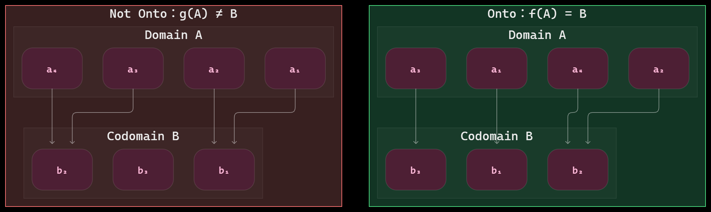

第一張圖：

- b₁ 有 a₁ 對應。
- b₂ 有 a₂、a₄ 對應。
- b₃ 有 a₃ 對應。

因此每個 B 的元素都有被命中：

\\[ f(A)=B \\]

所以是 Onto。

第二張圖：

- b₁ 有 a₁、a₂ 對應。
- b₂ 有 a₃、a₄ 對應。
- b₃ 沒有人對應。

因此：

\\[ g(A)=\\{b_1,b_2\\}\neq B \\]

所以不是 Onto。

容易混淆

Onto 不代表 One-to-one（單射）。

///danger|單射是啥？

f(a) = f(b) -> a=b

///

第一張圖裡面 a₂、a₄ 都對應到 b₂，仍然是 Onto。

### 1.4 課本 Example 5.21：判斷是否為 Onto

///danger | 為何 onto 叫做 onto？
因為英文 onto 本身就有「到……上面」的意思。

在數學中：

\\[ f:A\rightarrow B \\]

Onto（滿射） 可以理解成：A 的元素經過函數 \\(f\\) 後，覆蓋整個 B 集合，沒有任何 B 的元素被漏掉。

因此：

\\[ \boxed{f(A)=B} \\]

你可以這樣記：

- Into：對應到 B 裡面，但不一定覆蓋整個 B。
- Onto：對應到 B，而且覆蓋整個 B。

所以 Onto 的重點就是：整個 Codomain（對應域）都被覆蓋到。
///

老師在逐字稿中介紹這題時，辨識文字出現 Example 5.26；但依照 A、B 和函數配對內容，實際對應的是課本 Example 5.21（印刷頁 261）。

題目：

\\[ A=\\{1,2,3,4\\},\quad B=\\{x,y,z\\} \\]

考慮以下函數：

\\[ f_1=\\{(1,z),(2,y),(3,x),(4,y)\\} \\]

其值域：

\\[ f_1(A)=\\{x,y,z\\}=B \\]

因此：

\\[ \boxed{f_1\text{ is onto}} \\]

再看：

\\[ g=\\{(1,x),(2,x),(3,y),(4,y)\\} \\]

其值域：

\\[ g(A)=\\{x,y\\} \\]

但是：

\\[ \\{x,y\\}\neq\\{x,y,z\\} \\]

所以：

\\[ \boxed{g\text{ is not onto}} \\]

考試判斷技巧：

直接求出 Range，再與 Codomain 比較即可。

### 1.5 Counting Onto Functions（計算滿射函數數量）

這是本次課堂非常重要的部分。

老師接下來要解決：

假設 A 有 m 個元素，B 有 n 個元素，總共有多少個 Onto Functions？

首先記住：

\\[ |A|=m,\qquad |B|=n \\]

要有 Onto Function，必須：

\\[ \boxed{m\geq n} \\]

因為輸入元素數量至少要和輸出元素數量一樣多。

#### Step 1：先計算全部 Function

每一個 A 的元素，都有 n 種選擇。

因此：

\\[ \boxed{n^m} \\]

這是全部 Function 的數量，包含 Onto 和 Not Onto。

#### Step 2：扣除 Not Onto 的 Function

先用老師上課的例子：

\\[ A=\\{w,x,y,z\\} \\]

\\[ B=\\{1,2,3\\} \\]

因此：

\\[ m=4,\qquad n=3 \\]

全部 Function：

\\[ 3^4=81 \\]

但是我們只想要 Onto。

所以必須排除沒有使用到 B 所有元素的 Function。

第一步：只使用 B 中的兩個元素。

B 有三個元素，選其中兩個：

\\[ \binom32 \\]

每個 A 元素有兩種選擇：

\\[ 2^4 \\]

因此：

\\[ \binom32 2^4 \\]

這些都不是 Onto。

所以先扣除：

\\[ 3^4-\binom32 2^4 \\]

第二步：處理重複扣除。

這裡有一個很重要的問題。

假設所有 A 的元素都對應到 1：

\\[ f(w)=f(x)=f(y)=f(z)=1 \\]

這個 Function 同時出現在：

- 只使用 2 的 Function。
- 只使用 3 的 Function。

所以剛剛已經被扣掉兩次。

但是我們只希望它被扣掉一次。

因此要把多扣的部分加回來一次。

B 有三種可能只使用一個元素：

\\[ \binom31 \\]

每一種只有：

\\[ 1^4 \\]

因此加回：

\\[ \binom31 1^4 \\]

#### Step 3：得到答案

所以：

\\[ \begin{aligned} N\_{\text{onto}} &=3^4-\binom32 2^4+\binom31 1^4\\\ &=81-3(16)+3(1)\\\ &=81-48+3\\\ &=\boxed{36} \end{aligned} \\]

重要公式

///上面公式都看不懂，所以提出問題：


#### Q 

所以他在算的不是剛好對應到兩個不同的數字，而是對應到1 或兩個不同的數對不對？因為我剛剛卡住是以為他表示剛好兩個，剛好兩個的話應該要用 p(2,1)才對而不是 2^4

#### A

```
Phase A — Internal Control Surface | TURN=第 8 次對話 | PROMPT=1.17.0 | REFRESH=NO | REFRESH_REMINDER=NONE | STATE={Session=05; KP=Counting Onto Functions; Weakness=剛好使用兩個輸出與最多使用兩個輸出的區別; Completion=IN_PROGRESS} | PLAN={ThisResponse=確認理解並修正 P(2,1) 的誤解}
```

對！你的理解完全正確，但最後提到的 \\(P(2,1)\\) 需要修正。

##### 1.1 \\(2^4\\) 算的是什麼？

假設只能使用 \\(\\{1,2\\}\\)：

\\[ 2^4=16 \\]

它包含兩種情況：

- 剛好使用 1 個不同的數字：例如 \\((1,1,1,1)\\)。
- 剛好使用 2 個不同的數字：例如 \\((1,1,2,2)\\)。

因此，\\(2^4\\) 算的是使用 1 個或 2 個不同數字的所有函數。

##### 1.2 如果要求「剛好使用兩個不同的數字」呢？

就不能直接使用 \\(2^4\\)，因為要扣掉全部都是 1、全部都是 2 的情況。

\\[ \begin{aligned} N &=2^4-\binom21 1^4\\\ &=16-2\\\ &=\boxed{14} \end{aligned} \\]

而不是 \\(P(2,1)\\)。

因為 \\(P(2,1)=2\\) 只是在 2 個數字中選出 1 個，並沒有計算 4 個輸入各自如何對應。

##### 1.3 Exam Quick Sheet（考試速記）

| 條件               | 計算方式           |
| ---------------- | -------------- |
| 4 個輸入，每個可選 1 或 2 | \\(2^4=16\\)   |
| 4 個輸入，剛好使用 1 種數字 | \\(2\\)        |
| 4 個輸入，剛好使用 2 種數字 | \\(2^4-2=14\\) |

核心觀念：\\(n^m\\) 只限制每個輸入有 \\(n\\) 種選擇，不保證這 \\(n\\) 種輸出全部都被使用。


#### Q 

然後最後要加回去是因為不選 3 和不選 2 會在只選 1 時重複對不對


#### A

對！完全正確！

假設：

\\[ f(w)=f(x)=f(y)=f(z)=1 \\]

這個函數會同時出現在：

1. 不選 3：只能使用 \\(\\{1,2\\}\\)，包含全部選 1。
2. 不選 2：只能使用 \\(\\{1,3\\}\\)，也包含全部選 1。

所以「全部選 1」這個函數被扣掉了兩次。

但我們只需要扣掉一次，因此要加回一次：

\\[ 1-1-1+1=0 \\]

同樣的情況也會發生在「全部選 2」和「全部選 3」。

所以總共要加回：

\\[ \binom31 1^4=3 \\]

最終：

\\[ \boxed{3^4-\binom32 2^4+\binom31 1^4=36} \\]

重點：加回來不是讓這些函數變成 Onto，而是修正重複扣除，讓每個 Not Onto 函數最後都被計算 0 次。


///


#### 1.6 General Formula（一般公式）

課本將上面的規律推廣。

///Onto Functions 公式

假設：

\\[ |A|=m,\quad |B|=n,\quad m\geq n \\]

則 Onto Functions 的數量：

\\[ \boxed{ N\_{\text{onto}}(m,n) = \sum\_{k=0}^{n-1} (-1)^k \binom nk(n-k)^m } \\]

展開：

\\[ \begin{aligned} N\_{\text{onto}}(m,n) ={}&\binom nn n^m\\\ &-\binom n{n-1}(n-1)^m\\\ &+\binom n{n-2}(n-2)^m\\\ &-\cdots\\\ &+(-1)^{n-1}\binom n1 1^m \end{aligned} \\]

///

記住三個部分：

///sigma 上面是 n-1 

寫 n 也不會怎樣啦，只是 k - n 時為 0 就沒必要寫了

\\[ \boxed{ N\_{\text{onto}}(m,n) = \sum\_{k=0}^{n-1} (-1)^k \binom nk(n-k)^m } \\]

///

1. 底數從 n 開始往下減。
2. 指數一直是 m。
3. 正負號交替。

注意：

\\[ \binom n{n-k}=\binom nk \\]

所以兩種寫法完全相同。

#### Step 4：老師的 Example 5.24

題目：

\\[ |A|=7,\qquad |B|=4 \\]

求 Onto Functions 的數量。

套用公式：

\\[ \begin{aligned} N\_{\text{onto}} ={}&\binom44 4^7\\\ &-\binom43 3^7\\\ &+\binom42 2^7\\\ &-\binom41 1^7 \end{aligned} \\]

計算：

\\[ \begin{aligned} &=16384-4(2187)+6(128)-4\\\ &=16384-8748+768-4\\\ &=\boxed{8400} \end{aligned} \\]

這是課本 Example 5.24，印刷頁 262。

### 1.7 Stirling Numbers of the Second Kind（第二類 Stirling 數）

這是老師在這個知識點最後介紹的另一個重要連結。

先想像：

- 有 m 個不同的物件。
- 有 n 個容器。
- 每個容器都必須至少放一個物件。

現在分成兩種情況：
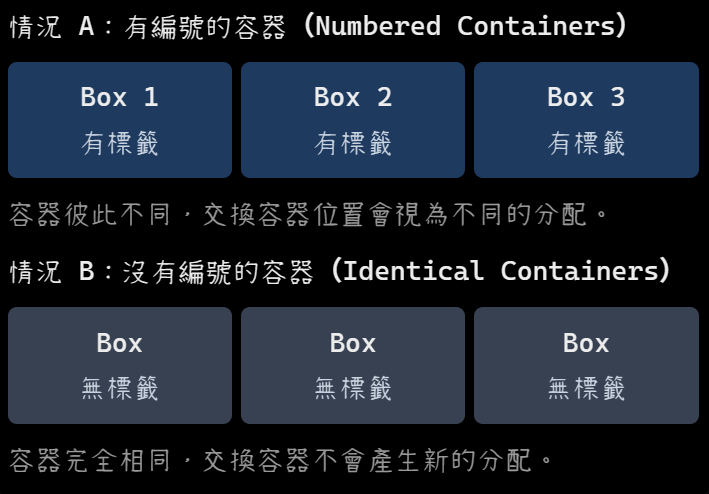

這兩種計數方式有什麼關係？

有編號的容器：

其實就是 Onto Function。

因為：

- A 的 m 個物件是輸入。
- B 的 n 個有編號容器是輸出。
- 每個容器都必須有物件。

所以：

\\[ N\_{\text{onto}}(m,n) \\]

沒有編號的容器：

這就是 Stirling Number of the Second Kind：

\\[ \boxed{S(m,n)} \\]

它代表將 m 個不同物件分配到 n 個相同且不為空的容器的方法數。

#### 為什麼要除以 n!？

假設有三個不同的容器，原本有編號：

\\[ 1,\ 2,\ 3 \\]

當我們移除編號之後，同一種分配會因為容器的編號排列而被計算：

\\[ 3!=6 \\]

次。

因此：

\\[ \boxed{ S(m,n)=\frac{N\_{\text{onto}}(m,n)}{n!} } \\]

反過來：

///Stirling Number of the Second Kind 公式

\\[ \boxed{ N\_{\text{onto}}(m,n)=n!S(m,n) } \\]

///


///所以Stirling Number of the Second Kind是沒有編號的容器？那有編號的是啥？

對！你理解得沒錯。

| 容器類型          | 計算方式                                            |
| ------------- | ----------------------------------------------- |
| 沒有編號的容器（相同容器） | Stirling Number of the Second Kind：\\(S(m,n)\\) |
| 有編號的容器（不同容器）  | Onto Functions（滿射函數）：\\(n!S(m,n)\\)             |

假設有 \\(m\\) 個不同物件，要分配到 \\(n\\) 個容器，而且每個容器至少要有一個物件。

- 無編號： 只考慮物件如何分組，不考慮哪組放在哪個容器。
- 有編號： 除了分組，還要考慮每組被分配到哪個容器。

因此：

\\[ \boxed{\text{Onto Functions}=n!\times S(m,n)} \\]

為什麼乘 \\(n!\\)？

因為分成 \\(n\\) 組後，還可以用 \\(n!\\) 種方式把這些組分配給有編號的容器。

考試記法：

\\[ \boxed{ \begin{aligned} \text{無編號}&\rightarrow S(m,n)\\\ \text{有編號}&\rightarrow n!S(m,n) \end{aligned} } \\]

注意：兩種情況都要求每個容器非空。如果允許空容器，有編號的情況就改成 \\(n^m\\)。


///

這是非常重要的關係。

再次使用剛剛的 Example 5.24：

我們已經算出：

\\[ N\_{\text{onto}}(7,4)=8400 \\]

因此：

\\[ \begin{aligned} S(7,4) &=\frac{8400}{4!}\\\ &=\frac{8400}{24}\\\ &=\boxed{350} \end{aligned} \\]

課本 Table 5.1 也可以查到：

\\[ S(7,4)=350 \\]

最容易混淆的地方

| 要計算的東西          | 公式                                      |
| --------------- | --------------------------------------- |
| Onto Functions  | \\(n!S(m,n)\\)                          |
| Stirling Number | \\(\dfrac{N\_{\text{onto}}(m,n)}{n!}\\) |

不要把兩者直接當成相同的數字。


///為何叫做"Stirling Number of the Second Kind"

#### 1.1 為什麼叫 Stirling Number of the Second Kind（第二類 Stirling 數）？

這個名稱可以拆成三個部分：

- Stirling：來自數學家 James Stirling（詹姆斯·斯特林）的姓氏。
- Number：表示一種用來計數的數學數列。
- Second Kind（第二類）：用來和 First Kind（第一類）區分，因為兩者計算的東西不同。

#### 1.2 為什麼是「第二類」？

因為 Stirling Numbers 有兩種主要類型：

| 名稱               | 計算的東西                  |
| ---------------- | ---------------------- |
| First Kind（第一類）  | 將排列分解成指定數量的 Cycles（循環） |
| Second Kind（第二類） | 將不同元素分成指定數量的非空、無編號群組   |

所以 Second Kind 只是數學上的分類名稱，不代表第二種方法，也不代表比較進階。

補充一個歷史細節：根據 MacTutor 數學史資料，First Kind／Second Kind 這兩個名稱是數學家 Niels Nielsen 後來提出的，並不是 James Stirling 自己命名的。

[image](https://www.google.com/s2/favicons?domain=https://mathshistory.st-andrews.ac.uk\&sz=32)

MacTutor History of Mathematics+1


你考試只需要記住：

\\[ \boxed{S(m,n)=\text{將 }m\text{ 個不同元素分成 }n\text{ 個非空、無編號群組的方法數}} \\]

「第二類」只是名稱，不代表容器有第二種特殊性質。

///

### 1.8 老師指定作業與考古題檢查

本堂老師口頭指定的作業：

| 章節     | 題目                |
| ------ | ----------------- |
| Ex 5.3 | 2、4、5、8、9、17      |
| Ex 5.4 | 2、3、4、9、11、12     |
| Ex 5.5 | 3、4、6、10、14、18、23 |

目前先記錄，不要求你一次全部完成。

《課本詳解.pdf》已找到對應答案：

- Ex 5.3：PDF viewer page 145–148。
- Ex 5.4：PDF viewer page 149–151。
- Ex 5.5：PDF viewer page 151–154。

你之後交作業時，我會逐題對照詳解，並依你提供的六項給分標準判斷能否得總分。

考古題初查：

目前的考古題索引有找到：

- 102 年期中考 Q1（12%）：直接考 Onto Function 計數。
- 99 年期中考 Q7（10%）：Function 的 one-to-one、onto、range 判斷。
- 103 年小考 P6、104 年小考 P2：Function 性質與 onto 相關題型。

目前這些是索引結果，尚未重新核對原始考卷頁面，因此暫時不冒充原題出題。

另外，老師在本堂提到下週期中考，但目前資料沒有提供該次期中考的正式範圍，不能直接推定本節一定會考。
///整理
### 1.9 Exam Quick Sheet（考試速記／最短骨架）

Onto Function

\\[ \boxed{f(A)=B} \\]

\\[ \forall b\in B,\ \exists a\in A:f(a)=b \\]

必要條件

\\[ m=|A|\geq n=|B| \\]

Onto Function 數量

\\[ \boxed{ \sum\_{k=0}^{n-1}(-1)^k \binom nk(n-k)^m } \\]

Stirling Number

\\[ \boxed{ S(m,n)=\frac{N\_{\text{onto}}(m,n)}{n!} } \\]

最重要的區別

- Onto：有編號的容器。
- Stirling：沒有編號的容器。
- Onto = \\(n!S(m,n)\\)。
///

### 1.10 Practice Tasks（練習任務）

這兩題是依照老師本堂教學內容設計的練習題，不是冒充課本原題。

#### 1.10.1 Task 1 — Onto Function 判斷


Generated

Concept Classification


Let

\\[ A=\\{1,2,3,4\\},\quad B=\\{x,y,z\\} \\]

Define two functions:

\\[ f=\\{(1,x),(2,y),(3,y),(4,z)\\} \\]

\\[ g=\\{(1,x),(2,x),(3,y),(4,y)\\} \\]

Determine whether each function is onto.

請回答：

1. f 是否為 Onto？寫出 \\(f(A)\\)。
2. g 是否為 Onto？寫出 \\(g(A)\\)。
3. 說明為什麼其中一個不是 Onto。

#### 1.10.2 Task 2 — Counting Onto Functions


Generated

Calculation


Let \\(A\\) and \\(B\\) be finite sets where

\\[ |A|=5,\qquad |B|=3 \\]

Find:

(a) The number of onto functions from A to B.

(b) The Stirling number \\(S(5,3)\\).

Requirements:

- Write the general formula.
- Substitute the correct values of m and n.
- Show the calculation steps.
- Give the final answers.

請直接回覆 Task 1、Task 2 的答案與計算過程，可以使用 LaTeX、文字或清晰的手寫照片。批改後我們接續第五堂課的下一個知識點：Theorem 5.3 — Stirling Number Recurrence（第二類 Stirling 數遞迴公式）。


```
Phase A — Internal Control Surface | TURN=第 1 次對話 | PROMPT=1.17.0 | REFRESH=Manual Prompt Refresh | REFRESH_REMINDER=NONE | STATE={MainlineMode=Transcript; MainlineSource=逐字稿_05_1106.txt; Locator=片段2／utterance159–197／00:25:45–00:32:05; KP=Stirling Numbers of the Second Kind; PreviousPractice=USER_OVERRIDE_ACCEPTED; Completion=NOT_VERIFIED; Transcript={Session=05; SessionSource=FilenamePrefix; Coverage=UNKNOWN; TeachingState=TAUGHT_CORE; Signals=Proof,Homework}; Reference={Aligned=Textbook §5.3 p.264/PDF viewer p.285; PrecisionStatus=VERIFIED}; QuickSheet={Status=PENDING; Type=ProofSkeleton}; Practice={TaskOrigin=Generated; SourceMatch=NA; AssessmentFidelity=Learning; SubmissionStatus=NOT_SUBMITTED}; AdjQueue=Theorem5.3→Exercise5.3→§5.4; ExerciseDebt=PENDING; TeachingMainlineDebt=§5.4後續未教; AssessmentRequirementDebt=Ex5.3指定題尚未驗證; ReferenceResolutionDebt=NONE_KNOWN; PastExamDebt=UNKNOWN; Weakness=無新增; Evidence=逐字稿與課本定理已核對; NextLegal=Theorem5.3} | PLAN={ThisResponse=講解遞迴公式及證明、例題、速記與練習; ExpectedNext=§5.4 Binary Operations}
```

## ⭐ Theorem 5.3 — Stirling Number Recurrence（第二類 Stirling 數的遞迴公式）

主線位置： Teacher Transcript／`逐字稿_05_1106.txt`／Session=05／片段 2／utterance 159–197／00:25:45–00:32:05。

對齊參考： 課本 §5.3／Theorem 5.3／印刷頁 264（PDF viewer 第 285 頁）。

自然邊界： 已核對。老師講完定理與證明後，在 00:32:05 開始指定 §5.3 作業，接著轉入 §5.4。

你上一題 \\(S(4,2)\\) 依你的要求視為答對，現在繼續老師下一個正式教學內容。

### 1. 老師接下來要解決什麼問題？

剛才已經學過：

\\[ S(m,n) \\]

代表將 \\(m\\) 個不同元素，分成剛好 \\(n\\) 個非空、無編號群組的方法數。

但是如果題目變成：

\\[ S(m+1,n) \\]

也就是元素數量多一個，群組數量不變，我們能不能利用原本的 \\(S(m,n)\\) 來算？

這就是老師接下來介紹的 Theorem 5.3。

### 2. Theorem 5.3：正式公式

///Theorem 5.3：正式公式

課本定理為：當 \\(m,n\\) 是正整數，且 \\(1\<n\leq m\\) 時，

\\[ \boxed{S(m+1,n)=S(m,n-1)+nS(m,n)} \\]

///

各部分代表：

| 公式             | 意義                                      |
| -------------- | --------------------------------------- |
| \\(S(m+1,n)\\) | \\(m+1\\) 個元素分成 \\(n\\) 組               |
| \\(S(m,n-1)\\) | 原本 \\(m\\) 個元素分成 \\(n-1\\) 組            |
| \\(nS(m,n)\\)  | 原本 \\(m\\) 個元素分成 \\(n\\) 組，再讓新元素選擇加入哪一組 |

為什麼是這兩項相加，而不是直接乘上 \\(n\\)？

因為新增的元素有兩種互斥情況：

1. 新元素自己成為一組。
2. 新元素加入已存在的其中一組。

只要把這兩種情況分開計算，就能推導出公式。

///選這兩個情況不選其它情況，是因為這兩個情況可以用 s() 湊出來嗎

對！你的理解方向是正確的。這樣分類的其中一個重要原因，就是能把兩種情況表示成已知的 \\(S(m,n)\\) 形式。

#### 1.1 為什麼選這兩種情況？

我們要計算：

\\[ S(m+1,n) \\]

可以有很多種分類方法，但我們希望找到一種分類方式，同時滿足：

1. 不重複、不遺漏：所有分組方法都剛好屬於一種情況。
2. 容易計算：分類後能利用較小的 Stirling Numbers 表示。

所以我們刻意觀察最後一個元素 \\(a\_{m+1}\\)：

| 情況    | 移除最後一個元素後                                  | 可以表示成          |
| ----- | ------------------------------------------ | -------------- |
| 自己一組  | 剩下 \\(m\\) 個元素、\\(n-1\\) 組                 | \\(S(m,n-1)\\) |
| 不自己一組 | 剩下 \\(m\\) 個元素、\\(n\\) 組，再考慮 \\(n\\) 種加入方式 | \\(nS(m,n)\\)  |

因此：

\\[ \boxed{S(m+1,n)=S(m,n-1)+nS(m,n)} \\]

#### 1.2 那可以選其他分類方式嗎？

可以！ 只要分類完整、互斥，而且能正確計數，就可以。

例如也可以按照「第一組有幾個元素」來分類，但因為群組沒有編號，還需要額外處理避免重複計數，通常比較麻煩。

所以選擇「最後一個元素是否自己一組」，是因為它剛好能把問題拆成兩個容易用 Stirling Numbers 表示的子問題。

一句話記住：

> 在 Combinatorial Proof（組合證明）中，我們會刻意尋找能讓問題變簡單、能用已知公式表示，而且不重複、不遺漏的分類方式。

因此你說的「為了用 \\(S()\\) 湊出來」可以當作理解上的直覺；更精確地說，是為了建立容易計算的遞迴關係而設計分類方式。

///


### 3. 為什麼公式成立？（老師的證明方法）

老師使用的是 Combinatorial Proof（組合證明），也就是把所有分配方法分類，再用 Rule of Sum（加法原理）相加。

假設：

\\[ A=\\{a_1,a_2,\ldots,a_m,a\_{m+1}\\} \\]

我們特別觀察最後一個元素：

\\[ \boxed{a\_{m+1}} \\]

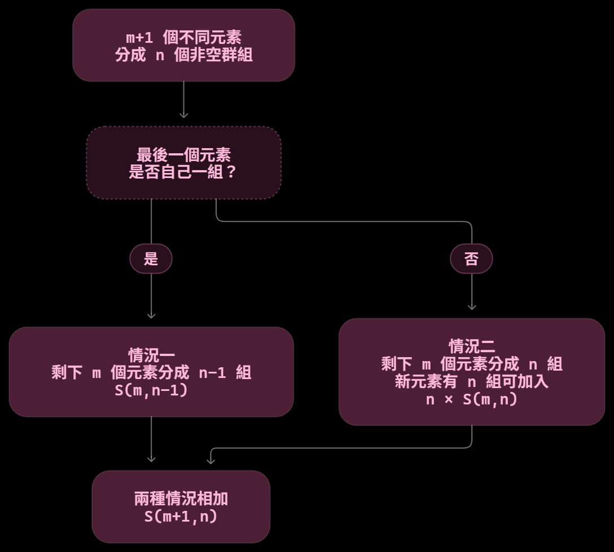

#### 情況一：新增的元素自己一組

假設最後的元素 \\(a\_{m+1}\\) 自己佔據一個群組。

那麼剩下：

- \\(m\\) 個不同元素。
- \\(n-1\\) 個非空群組。

這些元素的分組方式有：

\\[ S(m,n-1) \\]

而最後一個元素自己成組，沒有其他選擇，因此：

\\[ \boxed{\text{情況一}=S(m,n-1)} \\]

#### 情況二：新增的元素加入已存在的群組

這次先將前面 \\(m\\) 個元素分成 \\(n\\) 個非空群組。

方法數：

\\[ S(m,n) \\]

接著讓 \\(a\_{m+1}\\) 加入其中一組。

因為已經有 \\(n\\) 個群組，所以有 \\(n\\) 種加入方式。

因此：

\\[ \boxed{\text{情況二}=nS(m,n)} \\]

注意：雖然群組沒有編號，但每組包含的元素不同，因此加入哪一組會產生不同的分法。

#### 最後：把兩種情況加起來

因為最後一個元素不是自己一組，就是和其他元素同組，兩種情況不重疊，也沒有遺漏。

根據 Rule of Sum（加法原理）：

\\[ \boxed{ S(m+1,n)=S(m,n-1)+nS(m,n) } \\]

這就是 Theorem 5.3 的證明。

### 4. 完整例子：計算 \\(S(4,2)\\)

我們要將四個不同的元素：

\\[ A=\\{a,b,c,d\\} \\]

分成兩個非空、無編號群組。

因此：

\\[ S(4,2) \\]

套用公式：

\\[ \begin{aligned} S(4,2) &=S(3,1)+2S(3,2) \end{aligned} \\]

為什麼這樣算？

情況一：d 自己一組

\\(\\{a,b,c\\}\\)

\+

\\(\\{d\\}\\)

其餘 3 個元素只能分成 1 組：

\\[ S(3,1)=1 \\]

情況二：d 加入已存在的群組

先將 \\(a,b,c\\) 分成兩組：

\\[ \\{a\\}\mid\\{b,c\\} \\]

此時 d 有兩種選擇：

加入左邊

\\(\\{a,d\\}\\)\
\\(\\{b,c\\}\\)

加入右邊

\\(\\{a\\}\\)\
\\(\\{b,c,d\\}\\)

而原本 \\(a,b,c\\) 分成兩組，共有：

\\[ S(3,2)=3 \\]

種方法，因此：

\\[ 2S(3,2)=2(3)=6 \\]

最後：

\\[ \begin{aligned} S(4,2) &=S(3,1)+2S(3,2)\\\ &=1+2(3)\\\ &=\boxed{7} \end{aligned} \\]

與課本 Table 5.1 的 \\(S(4,2)=7\\) 相同。

### 5. 常見錯誤與考試寫法

錯誤一：認為只有 \\(nS(m,n)\\)。

這樣會漏掉「新增元素自己成為一組」的情況。

錯誤二：認為群組沒有編號，所以不能乘上 \\(n\\)。

即使群組沒有編號，分組完成後，每一組都有不同成員；新增元素加入不同群組，仍然會產生不同結果。

考試如果要求 Prove Theorem 5.3，建議用老師的分類證明法，而不是直接用複雜的代數公式推導。這樣符合本章所教技巧，且過程更容易寫完整。

### 6. Exam Quick Sheet（考試速記／最短骨架）

Theorem 5.3

\\[ \boxed{S(m+1,n)=S(m,n-1)+nS(m,n)} \\]

Proof Skeleton：

- 新增元素自己一組 → \\(S(m,n-1)\\)。
- 新增元素加入既有群組 → \\(nS(m,n)\\)。
- 兩種情況互斥且完整 → 相加。

常用基本值：

\\[ S(m,1)=1,\qquad S(m,m)=1 \\]

適用於正整數 \\(1\<n\leq m\\)。

### 7. Practice Tasks（練習任務）

#### 7.1 Task 1 — Combinatorial Proof（組合證明）

[Generated] · Proof · Learning Practice

Let \\(m,n\\) be positive integers with \\(1\<n\leq m\\).

Prove that

\\[ S(m+1,n)=S(m,n-1)+nS(m,n) \\]

by considering the element \\(a\_{m+1}\\).

Requirement: Explain both cases and why they account for all possible partitions.

請寫出完整證明，可以用中文或英文。

#### 7.2 Task 2 — Stirling Number Calculation

[Generated] · Calculation · Learning Practice

Given

\\[ S(4,2)=7,\qquad S(4,3)=6 \\]

Use Theorem 5.3 to calculate:

\\[ \boxed{S(5,3)} \\]

Show the recurrence formula, substitution, and final answer.

你可以直接打字列式，或上傳手寫計算照片。


```
Phase A — Internal Control Surface | TURN=第 1 次對話 | PROMPT=1.17.0 | REFRESH=Manual Prompt Refresh | REFRESH_REMINDER=NONE | STATE={MainlineMode=Transcript; MainlineSource=逐字稿_05_1106.txt; Session=05; SessionSource=FilenamePrefix; Locator=片段2／L1752–1894／00:32:50–00:38:45; PreviousKP=Theorem 5.3; PreviousPractice=USER_OVERRIDE_ACCEPTED; PreviousCompletion=USER_OVERRIDE_ONLY; KP=Binary Operations and Closure; Boundary=已核對至Definition 5.12前; TranscriptCoverage=UNKNOWN; TeachingState=TAUGHT_CORE; Reference={Textbook §5.4; PDF viewer p.288; Confidence=HIGH; Precision=VERIFIED}; QuickSheet=PENDING; Practice={Objective=判斷運算元數與封閉性; Modality=Classification+Counterexample; Origin=Generated; Fidelity=GENERATED; Submission=NOT_SUBMITTED}; ExerciseDebt=PENDING; TeachingMainlineDebt=§5.4後續; AssessmentRequirementDebt=Ex5.3未核銷; ReferenceResolutionDebt=NONE_KNOWN; PastExamDebt=UNKNOWN; NextLegal=BinaryOperations} | PLAN={ThisResponse=Definition5.10–5.11與Example5.29及練習; ExpectedNext=Definition5.12 Commutativity and Associativity}
```

## ⭐5.4 Binary Operations（二元運算）與 Closure（封閉性）— 函數的輸出會不會超出集合？

主線位置： Teacher Transcript／`逐字稿_05_1106.txt`／Session=05／片段 2／00:32:50–00:38:35／L1752–1890。

對齊參考： 課本 §5.4 Special Functions／Definition 5.10–5.11、Example 5.29／印刷頁 267（PDF viewer 第 288 頁）。

自然邊界： 老師從 Binary Operations、Closure、Unary Operations 講到 Example 5.29，接著於 00:38:35 轉入 Definition 5.12 的 Commutativity（交換性）。


/// 二元運算定義
### 1. Binary Operation（二元運算）是什麼？

前面我們學過一般 Function（函數）：

\\[ f:A\rightarrow B \\]

意思是從 A 取出一個元素，經過函數 \\(f\\)，得到 B 中的一個元素。

現在老師要介紹另一種 Function：

\\[ \boxed{f:A\times A\rightarrow B} \\]

這叫 Binary Operation（二元運算）。
///

差別在於：每次輸入兩個元素，而不是一個元素。

例如：

\\[ f(a,b)=a+b \\]

函數接收兩個輸入 \\(a,b\\)，然後把它們加起來。

\\[ f(2,3)=2+3=5 \\]

其中：

- \\(A\times A\\)：Cartesian Product（笛卡兒積），所有可能的輸入有序對。
- \\(B\\)：Codomain（對應域），輸出所在的集合。

假設：

\\[ A=\\{1,2\\} \\]

那麼：

\\[ A\times A=\\{(1,1),(1,2),(2,1),(2,2)\\} \\]

也就是函數必須能處理這四種輸入。

老師用九九乘法表說明：每次選兩個數字相乘，就是 Binary Operation 的例子。

///封閉性定義
### 2. Closure（封閉性）是什麼？

這是這個知識點最重要的概念。

Closure（封閉性）就是：從集合 A 取出元素做運算後，結果仍然留在集合 A 裡面。

數學上：

\\[ \boxed{ \forall a,b\in A,\quad f(a,b)\in A } \\]

課本 Definition 5.10 使用：

\\[ f:A\times A\rightarrow B \\]

若：

\\[ \boxed{B\subseteq A} \\]

則這個 Binary Operation 是 Closed（封閉的）。
///
因為輸出在 B，而 B 又包含在 A 裡面，所以輸出一定不會超出 A。

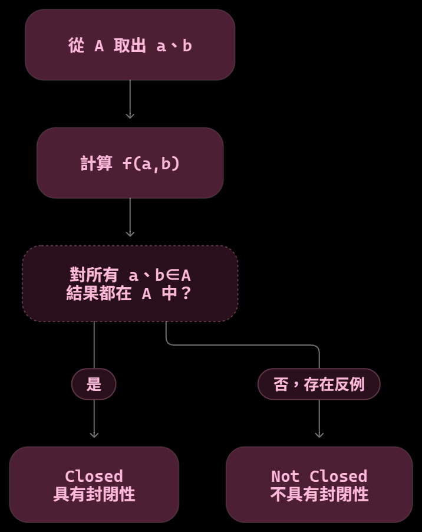

注意： 封閉性要求所有可能輸入都符合，而不是只找到一組符合就算。

### 3. 課本 Example 5.29：為什麼同樣是減法，封閉性卻不同？

這是老師實際講解的重點範例。

#### 3.1 情況一：整數相減

定義：

\\[ f:\mathbb Z\times\mathbb Z\rightarrow\mathbb Z \\]

\\[ f(a,b)=a-b \\]

其中：

\\[ \mathbb Z=\\{\ldots,-2,-1,0,1,2,\ldots\\} \\]

也就是整數集合。

例如：

\\[ f(3,7)=3-7=-4 \\]

因為：

\\[ -4\in\mathbb Z \\]

所以沒有超出整數集合。

而且任何兩個整數相減，結果都一定是整數。

因此：

\\[ \boxed{f\text{ is closed on }\mathbb Z} \\]

#### 3.2 情況二：正整數相減

改成：

\\[ g:\mathbb Z^+\times\mathbb Z^+\rightarrow\mathbb Z \\]

\\[ g(a,b)=a-b \\]

其中：

\\[ \mathbb Z^+=\\{1,2,3,\ldots\\} \\]

代表正整數集合。

現在：

\\[ g(3,7)=3-7=-4 \\]

但：

\\[ -4\notin\mathbb Z^+ \\]

因為 -4 不是正整數。

因此：

\\[ \boxed{g\text{ is not closed on }\mathbb Z^+} \\]


同一個減法，為什麼結果不同？

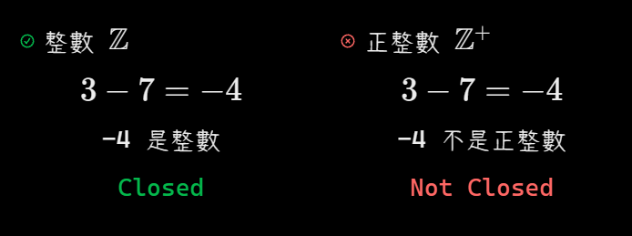

運算方式完全相同，但是指定的集合不同，封閉性的判斷就可能不同。

非常重要：

不具有封閉性，不代表它不是合法 Function。

上面的 \\(g\\) 仍是合法函數，因為輸出 -4 屬於指定的 Codomain \\(\mathbb Z\\)。

它只是對 \\(\mathbb Z^+\\) 不具有封閉性。
///一元運算定義
### 4. Unary Operation（一元運算）又是什麼？

接著老師介紹 Definition 5.11。

Unary Operation（一元運算）就是每次只接收一個元素進行運算。

課本定義：

\\[ \boxed{g:A\rightarrow A} \\]

稱為 Unary Operation。
///


與 Binary Operation 比較：

|      | Unary Operation        | Binary Operation               |
| ---- | ---------------------- | ------------------------------ |
| 輸入個數 | 1 個                    | 2 個                            |
| 函數形式 | \\(g:A\rightarrow A\\) | \\(f:A\times A\rightarrow B\\) |
| 例子   | \\(g(a)=-a\\)          | \\(f(a,b)=a+b\\)               |

#### 4.1 老師的 Example 5.29(c)

考慮：

\\[ h:\mathbb R^+\rightarrow\mathbb R^+ \\]

其中：

\\[ h(a)=\frac1a \\]

假設：

\\[ a=2 \\]

則：

\\[ h(2)=\frac12 \\]

只需要輸入一個元素，所以這是 Unary Operation。

而且正實數的倒數仍是正實數。

因此：

\\[ \boxed{h\text{ is a unary operation on }\mathbb R^+} \\]

### 5. 這部分最容易混淆的地方

///封不封閉和一元二元沒有關係，是獨立的

| 概念              | 判斷重點            |
| --------------- | --------------- |
| Binary（二元）      | 一次輸入兩個元素        |
| Unary（一元）       | 一次輸入一個元素        |
| Closed（封閉）      | 運算結果是否始終留在指定集合  |
| Not Closed（不封閉） | 只要找到一個結果超出集合的反例 |

注意：

Binary 和 Closed 是不同的性質。

一個運算可以是 Binary，但不是 Closed。例如剛剛的正整數減法。

老師也提到封閉性的重要性：如果需要反覆在同一集合上進行運算，封閉性可以保證每次的結果仍能作為下一次的輸入。

///

### 6. Exam Quick Sheet（考試速記／最短骨架）

Binary Operation

\\[ \boxed{f:A\times A\rightarrow B} \\]

Closed

\\[ \boxed{\forall a,b\in A,\ f(a,b)\in A} \\]

課本條件：\\(B\subseteq A\\) 可保證封閉性。

Unary Operation

\\[ \boxed{g:A\rightarrow A} \\]

考試最短判斷方法：

- 證明 Closed → 說明所有輸入的結果都在 A。
- 證明 Not Closed → 找一個 \\(f(a,b)\notin A\\) 的反例。

### 7. Practice Tasks（練習任務）

#### 7.1 Task 1 — Operation Classification

[Generated] · Classification · Learning Practice

Consider the following functions:

\\[ \begin{aligned} f &: \mathbb Z\times\mathbb Z\rightarrow\mathbb Z, &f(a,b)&=a+b\\\ g &: \mathbb Z^+\times\mathbb Z^+\rightarrow\mathbb Z, &g(a,b)&=a-b\\\ h &: \mathbb R^+\rightarrow\mathbb R^+, &h(a)&=\frac1a \end{aligned} \\]

Determine:

(a) Which functions are binary operations?

(b) Which function is a unary operation?

(c) Is \\(f\\) closed on \\(\mathbb Z\\)?

(d) Is \\(g\\) closed on \\(\mathbb Z^+\\)? Explain your answer.

#### 7.2 Task 2 — Proving or Disproving Closure

[Generated] · Counterexample / Proof · Learning Practice

Let

\\[ A=\\{1,2,3\\} \\]

and define

\\[ p:A\times A\rightarrow\mathbb N,\qquad p(a,b)=a+b \\]

where \\(\mathbb N=\\{0,1,2,\ldots\\}\\).

Determine whether \\(p\\) is a closed binary operation on \\(A\\).

Requirement: Justify your answer. If it is not closed, provide a counterexample.

請直接作答這兩題；可以用中文或英文，也可以上傳手寫照片。確認理解後，我們接續 Definition 5.12：Commutativity（交換性）與 Associativity（結合性）。


```
Phase A — Internal Control Surface | TURN=第 1 次對話 | PROMPT=1.17.0 | REFRESH=Manual Prompt Refresh | REFRESH_REMINDER=NONE | STATE={MainlineMode=Transcript; MainlineSource=逐字稿_05_1106.txt; Locator=片段2/L1892–1945/00:38:35–00:40:45; KP=Definition5.12; Boundary=VERIFIED; Transcript={Session=05; SessionSource=FilenamePrefix; Coverage=UNKNOWN; TeachingState=TAUGHT_CORE; Signals=Explanation; ASR=39:15術語混淆}; Reference={Aligned=Textbook§5.4/PDFp289; Confidence=HIGH; PrecisionStatus=VERIFIED}; PreviousPractice=USER_OVERRIDE_ACCEPTED; QuickSheet=PENDING; Practice={LearningObjective=判斷並驗證交換性與結合性; Modality=Classification+Proof; TaskOrigin=Generated; ContentFidelity=GENERATED; SourceMatch=NA; AssessmentFidelity=Learning; SubmissionStatus=NOT_SUBMITTED}; AdjQueue=Definition5.12→Definition5.13→Theorem5.4; ExerciseDebt=PENDING; TeachingMainlineDebt=§5.4後續; AssessmentRequirementDebt=作業待核銷; ReferenceResolutionDebt=ASR術語已用課本校準; PastExamDebt=UNKNOWN; Completion=IN_PROGRESS; NextLegal=Definition5.12} | PLAN={ThisResponse=講解交換性與結合性、示範、Exam Quick Sheet與練習; ExpectedNext=Definition5.13 Identity}
```

## ⭐5.4 Commutativity（交換性）與 Associativity（結合性）— 改變運算順序會不會影響結果？

主線位置： Teacher Transcript／`逐字稿_05_1106.txt`／Session=05／片段 2／L1892–1945／00:38:35–00:40:45。

對齊參考： 課本 §5.4／Definition 5.12／印刷頁 268（PDF viewer 第 289 頁）。

自然邊界： 已核對。老師在 00:38:35 開始介紹交換性與結合性，於 00:40:45 轉入下一個定義 Identity（單位元素）。

### 1. 這個概念在解決什麼問題？

剛才你已經學過：

- Unary / Binary（一元／二元）：需要幾個輸入？
- Closure（封閉性）：運算後的結果是否仍屬於原本的集合？

現在老師想進一步討論：

如果我們改變運算時元素的位置，或改變括號的位置，結果會不會一樣？

這就產生兩種不同的性質。

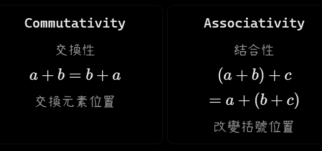

先記住這個最重要的區別：

交換性是換位置；結合性是換括號。

### 2. Definition 5.12(a)：Commutativity（交換性）

假設：

\\[ f:A\times A\rightarrow B \\]

是 Binary Operation（二元運算）。

若對所有 \\(a,b\in A\\)，都有：

\\[ \boxed{f(a,b)=f(b,a)} \\]

則稱 \\(f\\) 具有 Commutativity（交換性）。

意思是：把兩個輸入交換位置，輸出結果仍然相同。

#### 2.1 例子：整數加法

\\[ f(a,b)=a+b \\]

因為：

\\[ a+b=b+a \\]

所以：

\\[ f(a,b)=f(b,a) \\]

因此整數加法具有交換性。

例如：

\\[ 3+5=5+3=8 \\]

#### 2.2 反例：整數減法

假設：

\\[ f(a,b)=a-b \\]

取：

\\[ a=7,\quad b=2 \\]

則：

\\[ f(7,2)=7-2=5 \\]

但是：

\\[ f(2,7)=2-7=-5 \\]

所以：

\\[ f(7,2)\neq f(2,7) \\]

因此整數減法不具有交換性。

這裡要注意：

- 證明有交換性，必須證明所有 \\(a,b\in A\\) 都符合。
- 證明沒有交換性，只需要一個 Counterexample（反例）。

### 3. Definition 5.12(b)：Associativity（結合性）

接下來老師討論的是另一個性質。

假設：

\\[ f:A\times A\rightarrow B \\]

而且：

\\[ B\subseteq A \\]

因此運算具有 Closure（封閉性），可以把第一次運算的結果再次當成輸入。

若對所有 \\(a,b,c\in A\\)，都有：

\\[ \boxed{f(f(a,b),c)=f(a,f(b,c))} \\]

則稱 \\(f\\) 具有 Associativity（結合性）。

意思是：先算左邊兩個，或先算右邊兩個，最後結果一樣。

#### 3.1 為什麼一定要有 Closure？

因為這裡會進行兩次運算。

例如：

\\[ f(f(a,b),c) \\]

運算流程是：

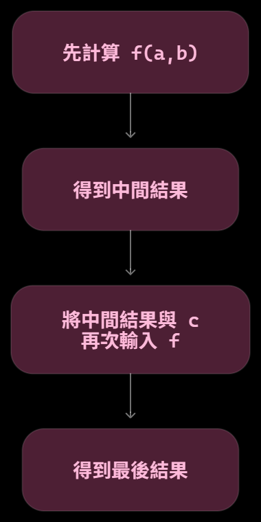

如果第一次運算的結果超出 A，第二次就可能無法再使用 \\(f\\)。

因此，課本在定義 Associativity 時先要求封閉性。

但要注意：具有封閉性，不代表一定具有結合性。 還是必須檢查兩種括號方式是否相等。

#### 3.2 例子：整數加法具有結合性

定義：

\\[ f(a,b)=a+b \\]

假設：

\\[ a=2,\quad b=3,\quad c=4 \\]

先計算左邊：

\\[ \begin{aligned} f(f(2,3),4) &=f(5,4)\\\ &=9 \end{aligned} \\]

再計算右邊：

\\[ \begin{aligned} f(2,f(3,4)) &=f(2,7)\\\ &=9 \end{aligned} \\]

兩邊都是 9。

而且根據整數加法的結合律，對所有整數 \\(a,b,c\\)：

\\[ (a+b)+c=a+(b+c) \\]

因此整數加法具有結合性。

#### 3.3 反例：整數減法不具有結合性

定義：

\\[ f(a,b)=a-b \\]

取：

\\[ a=8,\quad b=3,\quad c=2 \\]

先算：

\\[ \begin{aligned} f(f(8,3),2) &=(8-3)-2\\\ &=3 \end{aligned} \\]

再算：

\\[ \begin{aligned} f(8,f(3,2)) &=8-(3-2)\\\ &=7 \end{aligned} \\]

因為：

\\[ 3\neq7 \\]

所以：

\\[ \boxed{f(f(8,3),2)\neq f(8,f(3,2))} \\]

因此整數減法不具有結合性。

### 4. Closure、Commutativity、Associativity 的關係

這三個性質要分開判斷。

///性質整理

| 性質                 | 核心問題        | 判斷公式                          |
| ------------------ | ----------- | ----------------------------- |
| Closure（封閉性）       | 結果是否仍在 A？   | \\(f(a,b)\in A\\)             |
| Commutativity（交換性） | 交換輸入位置是否相同？ | \\(f(a,b)=f(b,a)\\)           |
| Associativity（結合性） | 改變括號位置是否相同？ | \\(f(f(a,b),c)=f(a,f(b,c))\\) |


///

例如，在整數集合 \\(\mathbb Z\\) 上：

| 運算           | Closed | Commutative | Associative |
| ------------ | ------ | ----------- | ----------- |
| 加法 \\(a+b\\) | ✅      | ✅           | ✅           |
| 減法 \\(a-b\\) | ✅      | ❌           | ❌           |
| 乘法 \\(ab\\)  | ✅      | ✅           | ✅           |

因此可以得到兩個重要結論：

- Closed 不代表 Commutative 或 Associative。 整數減法就是反例。
- Commutative 不代表 Associative，反之亦然。 兩者是不同的運算性質。

另外，這裡要修正逐字稿的一處不精確表述：在 00:39:15 附近，逐字稿將 Associative 與「封閉的特性」連在一起。依課本 Definition 5.12，Associative 正確意思是結合性，Closure 則是讓巢狀運算有意義的前提，兩者不是同一件事。

### 5. 考試如何證明這兩種性質？

#### 5.1 證明 Commutative

必須從任意：

\\[ a,b\in A \\]

開始，推導：

\\[ f(a,b)=f(b,a) \\]

不能只用一組數字證明成立。

#### 5.2 證明 Associative

必須從任意：

\\[ a,b,c\in A \\]

開始，分別計算：

\\[ f(f(a,b),c) \\]

以及：

\\[ f(a,f(b,c)) \\]

最後證明兩式相等。

反過來，如果要證明不具有交換性或結合性，只要找到一個反例即可。

### 6. Exam Quick Sheet（考試速記／最短骨架）

Commutative — 換位置

\\[ \boxed{f(a,b)=f(b,a)} \\]

Associative — 換括號

\\[ \boxed{f(f(a,b),c)=f(a,f(b,c))} \\]

考試判斷：

- 證明成立：對所有合法輸入推導等式。
- 證明不成立：找一個 Counterexample（反例）。
- Associative 的巢狀運算需要 Closure，單有 Closure 不保證 Associative。

### 7. Practice Tasks（練習任務）

#### 7.1 Task 1 — 判斷交換性與結合性

[Generated] · Classification + Counterexample · Learning Practice

Let

\\[ f:\mathbb Z\times\mathbb Z\rightarrow\mathbb Z \\]

be defined by

\\[ f(a,b)=2a+b \\]

Determine whether \\(f\\) is:

(a) Commutative.

(b) Associative.

Requirement: Justify each answer. If a property does not hold, provide a counterexample.

#### 7.2 Task 2 — 完整證明

[Generated] · Algebraic Proof · Learning Practice

Let

\\[ g:\mathbb Z\times\mathbb Z\rightarrow\mathbb Z \\]

be defined by

\\[ g(a,b)=a+b+1 \\]

Prove or disprove that \\(g\\) is:

(a) Commutative.

(b) Associative.

Requirement: Use arbitrary elements \\(a,b,c\in\mathbb Z\\) to prove a property that holds. If a property fails, provide a counterexample.

這次請實際列出計算或證明過程，不要只回答 Yes / No。中文、英文或手寫照片都可以。


```
Phase A — Internal Control Surface | TURN=第 1 次對話 | PROMPT=1.17.0 | REFRESH=Manual Prompt Refresh | REFRESH_REMINDER=NONE | STATE={MainlineMode=Transcript; MainlineSource=逐字稿_05_1106.txt; Transcript={Session=05; SessionSource=FilenamePrefix; Span=L1944–2006/片段2/00:40:45–00:43:25; Coverage=UNKNOWN; TeachingState=TAUGHT_CORE; Signals=Definition,Proof; Residual=局部已核對}; KP=Identity and Uniqueness; Boundary=VERIFIED_LOCAL; Reference={Aligned=Textbook §5.4 p269/PDF p290; PrecisionStatus=VERIFIED}; PreviousKP=Commutativity/Associativity; PreviousPractice=USER_OVERRIDE_ACCEPTED; QuickSheet=PENDING; Practice={LearningObjective=辨識單位元素及證明唯一性; Modality=Calculation+Proof; TaskOrigin=Generated; ContentFidelity=GENERATED; SourceMatch=NA; AssessmentFidelity=Learning; SubmissionStatus=NOT_SUBMITTED}; TeachingMainlineDebt=後續Projection及Pigeonhole; AssessmentRequirementDebt=指定作業尚未核銷; ReferenceResolutionDebt=無已知關鍵衝突; PastExamDebt=UNKNOWN; Completion=IN_PROGRESS; NextLegal=Identity} | PLAN={ThisResponse=Definition5.13及Theorem5.4、例題、證明、考試速記及練習; ExpectedNext=休息後Projection Functions}
```

## ⭐5.4 Identity（單位元素）與 Theorem 5.4 — 為什麼單位元素一定是唯一的？

主線位置： Teacher Transcript／`逐字稿_05_1106.txt`／Session=05／片段 2／L1944–2006／00:40:45–00:43:25。

對齊參考： 課本 §5.4／Definition 5.13、Theorem 5.4／印刷頁 269（PDF viewer 第 290 頁）。

自然邊界： 老師在 00:40:45 開始介紹 Identity（單位元素），緊接著證明它的唯一性，於 00:43:25 結束並宣布休息。兩者屬於同一個連續知識點。

### 1. Identity（單位元素）是什麼？

前面學過 Binary Operation（二元運算）：

\\[ f:A\times A\rightarrow B \\]

我們已經知道可以檢查 Closure（封閉性）、Commutativity（交換性）及 Associativity（結合性）。

現在老師要問：

是否存在某個特殊元素，讓它與任何元素運算後，都不會改變原本的元素？

例如：

\\[ 5+0=5,\qquad 0+5=5 \\]

以及：

\\[ 5\times1=5,\qquad1\times5=5 \\]

你會發現：

- 加法中的 0 不會改變另一個數。
- 乘法中的 1 不會改變另一個數。

這些特殊元素就是 Identity（單位元素）。


///單位元素定義
### 2. Definition 5.13：單位元素的正式定義

假設：

\\[ f:A\times A\rightarrow B \\]

是 A 上的 Binary Operation。

若存在 \\(x\in A\\)，使得對所有 \\(a\in A\\)：

\\[ \boxed{f(a,x)=f(x,a)=a} \\]

則稱 \\(x\\) 為 \\(f\\) 的 Identity Element（單位元素）。

///

這個定義有三個重點：

1. \\(x\\) 必須屬於 A。
2. 放在右邊，結果不變：\\(f(a,x)=a\\)。
3. 放在左邊，結果也不變：\\(f(x,a)=a\\)。

右側不改變

\\[ f(a,x)=a \\]

\\(x\\) 在右邊

左側不改變

\\[ f(x,a)=a \\]

\\(x\\) 在左邊

兩邊都必須成立，才符合課本的 Identity 定義。

### 3. 課本 Example 5.34：判斷 Identity

#### 3.1 整數加法

定義：

\\[ f:\mathbb Z\times\mathbb Z\rightarrow\mathbb Z \\]

\\[ f(a,b)=a+b \\]

我們想找到：

\\[ x\in\mathbb Z \\]

使：

\\[ f(a,x)=f(x,a)=a \\]

先看右邊：

\\[ f(a,x)=a+x=a \\]

得到：

\\[ x=0 \\]

再驗證左邊：

\\[ f(0,a)=0+a=a \\]

兩邊都成立，而且 \\(0\in\mathbb Z\\)。

因此：

\\[ \boxed{x=0} \\]

是整數加法的 Identity。

#### 3.2 整數減法

現在改成：

\\[ f(a,b)=a-b \\]

如果只看右邊：

\\[ f(a,x)=a-x=a \\]

可得到：

\\[ x=0 \\]

但必須再驗證左邊：

\\[ f(0,a)=0-a=-a \\]

通常：

\\[ -a\neq a \\]

例如：

\\[ f(0,5)=-5\neq5 \\]

因此：

\\[ \boxed{\text{整數減法沒有 Identity}} \\]

這就是最容易犯的錯誤：

找到讓 \\(f(a,x)=a\\) 成立的元素，不代表它一定是 Identity。還要檢查 \\(f(x,a)=a\\)。

### 4. Identity 與前面三種性質的關係

| 性質                 | 核心判斷                                      |
| ------------------ | ----------------------------------------- |
| Closure（封閉性）       | 運算結果是否仍在 A                                |
| Commutativity（交換性） | \\(f(a,b)=f(b,a)\\)                       |
| Associativity（結合性） | \\(f(f(a,b),c)=f(a,f(b,c))\\)             |
| Identity（單位元素）     | 是否存在 \\(x\in A\\)，使 \\(f(a,x)=f(x,a)=a\\) |

它們是不同的性質，不能因為某個運算具有交換性、結合性或封閉性，就直接認定它存在 Identity。

而且 Identity 不一定是 0 或 1，要根據運算定義及集合 A 來判斷。

例如加法在 \\(\mathbb Z\\) 上有單位元素 0，但加法在 \\(\mathbb Z^+\\) 上沒有單位元素，因為 \\(0\notin\mathbb Z^+\\)。

### 5. Theorem 5.4：Identity 一定是唯一的

老師接著要證明：

> If a binary operation has an identity, then that identity is unique.

意思是：

如果一個 Binary Operation 存在 Identity，那麼這個 Identity 一定只有一個。

注意：不是說每個運算一定有 Identity，而是「如果有，就不可能有兩個不同的 Identity」。

#### 5.1 證明思路

假設有兩個單位元素：

\\[ x_1,\ x_2\in A \\]

我們想證明：

\\[ \boxed{x_1=x_2} \\]

關鍵技巧是：

讓這兩個單位元素互相運算，計算 \\(f(x_1,x_2)\\)。

因為 \\(x_1\\) 是 Identity：

\\[ f(x_1,x_2)=x_2 \\]

因為 \\(x_2\\) 也是 Identity：

\\[ f(x_1,x_2)=x_1 \\]

所以：

\\[ \boxed{x_1=x_2} \\]

這樣就完成證明。

同一個運算結果，從兩種單位元素的性質來看

\\[ f(x_1,x_2) \\]

用 \\(x_1\\) 的性質

\\[ f(x_1,x_2)=x_2 \\]

用 \\(x_2\\) 的性質

\\[ f(x_1,x_2)=x_1 \\]

\\[ \boxed{x_1=x_2} \\]

#### 5.2 考試可直接使用的完整證明

下面是依照課本 Theorem 5.4 的技巧整理成比較簡潔、但完整的英文考試版本。

> Proof.

Suppose \\(x_1,x_2\in A\\) are both identities for \\(f\\).

Since \\(x_1\\) is an identity,

\\[ f(x_1,x_2)=x_2. \\]

Since \\(x_2\\) is also an identity,

\\[ f(x_1,x_2)=x_1. \\]

Hence,

\\[ x_1=x_2. \\]

Therefore, the identity is unique. \\(\square\\)

這個證明不用額外假設 Commutativity 或 Associativity。

你要記住的就是：

\\[ \boxed{f(x_1,x_2)=x_1=x_2} \\]

其中兩個等號分別來自不同 Identity 的性質。

### 6. Exam Quick Sheet（考試速記／最短骨架）

Definition 5.13：Identity

\\[ \boxed{x\in A,\quad\forall a\in A,\quad f(a,x)=f(x,a)=a} \\]

必須左右兩側都成立。

Theorem 5.4：Uniqueness

假設 \\(x_1,x_2\\) 都是 Identity：

\\[ \boxed{ f(x_1,x_2)=x_2 } \\]

\\[ \boxed{ f(x_1,x_2)=x_1 } \\]

因此：

\\[ \boxed{x_1=x_2} \\]

Common Trap： Identity 不一定存在；但如果存在，就一定唯一。

### 7. Practice Tasks（練習任務）

#### 7.1 Task 1 — Finding an Identity

[Generated] · Calculation · Learning Practice

Let

\\[ f:\mathbb Z\times\mathbb Z\rightarrow\mathbb Z \\]

be defined by

\\[ f(a,b)=a+b-5. \\]

Find the identity element for \\(f\\), if one exists.

Requirement: Find \\(x\in\mathbb Z\\) and verify both

\\[ f(a,x)=a,\qquad f(x,a)=a \\]

for every \\(a\in\mathbb Z\\).

#### 7.2 Task 2 — Does an Identity Exist?

[Generated] · Proof / Disproof · Learning Practice

Let

\\[ g:\mathbb Z\times\mathbb Z\rightarrow\mathbb Z \\]

be defined by

\\[ g(a,b)=a-b. \\]

Determine whether \\(g\\) has an identity element.

Explain why checking only \\(g(a,x)=a\\) is insufficient.

#### 7.3 Task 3 — Theorem 5.4 Proof

[Generated] · Proof · Learning Practice

Let \\(f:A\times A\rightarrow B\\) be a binary operation.

Prove that if \\(f\\) has an identity element, then the identity is unique.

Requirement: Assume \\(x_1,x_2\in A\\) are both identity elements and use \\(f(x_1,x_2)\\) to complete the proof.

請寫出三題的過程。第三題要實際寫 Proof（證明）；可以用中文、英文或手寫照片。

```
Phase A — Internal Control Surface | TURN=第 1 次對話 | PROMPT=1.17.0 | REFRESH=Manual Prompt Refresh | REFRESH_REMINDER=NONE | STATE={MainlineMode=Transcript; MainlineSource=逐字稿_05_1106.txt; Locator=片段3/L2170–2332/00:04:29–00:08:18; KP=Projection Functions; Boundary=VERIFIED_LOCAL; Transcript={Session=05; SessionSource=FilenamePrefix; Coverage=UNKNOWN; TeachingState=TAUGHT_CORE; Signals=Definition,Example; ASR=定義號及A集合內容有差異; Residual=下一段轉資料庫應用}; Reference={Aligned=Textbook§5.4/Definition5.14/Example5.36/PDFp291; PrecisionStatus=VERIFIED; Confidence=HIGH}; PreviousKP=Identity; PreviousPractice=USER_OVERRIDE_ACCEPTED; Completion=USER_OVERRIDE_ONLY; QuickSheet=PENDING; Practice={LearningObjective=計算投影並判斷滿射; Modality=Calculation+Explanation; ExpectedArtifact=公式與理由; AcceptedSubmission=文字或手寫; RequiredModality=NO; TaskOrigin=Generated; SourceReopened=NA; SourceIdentity=NA; ContentFidelity=GENERATED; SourceMatch=NA; AssessmentFidelity=Learning; SubmissionStatus=NOT_SUBMITTED}; AdjQueue=ProjectionFunctions→RelationalDatabaseProjection→Pigeonhole; ExerciseDebt=PENDING; TeachingMainlineDebt=後續授課未處理; AssessmentRequirementDebt=Ex5.4待處理; ReferenceResolutionDebt=ASR已由課本校準; PastExamDebt=UNKNOWN; Weakness=無新增; NextLegal=ProjectionFunctions} | PLAN={ThisResponse=講解Definition5.14及Example5.36、示範、速記及練習; ExpectedNext=Relational Database Projection}
```

## ⭐5.4 Projection Functions（投影函數）— 如何從有序對中取出指定座標？

主線位置： Teacher Transcript／`逐字稿_05_1106.txt`／Session=05／片段 3／L2170–2332／00:04:29–00:08:18。

對齊參考： 課本 §5.4／Definition 5.14、Example 5.36／印刷頁 270（PDF viewer 第 291 頁）。

自然邊界： 老師先介紹 Projection Function 的定義，接著用 Example 5.36 判斷 Onto；00:08:18 開始轉向 Relational Database（關聯式資料庫）的應用。

### 1. Projection Function 是什麼？

前面已經學過 Cartesian Product（笛卡兒積）：

\\[ A\times B \\]

它會將 A 和 B 的元素組成 Ordered Pair（有序對）。

例如：

\\[ A=\\{x,y\\},\qquad B=\\{1,2\\} \\]

則：

\\[ A\times B=\\{(x,1),(x,2),(y,1),(y,2)\\} \\]

但現在我們想做一件事：

給定一個有序對，只取出其中一個座標。

例如：

\\[ (x,2) \\]

我們可以選擇取出：

- 第一個座標 \\(x\\)。
- 第二個座標 \\(2\\)。

這就是 Projection Function（投影函數）的用途。

### 2. Definition 5.14：Projection Function（投影函數）

假設有兩個集合：

\\[ A,\ B \\]

以及：

\\[ \boxed{D\subseteq A\times B} \\]

也就是 D 是 Cartesian Product 的子集合。

我們可以定義兩種投影函數。

#### 2.1 Projection on the First Coordinate（第一座標投影）

定義：

\\[ \boxed{\pi_A:D\rightarrow A} \\]

其中：

\\[ \boxed{\pi_A((a,b))=a} \\]

意思是：從有序對 \\((a,b)\\) 中，取出第一個元素 \\(a\\)。

例如：

\\[ \pi_A((x,2))=x \\]

注意這裡的 \\(\pi\\) 是希臘字母 pi，代表 Projection，不是在計算圓周率。

#### 2.2 Projection on the Second Coordinate（第二座標投影）

定義：

\\[ \boxed{\pi_B:D\rightarrow B} \\]

其中：

\\[ \boxed{\pi_B((a,b))=b} \\]

意思是：從有序對 \\((a,b)\\) 中，取出第二個元素 \\(b\\)。

例如：

\\[ \pi_B((x,2))=2 \\]

所以：

| 函數                   | 作用    |
| -------------------- | ----- |
| \\(\pi_A((a,b))=a\\) | 取第一座標 |
| \\(\pi_B((a,b))=b\\) | 取第二座標 |


///所以 piA 就只是取第一個元素， piB 就只是取第二個元素？
```
Phase A — Internal Control Surface | TURN=第 4 次對話 | PROMPT=1.17.0 | REFRESH=NO | REFRESH_REMINDER=NONE | STATE={Session=05; KP=Projection Functions; Practice=待作答; Completion=IN_PROGRESS} | PLAN={ThisResponse=確認第一與第二座標投影的定義}
```

對！\\(\pi_A\\) 就是取第一個元素，\\(\pi_B\\) 就是取第二個元素。

假設：

\\[ (a,b)\in D,\qquad D\subseteq A\times B \\]

則：

\\[ \boxed{\pi_A((a,b))=a} \\]

\\[ \boxed{\pi_B((a,b))=b} \\]

例如：

\\[ (x,3) \\]

- \\(\pi_A((x,3))=x\\)：取第一個元素。
- \\(\pi_B((x,3))=3\\)：取第二個元素。

注意： \\(\pi_A\\)、\\(\pi_B\\) 的 A、B 是指對應的集合，不是隨便命名。

如果輸入是整個集合 D，就會取出所有有序對的對應座標，組成一個集合。

考試速記：

\\[ \boxed{\pi_A=\text{取第一座標},\quad \pi_B=\text{取第二座標}} \\]

///


兩個函數的 Domain（定義域）都是 D，但 Codomain（對應域）不同。

### 3. 課本 Example 5.36：投影函數是不是 Onto？

老師接著使用課本 Example 5.36，將 Projection Function 與之前學的 Onto Function（滿射函數）連結起來。

這個範例的集合資料如下：

\\[ A=\\{w,x,y\\} \\]

\\[ B=\\{1,2,3,4\\} \\]

\\[ D=\\{(x,1),(x,2),(x,3),(y,1),(y,4)\\} \\]

注意，這裡的 D 只是 \\(A\times B\\) 的一部分，不是整個 Cartesian Product。

#### 3.1 先觀察投影結果

選擇要觀察的 Projection Function

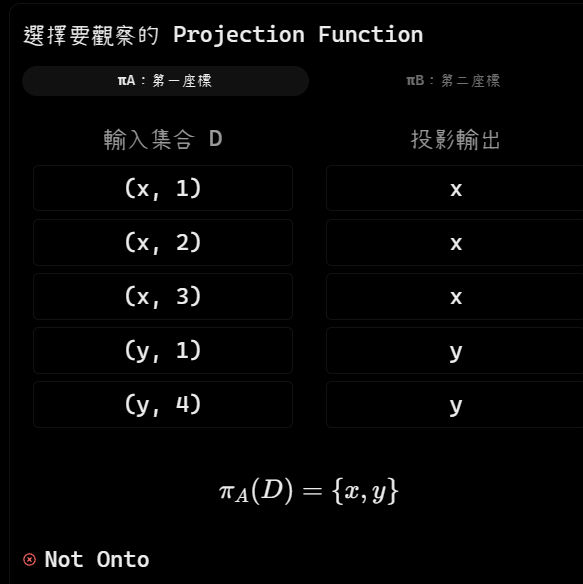

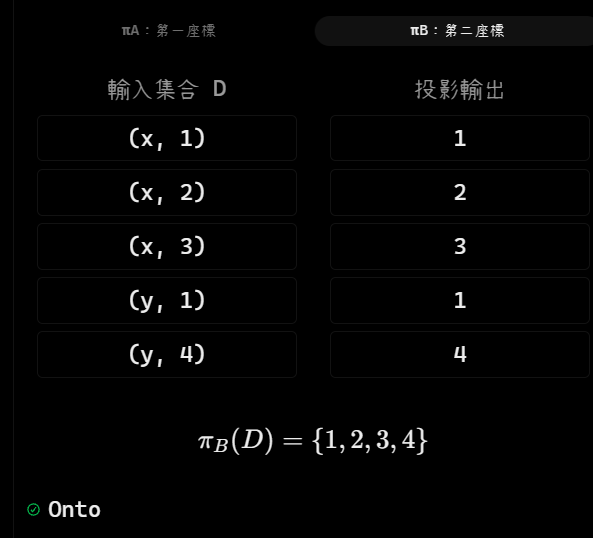


因為 \\(A=\\{w,x,y\\}\\)，但沒有任何輸入投影得到 \\(w\\)。

#### 3.2 第一座標投影

由定義：

\\[ \pi_A((a,b))=a \\]

因此：

\\[ \begin{aligned} \pi_A((x,1))&=x\\\ \pi_A((x,2))&=x\\\ \pi_A((x,3))&=x\\\ \pi_A((y,1))&=y\\\ \pi_A((y,4))&=y \end{aligned} \\]

所以：

\\[ \boxed{\pi_A(D)=\\{x,y\\}} \\]

但是：

\\[ A=\\{w,x,y\\} \\]

因此：

\\[ \pi_A(D)\neq A \\]

所以：

\\[ \boxed{\pi_A\text{ is not onto}} \\]

#### 3.3 第二座標投影

由定義：

\\[ \pi_B((a,b))=b \\]

因此：

\\[ \begin{aligned} \pi_B((x,1))&=1\\\ \pi_B((x,2))&=2\\\ \pi_B((x,3))&=3\\\ \pi_B((y,1))&=1\\\ \pi_B((y,4))&=4 \end{aligned} \\]

所以：

\\[ \boxed{\pi_B(D)=\\{1,2,3,4\\}} \\]

因為：

\\[ \pi_B(D)=B \\]

因此：

\\[ \boxed{\pi_B\text{ is onto}} \\]

### 4. 為什麼 \\(D=A\times B\\) 時，兩種 Projection 都是 Onto？

老師在 Definition 5.14 後面特別提到：

當：

\\[ D=A\times B \\]

且 A、B 都是非空集合時，

\\[ \boxed{\pi_A,\pi_B\text{ are both onto}} \\]

為什麼？

因為完整的 Cartesian Product 會包含所有可能的 \\((a,b)\\) 組合。

對於 A 中的每個元素 \\(a\\)，都能找到某個 \\(b\in B\\)，使：

\\[ \pi_A((a,b))=a \\]

因此：

\\[ \pi_A(D)=A \\]

同樣地，對於 B 中的每個元素 \\(b\\)，也能找到某個 \\(a\in A\\)，使：

\\[ \pi_B((a,b))=b \\]

因此：

\\[ \pi_B(D)=B \\]

所以兩者都是 Onto。

但是反過來不一定成立。 即使 D 只是 \\(A\times B\\) 的真子集合，也可能兩種投影都具有滿射性，只要兩邊集合的所有元素都有出現在對應座標即可。

///所以 Projection 沒有一定是不是 onto，主要取決於我們選擇的D對不對？
```
Phase A — Internal Control Surface | TURN=第 3 次對話 | PROMPT=1.17.0 | REFRESH=NO | REFRESH_REMINDER=NONE | STATE={Session=05; KP=Projection Functions; Practice=待作答; Completion=IN_PROGRESS} | PLAN={ThisResponse=確認 D 與滿射性的關係}
```

#### 1.1 對！你的理解正確。

Projection Function（投影函數）不一定是 Onto（滿射），主要取決於 D 包含哪些有序對。

假設：

\\[ D\subseteq A\times B \\]

則：

- \\(\pi_A:D\rightarrow A\\)：如果 D 的第一座標涵蓋整個 A，就是 Onto。
- \\(\pi_B:D\rightarrow B\\)：如果 D 的第二座標涵蓋整個 B，就是 Onto。

例如：

\\[ A=\\{x,y\\},\quad B=\\{1,2,3\\} \\]

若：

\\[ D=\\{(x,1),(y,2)\\} \\]

則：

\\[ \pi_A(D)=\\{x,y\\}=A \\]

所以 \\(\pi_A\\) 是 Onto。

但是：

\\[ \pi_B(D)=\\{1,2\\}\neq B \\]

所以 \\(\pi_B\\) 不是 Onto。

考試記住：

\\[ \boxed{\pi_A\text{ is onto}\iff\pi_A(D)=A} \\]

\\[ \boxed{\pi_B\text{ is onto}\iff\pi_B(D)=B} \\]

補充：A、B 也是固定條件的一部分。當 A、B 已經確定時，改變 D 就可能改變投影函數是否為 Onto。

特別是 \\(D=A\times B\\)，且 A、B 都非空時，兩個 Projection Function 一定都是 Onto。
///


### 5. 最容易混淆的兩個記號

這和你之前問過的 \\(f(A)\\) 很像。

單一有序對的投影：

\\[ \boxed{\pi_A((x,1))=x} \\]

輸出是一個元素。

整個集合 D 的投影：

\\[ \boxed{\pi_A(D)=\\{x,y\\}} \\]

輸出是一個集合。

所以不要把：

\\[ \pi_A((x,1)) \\]

與：

\\[ \pi_A(D) \\]

混淆。

另外，逐字稿在 00:04:29 附近把定義辨識成 Definition 5.3；課本實際是 Definition 5.14。本輪採用課本的正式編號。


### 6. Exam Quick Sheet（考試速記／最短骨架）

Projection Function

\\[ \boxed{D\subseteq A\times B} \\]

第一座標：

\\[ \boxed{\pi_A:D\rightarrow A,\quad \pi_A((a,b))=a} \\]

第二座標：

\\[ \boxed{\pi_B:D\rightarrow B,\quad \pi_B((a,b))=b} \\]

Onto 判斷：

\\[ \boxed{\pi_A(D)=A} \\]

\\[ \boxed{\pi_B(D)=B} \\]

若 \\(D=A\times B\\) 且 A、B 非空，兩種投影都是 Onto。

Common Trap： \\(D\subseteq A\times B\\) 不保證任一投影是 Onto，必須實際檢查 Image（像）。

### 7. Practice Tasks（練習任務）

#### 7.1 Task 1 — Projection and Onto Functions

[Generated] · Calculation + Classification · Learning Practice

Let

\\[ A=\\{a,b,c\\},\qquad B=\\{0,1,2\\} \\]

and

\\[ D=\\{(a,0),(b,1),(c,1)\\} \\]

Find:

(a) \\(\pi_A(D)\\)

(b) \\(\pi_B(D)\\)

(c) Is \\(\pi_A:D\rightarrow A\\) onto?

(d) Is \\(\pi_B:D\rightarrow B\\) onto?

Explain your answers.

#### 7.2 Task 2 — Understanding the Definition

[Generated] · Explanation · Learning Practice

Let \\(A\\) and \\(B\\) be nonempty sets, and let

\\[ D=A\times B \\]

Explain why both

\\[ \pi_A:D\rightarrow A \\]

and

\\[ \pi_B:D\rightarrow B \\]

are onto functions.

請列出投影結果與判斷理由。批改後，我們接續老師本堂下一個知識點：Relational Database Projection（關聯式資料庫的投影應用）。


```
Phase A — Internal Control Surface | TURN=第 1 次對話 | PROMPT=1.17.0 | REFRESH=Manual Prompt Refresh | REFRESH_REMINDER=NONE | STATE={MainlineMode=Transcript; MainlineSource=逐字稿_05_1106.txt; Transcript={Session=05; SessionSource=FilenamePrefix; WithinSessionOrder=片段3; Span=L2334–2579/00:08:18–00:13:57; Coverage=UNKNOWN; TeachingState=TAUGHT_CORE; Signals=資料庫範例與投影; Residual=下一主題鴿籠原理已定位}; KP=Relational Database Projection; Boundary=VERIFIED_LOCAL; Reference={Aligned=Textbook§5.4/Example5.38/Tables5.3–5.5/印刷p271/PDFp292; PrecisionStatus=VERIFIED}; PreviousKP=Projection Functions; PreviousPractice=USER_OVERRIDE_ACCEPTED; Completion=IN_PROGRESS; QuickSheet=PENDING; Practice={LearningObjective=計算多欄位投影並去除重複列; Modality=TableCompletion; ExpectedArtifact=投影後表格; AcceptedSubmission=文字或手寫; RequiredModality=YES; TaskOrigin=Generated; ContentFidelity=GENERATED; SourceMatch=NA; AssessmentFidelity=Learning; SubmissionStatus=NOT_SUBMITTED}; AdjQueue=RelationalDatabaseProjection→Pigeonhole; ExerciseDebt=PENDING; TeachingMainlineDebt=後續鴿籠原理; AssessmentRequirementDebt=Ex5.4指定題尚未核銷; ReferenceResolutionDebt=無已知關鍵衝突; PastExamDebt=UNKNOWN; NextLegal=RelationalDatabaseProjection} | PLAN={ThisResponse=講解資料庫投影、課本範例、考試速記及練習; ExpectedNext=Pigeonhole Principle}
```

## ⭐5.4 Relational Database Projection（關聯式資料庫投影）— 為什麼選取不同欄位，資料筆數可能不同？

主線位置： Teacher Transcript／`逐字稿_05_1106.txt`／Session=05／片段 3／L2334–2579／00:08:18–00:13:57。

對齊參考： 課本 §5.4／Example 5.38、Tables 5.3–5.5／印刷頁 271（PDF viewer 第 292 頁）。

自然邊界： 已核對。老師從 Projection Function 延伸到 Relational Database（關聯式資料庫），說明四欄資料的不同投影結果，於 00:13:57 轉入 Pigeonhole Principle（鴿籠原理）。

### 1. 為什麼 Projection Function 會用在資料庫？

上一部分你已經學會：

\\[ \pi_A((a,b))=a \\]

\\[ \pi_B((a,b))=b \\]

也就是從有序對取出指定座標。

現在老師把這個概念延伸到資料庫。

例如，一筆課程資料可能包含四個資訊：

\\[ (\text{課號},\text{課名},\text{教授},\text{班別}) \\]

但如果我們只想知道「有哪些課程」，就不一定需要教授和班別。

Projection（投影）的目的，就是從資料中取出指定的座標，也就是指定欄位。

### 2. 從兩個座標延伸到四個座標

假設：

\\[ D\subseteq A_1\times A_2\times A_3\times A_4 \\]

其中每筆資料是：

\\[ (a_1,a_2,a_3,a_4) \\]

我們可以定義：

\\[ \boxed{ \pi\_{A_1\times A_3\times A_4} (a_1,a_2,a_3,a_4) =(a_1,a_3,a_4) } \\]

這表示：

- 保留第一個座標。
- 不保留第二個座標。
- 保留第三個座標。
- 保留第四個座標。

相同道理，如果只想取第一、第二個座標：

\\[ \boxed{ \pi\_{A_1\times A_2} (a_1,a_2,a_3,a_4) =(a_1,a_2) } \\]

這和之前的 \\(\pi_A\\)、\\(\pi_B\\) 是同一個核心觀念，只是現在可以一次保留多個欄位。

### 3. Degree（階數）與資料筆數不同

在老師的範例中，每筆資料都有四個欄位，所以這個 Relation（關係）的 Degree（階數）是：

\\[ \boxed{\operatorname{degree}(D)=4} \\]

但它有多少筆資料，則是另一回事。

例如：

|       | 數量代表什麼                 |
| ----- | ---------------------- |
| 4 個欄位 | Degree = 4             |
| 6 筆資料 | \\(\lvert D\rvert=6\\) |

Degree 看每筆資料有幾個座標；\\(\lvert D\rvert\\) 看整個集合有幾筆不同的資料。

這是接下來理解課本範例的重要前提。

### 4. 課本 Example 5.38：兩種 Projection 的差別

老師用課程資料庫說明：選取不同的欄位，投影後保留下來的不同資料筆數可能不同。

課本 Table 5.3 有六筆課程紀錄，每筆有四個座標：

\\[ (A_1,A_2,A_3,A_4) \\]

分別是課號、課名、教授、班別。

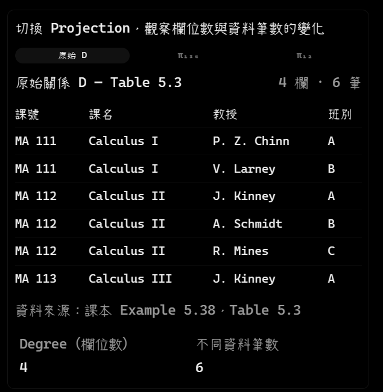

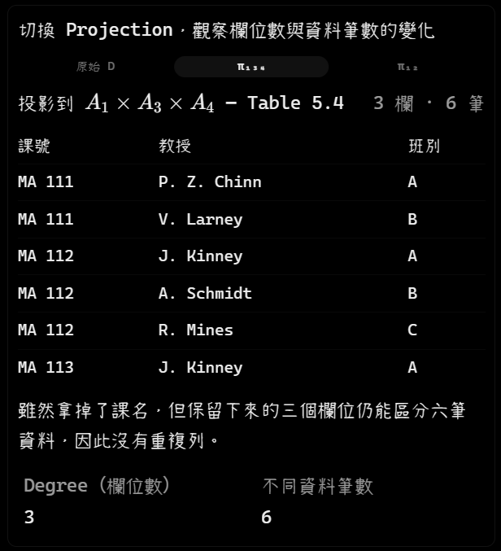


///集合不能有重複元素，所以只剩三筆。

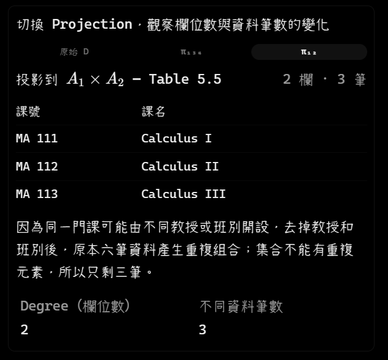

///

這三個表的差別可以整理成：

| 投影                                      | 保留欄位        | Degree | 不同資料筆數 |
| --------------------------------------- | ----------- | ------ | ------ |
| 原始 D                                    | 課號、課名、教授、班別 | 4      | 6      |
| \\(\pi\_{A_1\times A_3\times A_4}(D)\\) | 課號、教授、班別    | 3      | 6      |
| \\(\pi\_{A_1\times A_2}(D)\\)           | 課號、課名       | 2      | 3      |

核心觀念：投影一定會依指定座標改變保留的欄位，但不一定會減少不同資料的筆數。

逐字稿在這一段有一次把「欄位數」與「資料筆數」混在一起。對照課本表格，正確結果是：第一種投影的欄位數由四減為三，但資料筆數仍是六。

### 5. 為什麼重複的資料會消失？

因為這門離散數學課把 Relation（關係）當成 Set（集合）。

例如，原始資料有：

\\[ (\mathrm{MA111},\mathrm{Calculus\ I},P,A) \\]

\\[ (\mathrm{MA111},\mathrm{Calculus\ I},Q,B) \\]

兩筆原始資料不同。

但只取前兩個座標時，兩筆都變成：

\\[ (\mathrm{MA111},\mathrm{Calculus\ I}) \\]

在集合中，重複元素只記一次，因此：

\\[ \left\\{ (\mathrm{MA111},\mathrm{Calculus\ I}), (\mathrm{MA111},\mathrm{Calculus\ I}) \right\\} = \left\\{ (\mathrm{MA111},\mathrm{Calculus\ I}) \right\\} \\]

所以資料筆數減少。

這也是老師強調的資料庫應用：我們可以根據需要的資訊選擇投影欄位，減少不必要的重複資料，讓資料的組織與查詢更有針對性。不過，實際資料庫的查詢速度仍與索引、儲存及執行計畫等因素有關，並非投影後就一定比較快。

### 6. 考試容易出現的判斷方式

看到一個多欄位關係 D，要求計算 Projection，按照以下步驟：

1. 找出要保留的座標，例如 \\(A_1,A_3\\)。
2. 逐筆刪除不需要的座標。
3. 若投影後出現完全相同的資料列，只保留一筆。
4. 寫出結果集合，再計算 Degree 或不同資料筆數。

特別注意：只有整列保留座標都相同才算重複。不能因為課號相同，就直接把不同教授或不同班別的資料合併。

### 7. Exam Quick Sheet（考試速記／最短骨架）

\\[ \boxed{D\subseteq A_1\times A_2\times\cdots\times A_n} \\]

\\[ \boxed{ \pi\_{A_1\times A_3}(a_1,a_2,a_3,a_4) =(a_1,a_3) } \\]

- Projection： 保留指定座標。
- Degree： 每筆資料的座標數（欄位數）。
- 資料筆數： 投影後不同元素的數量。
- Common Trap： 投影後重複的資料列只算一次；欄位變少不代表筆數一定變少。

### 8. Practice Tasks（練習任務）

#### 8.1 Task 1 — Projecting a Relation

[Generated] · Table Completion · Learning Practice

Let \\(D\subseteq A_1\times A_2\times A_3\times A_4\\) be the following relation.

| Course Number (\\(A_1\\)) | Course Title (\\(A_2\\)) | Professor (\\(A_3\\)) | Section (\\(A_4\\)) |
| ------------------------- | ------------------------ | --------------------- | ------------------- |
| CS101                     | Programming              | Lin                   | A                   |
| CS101                     | Programming              | Wang                  | B                   |
| CS102                     | Data Structures          | Lin                   | A                   |
| CS102                     | Data Structures          | Lin                   | B                   |
| CS103                     | Logic                    | Chen                  | A                   |

(a) Construct the relation \\(\pi\_{A_1\times A_2}(D)\\) as a table.

(b) Construct the relation \\(\pi\_{A_1\times A_3\times A_4}(D)\\) as a table.

(c) State the degree and the number of distinct tuples in each projected relation.

Requirement: Show both projected tables, removing duplicate tuples when necessary.

#### 8.2 Task 2 — Conceptual Understanding

[Generated] · Explanation + Counterexample · Learning Practice

True or False?

> Projecting a relation onto fewer coordinates always reduces the number of distinct tuples.

Explain your answer and give a concrete example or counterexample.

這輪請實際寫出 Task 1 的兩個投影結果。你可以直接打表格，也可以手寫拍照。


```
Phase A — Internal Control Surface | TURN=第 1 次對話 | PROMPT=1.17.0 | REFRESH=Manual Prompt Refresh | REFRESH_REMINDER=NONE | STATE={MainlineMode=Transcript; MainlineSource=逐字稿_05_1106.txt; Transcript={Session=05; SessionSource=FilenamePrefix; WithinSessionOrder=片段3; Span=L2582–2716/00:13:57–00:17:13; Coverage=UNKNOWN; TeachingState=TAUGHT_CORE; Signals=TeacherEmphasis+Proof+Example5.42; Residual=後續轉Example5.47證明}; PreviousKP=RelationalDatabaseProjection; PreviousPractice=USER_OVERRIDE_ACCEPTED; PreviousArtifact=NOT_VERIFIED; KP=PigeonholePrinciple; Boundary=VERIFIED_LOCAL; Reference={Aligned=Textbook§5.5/印刷p273–274/PDFp294–295; PrecisionStatus=VERIFIED}; QuickSheet=PENDING; Practice={LearningObjective=辨識鴿子與籠子並完成鴿籠原理證明; Modality=Classification+Proof; ExpectedArtifact=數學推理; AcceptedSubmission=文字或手寫; RequiredModality=YES; TaskOrigin=Generated; ContentFidelity=GENERATED; SourceMatch=NA; AssessmentFidelity=Learning; SubmissionStatus=NOT_SUBMITTED}; AdjQueue=PigeonholePrinciple→Example5.47→TennisExample; ExerciseDebt=PENDING; TeachingMainlineDebt=後續證明與例題; AssessmentRequirementDebt=§5.4指定作業尚待核銷; ReferenceResolutionDebt=無已知關鍵衝突; PastExamDebt=UNKNOWN; Completion=IN_PROGRESS; NextLegal=PigeonholePrinciple} | PLAN={ThisResponse=基本鴿籠原理與Example5.42、證明技巧、ExamQuickSheet及練習; ExpectedNext=Example5.47}
```

## ⭐5.5 Pigeonhole Principle（鴿籠原理）— 為什麼物件太多，就一定會有重複？

主線位置： Teacher Transcript／`逐字稿_05_1106.txt`／Session=05／片段 3／L2582–2716／00:13:57–00:17:13。

對齊參考： 課本 §5.5／The Pigeonhole Principle、Example 5.42／印刷頁 273–274（PDF viewer 第 294–295 頁）。

自然邊界： 已核對。老師先介紹原理，再用 Example 5.42 示範餘數分類；接著於 00:17:13 轉入另一道較複雜的證明題 Example 5.47。

老師強調： 這是「非常重要的原理」，許多數學證明都會用到。這一部分不只要會判斷，還要能寫出完整證明。

### 1. Pigeonhole Principle 到底在說什麼？

假設你有：

- 4 隻鴿子。
- 3 個籠子。

每隻鴿子都必須進入某一個籠子。

有沒有可能每個籠子最多只放一隻？

不可能。

因為三個籠子最多只能各放一隻，總共容納 3 隻。但現在有 4 隻，所以至少有一個籠子必須放入 2 隻以上。

這就是鴿籠原理。

### 2. 正式定義

假設：

- \\(m\\)：Pigeons（鴿子）的數量。
- \\(n\\)：Pigeonholes（籠子）的數量。

如果：

\\[ \boxed{m>n} \\]

那麼：

\\[ \boxed{\text{至少有一個籠子包含兩隻以上的鴿子}} \\]

也就是：

\\[ \boxed{ \text{Objects}>\text{Categories} \Rightarrow \text{某個 Category 至少有 2 個 Objects} } \\]


/// 鴿籠原理到底是個啥？
#### 所以鴿籠原理要講的是在 m 個鴿子，n個籠子時，只要m>n，就存在一個籠子，裡面的鴿子大於等於兩隻對不對？ 而不是在講每個籠子中都會有鴿子


#### 1.1 對！你的理解完全正確。

Pigeonhole Principle（鴿籠原理）說的是：

假設有：

- \\(m\\) 隻鴿子。
- \\(n\\) 個籠子。
- 每隻鴿子都放進其中一個籠子。

只要：

\\[ \boxed{m>n} \\]

就能保證：

\\[ \boxed{\text{至少存在一個籠子，裡面有 }\ge 2\text{ 隻鴿子}} \\]

並不是說每個籠子都一定有鴿子！

#### 1.2 舉例：5 隻鴿子、3 個籠子

以下兩種分配都符合鴿籠原理：

| 籠子 A | 籠子 B | 籠子 C | 是否符合 |
| ---- | ---- | ---- | ---- |
| 2 隻  | 2 隻  | 1 隻  | ✅    |
| 5 隻  | 0 隻  | 0 隻  | ✅    |

第二種情況中，B 和 C 都是空的，但鴿籠原理依然成立。

因為它只要求：

\\[ \boxed{\exists\text{ 一個籠子，其鴿子數量}\ge 2} \\]

而不是：

\\[ \forall\text{ 籠子，其鴿子數量}\ge 1 \\]

這裡也順便複習兩個量詞：

- \\(\exists\\)：There exists（至少存在一個）。
- \\(\forall\\)：For all（對所有）。

#### 1.3 考試速記

\\[ \boxed{m>n\implies\exists\text{ 一個籠子至少有 2 隻鴿子}} \\]

可以有空籠子，也可以有很多籠子各自裝了 2 隻以上；鴿籠原理只保證「至少有一個」，不保證每個籠子都有。

///


#### 2.1 用數字示範

把 4、5、6、7 這四個整數，依照「除以 3 的餘數」分類。

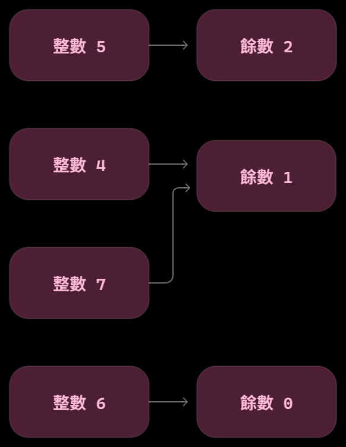

這張圖中：

- 鴿子： 4、5、6、7，共 4 個整數。
- 籠子： 餘數 0、1、2，共 3 種。
- 結果： 4 和 7 都進入「餘數 1」的籠子。

因為：

\\[ 4=3(1)+1 \\]

\\[ 7=3(2)+1 \\]

所以它們有相同的餘數。

請注意：這裡的籠子不是實體容器，而是分類方式。

這是鴿籠原理最重要的理解：我們可以自己設計籠子代表什麼。

### 3. 為什麼這個原理一定成立？（證明）

如果考試要求你證明 Pigeonhole Principle，可以用 Proof by Contradiction（反證法）。

假設：

\\[ m>n \\]

但反設每個籠子最多只有一隻鴿子。

那麼 \\(n\\) 個籠子最多只能容納：

\\[ n\times1=n \\]

隻鴿子。

然而我們知道：

\\[ m>n \\]

因此不可能把全部 \\(m\\) 隻鴿子放進這 \\(n\\) 個籠子，同時讓每個籠子最多只有一隻。

產生矛盾。

所以至少有一個籠子包含兩隻以上的鴿子。證畢。

這個證明的核心是：

\\[ \boxed{ \text{若每籠至多 1 個，總數至多 }n } \\]

但題目給你：

\\[ m>n \\]

所以假設不可能成立。

### 4. 課本 Example 5.42：37 個正整數，為什麼一定有兩個除以 36 的餘數相同？

課本 Example 5.42 的數學敘述意譯；以下依授課內容重新講解。

#### 4.1 題目

Let

\\[ S\subseteq\mathbb Z^+ \\]

and

\\[ |S|=37. \\]

Prove that \\(S\\) contains two distinct elements having the same remainder upon division by 36.

中文：

一個正整數集合 S 中有 37 個不同元素。證明其中一定有兩個不同的整數，除以 36 後得到相同的餘數。

#### 4.2 第一步：先用 Division Algorithm（除法演算法）

根據之前學過的 Division Algorithm：

任意正整數 \\(a\\)，除以 36 都可以寫成：

\\[ \boxed{a=36q+r} \\]

其中：

\\[ \boxed{0\le r<36} \\]

因此 \\(r\\) 只可能是：

\\[ r\in\\{0,1,2,\ldots,35\\} \\]

總共有：

\\[ \boxed{36\text{ 種可能餘數}} \\]

這一步非常重要，因為它讓我們知道「籠子」有多少個。

#### 4.3 第二步：找出鴿子和籠子

| 角色              | 題目中代表什麼？    | 數量 |
| --------------- | ----------- | -- |
| Pigeons（鴿子）     | S 中的正整數     | 37 |
| Pigeonholes（籠子） | 除以 36 的可能餘數 | 36 |

因為：

\\[ 37>36 \\]

所以根據 Pigeonhole Principle：

\\[ \boxed{\text{至少有兩個不同整數具有相同餘數}} \\]

證明完成。

#### 4.4 這個證明真正的技巧

不是單純看到 37 比 36 大就直接套公式。

你必須先知道：

為什麼這個問題只有 36 個籠子？

答案是 Division Algorithm：

\\[ a=36q+r,\qquad 0\le r<36 \\]

它限制了餘數的可能範圍。

所以完整的邏輯是：

除以 36 的餘數只有 36 種

37 個不同整數必須分入 36 種餘數

至少兩個整數具有相同餘數

### 5. 考試可以直接寫的完整證明

以 Example 5.42 為例，下面是一份精簡、完整的英文證明。

> Proof.

For every \\(a\in S\\), by the division algorithm, there exist integers \\(q\\) and \\(r\\) such that

\\[ a=36q+r,\qquad 0\le r<36. \\]

Thus, there are exactly 36 possible remainders:

\\[ 0,1,2,\ldots,35. \\]

Since \\(|S|=37>36\\), by the Pigeonhole Principle, at least two distinct elements of \\(S\\) have the same remainder upon division by 36.

\\[ \therefore\ \text{The statement holds.}\quad\square \\]

這個版本有清楚交代「鴿子」「籠子數量」和原理的使用，適合你希望拿到完整過程分數的寫法。

### 6. 常見錯誤

錯誤一：以為鴿子一定是實際物品。

不是。鴿子可以是整數、學生、資料或其他需要分類的物件。

錯誤二：忘記找出籠子的分類規則。

例如本題不是隨便說有 36 個籠子，而是因為除以 36 的餘數只有 0 到 35。

錯誤三：誤以為 \\(m=n\\) 時也保證有重複。

不保證。例如 3 個物件、3 個籠子，可以每個籠子剛好一個。

錯誤四：以為原理能指出哪兩個整數會有相同餘數。

不能。Pigeonhole Principle 是一種 Existence Proof（存在性證明）：保證至少存在一組，但不一定知道是哪一組。

### 7. Exam Quick Sheet（考試速記／最短骨架）

Pigeonhole Principle

\\[ \boxed{m>n\Rightarrow\text{至少一個籠子有 2 個以上物件}} \\]

證明模板：

確認 Pigeons → 確認 Pigeonholes → 比較數量 → 套用原理 → 寫結論。

餘數題：

\\[ \boxed{a=nq+r,\quad 0\le r\<n} \\]

除以 \\(n\\) 只有 \\(n\\) 種餘數，因此任取 \\(n+1\\) 個不同整數，必有兩個餘數相同。

Common Trap： 要證明「存在」，不需要指出具體是哪兩個元素。

### 8. Practice Tasks（練習任務）

#### 8.1 Task 1 — Identify the Pigeons and Pigeonholes

[Generated] · Classification + Proof · Learning Practice

Suppose 8 students were born on days of the week, from Monday through Sunday.

Prove that at least two students were born on the same day of the week.

Requirements:

(a) Identify the pigeons.

(b) Identify the pigeonholes.

(c) Apply the Pigeonhole Principle and write a complete conclusion.

#### 8.2 Task 2 — Proof Using Remainders

[Adapted from: Textbook §5.5, Example 5.42] · Proof · Learning Practice

Let

\\[ S\subseteq\mathbb Z^+,\qquad |S|=11. \\]

Prove that there are two distinct elements of \\(S\\) that have the same remainder when divided by 10.

Requirement: Use the Division Algorithm and the Pigeonhole Principle. Show the possible remainders and write a complete proof.

這兩題可以使用中文或英文作答，也可以拍照提交手寫證明。下一部分會進入老師實際示範的 Example 5.47：利用鴿籠原理證明整除性質。


```
Phase A — Internal Control Surface | TURN=第 1 次對話 | PROMPT=1.17.0 | REFRESH=Manual Prompt Refresh | REFRESH_REMINDER=NONE | STATE={MainlineMode=Transcript; MainlineSource=逐字稿_05_1106.txt; Locator=L2718–3032/片段3/00:17:13–00:25:21; Transcript={Session=05; SessionSource=FilenamePrefix; Coverage=UNKNOWN; TeachingState=TAUGHT_CORE; Signals=Proof+Explanation; Residual=後續轉網球例題}; PreviousKP=PigeonholePrinciple; PreviousPractice=USER_OVERRIDE_ACCEPTED; PreviousAssessment=NOT_VERIFIED; KP=Example5.47; Boundary=VERIFIED_LOCAL; Reference={Aligned=Textbook§5.5/Example5.47/印刷p276/PDFp297; PrecisionStatus=VERIFIED}; QuickSheet=PENDING; Practice={LearningObjective=使用鴿籠原理與互質性完成整除證明; Modality=Calculation+Proof; ExpectedArtifact=完整推導; AcceptedSubmission=文字或手寫; RequiredModality=YES; TaskOrigin=Generated; ContentFidelity=GENERATED; SourceMatch=NA; AssessmentFidelity=Learning; SubmissionStatus=NOT_SUBMITTED}; AdjQueue=Example5.47→Example5.48; ExerciseDebt=PENDING; TeachingMainlineDebt=後續網球例題; AssessmentRequirementDebt=§5.5作業尚未核銷; ReferenceResolutionDebt=無已知關鍵衝突; PastExamDebt=UNKNOWN; Completion=IN_PROGRESS; NextLegal=Example5.47} | PLAN={ThisResponse=講解Example5.47完整證明、考試速記與練習; ExpectedNext=Example5.48}
```

## ⭐5.5 Pigeonhole Principle（鴿籠原理）— Example 5.47：如何證明某個數一定可以被整除？

主線位置： Teacher Transcript／`逐字稿_05_1106.txt`／Session=05／片段 3／L2718–3032／00:17:13–00:25:21。

對齊參考： 課本 §5.5／Example 5.47／印刷頁 276（PDF viewer 第 297 頁）。

自然邊界： 已核對。老師在 00:17:13 開始這題，完整示範鴿籠原理、Division Algorithm（除法演算法）和互質性的使用，於 00:25:21 轉向網球例題。

上一輪的練習依你的要求視為答對，這次我們接著學老師實際示範的第二種鴿籠原理證明題。

### 1. 題目要證明什麼？

[Source: 課本 §5.5，Example 5.47 | Format-normalized]

Let \\(m\in\mathbb Z^+\\) with \\(m\\) odd. Prove that there exists a positive integer \\(n\\) such that \\(m\\) divides \\(2^n-1\\).

中文意思：

對任意正奇數 \\(m\\)，證明一定存在一個正整數 \\(n\\)，使得：

\\[ \boxed{m\mid(2^n-1)} \\]

這裡的：

\\[ m\mid(2^n-1) \\]

意思是 \\(2^n-1\\) 可以被 \\(m\\) 整除。

例如：

如果 \\(m=5\\)，我們可以找到 \\(n=4\\)：

\\[ 2^4-1=15 \\]

\\[ 5\mid15 \\]

但題目不是只要證明 \\(m=5\\) 成立。

它要求證明：不管給你哪一個正奇數 \\(m\\)，都一定能找到至少一個符合條件的正整數 \\(n\\)。

### 2. 為什麼這題需要 Pigeonhole Principle？

我們現在不知道 \\(n\\) 是多少。

也不能隨便猜一個 \\(n\\)，就宣稱所有正奇數 \\(m\\) 都成立。

所以老師使用一個很重要的策略：

先不直接找 \\(n\\)，而是製造足夠多個數字，保證其中兩個除以 \\(m\\) 的餘數相同。

接著利用這兩個數字，推導出我們需要的 \\(n\\)。

整體流程如下：

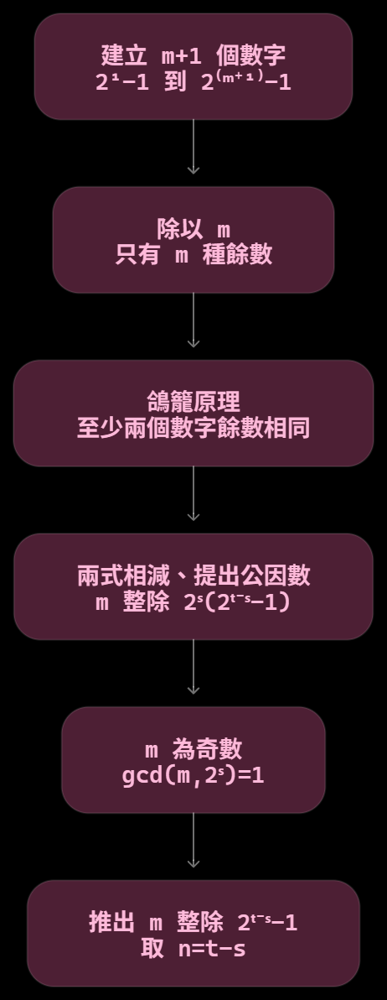


圖中最重要的是中間兩步：餘數相同，所以相減後可以被 \\(m\\) 整除；再利用 \\(m\\) 是奇數，去掉多餘的 \\(2^s\\)。

下面將每一步完整推導。

### 3. 第一步：建立 \\(m+1\\) 個正整數

我們先考慮：

\\[ \boxed{ 2^1-1,\ 2^2-1,\ 2^3-1,\ldots,2^{m+1}-1 } \\]

為什麼要建立 \\(m+1\\) 個？

因為這些數字除以 \\(m\\) 時，可能的餘數只有：

\\[ \boxed{0,1,2,\ldots,m-1} \\]

也就是總共 \\(m\\) 種。

| Pigeonhole Principle | 本題            |
| -------------------- | ------------- |
| Pigeons（鴿子）          | \\(m+1\\) 個數字 |
| Pigeonholes（籠子）      | \\(m\\) 種可能餘數 |

因為：

\\[ m+1>m \\]

所以一定有兩個不同的數字，除以 \\(m\\) 後具有相同餘數。

這兩個數字可以表示成：

\\[ 2^s-1,\qquad2^t-1 \\]

其中：

\\[ \boxed{1\le s\<t\le m+1} \\]

注意，我們不需要知道 \\(s,t\\) 具體是多少，只需要知道這樣的 \\(s,t\\) 一定存在。

### 4. 第二步：將「相同餘數」寫成數學式子

這一步要使用之前學過的 Division Algorithm（除法演算法）。

因為 \\(2^s-1\\) 和 \\(2^t-1\\) 除以 \\(m\\) 的餘數相同，所以可以寫成：

\\[ \boxed{2^s-1=q_1m+r} \\]

\\[ \boxed{2^t-1=q_2m+r} \\]

注意：

- \\(q_1,q_2\\)：兩個商數，不一定相同。
- \\(r\\)：相同的餘數。
- \\(0\le r\<m\\)。

把第二式減掉第一式：

\\[ \begin{aligned} (2^t-1)-(2^s-1) &=(q_2m+r)-(q_1m+r)\\\ 2^t-2^s &=(q_2-q_1)m \end{aligned} \\]

因為右邊是 \\(m\\) 的整數倍，所以：

\\[ \boxed{m\mid(2^t-2^s)} \\]

關鍵觀念：兩個整數除以 \\(m\\) 的餘數相同，就代表它們的差可以被 \\(m\\) 整除。

### 5. 第三步：提出 \\(2^s\\)

現在我們得到：

\\[ m\mid(2^t-2^s) \\]

但題目要的是：

\\[ m\mid(2^n-1) \\]

所以我們需要把式子變成 \\(2^{\text{某個正整數}}-1\\) 的形式。

由於 \\(t>s\\)：

\\[ \begin{aligned} 2^t-2^s &=2^s\cdot2^{t-s}-2^s\\\ &=\boxed{2^s(2^{t-s}-1)} \end{aligned} \\]

因此：

\\[ \boxed{m\mid 2^s(2^{t-s}-1)} \\]

我們已經非常接近目標。

但還有一個問題：

如何把前面的 \\(2^s\\) 去掉？

### 6. 第四步：為什麼題目特別要求 \\(m\\) 是奇數？

這是整道證明最關鍵的部分。

已知：

\\[ m\text{ is odd} \\]

因為 \\(m\\) 是奇數，所以它沒有質因數 2。

但：

\\[ 2^s \\]

的質因數只有 2。

因此：

\\[ \boxed{\gcd(m,2^s)=1} \\]

也就是 \\(m\\) 與 \\(2^s\\) 互質。

根據之前學過的互質整除性質：

\\[ \boxed{ \gcd(a,m)=1,\quad m\mid ab \ \Longrightarrow\ m\mid b } \\]

現在令：

\\[ a=2^s \\]

\\[ b=2^{t-s}-1 \\]

因為：

\\[ m\mid2^s(2^{t-s}-1) \\]

且：

\\[ \gcd(m,2^s)=1 \\]

因此可以推出：

\\[ \boxed{m\mid(2^{t-s}-1)} \\]

這裡不是隨便把 \\(2^s\\) 約掉，而是因為它與 \\(m\\) 互質，所以可以使用這個整除性質。

#### 6.1 為什麼如果 \\(m\\) 是偶數就不行？

例如 \\(m=2\\)。

對任何正整數 \\(n\\)：

\\[ 2^n-1 \\]

都是奇數。

所以：

\\[ 2\nmid(2^n-1) \\]

因此如果題目沒有要求 \\(m\\) 是奇數，結論就不一定成立。

### 7. 第五步：找到題目要的 \\(n\\)

我們已經證明：

\\[ m\mid(2^{t-s}-1) \\]

所以只要令：

\\[ \boxed{n=t-s} \\]

因為：

\\[ t>s \\]

所以：

\\[ n=t-s>0 \\]

因此 \\(n\\) 確實是正整數。

最後得到：

\\[ \boxed{m\mid(2^n-1)} \\]

證明完成。

### 8. 用實際數字驗證一次

假設：

\\[ m=5 \\]

那麼我們先建立 \\(m+1=6\\) 個數字：

\\[ 2^1-1,\ 2^2-1,\ldots,2^6-1 \\]

| 指數 \\(i\\) | \\(2^i-1\\) | 除以 5 的餘數 |
| ---------- | ----------- | -------- |
| 1          | 1           | 1        |
| 2          | 3           | 3        |
| 3          | 7           | 2        |
| 4          | 15          | 0        |
| 5          | 31          | 1        |
| 6          | 63          | 3        |

你會發現，第一個和第五個數字的餘數相同：

\\[ 1\equiv31\pmod5 \\]

因此我們可以選：

\\[ s=1,\qquad t=5 \\]

兩個數字相減：

\\[ 31-1=30 \\]

\\[ 30=2^1(2^4-1) \\]

因為 5 與 2 互質，所以：

\\[ 5\mid(2^4-1) \\]

令：

\\[ \boxed{n=5-1=4} \\]

得到：

\\[ 5\mid15 \\]

與我們的證明結果一致。

請注意：這只是幫助你理解的數字示範；真正證明所有正奇數 \\(m\\) 時，還是需要前面的一般性證明。

### 9. 考試可直接使用的完整證明

下面是依照課本 Example 5.47 與老師授課方法整理的英文考試版本。

Proof.

Let \\(m\\) be an odd positive integer.

Consider the \\(m+1\\) positive integers

\\[ 2^1-1,\ 2^2-1,\ldots,2^{m+1}-1. \\]

Since there are only \\(m\\) possible remainders upon division by \\(m\\), by the Pigeonhole Principle, there exist integers \\(s,t\\) such that

\\[ 1\le s\<t\le m+1 \\]

and \\(2^s-1\\), \\(2^t-1\\) have the same remainder.

Hence, for some integers \\(q_1,q_2\\) and \\(r\\),

\\[ 2^s-1=q_1m+r \\]

and

\\[ 2^t-1=q_2m+r. \\]

Subtracting gives

\\[ \begin{aligned} 2^t-2^s&=(q_2-q_1)m\\\ 2^s(2^{t-s}-1)&=(q_2-q_1)m. \end{aligned} \\]

Thus,

\\[ m\mid2^s(2^{t-s}-1). \\]

Since \\(m\\) is odd,

\\[ \gcd(m,2^s)=1. \\]

Therefore,

\\[ m\mid(2^{t-s}-1). \\]

Let \\(n=t-s\\). Since \\(t>s\\), \\(n\\) is a positive integer, and

\\[ \boxed{m\mid(2^n-1)}. \\]

Hence, the statement is proved. \\(\square\\)

這份證明完整呈現了老師使用的鴿籠原理、Division Algorithm、提出公因數，以及互質整除性質。

### 10. Exam Quick Sheet（考試速記／最短骨架）

題目目標

\\[ \boxed{m\text{ odd}\Longrightarrow\exists n>0,\ m\mid(2^n-1)} \\]

Proof Skeleton

建立 \\(m+1\\) 個數字：

\\[ 2^1-1,\ldots,2^{m+1}-1 \\]

鴿籠原理：有 \\(s\<t\\) 使餘數相同。

\\[ \begin{aligned} 2^s-1&=q_1m+r\\\ 2^t-1&=q_2m+r \end{aligned} \\]

相減、因式分解：

\\[ \boxed{m\mid2^s(2^{t-s}-1)} \\]

利用奇數條件：

\\[ \gcd(m,2^s)=1 \\]

\\[ \boxed{m\mid(2^{t-s}-1)} \\]

最後令 \\(n=t-s>0\\)。

必背關鍵： 餘數相同 → 相減可整除 → 互質才能消去 \\(2^s\\)。

### 11. Practice Tasks（練習任務）

#### 11.1 Task 1 — Applying the Proof to a Concrete Number

[Generated] · Calculation · Learning Practice

Let \\(m=7\\).

Consider the eight integers

\\[ 2^1-1,\ 2^2-1,\ldots,2^8-1. \\]

(a) Find their remainders upon division by 7.

(b) Choose two indices \\(s\<t\\) for which \\(2^s-1\\) and \\(2^t-1\\) have the same remainder.

(c) Set \\(n=t-s\\), and verify that

\\[ 7\mid(2^n-1). \\]

Requirement: Show your calculations and explain the connection to the Pigeonhole Principle.

#### 11.2 Task 2 — Complete Mathematical Proof

[Generated] · Proof · Learning Practice

Let \\(m\\) be an odd positive integer.

Prove that there exists a positive integer \\(n\\) such that

\\[ m\mid(2^n-1). \\]

Requirements: Write a complete proof using the Pigeonhole Principle, the Division Algorithm, and the fact that \\(m\\) is odd. Clearly explain why the factor \\(2^s\\) can be removed from the divisibility statement.

你可以用中文、英文或手寫照片作答。這輪第二題的重點是實際寫出完整 Proof（證明），下一部分再接續老師的 Example 5.48：網球與連續天數的鴿籠原理證明。


```
Phase A — Internal Control Surface | TURN=第 1 次對話 | PROMPT=1.17.0 | REFRESH=Manual Prompt Refresh | REFRESH_REMINDER=NONE | STATE={MainlineMode=Transcript; MainlineSource=逐字稿_05_1106.txt; Transcript={Session=05; SessionSource=FilenamePrefix; WithinSessionOrder=片段3; Span=L3038–3303/00:25:21–00:32:40; Coverage=UNKNOWN; TeachingState=TAUGHT_CORE; Signals=WorkedExample+Homework+ASRorOralConflict; Residual=後續為作業指派及下課}; PreviousKP=Example5.47; PreviousPractice=USER_OVERRIDE_ACCEPTED; PreviousArtifact=NOT_VERIFIED; KP=Example5.48; Boundary=VERIFIED_LOCAL; Reference={Aligned=Textbook§5.5/Example5.48/印刷p276/PDFp297; PrecisionStatus=VERIFIED}; QuickSheet=PENDING; Practice={LearningObjective=使用累計和與鴿籠原理證明連續區間總量; Modality=Calculation+Proof; ExpectedArtifact=完整證明; AcceptedSubmission=文字或手寫; RequiredModality=YES; TaskOrigin=Generated; ContentFidelity=GENERATED; SourceMatch=NA; AssessmentFidelity=Learning; SubmissionStatus=NOT_SUBMITTED}; AdjQueue=Example5.48→§5.5作業要求; ExerciseDebt=PENDING; AssessmentRequirementDebt=§5.4與§5.5指定作業待核銷; ReferenceResolutionDebt=逐字稿口述與原題條件衝突但課本原文清楚; PastExamDebt=UNKNOWN; Completion=IN_PROGRESS; NextLegal=Example5.48} | PLAN={ThisResponse=核對原題、修正口述歧義、講解累計和證明、ExamQuickSheet及練習; ExpectedNext=§5.5作業與堂次殘餘檢查}
```

## ⭐5.5 Pigeonhole Principle — Example 5.48：如何證明一定存在「連續幾天剛好打 15 組網球」？

主線位置： Teacher Transcript／`逐字稿_05_1106.txt`／Session=05／片段 3／L3038–3303／00:25:21–00:32:40。

對齊參考： 課本 §5.5／Example 5.48／印刷頁 276（PDF viewer 第 297 頁）。

自然邊界： 已核對。老師講完 Example 5.47 後，接著講網球例題，之後指定 §5.5 作業並結束本堂課。

上一部分依你的要求視為答對，這次我們學一種更有技巧的 Pigeonhole Principle（鴿籠原理）證明題。

### 1. 題目到底要求證明什麼？

[Source: 課本 §5.5，Example 5.48]

> While on a four-week vacation, Herbert will play at least one set of tennis each day, but he won’t play more than 40 sets total during this time. Prove that no matter how he distributes his sets during the four weeks, there is a span of consecutive days during which he will play exactly 15 sets.

中文意思：

Herbert 有四週假期，期間每天至少打一組網球，而且整個假期總共最多打 40 組。

證明：不管他怎麼安排每天的網球組數，一定存在一段連續的日子，這段時間內總共剛好打 15 組。

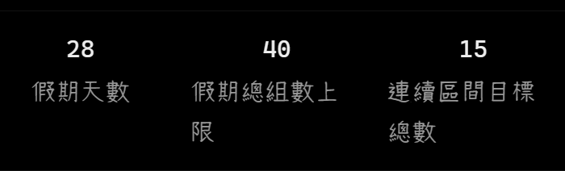

這題有兩個非常容易看錯的地方：

- 40 組是整個四週的總上限，不是每天最多 40 組。
- 15 組是某段連續日子的合計，不是那段時間每天都打 15 組。

我重新核對後發現，逐字稿中老師有幾次把這些條件口述成「每天最多 40 組」或「連續每天都打 15 組」，與課本原題及其證明不一致。接下來會以課本的精確條件進行證明，不採用那些不一致的口述。

### 2. 最重要的技巧：Daily Count 與 Cumulative Sum 不一樣

為了證明「連續某幾天的總組數」，只記錄每天打幾組並不方便。

我們需要 Cumulative Sum（累計和）。

令：

\\[ a_i=\text{第 }i\text{ 天打的網球組數} \\]

因為每天至少一組：

\\[ \boxed{a_i\ge1} \\]

再定義：

\\[ \boxed{x_i=a_1+a_2+\cdots+a_i} \\]

也就是：

\\[ \boxed{x_i=\text{從第 1 天到第 }i\text{ 天的累計組數}} \\]

例如，前五天這樣安排：

| 天數    | 當天組數 \\(a_i\\) | 累計組數 \\(x_i\\) |
| ----- | -------------- | -------------- |
| 第 1 天 | 2              | 2              |
| 第 2 天 | 1              | 3              |
| 第 3 天 | 3              | 6              |
| 第 4 天 | 2              | 8              |
| 第 5 天 | 1              | 9              |

假設想算第 3 天到第 5 天的組數：

\\[ a_3+a_4+a_5=3+2+1=6 \\]

也可以直接用：

\\[ x_5-x_2=9-3=6 \\]

所以得到本題最重要的公式：

\\[ \boxed{x_i-x_j=\text{第 }j+1\text{ 天到第 }i\text{ 天的總組數}} \\]

其中 \\(j\<i\\)。

我們只需要證明存在 \\(j\<i\\)，使得：

\\[ \boxed{x_i-x_j=15} \\]

就能完成原題。

### 3. 為什麼這題能使用 Pigeonhole Principle？

這裡最巧妙的地方是：我們要自己建立 56 個整數，但讓它們只能落在 55 種可能數值之中。

#### 3.1 第一組：28 個累計組數

由於每天至少打 1 組，所以累計組數每天都會嚴格增加：

\\[ \boxed{1\le x_1\<x_2<\cdots\<x\_{28}\le40} \\]

因此：

\\[ x_1,x_2,\ldots,x\_{28} \\]

是 28 個互不相同的整數。

注意：這裡的 \\(x_i\\) 必須是「累計組數」，才能保證它們嚴格遞增。如果把 \\(x_i\\) 定義成每天的組數，就不能推導出這個性質。

#### 3.2 第二組：每個累計組數都加 15

另外建立：

\\[ x_1+15,x_2+15,\ldots,x\_{28}+15 \\]

因為原本的 \\(x_i\\) 嚴格遞增，所以加上 15 後仍然嚴格遞增：

\\[ \boxed{16\le x_1+15<\cdots\<x\_{28}+15\le55} \\]

因此這也是 28 個互不相同的整數。

#### 3.3 現在數鴿子與籠子

|                 | 本題代表什麼                           | 數量             |
| --------------- | -------------------------------- | -------------- |
| Pigeons（鴿子）     | 兩組數字，包含 \\(x_i\\) 與 \\(x_i+15\\) | \\(28+28=56\\) |
| Pigeonholes（籠子） | 整數值 \\(1,2,\ldots,55\\)          | 55             |

因為：

\\[ \boxed{56>55} \\]

由 Pigeonhole Principle：

\\[ \boxed{\text{這 56 個數字中，至少有兩個數值相同}} \\]

但這題還需要繼續推理，不能在這裡就停止。

### 4. 為什麼相同的兩個數字一定分別來自不同組？

因為第一組：

\\[ x_1\<x_2<\cdots\<x\_{28} \\]

裡面的數字全部不同。

第二組：

\\[ x_1+15\<x_2+15<\cdots\<x\_{28}+15 \\]

裡面的數字也全部不同。

所以鴿籠原理保證出現的重複值，一定是一個來自第一組，另一個來自第二組。

因此存在某些 \\(i,j\\)，使得：

\\[ \boxed{x_i=x_j+15} \\]

整理：

\\[ \boxed{x_i-x_j=15} \\]

又因為：

\\[ x_i>x_j \\]

而累計組數嚴格遞增，所以：

\\[ i>j \\]

因此：

\\[ \boxed{ x_i-x_j =a\_{j+1}+a\_{j+2}+\cdots+a_i =15 } \\]

這就證明了：

從第 \\(j+1\\) 天到第 \\(i\\) 天，這段連續日子總共剛好打了 15 組網球。

整個證明的關係

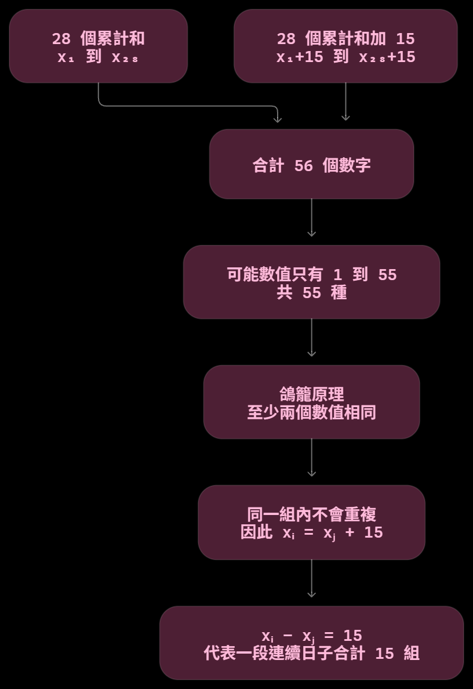


這張圖最關鍵的不是 \\(56>55\\) 本身，而是我們特別建立了 \\(x_i\\) 和 \\(x_i+15\\)，讓「數值相同」可以轉換成題目需要的「相差 15」。

### 5. 用實際安排驗證一次

假設 Herbert 在四週內：

- 第 1～4 天分別打 \\(2,1,3,2\\) 組。
- 第 5～28 天每天都打 1 組。

那麼整個假期的組數為：

\\[ 2+1+3+2+24=32\le40 \\]

這是一個符合題目條件的安排。

現在看兩個累計和：

\\[ x_3=2+1+3=6 \\]

\\[ x\_{17}=2+1+3+2+13=21 \\]

所以：

\\[ x\_{17}-x_3=21-6=15 \\]

也就是：

\\[ \boxed{\text{第 4 天到第 17 天，總共打 15 組}} \\]

這只是其中一種可能的安排。正式證明的強大之處是：不管每天的組數如何分配，只要符合題目條件，都一定存在這樣的連續區間。


///details|我看不懂為何要加 15 ？ (GPT 回覆)

///解釋

```
Phase A — Internal Control Surface | TURN=第 2 次對話 | PROMPT=1.17.0 | REFRESH=NO | REFRESH_REMINDER=NONE | STATE={MainlineMode=Transcript; Session=05; KP=Example5.48/CumulativeSums; Locator=逐字稿_05_1106.txt/L3038–3303; Teaching=已講解; Practice=已出題待作答; Weakness=不理解平移累計和及鴿籠原理的連結; Completion=IN_PROGRESS} | PLAN={ThisResponse=以縮小版數字示範為何建立第二組、為何56個位置必有相同值，以及相同值如何形成連續區間}
```

#### 1.1 你卡住的地方，其實是「為什麼要自己再建立一組 \\(x_i+15\\)？」

先講最重要的答案：

因為題目要找的是「連續幾天總共剛好 15 組」，也就是要找到兩個累計和，相差剛好 15。

\\[ \boxed{x_i-x_j=15} \\]

但 Pigeonhole Principle（鴿籠原理）只能幫我們找到「相同的數字」，不能直接幫我們找到「相差 15 的數字」。

所以我們把目標改寫：

\\[ x_i-x_j=15 \\]

移項得到：

\\[ \boxed{x_i=x_j+15} \\]

這時你就會發現：

只要在原本的累計和中，找到一個數字，恰好等於另一個累計和加 15，我們就成功了。

這就是為什麼要建立第二組 \\(x_i+15\\)。

#### 1.2 先不要看 28 天，我們用 4 天示範

假設一個人連續 4 天打網球：

| 天數    | 當天打幾組 | 累計 \\(x_i\\) |
| ----- | ----- | ------------ |
| 第 1 天 | 1     | 1            |
| 第 2 天 | 2     | 3            |
| 第 3 天 | 1     | 4            |
| 第 4 天 | 1     | 5            |

我們現在想找的是：

是否存在連續幾天，總共剛好打 2 組？

也就是找：

\\[ x_i-x_j=2 \\]

改寫成：

\\[ x_i=x_j+2 \\]

於是建立兩組數字：

第一組：原始累計和

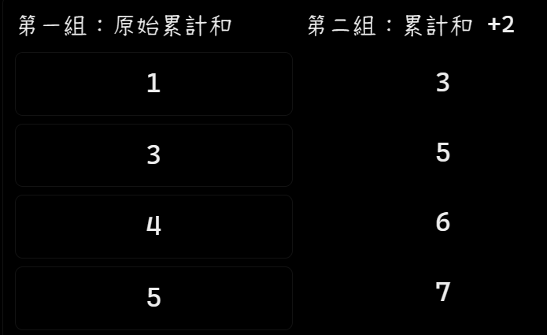

你有發現兩組裡面出現相同的數字嗎？

\\[ \underbrace{3}\_{x_2} \\]

\\[ \underbrace{1+2}\_{x_1+2} \\]

因此：

\\[ x_2=x_1+2\implies x_2-x_1=2 \\]

代表第 2 天剛好打了 2 組。

這個例子讓你看到：第二組不是實際多打出來的網球，也不是多出來的天數。它只是我們為了找出「相差 2」而額外建立的數字。

#### 1.3 那怎麼保證一定找得到相同數字？

這才是 Pigeonhole Principle 發揮作用的地方。

剛剛的例子有：

- 第一組 4 個數字。
- 第二組 4 個數字。
- 合計 8 個數字。

而且這 8 個數字全部都在：

\\[ \\{1,2,3,4,5,6,7\\} \\]

裡面。

這代表：

\\[ \boxed{\text{8 個數字位置，只有 7 種可能數值}} \\]

因此一定有至少兩個位置的數值相同。

這裡要特別注意：

不是說這 8 個數字彼此都不同。恰好相反，因為只有 7 種可能值，所以不可能全部不同。

而且：

- 第一組的數字都不同。
- 第二組的數字也都不同。

因此重複的數值必定是第一組一個、第二組一個。

這樣就一定可以寫成：

\\[ x_i=x_j+2 \\]

然後得到：

\\[ x_i-x_j=2 \\]

#### 1.4 現在換回原題的 28 天、40 組、15 組

原題就是把剛剛的邏輯放大。

|            | 剛剛的小例子      | 課本原題         |
| ---------- | ----------- | ------------ |
| 天數         | 4           | 28           |
| 總組數上限      | 5           | 40           |
| 想找的連續區間總組數 | 2           | 15           |
| 第一組數字      | \\(x_i\\)   | \\(x_i\\)    |
| 第二組數字      | \\(x_i+2\\) | \\(x_i+15\\) |
| 兩組總數量      | 8           | 56           |
| 所有可能數值     | 1～7         | 1～55         |
| 籠子數量       | 7           | 55           |

因為原題中：

\\[ 1\le x_i\le40 \\]

所以：

\\[ 16\le x_i+15\le55 \\]

因此兩組數字總共 56 個位置，卻全部只能使用 1～55 這 55 種數值。

所以：

\\[ \boxed{56>55} \\]

依 Pigeonhole Principle，一定有兩個位置的數字相同。

而兩組各自都不會重複，因此：

\\[ \boxed{x_i=x_j+15} \\]

移項：

\\[ \boxed{x_i-x_j=15} \\]

代表從第 \\(j+1\\) 天到第 \\(i\\) 天，累計剛好打了 15 組。

這就是整道題目的核心。

#### 1.5 Exam Quick Sheet（考試速記）

這一題你可以只記住：

\\[ \boxed{\text{想找相差 15}\ \Longrightarrow\ \text{建立 }x_i\text{ 與 }x_i+15} \\]

\\[ \underbrace{28+28}\_{56\text{ 個數字位置}} > \underbrace{40+15}\_{55\text{ 種可能值}} \\]

\\[ \boxed{ \text{跨組數值相同} \implies x_i=x_j+15 \implies x_i-x_j=15 } \\]

一句話：我們故意把累計和全部加 15，讓「兩個累計和相差 15」變成「兩組有相同數字」，如此才能使用鴿籠原理。

///


///


### 6. 考試可以直接使用的完整證明

以下依課本 Example 5.48 整理成較精簡、過程完整的英文考試寫法。

Proof.

Let \\(x_i\\) be the total number of sets played from the beginning of the vacation through day \\(i\\), where \\(1\le i\le28\\).

Since Herbert plays at least one set each day and at most 40 sets in total,

\\[ 1\le x_1\<x_2<\cdots\<x\_{28}\le40. \\]

Thus,

\\[ 16\le x_1+15\<x_2+15<\cdots\<x\_{28}+15\le55. \\]

Consider the following 56 integers:

\\[ x_1,\ldots,x\_{28}, \quad x_1+15,\ldots,x\_{28}+15. \\]

Since all 56 integers belong to \\(\\{1,2,\ldots,55\\}\\), by the Pigeonhole Principle, at least two of them must be equal.

Since the integers within each group are distinct, there exist \\(i,j\\) such that

\\[ x_i=x_j+15. \\]

Hence,

\\[ x_i-x_j=15. \\]

Since \\(x_i>x_j\\), we have \\(i>j\\).

Therefore, Herbert plays exactly 15 sets from day \\(j+1\\) through day \\(i\\), which are consecutive days.

Thus, the statement is proved. \\(\square\\)

這份證明有交代累計和的定義、嚴格遞增、56 個數字的來源、55 種可能數值、重複一定跨組，以及連續區間的結論。

老師在本段結束後指定了 §5.5 的 Ex 3、4、6、10、14、18、23 作業；這些題目仍須另外核對原題與完成情況，不能用本輪的自編練習取代。

### 7. Exam Quick Sheet（考試速記／最短骨架）

目標： 證明存在一段連續日子，總共打 15 組。

定義累計和：

\\[ \boxed{x_i=\sum\_{k=1}^{i}a_k} \\]

建立兩組數字：

\\[ \begin{aligned} &1\le x_1<\cdots\<x\_{28}\le40\\\ &16\le x_1+15<\cdots\<x\_{28}+15\le55 \end{aligned} \\]

由 Pigeonhole Principle：

\\[ \underbrace{56}\_{\text{數字}} > \underbrace{55}\_{\text{可能數值}} \\]

且各組內沒有重複，因此必有：

\\[ \boxed{x_i=x_j+15} \\]

最後：

\\[ \boxed{x_i-x_j=15} \\]

代表第 \\(j+1\\) 天至第 \\(i\\) 天連續打了剛好 15 組。

Common Trap： \\(x_i\\) 是累計和，不是當天組數；15 是區間的合計，不是每天的組數。

### 8. Practice Tasks（練習任務）

#### 8.1 Task 1 — Understanding Cumulative Sums

[Generated] · Calculation · Learning Practice

A tennis player plays the following numbers of sets over seven consecutive days:

\\[ a_1,a_2,\ldots,a_7=(2,1,3,1,2,2,1). \\]

Define

\\[ x_i=\sum\_{k=1}^{i}a_k. \\]

(a) Calculate \\(x_1,x_2,\ldots,x_7\\).

(b) Calculate \\(x_6-x_3\\).

(c) Explain which consecutive days are represented by \\(x_6-x_3\\), and verify their total number of sets.

#### 8.2 Task 2 — Pigeonhole Principle Proof

[Generated] · Complete Proof · Learning Practice

During a 14-day vacation, a person plays at least one set of tennis each day and no more than 20 sets in total.

Prove that there is a span of consecutive days during which the person plays exactly 7 sets of tennis.

Requirements: Define cumulative sums, construct two groups of integers, apply the Pigeonhole Principle, and explain why the repeated value guarantees a consecutive span with exactly 7 sets.

你可以用中文、英文或清楚的手寫照片作答；Task 2 請實際寫出完整證明。

## 錯題

### Ex 5.3

onto 要全部都有，可重複

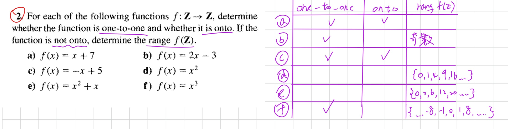


---


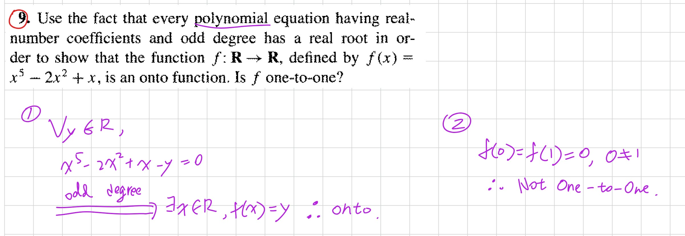

---

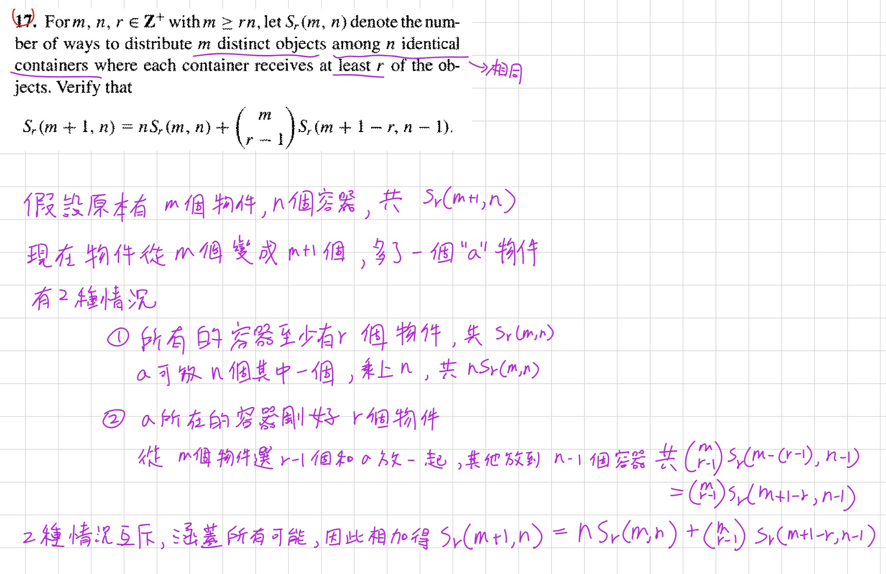

### Ex 5.4

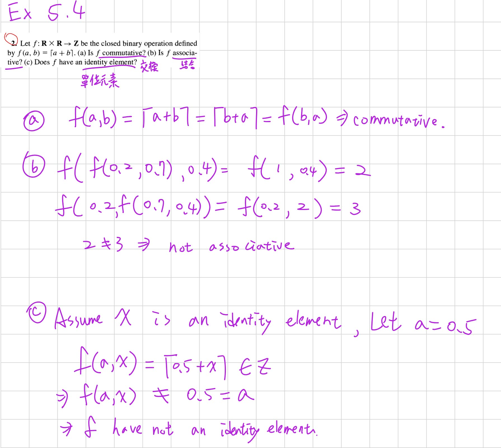

---

沒交換率不代表沒有單位元素，有單位元素時只有單位元素有交換率也可以。

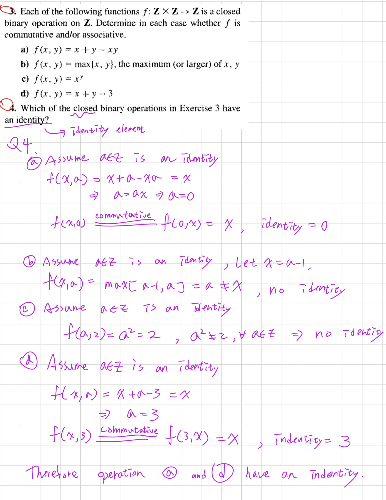


---

b 小題可以用變數當作答案

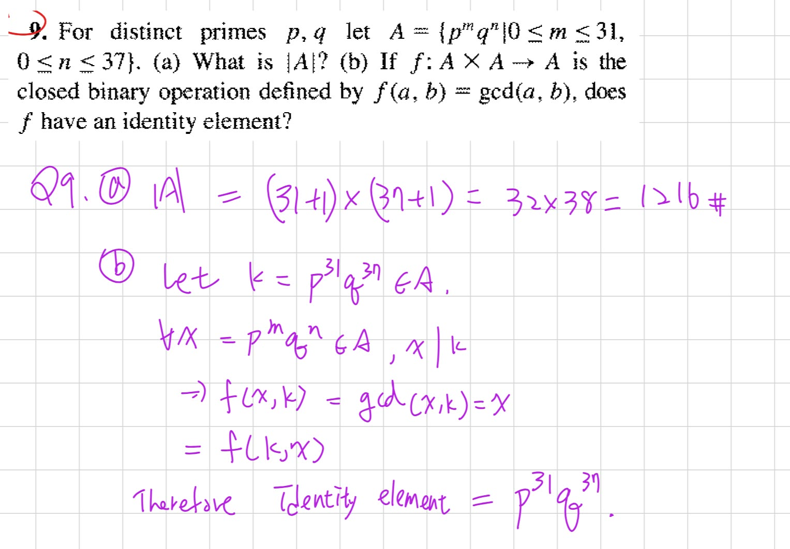

---

要弄懂

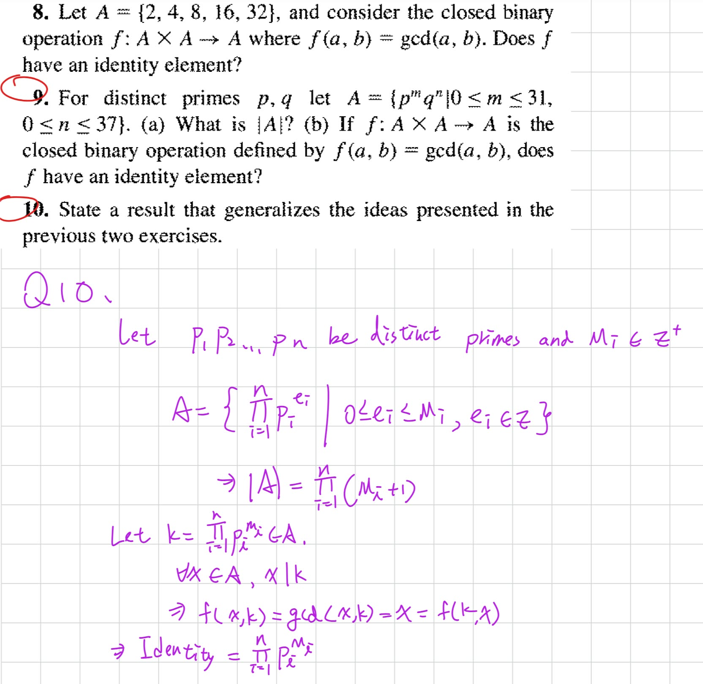


---

他要的是座標的集合

圓方程式：

\[
\boxed{(x-h)^2+(y-k)^2=r^2}
\]


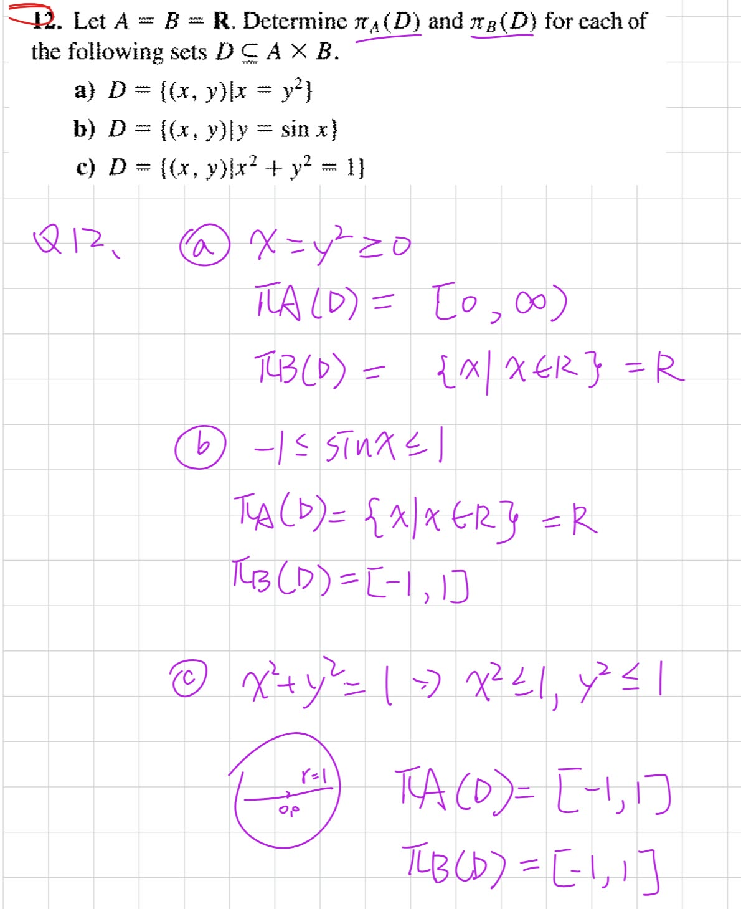


---

英文看不懂

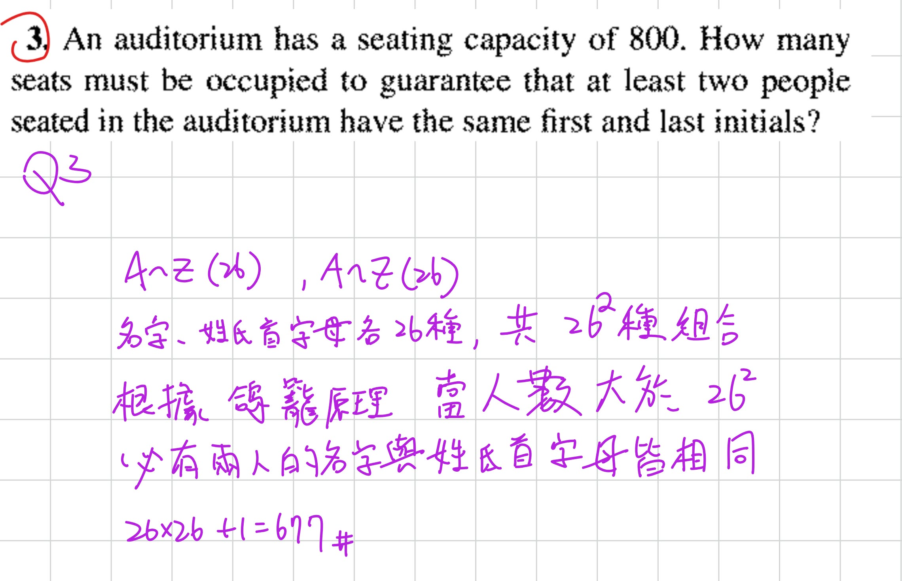

---

鴿籠可以用分組


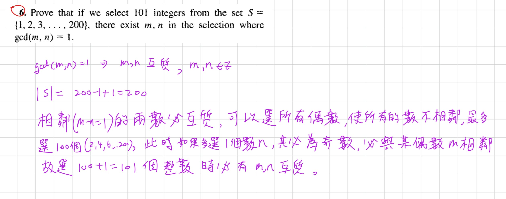


---

鴿籠可以分區塊


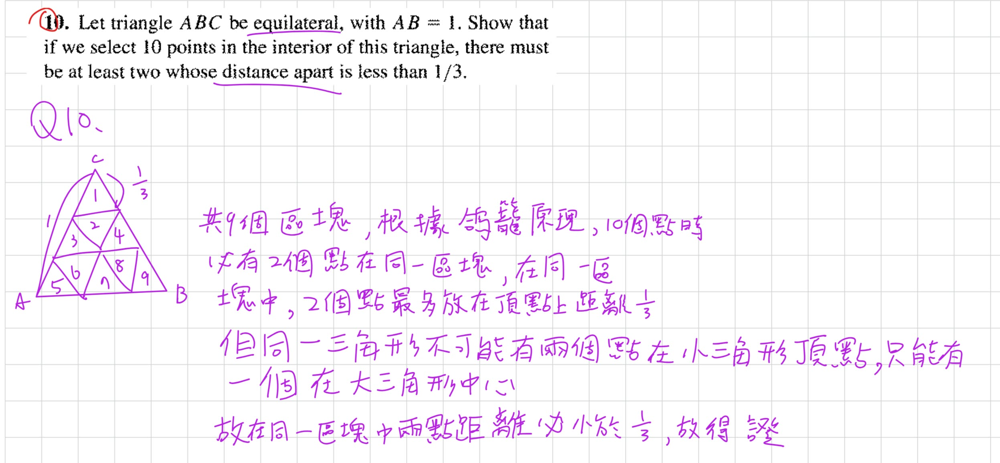


---

鴿籠+前綴合 

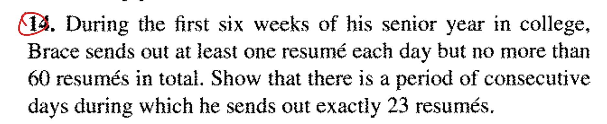


