```
Phase A — Internal Control Surface | TURN=第 1 次對話 | PROMPT=1.17.0 | REFRESH=Manual Prompt Refresh / 新複習流程 | REFRESH_REMINDER=NONE | STATE={MainlineMode=Transcript; MainlineSource=逐字稿_06_11-13.txt; Locator=Session 06 / L1–L75 / 00:00:00–00:05:57; KP=Bijective Function; Boundary=已確認轉入 Function Equality，後續回補檢查未完成; Transcript={Session=06; SessionSource=FilenamePrefix; WithinSessionOrder=NA; TotalLines=4720; Coverage=UNKNOWN; TeachingState=TAUGHT_BRIEF; Signals=老師說明 Definition 5.5、One-one、Onto 與映射例子; ASR=部分口語敘述不精確; Residual=PENDING}; Reference={Aligned=課本 Definition 5.5 待頁碼核對; PrecisionStatus=PARTIAL，PDF 文字無法直接完整擷取}; QuickSheet={Status=PENDING; Type=MustKnow; SourceScope=VERIFIED_ONLY}; Practice={LearningObjective=判斷 bijective 並說明原因; Modality=Mapping Classification; ExpectedArtifact=分類與簡短理由; AcceptedSubmission=中文或英文文字; RequiredModality=NO; TaskOrigin=Generated; ContentFidelity=GENERATED; SourceMatch=NA; AssessmentFidelity=Learning; SubmissionStatus=NOT_SUBMITTED}; AdjQueue=Function Equality / 00:05:57 起; ExerciseDebt=待輸出; TeachingMainlineDebt=後續知識點待處理; AssessmentRequirementDebt=UNKNOWN; ReferenceResolutionDebt=課本精確對齊待查; PastExamDebt=UNKNOWN; Weakness=NONE; Coverage=第六堂尚未完成; Completion=NOT_COMPLETE; Evidence=已讀逐字稿第六堂開頭並確認後續 Function Equality 授課段落; Blockers=無本輪教學阻斷; NextLegal=本知識點練習與批改} | PLAN={ThisResponse=教學 Bijective Function、Exam Quick Sheet、3 個練習; ExpectedDebtChange=輸出練習後等待作答; ExpectedNext=Function Equality}
```

## **⭐ Bijective Function（雙射函數）— 為什麼一對一還不夠？**

主線位置：Teacher Transcript／逐字稿_06_11-13.txt／Session=06／L1–L75／00:00:00–00:05:57

老師提到：Definition 5.5。參考教材：Grimaldi, *Discrete and Combinatorial Mathematics*，精確 PDF 頁碼尚待核對。

這是第六堂課一開始複習的概念。老師先回顧 Bijective Function（雙射函數），接著才進入 Function Equality（函數相等）。

我們先把雙射函數真正弄懂，再進入後面的內容。

### **1. 為什麼需要 Bijective Function？**

假設有兩個集合：

\\[ A=\\{1,2,3\\},\qquad B=\\{a,b,c\\} \\]

我們定義一個 Function（函數）：

\\[ f:A\rightarrow B \\]

意思是：集合 \\(A\\) 的每個元素，都必須有且只有一個對應到集合 \\(B\\) 的元素。

例如：

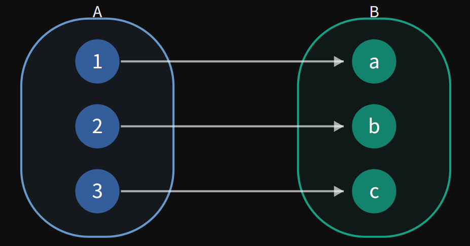

這種對應就是 Bijective，因為它同時滿足兩個條件：

\\[ \boxed{\text{Bijective}=\text{Injective}+\text{Surjective}} \\]

也就是：

**One-to-one（單射）+ Onto（滿射）= Bijective（雙射）**

///單字

injective / one-to-one : 單射  -> 一對一(不可重複)

Surjective / onto : 滿射 -> 全部都被對到(可重複)

Bijective Function : 雙射函數 -> 單射又滿射

///


### **2. One-to-one（單射）是什麼？**

One-to-one 又稱 Injective（單射）。

定義是：

\\[ \boxed{f(a_1)=f(a_2)\Rightarrow a_1=a_2} \\]

意思是：如果兩個輸入得到相同輸出，那麼這兩個輸入必須是同一個元素。

反過來理解更容易：

**不同的輸入，不可以對應到相同的輸出。**

### **3. Onto（滿射）是什麼？**

Onto 又稱 Surjective（滿射）。

定義是：

\\[ \boxed{\forall b\in B,\ \exists a\in A:\ f(a)=b} \\]

意思是：

**集合 B 裡面的每個元素，都必須至少被一個 A 的元素對應到。**

不能有 B 的元素完全沒有人指向它。

### **4. 互動比較：判斷不同映射**

切換下面三種 Mapping（映射），觀察 One-to-one、Onto 與 Bijective 的差別。


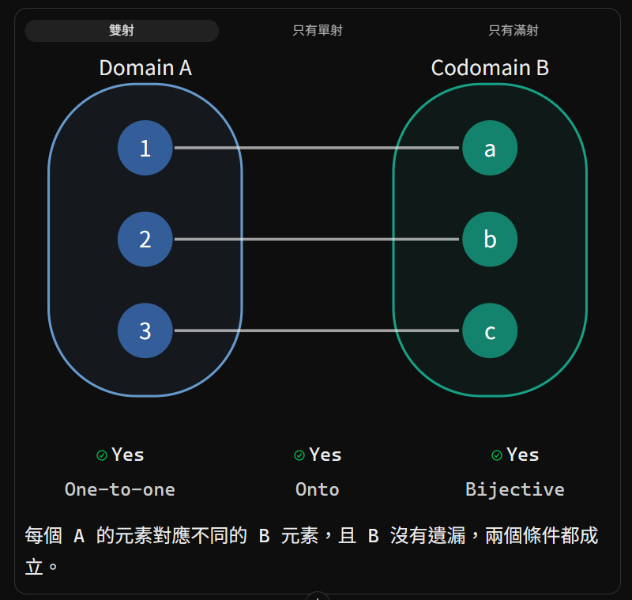

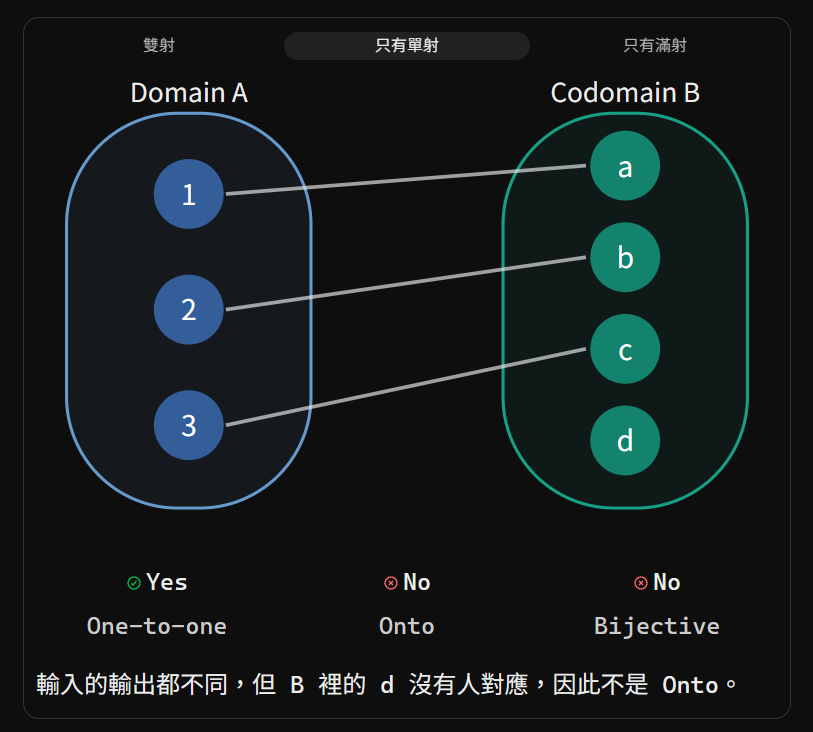

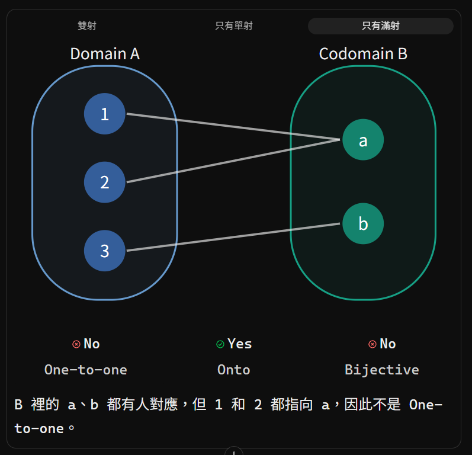

這裡有一個關鍵：**單射不代表滿射，滿射也不代表單射。**

另外要注意，Bijective 並不是要求「圖上剛好有三條箭頭」，而是要求兩個邏輯條件同時成立。

### **5. 常見錯誤與考試判斷方式**

假設：

\\[ f:A\rightarrow B \\]

判斷是否 Bijective，依照這個流程：


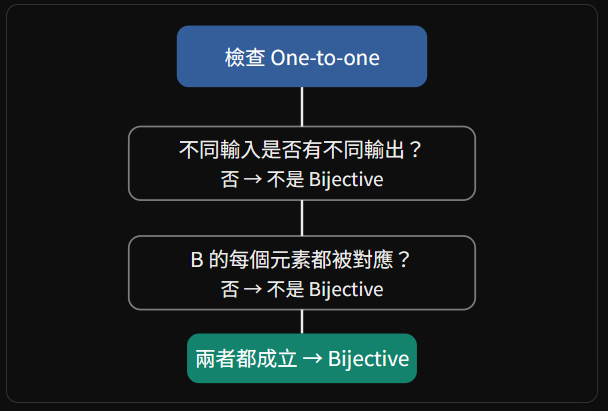

最大的陷阱是把 **Codomain（陪域）** 和實際被對應到的值混淆。即使所有輸入都有輸出，仍然不代表 Onto。

### **6. Exam Quick Sheet（考試速記／最短骨架）**

| 性質                     | 最短判斷                |
| ---------------------- | ------------------- |
| One-to-one / Injective | 不同輸入不能撞到相同輸出        |
| Onto / Surjective      | B 的每個元素都要被命中        |
| Bijective              | One-to-one AND Onto |

\\[ \boxed{\text{Bijective}\iff\text{Injective}\land\text{Surjective}} \\]

### **7. Practice Tasks（練習任務）**

以下三題為 `[Generated: Learning Practice]`，不是老師作業或考古題。請先自己判斷，我會依你的答案批改。

#### **7.1 Task 1 — Classification**

Given \\(A=\\{1,2,3\\}\\) and \\(B=\\{a,b,c\\}\\), let

\\[ f(1)=a,\quad f(2)=b,\quad f(3)=b. \\]

Which statement is correct?

A. Injective only

B. Surjective only

C. Both injective and surjective

D. Neither injective nor surjective

#### **7.2 Task 2 — Classification**

Given \\(A=\\{1,2,3\\}\\) and \\(B=\\{a,b,c,d\\}\\), let

\\[ f(1)=a,\quad f(2)=b,\quad f(3)=c. \\]

Is this function bijective?

A. Yes

B. No

#### **7.3 Task 3 — Explanation**

Explain why a function must satisfy both injectivity and surjectivity to be bijective.

可使用繁體中文或英文，簡短說明即可。

提交三題答案並批改&#x20;

```
Phase A — Internal Control Surface | TURN=第 1 次對話 | PROMPT=1.17.0 | REFRESH=Manual Prompt Refresh; ProgressPreserved=YES | REFRESH_REMINDER=NONE | STATE={MainlineMode=Transcript; MainlineSource=逐字稿_06_11-13.txt; Locator=Session 06 / L77起; PreviousKP=Bijective Function; PreviousPractice=3題已輸出且使用者要求視同答對; PreviousCompletion=USER_ACCEPTED_NOT_INDEPENDENTLY_VERIFIED; KP=Function Equality; Boundary=本輪核對 L77–L379 並延伸至算法與計算成本; Transcript={File=逐字稿_06_11-13.txt; Session=06; SessionSource=FilenamePrefix; Span=L77–L379 / 00:05:57–00:18:49; Coverage=UNKNOWN; TeachingState=TAUGHT_CORE; Signals=Definition 5.17、Common Pitfall、整數與非整數分類、負數例子、計算成本; Residual=PARTIAL}; Reference={Aligned=Definition 5.17; PrecisionStatus=TRANSCRIPT_VERIFIED_TEXTBOOK_PAGE_PENDING}; QuickSheet={Status=PENDING; Type=Mixed; SourceScope=VERIFIED_ONLY}; Practice={LearningObjective=判斷函數相等並以分類證明; Modality=Classification+Proof; ExpectedArtifact=判斷與推導; AcceptedSubmission=文字或手寫; RequiredModality=NO; TaskOrigin=Generated; ContentFidelity=GENERATED; SourceMatch=NA; AssessmentFidelity=Learning; SubmissionStatus=NOT_SUBMITTED}; AdjQueue=函數相等後續計算觀點及下一授課項待核對; ExerciseDebt=待本輪輸出; TeachingMainlineDebt=後續未處理; AssessmentRequirementDebt=UNKNOWN; ReferenceResolutionDebt=課本精確頁碼待核對; PastExamDebt=UNKNOWN; Weakness=NONE; Completion=NOT_COMPLETE; Evidence=本輪重新讀取逐字稿 L46–L435; Blockers=無本輪教學阻斷; NextLegal=完成本知識點練習} | PLAN={ThisResponse=教學 Function Equality 與分類證明並安排練習; ExpectedDebtChange=練習輸出後等待作答; ExpectedNext=批改後依逐字稿接續}
```

上一個 Bijective Function（雙射函數）依你的要求視為答對，不列入錯題，也不再重複練習。

現在依照老師第六堂課的實際順序，進入下一個知識點。

## **⭐ Function Equality（函數相等）— 兩個函數長得不同，卻可能完全相同？**

主線位置：Teacher Transcript／逐字稿_06_11-13.txt／Session=06／L77–L379／00:05:57–00:18:49

對齊參考：老師提到 Definition 5.17；課本 PDF 頁碼尚未核對。教學依本輪重新讀取的逐字稿，知識點邊界為暫定。

### **1. 老師在這段想解決什麼問題？**

假設有兩個函數：

\\[ f(x)=x+x \\]

\\[ g(x)=2x \\]

它們寫法不同，但輸入任何相同的 \\(x\\)，都會得到相同結果。

例如：

| \\(x\\) | \\(f(x)=x+x\\) | \\(g(x)=2x\\) |
| ------- | -------------- | ------------- |
| 1       | 2              | 2             |
| 3       | 6              | 6             |
| -2      | -4             | -4            |

因此，如果兩個函數的 Domain（定義域）和 Codomain（陪域）也一致，就可以認為它們是相同的函數。

**核心原理：函數是否相等，看的不是公式外觀，而是完整的對應關係。**

### **2. Function Equality 的正式定義**

假設：

\\[ f:A\rightarrow B,\qquad g:A\rightarrow B \\]

則：

\\[ \boxed{f=g\iff \forall x\in A,\ f(x)=g(x)} \\]

意思是：對於定義域 \\(A\\) 中的**每一個元素**，兩個函數都要得到相同輸出。

請注意這個符號：

\\[ \forall x\in A \\]

它代表「對所有 \\(x\\)」，不是只要找到幾個相同的例子就算成立。

這正是老師在約 00:09:02 開始強調的 Common Pitfall（常見陷阱）。

### **3. 為什麼不能只代入幾個數字？**

例如：

\\[ f(x)=x^2,\qquad g(x)=|x| \\]

如果只試：

\\[ x=0,\quad x=1,\quad x=-1 \\]

你會得到完全相同的結果。

但是代入 \\(x=2\\)：

\\[ f(2)=4,\qquad g(2)=2 \\]

就發現不相等。

因此，**要證明兩函數相等，必須涵蓋整個 Domain；要證明不相等，只需找到一個 Counterexample（反例）。**

### **4. 老師實際教的例子：Floor 與 Ceiling**

逐字稿約 00:11:09 開始，老師討論兩個從實數映射到整數的函數：

\\[ f,g:\mathbb R\rightarrow\mathbb Z \\]

其中：

\\[ f(x)= \begin{cases} x,&x\in\mathbb Z\\\ \lfloor x\rfloor+1,&x\notin\mathbb Z \end{cases} \\]

另一個是：

\\[ g(x)=\lceil x\rceil \\]

我們要證明：

\\[ \boxed{f=g} \\]

先理解兩個符號：

- Floor（下取整）\\(\lfloor x\rfloor\\)：不大於 \\(x\\) 的最大整數。
- Ceiling（上取整）\\(\lceil x\rceil\\)：不小於 \\(x\\) 的最小整數。

注意：負數的 Floor 和 Ceiling 很容易搞混。

以老師的例子 \\(x=-7.3\\)：

\\[ \lfloor-7.3\rfloor=-8 \\]

\\[ \lceil-7.3\rceil=-7 \\]

因此：

\\[ f(-7.3)=-8+1=-7 \\]

\\[ g(-7.3)=-7 \\]

兩者相等。

### **5. 如何證明這兩個函數對所有實數都相等？**

老師不是只代入幾個例子，而是把實數分成兩種情況來證明。

**Case 1：**\\(x\\)**&#x20;是整數**

根據定義：

\\[ f(x)=x \\]

而整數的 Ceiling 就是它本身：

\\[ g(x)=\lceil x\rceil=x \\]

所以：

\\[ f(x)=g(x) \\]

**Case 2：**\\(x\\)**&#x20;不是整數**

任何非整數實數都能寫成：

\\[ x=n+r,\quad n\in\mathbb Z,\quad 0\<r<1 \\]

這裡 \\(n=\lfloor x\rfloor\\)。

因此：

\\[ f(x)=\lfloor x\rfloor+1=n+1 \\]

同時：

\\[ g(x)=\lceil n+r\rceil=n+1 \\]

所以：

\\[ f(x)=g(x) \\]

兩種情況涵蓋所有實數，因此：

\\[ \boxed{\forall x\in\mathbb R,\ f(x)=g(x)} \\]

這就是完整的證明。

### **6. 老師為什麼認為 Function Equality 很重要？**

老師在約 00:17:23–00:18:10 特別提到一件事：

**相同的 Function，可以有不同的計算方式和不同的計算成本。**

例如：

\\[ f(x)=x+x+x+x \\]

\\[ g(x)=4x \\]

在數學上，兩者對相同輸入給出相同結果，但程式實作可以採用不同計算步驟。

這會連結到後續的 Algorithm Design（演算法設計）與 Computational Cost（計算成本）。

也就是說：

- 函數描述「輸入和輸出的關係」。
- 演算法描述「如何計算出輸出」。

老師正在建立的觀念是：**找到解答，與找到有效率的解答，是兩件不同的事情。**

### **7. Exam Quick Sheet（考試速記／最短骨架）**

**Function Equality：**

\\[ \boxed{f=g\iff\forall x\in A,\ f(x)=g(x)} \\]

**Proof Skeleton（證明骨架）：**

1. 確認相同 Domain 與 Codomain。
2. 將所有輸入分成完整、互不遺漏的情況。
3. 在每種情況證明 \\(f(x)=g(x)\\)。
4. 推得 \\(f=g\\)。

**Common Trap：** 代入幾個數字相等，不等於已證明所有數字都相等。

### **8. Practice Tasks（練習任務）**

以下為 Generated Learning Practice（自行生成的學習練習），非老師原題。

#### **8.1 Task 1 — Function Equality**

Let \\(f,g:\mathbb R\rightarrow\mathbb R\\) be defined by

\\[ f(x)=(x+1)^2 \\]

\\[ g(x)=x^2+2x+1 \\]

Are \\(f\\) and \\(g\\) equal functions?

A. Yes

B. No

#### **8.2 Task 2 — Counterexample**

Let \\(f,g:\mathbb R\rightarrow\mathbb R\\) be defined by

\\[ f(x)=x^2,\qquad g(x)=|x| \\]

Find one value of \\(x\\) for which \\(f(x)\ne g(x)\\).

#### **8.3 Task 3 — Proof by Cases**

Let \\(f,g:\mathbb R\rightarrow\mathbb Z\\) be defined by

\\[ f(x)= \begin{cases} x,&x\in\mathbb Z\\\ \lfloor x\rfloor+1,&x\notin\mathbb Z \end{cases} \qquad g(x)=\lceil x\rceil. \\]

Prove that \\(f=g\\) by considering two cases: integer and non-integer inputs.

提交答案並批改&#x20;


```
Phase A — Internal Control Surface | TURN=第 1 次對話 | PROMPT=1.17.0 | REFRESH=Manual Prompt Refresh; ProgressPreserved=YES | REFRESH_REMINDER=NONE | STATE={MainlineMode=Transcript; MainlineSource=逐字稿_06_11-13.txt; Locator=Session 06 / L466–L579 / 00:22:16–00:27:40; PreviousKP=Function Equality; PreviousPractice=3題由使用者要求視同答對; PreviousCompletion=USER_ACCEPTED_NOT_INDEPENDENTLY_VERIFIED; KP=Composite Function; Boundary=已核對主題於00:27:40轉入Theorem 5.5; Transcript={File=逐字稿_06_11-13.txt; Session=06; SessionSource=FilenamePrefix; WithinSessionOrder=NA; Span=L466–L579; Coverage=UNKNOWN; TeachingState=TAUGHT_CORE; Signals=Definition 5.18,Example 5.13,先f後g,略過後續較複雜計算範例; Correction=NONE_FOUND_IN_SPAN; ASR=符號發音須以數學記號校準; Residual=LOCAL_CHECK}; Reference={Aligned=Definition 5.18與Example 5.13; Confidence=MEDIUM; PrecisionStatus=逐字稿核對,課本頁碼待核對}; QuickSheet={Status=PENDING; Type=ProcedureSkeleton; SourceScope=VERIFIED_ONLY}; Practice={LearningObjective=正確計算複合函數並辨別順序; Modality=TableCompletion+Calculation; ExpectedArtifact=複合函數輸出; AcceptedSubmission=文字或手寫; RequiredModality=NO; TaskOrigin=Generated; SourceReopened=NA; SourceIdentity=NA; ContentFidelity=GENERATED; SourceMatch=NA; AssessmentFidelity=Learning; SubmissionStatus=NOT_SUBMITTED}; AdjQueue=Theorem 5.5單射與滿射之複合性質; ExerciseDebt=本輪待輸出; TeachingMainlineDebt=後續主線未處理; AssessmentRequirementDebt=UNKNOWN; ReferenceResolutionDebt=課本頁碼未核對; PastExamDebt=UNKNOWN; Weakness=NONE; Coverage=第六堂進行中; Completion=NOT_COMPLETE; Evidence=本輪重新核對逐字稿L366–L710; Blockers=無本輪阻斷; NextLegal=練習後接Theorem 5.5} | PLAN={ThisResponse=教學Composite Function及其計算,輸出Exam Quick Sheet及3題; ExpectedDebtChange=輸出練習後等待作答; ExpectedNext=批改並進入Theorem 5.5}
```

Function Equality（函數相等）的練習依你的要求視同答對，不列錯題，但不代表已獨立驗證證明能力。

上一段老師還補充：**相同函數可以有不同計算方法，數學上的相等不代表計算成本相同。** 接著老師才正式進入下一個主題。

## **⭐ Composite Function（複合函數）— 如何把兩個函數組合起來？**

主線位置：Teacher Transcript／逐字稿_06_11-13.txt／Session=06／L466–L579／00:22:16–00:27:40

對齊參考：老師提到 Definition 5.18、Example 5.13；課本 PDF 頁碼尚未核對。自然邊界：00:27:40 轉入 Theorem 5.5。

### **1. Composite Function 要解決什麼問題？**

假設有兩個函數：

\\[ f:A\rightarrow B \\]

\\[ g:B\rightarrow C \\]

第一個函數 \\(f\\) 把 \\(A\\) 的元素轉換到 \\(B\\)，第二個函數 \\(g\\) 再把 \\(B\\) 的元素轉換到 \\(C\\)。

那我們能不能把這兩次轉換合併，直接得到一個從 \\(A\\) 到 \\(C\\) 的函數？

可以。這就是 Composite Function（複合函數）。

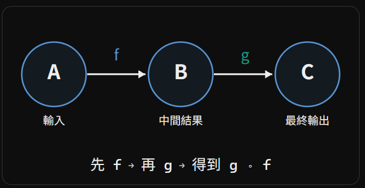

生活例子：先把攝氏溫度轉成華氏，再將華氏溫度轉成一段顯示文字。兩個函數的輸出與輸入可以接起來，就能形成一個完整的轉換流程。

### **2. 複合函數的正式定義**

\\[ \boxed{(g\circ f)(x)=g(f(x))} \\]

這裡的 \\(\circ\\) 是 Function Composition（函數合成）符號。

**最重要的規則：從右邊開始計算。**

\\[ g\circ f \\]

代表先執行 \\(f\\)，再執行 \\(g\\)。

不是先執行 \\(g\\)。

這也是老師在約 00:23:13–00:23:57 特別說明的順序規則。

### **3. 實際計算一次**

假設：

\\[ f(x)=2x+1 \\]

\\[ g(x)=x^2 \\]

要計算：

\\[ (g\circ f)(3) \\]

第一步，先算內層：

\\[ f(3)=2(3)+1=7 \\]

第二步，把結果交給外層：

\\[ g(7)=7^2=49 \\]

因此：

\\[ \boxed{(g\circ f)(3)=49} \\]

但如果順序顛倒：

\\[ (f\circ g)(3)=f(g(3)) \\]

就會先算：

\\[ g(3)=9 \\]

再算：

\\[ f(9)=19 \\]

得到：

\\[ \boxed{(f\circ g)(3)=19} \\]

可以看到：

\\[ \boxed{g\circ f\ne f\circ g} \\]

在這個例子中，兩個順序產生不同結果，所以兩個複合函數不相等。

### **5. 老師的 Example 5.13：使用對應表計算**

老師在約 00:25:06–00:27:28 示範一個集合對應例子。

定義：

\\[ A=\\{1,2,3,4\\} \\]

\\[ B=\\{a,b,c\\},\quad C=\\{w,x,y,z\\} \\]

依逐字稿可確認的對應關係：

| A 的輸入 | \\(f\\) 的輸出 | \\(g\\) 的輸出 |
| ----- | ----------- | ----------- |
| 1     | a           | x           |
| 2     | a           | x           |
| 3     | b           | y           |
| 4     | c           | z           |

所以：

\\[ (g\circ f)(1)=g(a)=x \\]

\\[ (g\circ f)(2)=g(a)=x \\]

\\[ (g\circ f)(3)=g(b)=y \\]

\\[ (g\circ f)(4)=g(c)=z \\]

最後：

\\[ \boxed{g\circ f=\\{(1,x),(2,x),(3,y),(4,z)\\}} \\]

你會發現 1 和 2 可以得到相同輸出。這不會使它失去 Function（函數）的資格；只是表示這個複合函數不是 Injective（單射）。

老師在這個例子之後說，更複雜的計算範例不再逐一示範，知道操作方式即可。接著進入 Theorem 5.5，討論單射與滿射的複合性質。

### **6. Exam Quick Sheet（考試速記／最短骨架）**

**Formula：**

\\[ \boxed{(g\circ f)(x)=g(f(x))} \\]

**Procedure Skeleton：**

輸入 \\(x\\) → 算 \\(f(x)\\) → 將結果代入 \\(g\\) → 得到 \\(g(f(x))\\)。

**Common Trap：** \\(g\circ f\\) 是先 \\(f\\) 後 \\(g\\)；不能隨意交換順序。

### **7. Practice Tasks（練習任務）**

[Generated: Learning Practice]，非課本原題或考古題。

#### **7.1 Task 1 — Calculation**

Given

\\[ f(x)=3x+2,\quad g(x)=x^2 \\]

Calculate \\((g\circ f)(2)\\).

#### **7.2 Task 2 — Reverse Order**

Using the same functions,

\\[ f(x)=3x+2,\quad g(x)=x^2 \\]

Calculate \\((f\circ g)(2)\\).

#### **7.3 Task 3 — Mapping Table**

Given the functions:

| Input | \\(f\\) | \\(g\\) |
| ----- | ------- | ------- |
| 1     | a       | —       |
| 2     | b       | —       |
| 3     | a       | —       |
| a     | —       | x       |
| b     | —       | y       |

Complete the outputs of \\((g\circ f)(1)\\), \\((g\circ f)(2)\\), and \\((g\circ f)(3)\\).

(g ∘ f)(1)

(g ∘ f)(2)

(g ∘ f)(3)

提交答案並批改&#x20;


```
Phase A — Internal Control Surface | TURN=第 1 次對話 | PROMPT=1.17.0 | REFRESH=Manual Prompt Refresh; ProgressPreserved=YES | REFRESH_REMINDER=NONE | STATE={MainlineMode=Transcript; MainlineSource=逐字稿_06_11-13.txt; Locator=Session 06 / L581–L723 / 00:27:40–00:34:45; KP=Theorem 5.5; Boundary=VERIFIED_LOCAL; Transcript={File=逐字稿_06_11-13.txt; Session=06; SessionSource=FilenamePrefix; WithinSessionOrder=NA; Span=L581–L723; Coverage=UNKNOWN; TeachingState=TAUGHT_CORE; Signals=證明單射及滿射之複合性質、強調證明順序及定理重要性; ASR=以數學定義校準符號; Residual=局部已確認下一主題為Theorem 5.6}; Reference={Aligned=Theorem 5.5; Confidence=MEDIUM; PrecisionStatus=逐字稿已核對、課本原頁未核對}; QuickSheet={Status=PENDING; Type=ProofSkeleton; SourceScope=已確認授課內容}; Practice={LearningObjective=理解及證明複合函數保持單射與滿射; Modality=ProofCompletion; ExpectedArtifact=兩種證明; AcceptedSubmission=文字、公式或手寫; RequiredModality=YES; TaskOrigin=Generated; ContentFidelity=GENERATED; SourceMatch=NA; AssessmentFidelity=Learning; SubmissionStatus=NOT_SUBMITTED}; AdjQueue=Theorem 5.6; ExerciseDebt=待輸出; TeachingMainlineDebt=後續主線待處理; AssessmentRequirementDebt=UNKNOWN; ReferenceResolutionDebt=課本原頁對齊待核對; PastExamDebt=UNKNOWN; Weakness=NONE; Coverage=第六堂進行中; Completion=NOT_COMPLETE; Evidence=本輪重新核對逐字稿L581–L727; Blockers=無本輪教學阻斷; NextLegal=練習後接Theorem 5.6} | PLAN={ThisResponse=教學Theorem 5.5兩項證明並安排練習; ExpectedDebtChange=輸出練習等待作答; ExpectedNext=批改後接Theorem 5.6}
```

上一個 Composite Function（複合函數）的三題練習依你的要求視同答對，不列錯題，但不視為已獨立驗證計算能力。

現在繼續第六堂課。老師在複合函數之後，進入 **Theorem 5.5（定理 5.5）**，而且明確強調這個定理很重要，要知道怎麼證明。

## **⭐ Theorem 5.5 — 為什麼兩個單射或滿射組合後，仍保有相同性質？**

主線位置：Teacher Transcript／逐字稿\_06\_11-13.txt／Session=06／L581–L723／00:27:40–00:34:45

對齊參考：課本 Theorem 5.5，原頁碼尚未核對。自然邊界：老師在 00:34:45 轉入 Theorem 5.6。

### **1\. Theorem 5.5 要證明什麼？**

假設有兩個函數：

\[
f:A\rightarrow B,\qquad g:B\rightarrow C
\]

複合函數：

\[
g\circ f:A\rightarrow C
\]

定理要說明兩件事：

1. 如果 \(f\)、\(g\) 都是 Injective（單射），那麼 \(g\circ f\) 也是單射。
2. 如果 \(f\)、\(g\) 都是 Surjective（滿射），那麼 \(g\circ f\) 也是滿射。

![](data:image/svg+xml;charset=utf-8,%3Csvg%20font-family%3D%22%26quot%3BPEICD%20Local%203%20Latin%26quot%3B%2C%20%26quot%3BPEICD%20Local%204%20CJK%26quot%3B%2C%20%26quot%3BNoto%20Sans%20TC%26quot%3B%2C%20%26quot%3BNoto%20Sans%20CJK%20TC%26quot%3B%2C%20%26quot%3BCascadia%20Mono%26quot%3B%2C%20%26quot%3BMicrosoft%20JhengHei%26quot%3B%2C%20%26quot%3BSegoe%20UI%26quot%3B%2C%20sans-serif%22%20font-weight%3D%22400%22%20data-d-component%3D%22svg%22%20fill%3D%22currentColor%22%20style%3D%22color%3Argb%28237%2C%20237%2C%20237%29%22%20viewBox%3D%220%200%20336%20135%22%20width%3D%22100%25%22%20xmlns%3D%22http%3A%2F%2Fwww.w3.org%2F2000%2Fsvg%22%3E%3Ccircle%20cx%3D%2241%22%20cy%3D%2262%22%20r%3D%2231%22%20fill%3D%22%23537fb3%22%20fill-opacity%3D%22.15%22%20stroke%3D%22%23537fb3%22%20stroke-width%3D%221.7%22%2F%3E%3Ctext%20x%3D%2241%22%20y%3D%2268%22%20text-anchor%3D%22middle%22%20font-size%3D%2220%22%20fill%3D%22currentColor%22%3EA%3C%2Ftext%3E%3Ccircle%20cx%3D%22168%22%20cy%3D%2262%22%20r%3D%2231%22%20fill%3D%22%23537fb3%22%20fill-opacity%3D%22.15%22%20stroke%3D%22%23537fb3%22%20stroke-width%3D%221.7%22%2F%3E%3Ctext%20x%3D%22168%22%20y%3D%2268%22%20text-anchor%3D%22middle%22%20font-size%3D%2220%22%20fill%3D%22currentColor%22%3EB%3C%2Ftext%3E%3Ccircle%20cx%3D%22295%22%20cy%3D%2262%22%20r%3D%2231%22%20fill%3D%22%23537fb3%22%20fill-opacity%3D%22.15%22%20stroke%3D%22%23537fb3%22%20stroke-width%3D%221.7%22%2F%3E%3Ctext%20x%3D%22295%22%20y%3D%2268%22%20text-anchor%3D%22middle%22%20font-size%3D%2220%22%20fill%3D%22currentColor%22%3EC%3C%2Ftext%3E%3Cpath%20d%3D%22M73%2062%20H135%20M201%2062%20H262%22%20stroke%3D%22currentColor%22%20stroke-width%3D%221.6%22%2F%3E%3Cpath%20d%3D%22M135%2062%20l-8%20-4%20v8Z%20M262%2062%20l-8%20-4%20v8Z%22%20fill%3D%22currentColor%22%2F%3E%3Ctext%20x%3D%22105%22%20y%3D%2249%22%20text-anchor%3D%22middle%22%20fill%3D%22currentColor%22%20font-size%3D%2213%22%3Ef%3C%2Ftext%3E%3Ctext%20x%3D%22231%22%20y%3D%2249%22%20text-anchor%3D%22middle%22%20fill%3D%22currentColor%22%20font-size%3D%2213%22%3Eg%3C%2Ftext%3E%3Cpath%20d%3D%22M42%2024%20Q168%20-35%20294%2024%22%20stroke%3D%22%2316a085%22%20stroke-width%3D%221.8%22%20fill%3D%22none%22%2F%3E%3Cpath%20d%3D%22M294%2024%20l-9%20-4%202%209Z%22%20fill%3D%22%2316a085%22%2F%3E%3Ctext%20x%3D%22168%22%20y%3D%2215%22%20text-anchor%3D%22middle%22%20fill%3D%22%2316a085%22%20font-size%3D%2213%22%3Eg%20%E2%88%98%20f%3C%2Ftext%3E%3Ctext%20x%3D%22168%22%20y%3D%22123%22%20text-anchor%3D%22middle%22%20font-size%3D%2212%22%20fill%3D%22currentColor%22%3E%E5%85%88%20f%EF%BC%8C%E5%86%8D%20g%3C%2Ftext%3E%3C%2Fsvg%3E)

這不是說所有複合函數都是單射或滿射，而是說**當兩個組成函數都具有該性質時，複合後也會保留該性質**。

### **2\. 第一部分：證明單射**

先回想單射的正式定義：

\[
\boxed{f(a_1)=f(a_2)\Rightarrow a_1=a_2}
\]

也就是：如果輸出相同，就能推得輸入相同。

我們的目標是證明：

\[
(g\circ f)(a_1)=(g\circ f)(a_2)
\Rightarrow a_1=a_2
\]

**步驟一：假設複合函數輸出相同。**

任取 \(a_1,a_2\in A\)，假設：

\[
(g\circ f)(a_1)=(g\circ f)(a_2)
\]

展開 Composite Function（複合函數）定義：

\[
g(f(a_1))=g(f(a_2))
\]

**步驟二：利用 **\(g\)** 是單射。**

因為 \(g\) 的輸出相同，且它是單射，所以它的輸入也必須相同：

\[
f(a_1)=f(a_2)
\]

**步驟三：利用 **\(f\)** 是單射。**

同樣的道理：

\[
f(a_1)=f(a_2)\Rightarrow a_1=a_2
\]

因此：

\[
\boxed{g\circ f\text{ 是 Injective}}
\]

證明的邏輯鏈

\[
g(f(a_1))=g(f(a_2))
\]

<svg width="1em" height="1em" viewBox="0 0 24 24" fill="currentColor" data-d-component="icon" style="color: var(--color-text-secondary); font-size: 16px;"><path fill-rule="evenodd" d="M12.707 18.707a1 1 0 0 1-1.414 0l-5-5a1 1 0 1 1 1.414-1.414L11 15.586V6a1 1 0 1 1 2 0v9.586l3.293-3.293a1 1 0 0 1 1.414 1.414l-5 5Z" clip-rule="evenodd"></path></svg>

因為 g 是單射

\[
f(a_1)=f(a_2)
\]

<svg width="1em" height="1em" viewBox="0 0 24 24" fill="currentColor" data-d-component="icon" style="color: var(--color-text-secondary); font-size: 16px;"><path fill-rule="evenodd" d="M12.707 18.707a1 1 0 0 1-1.414 0l-5-5a1 1 0 1 1 1.414-1.414L11 15.586V6a1 1 0 1 1 2 0v9.586l3.293-3.293a1 1 0 0 1 1.414 1.414l-5 5Z" clip-rule="evenodd"></path></svg>

因為 f 是單射

\[
a_1=a_2
\]

老師特別提到證明的順序：**先使用 **\(g\)** 的單射性，再使用 **\(f\)** 的單射性。**

為什麼？因為你一開始知道的是最外層 \(g\) 的輸出相同，必須先消去外層，才能進一步處理內層。

### **3\. 第二部分：證明滿射**

滿射的定義是：

\[
\boxed{\forall b\in B,\ \exists a\in A:\ f(a)=b}
\]

簡單來說：Codomain（陪域）裡的每個元素，都至少能找到一個輸入對應到它。

現在要證明：

\[
g\circ f:A\rightarrow C
\]

也是滿射。

因此，我們必須證明：

\[
\forall z\in C,\ \exists x\in A:
g(f(x))=z
\]

**步驟一：任取一個 **\(z\in C\)**。**

由於 \(g:B\rightarrow C\) 是滿射，所以一定存在 \(y\in B\)，使得：

\[
g(y)=z
\]

**步驟二：利用 **\(f\)** 也是滿射。**

既然 \(y\in B\)，一定存在 \(x\in A\)，使得：

\[
f(x)=y
\]

**步驟三：把兩個關係結合。**

\[
g(f(x))=g(y)=z
\]

所以：

\[
\boxed{\forall z\in C,\ \exists x\in A:g(f(x))=z}
\]

這正是滿射的定義，因此 \(g\circ f\) 是滿射。

滿射的證明：從終點往回找

![](data:image/svg+xml;charset=utf-8,%3Csvg%20font-family%3D%22%26quot%3BPEICD%20Local%203%20Latin%26quot%3B%2C%20%26quot%3BPEICD%20Local%204%20CJK%26quot%3B%2C%20%26quot%3BNoto%20Sans%20TC%26quot%3B%2C%20%26quot%3BNoto%20Sans%20CJK%20TC%26quot%3B%2C%20%26quot%3BCascadia%20Mono%26quot%3B%2C%20%26quot%3BMicrosoft%20JhengHei%26quot%3B%2C%20%26quot%3BSegoe%20UI%26quot%3B%2C%20sans-serif%22%20font-weight%3D%22400%22%20data-d-component%3D%22svg%22%20fill%3D%22currentColor%22%20style%3D%22color%3Argb%28237%2C%20237%2C%20237%29%22%20viewBox%3D%220%200%20332%20105%22%20width%3D%22100%25%22%20xmlns%3D%22http%3A%2F%2Fwww.w3.org%2F2000%2Fsvg%22%3E%3Ccircle%20cx%3D%2246%22%20cy%3D%2248%22%20r%3D%2222%22%20fill%3D%22%23537fb3%22%20fill-opacity%3D%22.2%22%20stroke%3D%22%23537fb3%22%2F%3E%3Ctext%20x%3D%2246%22%20y%3D%2253%22%20fill%3D%22currentColor%22%20font-size%3D%2217%22%20text-anchor%3D%22middle%22%3Ex%3C%2Ftext%3E%3Ctext%20x%3D%2246%22%20y%3D%2291%22%20fill%3D%22currentColor%22%20font-size%3D%2212%22%20text-anchor%3D%22middle%22%3EA%3C%2Ftext%3E%3Ccircle%20cx%3D%22166%22%20cy%3D%2248%22%20r%3D%2222%22%20fill%3D%22%23537fb3%22%20fill-opacity%3D%22.2%22%20stroke%3D%22%23537fb3%22%2F%3E%3Ctext%20x%3D%22166%22%20y%3D%2253%22%20fill%3D%22currentColor%22%20font-size%3D%2217%22%20text-anchor%3D%22middle%22%3Ey%3C%2Ftext%3E%3Ctext%20x%3D%22166%22%20y%3D%2291%22%20fill%3D%22currentColor%22%20font-size%3D%2212%22%20text-anchor%3D%22middle%22%3EB%3C%2Ftext%3E%3Ccircle%20cx%3D%22286%22%20cy%3D%2248%22%20r%3D%2222%22%20fill%3D%22%23537fb3%22%20fill-opacity%3D%22.2%22%20stroke%3D%22%23537fb3%22%2F%3E%3Ctext%20x%3D%22286%22%20y%3D%2253%22%20fill%3D%22currentColor%22%20font-size%3D%2217%22%20text-anchor%3D%22middle%22%3Ez%3C%2Ftext%3E%3Ctext%20x%3D%22286%22%20y%3D%2291%22%20fill%3D%22currentColor%22%20font-size%3D%2212%22%20text-anchor%3D%22middle%22%3EC%3C%2Ftext%3E%3Cpath%20d%3D%22M69%2048%20H143%20M189%2048%20H263%22%20stroke%3D%22currentColor%22%20stroke-width%3D%221.5%22%2F%3E%3Cpath%20d%3D%22M143%2048%20l-7%20-4%20v8%20Z%20M263%2048%20l-7%20-4%20v8%20Z%22%20fill%3D%22currentColor%22%2F%3E%3Ctext%20x%3D%22106%22%20y%3D%2237%22%20fill%3D%22currentColor%22%20font-size%3D%2212%22%20text-anchor%3D%22middle%22%3Ef%3C%2Ftext%3E%3Ctext%20x%3D%22226%22%20y%3D%2237%22%20fill%3D%22currentColor%22%20font-size%3D%2212%22%20text-anchor%3D%22middle%22%3Eg%3C%2Ftext%3E%3C%2Fsvg%3E)

先選任意 z，利用 g 的滿射性找到 y，再利用 f 的滿射性找到 x。

這裡和單射證明的操作不同：單射是從輸出相等反推輸入相等；滿射是從目標輸出反向尋找它的來源。

### **4\. 兩個證明為什麼採用不同策略？**

|  | Injective（單射） | Surjective（滿射） |
| --- | --- | --- |
| 要證明 | 輸出相同則輸入相同 | 每個輸出都有來源 |
| 起點 | 假設兩個輸出相等 | 任取一個目標輸出 |
| 使用順序 | 先 \(g\)，再 \(f\) | 先 \(g\)，再 \(f\) |
| 結論 | \(a_1=a_2\) | 存在 \(x\) 使 \(g(f(x))=z\) |

老師在 00:34:33–00:34:45 強調 Theorem 5.5 很重要，因為這類證明雖然只使用基本定義，實際寫的時候卻容易不知道如何開始。

所以考試準備不只需要背結果，也要能從定義推回完整證明。

### **5\. Exam Quick Sheet（考試速記／最短骨架）**

**Theorem 5.5：**

\[
f,g\text{ 都單射}\Rightarrow g\circ f\text{ 單射}
\]

\[
f,g\text{ 都滿射}\Rightarrow g\circ f\text{ 滿射}
\]

**Proof Skeleton：**

單射：

\[
g(f(a_1))=g(f(a_2))
\overset{g}{\Rightarrow}f(a_1)=f(a_2)
\overset{f}{\Rightarrow}a_1=a_2
\]

滿射：

\[
z\in C
\overset{g\text{ 滿射}}{\Longrightarrow}
\exists y\in B:g(y)=z
\]

\[
\overset{f\text{ 滿射}}{\Longrightarrow}
\exists x\in A:f(x)=y
\Longrightarrow g(f(x))=z
\]

### **6\. Practice Tasks（練習任務）**

本輪目標是練會兩種證明的核心步驟，而不是單純背誦結論。以下均為 `[Generated: Learning Practice]`，非課本或考古題原題。

#### **6.1 Task 1 — Injectivity Proof**

Let \(f:A\to B\) and \(g:B\to C\) be injective functions.

Complete the proof that \(g\circ f\) is injective:

\[
g(f(a_1))=g(f(a_2))
\]

Explain why this implies \(a_1=a_2\), identifying which function's injectivity is used at each step.

> 此互動元件需要補上可獨立執行的 HTML／JavaScript 原始碼。

#### **6.2 Task 2 — Surjectivity Proof**

Let \(f:A\to B\) and \(g:B\to C\) be surjective functions.

For an arbitrary \(z\in C\), prove that there exists \(x\in A\) such that:

\[
g(f(x))=z
\]

> 此互動元件需要補上可獨立執行的 HTML／JavaScript 原始碼。

> 此互動元件需要補上可獨立執行的 HTML／JavaScript 原始碼。


```
Phase A — Internal Control Surface | TURN=第 1 次對話 | PROMPT=1.17.0 | REFRESH=YES; ProgressPreserved=YES | REFRESH_REMINDER=NONE | STATE={MainlineMode=Transcript; MainlineSource=逐字稿_06_11-13.txt; Locator=Session 06 / L725–L831 / 00:34:45–00:40:09; KP=Theorem 5.6待教; Boundary=VERIFIED_LOCAL; Transcript={File=逐字稿_06_11-13.txt; Session=06; SessionSource=FilenamePrefix; WithinSessionOrder=NA; Span=L725–L831; Coverage=UNKNOWN; TeachingState=TAUGHT_CORE; Signals=函數複合的兩種括號組合與逐點證明; Scope=結合律; Correction=老師口頭先稱交換律後表示不像交換律，正式應為結合律; ASR=部分口語辨識不精確; Residual=下一項Definition 5.19於L833開始}; Reference={Aligned=Theorem 5.6; PrecisionStatus=已核對逐字稿並以標準函數定義校準，課本原頁UNKNOWN}; QuickSheet={Status=PENDING; Type=ProofSkeleton; SourceScope=本輪已核對範圍}; Practice={LearningObjective=證明複合函數結合律; Modality=Calculation+Proof; ExpectedArtifact=逐點計算及等式證明; AcceptedSubmission=文字或手寫; RequiredModality=YES; TaskOrigin=Generated; SourceReopened=NA; SourceIdentity=NA; ContentFidelity=GENERATED; SourceMatch=NA; AssessmentFidelity=Learning; SubmissionStatus=NOT_SUBMITTED}; AdjQueue=Definition 5.19; ExerciseDebt=本輪待輸出; TeachingMainlineDebt=後續主線待處理; AssessmentRequirementDebt=UNKNOWN; ReferenceResolutionDebt=課本原頁待核對; PastExamDebt=UNKNOWN; Weakness=NONE; Coverage=第六堂進行中; Completion=NOT_COMPLETE; Evidence=前輪Theorem 5.5兩題已輸出且使用者要求視同答對；本輪實讀逐字稿L725–L843; Blockers=無本輪教學阻斷; NextLegal=Theorem 5.6練習後接Definition 5.19} | PLAN={ThisResponse=教學Theorem 5.6並安排練習; ExpectedDebtChange=練習輸出待作答; ExpectedNext=Definition 5.19}
```

Theorem 5.5 的兩題依你的要求視同答對，不列錯題。這不代表已實際驗證完整 Proof（證明）能力，但可以繼續推進。

## **⭐ Theorem 5.6 — Composite Function 的 Associative Law（結合律）**

主線位置：Teacher Transcript／逐字稿\_06\_11-13.txt／Session=06／L725–L831／00:34:45–00:40:09

對齊參考：課本 Theorem 5.6（原頁尚未核對）。自然邊界：已核對，老師於 00:40:09 切換到 Definition 5.19。

### **1\. 這個定理在解決什麼問題？**

我們已經知道兩個函數可以做 Composite Function（複合函數）。

那麼，****如果有三個函數，可以改變括號的位置嗎？****

假設：

\[
f:A\rightarrow B,\quad g:B\rightarrow C,\quad h:C\rightarrow D
\]

Theorem 5.6 要證明：

\[
\boxed{h\circ(g\circ f)=(h\circ g)\circ f}
\]

這叫 Associative Law（結合律）。

意思是：****三個函數做複合時，可以改變先組合哪兩個函數，但不能改變函數的作用順序。****

### **2\. 透過圖形理解兩種組合方式**

![](data:image/svg+xml;charset=utf-8,%3Csvg%20font-family%3D%22%26quot%3BPEICD%20Local%203%20Latin%26quot%3B%2C%20%26quot%3BPEICD%20Local%204%20CJK%26quot%3B%2C%20%26quot%3BNoto%20Sans%20TC%26quot%3B%2C%20%26quot%3BNoto%20Sans%20CJK%20TC%26quot%3B%2C%20%26quot%3BCascadia%20Mono%26quot%3B%2C%20%26quot%3BMicrosoft%20JhengHei%26quot%3B%2C%20%26quot%3BSegoe%20UI%26quot%3B%2C%20sans-serif%22%20font-weight%3D%22400%22%20data-d-component%3D%22svg%22%20fill%3D%22currentColor%22%20style%3D%22color%3Argb%28237%2C%20237%2C%20237%29%22%20viewBox%3D%220%200%20340%20170%22%20width%3D%22100%25%22%20xmlns%3D%22http%3A%2F%2Fwww.w3.org%2F2000%2Fsvg%22%3E%3Ccircle%20cx%3D%2227%22%20cy%3D%2277%22%20r%3D%2223%22%20fill%3D%22%23547ca6%22%20fill-opacity%3D%22.15%22%20stroke%3D%22%23547ca6%22%20stroke-width%3D%221.5%22%2F%3E%3Ctext%20x%3D%2227%22%20y%3D%2282%22%20fill%3D%22currentColor%22%20text-anchor%3D%22middle%22%20font-size%3D%2216%22%3EA%3C%2Ftext%3E%3Ccircle%20cx%3D%22122%22%20cy%3D%2277%22%20r%3D%2223%22%20fill%3D%22%23547ca6%22%20fill-opacity%3D%22.15%22%20stroke%3D%22%23547ca6%22%20stroke-width%3D%221.5%22%2F%3E%3Ctext%20x%3D%22122%22%20y%3D%2282%22%20fill%3D%22currentColor%22%20text-anchor%3D%22middle%22%20font-size%3D%2216%22%3EB%3C%2Ftext%3E%3Ccircle%20cx%3D%22217%22%20cy%3D%2277%22%20r%3D%2223%22%20fill%3D%22%23547ca6%22%20fill-opacity%3D%22.15%22%20stroke%3D%22%23547ca6%22%20stroke-width%3D%221.5%22%2F%3E%3Ctext%20x%3D%22217%22%20y%3D%2282%22%20fill%3D%22currentColor%22%20text-anchor%3D%22middle%22%20font-size%3D%2216%22%3EC%3C%2Ftext%3E%3Ccircle%20cx%3D%22312%22%20cy%3D%2277%22%20r%3D%2223%22%20fill%3D%22%23547ca6%22%20fill-opacity%3D%22.15%22%20stroke%3D%22%23547ca6%22%20stroke-width%3D%221.5%22%2F%3E%3Ctext%20x%3D%22312%22%20y%3D%2282%22%20fill%3D%22currentColor%22%20text-anchor%3D%22middle%22%20font-size%3D%2216%22%3ED%3C%2Ftext%3E%3Cpath%20d%3D%22M50%2077%20h49%22%20stroke%3D%22currentColor%22%20stroke-width%3D%221.4%22%20fill%3D%22none%22%2F%3E%3Cpath%20d%3D%22M99%2077%20l-7%20-4%20v8%20Z%22%20fill%3D%22currentColor%22%2F%3E%3Ctext%20x%3D%2274%22%20y%3D%2267%22%20fill%3D%22currentColor%22%20font-size%3D%2212%22%20text-anchor%3D%22middle%22%3Ef%3C%2Ftext%3E%3Cpath%20d%3D%22M145%2077%20h49%22%20stroke%3D%22currentColor%22%20stroke-width%3D%221.4%22%20fill%3D%22none%22%2F%3E%3Cpath%20d%3D%22M194%2077%20l-7%20-4%20v8%20Z%22%20fill%3D%22currentColor%22%2F%3E%3Ctext%20x%3D%22169%22%20y%3D%2267%22%20fill%3D%22currentColor%22%20font-size%3D%2212%22%20text-anchor%3D%22middle%22%3Eg%3C%2Ftext%3E%3Cpath%20d%3D%22M240%2077%20h49%22%20stroke%3D%22currentColor%22%20stroke-width%3D%221.4%22%20fill%3D%22none%22%2F%3E%3Cpath%20d%3D%22M289%2077%20l-7%20-4%20v8%20Z%22%20fill%3D%22currentColor%22%2F%3E%3Ctext%20x%3D%22264%22%20y%3D%2267%22%20fill%3D%22currentColor%22%20font-size%3D%2212%22%20text-anchor%3D%22middle%22%3Eh%3C%2Ftext%3E%3Cpath%20d%3D%22M27%2048%20Q122%20-7%20217%2048%22%20fill%3D%22none%22%20stroke%3D%22%230d9488%22%20stroke-width%3D%222%22%2F%3E%3Cpath%20d%3D%22M217%2048%20l-9%20-5%202%209%20Z%22%20fill%3D%22%230d9488%22%2F%3E%3Ctext%20x%3D%22122%22%20y%3D%2213%22%20font-size%3D%2212%22%20text-anchor%3D%22middle%22%20fill%3D%22%230d9488%22%3Eg%20%E2%88%98%20f%3C%2Ftext%3E%3Cpath%20d%3D%22M122%20107%20Q217%20158%20312%20107%22%20fill%3D%22none%22%20stroke%3D%22%23b47a26%22%20stroke-width%3D%222%22%2F%3E%3Cpath%20d%3D%22M312%20107%20l-9%201%204%208%20Z%22%20fill%3D%22%23b47a26%22%2F%3E%3Ctext%20x%3D%22218%22%20y%3D%22161%22%20font-size%3D%2212%22%20text-anchor%3D%22middle%22%20fill%3D%22%23b47a26%22%3Eh%20%E2%88%98%20g%3C%2Ftext%3E%3C%2Fsvg%3E)

綠色先組合 g 與 f；橘色先組合 h 與 g。最後都得到從 A 到 D 的函數。

比較兩種組合：

| 組合方式 | 先組合 | 最終計算 |
| --- | --- | --- |
| \(h\circ(g\circ f)\) | \(g\circ f\) | \(h(g(f(x)))\) |
| \((h\circ g)\circ f\) | \(h\circ g\) | \(h(g(f(x)))\) |

不論括號怎麼放，對任意 \(x\in A\)，都仍然依照：

\[
\boxed{x\xrightarrow{f}f(x)\xrightarrow{g}g(f(x))\xrightarrow{h}h(g(f(x)))}
\]

來運算。

### **3\. 用數值實際算一次**

假設：

\[
f(x)=x+1,\quad g(x)=2x,\quad h(x)=x^2
\]

三個函數的定義域與陪域都取 \(\mathbb R\)。

取 \(x=3\)。

****方法一：先組合** \(g\circ f\)**

\[
\begin{aligned}
(g\circ f)(3)&=g(f(3))\\
&=g(4)=8
\end{aligned}
\]

再套入 \(h\)：

\[
h(8)=64
\]

****方法二：先組合** \(h\circ g\)**

先算出：

\[
(h\circ g)(y)=h(2y)=4y^2
\]

因此：

\[
\begin{aligned}
((h\circ g)\circ f)(3)
&=(h\circ g)(4)\\
&=4(4)^2\\
&=64
\end{aligned}
\]

兩種組合的輸出都是 \(64\)。

不過注意：****只驗證** \(x=3\)**，不能證明兩個函數相等。**** 還必須證明對所有 \(x\in A\) 都相等。

### **4\. 正式證明 Theorem 5.6**

你前面曾經問過：

> 兩個函數的定義域與陪域相同，不代表輸入輸出的對應也相同吧？

這個觀念在這裡正好派上用場。

我們知道：

\[
h\circ(g\circ f):A\rightarrow D
\]

\[
(h\circ g)\circ f:A\rightarrow D
\]

但是這還不足以說明它們相等。

所以要任取一個 \(x\in A\)，逐點比較。

****左邊：****

\[
\begin{aligned}
[h\circ(g\circ f)](x)
&=h((g\circ f)(x))\\
&=h(g(f(x)))
\end{aligned}
\]

****右邊：****

\[
\begin{aligned}
[(h\circ g)\circ f](x)
&=(h\circ g)(f(x))\\
&=h(g(f(x)))
\end{aligned}
\]

因此，對所有 \(x\in A\)：

\[
[h\circ(g\circ f)](x)=[(h\circ g)\circ f](x)
\]

加上兩個函數具有相同定義域與陪域，所以根據 Function Equality（函數相等）的定義：

\[
\boxed{h\circ(g\circ f)=(h\circ g)\circ f}
\]

證明完成。

### **5\. 最容易搞混：結合律不等於交換律**

逐字稿中老師起初口頭提到「交換律」，隨後也表示看起來不太像交換律。這裡正式的數學性質是 ****Associative Law（結合律）****，不是 Commutative Law（交換律）。

| 性質 | 公式 | 複合函數 |
| --- | --- | --- |
| 結合律 Associative | \((h\circ g)\circ f=h\circ(g\circ f)\) | ✅ 成立 |
| 交換律 Commutative | \(g\circ f=f\circ g\) | 一般不成立 |

例如令：

\[
f(x)=x+1,\qquad g(x)=2x
\]

則：

\[
(g\circ f)(x)=2x+2
\]

但：

\[
(f\circ g)(x)=2x+1
\]

兩者不相等。

因此你一定要記住：

****結合律可以移動括號，但不可以交換函數的位置。****

### **6\. Exam Quick Sheet（考試速記／最短骨架）**

****Must Know****

\[
\boxed{h\circ(g\circ f)=(h\circ g)\circ f}
\]

****Proof Skeleton****

\[
\begin{aligned}
[h\circ(g\circ f)](x)&=h(g(f(x)))\\
[(h\circ g)\circ f](x)&=h(g(f(x)))
\end{aligned}
\]

對所有 \(x\in A\) 都相等，因此兩函數相等。

****Common Trap：**** 結合律成立，不代表交換律成立。

### **7\. Practice Tasks（練習任務）**

這次安排兩題，分別測量計算能力與證明能力。均為自行生成的 Learning Practice，非正式課本原題。

#### **7.1 Task 1 — Function Composition**

Let:

\[
f(x)=x+2,\quad g(x)=3x,\quad h(x)=x-5
\]

All three functions map \(\mathbb R\) to \(\mathbb R\).

Calculate both expressions at \(x=2\):

\[
[h\circ(g\circ f)](2)
\]

\[
[(h\circ g)\circ f](2)
\]

<iframe title="筆記填答欄" srcdoc="&lt;!doctype html&gt;&lt;html lang=&quot;zh-Hant&quot;&gt;&lt;head&gt;&lt;meta charset=&quot;utf-8&quot;&gt;&lt;meta name=&quot;viewport&quot; content=&quot;width=device-width,initial-scale=1&quot;&gt;&lt;style&gt;
        :root{color-scheme:dark light}*{box-sizing:border-box}body{margin:0;padding:14px;background:#181818;color:#ededed;font:16px/1.6 system-ui,sans-serif}
        main{min-width:0}.notice{font-size:13px;color:#bbb;margin:0 0 12px}.card{border:1px solid #555;border-radius:14px;padding:16px}
        label{display:block}input,textarea,select,button{font:inherit;color:inherit;max-width:100%;border:1px solid #777;border-radius:8px;padding:7px;background:#252525}
        input:not([type=checkbox]):not([type=radio]),textarea,select{width:100%;min-width:0}input[type=range]{accent-color:#72e3fd;padding:0}
        button{cursor:pointer}button:disabled{cursor:default;opacity:.65}button[aria-pressed=true]{border-color:#72e3fd;color:#72e3fd}
        .choices,.steps{display:flex;gap:10px;flex-wrap:wrap;margin:12px 0}.step{flex:1;min-width:110px;background:#252525;border-radius:10px;padding:10px}
        .step output{display:block;font-size:25px;font-weight:600}p{overflow-wrap:anywhere}img,svg,canvas{max-width:100%;height:auto}
        [data-d-component=grid]{grid-template-columns:repeat(auto-fit,minmax(min(100%,140px),1fr))!important}
        math{font-size:1.1em}table{border-collapse:collapse}td,th{padding:6px;border:1px solid #555}
      output[data-answer-feedback]{display:block;min-height:1.6em;margin:6px 0;color:#72e3fd}.answer-controls{margin-top:12px}details{margin:10px 0}input,textarea{opacity:1!important;color:#ededed!important;background:#252525!important}&lt;/style&gt;&lt;/head&gt;&lt;body&gt;&lt;main&gt;&lt;p class=&quot;notice&quot;&gt;離線填答欄：可在筆記內填寫，保留複製當下的內容。&lt;/p&gt;&lt;textarea data-d-component=&quot;textarea&quot; placeholder=&quot;寫出兩邊的計算過程與結果。&quot; id=&quot;_r_5a_&quot; rows=&quot;3&quot; data-lpignore=&quot;true&quot; data-1p-ignore=&quot;true&quot; style=&quot;display: block; flex-flow: row; gap: normal; align-items: normal; justify-content: normal; padding: 10px 14px; margin: 0px; border: 0px rgb(237, 237, 237); border-radius: 0px; background-color: rgba(0, 0, 0, 0); color: rgb(237, 237, 237); font-weight: 400; text-align: start; fill: rgb(0, 0, 0); stroke: none; stroke-width: 1px; font-size: 18px; max-width: 100%;&quot;&gt;&lt;/textarea&gt;&lt;/main&gt;&lt;/body&gt;&lt;/html&gt;" sandbox="allow-scripts" loading="lazy" width="100%" height="210" style="display:block;max-width:100%;border:0;"></iframe>

#### **7.2 Task 2 — Proof of Associativity**

Let \(f:A\to B\), \(g:B\to C\), and \(h:C\to D\).

Prove that:

\[
h\circ(g\circ f)=(h\circ g)\circ f
\]

Your proof must explain why equality of the outputs for every \(x\in A\) establishes equality of the two functions.

<iframe title="筆記填答欄" srcdoc="&lt;!doctype html&gt;&lt;html lang=&quot;zh-Hant&quot;&gt;&lt;head&gt;&lt;meta charset=&quot;utf-8&quot;&gt;&lt;meta name=&quot;viewport&quot; content=&quot;width=device-width,initial-scale=1&quot;&gt;&lt;style&gt;
        :root{color-scheme:dark light}*{box-sizing:border-box}body{margin:0;padding:14px;background:#181818;color:#ededed;font:16px/1.6 system-ui,sans-serif}
        main{min-width:0}.notice{font-size:13px;color:#bbb;margin:0 0 12px}.card{border:1px solid #555;border-radius:14px;padding:16px}
        label{display:block}input,textarea,select,button{font:inherit;color:inherit;max-width:100%;border:1px solid #777;border-radius:8px;padding:7px;background:#252525}
        input:not([type=checkbox]):not([type=radio]),textarea,select{width:100%;min-width:0}input[type=range]{accent-color:#72e3fd;padding:0}
        button{cursor:pointer}button:disabled{cursor:default;opacity:.65}button[aria-pressed=true]{border-color:#72e3fd;color:#72e3fd}
        .choices,.steps{display:flex;gap:10px;flex-wrap:wrap;margin:12px 0}.step{flex:1;min-width:110px;background:#252525;border-radius:10px;padding:10px}
        .step output{display:block;font-size:25px;font-weight:600}p{overflow-wrap:anywhere}img,svg,canvas{max-width:100%;height:auto}
        [data-d-component=grid]{grid-template-columns:repeat(auto-fit,minmax(min(100%,140px),1fr))!important}
        math{font-size:1.1em}table{border-collapse:collapse}td,th{padding:6px;border:1px solid #555}
      output[data-answer-feedback]{display:block;min-height:1.6em;margin:6px 0;color:#72e3fd}.answer-controls{margin-top:12px}details{margin:10px 0}input,textarea{opacity:1!important;color:#ededed!important;background:#252525!important}&lt;/style&gt;&lt;/head&gt;&lt;body&gt;&lt;main&gt;&lt;p class=&quot;notice&quot;&gt;離線填答欄：可在筆記內填寫，保留複製當下的內容。&lt;/p&gt;&lt;textarea data-d-component=&quot;textarea&quot; placeholder=&quot;可用中文或英文，列出左右兩邊對任意 x 的運算，再說明函數相等。&quot; id=&quot;_r_5c_&quot; rows=&quot;4&quot; data-lpignore=&quot;true&quot; data-1p-ignore=&quot;true&quot; style=&quot;display: block; flex-flow: row; gap: normal; align-items: normal; justify-content: normal; padding: 10px 14px; margin: 0px; border: 0px rgb(237, 237, 237); border-radius: 0px; background-color: rgba(0, 0, 0, 0); color: rgb(237, 237, 237); font-weight: 400; text-align: start; fill: rgb(0, 0, 0); stroke: none; stroke-width: 1px; font-size: 18px; max-width: 100%;&quot;&gt;&lt;/textarea&gt;&lt;/main&gt;&lt;/body&gt;&lt;/html&gt;" sandbox="allow-scripts" loading="lazy" width="100%" height="230" style="display:block;max-width:100%;border:0;"></iframe>

<iframe title="教學元件：離線副本" srcdoc="&lt;!doctype html&gt;&lt;html lang=&quot;zh-Hant&quot;&gt;&lt;head&gt;&lt;meta charset=&quot;utf-8&quot;&gt;&lt;meta name=&quot;viewport&quot; content=&quot;width=device-width,initial-scale=1&quot;&gt;&lt;style&gt;
        :root{color-scheme:dark light}*{box-sizing:border-box}body{margin:0;padding:14px;background:#181818;color:#ededed;font:16px/1.6 system-ui,sans-serif}
        main{min-width:0}.notice{font-size:13px;color:#bbb;margin:0 0 12px}.card{border:1px solid #555;border-radius:14px;padding:16px}
        label{display:block}input,textarea,select,button{font:inherit;color:inherit;max-width:100%;border:1px solid #777;border-radius:8px;padding:7px;background:#252525}
        input:not([type=checkbox]):not([type=radio]),textarea,select{width:100%;min-width:0}input[type=range]{accent-color:#72e3fd;padding:0}
        button{cursor:pointer}button:disabled{cursor:default;opacity:.65}button[aria-pressed=true]{border-color:#72e3fd;color:#72e3fd}
        .choices,.steps{display:flex;gap:10px;flex-wrap:wrap;margin:12px 0}.step{flex:1;min-width:110px;background:#252525;border-radius:10px;padding:10px}
        .step output{display:block;font-size:25px;font-weight:600}p{overflow-wrap:anywhere}img,svg,canvas{max-width:100%;height:auto}
        [data-d-component=grid]{grid-template-columns:repeat(auto-fit,minmax(min(100%,140px),1fr))!important}
        math{font-size:1.1em}table{border-collapse:collapse}td,th{padding:6px;border:1px solid #555}
      output[data-answer-feedback]{display:block;min-height:1.6em;margin:6px 0;color:#72e3fd}.answer-controls{margin-top:12px}details{margin:10px 0}input,textarea{opacity:1!important;color:#ededed!important;background:#252525!important}&lt;/style&gt;&lt;/head&gt;&lt;body&gt;&lt;main&gt;&lt;p class=&quot;notice&quot;&gt;離線副本：保留目前畫面與填答欄。原站計算／批改動作需回 ChatGPT 使用。&lt;/p&gt;&lt;button type=&quot;button&quot; data-color=&quot;primary&quot; data-variant=&quot;solid&quot; data-pill=&quot;&quot; data-size=&quot;lg&quot; data-block=&quot;&quot; disabled=&quot;&quot; aria-disabled=&quot;true&quot; tabindex=&quot;-1&quot; data-disabled=&quot;&quot; data-d-component=&quot;button&quot; data-d-block=&quot;&quot; style=&quot;display: block; flex-flow: row; gap: 6px; align-items: normal; justify-content: normal; padding: 0px 15.96px; margin: 16px 0px 0px; border: 0px solid rgb(175, 175, 175); border-radius: 9999px; background-color: rgba(0, 0, 0, 0); color: rgb(175, 175, 175); font-weight: 500; text-align: center; fill: rgb(0, 0, 0); stroke: none; stroke-width: 1px; font-size: 16px; max-width: 100%;&quot;&gt;&lt;span style=&quot;display: flex; flex-flow: row; gap: 6px; align-items: center; justify-content: center; padding: 0px; margin: 0px; border: 0px solid rgb(175, 175, 175); border-radius: 0px; background-color: rgba(0, 0, 0, 0); color: rgb(175, 175, 175); font-weight: 500; text-align: center; fill: rgb(0, 0, 0); stroke: none; stroke-width: 1px; font-size: 16px; max-width: 100%;&quot;&gt;&lt;span style=&quot;display: block; flex-flow: row; gap: normal; align-items: normal; justify-content: normal; padding: 0px; margin: 0px; border: 0px solid rgb(175, 175, 175); border-radius: 0px; background-color: rgba(0, 0, 0, 0); color: rgb(175, 175, 175); font-weight: 500; text-align: center; fill: rgb(0, 0, 0); stroke: none; stroke-width: 1px; font-size: 16px; max-width: 100%;&quot;&gt;提交答案並批改 &lt;/span&gt;&lt;svg width=&quot;1em&quot; height=&quot;1em&quot; viewBox=&quot;0 0 24 24&quot; fill=&quot;currentColor&quot; data-d-component=&quot;icon&quot; data-d-inline=&quot;&quot; style=&quot;display: block; flex-flow: row; gap: normal; align-items: normal; justify-content: normal; padding: 0px; margin: 0px -1px 0px 0px; border: 0px solid rgb(175, 175, 175); border-radius: 0px; background-color: rgba(0, 0, 0, 0); color: rgb(175, 175, 175); font-weight: 500; text-align: center; fill: rgb(175, 175, 175); stroke: none; stroke-width: 1px; font-size: 16px; max-width: 100%;&quot;&gt;&lt;path fill-rule=&quot;evenodd&quot; d=&quot;M18.707 12.707a1 1 0 0 0 0-1.414l-5-5a1 1 0 1 0-1.414 1.414L15.586 11H6a1 1 0 1 0 0 2h9.586l-3.293 3.293a1 1 0 0 0 1.414 1.414l5-5Z&quot; clip-rule=&quot;evenodd&quot; style=&quot;display: inline; flex-flow: row; gap: normal; align-items: normal; justify-content: normal; padding: 0px; margin: 0px; border: 0px solid rgb(175, 175, 175); border-radius: 0px; background-color: rgba(0, 0, 0, 0); color: rgb(175, 175, 175); font-weight: 500; text-align: center; fill: rgb(175, 175, 175); stroke: none; stroke-width: 1px; font-size: 16px; max-width: 100%;&quot;&gt;&lt;/path&gt;&lt;/svg&gt;&lt;/span&gt;&lt;/button&gt;&lt;/main&gt;&lt;/body&gt;&lt;/html&gt;" sandbox="allow-scripts" loading="lazy" width="100%" height="170" style="display:block;max-width:100%;border:0;"></iframe>

<details class="peicd-note-report"><summary>保存清單與來源核對</summary><p>1 張圖片／1 張內嵌；2 個填答欄／2 個保留／0 個可本機核對；50 個來源公式／50 個保存</p><p>依可見頁面匯出；本機答案核對只驗算結果，無法取代推導或證明的批改。</p><table><thead><tr><td>項目</td><td>保存方式</td><td>來源／依據</td><td>限制</td></tr></thead><tbody><tr><td>note-1 圖片</td><td>內嵌圖片</td><td>原頁圖片</td><td>—</td></tr><tr><td>note-2 填答欄</td><td>離線副本</td><td>1 個欄位、0 處原站動作</td><td>沒有明確題目依據時不自動判分</td></tr><tr><td>note-3 填答欄</td><td>離線副本</td><td>1 個欄位、0 處原站動作</td><td>沒有明確題目依據時不自動判分</td></tr><tr><td>note-4 教學元件</td><td>離線副本</td><td>0 個欄位、1 處原站動作</td><td>原站動作未移植</td></tr></tbody></table></details>


```
Phase A — Internal Control Surface | TURN=第 1 次對話 | PROMPT=1.17.0 | REFRESH=Manual Prompt Refresh / 規則刷新且保留學習進度 | REFRESH_REMINDER=NONE | STATE={MainlineMode=Transcript; MainlineSource=逐字稿_06_11-13.txt; Locator=Session 06 / L833–L899 / 00:40:09–00:43:36; KP=Definition 5.19待教; Boundary=已核對至休息前; Transcript={File=逐字稿_06_11-13.txt; Session=06; SessionSource=FilenamePrefix; WithinSessionOrder=NA; Span=L833–L899; Coverage=UNKNOWN; TeachingState=TAUGHT_CORE+ORAL_SUPPLEMENT; Signals=函數重複複合例題及密碼學應用; Scope=自映射與函數冪; Correction=NONE; ASR=密碼學安全性部分需保守解讀; Residual=休息後進入反關係}; Reference={Aligned=Definition 5.19; Confidence=MEDIUM; PrecisionStatus=逐字稿公式已核對，課本原頁UNKNOWN}; QuickSheet={Status=PENDING; Type=Formula+Procedure; SourceScope=已核對逐字稿}; Practice={LearningObjective=計算函數重複複合; Modality=MappingTrace; ExpectedArtifact=映射結果與計算過程; AcceptedSubmission=文字或手寫; RequiredModality=YES; TaskOrigin=Generated; SourceReopened=NA; SourceIdentity=NA; ContentFidelity=GENERATED; SourceMatch=NA; AssessmentFidelity=Learning; SubmissionStatus=NOT_SUBMITTED}; AdjQueue=休息後Definition 5.20; ExerciseDebt=新知識點待出題; TeachingMainlineDebt=後續待處理; AssessmentRequirementDebt=UNKNOWN; ReferenceResolutionDebt=課本原頁低優先待核對; PastExamDebt=UNKNOWN; Weakness=NONE; Coverage=第六堂進行中; Completion=NOT_COMPLETE; Evidence=前輪Theorem 5.6已教且兩題依使用者要求視同答對但證明能力未驗證；本輪重新核對逐字稿L833–L899; Blockers=無; NextLegal=Definition 5.19教學及練習} | PLAN={ThisResponse=教學函數冪、逐步追蹤、提供Exam Quick Sheet與2題練習; ExpectedDebtChange=練習輸出後等待作答; ExpectedNext=Definition 5.20反關係}
```

上一個 Theorem 5.6 的兩題依你的要求視同答對，不列錯題，直接進入下一個知識點。不過完整證明能力仍標記為尚未實際驗證。

## **⭐ Definition 5.19 — Function Iteration（函數反覆複合）：函數也能做次方嗎？**

主線位置：Teacher Transcript／`逐字稿_06_11-13.txt`／Session=06／L833–L899／00:40:09–00:43:36

對齊參考：課本 Definition 5.19（PDF 原頁尚未核對）。

老師在這一段先介紹函數的次方，接著用四個元素的映射表計算 \(f^2\)、\(f^3\)，最後補充密碼學中的相關應用。

### **1\. Function Iteration（函數反覆複合）是什麼？**

你已經學過兩個函數可以組合：

\[
(g\circ f)(x)=g(f(x))
\]

那如果是同一個函數反覆作用呢？

假設：

\[
f:A\rightarrow A
\]

這叫作 Self-map（自映射），也就是輸入與輸出都在同一個集合 \(A\)。

因為輸出仍然屬於 \(A\)，所以可以再把輸出丟進同一個函數。

例如：

\[
f(x)=x+2
\]

連續做三次：

![](data:image/svg+xml;charset=utf-8,%3Csvg%20font-family%3D%22%26quot%3BPEICD%20Local%203%20Latin%26quot%3B%2C%20%26quot%3BPEICD%20Local%204%20CJK%26quot%3B%2C%20%26quot%3BNoto%20Sans%20TC%26quot%3B%2C%20%26quot%3BNoto%20Sans%20CJK%20TC%26quot%3B%2C%20%26quot%3BCascadia%20Mono%26quot%3B%2C%20%26quot%3BMicrosoft%20JhengHei%26quot%3B%2C%20%26quot%3BSegoe%20UI%26quot%3B%2C%20sans-serif%22%20font-weight%3D%22400%22%20data-d-component%3D%22svg%22%20fill%3D%22currentColor%22%20style%3D%22color%3Argb%28237%2C%20237%2C%20237%29%22%20viewBox%3D%220%200%20340%2090%22%20width%3D%22100%25%22%20xmlns%3D%22http%3A%2F%2Fwww.w3.org%2F2000%2Fsvg%22%3E%3Crect%20x%3D%228%22%20y%3D%2235%22%20width%3D%2247%22%20height%3D%2234%22%20rx%3D%228%22%20fill%3D%22%23547ca6%22%20fill-opacity%3D%22.14%22%20stroke%3D%22%23547ca6%22%2F%3E%3Ctext%20x%3D%2231.5%22%20y%3D%2256%22%20text-anchor%3D%22middle%22%20fill%3D%22currentColor%22%20font-size%3D%2216%22%3E1%3C%2Ftext%3E%3Cpath%20d%3D%22M55%2052%20h34%22%20stroke%3D%22currentColor%22%20stroke-width%3D%221.5%22%2F%3E%3Cpath%20d%3D%22M89%2052%20l-6%20-4%20v8%20Z%22%20fill%3D%22currentColor%22%2F%3E%3Ctext%20x%3D%2271%22%20y%3D%2225%22%20text-anchor%3D%22middle%22%20fill%3D%22currentColor%22%20font-size%3D%2212%22%3Ef%3C%2Ftext%3E%3Crect%20x%3D%2291%22%20y%3D%2235%22%20width%3D%2247%22%20height%3D%2234%22%20rx%3D%228%22%20fill%3D%22%23547ca6%22%20fill-opacity%3D%22.14%22%20stroke%3D%22%23547ca6%22%2F%3E%3Ctext%20x%3D%22114.5%22%20y%3D%2256%22%20text-anchor%3D%22middle%22%20fill%3D%22currentColor%22%20font-size%3D%2216%22%3E3%3C%2Ftext%3E%3Cpath%20d%3D%22M138%2052%20h34%22%20stroke%3D%22currentColor%22%20stroke-width%3D%221.5%22%2F%3E%3Cpath%20d%3D%22M172%2052%20l-6%20-4%20v8%20Z%22%20fill%3D%22currentColor%22%2F%3E%3Ctext%20x%3D%22154%22%20y%3D%2225%22%20text-anchor%3D%22middle%22%20fill%3D%22currentColor%22%20font-size%3D%2212%22%3Ef%3C%2Ftext%3E%3Crect%20x%3D%22174%22%20y%3D%2235%22%20width%3D%2247%22%20height%3D%2234%22%20rx%3D%228%22%20fill%3D%22%23547ca6%22%20fill-opacity%3D%22.14%22%20stroke%3D%22%23547ca6%22%2F%3E%3Ctext%20x%3D%22197.5%22%20y%3D%2256%22%20text-anchor%3D%22middle%22%20fill%3D%22currentColor%22%20font-size%3D%2216%22%3E5%3C%2Ftext%3E%3Cpath%20d%3D%22M221%2052%20h34%22%20stroke%3D%22currentColor%22%20stroke-width%3D%221.5%22%2F%3E%3Cpath%20d%3D%22M255%2052%20l-6%20-4%20v8%20Z%22%20fill%3D%22currentColor%22%2F%3E%3Ctext%20x%3D%22237%22%20y%3D%2225%22%20text-anchor%3D%22middle%22%20fill%3D%22currentColor%22%20font-size%3D%2212%22%3Ef%3C%2Ftext%3E%3Crect%20x%3D%22257%22%20y%3D%2235%22%20width%3D%2247%22%20height%3D%2234%22%20rx%3D%228%22%20fill%3D%22%23547ca6%22%20fill-opacity%3D%22.14%22%20stroke%3D%22%23547ca6%22%2F%3E%3Ctext%20x%3D%22280.5%22%20y%3D%2256%22%20text-anchor%3D%22middle%22%20fill%3D%22currentColor%22%20font-size%3D%2216%22%3E7%3C%2Ftext%3E%3C%2Fsvg%3E)起點 1，連續執行三次 f，得到 7。

所以：

\[
\begin{aligned}
f^1(1)&=f(1)=3\\
f^2(1)&=f(f(1))=5\\
f^3(1)&=f(f(f(1)))=7
\end{aligned}
\]

這裡最重要的觀念是：

****函數的次方不是把函數值做乘方，而是把函數重複執行。****

例如：

\[
f^2(x)=f(f(x))
\]

一般而言：

\[
f^2(x)\ne[f(x)]^2
\]

### **2\. Definition 5.19 的正式規則**

對 \(f:A\to A\)，定義：

\[
\boxed{f^1=f}
\]

若 \(n\) 是 Positive Integer（正整數）：

\[
\boxed{f^{n+1}=f\circ f^n}
\]

因此：

\[
\begin{aligned}
f^2&=f\circ f\\
f^3&=f\circ f\circ f\\
f^4&=f\circ f\circ f\circ f
\end{aligned}
\]

這裡只需要理解正整數次的反覆複合；不必先延伸到負次方或其他尚未授課的性質。

### **3\. 老師的映射表例子：如何計算** \(f^2\)**、**\(f^3\)**？**

老師使用：

\[
A=\{1,2,3,4\}
\]

以及下列函數：

\[
f=\{(1,2),(2,2),(3,1),(4,3)\}
\]

也就是：

| \(x\) | \(f(x)\) |
| --- | --- |
| 1 | 2 |
| 2 | 2 |
| 3 | 1 |
| 4 | 3 |

要算 \(f^2(4)\)，不能直接把 \(f(4)=3\) 平方成 9。

你必須再查一次表：

\[
\boxed{f^2(4)=f(f(4))=f(3)=1}
\]

同理：

\[
f^3(4)=f(f^2(4))=f(1)=2
\]

<iframe title="教學元件：離線副本" srcdoc="&lt;!doctype html&gt;&lt;html lang=&quot;zh-Hant&quot;&gt;&lt;head&gt;&lt;meta charset=&quot;utf-8&quot;&gt;&lt;meta name=&quot;viewport&quot; content=&quot;width=device-width,initial-scale=1&quot;&gt;&lt;style&gt;
        :root{color-scheme:dark light}*{box-sizing:border-box}body{margin:0;padding:14px;background:#181818;color:#ededed;font:16px/1.6 system-ui,sans-serif}
        main{min-width:0}.notice{font-size:13px;color:#bbb;margin:0 0 12px}.card{border:1px solid #555;border-radius:14px;padding:16px}
        label{display:block}input,textarea,select,button{font:inherit;color:inherit;max-width:100%;border:1px solid #777;border-radius:8px;padding:7px;background:#252525}
        input:not([type=checkbox]):not([type=radio]),textarea,select{width:100%;min-width:0}input[type=range]{accent-color:#72e3fd;padding:0}
        button{cursor:pointer}button:disabled{cursor:default;opacity:.65}button[aria-pressed=true]{border-color:#72e3fd;color:#72e3fd}
        .choices,.steps{display:flex;gap:10px;flex-wrap:wrap;margin:12px 0}.step{flex:1;min-width:110px;background:#252525;border-radius:10px;padding:10px}
        .step output{display:block;font-size:25px;font-weight:600}p{overflow-wrap:anywhere}img,svg,canvas{max-width:100%;height:auto}
        [data-d-component=grid]{grid-template-columns:repeat(auto-fit,minmax(min(100%,140px),1fr))!important}
        math{font-size:1.1em}table{border-collapse:collapse}td,th{padding:6px;border:1px solid #555}
      output[data-answer-feedback]{display:block;min-height:1.6em;margin:6px 0;color:#72e3fd}.answer-controls{margin-top:12px}details{margin:10px 0}input,textarea{opacity:1!important;color:#ededed!important;background:#252525!important}&lt;/style&gt;&lt;/head&gt;&lt;body&gt;&lt;main&gt;&lt;p class=&quot;notice&quot;&gt;離線副本：保留目前畫面與填答欄。原站計算／批改動作需回 ChatGPT 使用。&lt;/p&gt;&lt;div data-d-component=&quot;box&quot; data-d-direction=&quot;col&quot; data-d-has-border=&quot;&quot; style=&quot;display: flex; flex-flow: column; gap: 12px; align-items: normal; justify-content: normal; padding: 12px; margin: 16px 0px 0px; border: 1px solid rgba(255, 255, 255, 0.15); border-radius: 16px; background-color: rgba(0, 0, 0, 0); color: rgb(237, 237, 237); font-weight: 400; text-align: start; fill: rgb(0, 0, 0); stroke: none; stroke-width: 1px; font-size: 24px; max-width: 100%;&quot;&gt;&lt;div data-d-align=&quot;center&quot; data-d-auto-spacing=&quot;&quot; data-d-component=&quot;row&quot; data-d-direction=&quot;row&quot; data-d-justify=&quot;between&quot; style=&quot;display: flex; flex-flow: row; gap: normal; align-items: center; justify-content: space-between; padding: 0px; margin: 0px; border: 0px solid rgb(237, 237, 237); border-radius: 0px; background-color: rgba(0, 0, 0, 0); color: rgb(237, 237, 237); font-weight: 400; text-align: start; fill: rgb(0, 0, 0); stroke: none; stroke-width: 1px; font-size: 24px; max-width: 100%;&quot;&gt;&lt;p data-d-text-flow=&quot;&quot; data-d-component=&quot;text&quot; style=&quot;display: block; flex-flow: row; gap: normal; align-items: normal; justify-content: normal; padding: 0px; margin: 0px; border: 0px rgb(237, 237, 237); border-radius: 0px; background-color: rgba(0, 0, 0, 0); color: rgb(237, 237, 237); font-weight: 400; text-align: start; fill: rgb(0, 0, 0); stroke: none; stroke-width: 1px; font-size: 24px; max-width: 100%;&quot;&gt;&lt;span data-d-text-flow=&quot;&quot; data-d-component=&quot;text&quot; data-d-default-strong=&quot;&quot; data-d-inline=&quot;&quot; style=&quot;display: inline; flex-flow: row; gap: normal; align-items: normal; justify-content: normal; padding: 0px; margin: 0px; border: 0px rgb(237, 237, 237); border-radius: 0px; background-color: rgba(0, 0, 0, 0); color: rgb(237, 237, 237); font-weight: 600; text-align: start; fill: rgb(0, 0, 0); stroke: none; stroke-width: 1px; font-size: 24px; max-width: 100%;&quot;&gt;&lt;span data-d-stream-run=&quot;&quot; data-d-text-flow=&quot;run&quot; style=&quot;display: inline; flex-flow: row; gap: normal; align-items: normal; justify-content: normal; padding: 0px; margin: 0px; border: 0px solid rgb(237, 237, 237); border-radius: 0px; background-color: rgba(0, 0, 0, 0); color: rgb(237, 237, 237); font-weight: 600; text-align: start; fill: rgb(0, 0, 0); stroke: none; stroke-width: 1px; font-size: 24px; max-width: 100%;&quot;&gt;&lt;strong style=&quot;display: contents; flex-flow: row; gap: normal; align-items: normal; justify-content: normal; padding: 0px; margin: 0px; border: 0px solid rgb(237, 237, 237); border-radius: 0px; background-color: rgba(0, 0, 0, 0); color: rgb(237, 237, 237); font-weight: 600; text-align: start; fill: rgb(0, 0, 0); stroke: none; stroke-width: 1px; font-size: 24px; max-width: 100%;&quot;&gt;互動：改變複合次數&lt;/strong&gt;&lt;/span&gt;&lt;/span&gt;&lt;/p&gt;&lt;p data-d-text-flow=&quot;&quot; data-d-component=&quot;text&quot; data-d-weight=&quot;medium&quot; data-d-tabular-nums=&quot;true&quot; style=&quot;display: block; flex-flow: row; gap: normal; align-items: normal; justify-content: normal; padding: 0px; margin: 0px 0px 0px 8px; border: 0px rgb(205, 205, 205); border-radius: 0px; background-color: rgba(0, 0, 0, 0); color: rgb(205, 205, 205); font-weight: 500; text-align: start; fill: rgb(0, 0, 0); stroke: none; stroke-width: 1px; font-size: 24px; max-width: 100%;&quot;&gt;&lt;span data-d-stream-run=&quot;&quot; data-d-text-flow=&quot;run&quot; style=&quot;display: inline; flex-flow: row; gap: normal; align-items: normal; justify-content: normal; padding: 0px; margin: 0px; border: 0px solid rgb(205, 205, 205); border-radius: 0px; background-color: rgba(0, 0, 0, 0); color: rgb(205, 205, 205); font-weight: 500; text-align: start; fill: rgb(0, 0, 0); stroke: none; stroke-width: 1px; font-size: 24px; max-width: 100%;&quot;&gt;f^2&lt;/span&gt;&lt;/p&gt;&lt;/div&gt;&lt;div data-d-component=&quot;slider&quot; style=&quot;display: block; flex-flow: row; gap: normal; align-items: normal; justify-content: normal; padding: 0px; margin: 0px; border: 0px solid rgb(237, 237, 237); border-radius: 0px; background-color: rgba(0, 0, 0, 0); color: rgb(237, 237, 237); font-weight: 400; text-align: start; fill: rgb(0, 0, 0); stroke: none; stroke-width: 1px; font-size: 24px; max-width: 100%;&quot;&gt;&lt;div style=&quot;display: block; flex-flow: row; gap: normal; align-items: normal; justify-content: normal; padding: 0px; margin: 0px; border: 0px solid rgb(237, 237, 237); border-radius: 0px; background-color: rgba(0, 0, 0, 0); color: rgb(237, 237, 237); font-weight: 400; text-align: start; fill: rgb(0, 0, 0); stroke: none; stroke-width: 1px; font-size: 24px; max-width: 100%;&quot;&gt;&lt;span dir=&quot;ltr&quot; data-orientation=&quot;horizontal&quot; aria-disabled=&quot;false&quot; data-slider-style=&quot;continuous&quot; style=&quot;display: flex; flex-flow: row; gap: normal; align-items: center; justify-content: normal; padding: 0px; margin: 0px; border: 0px solid rgb(237, 237, 237); border-radius: 999px; background-color: rgba(255, 255, 255, 0.06); color: rgb(237, 237, 237); font-weight: 400; text-align: start; fill: rgb(0, 0, 0); stroke: none; stroke-width: 1px; font-size: 24px; max-width: 100%;&quot;&gt;&lt;span data-orientation=&quot;horizontal&quot; style=&quot;display: block; flex-flow: row; gap: normal; align-items: normal; justify-content: normal; padding: 0px; margin: 0px; border: 0px solid rgb(237, 237, 237); border-radius: 999px; background-color: rgba(0, 0, 0, 0); color: rgb(237, 237, 237); font-weight: 400; text-align: start; fill: rgb(0, 0, 0); stroke: none; stroke-width: 1px; font-size: 24px; max-width: 100%;&quot;&gt;&lt;span data-orientation=&quot;horizontal&quot; style=&quot;display: block; flex-flow: row; gap: normal; align-items: normal; justify-content: normal; padding: 0px; margin: 0px; border: 0px solid rgb(237, 237, 237); border-radius: 999px; background-color: rgba(0, 0, 0, 0); color: rgb(237, 237, 237); font-weight: 400; text-align: start; fill: rgb(0, 0, 0); stroke: none; stroke-width: 1px; font-size: 24px; max-width: 100%;&quot;&gt;&lt;/span&gt;&lt;/span&gt;&lt;span style=&quot;display: block; flex-flow: row; gap: normal; align-items: normal; justify-content: normal; padding: 0px; margin: 0px; border: 0px solid rgb(237, 237, 237); border-radius: 0px; background-color: rgba(0, 0, 0, 0); color: rgb(237, 237, 237); font-weight: 400; text-align: start; fill: rgb(0, 0, 0); stroke: none; stroke-width: 1px; font-size: 24px; max-width: 100%;&quot;&gt;&lt;label&gt;滑桿目前值：2&lt;/label&gt;&lt;/span&gt;&lt;/span&gt;&lt;div style=&quot;display: block; flex-flow: row; gap: normal; align-items: normal; justify-content: normal; padding: 0px; margin: 4px 0px 0px; border: 0px solid rgb(237, 237, 237); border-radius: 0px; background-color: rgba(0, 0, 0, 0); color: rgb(237, 237, 237); font-weight: 400; text-align: start; fill: rgb(0, 0, 0); stroke: none; stroke-width: 1px; font-size: 24px; max-width: 100%;&quot;&gt;&lt;div style=&quot;display: block; flex-flow: row; gap: normal; align-items: normal; justify-content: normal; padding: 0px; margin: 0px; border: 0px solid rgb(237, 237, 237); border-radius: 0px; background-color: rgba(0, 0, 0, 0); color: rgb(237, 237, 237); font-weight: 400; text-align: start; fill: rgb(0, 0, 0); stroke: none; stroke-width: 1px; font-size: 24px; max-width: 100%;&quot;&gt;&lt;div data-mark=&quot;true&quot; style=&quot;display: block; flex-flow: row; gap: normal; align-items: normal; justify-content: normal; padding: 0px; margin: 0px; border: 0px solid rgb(237, 237, 237); border-radius: 0px; background-color: rgba(0, 0, 0, 0); color: rgb(237, 237, 237); font-weight: 400; text-align: start; fill: rgb(0, 0, 0); stroke: none; stroke-width: 1px; font-size: 14px; max-width: 100%;&quot;&gt;&lt;span style=&quot;display: inline-block; flex-flow: row; gap: normal; align-items: normal; justify-content: normal; padding: 0px; margin: 0px; border: 0px solid rgb(237, 237, 237); border-radius: 0px; background-color: rgba(0, 0, 0, 0); color: rgb(237, 237, 237); font-weight: 400; text-align: center; fill: rgb(0, 0, 0); stroke: none; stroke-width: 1px; font-size: 14px; max-width: 100%;&quot;&gt;1&lt;/span&gt;&lt;/div&gt;&lt;div data-mark=&quot;true&quot; style=&quot;display: block; flex-flow: row; gap: normal; align-items: normal; justify-content: normal; padding: 0px; margin: 0px; border: 0px solid rgb(237, 237, 237); border-radius: 0px; background-color: rgba(0, 0, 0, 0); color: rgb(237, 237, 237); font-weight: 400; text-align: start; fill: rgb(0, 0, 0); stroke: none; stroke-width: 1px; font-size: 14px; max-width: 100%;&quot;&gt;&lt;span style=&quot;display: inline-block; flex-flow: row; gap: normal; align-items: normal; justify-content: normal; padding: 0px; margin: 0px; border: 0px solid rgb(237, 237, 237); border-radius: 0px; background-color: rgba(0, 0, 0, 0); color: rgb(237, 237, 237); font-weight: 400; text-align: center; fill: rgb(0, 0, 0); stroke: none; stroke-width: 1px; font-size: 14px; max-width: 100%;&quot;&gt;2&lt;/span&gt;&lt;/div&gt;&lt;div data-mark=&quot;true&quot; style=&quot;display: block; flex-flow: row; gap: normal; align-items: normal; justify-content: normal; padding: 0px; margin: 0px; border: 0px solid rgb(237, 237, 237); border-radius: 0px; background-color: rgba(0, 0, 0, 0); color: rgb(237, 237, 237); font-weight: 400; text-align: start; fill: rgb(0, 0, 0); stroke: none; stroke-width: 1px; font-size: 14px; max-width: 100%;&quot;&gt;&lt;span style=&quot;display: inline-block; flex-flow: row; gap: normal; align-items: normal; justify-content: normal; padding: 0px; margin: 0px; border: 0px solid rgb(237, 237, 237); border-radius: 0px; background-color: rgba(0, 0, 0, 0); color: rgb(237, 237, 237); font-weight: 400; text-align: center; fill: rgb(0, 0, 0); stroke: none; stroke-width: 1px; font-size: 14px; max-width: 100%;&quot;&gt;3&lt;/span&gt;&lt;/div&gt;&lt;div data-mark=&quot;true&quot; style=&quot;display: block; flex-flow: row; gap: normal; align-items: normal; justify-content: normal; padding: 0px; margin: 0px; border: 0px solid rgb(237, 237, 237); border-radius: 0px; background-color: rgba(0, 0, 0, 0); color: rgb(237, 237, 237); font-weight: 400; text-align: start; fill: rgb(0, 0, 0); stroke: none; stroke-width: 1px; font-size: 14px; max-width: 100%;&quot;&gt;&lt;span style=&quot;display: inline-block; flex-flow: row; gap: normal; align-items: normal; justify-content: normal; padding: 0px; margin: 0px; border: 0px solid rgb(237, 237, 237); border-radius: 0px; background-color: rgba(0, 0, 0, 0); color: rgb(237, 237, 237); font-weight: 400; text-align: center; fill: rgb(0, 0, 0); stroke: none; stroke-width: 1px; font-size: 14px; max-width: 100%;&quot;&gt;4&lt;/span&gt;&lt;/div&gt;&lt;div data-mark=&quot;true&quot; style=&quot;display: block; flex-flow: row; gap: normal; align-items: normal; justify-content: normal; padding: 0px; margin: 0px; border: 0px solid rgb(237, 237, 237); border-radius: 0px; background-color: rgba(0, 0, 0, 0); color: rgb(237, 237, 237); font-weight: 400; text-align: start; fill: rgb(0, 0, 0); stroke: none; stroke-width: 1px; font-size: 14px; max-width: 100%;&quot;&gt;&lt;span style=&quot;display: inline-block; flex-flow: row; gap: normal; align-items: normal; justify-content: normal; padding: 0px; margin: 0px; border: 0px solid rgb(237, 237, 237); border-radius: 0px; background-color: rgba(0, 0, 0, 0); color: rgb(237, 237, 237); font-weight: 400; text-align: center; fill: rgb(0, 0, 0); stroke: none; stroke-width: 1px; font-size: 14px; max-width: 100%;&quot;&gt;5&lt;/span&gt;&lt;/div&gt;&lt;/div&gt;&lt;/div&gt;&lt;/div&gt;&lt;/div&gt;&lt;div data-d-column-sizing=&quot;auto&quot; data-d-component=&quot;table&quot; style=&quot;display: flex; flex-flow: column; gap: normal; align-items: normal; justify-content: normal; padding: 0px; margin: 0px -12px; border: 0px solid rgb(237, 237, 237); border-radius: 0px; background-color: rgba(0, 0, 0, 0); color: rgb(237, 237, 237); font-weight: 400; text-align: start; fill: rgb(0, 0, 0); stroke: none; stroke-width: 1px; font-size: 24px; max-width: 100%;&quot;&gt;&lt;div data-d-table-viewport=&quot;true&quot; style=&quot;display: block; flex-flow: row; gap: normal; align-items: normal; justify-content: normal; padding: 0px 12px; margin: 0px; border: 0px solid rgb(237, 237, 237); border-radius: 0px; background-color: rgba(0, 0, 0, 0); color: rgb(237, 237, 237); font-weight: 400; text-align: start; fill: rgb(0, 0, 0); stroke: none; stroke-width: 1px; font-size: 24px; max-width: 100%;&quot;&gt;&lt;table data-d-column-sizing=&quot;auto&quot; data-d-dividers=&quot;&quot; style=&quot;display: table; flex-flow: row; gap: normal; align-items: normal; justify-content: normal; padding: 0px; margin: 0px; border: 0px solid rgb(237, 237, 237); border-radius: 0px; background-color: rgba(0, 0, 0, 0); color: rgb(237, 237, 237); font-weight: 400; text-align: start; fill: rgb(0, 0, 0); stroke: none; stroke-width: 1px; font-size: 24px; max-width: 100%;&quot;&gt;&lt;tbody style=&quot;display: table-row-group; flex-flow: row; gap: normal; align-items: normal; justify-content: normal; padding: 0px; margin: 0px; border: 0px solid rgb(237, 237, 237); border-radius: 0px; background-color: rgba(0, 0, 0, 0); color: rgb(237, 237, 237); font-weight: 400; text-align: start; fill: rgb(0, 0, 0); stroke: none; stroke-width: 1px; font-size: 24px; max-width: 100%;&quot;&gt;&lt;tr data-d-component=&quot;table-row&quot; style=&quot;display: table-row; flex-flow: row; gap: normal; align-items: normal; justify-content: normal; padding: 0px; margin: 0px; border-radius: 0px; background-color: rgba(0, 0, 0, 0); color: rgb(237, 237, 237); font-weight: 400; text-align: start; fill: rgb(0, 0, 0); stroke: none; stroke-width: 1px; font-size: 24px; max-width: 100%;&quot;&gt;&lt;td data-d-component=&quot;table-cell&quot; data-d-has-width=&quot;&quot; data-d-valign=&quot;start&quot; style=&quot;display: table-cell; flex-flow: row; gap: normal; align-items: normal; justify-content: normal; padding: 8px 8px 8px 0px; margin: 0px; border: 0px solid rgb(237, 237, 237); border-radius: 0px; background-color: rgba(0, 0, 0, 0); color: rgb(237, 237, 237); font-weight: 400; text-align: start; fill: rgb(0, 0, 0); stroke: none; stroke-width: 1px; font-size: 14px; max-width: 100%;&quot;&gt;&lt;p data-d-text-flow=&quot;&quot; data-d-component=&quot;text&quot; style=&quot;display: block; flex-flow: row; gap: normal; align-items: normal; justify-content: normal; padding: 0px; margin: 0px; border: 0px rgb(237, 237, 237); border-radius: 0px; background-color: rgba(0, 0, 0, 0); color: rgb(237, 237, 237); font-weight: 400; text-align: start; fill: rgb(0, 0, 0); stroke: none; stroke-width: 1px; font-size: 21px; max-width: 100%;&quot;&gt;&lt;span data-d-stream-run=&quot;&quot; data-d-text-flow=&quot;run&quot; style=&quot;display: inline; flex-flow: row; gap: normal; align-items: normal; justify-content: normal; padding: 0px; margin: 0px; border: 0px solid rgb(237, 237, 237); border-radius: 0px; background-color: rgba(0, 0, 0, 0); color: rgb(237, 237, 237); font-weight: 400; text-align: start; fill: rgb(0, 0, 0); stroke: none; stroke-width: 1px; font-size: 21px; max-width: 100%;&quot;&gt;起點 &lt;/span&gt;&lt;span data-d-component=&quot;math&quot; dir=&quot;ltr&quot; data-d-stream-inline=&quot;&quot; style=&quot;display: inline; flex-flow: row; gap: normal; align-items: normal; justify-content: normal; padding: 0px; margin: 0px; border: 0px solid rgb(237, 237, 237); border-radius: 0px; background-color: rgba(0, 0, 0, 0); color: rgb(237, 237, 237); font-weight: 400; text-align: start; fill: rgb(0, 0, 0); stroke: none; stroke-width: 1px; font-size: 21px; max-width: 100%;&quot;&gt;&lt;math xmlns=&quot;http://www.w3.org/1998/Math/MathML&quot;&gt;&lt;semantics&gt;&lt;mrow&gt;&lt;mi&gt;x&lt;/mi&gt;&lt;/mrow&gt;&lt;annotation encoding=&quot;application/x-tex&quot;&gt;x&lt;/annotation&gt;&lt;/semantics&gt;&lt;/math&gt;&lt;/span&gt;&lt;/p&gt;&lt;/td&gt;&lt;td data-d-component=&quot;table-cell&quot; data-d-valign=&quot;start&quot; style=&quot;display: table-cell; flex-flow: row; gap: normal; align-items: normal; justify-content: normal; padding: 8px; margin: 0px; border: 0px solid rgb(237, 237, 237); border-radius: 0px; background-color: rgba(0, 0, 0, 0); color: rgb(237, 237, 237); font-weight: 400; text-align: start; fill: rgb(0, 0, 0); stroke: none; stroke-width: 1px; font-size: 14px; max-width: 100%;&quot;&gt;逐步追蹤&lt;/td&gt;&lt;td data-d-align=&quot;end&quot; data-d-component=&quot;table-cell&quot; data-d-valign=&quot;start&quot; style=&quot;display: table-cell; flex-flow: row; gap: normal; align-items: normal; justify-content: normal; padding: 8px 0px 8px 8px; margin: 0px; border: 0px solid rgb(237, 237, 237); border-radius: 0px; background-color: rgba(0, 0, 0, 0); color: rgb(237, 237, 237); font-weight: 400; text-align: end; fill: rgb(0, 0, 0); stroke: none; stroke-width: 1px; font-size: 14px; max-width: 100%;&quot;&gt;結果&lt;/td&gt;&lt;/tr&gt;&lt;tr data-d-component=&quot;table-row&quot; style=&quot;display: table-row; flex-flow: row; gap: normal; align-items: normal; justify-content: normal; padding: 0px; margin: 0px; border-radius: 0px; background-color: rgba(0, 0, 0, 0); color: rgb(237, 237, 237); font-weight: 400; text-align: start; fill: rgb(0, 0, 0); stroke: none; stroke-width: 1px; font-size: 24px; max-width: 100%;&quot;&gt;&lt;td data-d-component=&quot;table-cell&quot; data-d-valign=&quot;start&quot; style=&quot;display: table-cell; flex-flow: row; gap: normal; align-items: normal; justify-content: normal; padding: 8px 8px 8px 0px; margin: 0px; border: 0px solid rgb(237, 237, 237); border-radius: 0px; background-color: rgba(0, 0, 0, 0); color: rgb(237, 237, 237); font-weight: 400; text-align: start; fill: rgb(0, 0, 0); stroke: none; stroke-width: 1px; font-size: 14px; max-width: 100%;&quot;&gt;&lt;p data-d-text-flow=&quot;&quot; data-d-component=&quot;text&quot; data-d-weight=&quot;medium&quot; data-d-tabular-nums=&quot;true&quot; style=&quot;display: block; flex-flow: row; gap: normal; align-items: normal; justify-content: normal; padding: 0px; margin: 0px; border: 0px rgb(237, 237, 237); border-radius: 0px; background-color: rgba(0, 0, 0, 0); color: rgb(237, 237, 237); font-weight: 500; text-align: start; fill: rgb(0, 0, 0); stroke: none; stroke-width: 1px; font-size: 21px; max-width: 100%;&quot;&gt;&lt;span data-d-stream-run=&quot;&quot; data-d-text-flow=&quot;run&quot; style=&quot;display: inline; flex-flow: row; gap: normal; align-items: normal; justify-content: normal; padding: 0px; margin: 0px; border: 0px solid rgb(237, 237, 237); border-radius: 0px; background-color: rgba(0, 0, 0, 0); color: rgb(237, 237, 237); font-weight: 500; text-align: start; fill: rgb(0, 0, 0); stroke: none; stroke-width: 1px; font-size: 21px; max-width: 100%;&quot;&gt;1&lt;/span&gt;&lt;/p&gt;&lt;/td&gt;&lt;td data-d-component=&quot;table-cell&quot; data-d-valign=&quot;start&quot; style=&quot;display: table-cell; flex-flow: row; gap: normal; align-items: normal; justify-content: normal; padding: 8px; margin: 0px; border: 0px solid rgb(237, 237, 237); border-radius: 0px; background-color: rgba(0, 0, 0, 0); color: rgb(237, 237, 237); font-weight: 400; text-align: start; fill: rgb(0, 0, 0); stroke: none; stroke-width: 1px; font-size: 14px; max-width: 100%;&quot;&gt;&lt;p data-d-text-flow=&quot;&quot; data-d-component=&quot;text&quot; data-d-size=&quot;sm&quot; data-d-tabular-nums=&quot;true&quot; style=&quot;display: block; flex-flow: row; gap: normal; align-items: normal; justify-content: normal; padding: 0px; margin: 0px; border: 0px rgb(237, 237, 237); border-radius: 0px; background-color: rgba(0, 0, 0, 0); color: rgb(237, 237, 237); font-weight: 400; text-align: start; fill: rgb(0, 0, 0); stroke: none; stroke-width: 1px; font-size: 21px; max-width: 100%;&quot;&gt;&lt;span data-d-stream-run=&quot;&quot; data-d-text-flow=&quot;run&quot; style=&quot;display: inline; flex-flow: row; gap: normal; align-items: normal; justify-content: normal; padding: 0px; margin: 0px; border: 0px solid rgb(237, 237, 237); border-radius: 0px; background-color: rgba(0, 0, 0, 0); color: rgb(237, 237, 237); font-weight: 400; text-align: start; fill: rgb(0, 0, 0); stroke: none; stroke-width: 1px; font-size: 21px; max-width: 100%;&quot;&gt;1 → 2 → 2&lt;/span&gt;&lt;/p&gt;&lt;/td&gt;&lt;td data-d-align=&quot;end&quot; data-d-component=&quot;table-cell&quot; data-d-valign=&quot;start&quot; style=&quot;display: table-cell; flex-flow: row; gap: normal; align-items: normal; justify-content: normal; padding: 8px 0px 8px 8px; margin: 0px; border: 0px solid rgb(237, 237, 237); border-radius: 0px; background-color: rgba(0, 0, 0, 0); color: rgb(237, 237, 237); font-weight: 400; text-align: end; fill: rgb(0, 0, 0); stroke: none; stroke-width: 1px; font-size: 14px; max-width: 100%;&quot;&gt;&lt;p data-d-text-flow=&quot;&quot; data-d-component=&quot;text&quot; data-d-weight=&quot;medium&quot; data-d-tabular-nums=&quot;true&quot; style=&quot;display: block; flex-flow: row; gap: normal; align-items: normal; justify-content: normal; padding: 0px; margin: 0px; border: 0px rgb(237, 237, 237); border-radius: 0px; background-color: rgba(0, 0, 0, 0); color: rgb(237, 237, 237); font-weight: 500; text-align: end; fill: rgb(0, 0, 0); stroke: none; stroke-width: 1px; font-size: 21px; max-width: 100%;&quot;&gt;&lt;span data-d-stream-run=&quot;&quot; data-d-text-flow=&quot;run&quot; style=&quot;display: inline; flex-flow: row; gap: normal; align-items: normal; justify-content: normal; padding: 0px; margin: 0px; border: 0px solid rgb(237, 237, 237); border-radius: 0px; background-color: rgba(0, 0, 0, 0); color: rgb(237, 237, 237); font-weight: 500; text-align: end; fill: rgb(0, 0, 0); stroke: none; stroke-width: 1px; font-size: 21px; max-width: 100%;&quot;&gt;2&lt;/span&gt;&lt;/p&gt;&lt;/td&gt;&lt;/tr&gt;&lt;tr data-d-component=&quot;table-row&quot; style=&quot;display: table-row; flex-flow: row; gap: normal; align-items: normal; justify-content: normal; padding: 0px; margin: 0px; border-radius: 0px; background-color: rgba(0, 0, 0, 0); color: rgb(237, 237, 237); font-weight: 400; text-align: start; fill: rgb(0, 0, 0); stroke: none; stroke-width: 1px; font-size: 24px; max-width: 100%;&quot;&gt;&lt;td data-d-component=&quot;table-cell&quot; data-d-valign=&quot;start&quot; style=&quot;display: table-cell; flex-flow: row; gap: normal; align-items: normal; justify-content: normal; padding: 8px 8px 8px 0px; margin: 0px; border: 0px solid rgb(237, 237, 237); border-radius: 0px; background-color: rgba(0, 0, 0, 0); color: rgb(237, 237, 237); font-weight: 400; text-align: start; fill: rgb(0, 0, 0); stroke: none; stroke-width: 1px; font-size: 14px; max-width: 100%;&quot;&gt;&lt;p data-d-text-flow=&quot;&quot; data-d-component=&quot;text&quot; data-d-weight=&quot;medium&quot; data-d-tabular-nums=&quot;true&quot; style=&quot;display: block; flex-flow: row; gap: normal; align-items: normal; justify-content: normal; padding: 0px; margin: 0px; border: 0px rgb(237, 237, 237); border-radius: 0px; background-color: rgba(0, 0, 0, 0); color: rgb(237, 237, 237); font-weight: 500; text-align: start; fill: rgb(0, 0, 0); stroke: none; stroke-width: 1px; font-size: 21px; max-width: 100%;&quot;&gt;&lt;span data-d-stream-run=&quot;&quot; data-d-text-flow=&quot;run&quot; style=&quot;display: inline; flex-flow: row; gap: normal; align-items: normal; justify-content: normal; padding: 0px; margin: 0px; border: 0px solid rgb(237, 237, 237); border-radius: 0px; background-color: rgba(0, 0, 0, 0); color: rgb(237, 237, 237); font-weight: 500; text-align: start; fill: rgb(0, 0, 0); stroke: none; stroke-width: 1px; font-size: 21px; max-width: 100%;&quot;&gt;2&lt;/span&gt;&lt;/p&gt;&lt;/td&gt;&lt;td data-d-component=&quot;table-cell&quot; data-d-valign=&quot;start&quot; style=&quot;display: table-cell; flex-flow: row; gap: normal; align-items: normal; justify-content: normal; padding: 8px; margin: 0px; border: 0px solid rgb(237, 237, 237); border-radius: 0px; background-color: rgba(0, 0, 0, 0); color: rgb(237, 237, 237); font-weight: 400; text-align: start; fill: rgb(0, 0, 0); stroke: none; stroke-width: 1px; font-size: 14px; max-width: 100%;&quot;&gt;&lt;p data-d-text-flow=&quot;&quot; data-d-component=&quot;text&quot; data-d-size=&quot;sm&quot; data-d-tabular-nums=&quot;true&quot; style=&quot;display: block; flex-flow: row; gap: normal; align-items: normal; justify-content: normal; padding: 0px; margin: 0px; border: 0px rgb(237, 237, 237); border-radius: 0px; background-color: rgba(0, 0, 0, 0); color: rgb(237, 237, 237); font-weight: 400; text-align: start; fill: rgb(0, 0, 0); stroke: none; stroke-width: 1px; font-size: 21px; max-width: 100%;&quot;&gt;&lt;span data-d-stream-run=&quot;&quot; data-d-text-flow=&quot;run&quot; style=&quot;display: inline; flex-flow: row; gap: normal; align-items: normal; justify-content: normal; padding: 0px; margin: 0px; border: 0px solid rgb(237, 237, 237); border-radius: 0px; background-color: rgba(0, 0, 0, 0); color: rgb(237, 237, 237); font-weight: 400; text-align: start; fill: rgb(0, 0, 0); stroke: none; stroke-width: 1px; font-size: 21px; max-width: 100%;&quot;&gt;2 → 2 → 2&lt;/span&gt;&lt;/p&gt;&lt;/td&gt;&lt;td data-d-align=&quot;end&quot; data-d-component=&quot;table-cell&quot; data-d-valign=&quot;start&quot; style=&quot;display: table-cell; flex-flow: row; gap: normal; align-items: normal; justify-content: normal; padding: 8px 0px 8px 8px; margin: 0px; border: 0px solid rgb(237, 237, 237); border-radius: 0px; background-color: rgba(0, 0, 0, 0); color: rgb(237, 237, 237); font-weight: 400; text-align: end; fill: rgb(0, 0, 0); stroke: none; stroke-width: 1px; font-size: 14px; max-width: 100%;&quot;&gt;&lt;p data-d-text-flow=&quot;&quot; data-d-component=&quot;text&quot; data-d-weight=&quot;medium&quot; data-d-tabular-nums=&quot;true&quot; style=&quot;display: block; flex-flow: row; gap: normal; align-items: normal; justify-content: normal; padding: 0px; margin: 0px; border: 0px rgb(237, 237, 237); border-radius: 0px; background-color: rgba(0, 0, 0, 0); color: rgb(237, 237, 237); font-weight: 500; text-align: end; fill: rgb(0, 0, 0); stroke: none; stroke-width: 1px; font-size: 21px; max-width: 100%;&quot;&gt;&lt;span data-d-stream-run=&quot;&quot; data-d-text-flow=&quot;run&quot; style=&quot;display: inline; flex-flow: row; gap: normal; align-items: normal; justify-content: normal; padding: 0px; margin: 0px; border: 0px solid rgb(237, 237, 237); border-radius: 0px; background-color: rgba(0, 0, 0, 0); color: rgb(237, 237, 237); font-weight: 500; text-align: end; fill: rgb(0, 0, 0); stroke: none; stroke-width: 1px; font-size: 21px; max-width: 100%;&quot;&gt;2&lt;/span&gt;&lt;/p&gt;&lt;/td&gt;&lt;/tr&gt;&lt;tr data-d-component=&quot;table-row&quot; style=&quot;display: table-row; flex-flow: row; gap: normal; align-items: normal; justify-content: normal; padding: 0px; margin: 0px; border-radius: 0px; background-color: rgba(0, 0, 0, 0); color: rgb(237, 237, 237); font-weight: 400; text-align: start; fill: rgb(0, 0, 0); stroke: none; stroke-width: 1px; font-size: 24px; max-width: 100%;&quot;&gt;&lt;td data-d-component=&quot;table-cell&quot; data-d-valign=&quot;start&quot; style=&quot;display: table-cell; flex-flow: row; gap: normal; align-items: normal; justify-content: normal; padding: 8px 8px 8px 0px; margin: 0px; border: 0px solid rgb(237, 237, 237); border-radius: 0px; background-color: rgba(0, 0, 0, 0); color: rgb(237, 237, 237); font-weight: 400; text-align: start; fill: rgb(0, 0, 0); stroke: none; stroke-width: 1px; font-size: 14px; max-width: 100%;&quot;&gt;&lt;p data-d-text-flow=&quot;&quot; data-d-component=&quot;text&quot; data-d-weight=&quot;medium&quot; data-d-tabular-nums=&quot;true&quot; style=&quot;display: block; flex-flow: row; gap: normal; align-items: normal; justify-content: normal; padding: 0px; margin: 0px; border: 0px rgb(237, 237, 237); border-radius: 0px; background-color: rgba(0, 0, 0, 0); color: rgb(237, 237, 237); font-weight: 500; text-align: start; fill: rgb(0, 0, 0); stroke: none; stroke-width: 1px; font-size: 21px; max-width: 100%;&quot;&gt;&lt;span data-d-stream-run=&quot;&quot; data-d-text-flow=&quot;run&quot; style=&quot;display: inline; flex-flow: row; gap: normal; align-items: normal; justify-content: normal; padding: 0px; margin: 0px; border: 0px solid rgb(237, 237, 237); border-radius: 0px; background-color: rgba(0, 0, 0, 0); color: rgb(237, 237, 237); font-weight: 500; text-align: start; fill: rgb(0, 0, 0); stroke: none; stroke-width: 1px; font-size: 21px; max-width: 100%;&quot;&gt;3&lt;/span&gt;&lt;/p&gt;&lt;/td&gt;&lt;td data-d-component=&quot;table-cell&quot; data-d-valign=&quot;start&quot; style=&quot;display: table-cell; flex-flow: row; gap: normal; align-items: normal; justify-content: normal; padding: 8px; margin: 0px; border: 0px solid rgb(237, 237, 237); border-radius: 0px; background-color: rgba(0, 0, 0, 0); color: rgb(237, 237, 237); font-weight: 400; text-align: start; fill: rgb(0, 0, 0); stroke: none; stroke-width: 1px; font-size: 14px; max-width: 100%;&quot;&gt;&lt;p data-d-text-flow=&quot;&quot; data-d-component=&quot;text&quot; data-d-size=&quot;sm&quot; data-d-tabular-nums=&quot;true&quot; style=&quot;display: block; flex-flow: row; gap: normal; align-items: normal; justify-content: normal; padding: 0px; margin: 0px; border: 0px rgb(237, 237, 237); border-radius: 0px; background-color: rgba(0, 0, 0, 0); color: rgb(237, 237, 237); font-weight: 400; text-align: start; fill: rgb(0, 0, 0); stroke: none; stroke-width: 1px; font-size: 21px; max-width: 100%;&quot;&gt;&lt;span data-d-stream-run=&quot;&quot; data-d-text-flow=&quot;run&quot; style=&quot;display: inline; flex-flow: row; gap: normal; align-items: normal; justify-content: normal; padding: 0px; margin: 0px; border: 0px solid rgb(237, 237, 237); border-radius: 0px; background-color: rgba(0, 0, 0, 0); color: rgb(237, 237, 237); font-weight: 400; text-align: start; fill: rgb(0, 0, 0); stroke: none; stroke-width: 1px; font-size: 21px; max-width: 100%;&quot;&gt;3 → 1 → 2&lt;/span&gt;&lt;/p&gt;&lt;/td&gt;&lt;td data-d-align=&quot;end&quot; data-d-component=&quot;table-cell&quot; data-d-valign=&quot;start&quot; style=&quot;display: table-cell; flex-flow: row; gap: normal; align-items: normal; justify-content: normal; padding: 8px 0px 8px 8px; margin: 0px; border: 0px solid rgb(237, 237, 237); border-radius: 0px; background-color: rgba(0, 0, 0, 0); color: rgb(237, 237, 237); font-weight: 400; text-align: end; fill: rgb(0, 0, 0); stroke: none; stroke-width: 1px; font-size: 14px; max-width: 100%;&quot;&gt;&lt;p data-d-text-flow=&quot;&quot; data-d-component=&quot;text&quot; data-d-weight=&quot;medium&quot; data-d-tabular-nums=&quot;true&quot; style=&quot;display: block; flex-flow: row; gap: normal; align-items: normal; justify-content: normal; padding: 0px; margin: 0px; border: 0px rgb(237, 237, 237); border-radius: 0px; background-color: rgba(0, 0, 0, 0); color: rgb(237, 237, 237); font-weight: 500; text-align: end; fill: rgb(0, 0, 0); stroke: none; stroke-width: 1px; font-size: 21px; max-width: 100%;&quot;&gt;&lt;span data-d-stream-run=&quot;&quot; data-d-text-flow=&quot;run&quot; style=&quot;display: inline; flex-flow: row; gap: normal; align-items: normal; justify-content: normal; padding: 0px; margin: 0px; border: 0px solid rgb(237, 237, 237); border-radius: 0px; background-color: rgba(0, 0, 0, 0); color: rgb(237, 237, 237); font-weight: 500; text-align: end; fill: rgb(0, 0, 0); stroke: none; stroke-width: 1px; font-size: 21px; max-width: 100%;&quot;&gt;2&lt;/span&gt;&lt;/p&gt;&lt;/td&gt;&lt;/tr&gt;&lt;tr data-d-component=&quot;table-row&quot; style=&quot;display: table-row; flex-flow: row; gap: normal; align-items: normal; justify-content: normal; padding: 0px; margin: 0px; border-radius: 0px; background-color: rgba(0, 0, 0, 0); color: rgb(237, 237, 237); font-weight: 400; text-align: start; fill: rgb(0, 0, 0); stroke: none; stroke-width: 1px; font-size: 24px; max-width: 100%;&quot;&gt;&lt;td data-d-component=&quot;table-cell&quot; data-d-valign=&quot;start&quot; style=&quot;display: table-cell; flex-flow: row; gap: normal; align-items: normal; justify-content: normal; padding: 8px 8px 8px 0px; margin: 0px; border: 0px solid rgb(237, 237, 237); border-radius: 0px; background-color: rgba(0, 0, 0, 0); color: rgb(237, 237, 237); font-weight: 400; text-align: start; fill: rgb(0, 0, 0); stroke: none; stroke-width: 1px; font-size: 14px; max-width: 100%;&quot;&gt;&lt;p data-d-text-flow=&quot;&quot; data-d-component=&quot;text&quot; data-d-weight=&quot;medium&quot; data-d-tabular-nums=&quot;true&quot; style=&quot;display: block; flex-flow: row; gap: normal; align-items: normal; justify-content: normal; padding: 0px; margin: 0px; border: 0px rgb(237, 237, 237); border-radius: 0px; background-color: rgba(0, 0, 0, 0); color: rgb(237, 237, 237); font-weight: 500; text-align: start; fill: rgb(0, 0, 0); stroke: none; stroke-width: 1px; font-size: 21px; max-width: 100%;&quot;&gt;&lt;span data-d-stream-run=&quot;&quot; data-d-text-flow=&quot;run&quot; style=&quot;display: inline; flex-flow: row; gap: normal; align-items: normal; justify-content: normal; padding: 0px; margin: 0px; border: 0px solid rgb(237, 237, 237); border-radius: 0px; background-color: rgba(0, 0, 0, 0); color: rgb(237, 237, 237); font-weight: 500; text-align: start; fill: rgb(0, 0, 0); stroke: none; stroke-width: 1px; font-size: 21px; max-width: 100%;&quot;&gt;4&lt;/span&gt;&lt;/p&gt;&lt;/td&gt;&lt;td data-d-component=&quot;table-cell&quot; data-d-valign=&quot;start&quot; style=&quot;display: table-cell; flex-flow: row; gap: normal; align-items: normal; justify-content: normal; padding: 8px; margin: 0px; border: 0px solid rgb(237, 237, 237); border-radius: 0px; background-color: rgba(0, 0, 0, 0); color: rgb(237, 237, 237); font-weight: 400; text-align: start; fill: rgb(0, 0, 0); stroke: none; stroke-width: 1px; font-size: 14px; max-width: 100%;&quot;&gt;&lt;p data-d-text-flow=&quot;&quot; data-d-component=&quot;text&quot; data-d-size=&quot;sm&quot; data-d-tabular-nums=&quot;true&quot; style=&quot;display: block; flex-flow: row; gap: normal; align-items: normal; justify-content: normal; padding: 0px; margin: 0px; border: 0px rgb(237, 237, 237); border-radius: 0px; background-color: rgba(0, 0, 0, 0); color: rgb(237, 237, 237); font-weight: 400; text-align: start; fill: rgb(0, 0, 0); stroke: none; stroke-width: 1px; font-size: 21px; max-width: 100%;&quot;&gt;&lt;span data-d-stream-run=&quot;&quot; data-d-text-flow=&quot;run&quot; style=&quot;display: inline; flex-flow: row; gap: normal; align-items: normal; justify-content: normal; padding: 0px; margin: 0px; border: 0px solid rgb(237, 237, 237); border-radius: 0px; background-color: rgba(0, 0, 0, 0); color: rgb(237, 237, 237); font-weight: 400; text-align: start; fill: rgb(0, 0, 0); stroke: none; stroke-width: 1px; font-size: 21px; max-width: 100%;&quot;&gt;4 → 3 → 1&lt;/span&gt;&lt;/p&gt;&lt;/td&gt;&lt;td data-d-align=&quot;end&quot; data-d-component=&quot;table-cell&quot; data-d-valign=&quot;start&quot; style=&quot;display: table-cell; flex-flow: row; gap: normal; align-items: normal; justify-content: normal; padding: 8px 0px 8px 8px; margin: 0px; border: 0px solid rgb(237, 237, 237); border-radius: 0px; background-color: rgba(0, 0, 0, 0); color: rgb(237, 237, 237); font-weight: 400; text-align: end; fill: rgb(0, 0, 0); stroke: none; stroke-width: 1px; font-size: 14px; max-width: 100%;&quot;&gt;&lt;p data-d-text-flow=&quot;&quot; data-d-component=&quot;text&quot; data-d-weight=&quot;medium&quot; data-d-tabular-nums=&quot;true&quot; style=&quot;display: block; flex-flow: row; gap: normal; align-items: normal; justify-content: normal; padding: 0px; margin: 0px; border: 0px rgb(237, 237, 237); border-radius: 0px; background-color: rgba(0, 0, 0, 0); color: rgb(237, 237, 237); font-weight: 500; text-align: end; fill: rgb(0, 0, 0); stroke: none; stroke-width: 1px; font-size: 21px; max-width: 100%;&quot;&gt;&lt;span data-d-stream-run=&quot;&quot; data-d-text-flow=&quot;run&quot; style=&quot;display: inline; flex-flow: row; gap: normal; align-items: normal; justify-content: normal; padding: 0px; margin: 0px; border: 0px solid rgb(237, 237, 237); border-radius: 0px; background-color: rgba(0, 0, 0, 0); color: rgb(237, 237, 237); font-weight: 500; text-align: end; fill: rgb(0, 0, 0); stroke: none; stroke-width: 1px; font-size: 21px; max-width: 100%;&quot;&gt;1&lt;/span&gt;&lt;/p&gt;&lt;/td&gt;&lt;/tr&gt;&lt;/tbody&gt;&lt;/table&gt;&lt;/div&gt;&lt;/div&gt;&lt;p data-d-text-flow=&quot;&quot; data-d-component=&quot;text&quot; data-d-size=&quot;xs&quot; style=&quot;display: block; flex-flow: row; gap: normal; align-items: normal; justify-content: normal; padding: 0px; margin: 0px; border: 0px rgb(205, 205, 205); border-radius: 0px; background-color: rgba(0, 0, 0, 0); color: rgb(205, 205, 205); font-weight: 400; text-align: start; fill: rgb(0, 0, 0); stroke: none; stroke-width: 1px; font-size: 24px; max-width: 100%;&quot;&gt;&lt;span data-d-stream-run=&quot;&quot; data-d-text-flow=&quot;run&quot; style=&quot;display: inline; flex-flow: row; gap: normal; align-items: normal; justify-content: normal; padding: 0px; margin: 0px; border: 0px solid rgb(205, 205, 205); border-radius: 0px; background-color: rgba(0, 0, 0, 0); color: rgb(205, 205, 205); font-weight: 400; text-align: start; fill: rgb(0, 0, 0); stroke: none; stroke-width: 1px; font-size: 24px; max-width: 100%;&quot;&gt;將次方切到 2 與 3，可以直接觀察老師給出的映射結果。&lt;/span&gt;&lt;/p&gt;&lt;/div&gt;&lt;/main&gt;&lt;/body&gt;&lt;/html&gt;" sandbox="allow-scripts" loading="lazy" width="100%" height="602" style="display:block;max-width:100%;border:0;"></iframe>

從這個例子可以看到：

\[
f^2=\{(1,2),(2,2),(3,2),(4,1)\}
\]

\[
f^3=\{(1,2),(2,2),(3,2),(4,2)\}
\]

這與逐字稿中的計算結果一致。

### **4\. 為什麼多做幾次，所有數字最後都變成 2？**

觀察原函數：

\[
1\rightarrow2,\quad 2\rightarrow2,\quad3\rightarrow1,\quad4\rightarrow3
\]

可以把它想成每個數字都有固定的下一站。

其中：

\[
2\rightarrow2
\]

表示 2 是 Fixed Point（不動點），也就是到達 2 之後，再套用 \(f\) 仍然是 2。

例如從 4 出發：

\[
4\rightarrow3\rightarrow1\rightarrow2\rightarrow2\rightarrow\cdots
\]

因此：

\[
f^3(4)=2
\]

之後也不再改變。

這個例子顯示：****反覆套用函數時，最後可能停留在不動點。**** 但不是每個函數都一定有不動點，也不是每次反覆作用都會收斂到同一個元素。

### **5\. 老師提到的密碼學應用**

老師在 00:41:57–00:43:22 口頭補充 Symmetric Encryption（對稱式加密），用來說明為什麼我們會想讓較簡單的運算反覆執行多次。

主要概念是：

- 128-bit（128 位元）的輸入共有 \(2^{128}\) 種可能。
- 如果直接儲存每個輸入對應哪個輸出的完整查找表，表會極其龐大。
- 因此實務上通常使用可有效計算的演算法，而許多分組密碼也會執行多個 Round（輪次），逐步轉換資料。

不過要補一個數學上的重要區別：老師這個四元素的 \(f\) 並非 Bijective（雙射），因為 1 與 2 都映射到 2。它只能用來示範反覆複合，不能直接作為需要可逆性的加密轉換。****重複很多次也不代表必然安全。****

### **6\. Exam Quick Sheet（考試速記／最短骨架）**

****Formula****

\[
\boxed{f^1=f,\qquad f^{n+1}=f\circ f^n}
\]

****Procedure****

\[
x\rightarrow f(x)\rightarrow f^2(x)\rightarrow f^3(x)
\]

每一步都把上一步結果重新帶入 \(f\)。

****Common Trap****

\[
\boxed{f^2(x)=f(f(x))\ne [f(x)]^2\text{（一般情況）}}
\]

### **7\. Practice Tasks（練習任務）**

以下兩題均為自行生成的練習，並非老師或課本原題。

#### **7.1 Task 1 — Mapping Trace**

Let \(A=\{1,2,3,4\}\), and let \(f:A\to A\) be defined by:

\[
f=\{(1,3),(2,1),(3,4),(4,4)\}
\]

Compute \(f^2(x)\) and \(f^3(x)\) for every \(x\in A\). Complete the table.

|  |  |  |
| --- | --- | --- |
| \(x\) | \(f^2(x)\) | \(f^3(x)\) |
| 1 | <iframe title="筆記填答欄" srcdoc="&lt;!doctype html&gt;&lt;html lang=&quot;zh-Hant&quot;&gt;&lt;head&gt;&lt;meta charset=&quot;utf-8&quot;&gt;&lt;meta name=&quot;viewport&quot; content=&quot;width=device-width,initial-scale=1&quot;&gt;&lt;style&gt;
        :root{color-scheme:dark light}*{box-sizing:border-box}body{margin:0;padding:14px;background:#181818;color:#ededed;font:16px/1.6 system-ui,sans-serif}
        main{min-width:0}.notice{font-size:13px;color:#bbb;margin:0 0 12px}.card{border:1px solid #555;border-radius:14px;padding:16px}
        label{display:block}input,textarea,select,button{font:inherit;color:inherit;max-width:100%;border:1px solid #777;border-radius:8px;padding:7px;background:#252525}
        input:not([type=checkbox]):not([type=radio]),textarea,select{width:100%;min-width:0}input[type=range]{accent-color:#72e3fd;padding:0}
        button{cursor:pointer}button:disabled{cursor:default;opacity:.65}button[aria-pressed=true]{border-color:#72e3fd;color:#72e3fd}
        .choices,.steps{display:flex;gap:10px;flex-wrap:wrap;margin:12px 0}.step{flex:1;min-width:110px;background:#252525;border-radius:10px;padding:10px}
        .step output{display:block;font-size:25px;font-weight:600}p{overflow-wrap:anywhere}img,svg,canvas{max-width:100%;height:auto}
        [data-d-component=grid]{grid-template-columns:repeat(auto-fit,minmax(min(100%,140px),1fr))!important}
        math{font-size:1.1em}table{border-collapse:collapse}td,th{padding:6px;border:1px solid #555}
      output[data-answer-feedback]{display:block;min-height:1.6em;margin:6px 0;color:#72e3fd}.answer-controls{margin-top:12px}details{margin:10px 0}input,textarea{opacity:1!important;color:#ededed!important;background:#252525!important}&lt;/style&gt;&lt;/head&gt;&lt;body&gt;&lt;main&gt;&lt;p class=&quot;notice&quot;&gt;離線填答欄：可在筆記內填寫，保留複製當下的內容。&lt;/p&gt;&lt;input data-d-component=&quot;input&quot; placeholder=&quot;?&quot; id=&quot;_r_6o_&quot; data-lpignore=&quot;true&quot; data-1p-ignore=&quot;true&quot; type=&quot;text&quot; value=&quot;&quot; aria-label=&quot;?&quot; style=&quot;display: block; flex-flow: row; gap: normal; align-items: normal; justify-content: normal; padding: 0px 15.96px; margin: 0px; border: 0px rgb(237, 237, 237); border-radius: 0px; background-color: rgba(0, 0, 0, 0); color: rgb(237, 237, 237); font-weight: 400; text-align: start; fill: rgb(0, 0, 0); stroke: none; stroke-width: 1px; font-size: 16px; max-width: 100%;&quot;&gt;&lt;/main&gt;&lt;/body&gt;&lt;/html&gt;" sandbox="allow-scripts" loading="lazy" width="100%" height="170" style="display:block;max-width:100%;border:0;"></iframe> | <iframe title="筆記填答欄" srcdoc="&lt;!doctype html&gt;&lt;html lang=&quot;zh-Hant&quot;&gt;&lt;head&gt;&lt;meta charset=&quot;utf-8&quot;&gt;&lt;meta name=&quot;viewport&quot; content=&quot;width=device-width,initial-scale=1&quot;&gt;&lt;style&gt;
        :root{color-scheme:dark light}*{box-sizing:border-box}body{margin:0;padding:14px;background:#181818;color:#ededed;font:16px/1.6 system-ui,sans-serif}
        main{min-width:0}.notice{font-size:13px;color:#bbb;margin:0 0 12px}.card{border:1px solid #555;border-radius:14px;padding:16px}
        label{display:block}input,textarea,select,button{font:inherit;color:inherit;max-width:100%;border:1px solid #777;border-radius:8px;padding:7px;background:#252525}
        input:not([type=checkbox]):not([type=radio]),textarea,select{width:100%;min-width:0}input[type=range]{accent-color:#72e3fd;padding:0}
        button{cursor:pointer}button:disabled{cursor:default;opacity:.65}button[aria-pressed=true]{border-color:#72e3fd;color:#72e3fd}
        .choices,.steps{display:flex;gap:10px;flex-wrap:wrap;margin:12px 0}.step{flex:1;min-width:110px;background:#252525;border-radius:10px;padding:10px}
        .step output{display:block;font-size:25px;font-weight:600}p{overflow-wrap:anywhere}img,svg,canvas{max-width:100%;height:auto}
        [data-d-component=grid]{grid-template-columns:repeat(auto-fit,minmax(min(100%,140px),1fr))!important}
        math{font-size:1.1em}table{border-collapse:collapse}td,th{padding:6px;border:1px solid #555}
      output[data-answer-feedback]{display:block;min-height:1.6em;margin:6px 0;color:#72e3fd}.answer-controls{margin-top:12px}details{margin:10px 0}input,textarea{opacity:1!important;color:#ededed!important;background:#252525!important}&lt;/style&gt;&lt;/head&gt;&lt;body&gt;&lt;main&gt;&lt;p class=&quot;notice&quot;&gt;離線填答欄：可在筆記內填寫，保留複製當下的內容。&lt;/p&gt;&lt;input data-d-component=&quot;input&quot; placeholder=&quot;?&quot; id=&quot;_r_6q_&quot; data-lpignore=&quot;true&quot; data-1p-ignore=&quot;true&quot; type=&quot;text&quot; value=&quot;&quot; aria-label=&quot;?&quot; style=&quot;display: block; flex-flow: row; gap: normal; align-items: normal; justify-content: normal; padding: 0px 15.96px; margin: 0px; border: 0px rgb(237, 237, 237); border-radius: 0px; background-color: rgba(0, 0, 0, 0); color: rgb(237, 237, 237); font-weight: 400; text-align: start; fill: rgb(0, 0, 0); stroke: none; stroke-width: 1px; font-size: 16px; max-width: 100%;&quot;&gt;&lt;/main&gt;&lt;/body&gt;&lt;/html&gt;" sandbox="allow-scripts" loading="lazy" width="100%" height="170" style="display:block;max-width:100%;border:0;"></iframe> |
| 2 | <iframe title="筆記填答欄" srcdoc="&lt;!doctype html&gt;&lt;html lang=&quot;zh-Hant&quot;&gt;&lt;head&gt;&lt;meta charset=&quot;utf-8&quot;&gt;&lt;meta name=&quot;viewport&quot; content=&quot;width=device-width,initial-scale=1&quot;&gt;&lt;style&gt;
        :root{color-scheme:dark light}*{box-sizing:border-box}body{margin:0;padding:14px;background:#181818;color:#ededed;font:16px/1.6 system-ui,sans-serif}
        main{min-width:0}.notice{font-size:13px;color:#bbb;margin:0 0 12px}.card{border:1px solid #555;border-radius:14px;padding:16px}
        label{display:block}input,textarea,select,button{font:inherit;color:inherit;max-width:100%;border:1px solid #777;border-radius:8px;padding:7px;background:#252525}
        input:not([type=checkbox]):not([type=radio]),textarea,select{width:100%;min-width:0}input[type=range]{accent-color:#72e3fd;padding:0}
        button{cursor:pointer}button:disabled{cursor:default;opacity:.65}button[aria-pressed=true]{border-color:#72e3fd;color:#72e3fd}
        .choices,.steps{display:flex;gap:10px;flex-wrap:wrap;margin:12px 0}.step{flex:1;min-width:110px;background:#252525;border-radius:10px;padding:10px}
        .step output{display:block;font-size:25px;font-weight:600}p{overflow-wrap:anywhere}img,svg,canvas{max-width:100%;height:auto}
        [data-d-component=grid]{grid-template-columns:repeat(auto-fit,minmax(min(100%,140px),1fr))!important}
        math{font-size:1.1em}table{border-collapse:collapse}td,th{padding:6px;border:1px solid #555}
      output[data-answer-feedback]{display:block;min-height:1.6em;margin:6px 0;color:#72e3fd}.answer-controls{margin-top:12px}details{margin:10px 0}input,textarea{opacity:1!important;color:#ededed!important;background:#252525!important}&lt;/style&gt;&lt;/head&gt;&lt;body&gt;&lt;main&gt;&lt;p class=&quot;notice&quot;&gt;離線填答欄：可在筆記內填寫，保留複製當下的內容。&lt;/p&gt;&lt;input data-d-component=&quot;input&quot; placeholder=&quot;?&quot; id=&quot;_r_6s_&quot; data-lpignore=&quot;true&quot; data-1p-ignore=&quot;true&quot; type=&quot;text&quot; value=&quot;&quot; aria-label=&quot;?&quot; style=&quot;display: block; flex-flow: row; gap: normal; align-items: normal; justify-content: normal; padding: 0px 15.96px; margin: 0px; border: 0px rgb(237, 237, 237); border-radius: 0px; background-color: rgba(0, 0, 0, 0); color: rgb(237, 237, 237); font-weight: 400; text-align: start; fill: rgb(0, 0, 0); stroke: none; stroke-width: 1px; font-size: 16px; max-width: 100%;&quot;&gt;&lt;/main&gt;&lt;/body&gt;&lt;/html&gt;" sandbox="allow-scripts" loading="lazy" width="100%" height="170" style="display:block;max-width:100%;border:0;"></iframe> | <iframe title="筆記填答欄" srcdoc="&lt;!doctype html&gt;&lt;html lang=&quot;zh-Hant&quot;&gt;&lt;head&gt;&lt;meta charset=&quot;utf-8&quot;&gt;&lt;meta name=&quot;viewport&quot; content=&quot;width=device-width,initial-scale=1&quot;&gt;&lt;style&gt;
        :root{color-scheme:dark light}*{box-sizing:border-box}body{margin:0;padding:14px;background:#181818;color:#ededed;font:16px/1.6 system-ui,sans-serif}
        main{min-width:0}.notice{font-size:13px;color:#bbb;margin:0 0 12px}.card{border:1px solid #555;border-radius:14px;padding:16px}
        label{display:block}input,textarea,select,button{font:inherit;color:inherit;max-width:100%;border:1px solid #777;border-radius:8px;padding:7px;background:#252525}
        input:not([type=checkbox]):not([type=radio]),textarea,select{width:100%;min-width:0}input[type=range]{accent-color:#72e3fd;padding:0}
        button{cursor:pointer}button:disabled{cursor:default;opacity:.65}button[aria-pressed=true]{border-color:#72e3fd;color:#72e3fd}
        .choices,.steps{display:flex;gap:10px;flex-wrap:wrap;margin:12px 0}.step{flex:1;min-width:110px;background:#252525;border-radius:10px;padding:10px}
        .step output{display:block;font-size:25px;font-weight:600}p{overflow-wrap:anywhere}img,svg,canvas{max-width:100%;height:auto}
        [data-d-component=grid]{grid-template-columns:repeat(auto-fit,minmax(min(100%,140px),1fr))!important}
        math{font-size:1.1em}table{border-collapse:collapse}td,th{padding:6px;border:1px solid #555}
      output[data-answer-feedback]{display:block;min-height:1.6em;margin:6px 0;color:#72e3fd}.answer-controls{margin-top:12px}details{margin:10px 0}input,textarea{opacity:1!important;color:#ededed!important;background:#252525!important}&lt;/style&gt;&lt;/head&gt;&lt;body&gt;&lt;main&gt;&lt;p class=&quot;notice&quot;&gt;離線填答欄：可在筆記內填寫，保留複製當下的內容。&lt;/p&gt;&lt;input data-d-component=&quot;input&quot; placeholder=&quot;?&quot; id=&quot;_r_6u_&quot; data-lpignore=&quot;true&quot; data-1p-ignore=&quot;true&quot; type=&quot;text&quot; value=&quot;&quot; aria-label=&quot;?&quot; style=&quot;display: block; flex-flow: row; gap: normal; align-items: normal; justify-content: normal; padding: 0px 15.96px; margin: 0px; border: 0px rgb(237, 237, 237); border-radius: 0px; background-color: rgba(0, 0, 0, 0); color: rgb(237, 237, 237); font-weight: 400; text-align: start; fill: rgb(0, 0, 0); stroke: none; stroke-width: 1px; font-size: 16px; max-width: 100%;&quot;&gt;&lt;/main&gt;&lt;/body&gt;&lt;/html&gt;" sandbox="allow-scripts" loading="lazy" width="100%" height="170" style="display:block;max-width:100%;border:0;"></iframe> |
| 3 | <iframe title="筆記填答欄" srcdoc="&lt;!doctype html&gt;&lt;html lang=&quot;zh-Hant&quot;&gt;&lt;head&gt;&lt;meta charset=&quot;utf-8&quot;&gt;&lt;meta name=&quot;viewport&quot; content=&quot;width=device-width,initial-scale=1&quot;&gt;&lt;style&gt;
        :root{color-scheme:dark light}*{box-sizing:border-box}body{margin:0;padding:14px;background:#181818;color:#ededed;font:16px/1.6 system-ui,sans-serif}
        main{min-width:0}.notice{font-size:13px;color:#bbb;margin:0 0 12px}.card{border:1px solid #555;border-radius:14px;padding:16px}
        label{display:block}input,textarea,select,button{font:inherit;color:inherit;max-width:100%;border:1px solid #777;border-radius:8px;padding:7px;background:#252525}
        input:not([type=checkbox]):not([type=radio]),textarea,select{width:100%;min-width:0}input[type=range]{accent-color:#72e3fd;padding:0}
        button{cursor:pointer}button:disabled{cursor:default;opacity:.65}button[aria-pressed=true]{border-color:#72e3fd;color:#72e3fd}
        .choices,.steps{display:flex;gap:10px;flex-wrap:wrap;margin:12px 0}.step{flex:1;min-width:110px;background:#252525;border-radius:10px;padding:10px}
        .step output{display:block;font-size:25px;font-weight:600}p{overflow-wrap:anywhere}img,svg,canvas{max-width:100%;height:auto}
        [data-d-component=grid]{grid-template-columns:repeat(auto-fit,minmax(min(100%,140px),1fr))!important}
        math{font-size:1.1em}table{border-collapse:collapse}td,th{padding:6px;border:1px solid #555}
      output[data-answer-feedback]{display:block;min-height:1.6em;margin:6px 0;color:#72e3fd}.answer-controls{margin-top:12px}details{margin:10px 0}input,textarea{opacity:1!important;color:#ededed!important;background:#252525!important}&lt;/style&gt;&lt;/head&gt;&lt;body&gt;&lt;main&gt;&lt;p class=&quot;notice&quot;&gt;離線填答欄：可在筆記內填寫，保留複製當下的內容。&lt;/p&gt;&lt;input data-d-component=&quot;input&quot; placeholder=&quot;?&quot; id=&quot;_r_70_&quot; data-lpignore=&quot;true&quot; data-1p-ignore=&quot;true&quot; type=&quot;text&quot; value=&quot;&quot; aria-label=&quot;?&quot; style=&quot;display: block; flex-flow: row; gap: normal; align-items: normal; justify-content: normal; padding: 0px 15.96px; margin: 0px; border: 0px rgb(237, 237, 237); border-radius: 0px; background-color: rgba(0, 0, 0, 0); color: rgb(237, 237, 237); font-weight: 400; text-align: start; fill: rgb(0, 0, 0); stroke: none; stroke-width: 1px; font-size: 16px; max-width: 100%;&quot;&gt;&lt;/main&gt;&lt;/body&gt;&lt;/html&gt;" sandbox="allow-scripts" loading="lazy" width="100%" height="170" style="display:block;max-width:100%;border:0;"></iframe> | <iframe title="筆記填答欄" srcdoc="&lt;!doctype html&gt;&lt;html lang=&quot;zh-Hant&quot;&gt;&lt;head&gt;&lt;meta charset=&quot;utf-8&quot;&gt;&lt;meta name=&quot;viewport&quot; content=&quot;width=device-width,initial-scale=1&quot;&gt;&lt;style&gt;
        :root{color-scheme:dark light}*{box-sizing:border-box}body{margin:0;padding:14px;background:#181818;color:#ededed;font:16px/1.6 system-ui,sans-serif}
        main{min-width:0}.notice{font-size:13px;color:#bbb;margin:0 0 12px}.card{border:1px solid #555;border-radius:14px;padding:16px}
        label{display:block}input,textarea,select,button{font:inherit;color:inherit;max-width:100%;border:1px solid #777;border-radius:8px;padding:7px;background:#252525}
        input:not([type=checkbox]):not([type=radio]),textarea,select{width:100%;min-width:0}input[type=range]{accent-color:#72e3fd;padding:0}
        button{cursor:pointer}button:disabled{cursor:default;opacity:.65}button[aria-pressed=true]{border-color:#72e3fd;color:#72e3fd}
        .choices,.steps{display:flex;gap:10px;flex-wrap:wrap;margin:12px 0}.step{flex:1;min-width:110px;background:#252525;border-radius:10px;padding:10px}
        .step output{display:block;font-size:25px;font-weight:600}p{overflow-wrap:anywhere}img,svg,canvas{max-width:100%;height:auto}
        [data-d-component=grid]{grid-template-columns:repeat(auto-fit,minmax(min(100%,140px),1fr))!important}
        math{font-size:1.1em}table{border-collapse:collapse}td,th{padding:6px;border:1px solid #555}
      output[data-answer-feedback]{display:block;min-height:1.6em;margin:6px 0;color:#72e3fd}.answer-controls{margin-top:12px}details{margin:10px 0}input,textarea{opacity:1!important;color:#ededed!important;background:#252525!important}&lt;/style&gt;&lt;/head&gt;&lt;body&gt;&lt;main&gt;&lt;p class=&quot;notice&quot;&gt;離線填答欄：可在筆記內填寫，保留複製當下的內容。&lt;/p&gt;&lt;input data-d-component=&quot;input&quot; placeholder=&quot;?&quot; id=&quot;_r_72_&quot; data-lpignore=&quot;true&quot; data-1p-ignore=&quot;true&quot; type=&quot;text&quot; value=&quot;&quot; aria-label=&quot;?&quot; style=&quot;display: block; flex-flow: row; gap: normal; align-items: normal; justify-content: normal; padding: 0px 15.96px; margin: 0px; border: 0px rgb(237, 237, 237); border-radius: 0px; background-color: rgba(0, 0, 0, 0); color: rgb(237, 237, 237); font-weight: 400; text-align: start; fill: rgb(0, 0, 0); stroke: none; stroke-width: 1px; font-size: 16px; max-width: 100%;&quot;&gt;&lt;/main&gt;&lt;/body&gt;&lt;/html&gt;" sandbox="allow-scripts" loading="lazy" width="100%" height="170" style="display:block;max-width:100%;border:0;"></iframe> |
| 4 | <iframe title="筆記填答欄" srcdoc="&lt;!doctype html&gt;&lt;html lang=&quot;zh-Hant&quot;&gt;&lt;head&gt;&lt;meta charset=&quot;utf-8&quot;&gt;&lt;meta name=&quot;viewport&quot; content=&quot;width=device-width,initial-scale=1&quot;&gt;&lt;style&gt;
        :root{color-scheme:dark light}*{box-sizing:border-box}body{margin:0;padding:14px;background:#181818;color:#ededed;font:16px/1.6 system-ui,sans-serif}
        main{min-width:0}.notice{font-size:13px;color:#bbb;margin:0 0 12px}.card{border:1px solid #555;border-radius:14px;padding:16px}
        label{display:block}input,textarea,select,button{font:inherit;color:inherit;max-width:100%;border:1px solid #777;border-radius:8px;padding:7px;background:#252525}
        input:not([type=checkbox]):not([type=radio]),textarea,select{width:100%;min-width:0}input[type=range]{accent-color:#72e3fd;padding:0}
        button{cursor:pointer}button:disabled{cursor:default;opacity:.65}button[aria-pressed=true]{border-color:#72e3fd;color:#72e3fd}
        .choices,.steps{display:flex;gap:10px;flex-wrap:wrap;margin:12px 0}.step{flex:1;min-width:110px;background:#252525;border-radius:10px;padding:10px}
        .step output{display:block;font-size:25px;font-weight:600}p{overflow-wrap:anywhere}img,svg,canvas{max-width:100%;height:auto}
        [data-d-component=grid]{grid-template-columns:repeat(auto-fit,minmax(min(100%,140px),1fr))!important}
        math{font-size:1.1em}table{border-collapse:collapse}td,th{padding:6px;border:1px solid #555}
      output[data-answer-feedback]{display:block;min-height:1.6em;margin:6px 0;color:#72e3fd}.answer-controls{margin-top:12px}details{margin:10px 0}input,textarea{opacity:1!important;color:#ededed!important;background:#252525!important}&lt;/style&gt;&lt;/head&gt;&lt;body&gt;&lt;main&gt;&lt;p class=&quot;notice&quot;&gt;離線填答欄：可在筆記內填寫，保留複製當下的內容。&lt;/p&gt;&lt;input data-d-component=&quot;input&quot; placeholder=&quot;?&quot; id=&quot;_r_74_&quot; data-lpignore=&quot;true&quot; data-1p-ignore=&quot;true&quot; type=&quot;text&quot; value=&quot;&quot; aria-label=&quot;?&quot; style=&quot;display: block; flex-flow: row; gap: normal; align-items: normal; justify-content: normal; padding: 0px 15.96px; margin: 0px; border: 0px rgb(237, 237, 237); border-radius: 0px; background-color: rgba(0, 0, 0, 0); color: rgb(237, 237, 237); font-weight: 400; text-align: start; fill: rgb(0, 0, 0); stroke: none; stroke-width: 1px; font-size: 16px; max-width: 100%;&quot;&gt;&lt;/main&gt;&lt;/body&gt;&lt;/html&gt;" sandbox="allow-scripts" loading="lazy" width="100%" height="170" style="display:block;max-width:100%;border:0;"></iframe> | <iframe title="筆記填答欄" srcdoc="&lt;!doctype html&gt;&lt;html lang=&quot;zh-Hant&quot;&gt;&lt;head&gt;&lt;meta charset=&quot;utf-8&quot;&gt;&lt;meta name=&quot;viewport&quot; content=&quot;width=device-width,initial-scale=1&quot;&gt;&lt;style&gt;
        :root{color-scheme:dark light}*{box-sizing:border-box}body{margin:0;padding:14px;background:#181818;color:#ededed;font:16px/1.6 system-ui,sans-serif}
        main{min-width:0}.notice{font-size:13px;color:#bbb;margin:0 0 12px}.card{border:1px solid #555;border-radius:14px;padding:16px}
        label{display:block}input,textarea,select,button{font:inherit;color:inherit;max-width:100%;border:1px solid #777;border-radius:8px;padding:7px;background:#252525}
        input:not([type=checkbox]):not([type=radio]),textarea,select{width:100%;min-width:0}input[type=range]{accent-color:#72e3fd;padding:0}
        button{cursor:pointer}button:disabled{cursor:default;opacity:.65}button[aria-pressed=true]{border-color:#72e3fd;color:#72e3fd}
        .choices,.steps{display:flex;gap:10px;flex-wrap:wrap;margin:12px 0}.step{flex:1;min-width:110px;background:#252525;border-radius:10px;padding:10px}
        .step output{display:block;font-size:25px;font-weight:600}p{overflow-wrap:anywhere}img,svg,canvas{max-width:100%;height:auto}
        [data-d-component=grid]{grid-template-columns:repeat(auto-fit,minmax(min(100%,140px),1fr))!important}
        math{font-size:1.1em}table{border-collapse:collapse}td,th{padding:6px;border:1px solid #555}
      output[data-answer-feedback]{display:block;min-height:1.6em;margin:6px 0;color:#72e3fd}.answer-controls{margin-top:12px}details{margin:10px 0}input,textarea{opacity:1!important;color:#ededed!important;background:#252525!important}&lt;/style&gt;&lt;/head&gt;&lt;body&gt;&lt;main&gt;&lt;p class=&quot;notice&quot;&gt;離線填答欄：可在筆記內填寫，保留複製當下的內容。&lt;/p&gt;&lt;input data-d-component=&quot;input&quot; placeholder=&quot;?&quot; id=&quot;_r_76_&quot; data-lpignore=&quot;true&quot; data-1p-ignore=&quot;true&quot; type=&quot;text&quot; value=&quot;&quot; aria-label=&quot;?&quot; style=&quot;display: block; flex-flow: row; gap: normal; align-items: normal; justify-content: normal; padding: 0px 15.96px; margin: 0px; border: 0px rgb(237, 237, 237); border-radius: 0px; background-color: rgba(0, 0, 0, 0); color: rgb(237, 237, 237); font-weight: 400; text-align: start; fill: rgb(0, 0, 0); stroke: none; stroke-width: 1px; font-size: 16px; max-width: 100%;&quot;&gt;&lt;/main&gt;&lt;/body&gt;&lt;/html&gt;" sandbox="allow-scripts" loading="lazy" width="100%" height="170" style="display:block;max-width:100%;border:0;"></iframe> |

#### **7.2 Task 2 — Function Powers**

Let \(f:\mathbb Z\to\mathbb Z\) be defined by:

\[
f(x)=2x+1
\]

Calculate \(f^2(x)\) and \(f^3(x)\). Show the substitutions clearly.

<iframe title="筆記填答欄" srcdoc="&lt;!doctype html&gt;&lt;html lang=&quot;zh-Hant&quot;&gt;&lt;head&gt;&lt;meta charset=&quot;utf-8&quot;&gt;&lt;meta name=&quot;viewport&quot; content=&quot;width=device-width,initial-scale=1&quot;&gt;&lt;style&gt;
        :root{color-scheme:dark light}*{box-sizing:border-box}body{margin:0;padding:14px;background:#181818;color:#ededed;font:16px/1.6 system-ui,sans-serif}
        main{min-width:0}.notice{font-size:13px;color:#bbb;margin:0 0 12px}.card{border:1px solid #555;border-radius:14px;padding:16px}
        label{display:block}input,textarea,select,button{font:inherit;color:inherit;max-width:100%;border:1px solid #777;border-radius:8px;padding:7px;background:#252525}
        input:not([type=checkbox]):not([type=radio]),textarea,select{width:100%;min-width:0}input[type=range]{accent-color:#72e3fd;padding:0}
        button{cursor:pointer}button:disabled{cursor:default;opacity:.65}button[aria-pressed=true]{border-color:#72e3fd;color:#72e3fd}
        .choices,.steps{display:flex;gap:10px;flex-wrap:wrap;margin:12px 0}.step{flex:1;min-width:110px;background:#252525;border-radius:10px;padding:10px}
        .step output{display:block;font-size:25px;font-weight:600}p{overflow-wrap:anywhere}img,svg,canvas{max-width:100%;height:auto}
        [data-d-component=grid]{grid-template-columns:repeat(auto-fit,minmax(min(100%,140px),1fr))!important}
        math{font-size:1.1em}table{border-collapse:collapse}td,th{padding:6px;border:1px solid #555}
      output[data-answer-feedback]{display:block;min-height:1.6em;margin:6px 0;color:#72e3fd}.answer-controls{margin-top:12px}details{margin:10px 0}input,textarea{opacity:1!important;color:#ededed!important;background:#252525!important}&lt;/style&gt;&lt;/head&gt;&lt;body&gt;&lt;main&gt;&lt;p class=&quot;notice&quot;&gt;離線填答欄：可在筆記內填寫，保留複製當下的內容。&lt;/p&gt;&lt;textarea data-d-component=&quot;textarea&quot; placeholder=&quot;列出 f(f(x)) 與 f(f(f(x))) 的代入過程，可使用中文或英文。&quot; id=&quot;_r_78_&quot; rows=&quot;4&quot; data-lpignore=&quot;true&quot; data-1p-ignore=&quot;true&quot; style=&quot;display: block; flex-flow: row; gap: normal; align-items: normal; justify-content: normal; padding: 10px 14px; margin: 0px; border: 0px rgb(237, 237, 237); border-radius: 0px; background-color: rgba(0, 0, 0, 0); color: rgb(237, 237, 237); font-weight: 400; text-align: start; fill: rgb(0, 0, 0); stroke: none; stroke-width: 1px; font-size: 18px; max-width: 100%;&quot;&gt;&lt;/textarea&gt;&lt;/main&gt;&lt;/body&gt;&lt;/html&gt;" sandbox="allow-scripts" loading="lazy" width="100%" height="230" style="display:block;max-width:100%;border:0;"></iframe>

<iframe title="教學元件：離線副本" srcdoc="&lt;!doctype html&gt;&lt;html lang=&quot;zh-Hant&quot;&gt;&lt;head&gt;&lt;meta charset=&quot;utf-8&quot;&gt;&lt;meta name=&quot;viewport&quot; content=&quot;width=device-width,initial-scale=1&quot;&gt;&lt;style&gt;
        :root{color-scheme:dark light}*{box-sizing:border-box}body{margin:0;padding:14px;background:#181818;color:#ededed;font:16px/1.6 system-ui,sans-serif}
        main{min-width:0}.notice{font-size:13px;color:#bbb;margin:0 0 12px}.card{border:1px solid #555;border-radius:14px;padding:16px}
        label{display:block}input,textarea,select,button{font:inherit;color:inherit;max-width:100%;border:1px solid #777;border-radius:8px;padding:7px;background:#252525}
        input:not([type=checkbox]):not([type=radio]),textarea,select{width:100%;min-width:0}input[type=range]{accent-color:#72e3fd;padding:0}
        button{cursor:pointer}button:disabled{cursor:default;opacity:.65}button[aria-pressed=true]{border-color:#72e3fd;color:#72e3fd}
        .choices,.steps{display:flex;gap:10px;flex-wrap:wrap;margin:12px 0}.step{flex:1;min-width:110px;background:#252525;border-radius:10px;padding:10px}
        .step output{display:block;font-size:25px;font-weight:600}p{overflow-wrap:anywhere}img,svg,canvas{max-width:100%;height:auto}
        [data-d-component=grid]{grid-template-columns:repeat(auto-fit,minmax(min(100%,140px),1fr))!important}
        math{font-size:1.1em}table{border-collapse:collapse}td,th{padding:6px;border:1px solid #555}
      output[data-answer-feedback]{display:block;min-height:1.6em;margin:6px 0;color:#72e3fd}.answer-controls{margin-top:12px}details{margin:10px 0}input,textarea{opacity:1!important;color:#ededed!important;background:#252525!important}&lt;/style&gt;&lt;/head&gt;&lt;body&gt;&lt;main&gt;&lt;p class=&quot;notice&quot;&gt;離線副本：保留目前畫面與填答欄。原站計算／批改動作需回 ChatGPT 使用。&lt;/p&gt;&lt;button type=&quot;button&quot; data-color=&quot;primary&quot; data-variant=&quot;solid&quot; data-pill=&quot;&quot; data-size=&quot;lg&quot; data-block=&quot;&quot; disabled=&quot;&quot; aria-disabled=&quot;true&quot; tabindex=&quot;-1&quot; data-disabled=&quot;&quot; data-d-component=&quot;button&quot; data-d-block=&quot;&quot; style=&quot;display: block; flex-flow: row; gap: 6px; align-items: normal; justify-content: normal; padding: 0px 15.96px; margin: 16px 0px 0px; border: 0px solid rgb(175, 175, 175); border-radius: 9999px; background-color: rgba(0, 0, 0, 0); color: rgb(175, 175, 175); font-weight: 500; text-align: center; fill: rgb(0, 0, 0); stroke: none; stroke-width: 1px; font-size: 16px; max-width: 100%;&quot;&gt;&lt;span style=&quot;display: flex; flex-flow: row; gap: 6px; align-items: center; justify-content: center; padding: 0px; margin: 0px; border: 0px solid rgb(175, 175, 175); border-radius: 0px; background-color: rgba(0, 0, 0, 0); color: rgb(175, 175, 175); font-weight: 500; text-align: center; fill: rgb(0, 0, 0); stroke: none; stroke-width: 1px; font-size: 16px; max-width: 100%;&quot;&gt;&lt;span style=&quot;display: block; flex-flow: row; gap: normal; align-items: normal; justify-content: normal; padding: 0px; margin: 0px; border: 0px solid rgb(175, 175, 175); border-radius: 0px; background-color: rgba(0, 0, 0, 0); color: rgb(175, 175, 175); font-weight: 500; text-align: center; fill: rgb(0, 0, 0); stroke: none; stroke-width: 1px; font-size: 16px; max-width: 100%;&quot;&gt;提交並批改 &lt;/span&gt;&lt;svg width=&quot;1em&quot; height=&quot;1em&quot; viewBox=&quot;0 0 24 24&quot; fill=&quot;currentColor&quot; data-d-component=&quot;icon&quot; data-d-inline=&quot;&quot; style=&quot;display: block; flex-flow: row; gap: normal; align-items: normal; justify-content: normal; padding: 0px; margin: 0px -1px 0px 0px; border: 0px solid rgb(175, 175, 175); border-radius: 0px; background-color: rgba(0, 0, 0, 0); color: rgb(175, 175, 175); font-weight: 500; text-align: center; fill: rgb(175, 175, 175); stroke: none; stroke-width: 1px; font-size: 16px; max-width: 100%;&quot;&gt;&lt;path fill-rule=&quot;evenodd&quot; d=&quot;M18.707 12.707a1 1 0 0 0 0-1.414l-5-5a1 1 0 1 0-1.414 1.414L15.586 11H6a1 1 0 1 0 0 2h9.586l-3.293 3.293a1 1 0 0 0 1.414 1.414l5-5Z&quot; clip-rule=&quot;evenodd&quot; style=&quot;display: inline; flex-flow: row; gap: normal; align-items: normal; justify-content: normal; padding: 0px; margin: 0px; border: 0px solid rgb(175, 175, 175); border-radius: 0px; background-color: rgba(0, 0, 0, 0); color: rgb(175, 175, 175); font-weight: 500; text-align: center; fill: rgb(175, 175, 175); stroke: none; stroke-width: 1px; font-size: 16px; max-width: 100%;&quot;&gt;&lt;/path&gt;&lt;/svg&gt;&lt;/span&gt;&lt;/button&gt;&lt;/main&gt;&lt;/body&gt;&lt;/html&gt;" sandbox="allow-scripts" loading="lazy" width="100%" height="170" style="display:block;max-width:100%;border:0;"></iframe>

<details class="peicd-note-report"><summary>保存清單與來源核對</summary><p>1 張圖片／1 張內嵌；9 個填答欄／9 個保留／0 個可本機核對；52 個來源公式／52 個保存</p><p>依可見頁面匯出；本機答案核對只驗算結果，無法取代推導或證明的批改。</p><table><thead><tr><td>項目</td><td>保存方式</td><td>來源／依據</td><td>限制</td></tr></thead><tbody><tr><td>note-1 圖片</td><td>內嵌圖片</td><td>原頁圖片</td><td>—</td></tr><tr><td>note-2 教學元件</td><td>離線副本</td><td>0 個欄位、1 處原站動作</td><td>原站動作未移植</td></tr><tr><td>note-3 填答欄</td><td>離線副本</td><td>1 個欄位、0 處原站動作</td><td>沒有明確題目依據時不自動判分</td></tr><tr><td>note-4 填答欄</td><td>離線副本</td><td>1 個欄位、0 處原站動作</td><td>沒有明確題目依據時不自動判分</td></tr><tr><td>note-5 填答欄</td><td>離線副本</td><td>1 個欄位、0 處原站動作</td><td>沒有明確題目依據時不自動判分</td></tr><tr><td>note-6 填答欄</td><td>離線副本</td><td>1 個欄位、0 處原站動作</td><td>沒有明確題目依據時不自動判分</td></tr><tr><td>note-7 填答欄</td><td>離線副本</td><td>1 個欄位、0 處原站動作</td><td>沒有明確題目依據時不自動判分</td></tr><tr><td>note-8 填答欄</td><td>離線副本</td><td>1 個欄位、0 處原站動作</td><td>沒有明確題目依據時不自動判分</td></tr><tr><td>note-9 填答欄</td><td>離線副本</td><td>1 個欄位、0 處原站動作</td><td>沒有明確題目依據時不自動判分</td></tr><tr><td>note-10 填答欄</td><td>離線副本</td><td>1 個欄位、0 處原站動作</td><td>沒有明確題目依據時不自動判分</td></tr><tr><td>note-11 填答欄</td><td>離線副本</td><td>1 個欄位、0 處原站動作</td><td>沒有明確題目依據時不自動判分</td></tr><tr><td>note-12 教學元件</td><td>離線副本</td><td>0 個欄位、1 處原站動作</td><td>原站動作未移植</td></tr></tbody></table></details>


```
Phase A — Internal Control Surface | TURN=第 1 次對話 | PROMPT=1.17.0 | REFRESH=Manual Prompt Refresh; ProgressPreserved=YES | REFRESH_REMINDER=NONE | STATE={MainlineMode=Transcript; MainlineSource=逐字稿_06_11-13.txt; PreviousKP=Function Iteration/Definition 5.19; PreviousLocator=L833–L899; PreviousQuickSheet=OUTPUT_VERIFIED; PreviousPractice=2題Generated且已輸出; PreviousSubmission=USER_ACCEPTED_NOT_INDEPENDENTLY_VERIFIED; PreviousRequiredModality=NOT_DEMONSTRATED; NextKP=Converse Relation/Definition 5.20; Transcript={Session=06; SessionSource=FilenamePrefix; Span=L1131–L1352; Timestamp=第二段錄音00:06:01–00:11:58; Coverage=UNKNOWN; TeachingState=TAUGHT_CORE; Signals=定義+反例+函數條件; Boundary=至Definition 5.21前已核對; Residual=後續切換可逆函數}; Reference={Textbook=Chapter 5 Section 5.6 PDF viewer page 303/printed page 282; Confidence=HIGH; PrecisionStatus=VERIFIED}; QuickSheet={NextKP=PENDING}; Practice={NextKP=Generated; Modality=OrderedPairConversion+Classification; RequiredModality=YES; SubmissionStatus=NOT_SUBMITTED}; AdjQueue=Definition 5.20→Definition 5.21→Theorem 5.7; ExerciseDebt=NextKP待輸出; TeachingMainlineDebt=後續尚未處理; AssessmentRequirementDebt=UNKNOWN; ReferenceResolutionDebt=NONE_FOR_CURRENT_DEFINITION; PastExamDebt=UNKNOWN/文本關鍵字快查無直接命中; Weakness=NONE_RECORDED; Completion=NOT_COMPLETE; Evidence=本輪已重新核對逐字稿與課本原頁; NextLegal=教Definition 5.20並安排練習} | PLAN={ThisResponse=反向關係定義+圖示+老師例子+Exam Quick Sheet+3題練習; ExpectedNext=Definition 5.21 Invertible Function}
```

## **⭐ Converse Relation（反向關係）— 為什麼把函數反過來，不一定還是函數？**

主線位置：Teacher Transcript／`逐字稿_06_11-13.txt`／Session=06／L1131–L1352／00:06:01–00:11:58（第二段錄音重新計時）

對齊參考：Grimaldi 課本 Chapter 5 §5.6／Definition 5.20／PDF viewer page 303／書本第 282 頁。

上一輪 Function Iteration（函數反覆複合）的兩題依你的要求視同答對，不列入錯題；但沒有實際提交答案，因此不宣稱計算能力已驗證。

### **1\. 老師這一段要解決什麼問題？**

我們已經學過 Function（函數）：

\[
f:A\rightarrow B
\]

現在如果把所有箭頭反過來：

\[
B\rightarrow A
\]

****反過來的東西，還一定是函數嗎？****

老師在 Definition 5.20 先不直接討論 Inverse Function（反函數），而是先回到更一般的 Relation（關係）。

原因是：

****每個函數都是關係，但不是每個關係都是函數。****

### **2\. Definition 5.20 — Converse Relation（反向關係）**

假設 \(R\) 是從集合 \(A\) 到集合 \(B\) 的關係：

\[
R\subseteq A\times B
\]

它可以包含許多 Ordered Pairs（有序對），例如：

\[
R=\{(1,w),(2,w),(3,x)\}
\]

Converse Relation（反向關係）的定義，就是****把每個有序對的前後位置交換****。

\[
\boxed{R^c=\{(b,a)\mid(a,b)\in R\}}
\]

其中：

\[
R^c\subseteq B\times A
\]

所以：

\[
\begin{aligned}
(1,w)&\rightarrow(w,1)\\
(2,w)&\rightarrow(w,2)\\
(3,x)&\rightarrow(x,3)
\end{aligned}
\]

得到：

\[
\boxed{R^c=\{(w,1),(w,2),(x,3)\}}
\]

注意：課本這裡使用的 \(R^c\) 表示 ****Converse（反向關係）****，不是 Complement（補集）。

### **3\. 關鍵差別：Relation 不一定是 Function**

老師接著使用一個函數：

\[
A=\{1,2,3,4\},\qquad B=\{w,x,y\}
\]

\[
f=\{(1,w),(2,x),(3,y),(4,x)\}
\]

先檢查原本的 \(f\)：

| Input | Output |
| --- | --- |
| 1 | w |
| 2 | x |
| 3 | y |
| 4 | x |

這是合法的函數。每個輸入恰好只有一個輸出，雖然不同輸入可以得到相同輸出。

現在交換所有有序對：

\[
f^c=\{(w,1),(x,2),(y,3),(x,4)\}
\]

看看發生什麼事。

![](data:image/svg+xml;charset=utf-8,%3Csvg%20font-family%3D%22%26quot%3BPEICD%20Local%203%20Latin%26quot%3B%2C%20%26quot%3BPEICD%20Local%204%20CJK%26quot%3B%2C%20%26quot%3BNoto%20Sans%20TC%26quot%3B%2C%20%26quot%3BNoto%20Sans%20CJK%20TC%26quot%3B%2C%20%26quot%3BCascadia%20Mono%26quot%3B%2C%20%26quot%3BMicrosoft%20JhengHei%26quot%3B%2C%20%26quot%3BSegoe%20UI%26quot%3B%2C%20sans-serif%22%20font-weight%3D%22400%22%20data-d-component%3D%22svg%22%20fill%3D%22currentColor%22%20style%3D%22color%3Argb%28237%2C%20237%2C%20237%29%22%20viewBox%3D%220%200%20340%20215%22%20width%3D%22100%25%22%20xmlns%3D%22http%3A%2F%2Fwww.w3.org%2F2000%2Fsvg%22%3E%3Ctext%20x%3D%2280%22%20y%3D%2219%22%20font-size%3D%2212%22%20text-anchor%3D%22middle%22%20font-weight%3D%22600%22%20fill%3D%22currentColor%22%3E%E5%8E%9F%E5%87%BD%E6%95%B8%20f%3C%2Ftext%3E%3Ctext%20x%3D%22260%22%20y%3D%2219%22%20font-size%3D%2212%22%20text-anchor%3D%22middle%22%20font-weight%3D%22600%22%20fill%3D%22currentColor%22%3E%E5%8F%8D%E5%90%91%E9%97%9C%E4%BF%82%20f%E1%B6%9C%3C%2Ftext%3E%3Cline%20x1%3D%22170%22%20y1%3D%228%22%20x2%3D%22170%22%20y2%3D%22205%22%20stroke%3D%22currentColor%22%20stroke-opacity%3D%22.18%22%20stroke-dasharray%3D%224%204%22%2F%3E%3Ccircle%20cx%3D%2222%22%20cy%3D%2247%22%20r%3D%2217%22%20fill%3D%22%236694ca%22%20fill-opacity%3D%22.16%22%20stroke%3D%22%236694ca%22%20stroke-width%3D%221.5%22%2F%3E%3Ctext%20x%3D%2222%22%20y%3D%2252%22%20text-anchor%3D%22middle%22%20font-size%3D%2215%22%20fill%3D%22currentColor%22%3E2%3C%2Ftext%3E%3Ccircle%20cx%3D%2222%22%20cy%3D%22127%22%20r%3D%2217%22%20fill%3D%22%236694ca%22%20fill-opacity%3D%22.16%22%20stroke%3D%22%236694ca%22%20stroke-width%3D%221.5%22%2F%3E%3Ctext%20x%3D%2222%22%20y%3D%22132%22%20text-anchor%3D%22middle%22%20font-size%3D%2215%22%20fill%3D%22currentColor%22%3E4%3C%2Ftext%3E%3Ccircle%20cx%3D%22112%22%20cy%3D%2287%22%20r%3D%2217%22%20fill%3D%22%236694ca%22%20fill-opacity%3D%22.16%22%20stroke%3D%22%236694ca%22%20stroke-width%3D%221.5%22%2F%3E%3Ctext%20x%3D%22112%22%20y%3D%2292%22%20text-anchor%3D%22middle%22%20font-size%3D%2215%22%20fill%3D%22currentColor%22%3Ex%3C%2Ftext%3E%3Ccircle%20cx%3D%22202%22%20cy%3D%2287%22%20r%3D%2217%22%20fill%3D%22%236694ca%22%20fill-opacity%3D%22.16%22%20stroke%3D%22%236694ca%22%20stroke-width%3D%221.5%22%2F%3E%3Ctext%20x%3D%22202%22%20y%3D%2292%22%20text-anchor%3D%22middle%22%20font-size%3D%2215%22%20fill%3D%22currentColor%22%3Ex%3C%2Ftext%3E%3Ccircle%20cx%3D%22292%22%20cy%3D%2247%22%20r%3D%2217%22%20fill%3D%22%236694ca%22%20fill-opacity%3D%22.16%22%20stroke%3D%22%236694ca%22%20stroke-width%3D%221.5%22%2F%3E%3Ctext%20x%3D%22292%22%20y%3D%2252%22%20text-anchor%3D%22middle%22%20font-size%3D%2215%22%20fill%3D%22currentColor%22%3E2%3C%2Ftext%3E%3Ccircle%20cx%3D%22292%22%20cy%3D%22127%22%20r%3D%2217%22%20fill%3D%22%236694ca%22%20fill-opacity%3D%22.16%22%20stroke%3D%22%236694ca%22%20stroke-width%3D%221.5%22%2F%3E%3Ctext%20x%3D%22292%22%20y%3D%22132%22%20text-anchor%3D%22middle%22%20font-size%3D%2215%22%20fill%3D%22currentColor%22%3E4%3C%2Ftext%3E%3Cpath%20d%3D%22M39%2054%20L95%2080%20M39%20120%20L95%2094%22%20fill%3D%22none%22%20stroke%3D%22%236694ca%22%20stroke-width%3D%222.3%22%2F%3E%3Cpath%20d%3D%22M95%2080%20l-8%20-1%204%20-7%20Z%20M95%2094%20l-4%208%20-4%20-7%20Z%22%20fill%3D%22%236694ca%22%2F%3E%3Cpath%20d%3D%22M219%2080%20L275%2054%20M219%2094%20L275%20120%22%20fill%3D%22none%22%20stroke%3D%22%23d09a59%22%20stroke-width%3D%222.3%22%2F%3E%3Cpath%20d%3D%22M275%2054%20l-8%201%203%207%20Z%20M275%20120%20l-7%20-6%208%20-1%20Z%22%20fill%3D%22%23d09a59%22%2F%3E%3Ctext%20x%3D%2280%22%20y%3D%22173%22%20font-size%3D%2211%22%20fill%3D%22currentColor%22%20text-anchor%3D%22middle%22%3E%E5%85%A9%E5%80%8B%E8%BC%B8%E5%85%A5%20%E2%86%92%20%E7%9B%B8%E5%90%8C%E8%BC%B8%E5%87%BA%3C%2Ftext%3E%3Ctext%20x%3D%22260%22%20y%3D%22173%22%20font-size%3D%2211%22%20fill%3D%22currentColor%22%20text-anchor%3D%22middle%22%3E%E5%90%8C%E4%B8%80%E8%BC%B8%E5%85%A5%20%E2%86%92%20%E5%85%A9%E5%80%8B%E8%BC%B8%E5%87%BA%3C%2Ftext%3E%3Ctext%20x%3D%2280%22%20y%3D%22193%22%20font-size%3D%2212%22%20fill%3D%22%236694ca%22%20text-anchor%3D%22middle%22%20font-weight%3D%22600%22%3E%E5%90%88%E6%B3%95%E7%9A%84%E5%87%BD%E6%95%B8%3C%2Ftext%3E%3Ctext%20x%3D%22260%22%20y%3D%22193%22%20font-size%3D%2212%22%20fill%3D%22%23d09a59%22%20text-anchor%3D%22middle%22%20font-weight%3D%22600%22%3E%E4%B8%8D%E6%98%AF%E5%87%BD%E6%95%B8%3C%2Ftext%3E%3C%2Fsvg%3E)只畫出與 x 有關的箭頭。左邊是合法的 Many-to-One（多對一），右邊反轉後變成 One-to-Many（一對多）。

右邊出現了：

\[
x\rightarrow2
\]

和

\[
x\rightarrow4
\]

同一個輸入 \(x\)，竟然有兩個不同的輸出。

但 Function（函數）的規定是：

\[
\boxed{\text{每個輸入必須恰好對應一個輸出}}
\]

因此：

\[
\boxed{f^c\text{ 是 Relation，但不是 Function}}
\]

這是老師這一段最重要的結論。

### **4\. 兩種容易搞混的情況**

先回憶函數允許哪些映射：

| 映射方式 | 是合法 Function 嗎？ | 原因 |
| --- | --- | --- |
| \(1\to a,\ 2\to b\) | ✅ | 各輸入只有一個輸出 |
| \(1\to a,\ 2\to a\) | ✅ | 不同輸入可以共用輸出 |
| \(1\to a,\ 1\to b\) | ❌ | 同一輸入有兩個輸出 |
| 某個定義域元素沒有輸出 | ❌ | 每個輸入都必須有輸出 |

****再把方向反過來思考：****

原本合法的 Many-to-One（多對一）映射，反過來就會變成不合法的 One-to-Many（一對多）。

此外，即使反轉後沒有一對多，若新的定義域 \(B\) 中有元素完全沒有輸出，也不能稱為 \(B\to A\) 的函數。

這就是為什麼：

\[
\boxed{\text{Converse Relation 不等於 Inverse Function}}
\]

反向關係總是可以定義，但反函數必須滿足額外條件。

至於什麼時候真正存在 Inverse Function（反函數），是接下來 Definition 5.21 與相關定理要處理的問題，這裡先不提前展開。

### **5\. 老師的證明觀念：一個反例就足夠**

老師在逐字稿約 00:10:53–00:11:46 強調：

如果有人宣稱：

> Every function has an inverse that is also a function.

也就是「每個函數反過來都還是函數」。

要證明它不成立，不需要檢查全世界的函數。

只要找一個合法的 \(f\)，使 \(f^c\) 不是函數，就能推翻這個全稱命題。

這就是 Counterexample（反例）的用途。

### **6\. Exam Quick Sheet（考試速記／最短骨架）**

****Definition****

\[
\boxed{R^c=\{(b,a)\mid(a,b)\in R\}}
\]

****Procedure****

\[
(a,b)\in R\quad\Longrightarrow\quad(b,a)\in R^c
\]

****Common Trap****

- Converse Relation（反向關係）一定是關係，但不一定是函數。
- 判斷是否為函數：****每個定義域元素都必須恰好有一個輸出****。
- 一個 Counterexample（反例）就能推翻「所有函數反過來都是函數」的說法。

### **7\. Practice Tasks（練習任務）**

以下均為自行生成練習，非課本原題或考古題。

#### **7.1 Task 1 — Construct a Converse Relation**

Let

\[
A=\{1,2,3\},\quad B=\{p,q\}
\]

and

\[
R=\{(1,p),(2,p),(3,q)\}.
\]

****Write the converse relation** \(R^c\) **as a set of ordered pairs.****

#### **7.2 Task 2 — Determine Whether the Converse Is a Function**

Let \(f:A\to B\), where

\[
A=\{1,2,3\},\quad B=\{a,b,c\}
\]

and

\[
f=\{(1,a),(2,b),(3,c)\}.
\]

****Find** \(f^c\)**. Is** \(f^c\) **a function from** \(B\) **to** \(A\)**? Explain briefly.****

#### **7.3 Task 3 — Find the Hidden Problem**

Let \(g:A\to B\), where

\[
A=\{1,2\},\quad B=\{p,q,r\}
\]

and

\[
g=\{(1,p),(2,q)\}.
\]

****The converse relation is****

\[
g^c=\{(p,1),(q,2)\}.
\]

****Is** \(g^c\) **a function from** \(B\) **to** \(A\)**? Explain why or why not.****

<iframe title="教學元件：離線副本" srcdoc="&lt;!doctype html&gt;&lt;html lang=&quot;zh-Hant&quot;&gt;&lt;head&gt;&lt;meta charset=&quot;utf-8&quot;&gt;&lt;meta name=&quot;viewport&quot; content=&quot;width=device-width,initial-scale=1&quot;&gt;&lt;style&gt;
        :root{color-scheme:dark light}*{box-sizing:border-box}body{margin:0;padding:14px;background:#181818;color:#ededed;font:16px/1.6 system-ui,sans-serif}
        main{min-width:0}.notice{font-size:13px;color:#bbb;margin:0 0 12px}.card{border:1px solid #555;border-radius:14px;padding:16px}
        label{display:block}input,textarea,select,button{font:inherit;color:inherit;max-width:100%;border:1px solid #777;border-radius:8px;padding:7px;background:#252525}
        input:not([type=checkbox]):not([type=radio]),textarea,select{width:100%;min-width:0}input[type=range]{accent-color:#72e3fd;padding:0}
        button{cursor:pointer}button:disabled{cursor:default;opacity:.65}button[aria-pressed=true]{border-color:#72e3fd;color:#72e3fd}
        .choices,.steps{display:flex;gap:10px;flex-wrap:wrap;margin:12px 0}.step{flex:1;min-width:110px;background:#252525;border-radius:10px;padding:10px}
        .step output{display:block;font-size:25px;font-weight:600}p{overflow-wrap:anywhere}img,svg,canvas{max-width:100%;height:auto}
        [data-d-component=grid]{grid-template-columns:repeat(auto-fit,minmax(min(100%,140px),1fr))!important}
        math{font-size:1.1em}table{border-collapse:collapse}td,th{padding:6px;border:1px solid #555}
      output[data-answer-feedback]{display:block;min-height:1.6em;margin:6px 0;color:#72e3fd}.answer-controls{margin-top:12px}details{margin:10px 0}input,textarea{opacity:1!important;color:#ededed!important;background:#252525!important}&lt;/style&gt;&lt;/head&gt;&lt;body&gt;&lt;main&gt;&lt;p class=&quot;notice&quot;&gt;離線副本：保留目前畫面與填答欄。原站計算／批改動作需回 ChatGPT 使用。&lt;/p&gt;&lt;div data-d-component=&quot;box&quot; data-d-direction=&quot;col&quot; data-d-has-border=&quot;&quot; style=&quot;display: flex; flex-flow: column; gap: 12px; align-items: normal; justify-content: normal; padding: 12px; margin: 16px 0px 0px; border: 1px solid rgba(255, 255, 255, 0.15); border-radius: 12px; background-color: rgba(0, 0, 0, 0); color: rgb(237, 237, 237); font-weight: 400; text-align: start; fill: rgb(0, 0, 0); stroke: none; stroke-width: 1px; font-size: 24px; max-width: 100%;&quot;&gt;&lt;form data-d-component=&quot;form&quot; data-d-direction=&quot;col&quot; style=&quot;display: flex; flex-flow: column; gap: 12px; align-items: normal; justify-content: normal; padding: 0px; margin: 0px; border: 0px solid rgb(237, 237, 237); border-radius: 0px; background-color: rgba(0, 0, 0, 0); color: rgb(237, 237, 237); font-weight: 400; text-align: start; fill: rgb(0, 0, 0); stroke: none; stroke-width: 1px; font-size: 24px; max-width: 100%;&quot;&gt;&lt;div data-d-component=&quot;box&quot; data-d-direction=&quot;col&quot; style=&quot;display: flex; flex-flow: column; gap: 4px; align-items: normal; justify-content: normal; padding: 0px; margin: 0px; border: 0px solid rgb(237, 237, 237); border-radius: 0px; background-color: rgba(0, 0, 0, 0); color: rgb(237, 237, 237); font-weight: 400; text-align: start; fill: rgb(0, 0, 0); stroke: none; stroke-width: 1px; font-size: 24px; max-width: 100%;&quot;&gt;&lt;label data-d-text-flow=&quot;&quot; data-d-component=&quot;label&quot; data-d-size=&quot;sm&quot; data-d-weight=&quot;medium&quot; id=&quot;_r_gm_&quot; style=&quot;display: block; flex-flow: row; gap: normal; align-items: normal; justify-content: normal; padding: 0px; margin: 0px; border: 0px rgb(205, 205, 205); border-radius: 0px; background-color: rgba(0, 0, 0, 0); color: rgb(205, 205, 205); font-weight: 500; text-align: start; fill: rgb(0, 0, 0); stroke: none; stroke-width: 1px; font-size: 14px; max-width: 100%;&quot;&gt;&lt;span data-d-stream-run=&quot;&quot; data-d-text-flow=&quot;run&quot; style=&quot;display: inline; flex-flow: row; gap: normal; align-items: normal; justify-content: normal; padding: 0px; margin: 0px; border: 0px solid rgb(205, 205, 205); border-radius: 0px; background-color: rgba(0, 0, 0, 0); color: rgb(205, 205, 205); font-weight: 500; text-align: start; fill: rgb(0, 0, 0); stroke: none; stroke-width: 1px; font-size: 14px; max-width: 100%;&quot;&gt;Task 1&lt;/span&gt;&lt;/label&gt;&lt;div data-w-component=&quot;&quot; data-variant=&quot;outline&quot; data-size=&quot;xl&quot; data-focused=&quot;false&quot; style=&quot;display: flex; flex-flow: row; gap: normal; align-items: normal; justify-content: normal; padding: 0px; margin: 0px; border: 0px solid rgb(237, 237, 237); border-radius: 8px; background-color: rgba(0, 0, 0, 0); color: rgb(237, 237, 237); font-weight: 400; text-align: start; fill: rgb(0, 0, 0); stroke: none; stroke-width: 1px; font-size: 18px; max-width: 100%;&quot;&gt;&lt;textarea aria-labelledby=&quot;_r_gm_&quot; data-d-component=&quot;textarea&quot; placeholder=&quot;R^c = {...}&quot; id=&quot;_r_gn_&quot; rows=&quot;2&quot; data-lpignore=&quot;true&quot; data-1p-ignore=&quot;true&quot; style=&quot;display: block; flex-flow: row; gap: normal; align-items: normal; justify-content: normal; padding: 10px 14px; margin: 0px; border: 0px rgb(237, 237, 237); border-radius: 0px; background-color: rgba(0, 0, 0, 0); color: rgb(237, 237, 237); font-weight: 400; text-align: start; fill: rgb(0, 0, 0); stroke: none; stroke-width: 1px; font-size: 18px; max-width: 100%;&quot;&gt;&lt;/textarea&gt;&lt;/div&gt;&lt;/div&gt;&lt;div data-d-component=&quot;box&quot; data-d-direction=&quot;col&quot; style=&quot;display: flex; flex-flow: column; gap: 4px; align-items: normal; justify-content: normal; padding: 0px; margin: 0px; border: 0px solid rgb(237, 237, 237); border-radius: 0px; background-color: rgba(0, 0, 0, 0); color: rgb(237, 237, 237); font-weight: 400; text-align: start; fill: rgb(0, 0, 0); stroke: none; stroke-width: 1px; font-size: 24px; max-width: 100%;&quot;&gt;&lt;label data-d-text-flow=&quot;&quot; data-d-component=&quot;label&quot; data-d-size=&quot;sm&quot; data-d-weight=&quot;medium&quot; id=&quot;_r_gp_&quot; style=&quot;display: block; flex-flow: row; gap: normal; align-items: normal; justify-content: normal; padding: 0px; margin: 0px; border: 0px rgb(205, 205, 205); border-radius: 0px; background-color: rgba(0, 0, 0, 0); color: rgb(205, 205, 205); font-weight: 500; text-align: start; fill: rgb(0, 0, 0); stroke: none; stroke-width: 1px; font-size: 14px; max-width: 100%;&quot;&gt;&lt;span data-d-stream-run=&quot;&quot; data-d-text-flow=&quot;run&quot; style=&quot;display: inline; flex-flow: row; gap: normal; align-items: normal; justify-content: normal; padding: 0px; margin: 0px; border: 0px solid rgb(205, 205, 205); border-radius: 0px; background-color: rgba(0, 0, 0, 0); color: rgb(205, 205, 205); font-weight: 500; text-align: start; fill: rgb(0, 0, 0); stroke: none; stroke-width: 1px; font-size: 14px; max-width: 100%;&quot;&gt;Task 2&lt;/span&gt;&lt;/label&gt;&lt;div data-w-component=&quot;&quot; data-variant=&quot;outline&quot; data-size=&quot;xl&quot; data-focused=&quot;false&quot; style=&quot;display: flex; flex-flow: row; gap: normal; align-items: normal; justify-content: normal; padding: 0px; margin: 0px; border: 0px solid rgb(237, 237, 237); border-radius: 8px; background-color: rgba(0, 0, 0, 0); color: rgb(237, 237, 237); font-weight: 400; text-align: start; fill: rgb(0, 0, 0); stroke: none; stroke-width: 1px; font-size: 18px; max-width: 100%;&quot;&gt;&lt;textarea aria-labelledby=&quot;_r_gp_&quot; data-d-component=&quot;textarea&quot; placeholder=&quot;f^c = {...}; Yes / No, because ...&quot; id=&quot;_r_gq_&quot; rows=&quot;3&quot; data-lpignore=&quot;true&quot; data-1p-ignore=&quot;true&quot; style=&quot;display: block; flex-flow: row; gap: normal; align-items: normal; justify-content: normal; padding: 10px 14px; margin: 0px; border: 0px rgb(237, 237, 237); border-radius: 0px; background-color: rgba(0, 0, 0, 0); color: rgb(237, 237, 237); font-weight: 400; text-align: start; fill: rgb(0, 0, 0); stroke: none; stroke-width: 1px; font-size: 18px; max-width: 100%;&quot;&gt;&lt;/textarea&gt;&lt;/div&gt;&lt;/div&gt;&lt;div data-d-component=&quot;box&quot; data-d-direction=&quot;col&quot; style=&quot;display: flex; flex-flow: column; gap: 4px; align-items: normal; justify-content: normal; padding: 0px; margin: 0px; border: 0px solid rgb(237, 237, 237); border-radius: 0px; background-color: rgba(0, 0, 0, 0); color: rgb(237, 237, 237); font-weight: 400; text-align: start; fill: rgb(0, 0, 0); stroke: none; stroke-width: 1px; font-size: 24px; max-width: 100%;&quot;&gt;&lt;label data-d-text-flow=&quot;&quot; data-d-component=&quot;label&quot; data-d-size=&quot;sm&quot; data-d-weight=&quot;medium&quot; id=&quot;_r_gs_&quot; style=&quot;display: block; flex-flow: row; gap: normal; align-items: normal; justify-content: normal; padding: 0px; margin: 0px; border: 0px rgb(205, 205, 205); border-radius: 0px; background-color: rgba(0, 0, 0, 0); color: rgb(205, 205, 205); font-weight: 500; text-align: start; fill: rgb(0, 0, 0); stroke: none; stroke-width: 1px; font-size: 14px; max-width: 100%;&quot;&gt;&lt;span data-d-stream-run=&quot;&quot; data-d-text-flow=&quot;run&quot; style=&quot;display: inline; flex-flow: row; gap: normal; align-items: normal; justify-content: normal; padding: 0px; margin: 0px; border: 0px solid rgb(205, 205, 205); border-radius: 0px; background-color: rgba(0, 0, 0, 0); color: rgb(205, 205, 205); font-weight: 500; text-align: start; fill: rgb(0, 0, 0); stroke: none; stroke-width: 1px; font-size: 14px; max-width: 100%;&quot;&gt;Task 3&lt;/span&gt;&lt;/label&gt;&lt;div data-w-component=&quot;&quot; data-variant=&quot;outline&quot; data-size=&quot;xl&quot; data-focused=&quot;false&quot; style=&quot;display: flex; flex-flow: row; gap: normal; align-items: normal; justify-content: normal; padding: 0px; margin: 0px; border: 0px solid rgb(237, 237, 237); border-radius: 8px; background-color: rgba(0, 0, 0, 0); color: rgb(237, 237, 237); font-weight: 400; text-align: start; fill: rgb(0, 0, 0); stroke: none; stroke-width: 1px; font-size: 18px; max-width: 100%;&quot;&gt;&lt;textarea aria-labelledby=&quot;_r_gs_&quot; data-d-component=&quot;textarea&quot; placeholder=&quot;Yes / No, because ...&quot; id=&quot;_r_gt_&quot; rows=&quot;3&quot; data-lpignore=&quot;true&quot; data-1p-ignore=&quot;true&quot; style=&quot;display: block; flex-flow: row; gap: normal; align-items: normal; justify-content: normal; padding: 10px 14px; margin: 0px; border: 0px rgb(237, 237, 237); border-radius: 0px; background-color: rgba(0, 0, 0, 0); color: rgb(237, 237, 237); font-weight: 400; text-align: start; fill: rgb(0, 0, 0); stroke: none; stroke-width: 1px; font-size: 18px; max-width: 100%;&quot;&gt;&lt;/textarea&gt;&lt;/div&gt;&lt;/div&gt;&lt;button type=&quot;submit&quot; data-color=&quot;primary&quot; data-variant=&quot;solid&quot; data-pill=&quot;&quot; data-size=&quot;lg&quot; data-block=&quot;&quot; disabled=&quot;&quot; aria-disabled=&quot;true&quot; tabindex=&quot;-1&quot; data-disabled=&quot;&quot; data-d-component=&quot;button&quot; data-d-block=&quot;&quot; style=&quot;display: block; flex-flow: row; gap: 6px; align-items: normal; justify-content: normal; padding: 0px 15.96px; margin: 0px; border: 0px solid rgb(175, 175, 175); border-radius: 9999px; background-color: rgba(0, 0, 0, 0); color: rgb(175, 175, 175); font-weight: 500; text-align: center; fill: rgb(0, 0, 0); stroke: none; stroke-width: 1px; font-size: 16px; max-width: 100%;&quot;&gt;&lt;span style=&quot;display: flex; flex-flow: row; gap: 6px; align-items: center; justify-content: center; padding: 0px; margin: 0px; border: 0px solid rgb(175, 175, 175); border-radius: 0px; background-color: rgba(0, 0, 0, 0); color: rgb(175, 175, 175); font-weight: 500; text-align: center; fill: rgb(0, 0, 0); stroke: none; stroke-width: 1px; font-size: 16px; max-width: 100%;&quot;&gt;&lt;span style=&quot;display: block; flex-flow: row; gap: normal; align-items: normal; justify-content: normal; padding: 0px; margin: 0px; border: 0px solid rgb(175, 175, 175); border-radius: 0px; background-color: rgba(0, 0, 0, 0); color: rgb(175, 175, 175); font-weight: 500; text-align: center; fill: rgb(0, 0, 0); stroke: none; stroke-width: 1px; font-size: 16px; max-width: 100%;&quot;&gt;提交答案並批改 &lt;/span&gt;&lt;svg width=&quot;1em&quot; height=&quot;1em&quot; viewBox=&quot;0 0 24 24&quot; fill=&quot;currentColor&quot; data-d-component=&quot;icon&quot; data-d-inline=&quot;&quot; style=&quot;display: block; flex-flow: row; gap: normal; align-items: normal; justify-content: normal; padding: 0px; margin: 0px -1px 0px 0px; border: 0px solid rgb(175, 175, 175); border-radius: 0px; background-color: rgba(0, 0, 0, 0); color: rgb(175, 175, 175); font-weight: 500; text-align: center; fill: rgb(175, 175, 175); stroke: none; stroke-width: 1px; font-size: 16px; max-width: 100%;&quot;&gt;&lt;path fill-rule=&quot;evenodd&quot; d=&quot;M18.707 12.707a1 1 0 0 0 0-1.414l-5-5a1 1 0 1 0-1.414 1.414L15.586 11H6a1 1 0 1 0 0 2h9.586l-3.293 3.293a1 1 0 0 0 1.414 1.414l5-5Z&quot; clip-rule=&quot;evenodd&quot; style=&quot;display: inline; flex-flow: row; gap: normal; align-items: normal; justify-content: normal; padding: 0px; margin: 0px; border: 0px solid rgb(175, 175, 175); border-radius: 0px; background-color: rgba(0, 0, 0, 0); color: rgb(175, 175, 175); font-weight: 500; text-align: center; fill: rgb(175, 175, 175); stroke: none; stroke-width: 1px; font-size: 16px; max-width: 100%;&quot;&gt;&lt;/path&gt;&lt;/svg&gt;&lt;/span&gt;&lt;/button&gt;&lt;/form&gt;&lt;/div&gt;&lt;/main&gt;&lt;/body&gt;&lt;/html&gt;" sandbox="allow-scripts" loading="lazy" width="100%" height="660" style="display:block;max-width:100%;border:0;"></iframe>

<details class="peicd-note-report"><summary>保存清單與來源核對</summary><p>1 張圖片／1 張內嵌；3 個填答欄／3 個保留／0 個可本機核對；48 個來源公式／48 個保存</p><p>依可見頁面匯出；本機答案核對只驗算結果，無法取代推導或證明的批改。</p><table><thead><tr><td>項目</td><td>保存方式</td><td>來源／依據</td><td>限制</td></tr></thead><tbody><tr><td>note-1 圖片</td><td>內嵌圖片</td><td>原頁圖片</td><td>—</td></tr><tr><td>note-2 填答欄</td><td>離線副本</td><td>3 個欄位、1 處原站動作</td><td>原站動作未移植</td></tr></tbody></table></details>


```
Phase A — Internal Control Surface | TURN=第 1 次對話 | PROMPT=1.17.0 | REFRESH=YES; ProgressPreserved=YES | REFRESH_REMINDER=NONE | STATE={MainlineMode=Transcript; MainlineSource=逐字稿_06_11-13.txt; PreviousKP=Converse Relation/Definition 5.20; PreviousLocator=L1131–L1352; PreviousQuickSheet=OUTPUT_VERIFIED; PreviousPractice=3題Generated已輸出; PreviousSubmission=USER_ACCEPTED_NOT_INDEPENDENTLY_VERIFIED; PreviousRequiredModality=NOT_DEMONSTRATED; Transcript={Session=06; SessionSource=FilenamePrefix; Coverage=UNKNOWN; NextSpan=L1354–L1529; NextTimestamp=第二段錄音00:11:59–00:17:05; NextTeachingState=TAUGHT_CORE; TeacherCorrection=Identity Function非Identity Element; Boundary=例題收束後切換Theorem 5.7}; Reference={Definition5.21=課本PDF viewer page303; Example5.58=page304; PrecisionStatus=VERIFIED_THIS_TURN}; QuickSheet={NextKP=PENDING}; Practice={NextKP=Generated; LearningObjective=雙向複合驗證; Modality=Calculation+Explanation; RequiredModality=YES; SubmissionStatus=NOT_SUBMITTED}; AdjQueue=Definition5.21→Theorem5.7→Theorem5.8; ExerciseDebt=NextKP待輸出; TeachingMainlineDebt=後續待學; AssessmentRequirementDebt=UNKNOWN; ReferenceResolutionDebt=NONE_FOR_CURRENT_DEFINITION; PastExamDebt=UNKNOWN; Weakness=NONE_RECORDED; Completion=NOT_COMPLETE; NextLegal=Definition5.21} | PLAN={ThisResponse=可逆函數定義+雙向複合示範+互動驗證+考試速記+練習; ExpectedNext=Theorem5.7反函數唯一性}
```

上一輪 Converse Relation（反向關係）的三題依你的要求視同答對，不列為錯題；因為沒有實際作答，仍不宣稱已驗證掌握程度。

現在依照老師的授課順序，進入 ****Definition 5.21：Invertible Function（可逆函數）****。

## **⭐ Invertible Function（可逆函數）— 什麼時候函數真的可以反過來？**

主線位置：Teacher Transcript／`逐字稿_06_11-13.txt`／Session=06／L1354–L1529／第二段錄音 00:11:59–00:17:05。

對齊參考：Grimaldi 課本 Chapter 5 §5.6／Definition 5.21（PDF viewer page 303）與 Example 5.58（page 304）。

自然邊界：老師先定義可逆函數，再用 \(2x+5\) 的例子驗證；約 00:17:12 切換到 Theorem 5.7（反函數的唯一性）。

### **1\. 核心問題：怎樣才算真正「可以還原」？**

上一個知識點告訴我們：

\[
f:A\to B
\]

即使 \(f\) 是函數，把箭頭反過來得到的 Converse Relation（反向關係），也不一定仍是函數。

現在我們要問更進一步的問題：

****能不能找到另一個函數** \(g\)**，把** \(f\) **做過的事情完全還原？****

例如某個輸入 \(x\)，經過 \(f\) 得到 \(y\)：

\[
x\xrightarrow{f}y
\]

如果 \(g\) 能從 \(y\) 回到原本的 \(x\)：

\[
y\xrightarrow{g}x
\]

這就具有「還原」的直覺。

但正式定義比這更精確：必須確保兩個方向都能還原。

### **2\. Definition 5.21 — 正式定義**

假設：

\[
f:A\rightarrow B
\]

如果存在另一個函數：

\[
g:B\rightarrow A
\]

使得：

\[
\boxed{g\circ f=1_A}
\]

而且：

\[
\boxed{f\circ g=1_B}
\]

那麼稱 \(f\) 是 ****Invertible（可逆的）****。

這裡最重要的是理解兩個式子各自在說什麼。

### **雙向還原的結構**

![](data:image/svg+xml;charset=utf-8,%3Csvg%20font-family%3D%22%26quot%3BPEICD%20Local%203%20Latin%26quot%3B%2C%20%26quot%3BPEICD%20Local%204%20CJK%26quot%3B%2C%20%26quot%3BNoto%20Sans%20TC%26quot%3B%2C%20%26quot%3BNoto%20Sans%20CJK%20TC%26quot%3B%2C%20%26quot%3BCascadia%20Mono%26quot%3B%2C%20%26quot%3BMicrosoft%20JhengHei%26quot%3B%2C%20%26quot%3BSegoe%20UI%26quot%3B%2C%20sans-serif%22%20font-weight%3D%22400%22%20data-d-component%3D%22svg%22%20fill%3D%22currentColor%22%20style%3D%22color%3Argb%28237%2C%20237%2C%20237%29%22%20viewBox%3D%220%200%20340%20200%22%20width%3D%22100%25%22%20xmlns%3D%22http%3A%2F%2Fwww.w3.org%2F2000%2Fsvg%22%3E%3Crect%20x%3D%227%22%20y%3D%2231%22%20width%3D%2252%22%20height%3D%2234%22%20rx%3D%229%22%20fill%3D%22%23679ccf20%22%20stroke%3D%22%23679ccf%22%20stroke-width%3D%221.5%22%2F%3E%3Ctext%20x%3D%2233%22%20y%3D%2253%22%20fill%3D%22currentColor%22%20font-size%3D%2216%22%20text-anchor%3D%22middle%22%20font-weight%3D%22600%22%3EA%3C%2Ftext%3E%3Crect%20x%3D%22144%22%20y%3D%2231%22%20width%3D%2252%22%20height%3D%2234%22%20rx%3D%229%22%20fill%3D%22%2392b99b20%22%20stroke%3D%22%2392b99b%22%20stroke-width%3D%221.5%22%2F%3E%3Ctext%20x%3D%22170%22%20y%3D%2253%22%20fill%3D%22currentColor%22%20font-size%3D%2216%22%20text-anchor%3D%22middle%22%20font-weight%3D%22600%22%3EB%3C%2Ftext%3E%3Crect%20x%3D%22281%22%20y%3D%2231%22%20width%3D%2252%22%20height%3D%2234%22%20rx%3D%229%22%20fill%3D%22%23679ccf20%22%20stroke%3D%22%23679ccf%22%20stroke-width%3D%221.5%22%2F%3E%3Ctext%20x%3D%22307%22%20y%3D%2253%22%20fill%3D%22currentColor%22%20font-size%3D%2216%22%20text-anchor%3D%22middle%22%20font-weight%3D%22600%22%3EA%3C%2Ftext%3E%3Cpath%20d%3D%22M60%2048%20L143%2048%20M197%2048%20L280%2048%22%20stroke%3D%22%238294aa%22%20stroke-width%3D%222%22%20stroke-linecap%3D%22round%22%20fill%3D%22none%22%2F%3E%3Cpath%20d%3D%22M143%2048%20l-7%20-4%20v8%20z%20M280%2048%20l-7%20-4%20v8%20z%22%20fill%3D%22%238294aa%22%2F%3E%3Ctext%20x%3D%22101%22%20y%3D%2239%22%20font-size%3D%2213%22%20text-anchor%3D%22middle%22%20fill%3D%22currentColor%22%3Ef%3C%2Ftext%3E%3Ctext%20x%3D%22239%22%20y%3D%2239%22%20font-size%3D%2213%22%20text-anchor%3D%22middle%22%20fill%3D%22currentColor%22%3Eg%3C%2Ftext%3E%3Ctext%20x%3D%22170%22%20y%3D%2283%22%20font-size%3D%2213%22%20fill%3D%22currentColor%22%20font-weight%3D%22600%22%20text-anchor%3D%22middle%22%3Eg%20%E2%88%98%20f%20%3D%201%E2%82%90%3C%2Ftext%3E%3Crect%20x%3D%227%22%20y%3D%22124%22%20width%3D%2252%22%20height%3D%2234%22%20rx%3D%229%22%20fill%3D%22%23679ccf20%22%20stroke%3D%22%23679ccf%22%20stroke-width%3D%221.5%22%2F%3E%3Ctext%20x%3D%2233%22%20y%3D%22146%22%20fill%3D%22currentColor%22%20font-size%3D%2216%22%20text-anchor%3D%22middle%22%20font-weight%3D%22600%22%3EB%3C%2Ftext%3E%3Crect%20x%3D%22144%22%20y%3D%22124%22%20width%3D%2252%22%20height%3D%2234%22%20rx%3D%229%22%20fill%3D%22%2392b99b20%22%20stroke%3D%22%2392b99b%22%20stroke-width%3D%221.5%22%2F%3E%3Ctext%20x%3D%22170%22%20y%3D%22146%22%20fill%3D%22currentColor%22%20font-size%3D%2216%22%20text-anchor%3D%22middle%22%20font-weight%3D%22600%22%3EA%3C%2Ftext%3E%3Crect%20x%3D%22281%22%20y%3D%22124%22%20width%3D%2252%22%20height%3D%2234%22%20rx%3D%229%22%20fill%3D%22%23679ccf20%22%20stroke%3D%22%23679ccf%22%20stroke-width%3D%221.5%22%2F%3E%3Ctext%20x%3D%22307%22%20y%3D%22146%22%20fill%3D%22currentColor%22%20font-size%3D%2216%22%20text-anchor%3D%22middle%22%20font-weight%3D%22600%22%3EB%3C%2Ftext%3E%3Cpath%20d%3D%22M60%20141%20L143%20141%20M197%20141%20L280%20141%22%20stroke%3D%22%238294aa%22%20stroke-width%3D%222%22%20stroke-linecap%3D%22round%22%20fill%3D%22none%22%2F%3E%3Cpath%20d%3D%22M143%20141%20l-7%20-4%20v8%20z%20M280%20141%20l-7%20-4%20v8%20z%22%20fill%3D%22%238294aa%22%2F%3E%3Ctext%20x%3D%22101%22%20y%3D%22132%22%20font-size%3D%2213%22%20text-anchor%3D%22middle%22%20fill%3D%22currentColor%22%3Eg%3C%2Ftext%3E%3Ctext%20x%3D%22239%22%20y%3D%22132%22%20font-size%3D%2213%22%20text-anchor%3D%22middle%22%20fill%3D%22currentColor%22%3Ef%3C%2Ftext%3E%3Ctext%20x%3D%22170%22%20y%3D%22176%22%20font-size%3D%2213%22%20fill%3D%22currentColor%22%20font-weight%3D%22600%22%20text-anchor%3D%22middle%22%3Ef%20%E2%88%98%20g%20%3D%201%E1%B5%A6%3C%2Ftext%3E%3C%2Fsvg%3E)上方從 A 出發，做 f 再做 g；下方從 B 出發，做 g 再做 f。兩條路都要回到起點。

****第一個條件：****

\[
(g\circ f)(a)=g(f(a))=a,\qquad \forall a\in A
\]

表示從 \(A\) 出發，先做 \(f\)，再做 \(g\)，會得到原本的 \(a\)。

****第二個條件：****

\[
(f\circ g)(b)=f(g(b))=b,\qquad \forall b\in B
\]

表示從 \(B\) 出發，先做 \(g\)，再做 \(f\)，也會得到原本的 \(b\)。

請特別記得：

\[
\boxed{\text{兩個條件都要成立，不是只檢查其中一個。}}
\]

### **3\. 什麼是 Identity Function（恆等函數）？**

老師在這裡有一個重要的口頭更正。

約 00:13:52–00:14:19，他先前將 \(1_A\)、\(1_B\) 稱為 Identity Element（單位元素），後來明確修正為 ****Identity Function（恆等函數）****。

它的意思是：輸入什麼，就輸出什麼。

對集合 \(A\)：

\[
1_A:A\rightarrow A
\]

\[
\boxed{1_A(a)=a}
\]

對集合 \(B\)：

\[
1_B:B\rightarrow B
\]

\[
\boxed{1_B(b)=b}
\]

| 符號 | 函數的方向 | 功能 |
| --- | --- | --- |
| \(1_A\) | \(A\to A\) | 保持 \(A\) 的每個元素不變 |
| \(1_B\) | \(B\to B\) | 保持 \(B\) 的每個元素不變 |

****常見誤解：**** \(1_A\) 不是數字 1，也不是把所有輸入都輸出成 1。

下標 \(A\)、\(B\) 是為了指出這個 Identity Function 的定義域。

### **4\. 老師的例子：**\(f(x)=2x+5\)

老師在約 00:14:42–00:17:01 示範兩個函數：

\[
f:\mathbb R\to\mathbb R,\qquad f(x)=2x+5
\]

\[
g:\mathbb R\to\mathbb R,\qquad g(x)=\frac{x-5}{2}
\]

目標：驗證 \(f\) 是 Invertible Function（可逆函數）。

#### **4.1 先做** \(f\)**，再做** \(g\)

根據 Function Composition（函數複合）：

\[
(g\circ f)(x)=g(f(x))
\]

先算：

\[
f(x)=2x+5
\]

接著把整個 \(2x+5\) 代入 \(g\)：

\[
\begin{aligned}
g(f(x))
&=\frac{f(x)-5}{2}\\
&=\frac{(2x+5)-5}{2}\\
&=\frac{2x}{2}\\
&=\boxed{x}
\end{aligned}
\]

所以：

\[
\boxed{g\circ f=1_{\mathbb R}}
\]

第一個條件通過。

#### **4.2 再做** \(g\)**，再做** \(f\)

現在反過來：

\[
(f\circ g)(x)=f(g(x))
\]

先算：

\[
g(x)=\frac{x-5}{2}
\]

然後把它代入 \(f\)：

\[
\begin{aligned}
f(g(x))
&=2g(x)+5\\
&=2\left(\frac{x-5}{2}\right)+5\\
&=(x-5)+5\\
&=\boxed{x}
\end{aligned}
\]

因此：

\[
\boxed{f\circ g=1_{\mathbb R}}
\]

第二個條件也通過。

所以：

\[
\boxed{f\text{ is invertible.}}
\]

並且 \(g\) 就是能讓 \(f\) 完全還原的函數。

### **5\. 互動驗證：改變輸入，觀察兩個方向**

<iframe title="教學元件：離線副本" srcdoc="&lt;!doctype html&gt;&lt;html lang=&quot;zh-Hant&quot;&gt;&lt;head&gt;&lt;meta charset=&quot;utf-8&quot;&gt;&lt;meta name=&quot;viewport&quot; content=&quot;width=device-width,initial-scale=1&quot;&gt;&lt;style&gt;
        :root{color-scheme:dark light}*{box-sizing:border-box}body{margin:0;padding:14px;background:#181818;color:#ededed;font:16px/1.6 system-ui,sans-serif}
        main{min-width:0}.notice{font-size:13px;color:#bbb;margin:0 0 12px}.card{border:1px solid #555;border-radius:14px;padding:16px}
        label{display:block}input,textarea,select,button{font:inherit;color:inherit;max-width:100%;border:1px solid #777;border-radius:8px;padding:7px;background:#252525}
        input:not([type=checkbox]):not([type=radio]),textarea,select{width:100%;min-width:0}input[type=range]{accent-color:#72e3fd;padding:0}
        button{cursor:pointer}button:disabled{cursor:default;opacity:.65}button[aria-pressed=true]{border-color:#72e3fd;color:#72e3fd}
        .choices,.steps{display:flex;gap:10px;flex-wrap:wrap;margin:12px 0}.step{flex:1;min-width:110px;background:#252525;border-radius:10px;padding:10px}
        .step output{display:block;font-size:25px;font-weight:600}p{overflow-wrap:anywhere}img,svg,canvas{max-width:100%;height:auto}
        [data-d-component=grid]{grid-template-columns:repeat(auto-fit,minmax(min(100%,140px),1fr))!important}
        math{font-size:1.1em}table{border-collapse:collapse}td,th{padding:6px;border:1px solid #555}
      output[data-answer-feedback]{display:block;min-height:1.6em;margin:6px 0;color:#72e3fd}.answer-controls{margin-top:12px}details{margin:10px 0}input,textarea{opacity:1!important;color:#ededed!important;background:#252525!important}&lt;/style&gt;&lt;/head&gt;&lt;body&gt;&lt;main&gt;&lt;p class=&quot;notice&quot;&gt;離線副本：保留目前畫面與填答欄。原站計算／批改動作需回 ChatGPT 使用。&lt;/p&gt;&lt;div data-d-component=&quot;box&quot; data-d-direction=&quot;col&quot; data-d-has-border=&quot;&quot; style=&quot;display: flex; flex-flow: column; gap: 12px; align-items: normal; justify-content: normal; padding: 12px; margin: 16px 0px 0px; border: 1px solid rgba(255, 255, 255, 0.15); border-radius: 16px; background-color: rgba(0, 0, 0, 0); color: rgb(237, 237, 237); font-weight: 400; text-align: start; fill: rgb(0, 0, 0); stroke: none; stroke-width: 1px; font-size: 24px; max-width: 100%;&quot;&gt;&lt;div data-d-align=&quot;center&quot; data-d-auto-spacing=&quot;&quot; data-d-component=&quot;row&quot; data-d-direction=&quot;row&quot; data-d-justify=&quot;between&quot; style=&quot;display: flex; flex-flow: row; gap: normal; align-items: center; justify-content: space-between; padding: 0px; margin: 0px; border: 0px solid rgb(237, 237, 237); border-radius: 0px; background-color: rgba(0, 0, 0, 0); color: rgb(237, 237, 237); font-weight: 400; text-align: start; fill: rgb(0, 0, 0); stroke: none; stroke-width: 1px; font-size: 24px; max-width: 100%;&quot;&gt;&lt;p data-d-text-flow=&quot;&quot; data-d-component=&quot;text&quot; data-d-weight=&quot;medium&quot; style=&quot;display: block; flex-flow: row; gap: normal; align-items: normal; justify-content: normal; padding: 0px; margin: 0px; border: 0px rgb(237, 237, 237); border-radius: 0px; background-color: rgba(0, 0, 0, 0); color: rgb(237, 237, 237); font-weight: 500; text-align: start; fill: rgb(0, 0, 0); stroke: none; stroke-width: 1px; font-size: 24px; max-width: 100%;&quot;&gt;&lt;span data-d-text-flow=&quot;&quot; data-d-component=&quot;text&quot; data-d-inline=&quot;&quot; style=&quot;display: inline; flex-flow: row; gap: normal; align-items: normal; justify-content: normal; padding: 0px; margin: 0px; border: 0px rgb(237, 237, 237); border-radius: 0px; background-color: rgba(0, 0, 0, 0); color: rgb(237, 237, 237); font-weight: 500; text-align: start; fill: rgb(0, 0, 0); stroke: none; stroke-width: 1px; font-size: 24px; max-width: 100%;&quot;&gt;&lt;span data-d-stream-run=&quot;&quot; data-d-text-flow=&quot;run&quot; style=&quot;display: inline; flex-flow: row; gap: normal; align-items: normal; justify-content: normal; padding: 0px; margin: 0px; border: 0px solid rgb(237, 237, 237); border-radius: 0px; background-color: rgba(0, 0, 0, 0); color: rgb(237, 237, 237); font-weight: 500; text-align: start; fill: rgb(0, 0, 0); stroke: none; stroke-width: 1px; font-size: 24px; max-width: 100%;&quot;&gt;測試輸入 &lt;/span&gt;&lt;span data-d-component=&quot;math&quot; dir=&quot;ltr&quot; data-d-stream-inline=&quot;&quot; style=&quot;display: inline; flex-flow: row; gap: normal; align-items: normal; justify-content: normal; padding: 0px; margin: 0px; border: 0px solid rgb(237, 237, 237); border-radius: 0px; background-color: rgba(0, 0, 0, 0); color: rgb(237, 237, 237); font-weight: 500; text-align: start; fill: rgb(0, 0, 0); stroke: none; stroke-width: 1px; font-size: 24px; max-width: 100%;&quot;&gt;&lt;math xmlns=&quot;http://www.w3.org/1998/Math/MathML&quot;&gt;&lt;semantics&gt;&lt;mrow&gt;&lt;mi&gt;x&lt;/mi&gt;&lt;/mrow&gt;&lt;annotation encoding=&quot;application/x-tex&quot;&gt;x&lt;/annotation&gt;&lt;/semantics&gt;&lt;/math&gt;&lt;/span&gt;&lt;/span&gt;&lt;/p&gt;&lt;h2 data-d-text-flow=&quot;&quot; data-d-component=&quot;title&quot; data-d-size=&quot;lg&quot; data-d-weight=&quot;semibold&quot; data-d-tabular-nums=&quot;true&quot; style=&quot;display: block; flex-flow: row; gap: normal; align-items: normal; justify-content: normal; padding: 0px; margin: 0px 0px 0px 8px; border: 0px rgb(237, 237, 237); border-radius: 0px; background-color: rgba(0, 0, 0, 0); color: rgb(237, 237, 237); font-weight: 600; text-align: start; fill: rgb(0, 0, 0); stroke: none; stroke-width: 1px; font-size: 24px; max-width: 100%;&quot;&gt;&lt;span data-d-stream-run=&quot;&quot; data-d-text-flow=&quot;run&quot; style=&quot;display: inline; flex-flow: row; gap: normal; align-items: normal; justify-content: normal; padding: 0px; margin: 0px; border: 0px solid rgb(237, 237, 237); border-radius: 0px; background-color: rgba(0, 0, 0, 0); color: rgb(237, 237, 237); font-weight: 600; text-align: start; fill: rgb(0, 0, 0); stroke: none; stroke-width: 1px; font-size: 24px; max-width: 100%;&quot;&gt;&lt;strong style=&quot;display: contents; flex-flow: row; gap: normal; align-items: normal; justify-content: normal; padding: 0px; margin: 0px; border: 0px solid rgb(237, 237, 237); border-radius: 0px; background-color: rgba(0, 0, 0, 0); color: rgb(237, 237, 237); font-weight: 600; text-align: start; fill: rgb(0, 0, 0); stroke: none; stroke-width: 1px; font-size: 24px; max-width: 100%;&quot;&gt;3&lt;/strong&gt;&lt;/span&gt;&lt;/h2&gt;&lt;/div&gt;&lt;div data-d-component=&quot;slider&quot; style=&quot;display: block; flex-flow: row; gap: normal; align-items: normal; justify-content: normal; padding: 0px; margin: 0px; border: 0px solid rgb(237, 237, 237); border-radius: 0px; background-color: rgba(0, 0, 0, 0); color: rgb(237, 237, 237); font-weight: 400; text-align: start; fill: rgb(0, 0, 0); stroke: none; stroke-width: 1px; font-size: 24px; max-width: 100%;&quot;&gt;&lt;div style=&quot;display: block; flex-flow: row; gap: normal; align-items: normal; justify-content: normal; padding: 0px; margin: 0px; border: 0px solid rgb(237, 237, 237); border-radius: 0px; background-color: rgba(0, 0, 0, 0); color: rgb(237, 237, 237); font-weight: 400; text-align: start; fill: rgb(0, 0, 0); stroke: none; stroke-width: 1px; font-size: 24px; max-width: 100%;&quot;&gt;&lt;span dir=&quot;ltr&quot; data-orientation=&quot;horizontal&quot; aria-disabled=&quot;false&quot; data-slider-style=&quot;continuous&quot; style=&quot;display: flex; flex-flow: row; gap: normal; align-items: center; justify-content: normal; padding: 0px; margin: 0px; border: 0px solid rgb(237, 237, 237); border-radius: 999px; background-color: rgba(255, 255, 255, 0.06); color: rgb(237, 237, 237); font-weight: 400; text-align: start; fill: rgb(0, 0, 0); stroke: none; stroke-width: 1px; font-size: 24px; max-width: 100%;&quot;&gt;&lt;span data-orientation=&quot;horizontal&quot; style=&quot;display: block; flex-flow: row; gap: normal; align-items: normal; justify-content: normal; padding: 0px; margin: 0px; border: 0px solid rgb(237, 237, 237); border-radius: 999px; background-color: rgba(0, 0, 0, 0); color: rgb(237, 237, 237); font-weight: 400; text-align: start; fill: rgb(0, 0, 0); stroke: none; stroke-width: 1px; font-size: 24px; max-width: 100%;&quot;&gt;&lt;span data-orientation=&quot;horizontal&quot; style=&quot;display: block; flex-flow: row; gap: normal; align-items: normal; justify-content: normal; padding: 0px; margin: 0px; border: 0px solid rgb(237, 237, 237); border-radius: 999px; background-color: rgba(0, 0, 0, 0); color: rgb(237, 237, 237); font-weight: 400; text-align: start; fill: rgb(0, 0, 0); stroke: none; stroke-width: 1px; font-size: 24px; max-width: 100%;&quot;&gt;&lt;/span&gt;&lt;/span&gt;&lt;span style=&quot;display: block; flex-flow: row; gap: normal; align-items: normal; justify-content: normal; padding: 0px; margin: 0px; border: 0px solid rgb(237, 237, 237); border-radius: 0px; background-color: rgba(0, 0, 0, 0); color: rgb(237, 237, 237); font-weight: 400; text-align: start; fill: rgb(0, 0, 0); stroke: none; stroke-width: 1px; font-size: 24px; max-width: 100%;&quot;&gt;&lt;label&gt;滑桿目前值：3&lt;/label&gt;&lt;/span&gt;&lt;/span&gt;&lt;div style=&quot;display: block; flex-flow: row; gap: normal; align-items: normal; justify-content: normal; padding: 0px; margin: 4px 0px 0px; border: 0px solid rgb(237, 237, 237); border-radius: 0px; background-color: rgba(0, 0, 0, 0); color: rgb(237, 237, 237); font-weight: 400; text-align: start; fill: rgb(0, 0, 0); stroke: none; stroke-width: 1px; font-size: 24px; max-width: 100%;&quot;&gt;&lt;div style=&quot;display: block; flex-flow: row; gap: normal; align-items: normal; justify-content: normal; padding: 0px; margin: 0px; border: 0px solid rgb(237, 237, 237); border-radius: 0px; background-color: rgba(0, 0, 0, 0); color: rgb(237, 237, 237); font-weight: 400; text-align: start; fill: rgb(0, 0, 0); stroke: none; stroke-width: 1px; font-size: 24px; max-width: 100%;&quot;&gt;&lt;div data-mark=&quot;true&quot; style=&quot;display: block; flex-flow: row; gap: normal; align-items: normal; justify-content: normal; padding: 0px; margin: 0px; border: 0px solid rgb(237, 237, 237); border-radius: 0px; background-color: rgba(0, 0, 0, 0); color: rgb(237, 237, 237); font-weight: 400; text-align: start; fill: rgb(0, 0, 0); stroke: none; stroke-width: 1px; font-size: 14px; max-width: 100%;&quot;&gt;&lt;span style=&quot;display: inline-block; flex-flow: row; gap: normal; align-items: normal; justify-content: normal; padding: 0px; margin: 0px; border: 0px solid rgb(237, 237, 237); border-radius: 0px; background-color: rgba(0, 0, 0, 0); color: rgb(237, 237, 237); font-weight: 400; text-align: center; fill: rgb(0, 0, 0); stroke: none; stroke-width: 1px; font-size: 14px; max-width: 100%;&quot;&gt;−10&lt;/span&gt;&lt;/div&gt;&lt;div data-mark=&quot;true&quot; style=&quot;display: block; flex-flow: row; gap: normal; align-items: normal; justify-content: normal; padding: 0px; margin: 0px; border: 0px solid rgb(237, 237, 237); border-radius: 0px; background-color: rgba(0, 0, 0, 0); color: rgb(237, 237, 237); font-weight: 400; text-align: start; fill: rgb(0, 0, 0); stroke: none; stroke-width: 1px; font-size: 14px; max-width: 100%;&quot;&gt;&lt;span style=&quot;display: inline-block; flex-flow: row; gap: normal; align-items: normal; justify-content: normal; padding: 0px; margin: 0px; border: 0px solid rgb(237, 237, 237); border-radius: 0px; background-color: rgba(0, 0, 0, 0); color: rgb(237, 237, 237); font-weight: 400; text-align: center; fill: rgb(0, 0, 0); stroke: none; stroke-width: 1px; font-size: 14px; max-width: 100%;&quot;&gt;0&lt;/span&gt;&lt;/div&gt;&lt;div data-mark=&quot;true&quot; style=&quot;display: block; flex-flow: row; gap: normal; align-items: normal; justify-content: normal; padding: 0px; margin: 0px; border: 0px solid rgb(237, 237, 237); border-radius: 0px; background-color: rgba(0, 0, 0, 0); color: rgb(237, 237, 237); font-weight: 400; text-align: start; fill: rgb(0, 0, 0); stroke: none; stroke-width: 1px; font-size: 14px; max-width: 100%;&quot;&gt;&lt;span style=&quot;display: inline-block; flex-flow: row; gap: normal; align-items: normal; justify-content: normal; padding: 0px; margin: 0px; border: 0px solid rgb(237, 237, 237); border-radius: 0px; background-color: rgba(0, 0, 0, 0); color: rgb(237, 237, 237); font-weight: 400; text-align: center; fill: rgb(0, 0, 0); stroke: none; stroke-width: 1px; font-size: 14px; max-width: 100%;&quot;&gt;10&lt;/span&gt;&lt;/div&gt;&lt;/div&gt;&lt;/div&gt;&lt;/div&gt;&lt;/div&gt;&lt;div data-d-component=&quot;grid&quot; style=&quot;display: grid; flex-flow: row; gap: 8px; align-items: normal; justify-content: normal; padding: 0px; margin: 0px; border: 0px solid rgb(237, 237, 237); border-radius: 0px; background-color: rgba(0, 0, 0, 0); color: rgb(237, 237, 237); font-weight: 400; text-align: start; fill: rgb(0, 0, 0); stroke: none; stroke-width: 1px; font-size: 24px; max-width: 100%;&quot;&gt;&lt;div data-d-component=&quot;grid-item&quot; data-d-direction=&quot;col&quot; data-d-variant=&quot;transparent&quot; style=&quot;display: contents; flex-flow: column; gap: 0px; align-items: normal; justify-content: normal; padding: 0px; margin: 0px; border: 0px solid rgb(237, 237, 237); border-radius: 0px; background-color: rgba(0, 0, 0, 0); color: rgb(237, 237, 237); font-weight: 400; text-align: start; fill: rgb(0, 0, 0); stroke: none; stroke-width: 1px; font-size: 24px; max-width: 100%;&quot;&gt;&lt;div data-d-component=&quot;box&quot; data-d-direction=&quot;col&quot; data-d-has-border=&quot;&quot; style=&quot;display: flex; flex-flow: column; gap: 8px; align-items: normal; justify-content: normal; padding: 12px; margin: 0px; border: 1px solid rgba(255, 255, 255, 0.15); border-radius: 12px; background-color: rgba(0, 0, 0, 0); color: rgb(237, 237, 237); font-weight: 400; text-align: start; fill: rgb(0, 0, 0); stroke: none; stroke-width: 1px; font-size: 24px; max-width: 100%;&quot;&gt;&lt;p data-d-text-flow=&quot;&quot; data-d-component=&quot;text&quot; data-d-size=&quot;xs&quot; data-d-weight=&quot;medium&quot; style=&quot;display: block; flex-flow: row; gap: normal; align-items: normal; justify-content: normal; padding: 0px; margin: 0px; border: 0px rgb(205, 205, 205); border-radius: 0px; background-color: rgba(0, 0, 0, 0); color: rgb(205, 205, 205); font-weight: 500; text-align: start; fill: rgb(0, 0, 0); stroke: none; stroke-width: 1px; font-size: 24px; max-width: 100%;&quot;&gt;&lt;span data-d-stream-run=&quot;&quot; data-d-text-flow=&quot;run&quot; style=&quot;display: inline; flex-flow: row; gap: normal; align-items: normal; justify-content: normal; padding: 0px; margin: 0px; border: 0px solid rgb(205, 205, 205); border-radius: 0px; background-color: rgba(0, 0, 0, 0); color: rgb(205, 205, 205); font-weight: 500; text-align: start; fill: rgb(0, 0, 0); stroke: none; stroke-width: 1px; font-size: 24px; max-width: 100%;&quot;&gt;先 f，再 g&lt;/span&gt;&lt;/p&gt;&lt;span data-d-component=&quot;math&quot; dir=&quot;ltr&quot; style=&quot;display: block; flex-flow: row; gap: normal; align-items: normal; justify-content: normal; padding: 0px; margin: 0px; border: 0px solid rgb(237, 237, 237); border-radius: 0px; background-color: rgba(0, 0, 0, 0); color: rgb(237, 237, 237); font-weight: 400; text-align: start; fill: rgb(0, 0, 0); stroke: none; stroke-width: 1px; font-size: 24px; max-width: 100%;&quot;&gt;&lt;math xmlns=&quot;http://www.w3.org/1998/Math/MathML&quot;&gt;&lt;semantics&gt;&lt;mrow&gt;&lt;mi&gt;f&lt;/mi&gt;&lt;mo stretchy=&quot;false&quot;&gt;(&lt;/mo&gt;&lt;mn&gt;3&lt;/mn&gt;&lt;mo stretchy=&quot;false&quot;&gt;)&lt;/mo&gt;&lt;mo&gt;=&lt;/mo&gt;&lt;mn&gt;11&lt;/mn&gt;&lt;/mrow&gt;&lt;annotation encoding=&quot;application/x-tex&quot;&gt;f(3)=11&lt;/annotation&gt;&lt;/semantics&gt;&lt;/math&gt;&lt;/span&gt;&lt;span data-d-component=&quot;math&quot; dir=&quot;ltr&quot; style=&quot;display: block; flex-flow: row; gap: normal; align-items: normal; justify-content: normal; padding: 0px; margin: 0px; border: 0px solid rgb(237, 237, 237); border-radius: 0px; background-color: rgba(0, 0, 0, 0); color: rgb(237, 237, 237); font-weight: 400; text-align: start; fill: rgb(0, 0, 0); stroke: none; stroke-width: 1px; font-size: 24px; max-width: 100%;&quot;&gt;&lt;math xmlns=&quot;http://www.w3.org/1998/Math/MathML&quot;&gt;&lt;semantics&gt;&lt;mrow&gt;&lt;mi&gt;g&lt;/mi&gt;&lt;mo stretchy=&quot;false&quot;&gt;(&lt;/mo&gt;&lt;mn&gt;11&lt;/mn&gt;&lt;mo stretchy=&quot;false&quot;&gt;)&lt;/mo&gt;&lt;mo&gt;=&lt;/mo&gt;&lt;mn&gt;3&lt;/mn&gt;&lt;/mrow&gt;&lt;annotation encoding=&quot;application/x-tex&quot;&gt;g(11)=3&lt;/annotation&gt;&lt;/semantics&gt;&lt;/math&gt;&lt;/span&gt;&lt;div data-d-component=&quot;divider&quot; style=&quot;display: block; flex-flow: row; gap: normal; align-items: normal; justify-content: normal; padding: 8px 0px; margin: 0px; border: 0px solid rgb(237, 237, 237); border-radius: 0px; background-color: rgba(255, 255, 255, 0.05); color: rgb(237, 237, 237); font-weight: 400; text-align: start; fill: rgb(0, 0, 0); stroke: none; stroke-width: 1px; font-size: 24px; max-width: 100%;&quot;&gt;&lt;/div&gt;&lt;div data-d-align=&quot;center&quot; data-d-auto-spacing=&quot;&quot; data-d-component=&quot;row&quot; data-d-direction=&quot;row&quot; data-d-justify=&quot;between&quot; style=&quot;display: flex; flex-flow: row; gap: normal; align-items: center; justify-content: space-between; padding: 0px; margin: 0px; border: 0px solid rgb(237, 237, 237); border-radius: 0px; background-color: rgba(0, 0, 0, 0); color: rgb(237, 237, 237); font-weight: 400; text-align: start; fill: rgb(0, 0, 0); stroke: none; stroke-width: 1px; font-size: 24px; max-width: 100%;&quot;&gt;&lt;p data-d-text-flow=&quot;&quot; data-d-component=&quot;text&quot; data-d-size=&quot;sm&quot; style=&quot;display: block; flex-flow: row; gap: normal; align-items: normal; justify-content: normal; padding: 0px; margin: 0px; border: 0px rgb(237, 237, 237); border-radius: 0px; background-color: rgba(0, 0, 0, 0); color: rgb(237, 237, 237); font-weight: 400; text-align: start; fill: rgb(0, 0, 0); stroke: none; stroke-width: 1px; font-size: 24px; max-width: 100%;&quot;&gt;&lt;span data-d-stream-run=&quot;&quot; data-d-text-flow=&quot;run&quot; style=&quot;display: inline; flex-flow: row; gap: normal; align-items: normal; justify-content: normal; padding: 0px; margin: 0px; border: 0px solid rgb(237, 237, 237); border-radius: 0px; background-color: rgba(0, 0, 0, 0); color: rgb(237, 237, 237); font-weight: 400; text-align: start; fill: rgb(0, 0, 0); stroke: none; stroke-width: 1px; font-size: 24px; max-width: 100%;&quot;&gt;還原結果&lt;/span&gt;&lt;/p&gt;&lt;p data-d-text-flow=&quot;&quot; data-d-component=&quot;text&quot; data-d-weight=&quot;medium&quot; data-d-tabular-nums=&quot;true&quot; style=&quot;display: block; flex-flow: row; gap: normal; align-items: normal; justify-content: normal; padding: 0px; margin: 0px 0px 0px 8px; border: 0px rgb(237, 237, 237); border-radius: 0px; background-color: rgba(0, 0, 0, 0); color: rgb(237, 237, 237); font-weight: 500; text-align: start; fill: rgb(0, 0, 0); stroke: none; stroke-width: 1px; font-size: 24px; max-width: 100%;&quot;&gt;&lt;span data-d-stream-run=&quot;&quot; data-d-text-flow=&quot;run&quot; style=&quot;display: inline; flex-flow: row; gap: normal; align-items: normal; justify-content: normal; padding: 0px; margin: 0px; border: 0px solid rgb(237, 237, 237); border-radius: 0px; background-color: rgba(0, 0, 0, 0); color: rgb(237, 237, 237); font-weight: 500; text-align: start; fill: rgb(0, 0, 0); stroke: none; stroke-width: 1px; font-size: 24px; max-width: 100%;&quot;&gt;3&lt;/span&gt;&lt;/p&gt;&lt;/div&gt;&lt;/div&gt;&lt;/div&gt;&lt;div data-d-component=&quot;grid-item&quot; data-d-direction=&quot;col&quot; data-d-variant=&quot;transparent&quot; style=&quot;display: contents; flex-flow: column; gap: 0px; align-items: normal; justify-content: normal; padding: 0px; margin: 0px; border: 0px solid rgb(237, 237, 237); border-radius: 0px; background-color: rgba(0, 0, 0, 0); color: rgb(237, 237, 237); font-weight: 400; text-align: start; fill: rgb(0, 0, 0); stroke: none; stroke-width: 1px; font-size: 24px; max-width: 100%;&quot;&gt;&lt;div data-d-component=&quot;box&quot; data-d-direction=&quot;col&quot; data-d-has-border=&quot;&quot; style=&quot;display: flex; flex-flow: column; gap: 8px; align-items: normal; justify-content: normal; padding: 12px; margin: 0px; border: 1px solid rgba(255, 255, 255, 0.15); border-radius: 12px; background-color: rgba(0, 0, 0, 0); color: rgb(237, 237, 237); font-weight: 400; text-align: start; fill: rgb(0, 0, 0); stroke: none; stroke-width: 1px; font-size: 24px; max-width: 100%;&quot;&gt;&lt;p data-d-text-flow=&quot;&quot; data-d-component=&quot;text&quot; data-d-size=&quot;xs&quot; data-d-weight=&quot;medium&quot; style=&quot;display: block; flex-flow: row; gap: normal; align-items: normal; justify-content: normal; padding: 0px; margin: 0px; border: 0px rgb(205, 205, 205); border-radius: 0px; background-color: rgba(0, 0, 0, 0); color: rgb(205, 205, 205); font-weight: 500; text-align: start; fill: rgb(0, 0, 0); stroke: none; stroke-width: 1px; font-size: 24px; max-width: 100%;&quot;&gt;&lt;span data-d-stream-run=&quot;&quot; data-d-text-flow=&quot;run&quot; style=&quot;display: inline; flex-flow: row; gap: normal; align-items: normal; justify-content: normal; padding: 0px; margin: 0px; border: 0px solid rgb(205, 205, 205); border-radius: 0px; background-color: rgba(0, 0, 0, 0); color: rgb(205, 205, 205); font-weight: 500; text-align: start; fill: rgb(0, 0, 0); stroke: none; stroke-width: 1px; font-size: 24px; max-width: 100%;&quot;&gt;先 g，再 f&lt;/span&gt;&lt;/p&gt;&lt;span data-d-component=&quot;math&quot; dir=&quot;ltr&quot; style=&quot;display: block; flex-flow: row; gap: normal; align-items: normal; justify-content: normal; padding: 0px; margin: 0px; border: 0px solid rgb(237, 237, 237); border-radius: 0px; background-color: rgba(0, 0, 0, 0); color: rgb(237, 237, 237); font-weight: 400; text-align: start; fill: rgb(0, 0, 0); stroke: none; stroke-width: 1px; font-size: 24px; max-width: 100%;&quot;&gt;&lt;math xmlns=&quot;http://www.w3.org/1998/Math/MathML&quot;&gt;&lt;semantics&gt;&lt;mrow&gt;&lt;mi&gt;g&lt;/mi&gt;&lt;mo stretchy=&quot;false&quot;&gt;(&lt;/mo&gt;&lt;mn&gt;3&lt;/mn&gt;&lt;mo stretchy=&quot;false&quot;&gt;)&lt;/mo&gt;&lt;mo&gt;=&lt;/mo&gt;&lt;mo&gt;−&lt;/mo&gt;&lt;mn&gt;1&lt;/mn&gt;&lt;/mrow&gt;&lt;annotation encoding=&quot;application/x-tex&quot;&gt;g(3)=-1&lt;/annotation&gt;&lt;/semantics&gt;&lt;/math&gt;&lt;/span&gt;&lt;span data-d-component=&quot;math&quot; dir=&quot;ltr&quot; style=&quot;display: block; flex-flow: row; gap: normal; align-items: normal; justify-content: normal; padding: 0px; margin: 0px; border: 0px solid rgb(237, 237, 237); border-radius: 0px; background-color: rgba(0, 0, 0, 0); color: rgb(237, 237, 237); font-weight: 400; text-align: start; fill: rgb(0, 0, 0); stroke: none; stroke-width: 1px; font-size: 24px; max-width: 100%;&quot;&gt;&lt;math xmlns=&quot;http://www.w3.org/1998/Math/MathML&quot;&gt;&lt;semantics&gt;&lt;mrow&gt;&lt;mi&gt;f&lt;/mi&gt;&lt;mo stretchy=&quot;false&quot;&gt;(&lt;/mo&gt;&lt;mo&gt;−&lt;/mo&gt;&lt;mn&gt;1&lt;/mn&gt;&lt;mo stretchy=&quot;false&quot;&gt;)&lt;/mo&gt;&lt;mo&gt;=&lt;/mo&gt;&lt;mn&gt;3&lt;/mn&gt;&lt;/mrow&gt;&lt;annotation encoding=&quot;application/x-tex&quot;&gt;f(-1)=3&lt;/annotation&gt;&lt;/semantics&gt;&lt;/math&gt;&lt;/span&gt;&lt;div data-d-component=&quot;divider&quot; style=&quot;display: block; flex-flow: row; gap: normal; align-items: normal; justify-content: normal; padding: 8px 0px; margin: 0px; border: 0px solid rgb(237, 237, 237); border-radius: 0px; background-color: rgba(255, 255, 255, 0.05); color: rgb(237, 237, 237); font-weight: 400; text-align: start; fill: rgb(0, 0, 0); stroke: none; stroke-width: 1px; font-size: 24px; max-width: 100%;&quot;&gt;&lt;/div&gt;&lt;div data-d-align=&quot;center&quot; data-d-auto-spacing=&quot;&quot; data-d-component=&quot;row&quot; data-d-direction=&quot;row&quot; data-d-justify=&quot;between&quot; style=&quot;display: flex; flex-flow: row; gap: normal; align-items: center; justify-content: space-between; padding: 0px; margin: 0px; border: 0px solid rgb(237, 237, 237); border-radius: 0px; background-color: rgba(0, 0, 0, 0); color: rgb(237, 237, 237); font-weight: 400; text-align: start; fill: rgb(0, 0, 0); stroke: none; stroke-width: 1px; font-size: 24px; max-width: 100%;&quot;&gt;&lt;p data-d-text-flow=&quot;&quot; data-d-component=&quot;text&quot; data-d-size=&quot;sm&quot; style=&quot;display: block; flex-flow: row; gap: normal; align-items: normal; justify-content: normal; padding: 0px; margin: 0px; border: 0px rgb(237, 237, 237); border-radius: 0px; background-color: rgba(0, 0, 0, 0); color: rgb(237, 237, 237); font-weight: 400; text-align: start; fill: rgb(0, 0, 0); stroke: none; stroke-width: 1px; font-size: 24px; max-width: 100%;&quot;&gt;&lt;span data-d-stream-run=&quot;&quot; data-d-text-flow=&quot;run&quot; style=&quot;display: inline; flex-flow: row; gap: normal; align-items: normal; justify-content: normal; padding: 0px; margin: 0px; border: 0px solid rgb(237, 237, 237); border-radius: 0px; background-color: rgba(0, 0, 0, 0); color: rgb(237, 237, 237); font-weight: 400; text-align: start; fill: rgb(0, 0, 0); stroke: none; stroke-width: 1px; font-size: 24px; max-width: 100%;&quot;&gt;還原結果&lt;/span&gt;&lt;/p&gt;&lt;p data-d-text-flow=&quot;&quot; data-d-component=&quot;text&quot; data-d-weight=&quot;medium&quot; data-d-tabular-nums=&quot;true&quot; style=&quot;display: block; flex-flow: row; gap: normal; align-items: normal; justify-content: normal; padding: 0px; margin: 0px 0px 0px 8px; border: 0px rgb(237, 237, 237); border-radius: 0px; background-color: rgba(0, 0, 0, 0); color: rgb(237, 237, 237); font-weight: 500; text-align: start; fill: rgb(0, 0, 0); stroke: none; stroke-width: 1px; font-size: 24px; max-width: 100%;&quot;&gt;&lt;span data-d-stream-run=&quot;&quot; data-d-text-flow=&quot;run&quot; style=&quot;display: inline; flex-flow: row; gap: normal; align-items: normal; justify-content: normal; padding: 0px; margin: 0px; border: 0px solid rgb(237, 237, 237); border-radius: 0px; background-color: rgba(0, 0, 0, 0); color: rgb(237, 237, 237); font-weight: 500; text-align: start; fill: rgb(0, 0, 0); stroke: none; stroke-width: 1px; font-size: 24px; max-width: 100%;&quot;&gt;3&lt;/span&gt;&lt;/p&gt;&lt;/div&gt;&lt;/div&gt;&lt;/div&gt;&lt;/div&gt;&lt;div data-d-align=&quot;center&quot; data-d-auto-spacing=&quot;&quot; data-d-component=&quot;row&quot; data-d-direction=&quot;row&quot; data-d-justify=&quot;between&quot; style=&quot;display: flex; flex-flow: row; gap: normal; align-items: center; justify-content: space-between; padding: 0px; margin: 0px; border: 0px solid rgb(237, 237, 237); border-radius: 0px; background-color: rgba(0, 0, 0, 0); color: rgb(237, 237, 237); font-weight: 400; text-align: start; fill: rgb(0, 0, 0); stroke: none; stroke-width: 1px; font-size: 24px; max-width: 100%;&quot;&gt;&lt;p data-d-text-flow=&quot;&quot; data-d-component=&quot;text&quot; data-d-size=&quot;sm&quot; style=&quot;display: block; flex-flow: row; gap: normal; align-items: normal; justify-content: normal; padding: 0px; margin: 0px; border: 0px rgb(205, 205, 205); border-radius: 0px; background-color: rgba(0, 0, 0, 0); color: rgb(205, 205, 205); font-weight: 400; text-align: start; fill: rgb(0, 0, 0); stroke: none; stroke-width: 1px; font-size: 24px; max-width: 100%;&quot;&gt;&lt;span data-d-stream-run=&quot;&quot; data-d-text-flow=&quot;run&quot; style=&quot;display: inline; flex-flow: row; gap: normal; align-items: normal; justify-content: normal; padding: 0px; margin: 0px; border: 0px solid rgb(205, 205, 205); border-radius: 0px; background-color: rgba(0, 0, 0, 0); color: rgb(205, 205, 205); font-weight: 400; text-align: start; fill: rgb(0, 0, 0); stroke: none; stroke-width: 1px; font-size: 24px; max-width: 100%;&quot;&gt;兩邊都回到原輸入&lt;/span&gt;&lt;/p&gt;&lt;button type=&quot;button&quot; data-color=&quot;secondary&quot; data-variant=&quot;outline&quot; data-pill=&quot;&quot; data-size=&quot;sm&quot; data-d-component=&quot;button&quot; disabled=&quot;&quot; aria-disabled=&quot;true&quot; style=&quot;display: block; flex-flow: row; gap: 4px; align-items: normal; justify-content: normal; padding: 0px 13.3px; margin: 0px 0px 0px 8px; border: 0px solid rgb(205, 205, 205); border-radius: 9999px; background-color: rgba(0, 0, 0, 0); color: rgb(205, 205, 205); font-weight: 500; text-align: center; fill: rgb(0, 0, 0); stroke: none; stroke-width: 1px; font-size: 16px; max-width: 100%;&quot;&gt;&lt;span style=&quot;display: flex; flex-flow: row; gap: 4px; align-items: center; justify-content: center; padding: 0px; margin: 0px; border: 0px solid rgb(205, 205, 205); border-radius: 0px; background-color: rgba(0, 0, 0, 0); color: rgb(205, 205, 205); font-weight: 500; text-align: center; fill: rgb(0, 0, 0); stroke: none; stroke-width: 1px; font-size: 16px; max-width: 100%;&quot;&gt;&lt;svg width=&quot;1em&quot; height=&quot;1em&quot; viewBox=&quot;0 0 24 24&quot; fill=&quot;currentColor&quot; data-d-component=&quot;icon&quot; data-d-inline=&quot;&quot; style=&quot;display: block; flex-flow: row; gap: normal; align-items: normal; justify-content: normal; padding: 0px; margin: 0px 0px 0px -1px; border: 0px solid rgb(205, 205, 205); border-radius: 0px; background-color: rgba(0, 0, 0, 0); color: rgb(205, 205, 205); font-weight: 500; text-align: center; fill: rgb(205, 205, 205); stroke: none; stroke-width: 1px; font-size: 16px; max-width: 100%;&quot;&gt;&lt;path d=&quot;M4.47192 2.5C5.02421 2.5 5.47192 2.94772 5.47192 3.5V5.07196C7.17065 3.47759 9.45675 2.5 11.9719 2.5C17.2186 2.5 21.4719 6.75329 21.4719 12C21.4719 17.2467 17.2186 21.5 11.9719 21.5C7.10262 21.5 3.0902 17.8375 2.53692 13.1164C2.47264 12.5679 2.8652 12.0711 3.41373 12.0068C3.96226 11.9425 4.45904 12.3351 4.52333 12.8836C4.95991 16.6089 8.12901 19.5 11.9719 19.5C16.1141 19.5 19.4719 16.1421 19.4719 12C19.4719 7.85786 16.1141 4.5 11.9719 4.5C9.75153 4.5 7.75552 5.46469 6.38146 7H9.00003C9.55232 7 10 7.44772 10 8C10 8.55228 9.55232 9 9.00003 9H4.47192C3.93256 9 3.49293 8.57299 3.47265 8.03859C3.47175 8.01771 3.47151 7.99677 3.47192 7.9758V3.5C3.47192 2.94772 3.91964 2.5 4.47192 2.5Z&quot; fill=&quot;currentColor&quot; style=&quot;display: inline; flex-flow: row; gap: normal; align-items: normal; justify-content: normal; padding: 0px; margin: 0px; border: 0px solid rgb(205, 205, 205); border-radius: 0px; background-color: rgba(0, 0, 0, 0); color: rgb(205, 205, 205); font-weight: 500; text-align: center; fill: rgb(205, 205, 205); stroke: none; stroke-width: 1px; font-size: 16px; max-width: 100%;&quot;&gt;&lt;/path&gt;&lt;/svg&gt;&lt;span style=&quot;display: block; flex-flow: row; gap: normal; align-items: normal; justify-content: normal; padding: 0px; margin: 0px; border: 0px solid rgb(205, 205, 205); border-radius: 0px; background-color: rgba(0, 0, 0, 0); color: rgb(205, 205, 205); font-weight: 500; text-align: center; fill: rgb(0, 0, 0); stroke: none; stroke-width: 1px; font-size: 16px; max-width: 100%;&quot;&gt; 重設&lt;/span&gt;&lt;/span&gt;&lt;/button&gt;&lt;/div&gt;&lt;/div&gt;&lt;/main&gt;&lt;/body&gt;&lt;/html&gt;" sandbox="allow-scripts" loading="lazy" width="100%" height="547" style="display:block;max-width:100%;border:0;"></iframe>

調整滑桿可以觀察這個例子的結果，但要記住：****有限次的數值測試不能證明函數對所有實數都成立。****

真正的證明是前面將 \(x\) 保留為任意實數，經過代數化簡後，兩個方向都恆等於 \(x\)。

### **6\. 為什麼只有一個方向成立還不夠？**

假設：

\[
A=\{1\},\qquad B=\{p,q\}
\]

定義兩個函數：

\[
f:A\to B,\quad f(1)=p
\]

\[
g:B\to A,\quad g(p)=1,\quad g(q)=1
\]

從 \(A\) 出發：

\[
g(f(1))=g(p)=1
\]

因此：

\[
g\circ f=1_A
\]

但從 \(B\) 出發，試試 \(q\)：

\[
f(g(q))=f(1)=p\neq q
\]

所以：

\[
f\circ g\neq1_B
\]

這代表 \(g\) 只能在一個方向還原，無法滿足 Definition 5.21。

你可以把它想成程式的 Encoder（編碼器）與 Decoder（解碼器）：如果某個方向能把資料還原，但另一個方向卻把不同資料變成同一個結果，就不是這裡要求的雙向可逆。

### **7\. Exam Quick Sheet（考試速記／最短骨架）**

****Definition 5.21****

\[
\boxed{
\begin{gathered}
f:A\to B,\quad g:B\to A\\
g\circ f=1_A,\quad f\circ g=1_B
\end{gathered}}
\]

****Proof Skeleton（驗證骨架）****

\[
g(f(a))=a\quad(\forall a\in A)
\]

\[
f(g(b))=b\quad(\forall b\in B)
\]

****Common Trap：**** 只證明一個方向不夠；\(1_A\)、\(1_B\) 是 Identity Functions，不是常數 1。

### **8\. Practice Tasks（練習任務）**

以下兩題為自行生成（Generated），用來檢查雙向複合計算與條件判斷，不是正式作業或考古題。

#### **8.1 Task 1 — Verify Invertibility**

Let \(f,g:\mathbb R\to\mathbb R\) be defined by

\[
f(x)=3x-4,\qquad g(x)=\frac{x+4}{3}.
\]

****Compute both** \(g(f(x))\) **and** \(f(g(x))\)**. Show your algebraic steps and determine whether** \(f\) **is invertible.****

Expected Artifact：兩個方向的代數計算與結論。

#### **8.2 Task 2 — Check Both Conditions**

Let

\[
A=\{1,2\},\qquad B=\{a,b,c\}
\]

and define

\[
f:A\to B,\qquad f=\{(1,a),(2,b)\}
\]

\[
g:B\to A,\qquad g=\{(a,1),(b,2),(c,1)\}.
\]

****Determine whether the following statements are true or false. Justify your answers using the given mappings.****

1. \(g\circ f=1_A\)
2. \(f\circ g=1_B\)
3. \(f\) is invertible.

<iframe title="教學元件：離線副本" srcdoc="&lt;!doctype html&gt;&lt;html lang=&quot;zh-Hant&quot;&gt;&lt;head&gt;&lt;meta charset=&quot;utf-8&quot;&gt;&lt;meta name=&quot;viewport&quot; content=&quot;width=device-width,initial-scale=1&quot;&gt;&lt;style&gt;
        :root{color-scheme:dark light}*{box-sizing:border-box}body{margin:0;padding:14px;background:#181818;color:#ededed;font:16px/1.6 system-ui,sans-serif}
        main{min-width:0}.notice{font-size:13px;color:#bbb;margin:0 0 12px}.card{border:1px solid #555;border-radius:14px;padding:16px}
        label{display:block}input,textarea,select,button{font:inherit;color:inherit;max-width:100%;border:1px solid #777;border-radius:8px;padding:7px;background:#252525}
        input:not([type=checkbox]):not([type=radio]),textarea,select{width:100%;min-width:0}input[type=range]{accent-color:#72e3fd;padding:0}
        button{cursor:pointer}button:disabled{cursor:default;opacity:.65}button[aria-pressed=true]{border-color:#72e3fd;color:#72e3fd}
        .choices,.steps{display:flex;gap:10px;flex-wrap:wrap;margin:12px 0}.step{flex:1;min-width:110px;background:#252525;border-radius:10px;padding:10px}
        .step output{display:block;font-size:25px;font-weight:600}p{overflow-wrap:anywhere}img,svg,canvas{max-width:100%;height:auto}
        [data-d-component=grid]{grid-template-columns:repeat(auto-fit,minmax(min(100%,140px),1fr))!important}
        math{font-size:1.1em}table{border-collapse:collapse}td,th{padding:6px;border:1px solid #555}
      output[data-answer-feedback]{display:block;min-height:1.6em;margin:6px 0;color:#72e3fd}.answer-controls{margin-top:12px}details{margin:10px 0}input,textarea{opacity:1!important;color:#ededed!important;background:#252525!important}&lt;/style&gt;&lt;/head&gt;&lt;body&gt;&lt;main&gt;&lt;p class=&quot;notice&quot;&gt;離線副本：保留目前畫面與填答欄。原站計算／批改動作需回 ChatGPT 使用。&lt;/p&gt;&lt;div data-d-component=&quot;box&quot; data-d-direction=&quot;col&quot; data-d-has-border=&quot;&quot; style=&quot;display: flex; flex-flow: column; gap: 12px; align-items: normal; justify-content: normal; padding: 12px; margin: 16px 0px 0px; border: 1px solid rgba(255, 255, 255, 0.15); border-radius: 12px; background-color: rgba(0, 0, 0, 0); color: rgb(237, 237, 237); font-weight: 400; text-align: start; fill: rgb(0, 0, 0); stroke: none; stroke-width: 1px; font-size: 24px; max-width: 100%;&quot;&gt;&lt;form data-d-component=&quot;form&quot; data-d-direction=&quot;col&quot; style=&quot;display: flex; flex-flow: column; gap: 12px; align-items: normal; justify-content: normal; padding: 0px; margin: 0px; border: 0px solid rgb(237, 237, 237); border-radius: 0px; background-color: rgba(0, 0, 0, 0); color: rgb(237, 237, 237); font-weight: 400; text-align: start; fill: rgb(0, 0, 0); stroke: none; stroke-width: 1px; font-size: 24px; max-width: 100%;&quot;&gt;&lt;div data-d-component=&quot;box&quot; data-d-direction=&quot;col&quot; style=&quot;display: flex; flex-flow: column; gap: 4px; align-items: normal; justify-content: normal; padding: 0px; margin: 0px; border: 0px solid rgb(237, 237, 237); border-radius: 0px; background-color: rgba(0, 0, 0, 0); color: rgb(237, 237, 237); font-weight: 400; text-align: start; fill: rgb(0, 0, 0); stroke: none; stroke-width: 1px; font-size: 24px; max-width: 100%;&quot;&gt;&lt;label data-d-text-flow=&quot;&quot; data-d-component=&quot;label&quot; data-d-size=&quot;sm&quot; data-d-weight=&quot;medium&quot; id=&quot;_r_l3_&quot; style=&quot;display: block; flex-flow: row; gap: normal; align-items: normal; justify-content: normal; padding: 0px; margin: 0px; border: 0px rgb(205, 205, 205); border-radius: 0px; background-color: rgba(0, 0, 0, 0); color: rgb(205, 205, 205); font-weight: 500; text-align: start; fill: rgb(0, 0, 0); stroke: none; stroke-width: 1px; font-size: 14px; max-width: 100%;&quot;&gt;&lt;span data-d-stream-run=&quot;&quot; data-d-text-flow=&quot;run&quot; style=&quot;display: inline; flex-flow: row; gap: normal; align-items: normal; justify-content: normal; padding: 0px; margin: 0px; border: 0px solid rgb(205, 205, 205); border-radius: 0px; background-color: rgba(0, 0, 0, 0); color: rgb(205, 205, 205); font-weight: 500; text-align: start; fill: rgb(0, 0, 0); stroke: none; stroke-width: 1px; font-size: 14px; max-width: 100%;&quot;&gt;Task 1 — Algebraic verification&lt;/span&gt;&lt;/label&gt;&lt;div data-w-component=&quot;&quot; data-variant=&quot;outline&quot; data-size=&quot;xl&quot; data-focused=&quot;false&quot; style=&quot;display: flex; flex-flow: row; gap: normal; align-items: normal; justify-content: normal; padding: 0px; margin: 0px; border: 0px solid rgb(237, 237, 237); border-radius: 8px; background-color: rgba(0, 0, 0, 0); color: rgb(237, 237, 237); font-weight: 400; text-align: start; fill: rgb(0, 0, 0); stroke: none; stroke-width: 1px; font-size: 18px; max-width: 100%;&quot;&gt;&lt;textarea aria-labelledby=&quot;_r_l3_&quot; data-d-component=&quot;textarea&quot; placeholder=&quot;g(f(x)) = ...
f(g(x)) = ...
Conclusion: ...&quot; id=&quot;_r_l4_&quot; rows=&quot;4&quot; data-lpignore=&quot;true&quot; data-1p-ignore=&quot;true&quot; style=&quot;display: block; flex-flow: row; gap: normal; align-items: normal; justify-content: normal; padding: 10px 14px; margin: 0px; border: 0px rgb(237, 237, 237); border-radius: 0px; background-color: rgba(0, 0, 0, 0); color: rgb(237, 237, 237); font-weight: 400; text-align: start; fill: rgb(0, 0, 0); stroke: none; stroke-width: 1px; font-size: 18px; max-width: 100%;&quot;&gt;&lt;/textarea&gt;&lt;/div&gt;&lt;/div&gt;&lt;div data-d-component=&quot;box&quot; data-d-direction=&quot;col&quot; style=&quot;display: flex; flex-flow: column; gap: 4px; align-items: normal; justify-content: normal; padding: 0px; margin: 0px; border: 0px solid rgb(237, 237, 237); border-radius: 0px; background-color: rgba(0, 0, 0, 0); color: rgb(237, 237, 237); font-weight: 400; text-align: start; fill: rgb(0, 0, 0); stroke: none; stroke-width: 1px; font-size: 24px; max-width: 100%;&quot;&gt;&lt;label data-d-text-flow=&quot;&quot; data-d-component=&quot;label&quot; data-d-size=&quot;sm&quot; data-d-weight=&quot;medium&quot; id=&quot;_r_l6_&quot; style=&quot;display: block; flex-flow: row; gap: normal; align-items: normal; justify-content: normal; padding: 0px; margin: 0px; border: 0px rgb(205, 205, 205); border-radius: 0px; background-color: rgba(0, 0, 0, 0); color: rgb(205, 205, 205); font-weight: 500; text-align: start; fill: rgb(0, 0, 0); stroke: none; stroke-width: 1px; font-size: 14px; max-width: 100%;&quot;&gt;&lt;span data-d-stream-run=&quot;&quot; data-d-text-flow=&quot;run&quot; style=&quot;display: inline; flex-flow: row; gap: normal; align-items: normal; justify-content: normal; padding: 0px; margin: 0px; border: 0px solid rgb(205, 205, 205); border-radius: 0px; background-color: rgba(0, 0, 0, 0); color: rgb(205, 205, 205); font-weight: 500; text-align: start; fill: rgb(0, 0, 0); stroke: none; stroke-width: 1px; font-size: 14px; max-width: 100%;&quot;&gt;Task 2 — True / False and justification&lt;/span&gt;&lt;/label&gt;&lt;div data-w-component=&quot;&quot; data-variant=&quot;outline&quot; data-size=&quot;xl&quot; data-focused=&quot;false&quot; style=&quot;display: flex; flex-flow: row; gap: normal; align-items: normal; justify-content: normal; padding: 0px; margin: 0px; border: 0px solid rgb(237, 237, 237); border-radius: 8px; background-color: rgba(0, 0, 0, 0); color: rgb(237, 237, 237); font-weight: 400; text-align: start; fill: rgb(0, 0, 0); stroke: none; stroke-width: 1px; font-size: 18px; max-width: 100%;&quot;&gt;&lt;textarea aria-labelledby=&quot;_r_l6_&quot; data-d-component=&quot;textarea&quot; placeholder=&quot;1. True / False, because ...
2. True / False, because ...
3. True / False, because ...&quot; id=&quot;_r_l7_&quot; rows=&quot;4&quot; data-lpignore=&quot;true&quot; data-1p-ignore=&quot;true&quot; style=&quot;display: block; flex-flow: row; gap: normal; align-items: normal; justify-content: normal; padding: 10px 14px; margin: 0px; border: 0px rgb(237, 237, 237); border-radius: 0px; background-color: rgba(0, 0, 0, 0); color: rgb(237, 237, 237); font-weight: 400; text-align: start; fill: rgb(0, 0, 0); stroke: none; stroke-width: 1px; font-size: 18px; max-width: 100%;&quot;&gt;&lt;/textarea&gt;&lt;/div&gt;&lt;/div&gt;&lt;button type=&quot;submit&quot; data-color=&quot;primary&quot; data-variant=&quot;solid&quot; data-pill=&quot;&quot; data-size=&quot;lg&quot; data-block=&quot;&quot; disabled=&quot;&quot; aria-disabled=&quot;true&quot; tabindex=&quot;-1&quot; data-disabled=&quot;&quot; data-d-component=&quot;button&quot; data-d-block=&quot;&quot; style=&quot;display: block; flex-flow: row; gap: 6px; align-items: normal; justify-content: normal; padding: 0px 15.96px; margin: 0px; border: 0px solid rgb(175, 175, 175); border-radius: 9999px; background-color: rgba(0, 0, 0, 0); color: rgb(175, 175, 175); font-weight: 500; text-align: center; fill: rgb(0, 0, 0); stroke: none; stroke-width: 1px; font-size: 16px; max-width: 100%;&quot;&gt;&lt;span style=&quot;display: flex; flex-flow: row; gap: 6px; align-items: center; justify-content: center; padding: 0px; margin: 0px; border: 0px solid rgb(175, 175, 175); border-radius: 0px; background-color: rgba(0, 0, 0, 0); color: rgb(175, 175, 175); font-weight: 500; text-align: center; fill: rgb(0, 0, 0); stroke: none; stroke-width: 1px; font-size: 16px; max-width: 100%;&quot;&gt;&lt;span style=&quot;display: block; flex-flow: row; gap: normal; align-items: normal; justify-content: normal; padding: 0px; margin: 0px; border: 0px solid rgb(175, 175, 175); border-radius: 0px; background-color: rgba(0, 0, 0, 0); color: rgb(175, 175, 175); font-weight: 500; text-align: center; fill: rgb(0, 0, 0); stroke: none; stroke-width: 1px; font-size: 16px; max-width: 100%;&quot;&gt;提交答案並批改 &lt;/span&gt;&lt;svg width=&quot;1em&quot; height=&quot;1em&quot; viewBox=&quot;0 0 24 24&quot; fill=&quot;currentColor&quot; data-d-component=&quot;icon&quot; data-d-inline=&quot;&quot; style=&quot;display: block; flex-flow: row; gap: normal; align-items: normal; justify-content: normal; padding: 0px; margin: 0px -1px 0px 0px; border: 0px solid rgb(175, 175, 175); border-radius: 0px; background-color: rgba(0, 0, 0, 0); color: rgb(175, 175, 175); font-weight: 500; text-align: center; fill: rgb(175, 175, 175); stroke: none; stroke-width: 1px; font-size: 16px; max-width: 100%;&quot;&gt;&lt;path fill-rule=&quot;evenodd&quot; d=&quot;M18.707 12.707a1 1 0 0 0 0-1.414l-5-5a1 1 0 1 0-1.414 1.414L15.586 11H6a1 1 0 1 0 0 2h9.586l-3.293 3.293a1 1 0 0 0 1.414 1.414l5-5Z&quot; clip-rule=&quot;evenodd&quot; style=&quot;display: inline; flex-flow: row; gap: normal; align-items: normal; justify-content: normal; padding: 0px; margin: 0px; border: 0px solid rgb(175, 175, 175); border-radius: 0px; background-color: rgba(0, 0, 0, 0); color: rgb(175, 175, 175); font-weight: 500; text-align: center; fill: rgb(175, 175, 175); stroke: none; stroke-width: 1px; font-size: 16px; max-width: 100%;&quot;&gt;&lt;/path&gt;&lt;/svg&gt;&lt;/span&gt;&lt;/button&gt;&lt;/form&gt;&lt;/div&gt;&lt;/main&gt;&lt;/body&gt;&lt;/html&gt;" sandbox="allow-scripts" loading="lazy" width="100%" height="534" style="display:block;max-width:100%;border:0;"></iframe>

<details class="peicd-note-report"><summary>保存清單與來源核對</summary><p>1 張圖片／1 張內嵌；2 個填答欄／2 個保留／0 個可本機核對；102 個來源公式／102 個保存</p><p>依可見頁面匯出；本機答案核對只驗算結果，無法取代推導或證明的批改。</p><table><thead><tr><td>項目</td><td>保存方式</td><td>來源／依據</td><td>限制</td></tr></thead><tbody><tr><td>note-1 圖片</td><td>內嵌圖片</td><td>原頁圖片</td><td>—</td></tr><tr><td>note-2 教學元件</td><td>離線副本</td><td>0 個欄位、2 處原站動作</td><td>原站動作未移植</td></tr><tr><td>note-3 填答欄</td><td>離線副本</td><td>2 個欄位、1 處原站動作</td><td>原站動作未移植</td></tr></tbody></table></details>


```
Phase A — Internal Control Surface | TURN=第 1 次對話 | PROMPT=1.17.0 | REFRESH=YES; ProgressPreserved=YES | REFRESH_REMINDER=NONE | STATE={MainlineMode=Transcript; PreviousKP=Invertible Function/Definition5.21; PreviousLocator=逐字稿_06_11-13.txt L1354–L1529; PreviousQuickSheet=OUTPUT_VERIFIED; PreviousPractice=2題Generated已輸出; PreviousSubmission=USER_ACCEPTED_NOT_INDEPENDENTLY_VERIFIED; PreviousProofOrCalculationArtifact=NOT_DEMONSTRATED; Transcript={File=逐字稿_06_11-13.txt; Session=06; SessionSource=FilenamePrefix; WithinSessionOrder=單檔內依timestamp; Span=L1531–L1728; Timestamp=第二段錄音00:17:12–00:23:19; Coverage=UNKNOWN; TeachingState=TAUGHT_CORE; Signals=Explanation+Emphasis+Proof; Correction=NONE_OBSERVED; ASR=符號以課本校準; Residual=下一個Theorem5.8}; Boundary=Theorem5.7證明收束後轉Theorem5.8; Reference={Aligned=Grimaldi Ch5 §5.6 PDFviewerpage304; PrecisionStatus=VERIFIED}; QuickSheet={NextKP=PENDING; SourceScope=VERIFIED_ONLY}; Practice={LearningObjective=證明反函數唯一性並避免複合順序錯誤; Modality=Proof+ErrorAnalysis; ExpectedArtifact=完整證明+錯誤修正; RequiredModality=YES; TaskOrigin=Generated; ContentFidelity=GENERATED; SourceMatch=NA; AssessmentFidelity=Learning; SubmissionStatus=NOT_SUBMITTED}; AdjQueue=Theorem5.7→Theorem5.8; ExerciseDebt=新KP待輸出; TeachingMainlineDebt=後續待學; AssessmentRequirementDebt=UNKNOWN; ReferenceResolutionDebt=NONE_FOR_CURRENT_THEOREM; PastExamDebt=UNKNOWN; Weakness=NONE_RECORDED; Completion=NOT_COMPLETE; NextLegal=Theorem5.7} | PLAN={ThisResponse=完整教學反函數唯一性定理與證明+考試速記+2項練習; ExpectedNext=Theorem5.8}
```

## **⭐ Theorem 5.7 — Uniqueness of the Inverse Function（反函數的唯一性）**

主線位置：Teacher Transcript／`逐字稿_06_11-13.txt`／Session=06／L1531–L1728／第二段錄音 00:17:12–00:23:19。

對齊參考：Grimaldi 課本 Chapter 5 §5.6／Theorem 5.7（PDF viewer page 304）。

自然邊界：老師完成唯一性證明後，於約 00:23:12 開始 Theorem 5.8，切換成「可逆函數與一對一、映成函數之間的關係」。

上一輪 Definition 5.21 的兩題依你的要求視同答對，不列錯題；不視為已實際展示代數計算能力。

### **1. 這個定理要解決什麼問題？**

上一輪我們知道，若 \\(f:A\to B\\) 是 Invertible Function（可逆函數），就能找到 \\(g:B\to A\\)，讓：

\\[ g\circ f=1_A \\]

\\[ f\circ g=1_B \\]


/// 1A 是啥？

///details|講解
```
Phase A — Internal Control Surface | TURN=第 3 次對話 | PROMPT=1.17.0 | REFRESH=NO | REFRESH_REMINDER=NONE | STATE={KP=Theorem5.7; CurrentQuestion=IdentityFunctionNotation; Practice=已出題未提交; Completion=NOT_COMPLETE} | PLAN={ThisResponse=解釋1_A命名由來與定義; ProgressPreserved=YES}
```

#### **1. 為什麼叫做&#x20;**\\(1_A\\)**？是數學上的定義嗎？**

**是數學上的標準記號慣例，但不是只能這樣命名。**

\\[ \boxed{1_A:A\to A,\qquad 1_A(x)=x} \\]

其中：

- \\(1\\)：代表 Identity（恆等、單位）的概念。
- **下標&#x20;**\\(A\\)：表示這是作用在集合 \\(A\\) 上的函數。

為什麼使用數字 **1**？

因為它的作用很像乘法中的 1：

\\[ 5\times1=5 \\]

乘上 1，不會改變原本的數字。

同樣地，對任何 \\(f:A\to B\\)：

\\[ \boxed{f\circ1_A=f} \\]

\\[ \boxed{1_B\circ f=f} \\]

**與恆等函數複合，不會改變原本的函數。**

#### **2. 一定要寫&#x20;**\\(1_A\\)**&#x20;嗎？**

不一定。你也會在其他數學教材中看到：

\\[ \boxed{1_A=\operatorname{id}\_A=I_A} \\]

這些都可以用來表示 A 上的 Identity Function（恆等函數），但不同教材可能採用不同慣例。

你目前的課本採用 \\(1_A\\)，所以考試時建議沿用老師與課本的寫法。

**結論：**\\(1_A\\)**&#x20;是約定俗成的符號。之所以用 1，是因為恆等函數在 Function Composition（函數複合）中扮演與乘法單位元 1 類似的角色。**
///


///

但這留下了一個問題：

**同一個&#x20;**\\(f\\)**，有可能找到兩個不同的反函數嗎？**

例如：

- \\(g\\) 可以把 \\(f\\) 完全還原。
- \\(h\\) 也聲稱可以把 \\(f\\) 完全還原。

那麼 \\(g\\) 和 \\(h\\) 會不會是不同的函數？

Theorem 5.7 的答案是：

\\[ \boxed{\text{反函數只能有一個。}} \\]

注意，這裡的「唯一」指的是 **函數本身相同**，不是只有某個輸入算出的答案碰巧相同。

///Invertible Function（可逆函數）的定義

### **2. Theorem 5.7 — 正式敘述**

設：

\\[ f:A\rightarrow B \\]

是一個 Invertible Function（可逆函數）。

若 \\(g:B\to A\\) 滿足：

\\[ g\circ f=1_A,\qquad f\circ g=1_B \\]

則：

\\[ \boxed{g\text{ is unique.}} \\]

因此，我們可以把這個唯一的函數正式記成：

\\[ \boxed{f^{-1}=g} \\]

其中 \\(f^{-1}\\) 讀作 *f inverse*，即 \\(f\\) 的 Inverse Function（反函數）。

///


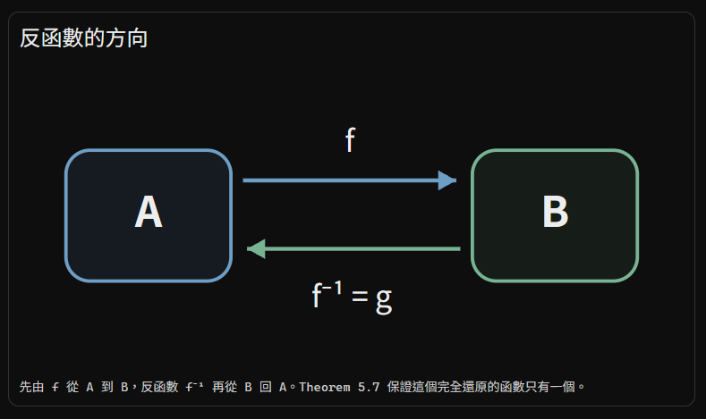

老師在約 00:19:43 特別強調這是非常重要的性質，接著花了約三分鐘示範證明，屬於正式展開的 `TAUGHT_CORE`。

///所以 1A 是單位函數， f^(-1)是可逆函數？

1. 差不多，但第二個要修正
- \(1_A\)：Identity Function（恆等函數），也可以稱為單位函數。
- \(f^{-1}\)：Inverse Function（反函數），不是「可逆函數」的名稱。
- \(f\) 是 Invertible Function（可逆函數），表示它存在反函數 \(f^{-1}\)。

///


### **3. 證明前，先理解一個策略**

我們想證明：

\\[ g=h \\]

但是一開始並不知道 \\(g\\) 和 \\(h\\) 是否相等。

所以採用以下方法：

1. 已經有一個反函數 \\(g\\)。
2. 假設還存在另一個符合反函數條件的 \\(h\\)。
3. 利用兩者都能還原 \\(f\\) 的性質。
4. 最後推導出 \\(h=g\\)。

只要證明任何符合條件的 \\(h\\) 都必然等於 \\(g\\)，就證明了唯一性。

這種方法並不是要證明「不存在 \\(h\\)」，而是證明**不可能存在與&#x20;**\\(g\\)**&#x20;不同的反函數**。

### **4. Theorem 5.7 — 完整 Proof（證明）**

已知 \\(g:B\to A\\) 是 \\(f\\) 的反函數。

假設另外有 \\(h:B\to A\\)，也滿足：

\\[ h\circ f=1_A \\]

\\[ f\circ h=1_B \\]

我們的目標是：

\\[ \boxed{h=g} \\]

**Step 1：從&#x20;**\\(h\\)**&#x20;本身出發。**

因為 \\(h:B\to A\\)，在它前面先做 \\(1_B\\) 不會改變任何事情。

所以：

\\[ h=h\circ1_B \\]

**Step 2：使用&#x20;**\\(f\circ g=1_B\\)**。**

我們已知：

\\[ f\circ g=1_B \\]

因此可以替換：

\\[ h\circ1_B=h\circ(f\circ g) \\]

**Step 3：使用 Associativity of Function Composition（函數複合的結合律）。**

\\[ h\circ(f\circ g)=(h\circ f)\circ g \\]

這一步只是改變括號的位置，沒有改變函數的先後順序。

**Step 4：使用&#x20;**\\(h\circ f=1_A\\)**。**

\\[ (h\circ f)\circ g=1_A\circ g \\]

**Step 5：Identity Function 不改變輸入。**

因為 \\(g:B\to A\\)，做完 \\(g\\) 再做 \\(1_A\\)，結果仍然是 \\(g\\)。

\\[ 1_A\circ g=g \\]

將全部過程串起來：

\\[ \boxed{ \begin{aligned} h &=h\circ1_B\\\ &=h\circ(f\circ g)\\\ &=(h\circ f)\circ g\\\ &=1_A\circ g\\\ &=g \end{aligned}} \\]

因此：

\\[ \boxed{h=g} \\]

所以 \\(f\\) 的 Inverse Function（反函數）是唯一的。證畢。

### **6. 常見錯誤：為什麼不能任意交換順序？**

函數複合具有 Associativity（結合律）：

\\[ h\circ(f\circ g)=(h\circ f)\circ g \\]

但一般**不具有** Commutativity（交換律）：

\\[ h\circ f\neq f\circ h \\]

此外，下標不能隨便更換。

| 式子                                       | 是否成立 | 原因                                                          |
| ---------------------------------------- | ---- | ----------------------------------------------------------- |
| \\(h\circ1_B=h\\)                        | ✅    | \\(h\\) 的定義域是 \\(B\\)                                       |
| \\(1_A\circ g=g\\)                       | ✅    | \\(g\\) 的值域包含於 \\(A\\)                                      |
| \\(h\circ1_A\\)                          | ❌    | 一般情況下無法組合，因為 \\(1_A\\) 輸出到 \\(A\\)，而 \\(h\\) 要求輸入來自 \\(B\\) |
| \\((h\circ f)\circ g=h\circ(f\circ g)\\) | ✅    | 結合律                                                         |

所以老師在這個段落提醒大家要熟悉 \\(A\to B\\)、\\(B\to A\\) 的函數方向，避免在證明中混淆。

///\(h\circ1_B\) 是 1B -> h 對不對？

```
Phase A — Internal Control Surface | TURN=第 5 次對話 | PROMPT=1.17.0 | REFRESH=NO | REFRESH_REMINDER=NONE | STATE={MainlineMode=Transcript; KP=Theorem5.7; Practice=已出題未提交; Completion=NOT_COMPLETE} | PLAN={ThisResponse=確認函數複合執行順序; ProgressPreserved=YES}
```

#### **1. 對，完全正確！**

\\[ \boxed{h\circ1_B} \\]

代表 **先執行&#x20;**\\(1_B\\)**，再執行&#x20;**\\(h\\)。

函數複合的執行順序是**從右往左**。

\\[ \boxed{(h\circ1_B)(b)=h(1_B(b))=h(b)} \\]

因為 \\(1_B\\) 是 Identity Function（恆等函數），不會改變輸入，所以：

\\[ \boxed{h\circ1_B=h} \\]

#### **2. 記住這個規則**

\\[ \boxed{f\circ g} \\]

表示：

\\[ \boxed{\text{先做 }g\ \longrightarrow\ \text{再做 }f} \\]

所以你理解的 \\(1_B\rightarrow h\\) 是正確的。

這也是 Theorem 5.7 證明中第一步 \\(h=h\circ1_B\\) 的意思。


///


### **7. Exam Quick Sheet（考試速記／最短骨架）**

**Theorem 5.7：** 若 \\(f:A\to B\\) 可逆，其反函數唯一，記為 \\(f^{-1}\\)。

**Proof Skeleton：**

\\[ \boxed{ h=h\circ1_B =h\circ(f\circ g) =(h\circ f)\circ g =1_A\circ g=g } \\]

**Common Trap：** 結合律可以移動括號，但不能交換函數順序；注意 \\(1_A\\)、\\(1_B\\) 的下標。

### **8. Practice Tasks（練習任務）**

這一輪的主要 Learning Objective 是能真正寫出 **Proof（證明）**，而不只是背下「反函數唯一」。

以下皆為自行生成的 Learning Practice，不是正式作業原題或考古題。

#### **8.1 Task 1 — Prove Uniqueness**

Let \\(A\\) and \\(B\\) be sets, and let

\\[ f:A\to B,\qquad g,h:B\to A. \\]

Suppose

\\[ g\circ f=1_A,\quad f\circ g=1_B \\]

and

\\[ h\circ f=1_A,\quad f\circ h=1_B. \\]

**Write a complete proof that&#x20;**\\(g=h\\)**, using function composition, associativity, and identity functions.**

Expected Artifact：完整的數學證明，可使用 LaTeX、純文字公式或手寫照片。

`[Generated: Inverse-function uniqueness proof]`

#### **8.2 Task 2 — Find and Correct the Error**

Let \\(f:A\to B\\), and let \\(g,h:B\to A\\) be inverse functions of \\(f\\).

A student writes the following step:

\\[ h=h\circ1_A \\]

**Explain whether this expression is valid for arbitrary sets&#x20;**\\(A\\)**&#x20;and&#x20;**\\(B\\)**. If it is not valid, write the correct expression and explain why the identity function must have that subscript.**

Expected Artifact：判斷、正確式子與理由。

`[Generated: Function-composition type checking]`

Task 1 — Complete proof

Task 2 — Error analysis

提交並批改&#x20;

```
Phase A — Internal Control Surface | TURN=第 1 次對話 | PROMPT=1.17.0 | REFRESH=Manual Prompt Refresh; ProgressPreserved=YES | REFRESH_REMINDER=NONE | STATE={MainlineMode=Transcript; MainlineSource=逐字稿_06_11-13.txt; PreviousKP=Theorem5.7; PreviousLocator=L1531–L1728; PreviousQuickSheet=OUTPUT_VERIFIED; PreviousPractice=2題Generated已輸出; PreviousSubmission=USER_ACCEPTED_NOT_INDEPENDENTLY_VERIFIED; PreviousProofArtifact=NOT_DEMONSTRATED; Transcript={Session=06; SessionSource=FilenamePrefix; WithinSessionOrder=單檔內依時間順序; Coverage=UNKNOWN; NextKP=Theorem5.8; NextSpan=L1730–L1939; NextTimestamp=第二段錄音00:23:20–00:29:43; TeachingState=TAUGHT_CORE+TAUGHT_BRIEF; Signals=雙條件定理及正向證明; Correction=NONE_OBSERVED; ASR=符號依課本校準}; Boundary=反向證明簡述後轉Theorem5.9; Reference={Aligned=Grimaldi Chapter5 Section5.6 PDFviewerpage304; Confidence=HIGH; PrecisionStatus=前輪已對齊}; QuickSheet={Status=PENDING; Type=ProofSkeleton; SourceScope=VERIFIED_ONLY}; Practice={LearningObjective=判斷雙射及證明可逆性; Modality=MappingClassification+Proof; ExpectedArtifact=映射判斷及證明; RequiredModality=YES; TaskOrigin=Generated; SourceReopened=NA; SourceIdentity=NA; ContentFidelity=GENERATED; SourceMatch=NA; AssessmentFidelity=Learning; SubmissionStatus=NOT_SUBMITTED}; AdjQueue=Theorem5.8→Theorem5.9; ExerciseDebt=新知識點待輸出; TeachingMainlineDebt=後續待學; AssessmentRequirementDebt=UNKNOWN; ReferenceResolutionDebt=NONE_KNOWN_FOR_CURRENT; PastExamDebt=UNKNOWN; Weakness=NONE_RECORDED; Completion=NOT_COMPLETE; Evidence=前輪Theorem5.7已教且練習已輸出; Blockers=無; NextLegal=Theorem5.8} | PLAN={ThisResponse=核對逐字稿及課本後教學雙射與可逆性雙向證明並安排練習; ExpectedNext=Theorem5.9}
```

## **⭐ Theorem 5.8 — Invertible if and only if One-to-One and Onto（可逆函數與雙射的等價關係）**

主線位置：Teacher Transcript／`逐字稿_06_11-13.txt`／Session=06／L1730–L1939／第二段錄音 00:23:20–00:29:43。

對齊參考：Grimaldi 課本 Chapter 5 §5.6／Theorem 5.8／PDF viewer page 304（書本第 283 頁）。

自然邊界：老師詳細證明「可逆 ⇒ 一對一且映成」，接著簡短提及反方向的證明方法，然後切換到 Theorem 5.9。

上一輪 Theorem 5.7 的兩題依你的要求視同答對，不列錯題；但尚未實際驗證你能獨立寫出完整證明。

### **1. 老師這次想回答什麼問題？**

我們已經知道，函數 \\(f:A\to B\\) 若存在反函數 \\(f^{-1}\\)，就表示：

\\[ f^{-1}\circ f=1_A \\]

\\[ f\circ f^{-1}=1_B \\]

但是這種定義有個問題：

**如果題目只給你一個函數&#x20;**\\(f\\)**，沒有給反函數，你要怎麼知道它可不可逆？**

難道每次都需要先猜出 \\(f^{-1}\\) 嗎？

Theorem 5.8 給我們一個更直接的判斷方法：

> 只需要檢查這個函數是不是同時滿足 One-to-One（一對一）和 Onto（映成）。

這是本輪的核心。

///Invertible if and only if One-to-One and Onto（可逆函數與雙射的等價關係）定理

### **2. Theorem 5.8 — 正式定理**

設：

\\[ f:A\rightarrow B \\]

則：

\\[ \boxed{ f\text{ is invertible} \iff f\text{ is one-to-one and onto} } \\]

也就是：

\\[ \boxed{\text{Invertible（可逆）}\iff\text{Bijective（雙射）}} \\]

其中 \\(\iff\\) 表示 **If and Only If（若且唯若）**，必須兩個方向都成立。

| 性質  | English                | 數學上的意思                |
| --- | ---------------------- | --------------------- |
| 一對一 | Injective / One-to-One | 不同輸入不能對應同一輸出          |
| 映成  | Surjective / Onto      | \\(B\\) 中每個元素至少被對應到一次 |
| 雙射  | Bijective              | 同時 One-to-One 和 Onto  |
| 可逆  | Invertible             | 存在可以雙向還原的反函數          |

為什麼這兩個條件剛好能保證可逆？

- One-to-One：確保反過來找原始輸入時，**不會出現兩個可能答案**。
- Onto：確保 \\(B\\) 中**每個元素都有原始輸入可以找回**。

兩個條件合起來，反方向才會成為合法的函數。

///

### **3. 用箭頭理解：為什麼必須同時滿足兩個條件？**

想像我們要把每個 \\(A\\) 的元素送到 \\(B\\)，再從 \\(B\\) 找回原本的元素。

只要有兩個輸入共用一個輸出，就無法唯一還原；只要有某個 \\(B\\) 的元素沒有被對應到，就無法從那個元素反推回 \\(A\\)。

下面可以切換三種情況：

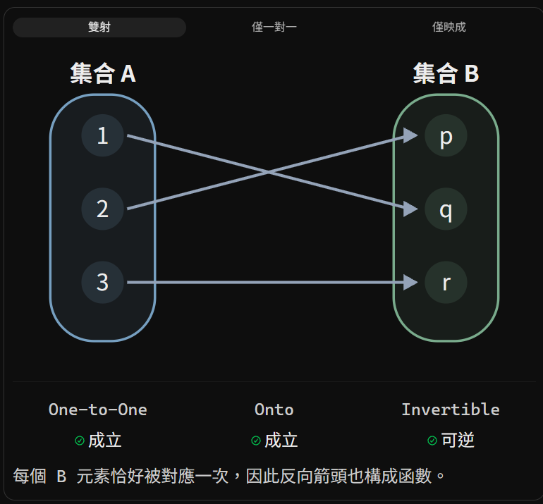


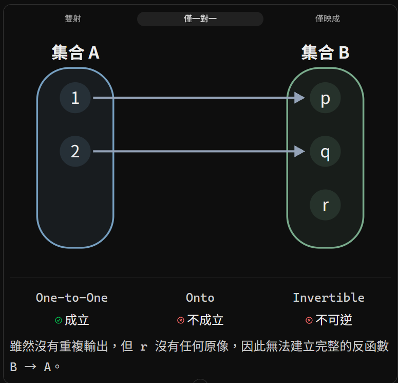

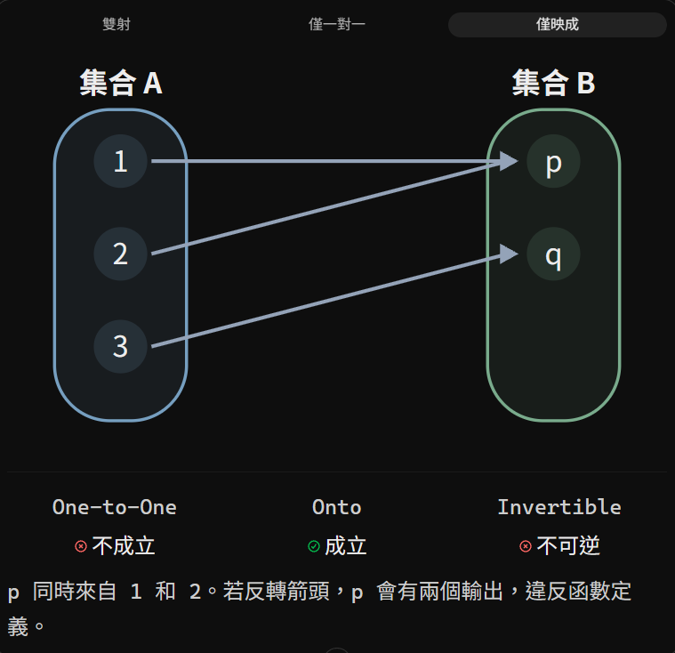

這個圖的結論就是：

\\[ \boxed{\text{每個 }B\text{ 元素恰好有一個 }A\text{ 元素對應它}} \\]

是反向箭頭能形成反函數的關鍵。

### **4. 證明方向一：Invertible ⇒ One-to-One and Onto**

這是老師在逐字稿中詳細講解的部分，約 00:23:53–00:29:12。

假設 \\(f:A\to B\\) 可逆，存在：

\\[ g:B\to A \\]

滿足：

\\[ g\circ f=1_A,\qquad f\circ g=1_B \\]

我們要分別證明 \\(f\\) 是 One-to-One 和 Onto。

#### **4.1 證明 One-to-One（一對一）**

One-to-One 的正式判斷是：

\\[ \boxed{f(a_1)=f(a_2)\Rightarrow a_1=a_2} \\]

任取 \\(a_1,a_2\in A\\)，假設：

\\[ f(a_1)=f(a_2) \\]

兩邊同時套用 \\(g\\)：

\\[ g(f(a_1))=g(f(a_2)) \\]

因為 \\(g\circ f=1_A\\)，所以：

\\[ 1_A(a_1)=1_A(a_2) \\]

又因為恆等函數不會改變輸入：

\\[ \boxed{a_1=a_2} \\]

這就完成 One-to-One 的證明。

**這裡的核心技巧是：用反函數&#x20;**\\(g\\)**&#x20;把兩邊的&#x20;**\\(f\\)**&#x20;消掉。**

#### **4.2 證明 Onto（映成）**

Onto 要證明：

\\[ \boxed{\forall b\in B,\ \exists a\in A:\ f(a)=b} \\]

意思是：任意挑一個 \\(B\\) 裡的元素 \\(b\\)，我們都能在 \\(A\\) 找到一個元素，經過 \\(f\\) 得到它。

任取 \\(b\in B\\)。

我們知道：

\\[ g:B\to A \\]

因此可以選擇：

\\[ a=g(b)\in A \\]

再代入 \\(f\\)：

\\[ \begin{aligned} f(a) &=f(g(b))\\\ &=(f\circ g)(b)\\\ &=1_B(b)\\\ &=\boxed{b} \end{aligned} \\]

所以對每個 \\(b\in B\\)，都確實找到了 \\(a=g(b)\in A\\) 讓 \\(f(a)=b\\)。

因此 \\(f\\) 是 Onto。

兩個性質都證明了：

\\[ \boxed{\text{Invertible}\Rightarrow\text{One-to-One and Onto}} \\]

### **5. 證明方向二：One-to-One and Onto ⇒ Invertible**

老師在約 00:29:13–00:29:43 簡短提及反方向的證明，表示技巧相近，隨後轉入下一個定理。

因此這個方向的證明以課本 Theorem 5.8 的正式內容補足，但不把它誤稱為老師逐步口述過的證明。

我們假設：

\\[ f:A\to B \\]

同時是 One-to-One 與 Onto，目標是**建立一個真正的反函數**。

首先，因為 \\(f\\) 是 Onto：

\\[ \forall b\in B,\ \exists a\in A:\ f(a)=b \\]

因此每個 \\(b\\) 都至少有一個原像 \\(a\\)。

接著，因為 \\(f\\) 是 One-to-One，這個原像不能有兩個不同的選擇，所以它是唯一的。

於是我們可以定義：

\\[ g:B\to A \\]

讓 \\(g(b)\\) 等於滿足 \\(f(a)=b\\) 的唯一那個 \\(a\\)。

現在檢查兩個反函數條件。

對所有 \\(b\in B\\)：

\\[ \boxed{f(g(b))=b} \\]

所以：

\\[ f\circ g=1_B \\]

對所有 \\(a\in A\\)，因為 \\(g\\) 會找回唯一的原像：

\\[ \boxed{g(f(a))=a} \\]

所以：

\\[ g\circ f=1_A \\]

兩個條件都成立，因此 \\(g\\) 是 \\(f\\) 的反函數。

\\[ \boxed{\text{One-to-One and Onto}\Rightarrow\text{Invertible}} \\]

兩個方向合起來，就證明了 Theorem 5.8。

### **6. 常見錯誤與老師的授課重點**

這個定理經常讓人混淆的不是公式，而是**每一段證明到底要證明什麼**。

| 要證明的性質     | 從什麼開始               | 最後要得到什麼                        |
| ---------- | ------------------- | ------------------------------ |
| One-to-One | \\(f(a_1)=f(a_2)\\) | \\(a_1=a_2\\)                  |
| Onto       | 任意 \\(b\in B\\)     | 找到 \\(a\in A\\) 使 \\(f(a)=b\\) |
| Invertible | 已知 One-to-One、Onto  | 建立 \\(g:B\to A\\)，使兩個複合都是恆等函數  |

特別注意：

- One-to-One **不等於** Onto。
- 只滿足其中一個性質，不能保證可逆。
- \\(\iff\\) 需要證明兩個方向，不能只證明其中一個就結束。

### **7. Exam Quick Sheet（考試速記／最短骨架）**

**Theorem 5.8**

\\[ \boxed{f\text{ invertible}\iff f\text{ bijective}} \\]

**Proof Skeleton**

正向：

\\[ \begin{aligned} &f(a_1)=f(a_2)\\\ &\Rightarrow g(f(a_1))=g(f(a_2))\\\ &\Rightarrow a_1=a_2\quad\text{(One-to-One)} \end{aligned} \\]

\\[ \forall b\in B,\quad a=g(b),\quad f(a)=b \quad\text{(Onto)} \\]

反向：

\\[ \text{Onto 保證存在原像} \\]

\\[ +\ \text{One-to-One 保證原像唯一} \\]

\\[ \Rightarrow \exists g=f^{-1} \\]

### **8. Practice Tasks（練習任務）**

以下三題都是自行生成的 Learning Practice，並非課本原題或考古題。

#### **8.1 Task 1 — Determine Invertibility**

[Generated: Learning Practice]

Let

\\[ A=\\{1,2,3\\},\quad B=\\{p,q,r\\} \\]

and

\\[ f=\\{(1,q),(2,r),(3,p)\\}. \\]

**Determine whether&#x20;**\\(f\\)**&#x20;is one-to-one, onto, and invertible. If it is invertible, write its inverse function as a set of ordered pairs.**

Expected Artifact：三項判斷、簡短理由，以及存在時的反函數有序對。

#### **8.2 Task 2 — Identify the Failed Condition**

[Generated: Learning Practice]

Let

\\[ A=\\{1,2,3,4\\},\quad B=\\{p,q,r\\} \\]

and

\\[ f=\\{(1,p),(2,q),(3,q),(4,r)\\}. \\]

**Determine whether&#x20;**\\(f\\)**&#x20;is one-to-one and onto. Explain whether it is invertible, using a specific counterexample when a condition fails.**

Expected Artifact：性質判斷、理由與具體反例。

#### **8.3 Task 3 — Prove the Converse Direction**

[Generated: Learning Practice]

Let \\(f:A\to B\\) be both one-to-one and onto.

**Prove that&#x20;**\\(f\\)**&#x20;is invertible. Define a function&#x20;**\\(g:B\to A\\)**&#x20;and verify both identities:**

\\[ g\circ f=1_A,\qquad f\circ g=1_B. \\]

Expected Artifact：能說明 \\(g\\) 為何存在、為何是合法函數，以及兩個複合關係的數學證明。可使用文字公式或手寫作答。

Task 1 — Classification and inverse

Task 2 — Counterexample

Task 3 — Proof

提交答案並批改&#x20;


```
Phase A — Internal Control Surface | TURN=第 1 次對話 | PROMPT=1.17.0 | REFRESH=Manual Prompt Refresh; ProgressPreserved=YES | REFRESH_REMINDER=NONE | STATE={MainlineMode=Transcript; MainlineSource=逐字稿_06_11-13.txt; PreviousKP=Theorem5.8; PreviousLocator=L1730–L1939; PreviousQuickSheet=OUTPUT_VERIFIED; PreviousPractice=3題Generated已輸出; PreviousSubmission=USER_ACCEPTED_NOT_INDEPENDENTLY_VERIFIED; Transcript={File=逐字稿_06_11-13.txt; Session=06; SessionSource=FilenamePrefix; WithinSessionOrder=單檔內依時間順序; Span=L1939–L2039; Timestamp=第二段錄音00:29:37–00:32:33; Coverage=UNKNOWN; TeachingState=TAUGHT_CORE+TAUGHT_BRIEF; Signals=複合可逆性與反函數順序+老師請學生試證; Scope=Theorem5.9; Correction=NONE; ASR=後續Example5.65與課本5.60編號不一致; Residual=下一項線性函數反函數例題}; Boundary=定理敘述與證明提示收束後轉例題; Reference={Aligned=Grimaldi Ch5 §5.6 PDFviewerpage305 printedpage284; Confidence=HIGH; PrecisionStatus=VERIFIED}; QuickSheet={Status=PENDING; Type=Formula+ProofSkeleton; SourceScope=VERIFIED_ONLY}; Practice={LearningObjective=計算複合函數反函數並證明通式; Modality=Calculation+Proof; ExpectedArtifact=代數計算與雙向複合證明; AcceptedSubmission=文字/LaTeX/手寫照片; RequiredModality=YES; TaskOrigin=Generated; SourceReopened=NA; SourceIdentity=NA; ContentFidelity=GENERATED; SourceMatch=NA; AssessmentFidelity=Learning; SubmissionStatus=NOT_SUBMITTED}; AdjQueue=Theorem5.9→線性函數反函數例題; ExerciseDebt=新KP待輸出; TeachingMainlineDebt=後續待學; AssessmentRequirementDebt=UNKNOWN; ReferenceResolutionDebt=例題編號差異待留意但不影響本定理; PastExamDebt=UNKNOWN; Weakness=NONE_RECORDED; Completion=NOT_COMPLETE; Evidence=前輪Theorem5.8教學與練習已輸出且使用者要求視同答對; Blockers=NONE; NextLegal=Theorem5.9} | PLAN={ThisResponse=教學反函數複合定理+證明+例子+ExamQuickSheet+2項練習; ExpectedNext=線性函數反函數例題}
```

## **⭐ Theorem 5.9 — Inverse of a Composite Function（複合函數的反函數）— 為什麼反過來時，順序也要顛倒？**

主線位置：Teacher Transcript／`逐字稿_06_11-13.txt`／Session=06／L1939–L2039／第二段錄音 00:29:37–00:32:33。

對齊參考：Grimaldi 課本 Chapter 5 §5.6／Theorem 5.9／PDF viewer page 305（書本第 284 頁）。

自然邊界：老師介紹定理、強調反函數符號的意義，並請學生試著證明；接著轉入線性函數求反函數的例題。

上一輪 Theorem 5.8 的三題依你的要求視同答對，不列入錯題；沒有實際批改答案，因此不宣稱已驗證雙射證明能力。

### **1\. 這個定理在解決什麼問題？**

上一輪我們學到：

\[
\boxed{\text{Invertible}\iff\text{One-to-One and Onto}}
\]

現在假設有兩個可逆函數：

\[
f:A\to B
\]

\[
g:B\to C
\]

我們把它們複合：

\[
g\circ f:A\to C
\]

也就是：

\[
A\xrightarrow{f}B\xrightarrow{g}C
\]

新的問題是：

**如果 \(f\) 和 \(g\) 都可逆，那麼先做 \(f\)、再做 \(g\) 的整個過程，還能還原嗎？**

答案是可以，而且還原時必須**反過來做**。

### **2\. Theorem 5.9 — 正式定理**

設：

\[
f:A\to B,\qquad g:B\to C
\]

都是 Invertible Functions（可逆函數）。

則 Composite Function（複合函數）：

\[
g\circ f:A\to C
\]

也是可逆函數，而且：

\[
\boxed{(g\circ f)^{-1}=f^{-1}\circ g^{-1}}
\]

這個公式就是 Theorem 5.9 的核心。

注意左右兩邊的順序：

\[
\underbrace{g\circ f}_{\text{先 }f\text{，後 }g}
\]

反函數變成：

\[
\underbrace{f^{-1}\circ g^{-1}}_{\text{先 }g^{-1}\text{，後 }f^{-1}}
\]

**原本做事的順序是 \(f\to g\)，還原時就要變成 \(g^{-1}\to f^{-1}\)。**

### **3\. 用日常例子理解：穿衣服與脫衣服**

假設你依序：

1. 穿上襯衫。
2. 穿上外套。

現在想恢復原本的狀態，必須：

1. 先脫外套。
2. 再脫襯衫。

不能直接把「穿襯衫」的動作先反過來做，因為外套還在外面。

這就是 Reverse Order（反向順序）的概念。

### **函數執行與還原的方向**

![](data:image/svg+xml;charset=utf-8,%3Csvg%20font-family%3D%22%26quot%3BPEICD%20Local%203%20Latin%26quot%3B%2C%20%26quot%3BPEICD%20Local%204%20CJK%26quot%3B%2C%20%26quot%3BNoto%20Sans%20TC%26quot%3B%2C%20%26quot%3BNoto%20Sans%20CJK%20TC%26quot%3B%2C%20%26quot%3BCascadia%20Mono%26quot%3B%2C%20%26quot%3BMicrosoft%20JhengHei%26quot%3B%2C%20%26quot%3BSegoe%20UI%26quot%3B%2C%20sans-serif%22%20font-weight%3D%22400%22%20data-d-component%3D%22svg%22%20fill%3D%22currentColor%22%20style%3D%22color%3Argb%28237%2C%20237%2C%20237%29%22%20viewBox%3D%220%200%20340%20186%22%20width%3D%22100%25%22%20xmlns%3D%22http%3A%2F%2Fwww.w3.org%2F2000%2Fsvg%22%3E%3Crect%20x%3D%2213%22%20y%3D%2267%22%20width%3D%2250%22%20height%3D%2242%22%20rx%3D%2210%22%20fill%3D%22%237394b525%22%20stroke%3D%22%237394b5%22%20stroke-width%3D%221.6%22%2F%3E%3Ctext%20x%3D%2238%22%20y%3D%2294%22%20fill%3D%22currentColor%22%20font-size%3D%2218%22%20font-weight%3D%22600%22%20text-anchor%3D%22middle%22%3EA%3C%2Ftext%3E%3Crect%20x%3D%22145%22%20y%3D%2267%22%20width%3D%2250%22%20height%3D%2242%22%20rx%3D%2210%22%20fill%3D%22%237394b525%22%20stroke%3D%22%237394b5%22%20stroke-width%3D%221.6%22%2F%3E%3Ctext%20x%3D%22170%22%20y%3D%2294%22%20fill%3D%22currentColor%22%20font-size%3D%2218%22%20font-weight%3D%22600%22%20text-anchor%3D%22middle%22%3EB%3C%2Ftext%3E%3Crect%20x%3D%22277%22%20y%3D%2267%22%20width%3D%2250%22%20height%3D%2242%22%20rx%3D%2210%22%20fill%3D%22%237394b525%22%20stroke%3D%22%237394b5%22%20stroke-width%3D%221.6%22%2F%3E%3Ctext%20x%3D%22302%22%20y%3D%2294%22%20fill%3D%22currentColor%22%20font-size%3D%2218%22%20font-weight%3D%22600%22%20text-anchor%3D%22middle%22%3EC%3C%2Ftext%3E%3Cpath%20d%3D%22M65%2078%20H143%20M197%2078%20H275%22%20stroke%3D%22%237eaad0%22%20stroke-width%3D%222.3%22%20fill%3D%22none%22%2F%3E%3Cpath%20d%3D%22M143%2078%20l-9%20-5%20v10%20z%20M275%2078%20l-9%20-5%20v10%20z%22%20fill%3D%22%237eaad0%22%2F%3E%3Ctext%20x%3D%22104%22%20y%3D%2258%22%20font-size%3D%2215%22%20text-anchor%3D%22middle%22%20fill%3D%22currentColor%22%3Ef%3C%2Ftext%3E%3Ctext%20x%3D%22236%22%20y%3D%2258%22%20font-size%3D%2215%22%20text-anchor%3D%22middle%22%20fill%3D%22currentColor%22%3Eg%3C%2Ftext%3E%3Cpath%20d%3D%22M275%20101%20H197%20M143%20101%20H65%22%20stroke%3D%22%239cba9a%22%20stroke-width%3D%222.3%22%20fill%3D%22none%22%2F%3E%3Cpath%20d%3D%22M197%20101%20l9%20-5%20v10%20z%20M65%20101%20l9%20-5%20v10%20z%22%20fill%3D%22%239cba9a%22%2F%3E%3Ctext%20x%3D%22104%22%20y%3D%22132%22%20font-size%3D%2215%22%20text-anchor%3D%22middle%22%20fill%3D%22currentColor%22%3Ef%E2%81%BB%C2%B9%3C%2Ftext%3E%3Ctext%20x%3D%22236%22%20y%3D%22132%22%20font-size%3D%2215%22%20text-anchor%3D%22middle%22%20fill%3D%22currentColor%22%3Eg%E2%81%BB%C2%B9%3C%2Ftext%3E%3Ctext%20x%3D%22170%22%20y%3D%2220%22%20font-size%3D%2212%22%20text-anchor%3D%22middle%22%20fill%3D%22%237eaad0%22%3E%E6%AD%A3%E5%90%91%EF%BC%9A%E5%85%88%20f%EF%BC%8C%E5%86%8D%20g%3C%2Ftext%3E%3Ctext%20x%3D%22170%22%20y%3D%22169%22%20font-size%3D%2212%22%20text-anchor%3D%22middle%22%20fill%3D%22%239cba9a%22%3E%E5%8F%8D%E5%90%91%EF%BC%9A%E5%85%88%20g%E2%81%BB%C2%B9%EF%BC%8C%E5%86%8D%20f%E2%81%BB%C2%B9%3C%2Ftext%3E%3C%2Fsvg%3E)上方的正向箭頭由 A 到 C；下方的反向箭頭由 C 回 A。複合函數的反函數必須倒轉執行順序。

所以公式不是死背的，它是還原動作的自然結果。

### **4\. 用實際函數計算一次**

這裡先用自行建立的教學例子。

設：

\[
f:\mathbb R\to\mathbb R,\qquad f(x)=x+2
\]

\[
g:\mathbb R\to\mathbb R,\qquad g(x)=3x
\]

兩個函數都可逆。

#### **4.1 先求複合函數**

\[
(g\circ f)(x)=g(f(x))
\]

先代入 \(f(x)=x+2\)：

\[
g(f(x))=3(x+2)
\]

得到：

\[
\boxed{(g\circ f)(x)=3x+6}
\]

例如輸入 \(x=4\)：

\[
4\xrightarrow{f}6\xrightarrow{g}18
\]

#### **4.2 求各自的反函數**

因為：

\[
f(x)=x+2
\]

所以：

\[
\boxed{f^{-1}(x)=x-2}
\]

因為：

\[
g(x)=3x
\]

所以：

\[
\boxed{g^{-1}(x)=\frac{x}{3}}
\]

接著按照 Theorem 5.9 的順序：

\[
(g\circ f)^{-1}=f^{-1}\circ g^{-1}
\]

計算：

\[
\begin{aligned}
(f^{-1}\circ g^{-1})(x)
&=f^{-1}(g^{-1}(x))\\
&=f^{-1}\left(\frac{x}{3}\right)\\
&=\frac{x}{3}-2
\end{aligned}
\]

因此：

\[
\boxed{(g\circ f)^{-1}(x)=\frac{x}{3}-2}
\]

驗算原本的 \(18\)：

\[
18\xrightarrow{g^{-1}}6\xrightarrow{f^{-1}}4
\]

確實回到原本的 \(4\)。

### **5\. 互動驗證：改變輸入，觀察還原過程**

【原本是互動網頁】

滑桿讓你觀察數值變化；下一節的證明則會說明，為什麼不管輸入是哪個合法元素，都可以還原。

### **6\. Theorem 5.9 — Proof（證明）**

老師在約 00:32:17–00:32:25 提到證明應該不難，請大家試試看；逐字稿在這裡沒有展開完整書面證明。

以下是根據已學過的 Function Composition（函數複合）與 Identity Function（恆等函數）重構的完整證明，不是老師逐字講述的版本。

已知：

\[
f:A\to B,\qquad g:B\to C
\]

兩者皆可逆，因此：

\[
f^{-1}\circ f=1_A,\qquad f\circ f^{-1}=1_B
\]

\[
g^{-1}\circ g=1_B,\qquad g\circ g^{-1}=1_C
\]

我們要證明：

\[
\boxed{(g\circ f)^{-1}=f^{-1}\circ g^{-1}}
\]

令：

\[
h=f^{-1}\circ g^{-1}:C\to A
\]

只要證明 \(h\) 與 \(g\circ f\) 的兩個複合都是恆等函數，就可以使用 Definition 5.21 判定 \(h\) 是反函數。

#### **6.1 第一個方向**

我們要證明：

\[
h\circ(g\circ f)=1_A
\]

計算：

\[
\begin{aligned}
h\circ(g\circ f)
&=(f^{-1}\circ g^{-1})\circ(g\circ f)\\
&=f^{-1}\circ(g^{-1}\circ g)\circ f\\
&=f^{-1}\circ1_B\circ f\\
&=f^{-1}\circ f\\
&=\boxed{1_A}
\end{aligned}
\]

注意中間這一步：

\[
g^{-1}\circ g=1_B
\]

因為 \(g\) 先把 \(B\) 的元素送到 \(C\)，再由 \(g^{-1}\) 送回 \(B\)。

#### **6.2 第二個方向**

我們還要證明：

\[
(g\circ f)\circ h=1_C
\]

計算：

\[
\begin{aligned}
(g\circ f)\circ h
&=(g\circ f)\circ(f^{-1}\circ g^{-1})\\
&=g\circ(f\circ f^{-1})\circ g^{-1}\\
&=g\circ1_B\circ g^{-1}\\
&=g\circ g^{-1}\\
&=\boxed{1_C}
\end{aligned}
\]

因為兩個方向都成立：

\[
\boxed{
h\circ(g\circ f)=1_A
}
\]

\[
\boxed{
(g\circ f)\circ h=1_C
}
\]

所以 \(h\) 確實是 \(g\circ f\) 的反函數。

又因為：

\[
h=f^{-1}\circ g^{-1}
\]

我們得到：

\[
\boxed{(g\circ f)^{-1}=f^{-1}\circ g^{-1}}
\]

證畢。

### **7\. 重要陷阱：負一次方不是倒數**

老師在約 00:31:09–00:31:54 特別說明，函數上的 \(-1\) 不是一般分數的意思。

\[
\boxed{f^{-1}\neq\frac1f}
\]

這裡的 \(f^{-1}\) 表示 Inverse Function（反函數），而不是 Reciprocal（倒數）。

例如：

\[
f(x)=x+2
\]

它的反函數為：

\[
f^{-1}(x)=x-2
\]

但是：

\[
\frac1{f(x)}=\frac1{x+2}
\]

兩者完全不同。

### **8\. Exam Quick Sheet（考試速記／最短骨架）**

**Theorem 5.9**

\[
\boxed{(g\circ f)^{-1}=f^{-1}\circ g^{-1}}
\]

**口訣：複合順序反過來，反函數也要反過來。**

**Proof Skeleton**

設 \(h=f^{-1}\circ g^{-1}\)，則：

\[
\boxed{h\circ(g\circ f)=1_A}
\]

\[
\boxed{(g\circ f)\circ h=1_C}
\]

因此 \(h=(g\circ f)^{-1}\)。

**Common Trap：** 不要寫成 \(g^{-1}\circ f^{-1}\)；\(-1\) 不是倒數。

### **9\. Practice Tasks（練習任務）**

本輪 Learning Objective 是能正確計算複合函數的反函數，以及使用雙向複合驗證公式。

以下兩題皆為自行生成練習，不是課本原題或考古題。

#### **9.1 Task 1 — Compute an Inverse of a Composition**

&#91;Generated: Learning Practice&#93;

Let \(f,g:\mathbb R\to\mathbb R\) be defined by

\[
f(x)=2x-1,\qquad g(x)=x+4.
\]

**Find the following functions and show your algebraic steps:**

1. \((g\circ f)(x)\)
2. \(f^{-1}(x)\) and \(g^{-1}(x)\)
3. \((g\circ f)^{-1}(x)\), using Theorem 5.9.

**Verify your answer by composing \((g\circ f)^{-1}\) with \(g\circ f\).**

Expected Artifact：完整代數計算與至少一個複合驗算。

#### **9.2 Task 2 — Prove the Inverse Composition Rule**

&#91;Generated: Learning Practice&#93;

Let

\[
f:A\to B,\qquad g:B\to C
\]

be invertible functions.

**Prove that \(g\circ f\) is invertible and that**

\[
(g\circ f)^{-1}=f^{-1}\circ g^{-1}.
\]

**Your proof must verify both identity compositions, with the correct domains.**

Expected Artifact：完整的數學證明；可打字、使用 LaTeX 或提交清楚的手寫照片。

Task 1 — Calculation and verification

【原本是互動網頁】

Task 2 — Complete proof

【原本是互動網頁】


```
Phase A — Internal Control Surface | TURN=第 1 次對話 | PROMPT=1.17.0 | REFRESH=Manual Prompt Refresh; ProgressPreserved=YES | REFRESH_REMINDER=NONE | STATE={MainlineMode=Transcript; MainlineSource=逐字稿_06_11-13.txt; PreviousKP=Theorem5.9; PreviousQuickSheet=OUTPUT_VERIFIED; PreviousPractice=2題Generated已輸出; PreviousSubmission=USER_ACCEPTED_NOT_INDEPENDENTLY_VERIFIED; PreviousProofArtifact=NOT_DEMONSTRATED; Transcript={File=逐字稿_06_11-13.txt; Session=06; SessionSource=FilenamePrefix; WithinSessionOrder=單檔依時間順序; Span=L2039–L2280; Timestamp=第二段錄音00:32:27–00:40:11; Coverage=UNKNOWN; TeachingState=TAUGHT_CORE; Signals=求反函數計算+驗證的重要性; Correction=NONE_OBSERVED; ASR=口語轉錄以課本公式校準; Residual=00:40:20轉Definition5.22}; KP=LinearFunctionInverseExample; Boundary=例題完成並明確轉換主題; Reference={Aligned=Grimaldi Ch5 §5.6 PDFviewerpage305 Example5.60; Confidence=HIGH; PrecisionStatus=VERIFIED; NumberConflict=逐字稿稱Example5.65而目前課本稱Example5.60}; QuickSheet={Status=PENDING; Type=Procedure+Formula; SourceScope=VERIFIED_ONLY}; Practice={LearningObjective=求一次函數的反函數與驗證可逆性; Modality=AlgebraicCalculation+Proof; ExpectedArtifact=求解過程及雙向驗算; AcceptedSubmission=文字/LaTeX/手寫; RequiredModality=YES; TaskOrigin=Generated; SourceReopened=NA; SourceIdentity=NA; ContentFidelity=GENERATED; SourceMatch=NA; AssessmentFidelity=Learning; SubmissionStatus=NOT_SUBMITTED}; AdjQueue=線性反函數例題→Definition5.22; ExerciseDebt=新KP待出題; TeachingMainlineDebt=後續待教; AssessmentRequirementDebt=本段未發現明確作業或考試指定; ReferenceResolutionDebt=例題編號差異待保留但不影響數學結論; PastExamDebt=UNKNOWN; Weakness=NONE_RECORDED; Completion=NOT_COMPLETE; Evidence=本輪重新讀取原始逐字稿L2039–2280及課本PDF原頁; Blockers=NONE; NextLegal=LinearFunctionInverseExample} | PLAN={ThisResponse=教學一次函數求反函數與雙向驗證+ExamQuickSheet+2題練習; ExpectedNext=Definition5.22}
```

## **⭐ Inverse of a Linear Function（一次函數的反函數）— 如何求出&#x20;**\\(f^{-1}(x)\\)**？**

主線位置：Teacher Transcript／`逐字稿_06_11-13.txt`／Session=06／L2039–L2280／第二段錄音 00:32:27–00:40:11。

對齊參考：Grimaldi 課本 Chapter 5 §5.6／Example 5.60／PDF viewer page 305（書本第 284 頁）。

來源註記：老師逐字稿稱這道題為 Example 5.65，但提供的課本將相同的數學例子標為 Example 5.60。數學條件一致；編號差異保留，不擅自認定哪一份標錯。

上一輪 Theorem 5.9 的兩題依你的要求視同答對，不列錯題；但尚未實際驗證計算與證明能力。

### **1. 老師這次要解決什麼問題？**

前面我們知道：

\\[ \boxed{f\text{ 可逆}\iff f\text{ 是 One-to-One 且 Onto}} \\]

但即使知道一個函數可逆，我們還需要知道：

**它的反函數到底長什麼樣子？**

這一段老師以最基本的 Linear Function（一次函數）示範：

\\[ \boxed{f(x)=mx+b} \\]

其中：

\\[ m,b\in\mathbb R,\qquad m\neq0 \\]

而且：

\\[ f:\mathbb R\to\mathbb R \\]

目標是求出：

\\[ \boxed{f^{-1}(x)=\ ?} \\]

### **2. 為什麼要限制&#x20;**\\(m\neq0\\)**？**

先理解這個條件，後面的公式才不會只是死背。

如果：

\\[ m=0 \\]

那麼：

\\[ f(x)=0x+b=b \\]

這就變成 Constant Function（常數函數）。

例如：

\\[ f(x)=5 \\]

不論輸入多少：

\\[ f(1)=5,\quad f(2)=5,\quad f(100)=5 \\]

同一個輸出 5 對應很多不同輸入，因此不能唯一還原。

所以當定義域、對應域都是 \\(\mathbb R\\) 時：

\\[ m=0\Rightarrow f\text{ 不可逆} \\]

而 \\(m\neq0\\) 除了避免這種問題，也讓我們後面可以合法地除以 \\(m\\)。

### **3. 求反函數的正式步驟**

老師在約 00:33:52–00:38:50 主要示範透過交換 Ordered Pairs（有序對）的前後位置，推導反函數公式。

我們把它整理成容易操作的三步。

**⭐ Step 1：先把&#x20;**\\(f(x)\\)**&#x20;寫成&#x20;**\\(y\\)

原本：

\\[ f(x)=mx+b \\]

改寫為：

\\[ \boxed{y=mx+b} \\]

這裡 \\(x\\) 是輸入、\\(y\\) 是輸出。

**⭐ Step 2：交換&#x20;**\\(x\\)**&#x20;和&#x20;**\\(y\\)

反函數的作用，就是讓原本的輸出變成輸入。

因此交換之後：

\\[ \boxed{x=my+b} \\]

注意：這是**交換變數的位置**，不是單純把等號左右兩邊互換。

**⭐ Step 3：重新解出&#x20;**\\(y\\)

從：

\\[ x=my+b \\]

先減掉 \\(b\\)：

\\[ x-b=my \\]

再除以 \\(m\\)：

\\[ y=\frac{x-b}{m} \\]

因此：

\\[ \boxed{f^{-1}(x)=\frac{x-b}{m}} \\]

這就是一次函數的反函數公式。

### **4. 用數字看出「交換輸入和輸出」的意思**

例如：

\\[ f(x)=3x+5 \\]

它的反函數：

\\[ f^{-1}(x)=\frac{x-5}{3} \\]

先看原本的函數：

\\[ f(2)=3(2)+5=11 \\]

因此：

\\[ \boxed{2\xrightarrow{f}11} \\]

反函數就是把這個方向顛倒：

\\[ \boxed{11\xrightarrow{f^{-1}}2} \\]

因為：

\\[ f^{-1}(11)=\frac{11-5}{3}=2 \\]

原函數將 2 送到 11；反函數將 11 送回 2。

這也解釋了老師為什麼一直強調：不能把原函數和反函數的相同輸入值混為一談。

例如：

\\[ f(2)=11 \\]

但：

\\[ f^{-1}(2)=-1 \\]

\\(f(2)\\)**&#x20;和&#x20;**\\(f^{-1}(2)\\)**&#x20;並不需要相等。**

反函數保證的是：

\\[ \boxed{f^{-1}(f(2))=2} \\]

### **5. 老師特別強調：求出公式還不夠，還要驗證！**

這是逐字稿約 00:38:56–00:40:11 的重要授課訊號。

老師的意思是：

交換 \\(x,y\\) 並解出公式，只是得到一個**候選的反函數**。

你還需要確認它真的符合 Definition 5.21。

令：

\\[ g(x)=\frac{x-b}{m} \\]

我們要檢查兩個方向：

#### **5.1 先做&#x20;**\\(f\\)**，再做&#x20;**\\(g\\)

\\[ \begin{aligned} g(f(x)) &=g(mx+b)\\\ &=\frac{(mx+b)-b}{m}\\\ &=\frac{mx}{m}\\\ &=\boxed{x} \end{aligned} \\]

所以：

\\[ \boxed{g\circ f=1\_{\mathbb R}} \\]

#### **5.2 先做&#x20;**\\(g\\)**，再做&#x20;**\\(f\\)

\\[ \begin{aligned} f(g(x)) &=f\left(\frac{x-b}{m}\right)\\\ &=m\left(\frac{x-b}{m}\right)+b\\\ &=x-b+b\\\ &=\boxed{x} \end{aligned} \\]

因此：

\\[ \boxed{f\circ g=1\_{\mathbb R}} \\]

兩個條件都成立。

所以：

\\[ \boxed{g=f^{-1}} \\]

這才是正式完成反函數驗證。

### **7. Exam Quick Sheet（考試速記／最短骨架）**

**Must Know**

\\[ f(x)=mx+b,\quad m\neq0 \\]

**Formula**

\\[ \boxed{f^{-1}(x)=\frac{x-b}{m}} \\]

**Procedure**

\\[ y=mx+b \\]

\\[ \Downarrow\quad \text{交換 }x,y \\]

\\[ x=my+b \\]

\\[ \Downarrow\quad\text{解出 }y \\]

\\[ \boxed{y=\frac{x-b}{m}} \\]

**Verification**

\\[ f^{-1}(f(x))=x,\qquad f(f^{-1}(x))=x \\]

**Common Trap：** \\(m\neq0\\)；求出公式後，要檢查雙向複合，不要只假設交換變數就一定正確。

### **8. Practice Tasks（練習任務）**

這一輪要確認你能自己求反函數、展示計算步驟，並理解斜率不能等於零的原因。

以下均為自行生成的 Learning Practice，非老師正式原題或考古題。

#### **8.1 Task 1 — Find and Verify an Inverse Function**

[Generated: Learning Practice]

Let

\\[ f:\mathbb R\to\mathbb R,\qquad f(x)=4x-9. \\]

**Find&#x20;**\\(f^{-1}(x)\\)**&#x20;by interchanging&#x20;**\\(x\\)**&#x20;and&#x20;**\\(y\\)**. Then verify your result by computing both:**

\\[ f^{-1}(f(x)) \\]

and

\\[ f(f^{-1}(x)). \\]

Expected Artifact：交換變數、解出反函數，以及兩個方向的代數驗算。

#### **8.2 Task 2 — Explain the Condition&#x20;**\\(m\neq0\\)

[Generated: Learning Practice]

Let

\\[ f:\mathbb R\to\mathbb R,\qquad f(x)=mx+b, \\]

where \\(m,b\in\mathbb R\\).

**Prove that&#x20;**\\(f\\)**&#x20;is one-to-one and onto when&#x20;**\\(m\neq0\\)**. Explain why&#x20;**\\(f\\)**&#x20;is not invertible when&#x20;**\\(m=0\\)**.**

Expected Artifact：One-to-One 與 Onto 的數學證明，以及 \\(m=0\\) 時的反例或理由。可用文字、LaTeX 或清楚的手寫照片作答。

Task 1 — Inverse and verification

Task 2 — Proof and counterexample

提交答案並批改&#x20;


```
Phase A — Internal Control Surface | TURN=第 1 次對話 | PROMPT=1.17.0 | REFRESH=Manual Prompt Refresh; ProgressPreserved=YES | REFRESH_REMINDER=NONE | STATE={MainlineMode=Transcript; MainlineSource=逐字稿_06_11-13.txt; PreviousKP=LinearFunctionInverseExample; PreviousLocator=L2039–L2280; PreviousQuickSheet=OUTPUT_VERIFIED; PreviousPractice=2題Generated已輸出; PreviousSubmission=USER_ACCEPTED_NOT_INDEPENDENTLY_VERIFIED; Transcript={File=逐字稿_06_11-13.txt; Session=06; SessionSource=FilenamePrefix; WithinSessionOrder=單檔依時間順序; Span=L2282–L2355; Coverage=UNKNOWN; TeachingState=TAUGHT_CORE; Signals=逆像定義與集合圖解; Scope=Definition5.22; Correction=NONE; ASR=口語混用反函數與逆像須依課本區分; Residual=下一段Theorem5.10}; KP=Definition5.22; Boundary=定義與圖解於L2355收束並轉入定理; Reference={Aligned=Grimaldi Ch5 §5.6 Definition5.22 PDFviewerpage306 printedpage285; Confidence=HIGH; PrecisionStatus=VERIFIED}; QuickSheet={Status=PENDING; Type=Formula+MustKnow; SourceScope=VERIFIED_ONLY}; Practice={LearningObjective=求集合逆像並區分反函數與逆像; Modality=SetCalculation+Classification; ExpectedArtifact=集合元素與簡短理由; AcceptedSubmission=文字/LaTeX/手寫照片; RequiredModality=YES; TaskOrigin=Generated; SourceReopened=NA; SourceIdentity=NA; ContentFidelity=GENERATED; SourceMatch=NA; AssessmentFidelity=Learning; SubmissionStatus=NOT_SUBMITTED}; AdjQueue=Definition5.22→Theorem5.10; ExerciseDebt=新知識點待出題; TeachingMainlineDebt=後續待教; AssessmentRequirementDebt=本段未發現明確指定; ReferenceResolutionDebt=NONE_FOR_CURRENT_DEFINITION; PastExamDebt=UNKNOWN; Weakness=NONE_RECORDED; Coverage=Session06進行中; Completion=NOT_COMPLETE; Evidence=前輪教學與題目已輸出且使用者要求視同答對; Blockers=NONE; NextLegal=Definition5.22} | PLAN={ThisResponse=教學集合逆像定義與例子、互動集合追蹤、ExamQuickSheet及2項練習; ExpectedNext=Theorem5.10}
```

## **⭐ Definition 5.22 — Preimage（逆像／原像）：不用有反函數，也能找回原本的輸入嗎？**

主線位置：Teacher Transcript／`逐字稿_06_11-13.txt`／Session=06／L2282–L2355／00:40:20–00:42:46。

對齊參考：Grimaldi 課本 Chapter 5 §5.6／Definition 5.22／PDF viewer page 306（書本第 285 頁）。

本輪已重新核對老師逐字稿與課本正式定義。老師講完集合逆像與圖解後，在 00:42:40 轉入 Theorem 5.10，因此這裡先處理 Definition 5.22。

### **1. 為什麼已經學過 Inverse Function（反函數），還需要這個定義？**

前面我們學過：

\\[ f:A\to B \\]

若 \\(f\\) 是 Invertible Function（可逆函數），就存在：

\\[ f^{-1}:B\to A \\]

能把輸出還原成唯一的輸入。

但現在考慮另一種情況：

\\[ f(1)=5,\qquad f(2)=5 \\]

當我們知道輸出是 \\(5\\)，可能對應原本的輸入 \\(1\\)，也可能是 \\(2\\)。

此時無法靠反函數唯一還原輸入。

不過我們仍然可以問：

**「所有會產生輸出 5 的輸入有哪些？」**

答案是：

\\[ \\{1,2\\} \\]

這就是 Preimage（逆像／原像）想解決的問題。

**關鍵差別：反函數要找唯一的輸入；逆像可以把所有符合條件的輸入收集成集合。**

### **2. Definition 5.22 — 正式定義**

假設：

\\[ f:A\to B \\]

而：

\\[ B_1\subseteq B \\]

則 \\(B_1\\) 在 \\(f\\) 之下的 Preimage（逆像）定義為：

\\[ \boxed{ f^{-1}(B_1)=\\{x\in A\mid f(x)\in B_1\\} } \\]

我們逐一拆解：

| 符號                   | 意義                    |
| -------------------- | --------------------- |
| \\(B_1\subseteq B\\) | 從對應域 \\(B\\) 選出一個子集合  |
| \\(x\in A\\)         | 檢查定義域 \\(A\\) 中的元素    |
| \\(f(x)\in B_1\\)    | 要求這個元素的輸出落在 \\(B_1\\) |
| \\(f^{-1}(B_1)\\)    | 收集所有符合條件的 \\(x\\)     |

這裡最需要注意：

\\[ \boxed{ f^{-1}(B_1)\text{ 是一個集合} } \\]

而且**這個定義不要求&#x20;**\\(f\\)**&#x20;是可逆函數**。

### **3. 用集合映射看懂 Preimage**

假設：

\\[ A=\\{1,2,3,4\\} \\]

\\[ B=\\{a,b,c\\} \\]

並定義函數：

\\[ f=\\{(1,a),(2,a),(3,b),(4,b)\\} \\]

也就是：

兩個不同的輸入都可以對應到同一個輸出。因此這個函數不是 One-to-One（一對一函數），也沒有從整個 B 到 A 的反函數。

假設現在選出：

\\[ B_1=\\{b\\} \\]

我們要找：

\\[ f^{-1}(B_1) \\]

也就是找出所有 \\(f(x)=b\\) 的 \\(x\\)。

因為：

\\[ f(3)=b,\qquad f(4)=b \\]

所以：

\\[ \boxed{f^{-1}(\\{b\\})=\\{3,4\\}} \\]

這就是逆像：**從輸出集合往回找，收集所有符合的輸入。**
逆像可能包含很多元素，也可能是空集合。

### **5. 很重要：Inverse Function 與 Preimage 不是同一件事**

這是 Definition 5.22 最容易混淆的地方。

兩者可能都使用 \\(f^{-1}\\) 這個符號，但代表的概念不同。

|      | Inverse Function（反函數） | Preimage（逆像）  |
| ---- | --------------------- | ------------- |
| 前提   | \\(f\\) 必須可逆          | 任何函數都可以       |
| 輸入   | 一個 \\(B\\) 中的元素       | \\(B\\) 的子集合  |
| 結果   | 唯一的 \\(A\\) 中元素       | \\(A\\) 的子集合  |
| 核心用途 | 還原唯一輸入                | 找出所有符合輸出條件的輸入 |

例如：

\\[ f:\mathbb R\to\mathbb R,\quad f(x)=x^2 \\]

這不是可逆函數，因為：

\\[ f(2)=4,\qquad f(-2)=4 \\]

但逆像仍然可以計算：

\\[ \boxed{f^{-1}(\\{4\\})=\\{-2,2\\}} \\]

**注意：這個結果不是反函數輸出兩個答案，而是集合&#x20;**\\(\\{4\\}\\)**&#x20;的逆像包含兩個元素。**

老師的逐字稿曾口語上將這個操作稱為 inverse function；但課本 Definition 5.22 明確定義的是 Preimage，不要求反函數存在。這裡必須依正式定義區分，避免誤以為任何函數都有反函數。

### **6. Exam Quick Sheet（考試速記／最短骨架）**

**Definition 5.22 — Preimage**

\\[ \boxed{f^{-1}(B_1)=\\{x\in A\mid f(x)\in B_1\\}} \\]

**Procedure**

選擇 \\(B_1\\) → 檢查每個 \\(x\in A\\) → 保留 \\(f(x)\in B_1\\) 的輸入。

**Common Trap**

- Preimage 是集合，可能有多個元素或沒有元素。
- \\(f^{-1}(B_1)\\)**&#x20;不需要&#x20;**\\(f\\)**&#x20;可逆。**
- 不能因為看到 \\(f^{-1}\\)，就認為一定存在 Inverse Function。

### **7. Practice Tasks（練習任務）**

本輪 Learning Objective：能從函數的對應關係算出集合的逆像，並分辨它與反函數的差異。

#### **7.1 Task 1 — Compute Preimages**

[Generated: Learning Practice]

Let

\\[ A=\\{1,2,3,4,5\\},\qquad B=\\{p,q,r,s\\} \\]

and

\\[ f=\\{(1,p),(2,q),(3,q),(4,r),(5,r)\\}. \\]

**Find the following preimages. Show which elements of&#x20;**\\(A\\)**&#x20;satisfy each condition.**

1. \\(f^{-1}(\\{q,r\\})\\)
2. \\(f^{-1}(\\{s\\})\\)
3. \\(f^{-1}(\\{p,r\\})\\)

Expected Artifact：三個集合，以及每個集合包含哪些輸入的判斷過程。

#### **7.2 Task 2 — Distinguish an Inverse Function from a Preimage**

[Generated: Learning Practice]

Let

\\[ f:\mathbb R\to\mathbb R,\qquad f(x)=x^2. \\]

**Answer both questions:**

1. Find \\(f^{-1}(\\{1,9\\})\\).
2. Does \\(f\\) have an inverse function from \\(\mathbb R\\) to \\(\mathbb R\\)? Explain your reasoning.

Expected Artifact：一個集合與判斷函數可逆性的理由。

Task 1 — Compute the three preimages

Task 2 — Preimage and invertibility

提交答案並批改&#x20;


```
Phase A — Internal Control Surface | TURN=第 1 次對話 | PROMPT=1.17.0 | REFRESH=Manual Prompt Refresh | REFRESH_REMINDER=NONE | STATE={MainlineMode=Transcript; MainlineSource=逐字稿_06_11-13.txt; Locator=Session06 / Definition5.22 / L2282–2352 / 00:40:20–00:42:32; KP=Definition5.22 Preimage已教; Boundary=已核對下一段開始Theorem5.10; Transcript={File=逐字稿_06_11-13.txt; Session=06; SessionSource=FilenamePrefix; WithinSessionOrder=NA; Span=L2282–2352; Coverage=UNKNOWN; TeachingState=TAUGHT_CORE; Signals=逆像定義及集合對應圖解; Correction=NONE; ASR=口語混用inverse function與preimage; Residual=Theorem5.10 L2354–2544}; Reference={Aligned=Grimaldi 5th ed. §5.6 / PDF viewer pages306,308; Confidence=HIGH; PrecisionStatus=已核對定義及定理原頁}; QuickSheet={Status=OUTPUT_VERIFIED; Type=MustKnow+Formula; SourceScope=Definition5.22}; Practice={LearningObjective=計算逆像; Modality=SetCalculation; ExpectedArtifact=集合結果; AcceptedSubmission=文字或手寫; RequiredModality=YES; TaskOrigin=Generated; SourceReopened=NA; SourceIdentity=NA; ContentFidelity=GENERATED; SourceMatch=NA; AssessmentFidelity=Learning; SubmissionStatus=USER_ASSUMED_CORRECT_NOT_INDEPENDENTLY_VERIFIED}; AdjQueue=Theorem5.10→Theorem5.11; ExerciseDebt=上一知識點練習已輸出並依使用者要求視同答對; TeachingMainlineDebt=Theorem5.10待教; AssessmentRequirementDebt=本段未確認正式作業; ReferenceResolutionDebt=NONE_HIGH_PRIORITY; PastExamDebt=UNKNOWN; Weakness=NONE_VERIFIED; Coverage=第六堂進行中; Completion=NOT_COMPLETE; Evidence=上一輪逆像教學及練習已輸出，使用者要求算對; Blockers=NONE; NextLegal=Theorem5.10} | PLAN={ThisResponse=教學逆像與交聯補三個運算律、示範聯集證明、提供Exam Quick Sheet及3題練習; ExpectedDebtChange=Theorem5.10練習輸出; ExpectedNext=批改後Theorem5.11}
```

## **⭐ Theorem 5.10 — Preimage and Set Operations（逆像與集合運算）：先做集合運算，還是先求逆像？**

主線位置：Teacher Transcript／`逐字稿_06_11-13.txt`／Session=06／L2354–2544／00:42:40–00:50:02

對齊參考：*Discrete and Combinatorial Mathematics*, 5th ed.／§5.6／PDF viewer page 308（書內第 287 頁）

老師這段主要在教三個公式，並且親自示範聯集的證明，交集和補集則留給讀者自行證明。

### **1. 為什麼需要這個定理？**

上一個知識點 Definition 5.22 已經教過：

若 \\(f:A\to B\\)，且 \\(B_1\subseteq B\\)，則

\\[ \boxed{f^{-1}(B_1)=\\{x\in A\mid f(x)\in B_1\\}} \\]

意思是：**找出所有經過&#x20;**\\(f\\)**&#x20;之後，輸出落在&#x20;**\\(B_1\\)**&#x20;的輸入。**

現在問題來了。

假設 \\(B\\) 裡面有兩個子集合 \\(B_1,B_2\\)，我們想找：

\\[ f^{-1}(B_1\cup B_2) \\]

究竟應該先把 \\(B_1,B_2\\) 聯集，再求逆像？還是先分別求逆像，最後再聯集？

Theorem 5.10 就是在回答這類問題。

### **2. Theorem 5.10 — 正式敘述**

設 \\(f:A\to B\\) 是任意函數，且 \\(B_1,B_2\subseteq B\\)。

（a）Intersection（交集）

\\[ \boxed{f^{-1}(B_1\cap B_2)=f^{-1}(B_1)\cap f^{-1}(B_2)} \\]

（b）Union（聯集）

\\[ \boxed{f^{-1}(B_1\cup B_2)=f^{-1}(B_1)\cup f^{-1}(B_2)} \\]

（c）Complement（補集）

\\[ \boxed{f^{-1}(\overline{B_1})=\overline{f^{-1}(B_1)}} \\]

第三個公式要特別注意：左邊的補集是在 \\(B\\) 裡取，右邊的補集是在 \\(A\\) 裡取。

這三個公式都不要求 \\(f\\) 是 One-to-One（一對一函數）、Onto（映成函數／滿射）或 Invertible（可逆函數）。

因為我們操作的是 **Preimage（逆像）**，不是必須存在的 Inverse Function（反函數）。

### **3. 用實際例子理解三個公式**

考慮以下自行建立的例子：

\\[ A=\\{1,2,3,4\\},\qquad B=\\{u,v,w\\} \\]

定義 \\(f:A\to B\\)：

從左邊的 A 出發，箭頭表示函數 f。注意 1 和 2 都對應到 u，因此 f 並非一對一函數。

也就是：

| 輸入 \\(x\\) | \\(f(x)\\) |
| ---------- | ---------- |
| 1          | \\(u\\)    |
| 2          | \\(u\\)    |
| 3          | \\(v\\)    |
| 4          | \\(w\\)    |

現在選擇：

\\[ B_1=\\{u,v\\},\qquad B_2=\\{v,w\\} \\]

先分別求逆像：

\\[ f^{-1}(B_1)=\\{1,2,3\\} \\]

\\[ f^{-1}(B_2)=\\{3,4\\} \\]

你可以切換下面的運算，觀察「先做集合運算」和「先求逆像」是不是一樣。

互動驗證｜選擇集合運算

交集 ∩聯集 ∪補集

第一步：先在 B 裡運算

B₁ ∩ B₂ = {v}

方法一：集合運算 → 求逆像

f⁻¹({v}) = {3}

方法二：求逆像 → 集合運算

{1,2,3} ∩ {3,4} = {3}

兩種方法得到相同集合

{3}

重點不是記住這組數字，而是知道：**逆像會保留交集、聯集、補集這三種集合運算的結構。**

### **4. 老師示範的證明：為什麼聯集公式成立？**

老師在這一段選擇證明 Theorem 5.10（b）：

\\[ f^{-1}(B_1\cup B_2)=f^{-1}(B_1)\cup f^{-1}(B_2) \\]

我們要證明兩個集合相等。

先回想：**證明兩個集合相等，常用的方法是證明任意元素屬於左邊，若且唯若它也屬於右邊。**

取任意 \\(a\in A\\)。

Step 1 — 從左邊開始

\\[ a\in f^{-1}(B_1\cup B_2) \\]

Step 2 — 套用 Preimage（逆像）的定義

\\[ \iff f(a)\in B_1\cup B_2 \\]

Step 3 — 展開 Union（聯集）

\\[ \iff f(a)\in B_1\ \lor\ f(a)\in B_2 \\]

Step 4 — 再使用逆像定義

\\[ \iff a\in f^{-1}(B_1)\ \lor\ a\in f^{-1}(B_2) \\]

Step 5 — 把 OR（或）寫回聯集

\\[ \iff a\in f^{-1}(B_1)\cup f^{-1}(B_2) \\]

因為每一步都是雙向等價，而且 \\(a\in A\\) 是任意選的，所以兩個集合相等。

\\[ \boxed{f^{-1}(B_1\cup B_2)=f^{-1}(B_1)\cup f^{-1}(B_2)} \\]

證明完成。

你可以看到，整個證明沒有計算任何特定函數，也沒有使用反函數。

**我們只使用了兩件事：逆像的定義，以及聯集的定義。**

### **5. 本段最容易混淆的地方**

**第一個陷阱：把&#x20;**\\(f^{-1}(B_1)\\)**&#x20;認為一定是反函數。**

不對。這裡是找 \\(B_1\\) 的所有原像，甚至可能一次找出多個輸入。即使 \\(f\\) 不可逆，也可以求逆像。

**第二個陷阱：補集的範圍弄錯。**

\\[ f^{-1}(\overline{B_1})=\overline{f^{-1}(B_1)} \\]

左邊的 \\(\overline{B_1}=B\setminus B_1\\)，右邊的 \\(\overline{f^{-1}(B_1)}=A\setminus f^{-1}(B_1)\\)。

**第三個陷阱：證明只寫單方向。**

若要透過元素法證明集合相等，最方便是寫出完整的 \\(\iff\\) 等價推導。只證明其中一邊包含另一邊，通常還不夠。

### **6. Exam Quick Sheet（考試速記／最短骨架）**

\\[ \boxed{\begin{aligned} f^{-1}(B_1\cap B_2)&=f^{-1}(B_1)\cap f^{-1}(B_2)\\\ f^{-1}(B_1\cup B_2)&=f^{-1}(B_1)\cup f^{-1}(B_2)\\\ f^{-1}(B\setminus B_1)&=A\setminus f^{-1}(B_1) \end{aligned}} \\]

**Proof Skeleton：**

\\[ a\in f^{-1}(S)\iff f(a)\in S \\]

再展開 \\(\cap\\)、\\(\cup\\) 或補集的定義，最後轉回逆像。

**Common Trap：** 逆像存在不代表函數可逆。

### **7. Practice Tasks（練習任務）**

接下來三題分別檢查集合計算、交集證明、補集證明。這些是自行生成的學習練習，不是正式考古題。老師這段有將交集與補集的證明留給讀者，所以特別安排實際證明。

#### **7.1 Task 1 — Calculate Preimages**

[Generated: Learning Practice]

Let \\(A=\\{1,2,3,4,5\\}\\), \\(B=\\{p,q,r\\}\\), and let \\(f:A\to B\\) be defined by

\\[ f(1)=p,\quad f(2)=p,\quad f(3)=q,\quad f(4)=r,\quad f(5)=r. \\]

Let \\(B_1=\\{p,q\\}\\) and \\(B_2=\\{q,r\\}\\).

Find the following sets:

\\[ \begin{aligned} \text{(a)}\quad &f^{-1}(B_1)\\\ \text{(b)}\quad &f^{-1}(B_2)\\\ \text{(c)}\quad &f^{-1}(B_1\cap B_2)\\\ \text{(d)}\quad &f^{-1}(B_1\cup B_2)\\\ \text{(e)}\quad &f^{-1}(B\setminus B_1) \end{aligned} \\]

Provide the actual sets, not only the formulas.

#### **7.2 Task 2 — Prove the Intersection Property**

[Generated: Learning Practice]

Let \\(f:A\to B\\), where \\(B_1,B_2\subseteq B\\).

Prove that

\\[ f^{-1}(B_1\cap B_2)=f^{-1}(B_1)\cap f^{-1}(B_2). \\]

Use an arbitrary element \\(a\in A\\) and show a complete chain of equivalences.

#### **7.3 Task 3 — Prove the Complement Property**

[Generated: Learning Practice]

Let \\(f:A\to B\\), and let \\(B_1\subseteq B\\).

Prove that

\\[ f^{-1}(B\setminus B_1)=A\setminus f^{-1}(B_1). \\]

Clearly explain where the complements are taken.

提交三題答案

可以用文字、LaTeX 或手寫照片作答；證明題需要實際展示推導過程。

```
Phase A — Internal Control Surface | TURN=第 1 次對話 | PROMPT=1.17.0 | REFRESH=Manual Prompt Refresh／保留學習進度 | REFRESH_REMINDER=NONE | STATE={MainlineMode=Transcript; MainlineSource=逐字稿_06_11-13.txt; Locator=Session 06／Theorem 5.10／L2354–2544; KP=Theorem 5.10已講解，前輪IFF與函數相等已補強; Boundary=老師於L2546轉換主題，L2574開始下一定理; Transcript={File=逐字稿_06_11-13.txt; Session=06; SessionSource=FilenamePrefix; WithinSessionOrder=NA; Coverage=UNKNOWN; TeachingState=TAUGHT_CORE; Signals=逆像與聯集的證明; Correction=NONE; ASR=部分術語待依課本判定; Residual=相鄰主線為Theorem 5.11}; Reference={Aligned=Textbook §5.6; PrecisionStatus=前輪局部已核對}; QuickSheet={Status=UNKNOWN; Type=Mixed; SourceScope=VERIFIED_ONLY}; Practice={LearningObjective=集合相等與逆像證明; Modality=Proof; ExpectedArtifact=推導; AcceptedSubmission=文字或手寫; RequiredModality=YES; TaskOrigin=Generated; SourceReopened=NA; SourceIdentity=NA; ContentFidelity=GENERATED; SourceMatch=NA; AssessmentFidelity=Learning; SubmissionStatus=使用者要求視同答對}; AdjQueue=Theorem 5.11→Homework signals→Chapter 6; ExerciseDebt=前輪依使用者要求視同答對，實際證明能力未獨立驗證; TeachingMainlineDebt=後續待處理; AssessmentRequirementDebt=UNKNOWN; ReferenceResolutionDebt=無已知高優先阻斷; PastExamDebt=UNKNOWN; Weakness=IFF已補講; Coverage=第六堂進行中; Completion=NOT_COMPLETE; Evidence=前輪已說明IFF與Function Equality，使用者明確要求視同答對; Blockers=無; NextLegal=Theorem 5.11} | PLAN={ThisResponse=依已重讀逐字稿L2574–2784及課本viewer page 308–309教學Theorem 5.11，提供證明、Exam Quick Sheet與練習; ExpectedDebtChange=新知識點練習輸出; ExpectedNext=批改後核對老師指定作業}
```

## **⭐ Theorem 5.11 — One-to-One、Onto 與 Invertible：為什麼有限集合中，單射就代表滿射？**

主線位置：Teacher Transcript／`逐字稿_06_11-13.txt`／Session=06／L2574–2784／00:50:55–00:58:48

對齊參考：Textbook §5.6／PDF viewer page 308–309／Theorem 5.11（已核對）

我們上一段學完了 **Theorem 5.10：Preimage（逆像）與集合運算的關係**。你要求上一段練習視同答對，因此我們直接往下。

接下來老師開始講 Theorem 5.11。這個定理把你前面學過的三個概念串在一起：

- One-to-One（單射）
- Onto（滿射）
- Invertible（可逆）

### **1. 先理解這個定理要解決什麼問題**

你之前學過：

**One-to-One Function（單射函數）**：不同輸入不能得到相同輸出。

\\[ f(x_1)=f(x_2)\Rightarrow x_1=x_2 \\]

**Onto Function（滿射函數）**：對應域 \\(B\\) 裡面的每個元素，都必須被某個輸入對應到。

\\[ \forall b\in B,\ \exists a\in A:\ f(a)=b \\]

**Invertible Function（可逆函數）**：存在反函數 \\(f^{-1}:B\to A\\)，能把 \\(f\\) 的對應完全還原。

前面 Theorem 5.8 已經證明：

\\[ \boxed{f\text{ 可逆}\iff f\text{ 同時為單射與滿射}} \\]

但是現在有一個新問題：

**單射和滿射一定要分別檢查嗎？能不能只檢查其中一個？**

一般情況不行，但 Theorem 5.11 告訴我們，在特定條件下可以。

### **2. Theorem 5.11 — 正式敘述**

假設：

\\[ f:A\rightarrow B \\]

而且 \\(A,B\\) 都是 Finite Sets（有限集合），滿足：

\\[ \boxed{|A|=|B|} \\]

這裡的 \\(|A|\\) 代表集合 \\(A\\) 的元素個數。

那麼以下三個敘述互相等價：

\\[ \boxed{ \begin{aligned} (a)\quad &f\text{ is one-to-one}\\\ (b)\quad &f\text{ is onto}\\\ (c)\quad &f\text{ is invertible} \end{aligned} } \\]

換句話說：

\\[ \boxed{\text{單射}\iff\text{滿射}\iff\text{可逆}} \\]

**但是一定要記住前提：**\\(A,B\\)**&#x20;都是有限集合，且&#x20;**\\(|A|=|B|\\)**。**

這正是老師在逐字稿 L2638–2640 特別提醒的條件。

### **3. 先用生活化的方式理解**

假設有三個學生，以及三張不同編號的座位：

\\[ A=\\{1,2,3\\},\qquad B=\\{a,b,c\\} \\]

函數代表「每個學生被安排到哪個座位」。

如果規定每個學生都要有座位，而且不同學生不能坐到同一個座位（單射）：

- 1 號坐 a
- 2 號坐 b
- 3 號坐 c

因為學生有三個，座位也剛好三個，因此不可能有空位。

也就是說，**在數量相同的前提下，單射會迫使滿射成立。**

反過來，如果三張座位全部都有學生（滿射），而總共只有三個學生，那也不可能有兩個學生坐同一張座位，否則一定有另一張座位沒人坐。

所以滿射也會迫使單射成立。

觀察不同映射，判斷定理何時成立

完全對應輸出重複數量不同

Domain A：{1, 2, 3}

Codomain B：{a, b, c}

One-to-One

是

Onto

是

Invertible

是

元素個數相同，且每個輸出剛好出現一次：同時是單射、滿射及可逆。

從這個示意圖，你可以看出 Theorem 5.11 的核心：**當有限集合的元素個數相等，單射和滿射不能只成立其中一個。**

### **4. 正式證明：為什麼三個條件等價？**

老師在逐字稿中先引用 Theorem 5.8，再使用反證法與 Pigeonhole Principle（鴿籠原理）。

我們按照這個思路重新整理。

#### **4.1 證明 One-to-One ⇒ Onto**

已知：

\\[ |A|=|B|=n \\]

假設 \\(f\\) 是 One-to-One（單射）。

因為不同的 \\(A\\) 元素會對應到不同的 \\(B\\) 元素，所以：

\\[ |f(A)|=|A|=n \\]

而且 \\(f(A)\\) 一定是 \\(B\\) 的子集合：

\\[ f(A)\subseteq B \\]

現在我們知道：

\\[ |f(A)|=|B|=n \\]

由於 \\(B\\) 是有限集合，而它的子集合 \\(f(A)\\) 已有同樣數量的元素，因此：

\\[ f(A)=B \\]

這正是 Onto（滿射）的定義。

所以：

\\[ \boxed{f\text{ is one-to-one}\Rightarrow f\text{ is onto}} \\]

#### **4.2 證明 Onto ⇒ One-to-One**

現在反過來。

假設 \\(f\\) 是 Onto（滿射），所以：

\\[ f(A)=B \\]

因此：

\\[ |f(A)|=|B|=n \\]

我們使用 Proof by Contradiction（反證法）。

**假設&#x20;**\\(f\\)**&#x20;不是 One-to-One。**

那麼一定存在兩個不同的輸入：

\\[ a_1\ne a_2 \\]

但它們的輸出相同：

\\[ f(a_1)=f(a_2) \\]

因為兩個輸入產生同一個輸出，所以 \\(n\\) 個輸入最多只能產生 \\(n-1\\) 個不同的輸出。

因此：

\\[ |f(A)|<|A|=n \\]

可是前面已經知道：

\\[ |f(A)|=n \\]

這就產生矛盾。

所以原本「\\(f\\) 不是單射」的假設是錯的。

因此：

\\[ \boxed{f\text{ is onto}\Rightarrow f\text{ is one-to-one}} \\]

#### **4.3 最後連接 Invertible**

前面 Theorem 5.8 已證明：

\\[ f\text{ is invertible} \iff f\text{ is both one-to-one and onto} \\]

現在我們又證明了：

\\[ \text{One-to-One}\iff\text{Onto} \\]

因此，在 \\(|A|=|B|\\) 且兩者有限的前提下：

\\[ \boxed{\text{One-to-One}\iff\text{Onto}\iff\text{Invertible}} \\]

這就完成了 Theorem 5.11。

### **5. 老師特別提醒的重點**

老師在 L2638–2640 特別提醒：**這個結論是因為兩個集合元素個數相同，不是所有函數都具備這個性質。**

例如：

\\[ A=\\{1,2\\},\qquad B=\\{a,b,c\\} \\]

令：

\\[ f(1)=a,\qquad f(2)=b \\]

這個函數是單射，但不是滿射，因為 \\(c\\) 沒有被對應到。

所以不能直接寫：

\\[ \text{One-to-One}\Rightarrow\text{Onto} \\]

而忘記有限集合、元素個數相同的前提。

另外，老師在逐字稿 L2770–2784 強調證明要把每個方向與條件交代清楚。尤其看到 IFF 時，不要只證明單一方向。

### **6. Exam Quick Sheet（考試速記／最短骨架）**

**Must Know**

\\[ \boxed{A,B\text{ finite},\quad |A|=|B|} \\]

\\[ \boxed{\text{One-to-One}\iff\text{Onto}\iff\text{Invertible}} \\]

**Proof Skeleton**

\\[ \begin{aligned} \text{1-to-1}&\Rightarrow |f(A)|=|A|=|B|\Rightarrow\text{Onto}\\\ \text{Onto}&\Rightarrow |f(A)|=|B|=|A|\Rightarrow\text{1-to-1} \end{aligned} \\]

最後用 Theorem 5.8 連接 Invertible。

**Common Trap：** 沒有確認有限性與 \\(|A|=|B|\\)，就直接宣稱單射等於滿射。

### **7. Practice Tasks（練習任務）**

#### **7.1 Task 1 — Function Classification**

[Generated: Learning Practice]

Let:

\\[ A=\\{1,2,3\\},\qquad B=\\{u,v,w\\} \\]

Consider two functions \\(f,g:A\to B\\) defined by:

| \\(x\\) | \\(f(x)\\) | \\(g(x)\\) |
| ------- | ---------- | ---------- |
| 1       | u          | u          |
| 2       | v          | u          |
| 3       | w          | w          |

**Determine whether each function is one-to-one, onto, and invertible. Explain your reasoning using the mappings.**

|   | One-to-One | Onto | Invertible |
| - | ---------- | ---- | ---------- |
| f | 選擇         | 選擇   | 選擇         |
| g | 選擇         | 選擇   | 選擇         |

#### **7.2 Task 2 — Proof**

[Generated: Learning Practice]

Let \\(f:A\to B\\), where \\(A\\) and \\(B\\) are finite sets satisfying \\(|A|=|B|\\).

**Prove that if&#x20;**\\(f\\)**&#x20;is one-to-one, then&#x20;**\\(f\\)**&#x20;is onto. Your proof should explicitly use the cardinality of&#x20;**\\(f(A)\\)**.**

**Expected Artifact：** 一段完整且簡短的 Proof（證明），可以中文、英文或手寫作答。

提交兩題答案


```
Phase A — Internal Control Surface | TURN=第 1 次對話 | PROMPT=1.17.0 | REFRESH=Manual Prompt Refresh／保留原進度 | REFRESH_REMINDER=NONE | STATE={MainlineMode=Transcript; MainlineSource=逐字稿_06_11-13.txt; Locator=Session 06／L2574–2784; KP=Theorem 5.11已教學並出練習; Boundary=已核對至L2784; Transcript={File=逐字稿_06_11-13.txt; Session=06; SessionSource=FilenamePrefix; WithinSessionOrder=檔內第二錄音段可辨識; Span=L2786–3364已核對; Coverage=UNKNOWN; TeachingState=Theorem5.11 TAUGHT_CORE、L2790–2828 ASSIGNED_REQUIRED、後續Chapter6介紹與Alphabet TAUGHT_CORE; Signals=老師指定作業並開始第六章; Scope=第六章語言與字母表; Correction=NONE; ASR=Formal Language與Regular Language用語需區分; Residual=Alphabet後接Sigma冪次}; Reference={Aligned=Textbook Chapter6 §6.1／PDF viewer page330–331; Confidence=HIGH; PrecisionStatus=本輪已檢視原頁}; QuickSheet={Status=前一知識點已輸出; Type=ProofSkeleton; SourceScope=VERIFIED_ONLY}; Practice={LearningObjective=Theorem5.11證明; Modality=Proof; ExpectedArtifact=證明; AcceptedSubmission=文字或手寫; RequiredModality=YES; TaskOrigin=Generated; SourceReopened=NA; SourceIdentity=NA; ContentFidelity=GENERATED; SourceMatch=NA; AssessmentFidelity=Learning; SubmissionStatus=使用者要求視同答對但未實際驗證}; AdjQueue=作業訊號→Chapter6介紹→Alphabet→Sigma冪次; ExerciseDebt=前輪已出題; TeachingMainlineDebt=Chapter6後續待教; AssessmentRequirementDebt=指定作業題號待核對原題; ReferenceResolutionDebt=作業題號所屬小節部分不明; PastExamDebt=UNKNOWN; Weakness=NONE; Coverage=第六堂進行中; Completion=NOT_COMPLETE; Evidence=本輪重讀逐字稿L2574–3364及課本PDF頁330–331; Blockers=本輪概念教學無阻斷; NextLegal=Alphabet教學} | PLAN={ThisResponse=依指示視同答對，登記作業訊號，教學Chapter6開頭Alphabet及安排練習; ExpectedDebtChange=新知識點練習出題; ExpectedNext=Definition6.1 Sigma冪次}
```

上一題 **Theorem 5.11（有限集合上的單射、滿射與可逆性）** 依你的要求視同答對，繼續前進；但不把尚未提交的證明視為已實際驗證。

我重新核對逐字稿後，確認老師在定理後先指定作業，接著在下一個錄音段正式開始第六章。

**作業訊號：** 逐字稿 L2790–2828，老師口述了第 2、3、6、13、14、15、16、19 題，以及 §5.6 第 9 題。前面題號所屬小節尚未完全確認，因此先登記為課程要求，不把自行生成的題目當成正式作業原題。

## **⭐ Alphabet（字母表）與 Formal Language（形式語言）— 電腦的語言由什麼組成？**

主線位置：Teacher Transcript／`逐字稿_06_11-13.txt`／Session=06／L2890–3364／檔內第二錄音段 00:06:18–00:15:32

對齊參考：Textbook Chapter 6，§6.1 *Language: The Set Theory of Strings*／PDF viewer page 330–331

來源說明：逐字稿在 L2886 重新從 00:00:00 計時，因此這裡是檔內另一錄音段，不是上一段 00:59 後直接延續的時間。

### **1. 為什麼老師突然從 Function 講到 Language？**

前面學的是 Function（函數），研究的是：

\\[ f:A\to B \\]

也就是輸入一個值，得到一個輸出。

現在老師要研究的是：

**電腦如何接收一串輸入符號、辨識它們，並依規則改變狀態或產生輸出？**

例如，自動販賣機接收到的可能是「投 10 元、再投 10 元、按下按鈕」這樣一連串輸入。電腦要按照順序處理，不能只看其中一個輸入。

所以第六章要先從最基本的單位開始：

Symbol（符號）

0、1

String（字串）

0101

Language（語言）

符合某些規則的字串集合

這張圖是概念上的關係。今天先正式學第一個單位：Alphabet（字母表）。

### **2. Alphabet（字母表）的正式概念**

在這門課裡，Alphabet（字母表）用希臘字母表示：

\\[ \boxed{\Sigma} \\]

它的意思是：

> 一個由符號組成的 **Nonempty Finite Set（非空有限集合）**。

拆開來看：

- **Finite（有限）**：集合裡的符號數量有限。
- **Nonempty（非空）**：至少要有一個符號。
- **Symbols（符號）**：元素被當成文字或符號，不是拿來進行算術運算的數值。

例如：

\\[ \boxed{\Sigma=\\{0,1\\}} \\]

這是一個 Alphabet，包含兩個符號：`0` 和 `1`。

也可以定義：

\\[ \Sigma=\\{a,b,c,d,e\\} \\]

它包含五個符號。

**重點：Alphabet 是一個集合，不是一串字。**

### **3. Symbol 和 String 有什麼差別？**

假設：

\\[ \Sigma=\\{0,1\\} \\]

那麼：

| 寫法    | 是 \\(\Sigma\\) 的元素嗎？ | 解釋         |
| ----- | -------------------- | ---------- |
| `0`   | ✅ 是                  | 一個符號       |
| `1`   | ✅ 是                  | 一個符號       |
| `01`  | ❌ 不是                 | 由兩個符號組成的字串 |
| `101` | ❌ 不是                 | 由三個符號組成的字串 |
| `2`   | ❌ 不是                 | 字母表沒有這個符號  |

注意：`01` 雖然不是 \\(\Sigma\\) 的單一元素，但它確實是**由&#x20;**\\(\Sigma\\)**&#x20;的符號組成的有效字串**。

這兩件事不能混在一起。

### **4. 為什麼老師特別強調「數字也是符號」？**

老師在逐字稿 00:15:21–00:15:32 特別強調，當我們在討論 Alphabet 時，數字的寫法只是符號。

例如：

\\[ \Sigma=\\{0,1\\} \\]

在這裡，`1` 代表一個 Symbol（符號）。

如果我們把它接在另一個 `1` 後面：

\\[ 1\\,1\longrightarrow 11 \\]

產生的是字串 `11`，**不是把兩個整數相加得到 2**。

同樣地：

\\[ 01\neq10 \\]

因為字串的排列順序不同。

這是後面學習 String（字串）、Concatenation（串接）和 Finite State Machine（有限狀態機）時的重要基礎。

### **5. 老師前面提到的 Turing Machine 和 P、NP 呢？**

在 L2890–3310，老師用 Formal Language（形式語言）、Turing Machine（圖靈機）、P／NP，以及 Quantum Computer（量子電腦）介紹第六章的背景。

目前先把這些視為**課程動機及預告**，不需要現在就學完整定義或證明。

另外，兩個容易混淆的名詞要先分清楚：

- **Formal Language（形式語言）** 是較廣泛的概念。
- **Regular Language（正規語言）** 是形式語言中的特定類別，兩者並非同義詞。

老師這一段真正開始建立的數學基礎，是 \\(\Sigma\\) 和由符號組成的 String。

### **6. Exam Quick Sheet（考試速記／最短骨架）**

\\[ \boxed{\Sigma=\text{非空、有限的符號集合}} \\]

\\[ \Sigma=\\{0,1\\} \\]

- `0`、`1`：Alphabet 的元素。
- `01`、`101`：由 Alphabet 的元素組成的字串，不是 Alphabet 的單一元素。
- 符號 `1` 不等於正在做整數加法；字串要保留順序。

**One-line Recall：Alphabet 提供可用的符號；String 把符號依序串起來。**

### **7. Practice Tasks（練習任務）**

#### **7.1 Task 1 — Classify Symbols and Strings**

[Generated: Learning Practice]

Let

\\[ \Sigma=\\{0,1\\}. \\]

Classify each item into exactly one category:

- **A**: An element of \\(\Sigma\\).
- **B**: A valid string formed from \\(\Sigma\\), but not an element of \\(\Sigma\\).
- **C**: Not a valid string formed from \\(\Sigma\\).

0

ABC

01

ABC

1010

ABC

2

ABC

120

ABC

1

ABC

提交 Task 1

#### **7.2 Task 2 — Identify Valid Alphabets**

[Generated: Learning Practice]

Which of the following sets can be an alphabet? Select all valid choices and briefly explain why.

\\[ \begin{aligned} \Sigma_A&=\\{a,b\\}\\\ \Sigma_B&=\varnothing\\\ \Sigma_C&=\\{0,1,2\\}\\\ \Sigma_D&=\\{1,2,3,\ldots\\} \end{aligned} \\]

Select all valid alphabets

ΣA

ΣB

ΣC

ΣD

提交 Task 2

可分別提交兩題，我會依你的答案批改，再繼續下一個知識點 **Definition 6.1 — Powers of an Alphabet（字母表的冪次）**。


```
Phase A — Internal Control Surface | TURN=第 1 次對話 | PROMPT=1.17.0 | REFRESH=Manual Prompt Refresh | REFRESH_REMINDER=NONE | STATE={MainlineMode=Transcript; MainlineSource=逐字稿_06_11-13.txt; Locator=Session 06／Chapter 6／Alphabet後; KP=Alphabet已教／Definition 6.1待教; Boundary=前一知識點已收束; Transcript={File=逐字稿_06_11-13.txt; Session=06; SessionSource=FilenamePrefix; WithinSessionOrder=NA; Span=前輪Alphabet; Coverage=UNKNOWN; TeachingState=TAUGHT_CORE; Signals=Alphabet為非空有限符號集合; Scope=字母表定義; Correction=NONE; ASR=NONE; Residual=下一項為字母表冪次}; Reference={Aligned=Textbook §6.1／Definition 6.1; PrecisionStatus=本輪已查看課本影像及逐字稿相鄰段}; QuickSheet={Status=OUTPUT_VERIFIED; Type=MustKnow; SourceScope=前輪已教內容}; Practice={LearningObjective=判斷有效Alphabet; Modality=Classification; ExpectedArtifact=選項及理由; AcceptedSubmission=文字; RequiredModality=NO; TaskOrigin=Generated; SourceReopened=NA; SourceIdentity=NA; ContentFidelity=GENERATED; SourceMatch=NA; AssessmentFidelity=Learning; SubmissionStatus=NOT_SUBMITTED／使用者要求視同答對}; AdjQueue=Definition6.1→Definition6.2; ExerciseDebt=前輪已出題; TeachingMainlineDebt=Chapter6後續待教; AssessmentRequirementDebt=UNKNOWN; ReferenceResolutionDebt=無已知高優先阻斷; PastExamDebt=UNKNOWN; Weakness=NONE; Coverage=第六堂進行中; Completion=NOT_COMPLETE; Evidence=Task1前輪批改6/6；Task2尚未提交但本輪明確要求視同答對; Blockers=無; NextLegal=Definition6.1} | PLAN={ThisResponse=依要求接受Task2並教學Definition6.1、示範字串組合、輸出QuickSheet及練習; ExpectedDebtChange=新知識點練習出題; ExpectedNext=批改後進入Definition6.2空字串}
```

上一題 Task 2 依你的要求視為答對，不列錯題；不把它記成已實際驗證。現在正式進入下一個知識點。

## **⭐ Definition 6.1 — Powers of an Alphabet（字母表的冪次）：怎麼用有限的符號產生不同長度的字串？**

主線位置：Teacher Transcript／`逐字稿_06_11-13.txt`／Session=06／L3390–3740／00:16:03–00:22:42

對齊參考：Textbook §6.1／PDF viewer page 331／書內頁碼 310／Definition 6.1、Example 6.1（已核對）。

### **1. 先搞懂：為什麼字母表需要「次方」？**

上一個知識點，我們學到 Alphabet（字母表）是**非空、有限的符號集合**。

例如：

\\[ \Sigma=\\{0,1\\} \\]

它只有兩個符號：`0` 和 `1`。

但是電腦的二進位字串可以長得像：

`01`、`110`、`10101`

這些字串明明比單一符號還長。

所以新的問題是：

**如何用&#x20;**\\(\Sigma\\)**&#x20;裡面的符號，產生所有長度恰好為&#x20;**\\(n\\)**&#x20;的字串？**

這就是 Powers of an Alphabet 要解決的事情。

### **2. Definition 6.1 — 正式定義**

假設 \\(\Sigma\\) 是 Alphabet，且 \\(n\\) 是 Positive Integer（正整數）。

首先：

\\[ \boxed{\Sigma^1=\Sigma} \\]

意思是：長度為 1 的所有字串，就是字母表裡的各個符號。

接著用 Recursive Definition（遞迴定義）：

\\[ \boxed{ \Sigma^{n+1} =\\{xy\mid x\in\Sigma,\ y\in\Sigma^n\\} } \\]

我們拆開看：

| 符號                 | 意義                      |
| ------------------ | ----------------------- |
| \\(x\in\Sigma\\)   | 從字母表取出一個符號              |
| \\(y\in\Sigma^n\\) | 取出一個長度為 \\(n\\) 的字串     |
| \\(xy\\)           | 把 \\(x\\) 接在 \\(y\\) 前面 |
| \\(\Sigma^{n+1}\\) | 收集所有這樣得到的字串             |

這種「把字串接在一起」的操作叫做 **Concatenation（字串串接）**。

例如：

\\[ x=1,\qquad y=01 \\]

那麼：

\\[ xy=101 \\]

注意，這裡不是算乘法：

\\[ 1\times01 \\]

而是把文字接起來。

老師在逐字稿中也特別解釋：左邊放一個符號，右邊放一個長度為 \\(n\\) 的字串，就得到長度為 \\(n+1\\) 的字串。

### **3. 實際示範：從&#x20;**\\(\Sigma^1\\)**&#x20;產生&#x20;**\\(\Sigma^3\\)

假設：

\\[ \Sigma=\\{0,1\\} \\]

先看一次方：

\\[ \Sigma^1=\\{0,1\\} \\]

現在把每個符號分別接上 `0` 和 `1`：

概念圖：每個原有字串都能再接上字母表裡的任一符號，因此字串數量會增加。

結果：

\\[ \boxed{\Sigma^2=\\{00,01,10,11\\}} \\]

再增加一個符號，就得到：

\\[ \boxed{ \Sigma^3= \\{000,001,010,011,100,101,110,111\\} } \\]

這裡有個非常重要的觀念：

**順序不同，就是不同的字串。**

例如 `01` 與 `10` 不相同。

而 `00` 也是合法的，因為**允許重複使用同一個符號**。


### **5. 如何直接計算&#x20;**\\(\Sigma^n\\)**&#x20;的元素個數？**

假設：

\\[ |\Sigma|=k \\]

也就是字母表有 \\(k\\) 個符號。

現在要組成長度為 \\(n\\) 的字串，每個位置都有 \\(k\\) 種選擇：

\\[ \underbrace{k\times k\times\cdots\times k}\_{n\text{ 個位置}} \\]

因此：

\\[ \boxed{|\Sigma^n|=|\Sigma|^n} \\]

注意左右兩邊差別：

- \\(\Sigma^n\\)：**集合**，裡面裝的是所有長度為 \\(n\\) 的字串。
- \\(|\Sigma^n|\\)：**數量**，表示這個集合裡有幾個字串。

老師在逐字稿的 00:20:33–00:22:38 也舉了這個例子：

若字母表有 5 個符號，長度為 3 的字串總數就是：

\\[ 5^3=125 \\]

因此有 125 種不同的三符號字串。

### **6. 常見錯誤**

| 容易誤會的地方                       | 正確觀念           |
| ----------------------------- | -------------- |
| 把 \\(\Sigma^2\\) 當成數值平方       | 它代表長度為 2 的所有字串 |
| 認為 `01` 和 `10` 一樣             | 字串有順序，兩者不同     |
| 認為不能重複符號                      | 可以，例如 `000`    |
| 認為 \\(\Sigma^3\\) 裡面有長度 2 的字串 | 每個字串都必須恰好長度 3  |

另外，這個定義目前只處理 \\(n\geq1\\)。老師下一個知識點 **Definition 6.2** 才會介紹 \\(\Sigma^0\\) 與 Empty String（空字串），所以我們先不混在一起。

### **7. Exam Quick Sheet（考試速記／最短骨架）**

**Must Know**

\\[ \Sigma^1=\Sigma \\]

\\[ \Sigma^{n+1}=\\{xy\mid x\in\Sigma,\ y\in\Sigma^n\\} \\]

**Counting Formula**

\\[ \boxed{|\Sigma^n|=|\Sigma|^n} \\]

**One-line Recall：** \\(\Sigma^n\\) 是所有長度恰好為 \\(n\\) 的字串所成的集合；符號可重複，但順序不能忽略。

### **8. Practice Tasks（練習任務）**

#### **8.1 Task 1 — Construct a Set**

[Generated: Learning Practice] · Set Construction

Let

\\[ \Sigma=\\{a,b\\} \\]

**List all elements of&#x20;**\\(\Sigma^2\\)**. Then find&#x20;**\\(|\Sigma^2|\\)**.**

請列出完整集合，並寫出元素個數。

#### **8.2 Task 2 — Cardinality and Membership**

[Generated: Learning Practice] · Calculation + Classification

Let

\\[ \Sigma=\\{0,1,2\\} \\]

**(a)** Find \\(|\Sigma^3|\\) and explain your calculation.

**(b)** Determine whether each string belongs to \\(\Sigma^3\\).

Task 1：Σ² 與元素個數

Task 2(a)：計算及理由

Task 2(b)：選擇是否屬於 Σ³

012

Yes

No

02

Yes

No

000

Yes

No

300

Yes

No

提交答案


```
Phase A — Internal Control Surface | TURN=第 1 次對話 | PROMPT=1.17.0 | REFRESH=Manual Prompt Refresh／保留學習進度 | REFRESH_REMINDER=NONE | STATE={MainlineMode=Transcript; MainlineSource=逐字稿_06_11-13.txt; Locator=Session06／L3390–3740／00:16:03–00:22:42; KP=Definition6.1已教且已出練習; Boundary=已核對L3742開始Definition6.2; Transcript={File=逐字稿_06_11-13.txt; Session=06; SessionSource=FilenamePrefix; WithinSessionOrder=NA; Span=L3742–4017; Coverage=UNKNOWN; TeachingState=TAUGHT_CORE+ORAL_SUPPLEMENT; Signals=空字串與空白及空集合區別、販賣機類比; Correction=NONE; ASR=FSM口頭類比須避免誤作正式定義; Residual=L4018切入Sigma-plus}; Reference={Aligned=Textbook§6.1／PDFviewer331／Definition6.2; Confidence=HIGH; PrecisionStatus=本輪已核對}; QuickSheet={Status=Definition6.1已輸出／Definition6.2待教; Type=MustKnow; SourceScope=VERIFIED_ONLY}; Practice={LearningObjective=理解字母表冪次; Modality=SetConstruction+Classification; ExpectedArtifact=集合與判斷; AcceptedSubmission=文字; RequiredModality=YES; TaskOrigin=Generated; SourceReopened=NA; SourceIdentity=NA; ContentFidelity=GENERATED; SourceMatch=NA; AssessmentFidelity=Learning; SubmissionStatus=NOT_SUBMITTED／使用者指定視同答對}; AdjQueue=Definition6.2→Definition6.3; ExerciseDebt=Definition6.1已出題; TeachingMainlineDebt=Definition6.2及後續; AssessmentRequirementDebt=UNKNOWN; ReferenceResolutionDebt=無已知高優先阻斷; PastExamDebt=UNKNOWN; Weakness=NONE; Coverage=Session06進行中; Completion=NOT_COMPLETE; Evidence=前輪Definition6.1教學、QuickSheet及兩題實際輸出；使用者本輪要求視同答對; Blockers=NONE; NextLegal=Definition6.2} | PLAN={ThisResponse=教學空字串及其與空集合、空白之區別；輸出ExamQuickSheet與2題Generated練習; ExpectedDebtChange=Definition6.2練習出題; ExpectedNext=Definition6.3 Sigma-plus與Sigma-star}
```

上一輪 Task 1、Task 2 依你的要求都視為答對，不列入錯題；但不記成已實際展示解題能力。

## **⭐ Definition 6.2 — Empty String（空字串）：什麼都沒有，為什麼還算一個字串？**

主線位置：Teacher Transcript／`逐字稿_06_11-13.txt`／Session=06／L3742–4017／00:22:42–00:28:11

對齊參考：Textbook §6.1／PDF viewer page 331／書內頁碼 310／Definition 6.2（本輪已核對）。

### **1. 從上一個知識點出發**

我們剛學到：

\\[ \Sigma=\\{0,1\\} \\]

\\[ \Sigma^1=\\{0,1\\} \\]

\\[ \Sigma^2=\\{00,01,10,11\\} \\]

而且：

\\[ |\Sigma^n|=|\Sigma|^n \\]

但有個問題：

如果字串的長度不是 1、2、3，而是 **0** 呢？

也就是說，我們從字母表裡面**一個符號都沒有取出來**，結果是什麼？

數學上仍然需要一個物件來代表這種情況。

這就是 Empty String（空字串）。

### **2. Definition 6.2 — 正式定義**

假設 \\(\Sigma\\) 是 Alphabet（字母表）。

定義：

\\[ \boxed{\Sigma^0=\\{\lambda\\}} \\]

///\(\Sigma\)= {1,2,3}, \(\Sigma^0\) = {\(\lambda\)}嗎

#### \(\Sigma\)= {1,2,3}, \(\Sigma^0\) = {\(\lambda\)}嗎

#### **1. 沒錯，完全正確！**

假設：

\\[ \Sigma=\\{1,2,3\\} \\]

那麼：

\\[ \boxed{\Sigma^0=\\{\lambda\\}} \\]

**不管 Alphabet（字母表）裡面有多少個符號，零次方都只包含一個 Empty String（空字串）。**

因此：

\\[ \boxed{|\Sigma^0|=1} \\]

但空字串本身的長度是：

\\[ \boxed{|\lambda|=0} \\]

#### **2. Exam Quick Sheet（考試速記）**

記住這三件事就好：

\\[ \begin{aligned} \Sigma^0&=\\{\lambda\\}\\\ |\Sigma^0|&=1\\\ |\lambda|&=0 \end{aligned} \\]

特別注意：\\(\\{\lambda\\}\neq\varnothing\\)。

因為前者有一個元素（空字串），後者完全沒有元素。

///

///\(\lambda\) 就是 ""對不對？
對，完全正確！
在 Python、C++ 等程式語言中，可以用 "" 表示 Empty String（空字串）：

///

其中：

\\[ \boxed{\lambda=\text{Empty String（空字串）}} \\]

\\(\lambda\\)（lambda）代表**長度為 0、不包含任何符號的字串**。

因此：

\\[ |\lambda|=0 \\]

這裡的 \\(|\lambda|\\) 是 String Length（字串長度）。

但要注意，\\(\Sigma^0\\) 是一個集合，裡面有一個元素 \\(\lambda\\)。

所以：

\\[ \boxed{|\Sigma^0|=1} \\]

你可能會問：

「字串長度明明是 0，為什麼集合裡面有 1 個元素？」

因為這是兩種不同的計數！

- \\(|\lambda|=0\\)：空字串有 **0 個符號**。
- \\(|\\{\lambda\\}|=1\\)：這個集合裡面有 **1 個字串**，那個字串剛好是空的。

就像一個盒子裡面放了一張完全空白的紙。

紙上有 0 個字，但盒子裡面仍然有 1 張紙。

### **3. 最容易混淆的三個概念**

這是老師在本段特別花時間說明的部分。

### **Empty String、Space、Empty Set 比較**

| **Empty String**<br>\\(\lambda\\)        | 一個沒有任何符號的字串。<br>長度為 0。   |
| ---------------------------------------- | ------------------------ |
| **Space**<br>`␠`                         | 一個空白符號。<br>長度為 1。        |
| **Empty Set**<br>\\(\varnothing\\)       | 一個沒有任何元素的集合。<br>元素個數為 0。 |
| **Singleton Set**<br>\\(\\{\lambda\\}\\) | 一個包含空字串的集合。<br>元素個數為 1。  |

最重要的區別是：

\\[ \boxed{\\{\lambda\\}\neq\varnothing} \\]

為什麼？

因為：

\\[ |\\{\lambda\\}|=1 \\]

但：

\\[ |\varnothing|=0 \\]

所以兩個集合不可能相等。

#### **生活例子**

假設手機有個輸入框：

- 什麼都沒有輸入：`""`，代表 Empty String。
- 按一次空白鍵：`" "`，代表長度為 1 的字串。
- 一個資料集合裡面完全沒有任何字串：\\(\varnothing\\)。

第一種與第二種看起來可能都沒字，但電腦知道它們不同。

第三種更不同，因為連字串這個元素都不存在。

### **4. 為什麼&#x20;**\\(\lambda\\)**&#x20;不屬於&#x20;**\\(\Sigma\\)**？**

依照本課本的定義：

\\[ \boxed{\lambda\notin\Sigma} \\]


/// 所以也不會有 \(\Sigma\) = {\(\lambda\),1,2}對不對？


#### **1. 對！依照你這門課的定義，不能這樣寫。**

假設 \\(\lambda\\) 代表 Empty String（空字串），那麼：

\\[ \boxed{\Sigma=\\{\lambda,1,2\\}\quad\text{不符合定義}} \\]

因為 \\(\lambda\\)**&#x20;不是 Alphabet（字母表）裡的符號，而是長度為 0 的字串。**

正確寫法是：

\\[ \Sigma=\\{1,2\\} \\]

\\[ \boxed{\Sigma^0=\\{\lambda\\}} \\]

\\[ \Sigma^1=\\{1,2\\} \\]

\\[ \Sigma^2=\\{11,12,21,22\\} \\]

#### **2. 記住這個差別**

- \\(\lambda\notin\Sigma\\)：空字串不是字母表的元素。
- \\(\lambda\in\Sigma^0\\)：空字串是零次方集合的元素。
- \\(\\{\lambda\\}\neq\varnothing\\)：包含空字串的集合不等於空集合。

老師在第六堂逐字稿 L3862–3872 也明確強調：**代表空字串的&#x20;**\\(\lambda\\)**&#x20;不會是 Alphabet 的元素。**

補充一個嚴謹區別：如果把印出來的希臘字母 `λ` 當作普通的單一字元，理論上可以把它放進字母表；但那個字元就不代表 Empty String。**在這門課目前的記號中，**\\(\lambda\\)**&#x20;專門代表空字串，因此不能把它放進&#x20;**\\(\Sigma\\)**。**

///


\\(\Sigma\\) 裡面放的是可以拿來組字串的單一符號。

例如：

\\[ \Sigma=\\{0,1\\} \\]

這個集合裡有 `0`、`1`，卻沒有空字串 \\(\lambda\\)。

但是，空字串依然可以是由這個字母表產生的長度為 0 的字串：

\\[ \lambda\in\Sigma^0 \\]

這兩句不矛盾，因為 \\(\Sigma\\) 與 \\(\Sigma^0\\) 是不同的集合。

再來，老師也比較了 Empty Set（空集合）與包含空字串的集合。

\\[ \boxed{\varnothing\subseteq\Sigma} \\]

/// \(\Sigma\) = \(\varnothing\) 是可以的嗎？

不行！

\[
\boxed{A\subseteq B}
\]

意思是 A 是 B 的子集合，允許 A 與 B 相等。

但不代表它們真的相等。


\[
\Sigma=\{1,2,3\}
\]

我們可以同時得到：
\[
\boxed{\varnothing\subseteq\Sigma\quad\text{True}}
\]

\[
\boxed{\varnothing=\Sigma\quad\text{False}}
\]

甚至可以更精確地寫：
\[
\boxed{\varnothing\subsetneq\Sigma}
\]
///

空集合是任何集合的子集。

但：

\\[ \boxed{\\{\lambda\\}\not\subseteq\Sigma} \\]

因為 \\(\lambda\notin\Sigma\\)。

這裡要分清楚：

- \\(x\in A\\)：問的是「一個元素是否在集合裡」。
- \\(A\subseteq B\\)：問的是「A 的所有元素是否都屬於 B」。

所以當我們問 \\(\\{\lambda\\}\subseteq\Sigma\\) 時，就是問：\\(\lambda\\) 是否也在 \\(\Sigma\\) 裡？

答案是否定的。

### **5. 老師的口頭補充：自動販賣機的例子**

老師在 00:27:02–00:28:11 舉了自動販賣機的例子。

想像一台機器每隔 5 秒觀察一次使用者的操作。

如果你這 5 秒內完全沒有按任何按鈕，老師用這個情境來類比 Empty String。

因為：

**「沒有輸入任何符號」也可以是一種需要被表示的情況。**

不過，這只是協助理解的類比。空字串本身不代表等待 5 秒，也沒有時間長度；它的正式定義始終是：

\\[ |\lambda|=0 \\]

老師還提到：肉眼看不見的白色文字並不等於沒有文字。這同樣是在強調「看起來是空的」與「真的沒有符號」是兩回事。

### **6. Exam Quick Sheet（考試速記／最短骨架）**

**Must Know**

\\[ \boxed{\Sigma^0=\\{\lambda\\}} \\]

\\[ \boxed{|\lambda|=0,\qquad |\\{\lambda\\}|=1} \\]

**Common Trap**

\\[ \\{\lambda\\}\neq\varnothing \\]

\\[ \lambda\notin\Sigma,\qquad \lambda\in\Sigma^0 \\]

\\[ \varnothing\subseteq\Sigma,\qquad \\{\lambda\\}\not\subseteq\Sigma \\]

**One-line Recall：** 空字串是「長度為 0 的一個字串」，不是空白鍵，也不是空集合。

### **7. Practice Tasks（練習任務）**

#### **7.1 Task 1 — True or False**

[Generated: Learning Practice] · Concept Classification

Let \\(\Sigma=\\{a,b\\}\\), and let \\(\lambda\\) denote the empty string.

**Determine whether each statement is true or false.**

A.

\\(\lambda\in\Sigma\\)

True

False

B.

\\(\lambda\in\Sigma^0\\)

True

False

C.

\\(\\{\lambda\\}=\varnothing\\)

True

False

D.

\\(\varnothing\subseteq\Sigma\\)

True

False

E.

\\(|\Sigma^0|=1\\)

True

False

Explain why \\(\\{\lambda\\}\\) and \\(\varnothing\\) are different.

#### **7.2 Task 2 — Compare String Lengths**

[Generated: Learning Practice] · Length Comparison

Let \\(\Sigma=\\{a,b,\text{␠}\\}\\), where `␠` represents one space character.

**Find the lengths of the following strings and explain which one is the empty string:**

\\[ w_1=\lambda,\qquad w_2=\text{" "},\qquad w_3=\text{"ab"} \\]

提交答案

你也可以不用上面的表單，直接用文字、公式或手寫照片作答。


```
Phase A — Internal Control Surface | TURN=第 1 次對話 | PROMPT=1.17.0 | REFRESH=Manual Prompt Refresh | REFRESH_REMINDER=NONE | STATE={MainlineMode=Transcript; MainlineSource=逐字稿_06_11-13.txt; Locator=Session=06／L3742–4017; KP=Definition6.2 Empty String已教學並輸出ExamQuickSheet與兩題練習; Boundary=已核對下一段於L4018開始Definition6.3; Transcript={File=逐字稿_06_11-13.txt; Session=06; SessionSource=FilenamePrefix; Coverage=UNKNOWN; TeachingState=TAUGHT_CORE; Signals=空字串與空集合的區別; Residual=後續為Sigma-plus和Sigma-star}; Reference={Aligned=Textbook§6.1; PrecisionStatus=前輪已核對Definition6.2}; QuickSheet={Status=OUTPUT_VERIFIED; Type=MustKnow; SourceScope=VERIFIED_ONLY}; Practice={LearningObjective=區分空字串及空集合; Modality=Classification; TaskOrigin=Generated; ContentFidelity=GENERATED; SourceMatch=NA; AssessmentFidelity=Learning; SubmissionStatus=USER_ASSUMED_CORRECT_NOT_INDEPENDENTLY_VERIFIED}; AdjQueue=Definition6.3→Example6.2→Definition6.4; ExerciseDebt=前輪已輸出練習; TeachingMainlineDebt=Definition6.3及後續; AssessmentRequirementDebt=Chapter5指定作業待核對原題; ReferenceResolutionDebt=指定作業題號所屬小節部分UNKNOWN; PastExamDebt=UNKNOWN; Weakness=NONE; Completion=NOT_COMPLETE; Evidence=前輪教學與兩題均已實際輸出，使用者明確要求視同答對; NextLegal=Definition6.3} | PLAN={ThisResponse=依已重新核對的逐字稿L4018–4210及課本viewer331–332教學Definition6.3和Example6.2，輸出QuickSheet及練習; ExpectedNext=Definition6.4 String Equality}
```

上一段 Definition 6.2（Empty String，空字串）的兩題練習，依你的要求視同答對，不列入錯題。接著進入老師實際教的下一個定義。

## **⭐ Definition 6.3 — Sigma Plus（Σ⁺）與 Sigma Star（Σ\*）：如何表示所有可能的字串？**

主線位置：Teacher Transcript／`逐字稿_06_11-13.txt`／Session=06／L4018–4210／00:28:11–00:32:18

對齊參考：Textbook §6.1／PDF viewer page 331–332／書內頁碼 310–311／Definition 6.3、Example 6.2（本輪已重新核對）。

知識點自然邊界：L4018–4210，已核對。老師先定義 \(\Sigma^+\) 與 \(\Sigma^*\)，接著使用 Example 6.2；L4212 開始轉入字串相等的 Definition 6.4。

### **1\. 為什麼需要 Sigma Plus 和 Sigma Star？**

前面我們已經知道：

假設：

\[
\Sigma=\{0,1\}
\]

那麼：

\[
\begin{aligned}
\Sigma^0&=\{\lambda\}\\
\Sigma^1&=\{0,1\}\\
\Sigma^2&=\{00,01,10,11\}\\
\Sigma^3&=\{000,001,010,011,100,101,110,111\}
\end{aligned}
\]

每一個 \(\Sigma^n\) 都只包含**長度恰好為 \(n\) 的字串**。

但是，如果我們想要一口氣表示：

「由 0 和 1 組成、長度可以是 1、2、3、4……的所有字串。」

該怎麼辦？

我們可以把不同長度的字串集合使用 Union（聯集）合併起來。

這就是 \(\Sigma^+\) 的概念。

而如果連長度為 0 的空字串也要包含，就需要 \(\Sigma^*\)。

### **2\. Sigma Plus（Σ⁺）：所有非空字串**

Definition 6.3(a)：

\[
\boxed{\Sigma^+=\bigcup_{n=1}^{\infty}\Sigma^n}
\]

這個式子初看可能有點複雜，我們拆開：

- \(\bigcup\)：Union（聯集）。
- \(n=1\)：從長度 1 開始。
- \(\infty\)：沒有固定的最大長度。
- \(\Sigma^n\)：所有長度恰好為 \(n\) 的字串。

所以，它其實就是：

\[
\boxed{\Sigma^+=\Sigma^1\cup\Sigma^2\cup\Sigma^3\cup\cdots}
\]

用 \(\Sigma=\{0,1\}\) 舉例：

\[
\Sigma^+=\{0,1,00,01,10,11,000,001,\ldots\}
\]

它包含長度為 1、2、3……的所有字串。

但**不包含空字串 \(\lambda\)**，因為 \(\lambda\) 的長度是 0。

\[
\boxed{\lambda\notin\Sigma^+}
\]

這就是老師在 L4074–4092 強調的重點：\(\Sigma^+\) 裡面的字串，長度都至少是 1。

### **3\. Sigma Star（Σ\*）：所有有限長度的字串，包含空字串**

Definition 6.3(b)：

\[
\boxed{\Sigma^*=\bigcup_{n=0}^{\infty}\Sigma^n}
\]

跟 \(\Sigma^+\) 相比，唯一的差別是：

**從 \(n=0\) 開始，而不是從 \(n=1\) 開始。**

因此：

\[
\Sigma^*=\Sigma^0\cup\Sigma^1\cup\Sigma^2\cup\cdots
\]

前面已經學過：

\[
\Sigma^0=\{\lambda\}
\]

所以：

\[
\boxed{\Sigma^*=\{\lambda\}\cup\Sigma^+}
\]

用 \(\Sigma=\{0,1\}\) 舉例：

\[
\Sigma^*=\{\lambda,0,1,00,01,10,11,000,\ldots\}
\]

因此：

\[
\boxed{\lambda\in\Sigma^*}
\]


### **5\. 一個很容易混淆的地方：無限集合，不代表無限長字串**

老師在 Example 6.2 講到 \(\Sigma=\{0,1\}\) 時，指出 \(\Sigma^*\) 包含所有有限的 0、1 字串以及空字串。

這裡需要分清楚兩件事：

- \(\Sigma^*\) 是一個 **Infinite Set（無限集合）**，因為可以產生任意大的有限長度字串。
- \(\Sigma^*\) 裡面的每一個字串，都是 **Finite String（有限長度字串）**。

例如 `0`、`01`、`10101` 都是有限長度字串。

即使字串可以長到一百萬個符號，它仍然只有有限個符號。

所以：

**「可以有無限多種不同字串」不等於「其中包含一個長度無限大的字串」。**

這也是課本在 Definition 6.3 後特別說明的區別。

### **6\. Example 6.2 — 為什麼看起來亂寫的運算式也可能屬於 Σ\*？**

課本接著舉出另一個 Alphabet，包含數字、運算符號、括號與空白字元。

這些符號可以串成有意義的算術表示式，也可以串成看起來完全沒有意義的字串。

例如我們用一個簡化的教學例子：

\[
\Sigma=\{0,1,+,-,(,)\}
\]

那麼：

- `1+0`：是 \(\Sigma^*\) 的元素。
- `))+1`：也是 \(\Sigma^*\) 的元素。
- `2+1`：不是 \(\Sigma^*\) 的元素，因為 `2` 不在字母表裡。

為什麼第二個也算？

因為目前我們只在檢查：

**字串是否由 Alphabet 裡面的符號組成，而不是這個字串在數學或程式語言中有沒有意義。**

這個區別很重要。後續研究 Formal Language（形式語言）時，才會進一步討論哪些字串符合特定規則。

### **7\. Exam Quick Sheet（考試速記／最短骨架）**

\[
\boxed{\Sigma^+=\bigcup_{n=1}^{\infty}\Sigma^n}
\]

長度至少 1，不含空字串。

\[
\boxed{\Sigma^*=\bigcup_{n=0}^{\infty}\Sigma^n}
\]

包含所有有限長度字串，也包含空字串。

\[
\boxed{\Sigma^*=\Sigma^+\cup\{\lambda\}}
\]

\[
\boxed{\lambda\notin\Sigma^+,\qquad \lambda\in\Sigma^*}
\]

**Common Trap：** \(\Sigma^*\) 是無限集合，但它的每個元素都是有限長度的字串。

### **8\. Practice Tasks（練習任務）**

#### **8.1 Task 1 — Membership Classification**

&#91;Generated: Learning Practice&#93;

Let:

\[
\Sigma=\{a,b\}
\]

**For each string, determine whether it belongs to \(\Sigma^+\) and whether it belongs to \(\Sigma^*\).**

|  |  |  |
| --- | --- | --- |
| 字串 | 屬於 Σ⁺？ | 屬於 Σ\*？ |
| λ | 【原本是互動網頁】 |  |
| a |  |  |
| ab |  |  |
| bbb |  |  |
| c |  |  |
| ac |  |  |

【原本是互動網頁】

#### **8.2 Task 2 — Explain an Infinite Set of Finite Strings**

&#91;Generated: Learning Practice&#93;

Let:

\[
\Sigma=\{0,1\}
\]

**Answer both questions:**

(a) Is \(\Sigma^*\) a finite set or an infinite set? Explain why.

(b) Does \(\Sigma^*\) contain a string of infinite length? Explain why or why not.

【原本是互動網頁】


```
Phase A — Internal Control Surface | TURN=第 1 次對話 | PROMPT=1.17.0 | REFRESH=Manual Prompt Refresh／保留學習進度 | REFRESH_REMINDER=NONE | STATE={MainlineMode=Transcript; MainlineSource=逐字稿_06_11-13.txt; Locator=Session06／L4018–4210; KP=Definition6.3已講解且兩題練習已輸出; Boundary=L4212轉入Definition6.4; Transcript={File=逐字稿_06_11-13.txt; Session=06; SessionSource=FilenamePrefix; WithinSessionOrder=檔內第二錄音段; Coverage=UNKNOWN; TeachingState=TAUGHT_CORE; Signals=SigmaPlus與SigmaStar的差別; Scope=Chapter6§6.1; Correction=NONE; ASR=後續精確符號依課本校正; Residual=相鄰項Definition6.4及Definition6.5}; Reference={Aligned=Textbook§6.1／PDFviewer332／bookp311／Definition6.4; PrecisionStatus=本輪已核對}; QuickSheet={Status=OUTPUT_VERIFIED; Type=Formula; SourceScope=VERIFIED_ONLY}; Practice={LearningObjective=辨識SigmaPlus及SigmaStar; Modality=Classification+Explanation; ExpectedArtifact=分類與理由; AcceptedSubmission=文字; RequiredModality=NO; TaskOrigin=Generated; SourceReopened=NA; SourceIdentity=NA; ContentFidelity=GENERATED; SourceMatch=NA; AssessmentFidelity=Learning; SubmissionStatus=USER_ASSUMED_CORRECT_NOT_INDEPENDENTLY_VERIFIED}; AdjQueue=Definition6.4→Definition6.5→Definition6.6; ExerciseDebt=前輪任務已輸出; TeachingMainlineDebt=後續待教; AssessmentRequirementDebt=Chapter5老師指定作業原題待核對; ReferenceResolutionDebt=部分作業題號所屬小節UNKNOWN; PastExamDebt=UNKNOWN; Weakness=NONE; Coverage=Session06進行中; Completion=NOT_COMPLETE; Evidence=Definition6.3教學與QuickSheet及練習已輸出，使用者要求視同答對; Blockers=NONE; NextLegal=Definition6.4} | PLAN={ThisResponse=依重新核對逐字稿L4212–4274與課本Definition6.4，教學字串相等並輸出ExamQuickSheet及Generated練習; ExpectedDebtChange=新知識點練習出題; ExpectedNext=Definition6.5字串長度}
```

上一輪 Definition 6.3 的練習依你的要求視同答對，不列入錯題，也不宣稱已獨立驗證。接著學老師的下一個定義。

## **⭐ Definition 6.4 — String Equality（字串相等）：為什麼符號一樣，字串卻不一定相等？**

主線位置：Teacher Transcript／`逐字稿_06_11-13.txt`／Session=06／L4212–4274／00:32:18–00:33:38

對齊參考：Textbook §6.1／PDF viewer page 332／書內頁碼 311／Definition 6.4（本輪已重新核對）。

知識點自然邊界：已核對。老師從 L4212 開始講兩個字串相等的條件，L4275 接著轉入 Definition 6.5（字串長度）。

### **1\. 先想一個問題**

假設字母表是：

\[
\Sigma=\{0,1\}
\]

現在有兩個字串：

\[
w_1=011,\qquad w_2=110
\]

它們都有三個符號，而且都是一個 `0`、兩個 `1`。

那麼，它們相等嗎？

**不相等。**

因為 String（字串）是一個有順序的符號序列。就算使用了相同數量的符號，只要排列順序不同，就不是同一個字串。

例如：

\[
011\neq110
\]

所以字串相等不能只比較「用了哪些符號」，還必須比較**每個位置是否對應相同**。

### **2\. Definition 6.4 — 正式定義**

假設兩個非空字串：

\[
w_1=x_1x_2\cdots x_m
\]

\[
w_2=y_1y_2\cdots y_n
\]

其中 \(m,n\) 為正整數，所有 \(x_i,y_j\) 都是字母表 \(\Sigma\) 的符號。

那麼：

\[
\boxed{
w_1=w_2
\iff
\left(m=n\ \land\ x_i=y_i\text{ for every }1\leq i\leq m\right)
}
\]

這個定義有兩個**必須同時滿足**的條件：

1. **Length（長度）相同**：\(m=n\)。
2. **Corresponding Symbols（對應位置的符號）相同**：每一個位置 \(i\)，都要滿足 \(x_i=y_i\)。

注意這裡的 `and`（\(\land\)）是兩個條件都要成立，不能只滿足其中一個。

而 `if and only if`（\(\iff\)）表示雙向成立：這兩個條件成立，兩個字串就相等；兩個字串若相等，這兩個條件也必定成立。

### **3\. 用對齊位置的方法檢查**

假設：

\[
w_1=0101,\qquad w_2=0111
\]

先看長度：兩個字串都是 4 個符號，通過第一個條件。

接著逐一比較：

逐個位置比較

位置

1

2

3

4

w₁

0

1

0

1

w₂

0

1

1

1

比較

相同

相同

不同

相同

第三個位置：\(x_3=0\)，但 \(y_3=1\)，因此 \(x_3\ne y_3\)。只要一個位置不相同，整個字串就不相等。

因此：

\[
\boxed{0101\ne0111}
\]

再比較三種常見情況：

| \(w_1\) | \(w_2\) | 是否相等 | 原因 |
| --- | --- | --- | --- |
| `010` | `010` | ✅ | 長度相同，每個位置也相同 |
| `010` | `001` | ❌ | 長度相同，但位置 2、3 不同 |
| `01` | `001` | ❌ | 長度不同 |

### **4\. 老師的解題方法：就像程式中的字串比較**

老師在逐字稿 L4263–4272，把這個定義對應到寫程式比較字串的方式：

⭐ **步驟 1：** 先確認兩個字串長度是否相同。不同就直接判定不相等。

⭐ **步驟 2：** 長度相同時，從第一個位置開始逐一比較。

⭐ **步驟 3：** 只要有任何一個位置不同，就判定不相等；全部位置都相同，才判定相等。

### **字串相等判斷流程**

【原本是互動網頁】


這個流程就是 Definition 6.4 的直接實作方式。

### **5\. 它跟之前學的 Set Equality（集合相等）有什麼差別？**

這個區別非常重要：

| 比較對象 | 相等的條件 |
| --- | --- |
| Set（集合） | 元素完全相同，不考慮列出的順序 |
| String（字串） | 長度相同，而且每個位置的符號都相同 |
| Function（函數） | 定義域、對應域相同，而且每個輸入的函數值都相同 |

例如集合：

\[
\{0,1\}=\{1,0\}
\]

因為它們有相同的元素。

但字串：

\[
01\ne10
\]

因為第一個位置就不相同。

**所以不要把 Set（集合）不考慮順序的性質，錯誤套用到 String（字串）。**

另外，Definition 6.4 的正式敘述針對 \(\Sigma^+\) 裡的非空字串；\(\lambda\) 是我們前面另外定義的唯一空字串。

### **6\. Exam Quick Sheet（考試速記／最短骨架）**

**Must Know**

若 \(w_1=x_1\cdots x_m\)、\(w_2=y_1\cdots y_n\)，則：

\[
\boxed{
w_1=w_2\iff
m=n\land(\forall i,\ 1\le i\le m:\ x_i=y_i)
}
\]

**Procedure Skeleton**

長度比較 → 對應位置逐一比較 → 全部相同才相等。

**Common Trap**

相同符號、相同出現次數，不代表字串相等。順序也必須相同。

### **7\. Practice Tasks（練習任務）**

#### **7.1 Task 1 — Determine String Equality**

&#91;Generated: Learning Practice&#93;

Let \(\Sigma=\{0,1\}\).

**Determine whether each pair of strings is equal.**

|  |  |  |
| --- | --- | --- |
| 字串 \(w_1\) | 字串 \(w_2\) | 相等？ |
| 010 | 010 | 【原本是互動網頁】 |
| 010 | 001 |  |
| 01 | 001 |  |
| 1010 | 0101 |  |
| 0111 | 0110 |  |

Explain why `010` and `001` are or are not equal.

【原本是互動網頁】

#### **7.2 Task 2 — State the Equality Condition**

&#91;Generated: Learning Practice&#93;

Suppose:

\[
w_1=x_1x_2\cdots x_m,\qquad
w_2=y_1y_2\cdots y_n
\]

where \(m,n\) are positive integers.

**State the two necessary and sufficient conditions for \(w_1=w_2\). Explain why having the same symbols in different orders is not enough.**

Expected Artifact：兩個條件的文字敘述或數學公式，以及簡短理由。

【原本是互動網頁】


```
Phase A — Internal Control Surface | TURN=第 1 次對話 | PROMPT=1.17.0 | REFRESH=Manual Prompt Refresh | REFRESH_REMINDER=NONE | STATE={MainlineMode=Transcript; MainlineSource=逐字稿_06_11-13.txt; Locator=Session06／L4212–4274; KP=Definition6.4_StringEquality已教學且練習已輸出; Boundary=VERIFIED; Transcript={File=逐字稿_06_11-13.txt; Session=06; SessionSource=FilenamePrefix; WithinSessionOrder=檔內順序; Span=L4212–4274; Coverage=UNKNOWN; TeachingState=TAUGHT_CORE; Signals=逐位置比較; Scope=Chapter6§6.1; Correction=NONE; ASR=無影響本輪答案之未決問題; Residual=後續Definition6.5}; Reference={Aligned=Textbook§6.1／viewer332／Definition6.4; PrecisionStatus=已核對}; QuickSheet={Status=OUTPUT_VERIFIED; Type=Formula; SourceScope=VERIFIED_ONLY}; Practice={LearningObjective=字串相等判斷; Modality=Classification+Explanation; ExpectedArtifact=判斷及兩條件; AcceptedSubmission=文字或公式; RequiredModality=NO; TaskOrigin=Generated; SourceReopened=NA; SourceIdentity=NA; ContentFidelity=GENERATED; SourceMatch=NA; AssessmentFidelity=Learning; SubmissionStatus=USER_ASSUMED_CORRECT_NOT_INDEPENDENTLY_VERIFIED}; AdjQueue=Definition6.5→Definition6.6→Definition6.7; ExerciseDebt=Definition6.4已出題; TeachingMainlineDebt=後續待教; AssessmentRequirementDebt=先前Chapter5指定作業仍待原題核對; ReferenceResolutionDebt=先前作業部分來源UNKNOWN; PastExamDebt=UNKNOWN; Weakness=NONE; Coverage=第六堂進行中; Completion=Definition6.4按使用者要求視同答對但未獨立驗證; Evidence=上一輪Definition6.4教學及QuickSheet及2題練習已實際輸出; Blockers=NONE; NextLegal=Definition6.5} | PLAN={ThisResponse=教學Definition6.5字串長度與空字串集合之區別並輸出ExamQuickSheet及2題Generated練習; ExpectedDebtChange=Definition6.5練習出題; ExpectedNext=Definition6.6字串串接}
```

上一輪的 String Equality（字串相等）練習依你的要求視同答對，繼續進入老師的下一個定義。

## **⭐ Definition 6.5 — Length of a String（字串長度）：為什麼** \(\|\lambda\|=0\)**，但** \(|\{\lambda\}|=1\)**？**

主線位置：Teacher Transcript／`逐字稿_06_11-13.txt`／Session=06／L4275–4327／00:33:38–00:34:48

對齊參考：Textbook §6.1／PDF viewer page 332／書內頁碼 311／Definition 6.5（本輪已重新核對）。

自然邊界：已核對。老師從字串長度講到空字串與單元素集合的區別，接著在 L4328 開始 Definition 6.6（Concatenation）。

### **1\. 為什麼需要定義字串長度？**

上一個定義告訴我們，兩個字串要相等，第一個條件就是長度相同。

例如：

\[
w_1=0101,\qquad w_2=011
\]

我們一眼就能知道：

- \(w_1\) 有 4 個符號。
- \(w_2\) 有 3 個符號。

所以它們不可能相等。

但是數學不能只說「看起來有四個字」，必須正式定義如何表示、計算字串長度。

這就是 Definition 6.5 要解決的問題。

### **2\. Definition 6.5 — 正式定義**

設 \(\Sigma\) 是一個 Alphabet（字母表）。

假設有一個非空字串：

\[
w=x_1x_2\cdots x_n\in\Sigma^+
\]

其中每個符號 \(x_i\in\Sigma\)。

那麼字串 \(w\) 的 Length（長度）定義為：

\[
\boxed{\|w\|=n}
\]

這裡 \(\|w\|\) 的意思是：**字串 \(w\) 中包含多少個符號。**

例如，若：

\[
\Sigma=\{0,1,2\},\qquad w=12012
\]

因為它有五個符號：

\[
\boxed{\|12012\|=5}
\]

重點是 **重複出現也要重複計算**。

例如：

\[
\|1111\|=4
\]

即使只使用了 `1` 這一種符號，字串仍然有四個位置。

### **3\. Empty String（空字串）的長度**

前面已經學過：

\[
\lambda=""
\]

意思是什麼符號都沒有的空字串。

因此：

\[
\boxed{\|\lambda\|=0}
\]

注意，\(\lambda\) 並不是一個需要占據一個位置的字元。

`λ` 是我們在數學中用來**表示空字串**的記號。

所以：

| 字串 | 長度 |
| --- | --- |
| \(\lambda\) | 0 |
| `0` | 1 |
| `00` | 2 |
| `010` | 3 |
| `11111` | 5 |

### **4\. 老師特別強調的陷阱：**\(\|\lambda\|\) **與** \(|\{\lambda\}|\)

這是這一小段最值得記住的地方。

老師在 **00:34:13–00:34:48** 特別拿兩種寫法讓學生比較。

看起來很像：

\[
\|\lambda\|
\qquad\text{與}\qquad
|\{\lambda\}|
\]

但是，它們在問**完全不同的問題**。


用你前面學過的集合觀念來看：

\[
\Sigma^0=\{\lambda\}
\]

因此：

\[
\boxed{|\Sigma^0|=|\{\lambda\}|=1}
\]

但 \(\Sigma^0\) 裡面唯一那個字串，長度是：

\[
\boxed{\|\lambda\|=0}
\]

這兩個敘述並不矛盾。

**生活類比：** 一個盒子裡放著一張完全空白的紙。

- 盒子裡的紙張數量：1 張。
- 紙上的文字數量：0 個。

就像集合 \(\{\lambda\}\) 有一個元素，但這個元素本身是一個長度為零的字串。

### **5\. 另一個容易混淆的地方：不同符號數量不等於字串長度**

看這個字串：

\[
w=001100
\]

它的長度是：

\[
\|w\|=6
\]

但出現過的不同符號只有：

\[
\{0,1\}
\]

這個集合的基數是：

\[
|\{0,1\}|=2
\]

因此：

\[
\boxed{\|001100\|=6\ne2=|\{0,1\}|}
\]

記住：

- String Length（字串長度）計算所有位置。
- Set Cardinality（集合基數）計算不同元素的數量。

老師這裡使用 \(\|w\|\) 這個雙直槓記號來表示 String Length。它外觀看起來像 Norm（範數）的記號，但此處定義的是**符號個數**，不是向量的長度或大小。

### **6\. Exam Quick Sheet（考試速記／最短骨架）**

**Formula**

\[
\boxed{
\begin{aligned}
\|x_1x_2\cdots x_n\|&=n\\
\|\lambda\|&=0\\
|\{\lambda\}|&=1
\end{aligned}
}
\]

**Common Trap**

\[
\underbrace{\|\lambda\|}_{\text{字串長度}=0}
\ne
\underbrace{|\{\lambda\}|}_{\text{集合元素數}=1}
\]

一句話：**字串有多少符號，和集合有多少元素，是兩種不同的計數。**

///
#### strgin s , || s || = s.size() 對不對？

```
Phase A — Internal Control Surface | TURN=第 2 次對話 | PROMPT=1.17.0 | REFRESH=NONE | REFRESH_REMINDER=NONE | STATE={MainlineMode=Transcript; KP=Definition6.5_StringLength; QuickSheet=OUTPUT_VERIFIED; Practice=2題已輸出且尚未提交; NextLegal=Definition6.6} | PLAN={ThisResponse=釐清數學字串長度與C++ std::string::size()的對應; ProgressChange=NONE}
```

#### **1. 對，概念上是相同的 ✅**

在 C++ 中：

```
std::string s = "10110";
```

數學上的字串長度：

\\[ \boxed{\\|s\\|=s.\operatorname{size}()=5} \\]

對應關係：

| 離散數學                    | C++                                |
| ----------------------- | ---------------------------------- |
| \\(\\\|s\\\|\\)         | `s.size()`                         |
| \\(\\\|\lambda\\\|=0\\) | `std::string("").size() == 0`      |
| \\(\\\|10110\\\|=5\\)   | `std::string("10110").size() == 5` |

**唯一要注意：** C++ `std::string::size()` 計算的是 `char` 數量。若儲存 UTF-8 中文，通常計算的是位元組數，而不是人眼看到的字元數。

例如 `"你好"` 在 UTF-8 下通常 `size() == 6`，但數學上若視「你」「好」為兩個符號，字串長度是 2。

**因此，在目前課程的&#x20;**\\(\Sigma=\\{0,1,2\\}\\)**&#x20;這類單位元組符號情境下，可以直接把&#x20;**\\(\\|s\\|\\)**&#x20;理解成&#x20;**`s.size()`**。**

///


### **7\. Practice Tasks（練習任務）**

#### **7.1 Task 1 — Calculate String Lengths and Cardinalities**

&#91;Generated: Learning Practice&#93;

Let \(\Sigma=\{0,1,2\}\), and let \(\lambda\) denote the empty string.

**Calculate each of the following values.**

\(\|12010\|\)

【原本是互動網頁】

\(\|0000\|\)

【原本是互動網頁】

\(\|\lambda\|\)

【原本是互動網頁】

\(|\{\lambda\}|\)

【原本是互動網頁】

\(|\Sigma^0|\)

【原本是互動網頁】

#### **7.2 Task 2 — Explain the Difference**

&#91;Generated: Learning Practice&#93;

**Explain why**

\[
\|\lambda\|=0
\]

**but**

\[
|\{\lambda\}|=1.
\]

Your explanation must distinguish **String Length** from **Set Cardinality**. You may answer in Chinese or English.

【原本是互動網頁】
```
Phase A — Internal Control Surface | TURN=第 1 次對話 | PROMPT=1.17.0 | REFRESH=Manual Prompt Refresh | REFRESH_REMINDER=NONE | STATE={MainlineMode=Transcript; MainlineSource=逐字稿_06_11-13.txt; Locator=Definition6.5→6.6; KP=Definition6.5已教學並出題; Boundary=Def6.5結束於L4324; Transcript={File=逐字稿_06_11-13.txt; Session=06; SessionSource=FilenamePrefix; WithinSessionOrder=NA; Span=L4276–4396; Coverage=目前區段已核對/整堂UNKNOWN; TeachingState=TAUGHT_CORE; Signals=Explanation; Correction=NONE; ASR=無關鍵未解; Residual=Def6.7於L4396開始}; Reference={Aligned=Grimaldi§6.1 PDF viewer p332; Confidence=HIGH; PrecisionStatus=已核對}; QuickSheet={Status=Definition6.5先前已輸出/Definition6.6待輸出; Type=Formula; SourceScope=VERIFIED_ONLY}; Practice={LearningObjective=字串串接與空字串; Modality=Calculation/Classification; ExpectedArtifact=字串及長度; AcceptedSubmission=文字/公式/手寫照片; RequiredModality=NO; TaskOrigin=Generated; SourceReopened=NA; SourceIdentity=NA; ContentFidelity=GENERATED; SourceMatch=NA; AssessmentFidelity=Learning; SubmissionStatus=前輪USER_ASSUMED_CORRECT/未獨立批改}; AdjQueue=Definition6.6→Definition6.7→Definition6.8; ExerciseDebt=前輪已出題/本輪待出題; TeachingMainlineDebt=Definition6.6及後續; AssessmentRequirementDebt=本段未發現; ReferenceResolutionDebt=本段無高影響未解; PastExamDebt=UNKNOWN; Weakness=未驗證; Coverage=局部; Completion=Definition6.5依使用者指示視同答對/非獨立驗證; Evidence=前輪教學與題目及本輪使用者指示; Blockers=NONE_FOR_LOCAL_ADVANCEMENT; NextLegal=Definition6.6} | PLAN={ThisResponse=教學Definition6.6/ExamQuickSheet/GeneratedPractice; ExpectedDebtChange=本輪練習出題; ExpectedNext=Definition6.7}
```

## **⭐ Definition 6.6 — Concatenation(字串串接)：如何把兩個字串接成一個新字串？**

主線位置：Teacher Transcript／`逐字稿_06_11-13.txt`／Session=06／L4328–4392／00:34:48–00:36:16

對齊參考：Grimaldi《Discrete and Combinatorial Mathematics》第 5 版／§6.1／PDF viewer page 332（課本頁碼 311）／Definition 6.6。

知識點自然邊界已核對：老師說明完空字串的串接後，於 L4396 開始 Definition 6.7。

### **1\. 為什麼需要 Concatenation(字串串接)？**

我們已經學過：

- Alphabet(字母表) \(\Sigma\)：可以使用的符號。
- String(字串)：將符號依照特定順序排列。
- Length(字串長度) \(\|w\|\)：字串包含多少個符號。

接下來的問題是：

**如果我手上有兩個字串，如何將它們組合成一個新字串？**

例如：

\[
x=10,\qquad y=201
\]

我們希望將 \(x\) 放在前面，\(y\) 放在後面。

![](data:image/svg+xml;charset=utf-8,%3Csvg%20font-family%3D%22%26quot%3BPEICD%20Local%203%20Latin%26quot%3B%2C%20%26quot%3BPEICD%20Local%204%20CJK%26quot%3B%2C%20%26quot%3BNoto%20Sans%20TC%26quot%3B%2C%20%26quot%3BNoto%20Sans%20CJK%20TC%26quot%3B%2C%20%26quot%3BCascadia%20Mono%26quot%3B%2C%20%26quot%3BMicrosoft%20JhengHei%26quot%3B%2C%20%26quot%3BSegoe%20UI%26quot%3B%2C%20sans-serif%22%20font-weight%3D%22400%22%20data-d-component%3D%22svg%22%20fill%3D%22currentColor%22%20style%3D%22color%3Argb%28237%2C%20237%2C%20237%29%22%20viewBox%3D%220%200%20710%20128%22%20width%3D%22100%25%22%20xmlns%3D%22http%3A%2F%2Fwww.w3.org%2F2000%2Fsvg%22%3E%3Crect%20x%3D%2218%22%20y%3D%2217%22%20width%3D%22152%22%20height%3D%2276%22%20rx%3D%228%22%20fill%3D%22%231e293b%22%20stroke%3D%22%2364748b%22%20stroke-width%3D%221.5%22%2F%3E%3Ctext%20x%3D%2294%22%20y%3D%2245%22%20fill%3D%22%2394a3b8%22%20font-size%3D%2213%22%20text-anchor%3D%22middle%22%20font-family%3D%22Consolas%2C%20monospace%22%3Ex%3C%2Ftext%3E%3Ctext%20x%3D%2294%22%20y%3D%2276%22%20fill%3D%22%23f8fafc%22%20font-size%3D%2228%22%20font-weight%3D%22bold%22%20text-anchor%3D%22middle%22%20font-family%3D%22Consolas%2C%20monospace%22%3E10%3C%2Ftext%3E%3Ctext%20x%3D%22194%22%20y%3D%2266%22%20fill%3D%22%23cbd5e1%22%20font-size%3D%2227%22%20text-anchor%3D%22middle%22%3E%2B%3C%2Ftext%3E%3Crect%20x%3D%22218%22%20y%3D%2217%22%20width%3D%22152%22%20height%3D%2276%22%20rx%3D%228%22%20fill%3D%22%231e293b%22%20stroke%3D%22%2364748b%22%20stroke-width%3D%221.5%22%2F%3E%3Ctext%20x%3D%22294%22%20y%3D%2245%22%20fill%3D%22%2394a3b8%22%20font-size%3D%2213%22%20text-anchor%3D%22middle%22%20font-family%3D%22Consolas%2C%20monospace%22%3Ey%3C%2Ftext%3E%3Ctext%20x%3D%22294%22%20y%3D%2276%22%20fill%3D%22%23f8fafc%22%20font-size%3D%2228%22%20font-weight%3D%22bold%22%20text-anchor%3D%22middle%22%20font-family%3D%22Consolas%2C%20monospace%22%3E201%3C%2Ftext%3E%3Cpath%20d%3D%22M393%2055%20H450%20M440%2046%20L450%2055%20L440%2064%22%20fill%3D%22none%22%20stroke%3D%22%23cbd5e1%22%20stroke-width%3D%222.5%22%20stroke-linecap%3D%22round%22%20stroke-linejoin%3D%22round%22%2F%3E%3Crect%20x%3D%22472%22%20y%3D%2217%22%20width%3D%22215%22%20height%3D%2276%22%20rx%3D%228%22%20fill%3D%22%23172735%22%20stroke%3D%22%2377b6d2%22%20stroke-width%3D%222%22%2F%3E%3Ctext%20x%3D%22579%22%20y%3D%2245%22%20fill%3D%22%2394a3b8%22%20font-size%3D%2213%22%20text-anchor%3D%22middle%22%20font-family%3D%22Consolas%2C%20monospace%22%3Exy%3C%2Ftext%3E%3Ctext%20x%3D%22579%22%20y%3D%2276%22%20fill%3D%22%23f8fafc%22%20font-size%3D%2228%22%20font-weight%3D%22bold%22%20text-anchor%3D%22middle%22%20font-family%3D%22Consolas%2C%20monospace%22%3E10201%3C%2Ftext%3E%3Ctext%20x%3D%2294%22%20y%3D%22116%22%20fill%3D%22%23cbd5e1%22%20font-size%3D%2212%22%20text-anchor%3D%22middle%22%3E%E5%B7%A6%E9%82%8A%E5%AD%97%E4%B8%B2%3C%2Ftext%3E%3Ctext%20x%3D%22294%22%20y%3D%22116%22%20fill%3D%22%23cbd5e1%22%20font-size%3D%2212%22%20text-anchor%3D%22middle%22%3E%E5%8F%B3%E9%82%8A%E5%AD%97%E4%B8%B2%3C%2Ftext%3E%3Ctext%20x%3D%22579%22%20y%3D%22116%22%20fill%3D%22%23cbd5e1%22%20font-size%3D%2212%22%20text-anchor%3D%22middle%22%3E%E4%B8%B2%E6%8E%A5%E7%B5%90%E6%9E%9C%3C%2Ftext%3E%3C%2Fsvg%3E)

這個操作稱為 Concatenation(字串串接)。

\[
\boxed{xy=10201}
\]

重點：**串接是把字串接起來，不是進行數字加法。**

### **2\. Definition 6.6 的正式定義**

假設：

\[
x=x_1x_2\cdots x_m
\]

\[
y=y_1y_2\cdots y_n
\]

其中 \(x,y\in\Sigma^+\)，也就是兩者都是非空字串。

那麼 \(x\) 與 \(y\) 的 Concatenation 定義為：

\[
\boxed{xy=x_1x_2\cdots x_m y_1y_2\cdots y_n}
\]

意思就是：

先完整保留 \(x\) 的所有符號，再接上 \(y\) 的所有符號。

例如取 \(\Sigma=\{a,b\}\)：

\[
x=ab,\qquad y=baa
\]

則：

\[
xy=abbaa
\]

如果反過來：

\[
yx=baaab
\]

顯然：

\[
xy\ne yx
\]

因此 Concatenation **一般不能交換順序**。

這和 C++ 的 `std::string` 相加很相似：

```
std::string x = "ab";
std::string y = "baa";

std::string z = x + y; // "abbaa"
```

### **3\. 空字串** \(\lambda\) **的特殊性質**

這是老師在 Definition 6.6 特別說明的部分。

還記得：

\[
\lambda=""
\]

它代表 Empty String(空字串)，沒有任何符號。

假設：

\[
x=101
\]

當我們在 \(x\) 後面接一個空字串：

\[
x\lambda=101\lambda=101
\]

因為 \(\lambda\) 根本沒有東西可以接上去。

同理，在 \(x\) 前面接空字串：

\[
\lambda x=\lambda101=101
\]

所以：

\[
\boxed{x\lambda=\lambda x=x}
\]

那如果兩個空字串互相串接呢？

\[
\boxed{\lambda\lambda=\lambda}
\]

這三個等式都是老師實際講過的。

這也代表 \(\lambda\) 是 Concatenation 的 Identity Element(單位元素)。

所謂單位元素，就是無論放在另一個元素左邊或右邊，串接結果都不變。

### **4\. 字串串接後的長度**

利用前面學過的 Length 定義，我們可以直接推得：

\[
\boxed{\|xy\|=\|x\|+\|y\|}
\]

因為新字串完整包含 \(x\) 的 \(m\) 個符號，以及 \(y\) 的 \(n\) 個符號，所以總長度就是 \(m+n\)。

例如：

\[
x=10,\qquad y=201
\]

\[
\|x\|=2,\qquad \|y\|=3
\]

因此：

\[
\|xy\|=2+3=5
\]

遇到空字串，也是一樣的道理：

\[
\|x\lambda\|=\|x\|+\|\lambda\|=\|x\|+0=\|x\|
\]

這是由已學定義直接推導的性質，不需要另外背一套規則。

### **5\. 常見錯誤**

| 說法 | 判斷與原因 |
| --- | --- |
| \(10\) 與 \(201\) 串接會得到 \(211\) | ❌ 這是數字加法，不是字串串接 |
| \(xy\) 和 \(yx\) 一定相等 | ❌ 串接順序一般會影響結果 |
| \(x\lambda=x\) | ✅ 空字串不增加符號 |
| \(\lambda\lambda\) 的長度是 2 | ❌ \(\lambda\lambda=\lambda\)，長度仍然是 0 |

特別注意：**\(\lambda\) 並不是字元 `λ` 本身，也不是文字 `"lambda"`。它代表長度為零的字串。**

### **6\. Exam Quick Sheet(考試速記／最短骨架)**

**Definition 6.6 — Concatenation**

\[
xy=x_1\cdots x_m y_1\cdots y_n
\]

\[
\boxed{x\lambda=\lambda x=x}
\]

\[
\boxed{\lambda\lambda=\lambda}
\]

\[
\boxed{\|xy\|=\|x\|+\|y\|}
\]

**Common Trap：** 一般而言 \(xy\ne yx\)。串接不是數值加法。

### **7\. Practice Tasks(練習任務)**

#### **7.1 Task 1 — String Concatenation**

&#91;Generated: Learning Practice&#93;

Let

\[
\Sigma=\{0,1,2\},\quad x=120,\quad y=02.
\]

Compute:

(a) \(xy\)

(b) \(yx\)

(c) \(\|xy\|\)

(d) \(\|yx\|\)

#### **7.2 Task 2 — Empty String**

&#91;Generated: Learning Practice&#93;

Let \(\Sigma=\{a,b\}\), \(x=aba\), and \(\lambda\) be the empty string.

Compute the resulting string and its length for each expression:

(a) \(x\lambda\)

(b) \(\lambda x\)

(c) \(\lambda\lambda\)

#### **7.3 Task 3 — Concept Check**

&#91;Generated: Learning Practice&#93;

Let

\[
\Sigma=\{a,b\},\qquad x=ab,\qquad y=ba.
\]

Determine whether the following statement is true or false:

\[
xy=yx
\]

Write both concatenated strings explicitly and explain your answer.

可以直接用文字、LaTeX 或手寫照片作答。


```
Phase A — Internal Control Surface | TURN=第 1 次對話 | PROMPT=1.17.0 | REFRESH=Manual Prompt Refresh | REFRESH_REMINDER=NONE | STATE={MainlineMode=Transcript; MainlineSource=逐字稿_06_11-13.txt; KP=Definition6.6; Locator=L4328–4392/00:34:48–00:36:16; Transcript={Session=06; SessionSource=FilenamePrefix; Coverage=目前區段已核對/整堂UNKNOWN; TeachingState=TAUGHT_CORE; Residual=下一項Definition6.7}; Reference={Definition6.6已教; Definition6.7對齊課本PDF頁333}; QuickSheet={Status=OUTPUT_VERIFIED; SourceScope=VERIFIED_ONLY}; Practice={TaskOrigin=Generated; ContentFidelity=GENERATED; SourceMatch=NA; SubmissionStatus=USER_ASSUMED_CORRECT_NOT_INDEPENDENTLY_VERIFIED}; AdjQueue=Definition6.7→Definition6.8→Definition6.9; ExerciseDebt=前輪題目已輸出; TeachingMainlineDebt=Definition6.7及後續未教; AssessmentRequirementDebt=指定習題待原題核對; ReferenceResolutionDebt=無本輪高風險阻斷; PastExamDebt=UNKNOWN; Weakness=UNKNOWN; Completion=Definition6.6已教且依使用者要求視為答對; NextLegal=Definition6.7} | PLAN={ThisResponse=教學Definition6.7並輸出ExamQuickSheet與GeneratedPractice; ExpectedDebtChange=本輪練習題實際輸出後清償; ExpectedNext=Definition6.8}
```

## **⭐ Definition 6.7 — Powers of Strings(字串的冪次)：如何重複一個字串？**

主線位置：Teacher Transcript／`逐字稿_06_11-13.txt`／Session=06／L4394–4412／00:36:16–00:36:41

對齊參考：Grimaldi, *Discrete and Combinatorial Mathematics*, §6.1／PDF viewer page 333／課本印刷頁 312／Definition 6.7

知識點自然邊界：已核對。老師在說明字串冪次的遞迴規則後，接著轉入 Definition 6.8 的 Prefix(前綴) 與 Suffix(後綴)。

### **1\. 為什麼字串也可以有次方？**

你之前學過數字的次方：

\[
3^3=3\times3\times3=27
\]

數字的次方代表「重複相乘」。

那麼字串能不能也重複某個操作？

可以。但字串不是做數值乘法，而是做剛學過的 **Concatenation(字串串接)**。

例如：

\[
x=ab
\]

將 `ab` 與自己串接三次：

\[
\underbrace{ab\,ab\,ab}_{3\text{ 次}}=ababab
\]

我們記為：

\[
\boxed{x^3=ababab}
\]

這就是 Powers of Strings(字串的冪次)。

**核心概念：數字的次方重複做乘法；字串的次方重複做串接。**


/// 字串乘法與加法


#### **1\.** \(x+y\) **和** \(xy\) **有什麼不同？**

假設：

\[
x=\text{"1234"},\qquad y=\text{"5678"}
\]

要看使用的情境：

| 情境 | 寫法 | 結果 |
| --- | --- | --- |
| **離散數學（目前課程）** | \(xy\) | `"12345678"` |
| 離散數學（目前課程） | \(x+y\) | **未定義** |
| C++ `std::string` | `x + y` | `"12345678"` |
| 整數加法 | \(1234+5678\) | \(6912\) |

老師在 Definition 6.6（定義 6.6）使用的是 **Concatenation(字串串接)**，記號為 \(xy\)，沒有在這個定義中使用 \(x+y\)。

**結論：這門離散數學課要表示字串串接，寫 \(xy\)；如果是在 C++ 操作 `std::string`，則可以寫 `x + y`。**


///


### **2\. Definition 6.7 的正式定義**

給定 Alphabet(字母表) \(\Sigma\)，以及一個字串：

\[
x\in\Sigma^*
\]

定義：

\[
\boxed{
\begin{aligned}
x^0&=\lambda\\
x^1&=x\\
x^2&=xx\\
x^3&=xx^2\\
&\ \vdots\\
x^{n+1}&=xx^n
\end{aligned}
}
\]

其中 \(\lambda\) 是 Empty String(空字串)。

最後一行是 Recursive Definition(遞迴定義)：要建立 \(x^{n+1}\)，只需要把一個 \(x\) 接到 \(x^n\) 前面。

這也是老師在逐字稿中實際列出的規則。

### **3\. 實際展開字串冪次**

令：

\[
\Sigma=\{a,b\},\qquad x=ab
\]

| 表達式 | 展開方式 | 結果 | 長度 |
| --- | --- | --- | --- |
| \(x^0\) | 不串接任何份 \(x\) | \(\lambda\) | 0 |
| \(x^1\) | \(x\) | `ab` | 2 |
| \(x^2\) | \(xx\) | `abab` | 4 |
| \(x^3\) | \(xxx\) | `ababab` | 6 |
| \(x^4\) | \(xxxx\) | `abababab` | 8 |

你可以改變 \(n\)，觀察字串如何變化：

固定字串 \(x=ab\)

選擇冪次 \(n\)


你應該觀察到兩件事：

- 次方 \(n\) 決定字串 \(x\) 被重複串接幾次。
- 每份 `ab` 長度都是 2，所以結果長度會隨串接次數增加。

由前面學過的字串長度與串接關係，也能推得：

\[
\boxed{\|x^n\|=n\|x\|}
\]

這是對已學規則的直接推論；老師在本次 Definition 6.7 的逐字稿中主要著重於冪次的定義，而非另外證明這個長度公式。

### **4\. 為什麼** \(x^0=\lambda\)**，不是空集合？**

這裡要連結你先前問過的兩個概念。

字串的零次方

\[
x^0=\lambda
\]

結果是一個空字串

字母表的零次方

\[
\Sigma^0=\{\lambda\}
\]

結果是包含空字串的集合

雖然兩個式子都有 0 次方，但操作對象不同：

\[
\underbrace{x^0}_{\text{一個字串}}=\lambda
\]

\[
\underbrace{\Sigma^0}_{\text{一個集合}}=\{\lambda\}
\]

注意：

\[
\lambda\neq\{\lambda\}
\]

左邊是一個字串；右邊是一個包含一個元素的集合。

這個區別與你之前學過的 \(\|\lambda\|=0\)、\(|\{\lambda\}|=1\) 完全一致。

### **5\. 常見陷阱**

**陷阱 A：把字串次方當成單一字元的次方。**

假設：

\[
x=abc
\]

那麼：

\[
x^2=abcabc
\]

不是 `abcc`，因為重複的是整個 `abc`，不是最後一個字元 `c`。

**陷阱 B：認為空字串重複串接後會變長。**

假設：

\[
x=\lambda
\]

無論串接幾次，結果都是：

\[
\lambda^0=\lambda,\qquad
\lambda^1=\lambda,\qquad
\lambda^2=\lambda
\]

因為 Empty String(空字串) 沒有任何符號可以增加。

**陷阱 C：混淆 \(x^n\) 與 \(\Sigma^n\)。**

假設 \(x=ab\)，且 \(\Sigma=\{a,b\}\)：

\[
x^2=abab
\]

但：

\[
\Sigma^2=\{aa,ab,ba,bb\}
\]

前者是一個長度為 4 的字串；後者是一個由長度為 2 的字串所組成的集合。

### **6\. Exam Quick Sheet(考試速記／最短骨架)**

**Definition 6.7 — Powers of Strings**

\[
\boxed{
x^0=\lambda,\quad x^1=x,\quad
x^{n+1}=xx^n
}
\]

\[
\|x^n\|=n\|x\|
\]

**Common Trap：**

\[
x^0=\lambda\quad\neq\quad\{\lambda\}=\Sigma^0
\]

一句話記憶：**字串次方就是重複串接整個字串。**

### **7\. Practice Tasks(練習任務)**

以下都是自行設計的 Learning Practice(學習練習)，不是課本原題或考古題。

#### **7.1 Task 1 — String Powers**

&#91;Generated: Learning Practice&#93;

Let \(\Sigma=\{a,b,c\}\) and \(x=ca\).

Find:

(a) \(x^0\)

(b) \(x^2\)

(c) \(x^4\)

(d) \(\|x^4\|\)

#### **7.2 Task 2 — Identify the Correct Statement**

&#91;Generated: Learning Practice&#93;

Let \(\Sigma=\{0,1\}\) and \(x=10\).

Which statement is correct? Choose one and explain why.

【原本是互動網頁】

A. \(x^3=1000\)

B. \(x^3=101010\)

C. \(x^0=\{\lambda\}\)

D. \(\|x^3\|=3\)

#### **7.3 Task 3 — Recursive Definition**

&#91;Generated: Learning Practice&#93;

Let \(x=abc\).

Using the recursive definition

\[
x^{n+1}=xx^n,
\]

show the intermediate steps for computing \(x^3\), starting from \(x^0=\lambda\).

**Expected Artifact：** Write the complete sequence \(x^0\rightarrow x^1\rightarrow x^2\rightarrow x^3\). You may submit typed equations or a clear handwritten photo.


```
Phase A — Internal Control Surface | TURN=第 5 次對話 | PROMPT=1.17.0 | REFRESH=NONE | REFRESH_REMINDER=NONE | STATE={MainlineMode=Transcript; MainlineSource=逐字稿_06_11-13.txt; Session=06; SessionSource=FilenamePrefix; KP=Definition6.7; Locator=L4394–4408; PriorPractice=USER_ASSUMED_CORRECT; IndependentVerification=NO; Completion=NOT_INDEPENDENTLY_VERIFIED; QuickSheet=UNKNOWN; NextLegal=Definition6.8; TranscriptCoverage=LOCAL_VERIFIED} | PLAN={KP=Definition6.8; Span=L4410–4485; Boundary=VERIFIED_BY_DEFINITION6.9_START; TeachingState=TAUGHT_CORE; Reference=Grimaldi6.1_PDFviewer333_PRINT312; ReferenceConfidence=HIGH; ASR=SuffixExampleUncertain; Practice=Generated_ClassificationAndEnumeration; RequiredModality=NO; SourceMatch=NA; AssessmentFidelity=Learning; AssessmentRequirement=UNKNOWN; PastExam=UNKNOWN; ExerciseDebt=TO_OUTPUT; ExpectedNext=Definition6.9}
```

## **⭐ Definition 6.8 — Prefix(前綴) 與 Suffix(後綴) 是什麼？**

主線位置：Teacher Transcript／`逐字稿_06_11-13.txt`／Session=06／L4410–4485／00:36:36–00:38:14

對齊參考：Grimaldi, *Discrete and Combinatorial Mathematics*, §6.1／Definition 6.8、Example 6.4／PDF viewer page 333（課本頁 312）。

這一段老師先定義 Prefix(前綴) 與 Suffix(後綴)，再用字串說明 Proper Prefix(真前綴) 和 Proper Suffix(真後綴) 的差別。

### **1\. 先理解：從左邊取，還是從右邊取？**

假設有一個字串：

\[
w=\text{"abbc"}
\]

如果我們把它切成：

\[
w=\underbrace{\text{"ab"}}_{x}\underbrace{\text{"bc"}}_{y}
\]

那麼 `ab` 就是 \(w\) 的 Prefix(前綴)，`bc` 就是 \(w\) 的 Suffix(後綴)。

![](data:image/svg+xml;charset=utf-8,%3Csvg%20font-family%3D%22%26quot%3BPEICD%20Local%203%20Latin%26quot%3B%2C%20%26quot%3BPEICD%20Local%204%20CJK%26quot%3B%2C%20%26quot%3BNoto%20Sans%20TC%26quot%3B%2C%20%26quot%3BNoto%20Sans%20CJK%20TC%26quot%3B%2C%20%26quot%3BCascadia%20Mono%26quot%3B%2C%20%26quot%3BMicrosoft%20JhengHei%26quot%3B%2C%20%26quot%3BSegoe%20UI%26quot%3B%2C%20sans-serif%22%20font-weight%3D%22400%22%20data-d-component%3D%22svg%22%20fill%3D%22currentColor%22%20style%3D%22color%3Argb%28237%2C%20237%2C%20237%29%22%20viewBox%3D%220%200%20340%20142%22%20width%3D%22100%25%22%20xmlns%3D%22http%3A%2F%2Fwww.w3.org%2F2000%2Fsvg%22%3E%3Ctext%20x%3D%224%22%20y%3D%2239%22%20fill%3D%22%23e5e7eb%22%20font-size%3D%2213%22%20font-family%3D%22Consolas%2C%20monospace%22%3EPrefix%3C%2Ftext%3E%3Crect%20x%3D%22110%22%20y%3D%2213%22%20width%3D%2246%22%20height%3D%2243%22%20rx%3D%225%22%20fill%3D%22%2360a5fa%22%20fill-opacity%3D%220.24%22%20stroke%3D%22%2360a5fa%22%20stroke-width%3D%221.5%22%2F%3E%3Ctext%20x%3D%22133%22%20y%3D%2240%22%20text-anchor%3D%22middle%22%20fill%3D%22%23f9fafb%22%20font-size%3D%2220%22%20font-weight%3D%22600%22%20font-family%3D%22Consolas%2C%20monospace%22%3Ea%3C%2Ftext%3E%3Crect%20x%3D%22161%22%20y%3D%2213%22%20width%3D%2246%22%20height%3D%2243%22%20rx%3D%225%22%20fill%3D%22%2360a5fa%22%20fill-opacity%3D%220.24%22%20stroke%3D%22%2360a5fa%22%20stroke-width%3D%221.5%22%2F%3E%3Ctext%20x%3D%22184%22%20y%3D%2240%22%20text-anchor%3D%22middle%22%20fill%3D%22%23f9fafb%22%20font-size%3D%2220%22%20font-weight%3D%22600%22%20font-family%3D%22Consolas%2C%20monospace%22%3Eb%3C%2Ftext%3E%3Crect%20x%3D%22212%22%20y%3D%2213%22%20width%3D%2246%22%20height%3D%2243%22%20rx%3D%225%22%20fill%3D%22%2329323f%22%20fill-opacity%3D%221%22%20stroke%3D%22%234b5563%22%20stroke-width%3D%221.5%22%2F%3E%3Ctext%20x%3D%22235%22%20y%3D%2240%22%20text-anchor%3D%22middle%22%20fill%3D%22%23f9fafb%22%20font-size%3D%2220%22%20font-weight%3D%22600%22%20font-family%3D%22Consolas%2C%20monospace%22%3Eb%3C%2Ftext%3E%3Crect%20x%3D%22263%22%20y%3D%2213%22%20width%3D%2246%22%20height%3D%2243%22%20rx%3D%225%22%20fill%3D%22%2329323f%22%20fill-opacity%3D%221%22%20stroke%3D%22%234b5563%22%20stroke-width%3D%221.5%22%2F%3E%3Ctext%20x%3D%22286%22%20y%3D%2240%22%20text-anchor%3D%22middle%22%20fill%3D%22%23f9fafb%22%20font-size%3D%2220%22%20font-weight%3D%22600%22%20font-family%3D%22Consolas%2C%20monospace%22%3Ec%3C%2Ftext%3E%3Ctext%20x%3D%224%22%20y%3D%22107%22%20fill%3D%22%23e5e7eb%22%20font-size%3D%2213%22%20font-family%3D%22Consolas%2C%20monospace%22%3ESuffix%3C%2Ftext%3E%3Crect%20x%3D%22110%22%20y%3D%2281%22%20width%3D%2246%22%20height%3D%2243%22%20rx%3D%225%22%20fill%3D%22%2329323f%22%20fill-opacity%3D%221%22%20stroke%3D%22%234b5563%22%20stroke-width%3D%221.5%22%2F%3E%3Ctext%20x%3D%22133%22%20y%3D%22108%22%20text-anchor%3D%22middle%22%20fill%3D%22%23f9fafb%22%20font-size%3D%2220%22%20font-weight%3D%22600%22%20font-family%3D%22Consolas%2C%20monospace%22%3Ea%3C%2Ftext%3E%3Crect%20x%3D%22161%22%20y%3D%2281%22%20width%3D%2246%22%20height%3D%2243%22%20rx%3D%225%22%20fill%3D%22%2329323f%22%20fill-opacity%3D%221%22%20stroke%3D%22%234b5563%22%20stroke-width%3D%221.5%22%2F%3E%3Ctext%20x%3D%22184%22%20y%3D%22108%22%20text-anchor%3D%22middle%22%20fill%3D%22%23f9fafb%22%20font-size%3D%2220%22%20font-weight%3D%22600%22%20font-family%3D%22Consolas%2C%20monospace%22%3Eb%3C%2Ftext%3E%3Crect%20x%3D%22212%22%20y%3D%2281%22%20width%3D%2246%22%20height%3D%2243%22%20rx%3D%225%22%20fill%3D%22%234ade80%22%20fill-opacity%3D%220.24%22%20stroke%3D%22%234ade80%22%20stroke-width%3D%221.5%22%2F%3E%3Ctext%20x%3D%22235%22%20y%3D%22108%22%20text-anchor%3D%22middle%22%20fill%3D%22%23f9fafb%22%20font-size%3D%2220%22%20font-weight%3D%22600%22%20font-family%3D%22Consolas%2C%20monospace%22%3Eb%3C%2Ftext%3E%3Crect%20x%3D%22263%22%20y%3D%2281%22%20width%3D%2246%22%20height%3D%2243%22%20rx%3D%225%22%20fill%3D%22%234ade80%22%20fill-opacity%3D%220.24%22%20stroke%3D%22%234ade80%22%20stroke-width%3D%221.5%22%2F%3E%3Ctext%20x%3D%22286%22%20y%3D%22108%22%20text-anchor%3D%22middle%22%20fill%3D%22%23f9fafb%22%20font-size%3D%2220%22%20font-weight%3D%22600%22%20font-family%3D%22Consolas%2C%20monospace%22%3Ec%3C%2Ftext%3E%3C%2Fsvg%3E)藍框從字串開頭取；綠框從字串結尾取。

**核心概念：**

- Prefix(前綴)：必須從最左邊開始，連續取字元。
- Suffix(後綴)：必須從最右邊結束，連續取字元。

不能跳過中間的字元。

### **2\. 正式定義**

設 \(x,y\in\Sigma^*\)，且

\[
\boxed{w=xy}
\]

則：

| 名稱 | 條件 | 意思 |
| --- | --- | --- |
| Prefix(前綴) | \(w=xy\) | \(x\) 是 \(w\) 的前綴 |
| Proper Prefix(真前綴) | \(y\ne\lambda\) | \(x\) 是前綴，但不能等於整個 \(w\) |
| Suffix(後綴) | \(w=xy\) | \(y\) 是 \(w\) 的後綴 |
| Proper Suffix(真後綴) | \(x\ne\lambda\) | \(y\) 是後綴，但不能等於整個 \(w\) |

為什麼 Proper Prefix 要求 \(y\neq\lambda\)？

因為如果 \(y=\lambda\)，就有：

\[
w=x\lambda=x
\]

這代表 \(x\) 已經等於完整的 \(w\)，所以不是 Proper Prefix。

Proper Suffix 也是同樣道理，只是方向相反。

### **3\. 完整範例：列出所有 Prefix 與 Suffix**

我們用：

\[
w=\text{"abbc"}
\]

**所有 Prefix(前綴)：**

\[
\boxed{\{\lambda,a,ab,abb,abbc\}}
\]

**所有 Proper Prefix(真前綴)：**

\[
\boxed{\{\lambda,a,ab,abb\}}
\]

因為 `abbc` 是完整字串，要從 Proper Prefix 中排除。

**所有 Suffix(後綴)：**

\[
\boxed{\{\lambda,c,bc,bbc,abbc\}}
\]

**所有 Proper Suffix(真後綴)：**

\[
\boxed{\{\lambda,c,bc,bbc\}}
\]

同樣排除完整字串 `abbc`。

這裡最容易搞錯的地方是：

**\(\lambda\) 雖然是 Empty String(空字串)，但它同時是任何字串的 Prefix 與 Suffix。只要 \(w\neq\lambda\)，它甚至是 Proper Prefix 與 Proper Suffix。**

另外，老師逐字稿中的 Suffix 範例有疑似語音辨識順序錯誤，上面使用的是重新核對定義後的示範，不直接照抄該片段。


/// 前綴到底是啥？

Prefix(前綴)：如果字串 \(w\) 可以寫成 \(w=xy\)，那麼 \(x\) 就是 \(w\) 的前綴，也就是從 \(w\) 的開頭開始連續取出的字串（可以是空字串或整個 \(w\)）。

///


### **4\. 考試常見陷阱：Proper 不是「不能為空」**

考慮字串：

\[
w=\text{"cat"}
\]

\(\lambda\) 是 Proper Prefix 嗎？

是，因為：

\[
w=\lambda\cdot\text{"cat"}
\]

而且剩下的 `"cat"` 不是空字串，因此符合 Proper Prefix 的條件。

反過來：

\[
w=\text{"cat"}\cdot\lambda
\]

所以 `"cat"` 是 Prefix，但不是 Proper Prefix。

對於長度為 \(n\) 的非空字串：

\[
\boxed{
\begin{aligned}
\text{Prefix 數量}&=n+1\\
\text{Proper Prefix 數量}&=n\\
\text{Suffix 數量}&=n+1\\
\text{Proper Suffix 數量}&=n
\end{aligned}}
\]

注意：這裡算的是不同長度的前綴、後綴，每一種長度各有一個。

### **5\. Exam Quick Sheet(考試速記／最短骨架)**

| 概念 | 最短記憶 |
| --- | --- |
| Prefix | \(w=xy\)，取左邊 \(x\) |
| Proper Prefix | \(w=xy,\ y\ne\lambda\) |
| Suffix | \(w=xy\)，取右邊 \(y\) |
| Proper Suffix | \(w=xy,\ x\ne\lambda\) |
| 必記陷阱 | \(\lambda\) 可以是 Proper Prefix／Suffix；完整的 \(w\) 不可以 |

### **6\. Practice Tasks(練習任務)**

以下全部是 `[Generated: Learning Practice]`，不是課本或考古題原題。

#### **6.1 Task 1 — Prefix Classification**

Let \(w=\text{"aabc"}\).

Which of the following are prefixes of \(w\)? Select all that apply.

【原本是互動網頁】λ

a

aa

ab

aab

aabc

bc

#### **6.2 Task 2 — Proper Suffix Enumeration**

Let \(w=\text{"12345"}\).

List **all proper suffixes** of \(w\), including the empty string if applicable.

請直接寫出集合。

#### **6.3 Task 3 — Understanding Proper Prefix and Proper Suffix**

Let \(w=\text{"aba"}\).

Determine whether each statement is **True or False**, and briefly explain why.

a. \(\lambda\) is a proper prefix of \(w\).

b. `"aba"` is a proper suffix of \(w\).

c. `"ba"` is a suffix of \(w\).

d. `"ab"` is a suffix of \(w\).

可以用中文回答理由，也可以拍照上傳手寫答案。


```
Phase A — Internal Control Surface | TURN=第 1 次對話 | PROMPT=1.17.0 | REFRESH=Manual Prompt Refresh | REFRESH_REMINDER=NONE | STATE={MainlineMode=Transcript; MainlineSource=逐字稿_06_11-13.txt; Session=06; SessionSource=FilenamePrefix; PriorKP=Definition6.8_PrefixSuffix; PriorQuickSheet=OUTPUT_VERIFIED; PriorPractice=USER_ASSUMED_CORRECT_NOT_INDEPENDENTLY_GRADED; Completion=USER_ASSUMED_PASS; TranscriptCoverage=LOCAL_VERIFIED_GLOBAL_UNKNOWN; AdjQueue=Definition6.9→Definition6.10→LanguageConcatenation; AssessmentRequirementDebt=指定習題待原題核對; PastExamDebt=UNKNOWN; Weakness=前綴相對關係曾詢問並已澄清; NextLegal=Definition6.9} | PLAN={ThisResponse=Definition6.9_Substring; Locator=L4488–4540/00:38:14–00:39:26; Boundary=VERIFIED_NEXT_DEFINITION6.10; TeachingState=TAUGHT_CORE; Reference=Grimaldi_6.1_Definition6.9_PDFviewer334_Print313; ReferenceConfidence=HIGH; ASR=口誤以正式定義校準; Practice={Objective=區分Substring_ProperSubstring_Prefix_Suffix; Modality=ClassificationAndShortAnswer; TaskOrigin=Generated; ContentFidelity=GENERATED; SourceMatch=NA; RequiredModality=NO; SubmissionStatus=NOT_SUBMITTED}; ExpectedNext=Definition6.10}
```

## **⭐ Definition 6.9 — Substring(子字串)：字串中間的一段，也算嗎？**

主線位置：Teacher Transcript／`逐字稿_06_11-13.txt`／Session=06／L4488–4540／00:38:14–00:39:26

對齊參考：Grimaldi, *Discrete and Combinatorial Mathematics*, §6.1／Definition 6.9／PDF viewer page 334（課本頁 313）。

這一段老師接著 Prefix(前綴) 和 Suffix(後綴)，介紹第三種字串關係：**Substring(子字串)**。

### **1\. 為什麼需要 Substring？**

你剛剛已經理解：

- Prefix(前綴)：從整個字串的開頭取。
- Suffix(後綴)：從整個字串的結尾取。

但是，如果我們要取的是**中間的一段**呢？

例如：

\[
w=\text{"123456"}
\]

你想取 `"34"`。

它不是 \(w\) 的 Prefix，也不是 Suffix，因為它不在最左邊，也不在最右邊。

但 `"34"` 確實是完整字串中連續出現的一段。

這就是 **Substring(子字串)**。

### **2\. 正式定義：**\(w=xyz\)

設：

\[
x,y,z\in\Sigma^*
\]

如果：

\[
\boxed{w=xyz}
\]

那麼：

\[
\boxed{y\text{ is a substring of }w}
\]

也就是說，**\(y\) 是 \(w\) 的子字串**。

注意這裡依然是一種相對關係：

我們說的是「\(y\) 是 \(w\) 的 Substring」，而不是「\(y\) 是 \(x\) 或 \(z\) 的 Substring」。

用你之前的例子：

\[
\begin{aligned}
w&=\text{"123456"}\\
x&=\text{"12"}\\
y&=\text{"34"}\\
z&=\text{"56"}
\end{aligned}
\]


### **3\. Substring 不一定要位於中間！**

這是很重要的地方。

假設：

\[
w=\text{"abcd"}
\]

以下其實全部都是 Substring(子字串)：

| 字串 | 是 Substring 嗎？ | 同時也是 |
| --- | --- | --- |
| `"ab"` | ✅ | Prefix |
| `"bc"` | ✅ | 位於中間的子字串 |
| `"cd"` | ✅ | Suffix |
| `"abcd"` | ✅ | Prefix、Suffix |
| \(\lambda\) | ✅ | Prefix、Suffix |
| `"ac"` | ❌ | 不是連續的一段 |

為什麼 `"ab"` 是 Substring？

因為我們可以寫：

\[
w=\underbrace{\lambda}_{x}
\underbrace{\text{"ab"}}_{y}
\underbrace{\text{"cd"}}_{z}
\]

這符合 \(w=xyz\)。

同理，Suffix 也是 Substring，因為最右邊剩下的 \(z\) 可以是 \(\lambda\)。

因此：

\[
\boxed{\text{每個 Prefix 和 Suffix 都是 Substring}}
\]

但反過來不一定成立。

例如 `"bc"` 是 `"abcd"` 的 Substring，卻不是 Prefix 或 Suffix。

### **4\. Proper Substring(真子字串) 是什麼？**

老師接著講了 Proper Substring。

正式定義：

\[
w=xyz
\]

若：

\[
\boxed{x\neq\lambda\quad\text{或}\quad z\neq\lambda}
\]

那麼 \(y\) 就是 \(w\) 的 Proper Substring(真子字串)。

意思是：**\(y\) 是子字串，但不等於整個 \(w\)。**

為什麼是「或」而不是「且」？

因為只要左邊或右邊還有任何內容，\(y\) 就不可能等於完整的 \(w\)。

例如：

\[
w=\text{"abc"}
\]

| \(y\) | Substring | Proper Substring |
| --- | --- | --- |
| `"a"` | ✅ | ✅ |
| `"b"` | ✅ | ✅ |
| `"bc"` | ✅ | ✅ |
| `"abc"` | ✅ | ❌ |
| \(\lambda\) | ✅ | ✅ |

最後一列的前提是 \(w\) 為非空字串。

**特別注意：** 課本的正式定義使用 \(x\neq\lambda\) 或 \(z\neq\lambda\)。逐字稿 L4536 曾出現「x 跟 y 都是空的」的說法，與前一句及課本定義不符，應視為疑似口誤或辨識問題。另外，整個 \(w\) 本身仍然是 Substring，只是不是 Proper Substring。

### **5\. 三個概念放在一起比較**

以 \(w=\text{"abcdef"}\) 為例

|  |  |  |
| --- | --- | --- |
| Prefix | `"abc"` | 從開頭取 |
| Suffix | `"def"` | 從結尾取 |
| Substring | `"bcd"` | 任何連續的一段 |

三個定義的最短形式：

\[
\begin{aligned}
w=xy&\implies x\text{ 是 Prefix}\\
w=xy&\implies y\text{ 是 Suffix}\\
w=xyz&\implies y\text{ 是 Substring}
\end{aligned}
\]

注意第三行和前兩行的核心差異：**Substring 允許左右兩邊都還有字元。**

### **6\. Exam Quick Sheet(考試速記／最短骨架)**

\[
\boxed{w=xyz\implies y\text{ is a substring of }w}
\]

\[
\boxed{
y\text{ is proper}\iff x\neq\lambda\ \lor\ z\neq\lambda
}
\]

**必記：**

- Substring 必須連續，不能跳著選字元。
- Prefix、Suffix 都屬於 Substring。
- 完整字串 \(w\) 是自己的 Substring，但不是 Proper Substring。
- \(w\neq\lambda\) 時，\(\lambda\) 是 \(w\) 的 Proper Substring。

### **7\. Practice Tasks(練習任務)**

以下都是 `[Generated: Learning Practice]`，用來確認你是否能分辨 Substring 和 Proper Substring。

#### **7.1 Task 1 — Substring Classification**

Let \(w=\text{"123456"}\).

For each string below, determine whether it is:

(a) a substring of \(w\);

(b) a proper substring of \(w\).

| 字串 | Substring? | Proper Substring? |
| --- | --- | --- |
| `"34"` | ? | ? |
| `"123"` | ? | ? |
| `"135"` | ? | ? |
| `"123456"` | ? | ? |
| \(\lambda\) | ? | ? |

請填 Yes 或 No。

#### **7.2 Task 2 — Definition Understanding**

Let:

\[
w=xyz,\qquad
x=\text{"ab"},\quad
y=\text{"cd"},\quad
z=\text{"ef"}
\]

Determine whether each statement is True or False, and briefly explain your reasoning.

1. \(y\) is a substring of \(w\).
2. \(y\) is a prefix of \(w\).
3. \(x\) is a proper substring of \(w\).
4. \(w\) is a proper substring of itself.

你可以直接用中文回答，例如 `Task 2：T、F、T、F`，並附上簡短理由。


```
Phase A — Internal Control Surface | TURN=第 1 次對話 | PROMPT=1.17.0 | REFRESH=Manual Prompt Refresh | REFRESH_REMINDER=NONE | STATE={MainlineMode=Transcript; MainlineSource=逐字稿_06_11-13.txt; Session=06; SessionSource=FilenamePrefix; WithinSessionOrder=NA; PriorKP=Definition6.9_Substring; PriorPractice=USER_ASSUMED_CORRECT_NOT_INDEPENDENTLY_VERIFIED; PriorQuickSheet=OUTPUT_VERIFIED; Coverage=LOCAL_VERIFIED_GLOBAL_UNKNOWN; AssessmentRequirementDebt=老師指定習題待原題核對; PastExamDebt=UNKNOWN; NextLegal=Definition6.10} | PLAN={KP=Definition6.10_Language; Locator=L4544–4612/00:39:26–00:41:00; TeachingState=TAUGHT_CORE; Boundary=VERIFIED_NEXT_LANGUAGE_CONCATENATION; Reference=Grimaldi6.1_PDFviewer334_Print313; PrecisionStatus=VERIFIED; ASR=Sigma3口頭列舉不完整; Practice={LearningObjective=理解Language作為字串集合並判斷成員關係; Modality=ClassificationAndCalculation; ExpectedArtifact=文字或表格; RequiredModality=NO; TaskOrigin=Generated; ContentFidelity=GENERATED; SourceMatch=NA; AssessmentFidelity=Learning; SubmissionStatus=NOT_SUBMITTED}; ExpectedNext=Definition6.11_LanguageConcatenation}
```

## **⭐ Definition 6.10 — Language(語言)：為什麼字串的集合就叫做語言？**

主線位置：Teacher Transcript／`逐字稿_06_11-13.txt`／Session=06／L4544–4612／00:39:26–00:41:00

對齊參考：Grimaldi, *Discrete and Combinatorial Mathematics*, §6.1／Definition 6.10／PDF viewer page 334（課本頁 313）。

這一段老師正式介紹 Language(語言)，並用長度為 3 的二進位字串，以及自動販賣機的規則作為例子。

### **1\. 從一個字串，變成一群字串**

前面我們一直在研究「一個字串」的性質：

- Concatenation(串接)：\(xy\)
- Prefix(前綴)：\(w=xy\) 中的 \(x\)
- Suffix(後綴)：\(w=xy\) 中的 \(y\)
- Substring(子字串)：\(w=xyz\) 中的 \(y\)

現在換個問題：

**如果我們想研究「符合某種規則的所有字串」，該如何表示？**

假設：

\[
\Sigma=\{0,1\}
\]

我們可以指定一個規則：

「只接受長度剛好為 2 的二進位字串。」

符合規則的字串有：

\[
00,\quad 01,\quad 10,\quad 11
\]

把它們放進集合：

\[
L=\{00,01,10,11\}
\]

這個集合 \(L\) 就是一個 Language(語言)。

重點是：**離散數學中的 Language 不是指中文、英文那種自然語言，而是一個由字串組成的集合。**

### **2\. Definition 6.10 的正式定義**

給定 Alphabet(字母表) \(\Sigma\)。

我們先回憶：

\[
\Sigma^*=\text{由 }\Sigma\text{ 的符號所形成的所有有限字串之集合}
\]

例如：

\[
\Sigma=\{0,1\}
\]

則：

\[
\Sigma^*=\{\lambda,0,1,00,01,10,11,000,\ldots\}
\]

老師的 Definition 6.10 說：

> 只要一個集合是 \(\Sigma^*\) 的 Subset(子集合)，就稱為 \(\Sigma\) 上的一個 Language(語言)。

正式寫成：

\[
\boxed{L\subseteq\Sigma^*}
\]

因此，只要 \(L\) 裡面的元素全部都是合法字串，它就是一個 Language。

![](data:image/svg+xml;charset=utf-8,%3Csvg%20font-family%3D%22%26quot%3BPEICD%20Local%203%20Latin%26quot%3B%2C%20%26quot%3BPEICD%20Local%204%20CJK%26quot%3B%2C%20%26quot%3BNoto%20Sans%20TC%26quot%3B%2C%20%26quot%3BNoto%20Sans%20CJK%20TC%26quot%3B%2C%20%26quot%3BCascadia%20Mono%26quot%3B%2C%20%26quot%3BMicrosoft%20JhengHei%26quot%3B%2C%20%26quot%3BSegoe%20UI%26quot%3B%2C%20sans-serif%22%20font-weight%3D%22400%22%20data-d-component%3D%22svg%22%20fill%3D%22currentColor%22%20style%3D%22color%3Argb%28237%2C%20237%2C%20237%29%22%20viewBox%3D%220%200%20330%20208%22%20width%3D%22100%25%22%20xmlns%3D%22http%3A%2F%2Fwww.w3.org%2F2000%2Fsvg%22%3E%3Crect%20x%3D%228%22%20y%3D%227%22%20width%3D%22314%22%20height%3D%22193%22%20rx%3D%2212%22%20fill%3D%22%23192333%22%20stroke%3D%22%2364748b%22%20stroke-width%3D%221.5%22%2F%3E%3Ctext%20x%3D%2222%22%20y%3D%2231%22%20fill%3D%22%23e2e8f0%22%20font-size%3D%2216%22%20font-weight%3D%22600%22%3E%CE%A3*%EF%BC%9A%E6%89%80%E6%9C%89%E5%90%88%E6%B3%95%E5%AD%97%E4%B8%B2%3C%2Ftext%3E%3Ctext%20x%3D%2225%22%20y%3D%2263%22%20fill%3D%22%23cbd5e1%22%20font-size%3D%2213%22%20font-family%3D%22Consolas%2C%20monospace%22%3E%CE%BB%20%20%20%200%20%20%20%201%20%20%20%2001%20%20%20%2010%20%20%20%20...%3C%2Ftext%3E%3Crect%20x%3D%2231%22%20y%3D%2285%22%20width%3D%22267%22%20height%3D%22101%22%20rx%3D%2210%22%20fill%3D%22%23173249%22%20stroke%3D%22%2338bdf8%22%20stroke-width%3D%221.5%22%2F%3E%3Ctext%20x%3D%2247%22%20y%3D%22108%22%20fill%3D%22%237dd3fc%22%20font-size%3D%2215%22%20font-weight%3D%22600%22%3E%CE%A3%C2%B3%EF%BC%9A%E9%95%B7%E5%BA%A6%E7%82%BA%203%20%E7%9A%84%E5%AD%97%E4%B8%B2%3C%2Ftext%3E%3Ctext%20x%3D%2246%22%20y%3D%22130%22%20fill%3D%22%23cbd5e1%22%20font-size%3D%2212%22%20font-family%3D%22Consolas%2C%20monospace%22%3E001%20%20%20010%20%20%20011%20%20%20100%20%20%20101%20%20%20110%3C%2Ftext%3E%3Crect%20x%3D%2247%22%20y%3D%22143%22%20width%3D%22231%22%20height%3D%2232%22%20rx%3D%226%22%20fill%3D%22%23065f46%22%20stroke%3D%22%2334d399%22%20stroke-width%3D%221.5%22%2F%3E%3Ctext%20x%3D%2259%22%20y%3D%22164%22%20fill%3D%22%23d1fae5%22%20font-size%3D%2214%22%20font-family%3D%22Consolas%2C%20monospace%22%3EL%20%3D%20%7B000%2C%20111%7D%3C%2Ftext%3E%3C%2Fsvg%3E)

圖中示範 \(\Sigma^*\supseteq\Sigma^3\supseteq L\)。Language 是從所有合法字串中選出來的某個集合。

這張圖的關鍵是：\(L\) 不必包含 \(\Sigma^*\) 的所有字串，只要是其中的一部分就可以。

### **3\. 老師的例子：**\(\Sigma^3\) **也是一種 Language**

老師使用：

\[
\Sigma=\{0,1\}
\]

並考慮：

\[
\Sigma^3
\]

你之前學過，\(\Sigma^n\) 代表「長度恰好是 \(n\) 的所有字串」。

因此：

\[
\boxed{
\Sigma^3=
\{000,001,010,011,100,101,110,111\}
}
\]

總共有：

\[
|\Sigma^3|=2^3=8
\]

個字串。

這當然是一個 Language，因為：

\[
\Sigma^3\subseteq\Sigma^*
\]

**來源精確度提醒：** 老師口頭列舉到 `101`，可讀逐字稿沒有列出 `110`、`111`；依照 \(\Sigma^3\) 的正式定義，必須補上這兩個字串，才是完整集合。這裡不把口頭未列完整的例子當成新定義。

### **4\. Language 可以自己指定規則**

假設我們仍然使用：

\[
\Sigma=\{0,1\}
\]

那麼以下都是合法的 Language：

| Language | 成員 | 規則 |
| --- | --- | --- |
| \(L_1\) | \(\{00,11\}\) | 只接受這兩個字串 |
| \(L_2\) | \(\{0,01,001\}\) | 只接受列出的三個字串 |
| \(L_3\) | \(\Sigma^3\) | 接受所有長度為 3 的字串 |
| \(L_4\) | \(\{\lambda\}\) | 只接受空字串 |
| \(L_5\) | \(\emptyset\) | 不接受任何字串 |

它們全部都滿足：

\[
L_i\subseteq\Sigma^*
\]

其中最容易搞混的是最後兩個。

### **5\. Empty Language(空語言) 與 Empty String(空字串)**

這是 Definition 6.10 必須特別理解的地方。

Empty Language

\[
L=\emptyset
\]

沒有任何字串

\[
|L|=0
\]

只包含空字串

\[
L=\{\lambda\}
\]

有一個字串

\[
|L|=1
\]

所以：

\[
\boxed{\emptyset\neq\{\lambda\}}
\]

你可以想成：

- \(\emptyset\)：盒子裡什麼東西都沒有。
- \(\{\lambda\}\)：盒子裡有一張空白紙。

空白紙雖然沒有文字，但仍然是一個物件。

同理，空字串 \(\lambda\) 長度雖然是 0，但它仍然是一個字串。

### **6\. 老師為什麼提到自動販賣機？**

老師在這一段用自動販賣機說明：機器可以有自己的規則，而這些規則所允許的字串，可以形成一個 Language。

例如，把機器接收到的按鍵順序視為字串：

\[
\Sigma=\{0,1\}
\]

假設某部機器只接受：

\[
L=\{01,10\}
\]

那麼：

\[
01\in L
\]

代表 `01` 是允許的輸入序列。

而：

\[
11\notin L
\]

代表 `11` 不在允許的輸入序列集合中。

這就是老師要建立的觀念：

**Language(語言) 可以用來描述某個系統接受哪些字串。**

目前先理解這個關係即可。老師提到 §6.2 才會開始進行 Finite-State Machine(有限狀態機) 的機器設計，因此我們現在不提前學狀態機設計方法。


/// Language(語言)到底是啥？

1. Language(語言) 到底是什麼？
一句話：在離散數學中，Language(語言) 就是「由合法字串組成的集合」。

///


### **7\. Exam Quick Sheet(考試速記／最短骨架)**

\[
\boxed{L\subseteq\Sigma^*}
\]

**Language = 由合法字串組成的任意子集合。**

\[
\boxed{\Sigma^n\subseteq\Sigma^*}
\]

**必記陷阱：**

\[
\boxed{\emptyset\neq\{\lambda\}}
\]

- \(\emptyset\)：沒有任何元素，稱為 Empty Language。
- \(\{\lambda\}\)：包含一個空字串，也是一種 Language。
- \(w\in L\)：表示字串 \(w\) 屬於語言 \(L\)。

### **8\. Practice Tasks(練習任務)**

以下均為 `[Generated: Learning Practice]`，不是老師作業或考古題原題。

#### **8.1 Task 1 — Language Membership**

Let:

\[
\Sigma=\{0,1\}
\]

and

\[
L=\{0,01,101,\lambda\}
\]

Determine whether each statement is **True or False**.

【原本是互動網頁】

#### **8.2 Task 2 — Construct a Language**

Let:

\[
\Sigma=\{a,b\}
\]

**List all strings in the language \(L=\Sigma^2\).**

Also determine:

\[
|L|=?
\]

請列出完整集合與元素數量。

#### **8.3 Task 3 — Empty Language vs. Empty String**

Let:

\[
L_1=\emptyset,\qquad L_2=\{\lambda\}
\]

Answer the following:

(a) Is \(L_1\) a language over \(\Sigma=\{0,1\}\)?

(b) Is \(L_2\) a language over the same alphabet?

(c) Are \(L_1\) and \(L_2\) equal?

(d) What are \(|L_1|\) and \(|L_2|\)?

請簡短說明 (c) 的理由。


```
Phase A — Internal Control Surface | TURN=第 1 次對話 | PROMPT=1.17.0 | REFRESH=Manual Prompt Refresh | REFRESH_REMINDER=NONE | STATE={MainlineMode=Transcript; MainlineSource=逐字稿_06_11-13.txt; Session=06; SessionSource=FilenamePrefix; WithinSessionOrder=NA; PriorKP=Definition6.10_Language; PriorQuickSheet=OUTPUT_VERIFIED; PriorPractice=USER_ASSUMED_CORRECT_NOT_INDEPENDENTLY_VERIFIED; TranscriptCoverage=LOCAL_VERIFIED_GLOBAL_UNKNOWN; AssessmentRequirementDebt=課本習題2,4,6,7待原題核對; ReferenceResolutionDebt=NONE_FOR_CURRENT_DEFINITION; PastExamDebt=UNKNOWN; Completion=第六堂尚未完成整體評量核對; NextLegal=Definition6.11_LanguageConcatenation} | PLAN={ThisResponse=教學Definition6.11並安排GeneratedPractice; Locator=L4614–4628/00:41:00–00:41:20; TeachingState=TAUGHT_BRIEF; NaturalBoundary=VERIFIED_CLASS_END; Reference=Grimaldi§6.1_PDFviewer334_Print313; PrecisionStatus=VERIFIED; Practice={LearningObjective=計算語言串接; Modality=SetEnumeration; RequiredModality=NO; TaskOrigin=Generated; SourceMatch=NA; AssessmentFidelity=Learning; SubmissionStatus=NOT_SUBMITTED}; ExpectedNext=核對指定作業與第六堂整體覆蓋}
```

## **⭐ Definition 6.11 — Concatenation of Languages(語言串接)：兩個字串集合如何串接？**

主線位置：Teacher Transcript／`逐字稿_06_11-13.txt`／Session=06／L4614–4628／00:41:00–00:41:20

對齊參考：Grimaldi, *Discrete and Combinatorial Mathematics*, §6.1／Definition 6.11／PDF viewer page 334（課本頁 313）。

這是老師第六堂課最後正式介紹的概念。老師快速說明定義後，就因為下課時間到了而停止。

### **1\. 先回憶：String Concatenation(字串串接)**

你之前學過：

\[
x=\text{"12"},\qquad y=\text{"34"}
\]

所以：

\[
xy=\text{"1234"}
\]

這是 **兩個字串串接成一個字串**。

但是上一輪我們學到 Language(語言) 是一個字串集合。

例如：

\[
A=\{0,1\}
\]

\[
B=\{00,11\}
\]

那麼問題就變成：

**如果要把兩個 Language 串接，該怎麼做？**

答案是：從兩個集合各選一個字串，串接起來，再把所有可能的結果收集成一個新集合。

### **2\. 正式定義**

設：

\[
A,B\subseteq\Sigma^*
\]

也就是說，\(A\) 和 \(B\) 都是 Language(語言)。

它們的 Concatenation(串接) 定義為：

\[
\boxed{AB=\{ab\mid a\in A,\ b\in B\}}
\]

讀法是：

「\(AB\) 是所有 \(ab\) 組成的集合，其中 \(a\) 從 \(A\) 選出，\(b\) 從 \(B\) 選出。」

請注意：這裡的小寫 \(a,b\) 是字串，大寫 \(A,B\) 是字串集合。

因此：

\[
\underbrace{A}_{\text{Language}}
\quad
\underbrace{B}_{\text{Language}}
\quad\longrightarrow\quad
\underbrace{AB}_{\text{新的 Language}}
\]

### **3\. 實際計算：所有組合都要列出來**

令：

\[
A=\{0,11\}
\]

\[
B=\{1,00\}
\]

我們從 \(A\) 選一個字串，再從 \(B\) 選一個字串。

語言串接表：先取 A，再接 B

|  |  |  |
| --- | --- | --- |
| A \\ B | **`1`** | **`00`** |
| **`0`** | `01` | `000` |
| **`11`** | `111` | `1100` |

表格中的每一格，就是從 A、B 各選一個字串後，依序串接的結果。

分別計算：

\[
\begin{aligned}
0\cdot1&=01\\
0\cdot00&=000\\
11\cdot1&=111\\
11\cdot00&=1100
\end{aligned}
\]

所以：

\[
\boxed{AB=\{01,000,111,1100\}}
\]

這就是一個新的 Language。

**這裡不是把集合內的數字相乘，也不是把兩個集合直接合併，而是把所有字串配對串接。**

### **4\. 和普通的字串串接有什麼差別？**

| 比較項目 | String Concatenation | Language Concatenation |
| --- | --- | --- |
| 操作對象 | 兩個字串 \(x,y\) | 兩個集合 \(A,B\) |
| 記號 | \(xy\) | \(AB\) |
| 運作方式 | 直接接在一起 | 從兩集合各挑一個，列出所有串接結果 |
| 結果 | 一個字串 | 一個字串集合 |

例如：

\[
x=0,\quad y=1
\]

\[
xy=01
\]

但：

\[
A=\{0,1\},\quad B=\{0,1\}
\]

\[
AB=\{00,01,10,11\}
\]

兩個概念的核心都是「字串串接」，只是後者要考慮集合裡的所有選擇。

### **5\. 兩個常見陷阱**

**陷阱 A：只做相同位置的配對。**

假設：

\[
A=\{a,b\},\qquad B=\{0,1\}
\]

不能只算出 `a0`、`b1`，因為也要考慮 `a1`、`b0`。

必須列出所有可能的組合。

**陷阱 B：以為 \(AB=BA\)。**

例如：

\[
A=\{a\},\qquad B=\{b\}
\]

\[
AB=\{ab\},\qquad BA=\{ba\}
\]

因此一般來說：

\[
\boxed{AB\neq BA}
\]

因為字串串接本來就有順序。

### **6\. 老師在這裡如何結束課程？**

逐字稿接下來記錄，老師因為上課時間已到而停止，並明確指出：

- §6.2 的 Finite-State Machine(有限狀態機)設計尚未開始正式教學。
- 本次指定課本習題 **2、4、6、7**。
- 老師提到後面還有一些集合操作，但當天尚未講到，因此作業沒有指定那些後續題目。
- 期中考範圍以老師實際上課教到的部分為準。

這些作業屬於待完成的 Assessment Requirement(課程要求)。目前還沒有在本輪重新核對四道習題的完整原文，因此不把自行編寫的練習冒充成指定作業。

### **7\. Exam Quick Sheet(考試速記／最短骨架)**

\[
\boxed{AB=\{ab\mid a\in A,\ b\in B\}}
\]

**Procedure(計算步驟)：**

從 \(A\) 選一個字串 → 從 \(B\) 選一個字串 → 按順序串接 → 收集所有不同結果。

**Common Trap：** \(AB\) 是集合，不是單一字串；通常 \(AB\neq BA\)。

### **8\. Practice Tasks(練習任務)**

這輪安排兩題，直接檢查你是否能真正計算 Language Concatenation。

#### **8.1 Task 1 — Calculate Language Concatenation**

&#91;Generated: Learning Practice&#93;

Let:

\[
A=\{0,01\}
\]

\[
B=\{1,10\}
\]

**List all strings in \(AB\).**

Your answer should be written as a set.

#### **8.2 Task 2 — Understand the Definition**

&#91;Generated: Learning Practice&#93;

Let:

\[
A=\{a\},\qquad B=\{b,c\}
\]

Determine whether each statement is True or False.

【原本是互動網頁】


## 錯題


0 是 undefined 

證明函數相等必須確認三個條件：
1. Domain(定義域) 相同。
2. Codomain(對應域) 相同。
3. 對定義域中的每個 \(x\)，都有 \(f(x)=g(x)\)。


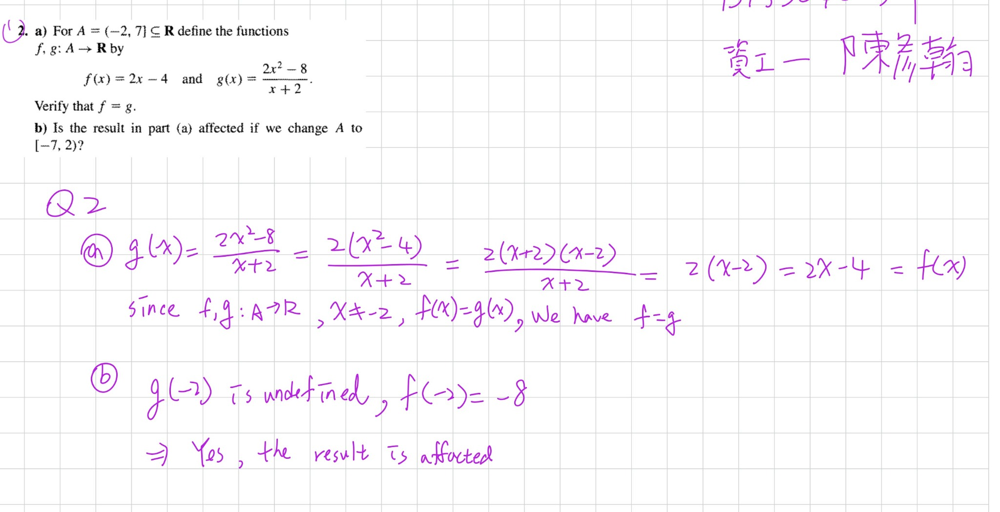

---

x^2 = 9, x = +-3

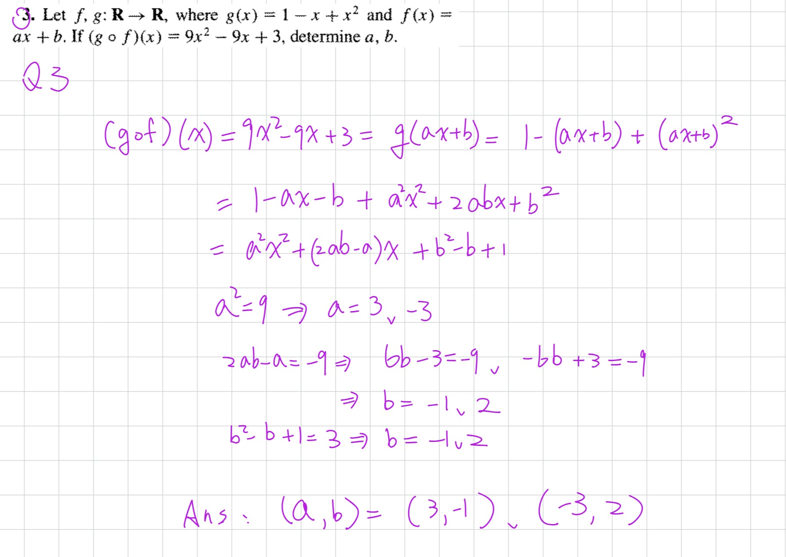


---


Q6

這是要算兩個函數相等，不是要算證明如何達成等式


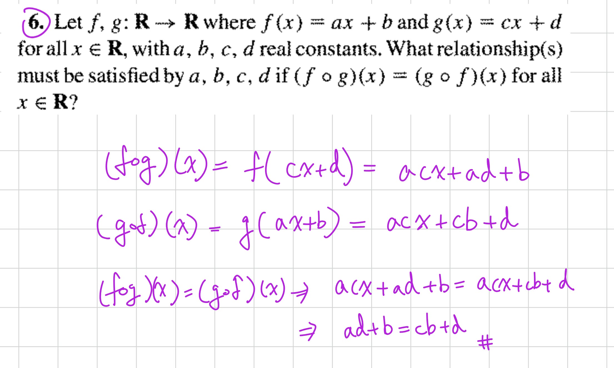


---


preimage 是一個集合，不是多個 Tople！！！


你寫的是：
\[
\{(2,3,5)\}
\]

應該寫：
\[
\boxed{f^{-1}(\{6\})=\{2,3,5\}}
\]

10 沒有 Preimage，所以：
\[
\begin{aligned}
f^{-1}(\{6,8,10\})
&=\{2,3,5\}\cup\{4,6\}\cup\varnothing\\
&=\boxed{\{2,3,4,5,6\}}
\end{aligned}
\]

注意：空集合不是一個要放進答案的元素。


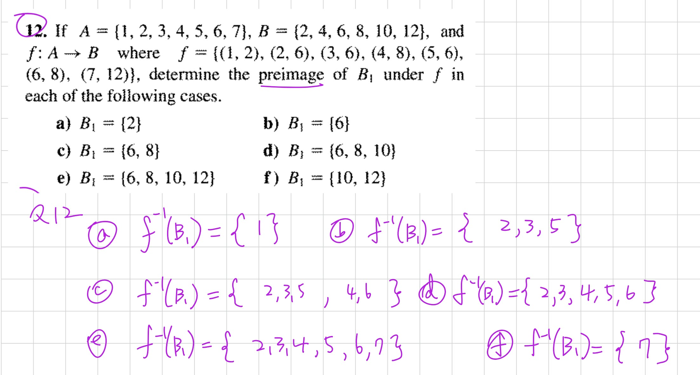


---

/// inverse function 和 preimage 差異

**Inverse Function（反函數）和 Preimage（原像）使用相同的符號：**

\[
\boxed{f^{-1}}
\]

但兩者的意義不同，要看上下文。

## **1\. Inverse Function（反函數）**

如果 \(f:A\to B\) 是 Bijective Function（雙射），就存在反函數：

\[
\boxed{f^{-1}:B\to A}
\]

例如：

\[
f(x)=2x+1
\]

反函數為：

\[
\boxed{f^{-1}(x)=\frac{x-1}{2}}
\]

這裡的 \(f^{-1}(x)\) 是一個數值。

## **2\. Preimage（原像）**

\[
\boxed{f^{-1}(\{y\})=\{x\in A\mid f(x)=y\}}
\]

這裡的 \(f^{-1}(\{y\})\) 是一個集合。

例如：

\[
f^{-1}(\{4\})=\{-3,\frac12,5\}
\]

## **3\. 考試必記比較**

| 比較 | Inverse Function | Preimage |
| --- | --- | --- |
| 中文 | 反函數 | 原像 |
| 符號 | \(f^{-1}\) | \(f^{-1}\) |
| 輸入 | 一個元素 | 一個集合 |
| 輸出 | 一個元素 | 一個集合 |
| 條件 | \(f\) 必須是雙射 | 不需要雙射 |

**最重要的觀念：**

看到 \(f^{-1}\) 不要馬上認定是反函數。

- \(f^{-1}:B\to A\)：通常表示反函數。
- \(f^{-1}(S)\)：表示集合 \(S\) 的原像。
- \(f^{-1}(\{y\})\)：表示元素 \(y\) 的原像集合。

兩者符號相同，但定義不同。


///


/// b部份，是不是檢查 domain 之後就會順便檢查 y 的範圍了？


如果你是用「先解不等式，再和該段 Domain 取交集」的方法，
那就不需要再另外檢查 \(y\) 的適用範圍。

因為：
- \(y\) 的適用範圍，本來就是由那一段的 Domain 推出來的。
- 所以你一旦有檢查 Domain，其實就已經間接檢查過那個 \(y\) 範圍了。

/// 
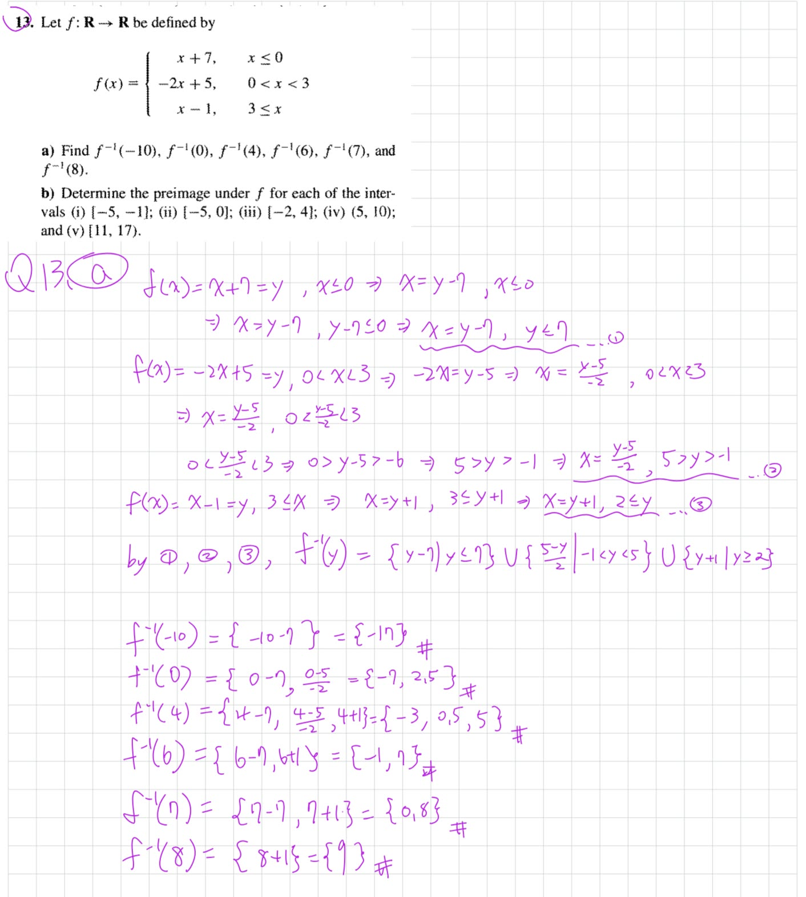

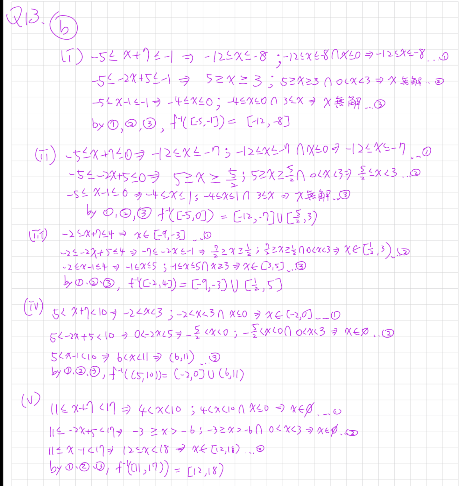


---


/// 但是他這樣的意思不是每個都要符合"\(f^{-1}(\{6,7,8\})=\{1,2\}\)"嗎？但是不可能會有任何一個符合"\(f^{-1}(\{6,7,8\})=\{1,2\}\)"吧


我知道你卡在哪裡了！你可能覺得：

「既然題目要求 \(f^{-1}(\{6,7,8\})=\{1,2\}\)，那怎麼可能真的找到符合這個等式的函數？」

其實**是有很多個函數符合的**。關鍵在於：題目沒有要求 6、7、8 每個數字都必須被映射到。

## **1\. 我們直接創造一個符合條件的函數**

假設我們定義：

\[
\begin{aligned}
f(1)&=6\\
f(2)&=7\\
f(3)&=9\\
f(4)&=10\\
f(5)&=12
\end{aligned}
\]

畫成對應關係：

## **一個合法的 Function**

![](data:image/svg+xml;charset=utf-8,%3Csvg%20font-family%3D%22%26quot%3BPEICD%20Local%203%20Latin%26quot%3B%2C%20%26quot%3BPEICD%20Local%204%20CJK%26quot%3B%2C%20%26quot%3BNoto%20Sans%20TC%26quot%3B%2C%20%26quot%3BNoto%20Sans%20CJK%20TC%26quot%3B%2C%20%26quot%3BCascadia%20Mono%26quot%3B%2C%20%26quot%3BMicrosoft%20JhengHei%26quot%3B%2C%20%26quot%3BSegoe%20UI%26quot%3B%2C%20sans-serif%22%20font-weight%3D%22400%22%20data-d-component%3D%22svg%22%20fill%3D%22currentColor%22%20style%3D%22color%3Argb%28237%2C%20237%2C%20237%29%22%20viewBox%3D%220%200%20320%20205%22%20width%3D%22100%25%22%20xmlns%3D%22http%3A%2F%2Fwww.w3.org%2F2000%2Fsvg%22%3E%3Ccircle%20cx%3D%2248%22%20cy%3D%2224%22%20r%3D%2212%22%20fill%3D%22%232563EB%22%2F%3E%3Ctext%20x%3D%2248%22%20y%3D%2228%22%20fill%3D%22white%22%20text-anchor%3D%22middle%22%20font-size%3D%2211%22%3E1%3C%2Ftext%3E%3Ccircle%20cx%3D%2248%22%20cy%3D%2263%22%20r%3D%2212%22%20fill%3D%22%232563EB%22%2F%3E%3Ctext%20x%3D%2248%22%20y%3D%2267%22%20fill%3D%22white%22%20text-anchor%3D%22middle%22%20font-size%3D%2211%22%3E2%3C%2Ftext%3E%3Ccircle%20cx%3D%2248%22%20cy%3D%22102%22%20r%3D%2212%22%20fill%3D%22%232563EB%22%2F%3E%3Ctext%20x%3D%2248%22%20y%3D%22106%22%20fill%3D%22white%22%20text-anchor%3D%22middle%22%20font-size%3D%2211%22%3E3%3C%2Ftext%3E%3Ccircle%20cx%3D%2248%22%20cy%3D%22141%22%20r%3D%2212%22%20fill%3D%22%232563EB%22%2F%3E%3Ctext%20x%3D%2248%22%20y%3D%22145%22%20fill%3D%22white%22%20text-anchor%3D%22middle%22%20font-size%3D%2211%22%3E4%3C%2Ftext%3E%3Ccircle%20cx%3D%2248%22%20cy%3D%22180%22%20r%3D%2212%22%20fill%3D%22%232563EB%22%2F%3E%3Ctext%20x%3D%2248%22%20y%3D%22184%22%20fill%3D%22white%22%20text-anchor%3D%22middle%22%20font-size%3D%2211%22%3E5%3C%2Ftext%3E%3Ccircle%20cx%3D%22270%22%20cy%3D%2215%22%20r%3D%2211%22%20fill%3D%22%2316A34A%22%2F%3E%3Ctext%20x%3D%22270%22%20y%3D%2219%22%20fill%3D%22white%22%20text-anchor%3D%22middle%22%20font-size%3D%2210%22%3E6%3C%2Ftext%3E%3Ccircle%20cx%3D%22270%22%20cy%3D%2242%22%20r%3D%2211%22%20fill%3D%22%2316A34A%22%2F%3E%3Ctext%20x%3D%22270%22%20y%3D%2246%22%20fill%3D%22white%22%20text-anchor%3D%22middle%22%20font-size%3D%2210%22%3E7%3C%2Ftext%3E%3Ccircle%20cx%3D%22270%22%20cy%3D%2269%22%20r%3D%2211%22%20fill%3D%22%2316A34A%22%2F%3E%3Ctext%20x%3D%22270%22%20y%3D%2273%22%20fill%3D%22white%22%20text-anchor%3D%22middle%22%20font-size%3D%2210%22%3E8%3C%2Ftext%3E%3Ccircle%20cx%3D%22270%22%20cy%3D%2296%22%20r%3D%2211%22%20fill%3D%22%2364748B%22%2F%3E%3Ctext%20x%3D%22270%22%20y%3D%22100%22%20fill%3D%22white%22%20text-anchor%3D%22middle%22%20font-size%3D%2210%22%3E9%3C%2Ftext%3E%3Ccircle%20cx%3D%22270%22%20cy%3D%22123%22%20r%3D%2211%22%20fill%3D%22%2364748B%22%2F%3E%3Ctext%20x%3D%22270%22%20y%3D%22127%22%20fill%3D%22white%22%20text-anchor%3D%22middle%22%20font-size%3D%2210%22%3E10%3C%2Ftext%3E%3Ccircle%20cx%3D%22270%22%20cy%3D%22150%22%20r%3D%2211%22%20fill%3D%22%2364748B%22%2F%3E%3Ctext%20x%3D%22270%22%20y%3D%22154%22%20fill%3D%22white%22%20text-anchor%3D%22middle%22%20font-size%3D%2210%22%3E11%3C%2Ftext%3E%3Ccircle%20cx%3D%22270%22%20cy%3D%22177%22%20r%3D%2211%22%20fill%3D%22%2364748B%22%2F%3E%3Ctext%20x%3D%22270%22%20y%3D%22181%22%20fill%3D%22white%22%20text-anchor%3D%22middle%22%20font-size%3D%2210%22%3E12%3C%2Ftext%3E%3Cg%20stroke-width%3D%221.7%22%20fill%3D%22none%22%3E%3Cpath%20d%3D%22M60%2024%20L258%2015%22%20stroke%3D%22%2316A34A%22%2F%3E%3Cpath%20d%3D%22M60%2063%20L258%2042%22%20stroke%3D%22%2316A34A%22%2F%3E%3Cpath%20d%3D%22M60%20102%20L258%2096%22%20stroke%3D%22%2364748B%22%2F%3E%3Cpath%20d%3D%22M60%20141%20L258%20123%22%20stroke%3D%22%2364748B%22%2F%3E%3Cpath%20d%3D%22M60%20180%20L258%20177%22%20stroke%3D%22%2364748B%22%2F%3E%3C%2Fg%3E%3Cg%20font-size%3D%2210%22%20fill%3D%22currentColor%22%3E%3Ctext%20x%3D%2248%22%20y%3D%22205%22%20text-anchor%3D%22middle%22%3EA%3C%2Ftext%3E%3Ctext%20x%3D%22270%22%20y%3D%22205%22%20text-anchor%3D%22middle%22%3EB%3C%2Ftext%3E%3C%2Fg%3E%3C%2Fsvg%3E)

綠色：6、7、8；灰色：9、10、11、12。

現在檢查：

\[
f^{-1}(\{6,7,8\})
\]

意思是找出 A 裡面哪些元素，映射後會落在 6、7、8 之中。

- 1 映射到 6：符合。
- 2 映射到 7：符合。
- 3 映射到 9：不符合。
- 4 映射到 10：不符合。
- 5 映射到 12：不符合。

所以：

\[
\boxed{f^{-1}(\{6,7,8\})=\{1,2\}}
\]

你看，這個函數完全符合題目！

## **2\. 你可能誤會的一個地方**

題目並沒有要求：

\[
\begin{aligned}
f(1)&=6\\
f(2)&=7
\end{aligned}
\]

也沒有要求 6、7、8 都必須被使用。

例如下面也符合：

\[
\begin{aligned}
f(1)&=6\\
f(2)&=6\\
f(3)&=9\\
f(4)&=10\\
f(5)&=12
\end{aligned}
\]

因為：

\[
f^{-1}(\{6,7,8\})=\{1,2\}
\]

即使 7、8 完全沒有被使用，也沒關係。

## **3\. 最重要的觀念**

\[
\boxed{f^{-1}(\{6,7,8\})=\{1,2\}}
\]

真正代表的是：

- 1、2 必須映射到 6、7、8 其中之一。
- 3、4、5 絕對不能映射到 6、7、8。

**它沒有要求 6、7、8 每個都要被使用，也沒有要求 1、2 必須映射到不同數字。**

這就是為什麼這題有很多個符合條件的函數，而不是沒有任何解。


///

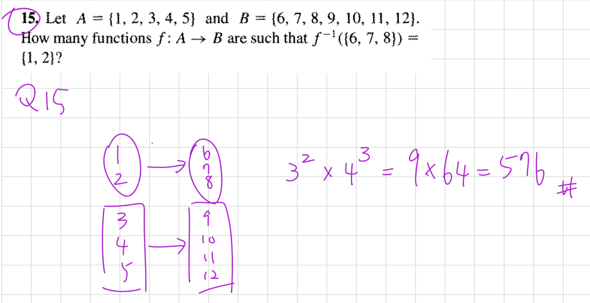


---


///onto 要如何證明？
證明 **Onto（滿射）** 的核心就是：

**證明 Codomain（對應域）中的每一個 \(y\)，都至少有一個 \(x\) 可以映射到它。**

## **1\. Onto 的正式定義**

假設：

\[
f:A\to B
\]

則 \(f\) 是 Onto，若且唯若：

\[
\boxed{\forall y\in B,\ \exists x\in A,\ f(x)=y}
\]

意思是：

對於 B 裡面**任意一個 \(y\)**，都能找到 A 裡面**至少一個 \(x\)**，使得 \(f(x)=y\)。

## **2\. 用你 Q20 的題目示範**

題目要證明：

\[
f:\mathbb Z\to\mathbb Z,\qquad
f(x)=\left\lfloor\frac{x}{2}\right\rfloor
\]

是 Onto。

⭐ **Step 1：任取一個輸出 \(y\)**

\[
\text{Let }y\in\mathbb Z.
\]

因為要證明所有整數都能被映射到，所以不能只選某個特定的 \(y\)。

⭐ **Step 2：找到能產生 \(y\) 的輸入 \(x\)**

我們希望：

\[
\left\lfloor\frac{x}{2}\right\rfloor=y
\]

可以直接選擇：

\[
\boxed{x=2y}
\]

⭐ **Step 3：代入驗證**

\[
\begin{aligned}
f(2y)
&=\left\lfloor\frac{2y}{2}\right\rfloor\\
&=\lfloor y\rfloor\\
&=y
\end{aligned}
\]

因為 \(y\in\mathbb Z\)，所以 \(x=2y\in\mathbb Z\)，是合法輸入。

因此，對所有 \(y\in\mathbb Z\)，都存在 \(x=2y\)，使 \(f(x)=y\)。

\[
\boxed{\therefore f\text{ is onto.}}
\]

## **3\. 作業最精簡滿分寫法**

\[
\begin{aligned}
&\text{Let }y\in\mathbb Z,\ x=2y\in\mathbb Z.\\
&f(x)=f(2y)=\left\lfloor\frac{2y}{2}\right\rfloor=y.\\
&\therefore f\text{ is onto.}
\end{aligned}
\]

這樣就已經是完整的 Onto 證明。

## **4\. 考試記住這個固定套路**

證明 Onto 就做三件事：

1. **任取 \(y\in B\)**。
2. **找出 \(x\in A\)，讓 \(f(x)=y\)**。
3. **代入驗證，得出 Onto**。

最重要的觀念是：**不能只舉幾個 \(y\) 的例子，而是要證明任意 \(y\) 都找得到對應的 \(x\)。**

這也正是 Onto 和 One-to-one 的證明差別：One-to-one 從兩個輸入比較開始；Onto 則從任意輸出 \(y\) 反過來找輸入 \(x\)。


///

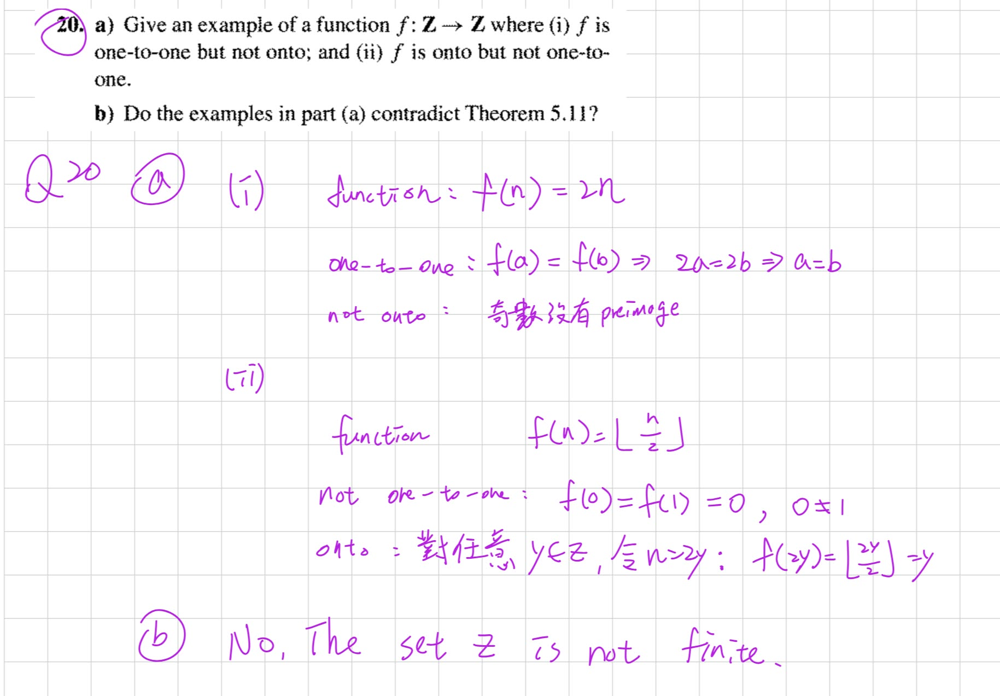


---


你寫：
\[
\binom{100}{2}
\]

這只能算出長度至少為 2 的子字串，因為你選了兩個不同位置作為頭尾。


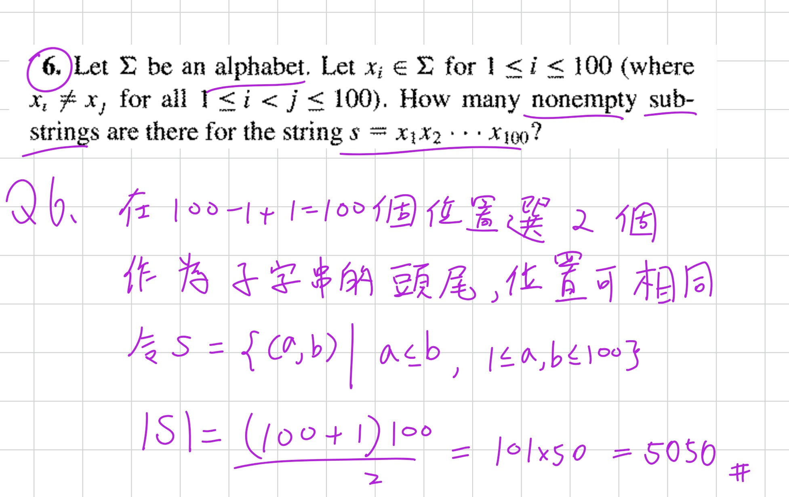


---

///details|(c) \(A\triangle B\)是啥

如果你問的是 (c) \(A\triangle B\)，這個符號叫做 Symmetric Difference（對稱差集）。

意思是：

找出只屬於 A 或只屬於 B，但不能同時屬於 A、B 的元素。

正式定義：
\[
\boxed{A\triangle B=(A-B)\cup(B-A)}
\]

也就是把兩個集合的交集排除。
套用這題
題目給：
\[
A=\{0,1,00,11,000,111,0000,1111\}
\]

\[
B=\{w\in\Sigma^*\mid |w|\geq2\}
\]

其中 \(B\) 是所有長度至少為 2 的二進位字串。

因此：
- \(0,1\)：只屬於 A，要保留。
- \(00,11,000,111,0000,1111\)：同時屬於 A、B，要排除。
- 其他長度至少為 2 的字串：只屬於 B，要保留。
所以：
\[
\boxed{
A\triangle B
=\Sigma^*-\{\lambda,00,11,000,111,0000,1111\}
}
\]

其中 \(\lambda\) 是空字串。


對！**完全一樣。**

Symmetric Difference（對稱差集）可以寫成：

\\[ \boxed{ A\triangle B=(A-B)\cup(B-A) } \\]

也等價於你說的：

\\[ \boxed{ A\triangle B=(A\cup B)-(A\cap B) } \\]

### **兩種寫法的意思**

1\. **第一種：** \\((A-B)\cup(B-A)\\)

&#x20;  只屬於 A，或只屬於 B 的元素。

2\. **第二種：** \\((A\cup B)-(A\cap B)\\)

&#x20;  先找出 A OR B 的所有元素，再排除 A AND B 的元素。

### **用邏輯表示**

\\[ \boxed{(A\lor B)\land\neg(A\land B)} \\]

這就是 **XOR（Exclusive OR，互斥或）**。

**考試記住：**

\\[ \boxed{ A\triangle B =(A-B)\cup(B-A) =(A\cup B)-(A\cap B) } \\]

你理解的完全正確，而且第二種寫法通常更直觀。

///

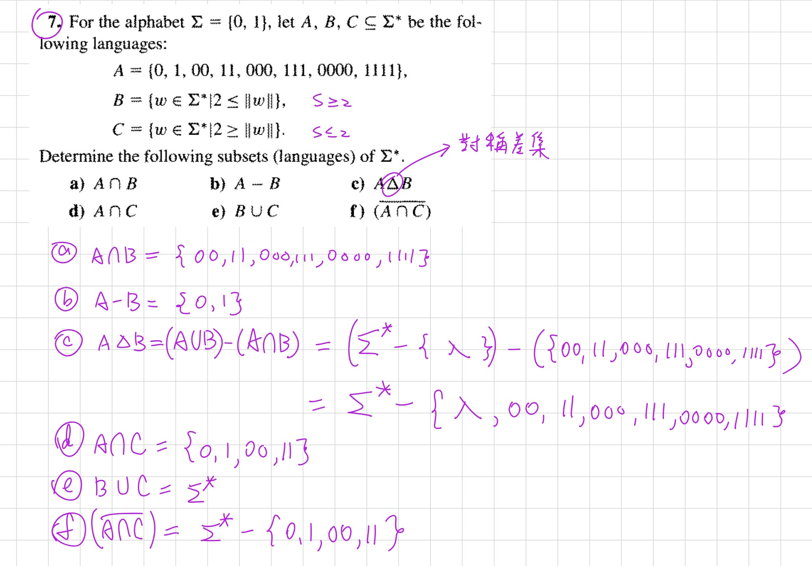