# 所有錯題

彙整離散筆記中明確標記的錯題，保留題目圖片、原有解析與補充公式，依原筆記分類。

| 來源 | 收錄內容 | 圖片 |
| --- | --- | ---: |
| [L01](L01.md) | 作業 1：第 4、9 題與補集技巧 | 3 |
| [L02](L02.md) | 英文看不懂的第 8 題 | 2 |
| [L03](L03.md) | 歸納法、∑、反例、消去律、Bézout 與 GCD 證明 | 9 |
| [L04](L04.md) | Ex 4.5、Ex 5.1、Ex 5.2 的作業錯題 | 5 |
| [第一次小考複習](第一次小考複習.md) | 補充：composition 的切點數與加數數量 | 0 |

## L01｜作業 1 錯題

來源：[L01.md](L01.md)

### 4

#### 4-b-3 另解

///danger|技巧

如果說至少，可以嘗試用補集

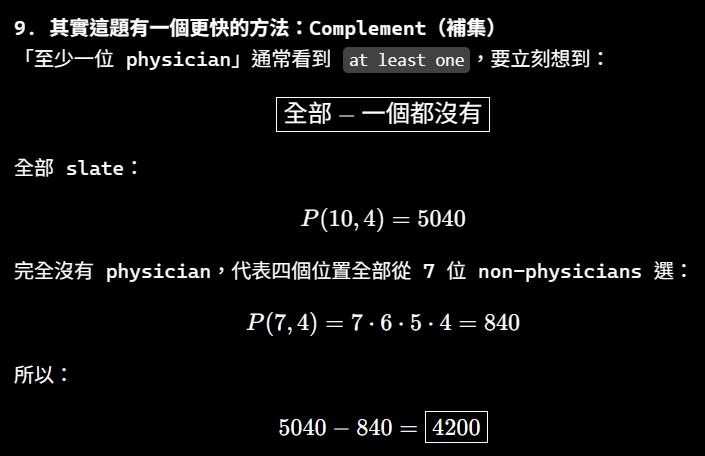

///

### 9

/// danger

題目的 tea 部分是：

> **tea (plain, with cream, with sugar, with cream and sugar, with lemon, or with lemon and sugar)**

中文就是：

> **茶有以下六種選擇：**
> 
> 1. `plain`：原味茶／什麼都不加
>     
> 2. `with cream`：加 cream
>     
> 3. `with sugar`：加糖
>     
> 4. `with cream and sugar`：加 cream 和糖
>     
> 5. `with lemon`：加檸檬
>     
> 6. `with lemon and sugar`：加檸檬和糖
>

///

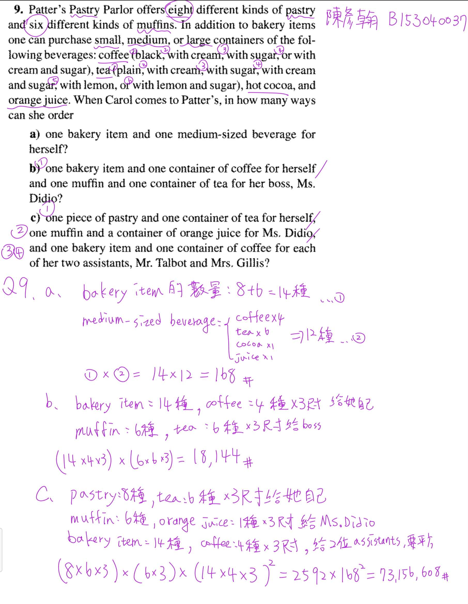

## L02｜錯題

來源：[L02.md](L02.md)

/// danger|英文看不懂的第 8 題

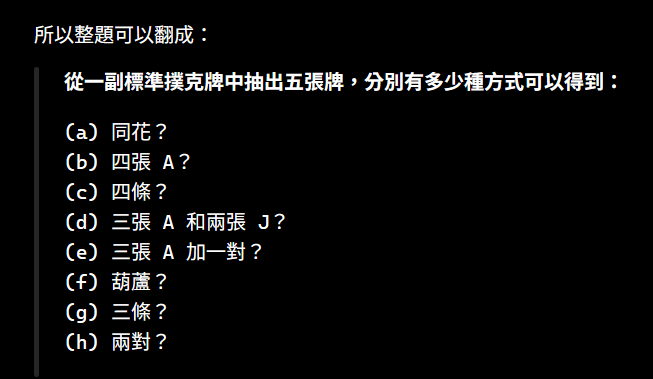
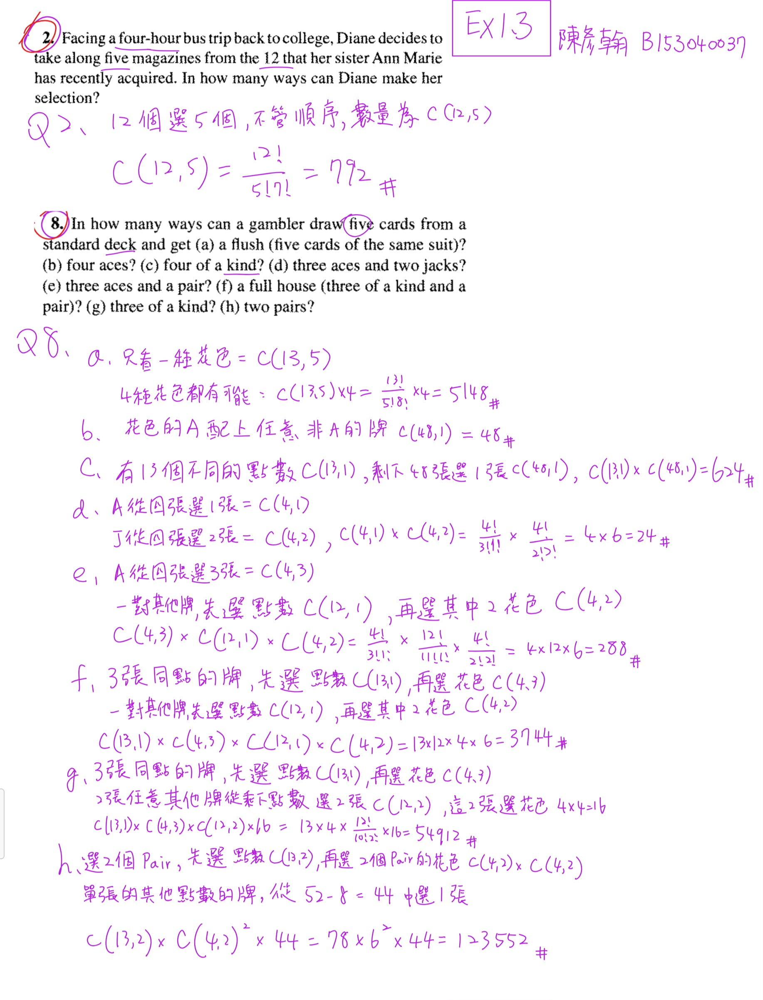

///

## L03｜作業錯題

來源：[L03.md](L03.md)

///danger|數學歸納法證明
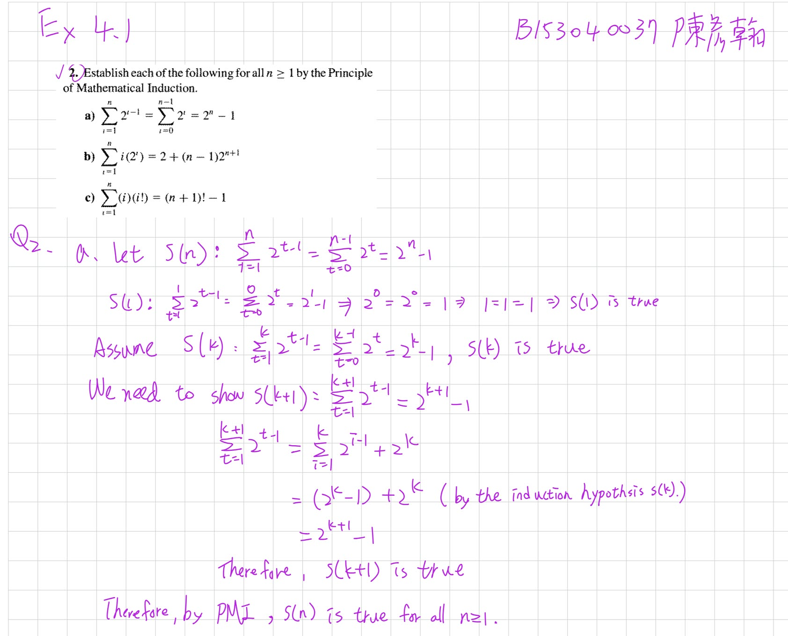
///

///danger|數學歸納法證明模板
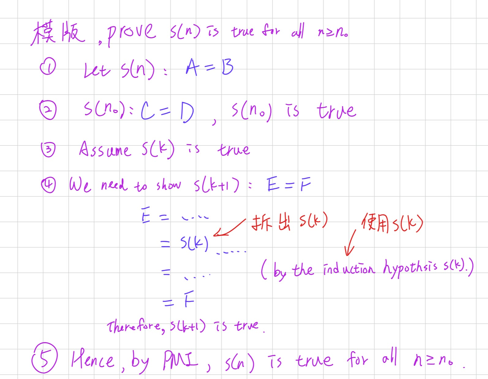
///

---

///danger|常用的 sigma
### ⭐sigma
#### 公式

[YouTube 參考影片](https://www.youtube.com/watch?v=p5z0O_L1Z0U)

$$
\sum_{k=1}^{n} k = \frac{n(n+1)}{2}
$$

$$
\sum_{k=1}^{n} k^2 = \frac{n(n+1)(2n+1)}{6}
$$

$$
\sum_{k=1}^{n} k^3 = \left[\frac{n(n+1)}{2}\right]^2
$$

$$
\sum_{k=1}^{n} k(k+1) = \frac{n(n+1)(n+2)}{3}
$$

#### ∑ 的性質

1. 常數和：

   $$
   \sum_{k=1}^{n} c = nc
   \quad
   (c \text{ 表示任一常數})
   $$

2. 係數可以提出：

   $$
   \sum_{k=1}^{n} c \cdot a_k
   =
   c \cdot \sum_{k=1}^{n} a_k
   $$

   其中 \(c\) 是與 \(k\) 無關的常數。

3. ∑ 的後面有加減可以拆：

   $$
   \sum_{k=1}^{n}(a_k \pm b_k)
   =
   \sum_{k=1}^{n}a_k
   \pm
   \sum_{k=1}^{n}b_k
   $$

4. ∑ 的後面很多相乘：
   先乘開，再利用加減可以拆的性質。

   例如：

   $$
   \sum_{k=1}^{n}(2k-1)(3k+1)
   $$

   先乘開：

   $$
   (2k-1)(3k+1)
   =
   6k^2-k-1
   $$

   所以：

   $$
   \sum_{k=1}^{n}(2k-1)(3k+1)
   =
   \sum_{k=1}^{n}(6k^2-k-1)
   $$

   再拆成：

   $$
   6\sum_{k=1}^{n}k^2
   -
   \sum_{k=1}^{n}k
   -
   \sum_{k=1}^{n}1
   $$

5. 相乘不能直接拆成兩個 ∑ 相乘：

   一般來說，

   $$
   \sum_{k=1}^{n}(a_kb_k)
   \neq
   \left(\sum_{k=1}^{n}a_k\right)
   \left(\sum_{k=1}^{n}b_k\right)
   $$

   原因是右邊乘開後會多出交叉項。

   例如：

   $$
   a_1b_1+a_2b_2
   \neq
   (a_1+a_2)(b_1+b_2)
   $$

   因為：

   $$
   (a_1+a_2)(b_1+b_2)
   =
   a_1b_1+a_1b_2+a_2b_1+a_2b_2
   $$

   所以遇到相乘時，通常要先把括號乘開，再利用性質 2、3 拆 ∑。

6. 平方不能直接移到 ∑ 外面：

   一般來說，

   $$
   \sum_{k=1}^{n}a_k^2
   \neq
   \left(\sum_{k=1}^{n}a_k\right)^2
   $$

   原因是右邊平方後會多出交叉項。

   例如：

   $$
   a_1^2+a_2^2
   \neq
   (a_1+a_2)^2
   $$

   因為：

   $$
   (a_1+a_2)^2
   =
   a_1^2+2a_1a_2+a_2^2
   $$

   所以要記：

   $$
   \boxed{
   \sum a_k^2
   \neq
   \left(\sum a_k\right)^2
   }
   $$

   ∑ 裡面的平方要留在每一項上，不能直接把平方搬到整個 ∑ 外面。
///

///danger|證明不成立只要一個反例即可
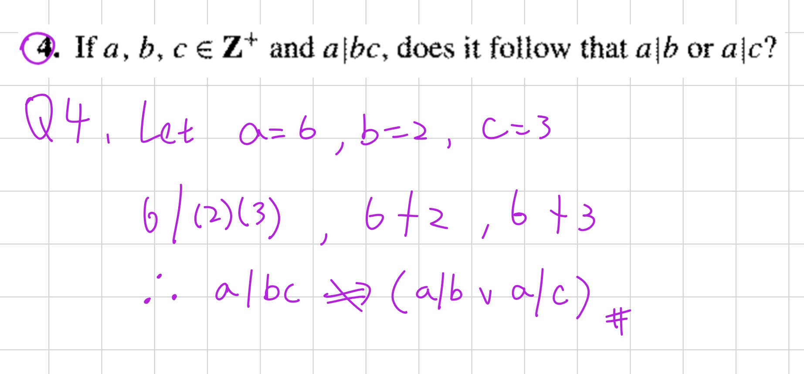
///

/// danger|Zero-Product Property(零乘積性質)

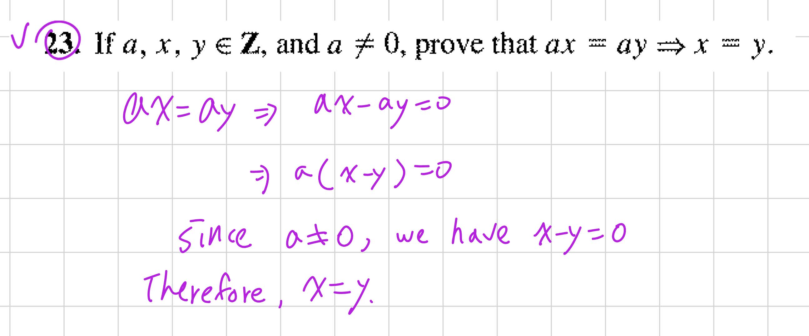

### ⭐Cancellation Law(消去律) — 為什麼可以把 \\(a\\) 消掉？

主線位置：使用者提供的第 63 題截圖；Teacher Transcript／Session=03／對應行號本輪尚未核對。

#### 1. 題目在問什麼？

題目：

\\[ a,x,y\in\mathbb Z,\qquad a\neq0 \\]

Prove that

\\[ ax=ay\Rightarrow x=y. \\]

翻譯：

假設 \\(a,x,y\\) 都是整數，而且 \\(a\neq0\\)。

證明：如果 \\(ax=ay\\)，那麼 \\(x=y\\)。

這題不是要算出 \\(x,y\\) 是多少，而是要證明這個規則對所有符合條件的整數都成立。

#### 2. 要怎麼證明？

你可能直覺會想：

\\[ ax=ay\Rightarrow x=y \\]

直接把兩邊的 \\(a\\) 約掉。

但這題就是要你證明「為什麼可以約掉」，所以我們把中間的理由寫出來。

Step 1：把所有項移到左邊。

\\[ ax=ay \\]

\\[ ax-ay=0 \\]

Step 2：提出共同因數 \\(a\\)。

\\[ a(x-y)=0 \\]

Step 3：使用 Zero-Product Property(零乘積性質)。

兩個整數相乘等於零，至少有一個必須是零。

因此：

\\[ a=0\quad\text{or}\quad x-y=0 \\]

但題目已經告訴我們：

\\[ a\neq0 \\]

所以只剩：

\\[ x-y=0 \\]

得到：

\\[ \boxed{x=y} \\]

證明完成。

#### 3. 作業可以這樣寫（英文簡短完整版）

> Proof. Assume \\(ax=ay\\), where \\(a\neq0\\).
>
> Then \\[ ax-ay=0 \\] \\[ a(x-y)=0. \\]
>
> Since \\(a\neq0\\), we have \\(x-y=0\\).
>
> Therefore, \\(x=y\\).

這個寫法已經包含關鍵理由與完整推導，適合用在證明題。

注意：這是依整數性質寫出的證明；目前尚未核對到《課本詳解.pdf》本題對應的原文寫法。

#### 4. Exam Quick Sheet(考試速記／最短骨架)

\\[ \boxed{ ax=ay \Rightarrow a(x-y)=0 \xRightarrow{a\neq0}x-y=0 \Rightarrow x=y } \\]

最重要的陷阱：\\(a\neq0\\) 不能省略。

#### 5. Practice Tasks(練習任務)

##### 5.1 Task 1

[Generated: 觀念確認]

Give a counterexample showing that the conclusion \\(x=y\\) may fail when \\(a=0\\).

請自己選擇整數 \\(a,x,y\\)，讓 \\(ax=ay\\) 成立，但是 \\(x\neq y\\)。

用中文、英文或列式回答都可以。
///

/// danger|Ex 4.4 第 4 題：Bézout's Identity(貝祖等式)
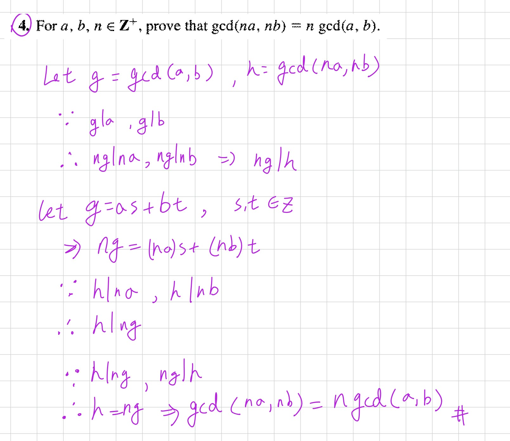

### ⭐Bézout's Identity(貝祖等式) — 為什麼最大公因數可以寫成兩個數的線性組合？

主線位置：Teacher Transcript／`逐字稿_03.txt`／Session=03／L531–L535、L619–L635。

對齊參考：《課本詳解.pdf》§4.4 第 4 題，PDF 第 119 頁。

先告訴你一個重點：

這題真正難的地方不是計算，而是理解：為什麼一個 GCD(最大公因數)可以用兩個數字的加減乘法表示，以及這件事怎麼幫我們證明整除。

我們先完全不碰作業題，從簡單例子開始。

#### 1. 先複習 GCD(最大公因數)

假設有兩個整數：

\\[ a=18,\qquad b=30 \\]

它們的公因數有：

\\[ 1,2,3,6 \\]

其中最大的就是 \\(6\\)。

因此：

\\[ \boxed{\gcd(18,30)=6} \\]

這部分你應該比較熟悉。

現在我換個問題：

你能不能只用 18 和 30，經過整數倍的加減，組合出 6？

可以！

\\[ 18(2)+30(-1)=36-30=6 \\]

也就是：

\\[ \boxed{6=18(2)+30(-1)} \\]

這就是 Bézout's Identity 背後的想法。

#### 2. Bézout's Identity 到底在說什麼？

對正整數 \\(a,b\\)，設

\\[ g=\gcd(a,b). \\]

Bézout's Identity 告訴我們：

一定存在兩個整數 \\(s,t\\)，使得

\\[ \boxed{g=as+bt} \\]

這裡每個符號的意思是：

| 符號          | 意思                       |
| ----------- | ------------------------ |
| \\(a,b\\)   | 原本的兩個正整數                 |
| \\(g\\)     | \\(a,b\\) 的最大公因數         |
| \\(s,t\\)   | 某兩個整數，可以是正數、0 或負數        |
| \\(as+bt\\) | Linear Combination(線性組合) |

重點是「存在某組 \\(s,t\\)」，不是隨便選 \\(s,t\\) 都會得到 GCD。

以前面的例子來看：

\\[ \gcd(18,30)=6 \\]

我們找到：

\\[ 6=18(2)+30(-1) \\]

因此：

\\[ s=2,\qquad t=-1. \\]

貝祖等式最重要的一句話

最大公因數可以表示成原本兩個整數的 Linear Combination(線性組合)：

\\[ \gcd(a,b)=as+bt \\]

其中 \\(s,t\in\mathbb Z\\)。

老師在逐字稿裡也特別強調：「最大公因數可以被原本兩個數的線性組合表示」，而且線性組合不一定唯一。

逐字稿_03.txt

#### 3. 那 \\(s,t\\) 是怎麼知道的？要自己猜嗎？

不用猜。可以透過 Euclidean Algorithm(歐幾里得演算法)和 Back-Substitution(回代法)找出來。

我們用剛剛的 \\(18,30\\) 示範。

Step 1：反覆做除法。

\\[ 30=18(1)+12 \\]

\\[ 18=12(1)+6 \\]

\\[ 12=6(2)+0 \\]

最後一個非零餘數是 \\(6\\)，所以：

\\[ \gcd(18,30)=6 \\]

Step 2：從 6 開始往回代。

由第二行：

\\[ 18=12+6 \\]

移項得到：

\\[ 6=18-12 \\]

但是第一行告訴我們：

\\[ 12=30-18 \\]

把它代回去：

\\[ \begin{aligned} 6&=18-12\\\ &=18-(30-18)\\\ &=18-30+18\\\ &=2(18)-30 \end{aligned} \\]

所以：

\\[ \boxed{6=18(2)+30(-1)} \\]

我們就找到：

\\[ s=2,\quad t=-1. \\]

這就是貝祖等式的實際求法。

你之前算 \\(252\\) 和 \\(105\\) 的最大公因數，最後寫成 \\(21=252(8)+105(-19)\\)，也是同一種方法。

#### 4. 貝祖等式為什麼可以拿來證明「整除」？

這一點非常重要，因為等等的作業會用到。

假設有一個整數 \\(d\\)，它同時整除 \\(a,b\\)。

也就是：

\\[ d\mid a,\qquad d\mid b. \\]

這代表存在整數 \\(p,q\\)，使得：

\\[ a=dp,\qquad b=dq. \\]

現在看任意線性組合：

\\[ as+bt \\]

代入：

\\[ \begin{aligned} as+bt &=(dp)s+(dq)t\\\ &=d(ps+qt) \end{aligned} \\]

因為 \\(ps+qt\\) 是整數，所以：

\\[ \boxed{d\mid(as+bt)} \\]

也就是：

如果 \\(d\\) 同時整除兩個數，那它也一定整除這兩個數的任何整數線性組合。

而貝祖等式告訴我們：

\\[ g=as+bt \\]

因此可以推出：

\\[ d\mid g. \\]

換句話說：

> 任何公因數，都整除最大公因數。

這正是老師講解 GCD 定理時使用的性質。

逐字稿_03.txt

### ⭐Ex 4.4 第 4 題 — 如何利用貝祖等式證明 GCD 的性質？

主線位置：Teacher Transcript／`逐字稿_03.txt`／Session=03／GCD 與線性組合定理，L529–L535；本題為 §4.4 作業練習。

對齊參考：《課本詳解.pdf》§4.4 第 4 題，PDF 第 119 頁。

課本詳解.pdf

#### 1. 先理解題目要證明什麼

已知：

\\[ a,b,n\in\mathbb Z^+ \\]

要證明：

\\[ \boxed{\gcd(na,nb)=n\gcd(a,b)} \\]

用中文講就是：

如果把兩個正整數都乘上相同的正整數 \\(n\\)，它們的最大公因數也會跟著乘上 \\(n\\)。

例如：

\\[ \gcd(6,10)=2 \\]

把兩個數都乘以 \\(3\\)：

\\[ \gcd(18,30)=6 \\]

而：

\\[ 6=3(2) \\]

符合：

\\[ \gcd(3\cdot6,3\cdot10)=3\gcd(6,10). \\]

但這個例子只能驗證一組數字，我們要證明所有正整數 \\(a,b,n\\) 都成立。

#### 2. 第一步：為什麼要設定 \\(g,h\\)？

我們設：

\\[ \boxed{g=\gcd(a,b)} \\]

\\[ \boxed{h=\gcd(na,nb)} \\]

現在題目就變成：

\\[ \boxed{\text{證明 }h=ng} \\]

是不是比一整串 GCD 符號容易看了？

接下來要利用整除性質證明：

\\[ ng\mid h \\]

以及：

\\[ h\mid ng. \\]

兩個正整數彼此整除，就一定相等。

#### 3. 第二步：先證明 \\(ng\mid h\\)

由於：

\\[ g=\gcd(a,b) \\]

因此：

\\[ g\mid a,\qquad g\mid b. \\]

也就是說，存在整數 \\(p,q\\)，使得：

\\[ a=gp,\qquad b=gq. \\]

兩邊都乘上 \\(n\\)：

\\[ na=(ng)p \\]

\\[ nb=(ng)q \\]

所以：

\\[ ng\mid na,\qquad ng\mid nb. \\]

這說明 \\(ng\\) 是 \\(na,nb\\) 的公因數。

但我們已經設定：

\\[ h=\gcd(na,nb) \\]

根據剛剛講過的 GCD 性質：

> 任何公因數都會整除最大公因數。

所以：

\\[ \boxed{ng\mid h} \\]

第一個方向完成。

#### 4. 第三步：利用 Bézout's Identity 證明 \\(h\mid ng\\)

這是整題最關鍵的一步。

因為：

\\[ g=\gcd(a,b) \\]

由 Bézout's Identity，存在整數 \\(s,t\\)，使得：

\\[ \boxed{g=as+bt} \\]

現在把兩邊乘以 \\(n\\)：

\\[ ng=n(as+bt) \\]

利用分配律：

\\[ \boxed{ng=(na)s+(nb)t} \\]

注意！這個式子非常重要。

我們成功把 \\(ng\\) 寫成 \\(na,nb\\) 的整數線性組合。

回想：

\\[ h=\gcd(na,nb). \\]

所以：

\\[ h\mid na,\qquad h\mid nb. \\]

而我們剛剛已經證明：

> 一個整數若整除兩個數，就會整除它們的整數線性組合。

因此：

\\[ h\mid\big((na)s+(nb)t\big). \\]

又因為：

\\[ ng=(na)s+(nb)t, \\]

所以：

\\[ \boxed{h\mid ng}. \\]

第二個方向也完成了。

#### 5. 第四步：將兩個結果合起來

我們得到了：

\\[ \boxed{ng\mid h} \\]

以及：

\\[ \boxed{h\mid ng}. \\]

這表示 \\(ng,h\\) 兩個正整數彼此整除。

因此：

\\[ h=ng. \\]

將 \\(g,h\\) 換回原本的 GCD：

\\[ \boxed{\gcd(na,nb)=n\gcd(a,b)}. \\]

證明完成。

#### 6. 作業正式寫法（精簡英文版）

這是依課本詳解的技巧整理出的版本，不是逐字照抄。等你理解上面的原因後，作業可以寫這份。

Proof.

Let \\(g=\gcd(a,b)\\) and \\(h=\gcd(na,nb)\\).

Since \\(g\mid a\\) and \\(g\mid b\\), we have

\\[ ng\mid na,\qquad ng\mid nb. \\]

Thus, \\(ng\mid h\\).

By Bézout's Identity, there exist \\(s,t\in\mathbb Z\\) such that

\\[ g=as+bt. \\]

Hence,

\\[ ng=(na)s+(nb)t. \\]

Since \\(h\mid na\\) and \\(h\mid nb\\), we have \\(h\mid ng\\).

Since \\(ng,h\in\mathbb Z^+\\) and they divide each other, \\(h=ng\\).

Therefore,

\\[ \boxed{\gcd(na,nb)=n\gcd(a,b).} \\]

#### 7. Exam Quick Sheet(考試速記／最短骨架)

Bézout's Identity

\\[ \gcd(a,b)=as+bt,\quad s,t\in\mathbb Z. \\]

GCD 證明模板

\\[ \begin{aligned} g&=\gcd(a,b)\\\ h&=\gcd(na,nb) \end{aligned} \\]

\\[ \underbrace{ng\mid h}\_{\text{公因數性質}} \qquad \underbrace{h\mid ng}\_{\text{貝祖等式}} \\]

\\[ \boxed{h=ng} \\]

#### 8. Practice Tasks(練習任務)

先確認你真的理解這兩個最重要的動作，不用急著重寫完整作業。

##### 8.1 Task 1 — Bézout's Identity

[Generated: Learning Practice]

Given \\(\gcd(12,20)=4\\), find integers \\(s,t\\) such that

\\[ 4=12s+20t. \\]

你可以直接列出 \\(s,t\\)，也可以寫出計算過程。

##### 8.2 Task 2 — 理解證明方向

[Generated: Learning Practice]

Let

\\[ g=\gcd(a,b),\qquad h=\gcd(na,nb). \\]

Suppose

\\[ g=as+bt,\qquad s,t\in\mathbb Z. \\]

Complete the following argument:

\\[ ng=(na)s+(nb)t. \\]

Since \\(h\mid na\\) and \\(h\mid nb\\),

\\[ h\mid\ \underline{\qquad\qquad} \\]

請填入空格，並用一句中文說明原因。

你先回答這兩題，我再確認你是否理解貝祖等式的用法。

///

///danger| gcd 之證明

把兩個分別設為 g 和 h，最後用 g|h、h|g 得到 g = h 得證。

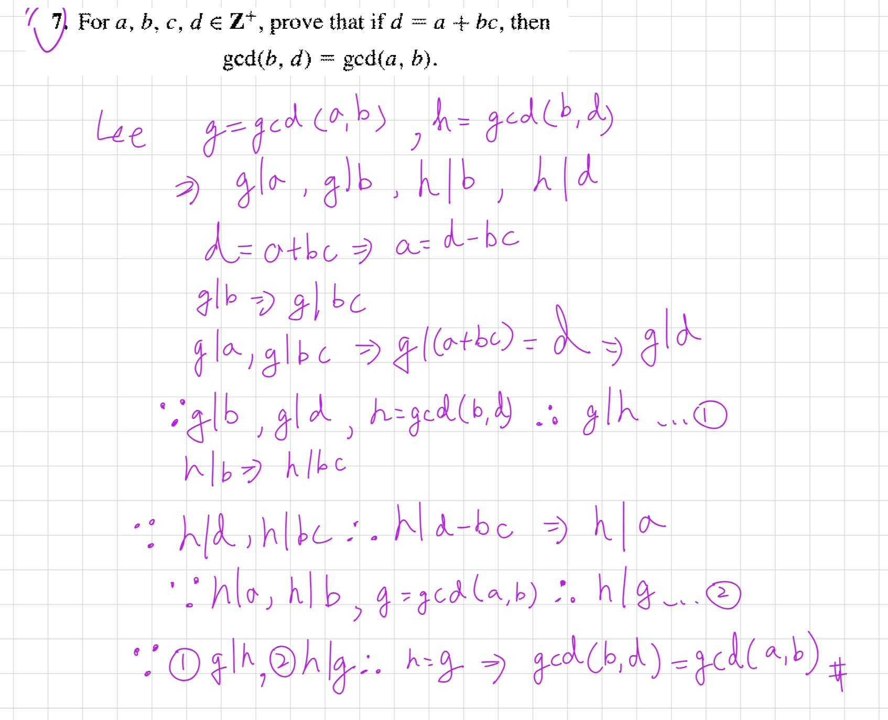
///

///danger|證明答案為 a 或 b

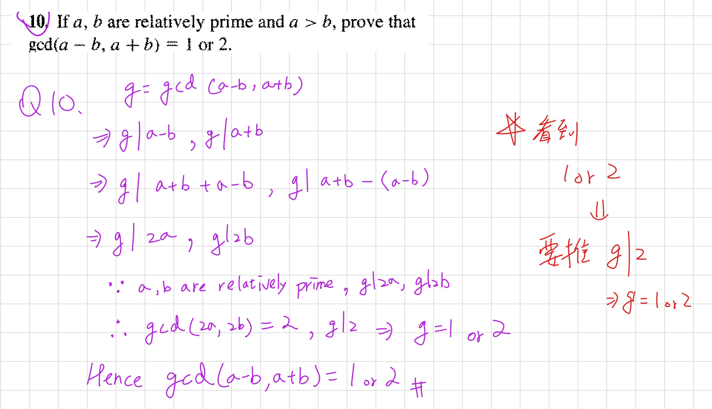

///

///danger|true 和 false 的 數學歸納法
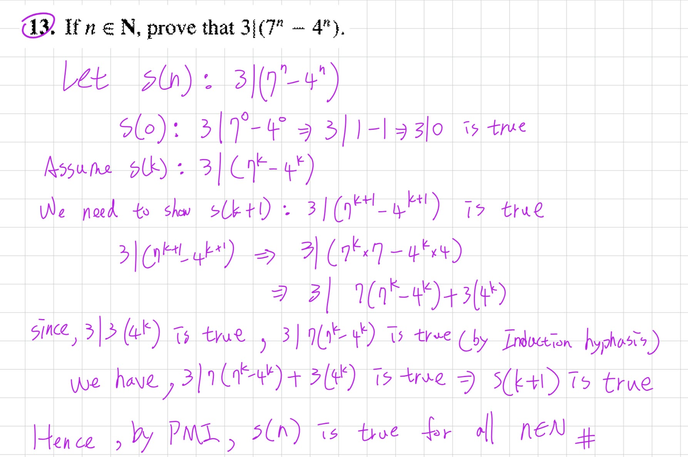
///

## L04｜作業錯題

來源：[L04.md](L04.md)

### Ex 4.5

#### 4

注意，要證明的是 A => B

#### 21

有點麻煩的題目

#### 27

超級麻煩的題目！！！

///danger|符號
在數論（Number Theory）中：
\[
\boxed{\sigma(N)=\text{Sum of all positive divisors of }N}
\]

意思是：整數 \(N\) 的所有正因數之和。
///

### Ex 5.1

要反向證明

### Ex 5.2

不應該寫 \(f(a)\ne1/0\)，因為 \(1/0\) 本身是未定義的，不能直接拿它作數值比較。

## 補充錯題｜Composition 的切點數與加數數量

來源：[第一次小考複習 §5.6](第一次小考複習.md#56-composition有序整數拆解)；同題列於該筆記的「個人錯題快速回想表」。

把正整數 $N$ 寫成若干**正整數加數**的和，且順序重要，稱為 composition。Summand（加數）就是相加的每一項；$2+1+3$ 的 summands 是 2、1、3。$3+1$ 與 $1+3$ 是不同 composition。

| 要數什麼 | 公式與條件 |
|---|---|
| $N$ 的所有 compositions | $\boxed{2^{N-1}}$，$N\ge1$ |
| 恰有 $k$ 個正整數加數 | $\boxed{\binom{N-1}{k-1}}$，$1\le k\le N$ |
| 每個加數都是正整數 $d$ 的倍數 | $d\mid N$ 時為 $\boxed{2^{N/d-1}}$；否則 0 |
| 每個加數都是 $d$ 的倍數，且恰有 $k$ 項 | $d\mid N$ 且 $N/d\ge k$ 時為 $\binom{N/d-1}{k-1}$ |

**原理：**把 $N$ 看成一列 $N$ 個 1，有 $N-1$ 個空隙。每隙選切／不切，共 $2^{N-1}$ 種；恰好 $k$ 段就選 $k-1$ 個切點。若每項為 $d$ 的倍數，每項除以 $d$，便與 $N/d$ 的 compositions 一一對應。

**個人筆記校正：**8 拆成恰好 3 個正整數，是 $\boxed{\binom72=21}$；$\binom73=35$ 對應恰好 4 個正整數。不要把「加號數／切點數」當成「加數數量」。7 拆成 3 個正整數則有 $\binom62=15$。

**Ex1.4 #25–26：**20 的每個 summand 都是偶數，除以 2 後是 10 的 composition，得 $2^9=512$；若每項是 4 的倍數，得 $2^4=16$。一般 $N=md$ 時，答案 $2^{m-1}$。

Partition（整數分割）不計加數順序，所以 $3+1$ 與 $1+3$ 相同；不能用 $2^{N-1}$。例如 4 的 compositions 有 8 種，而 partitions 只有 $4,3+1,2+2,2+1+1,1+1+1+1$ 這 5 種。
