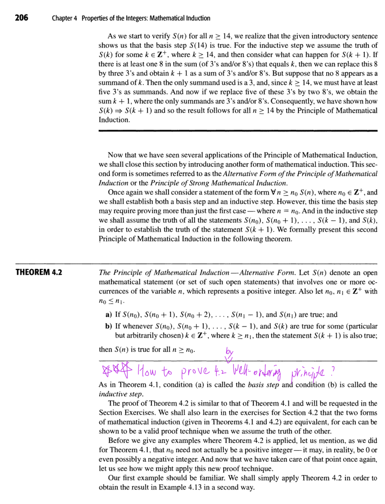
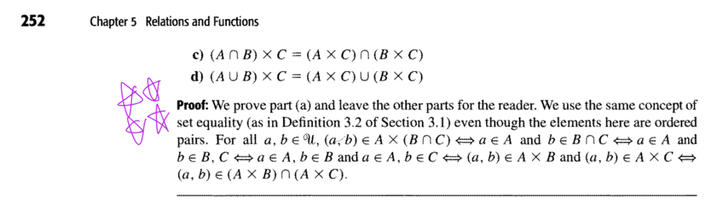

# 老師打星星的重點

///details|原圖

///

[GPT 網址](https://chatgpt.com/g/g-p-6aa36b5ca8fc819187896df33b424ecd-peicd-li-san/c/6ad4da35-d024-83ee-bf0a-c76b80a639ce)

你看到的正方形是 `\square`，數學中用來表示 Q.E.D.（證明完畢），不是語法錯誤。

我已將全部證明結尾的方框符號移除，改用完整的結論句。以下重新整理五題，每題都有老師提示、中文版、英文版，並盡量保持簡短、正確、容易在考試默寫。

## 1. Theorem 4.2 — Mathematical Induction

老師提示（10/2）： 重要證明題，練習使用 Well-Ordering Principle（良序原理）證明。

### 中文版

證明：

反設存在 \\(n\ge n_0\\) 使 \\(S(n)\\) 不成立。

由良序原理，令 \\(m\\) 為最小反例。

由基礎步驟，\\(m>n_1\\)。

由最小性，\\(S(n_0),\ldots,S(m-1)\\) 皆成立。

因 \\(m-1\ge n_1\\)，由歸納步驟得 \\(S(m)\\) 成立，矛盾。

故 \\(S(n)\\) 對所有 \\(n\ge n_0\\) 皆成立。

### English Version

Proof.

Suppose \\(S(n)\\) is false for some \\(n\ge n_0\\).

By the Well-Ordering Principle, let \\(m\\) be the smallest such \\(n\\).

By the basis step, \\(m>n_1\\).

By minimality, \\(S(n_0),\ldots,S(m-1)\\) are true.

Since \\(m-1\ge n_1\\), the inductive step gives \\(S(m)\\), a contradiction.

Thus \\(S(n)\\) is true for all \\(n\ge n_0\\).

## 2. Theorem 5.1 — Cartesian Product Distributive Laws

老師提示（10/16）： 要會證明 Cartesian Product 的四個分配律。課本第 252 頁 (a) 的證明有星號標記。

### 中文版

證明： 任取有序對 \\((x,y)\\)。

(a)

\\[ \begin{aligned} &(x,y)\in A\times(B\cap C)\\\ \iff\\;&x\in A\land y\in B\land y\in C\\\ \iff\\;&(x,y)\in(A\times B)\cap(A\times C). \end{aligned} \\]

(b)

\\[ \begin{aligned} &(x,y)\in A\times(B\cup C)\\\ \iff\\;&x\in A\land(y\in B\lor y\in C)\\\ \iff\\;&(x,y)\in(A\times B)\cup(A\times C). \end{aligned} \\]

(c)

\\[ \begin{aligned} &(x,y)\in(A\cap B)\times C\\\ \iff\\;&x\in A\land x\in B\land y\in C\\\ \iff\\;&(x,y)\in(A\times C)\cap(B\times C). \end{aligned} \\]

(d)

\\[ \begin{aligned} &(x,y)\in(A\cup B)\times C\\\ \iff\\;&(x\in A\lor x\in B)\land y\in C\\\ \iff\\;&(x,y)\in(A\times C)\cup(B\times C). \end{aligned} \\]

故四個等式皆成立。

### English Version

Proof. Let \\((x,y)\\) be arbitrary.

(a)

\\[ \begin{aligned} &(x,y)\in A\times(B\cap C)\\\ \iff\\;&x\in A\land y\in B\land y\in C\\\ \iff\\;&(x,y)\in(A\times B)\cap(A\times C). \end{aligned} \\]

(b)

\\[ \begin{aligned} &(x,y)\in A\times(B\cup C)\\\ \iff\\;&x\in A\land(y\in B\lor y\in C)\\\ \iff\\;&(x,y)\in(A\times B)\cup(A\times C). \end{aligned} \\]

(c)

\\[ \begin{aligned} &(x,y)\in(A\cap B)\times C\\\ \iff\\;&x\in A\land x\in B\land y\in C\\\ \iff\\;&(x,y)\in(A\times C)\cap(B\times C). \end{aligned} \\]

(d)

\\[ \begin{aligned} &(x,y)\in(A\cup B)\times C\\\ \iff\\;&(x\in A\lor x\in B)\land y\in C\\\ \iff\\;&(x,y)\in(A\times C)\cup(B\times C). \end{aligned} \\]

Thus all four identities hold.

## 3. Cartesian Product with Empty Set

老師提示（10/16）： 老師明確說這裡可以打星號，注意空集合與 Cartesian Product 的關係。

Prove:

\\[ A\times\varnothing=\varnothing \\]

### 中文版

證明：

反設 \\((a,b)\in A\times\varnothing\\)。

則 \\(b\in\varnothing\\)，矛盾。

故 \\(A\times\varnothing=\varnothing\\)。

同理，\\(\varnothing\times A=\varnothing\\)。

### English Version

Proof.

Suppose \\((a,b)\in A\times\varnothing\\).

Then \\(b\in\varnothing\\), a contradiction.

Thus \\(A\times\varnothing=\varnothing\\).

Similarly, \\(\varnothing\times A=\varnothing\\).

## 4. Theorem 4.4 — Infinitely Many Primes

老師提示（10/2）： 老師說「這個題目也蠻常考的」，要會使用 Proof by Contradiction（反證法）。

### 中文版

證明：

反設只有有限個質數 \\(p_1,\ldots,p_k\\)。

令

\\[ N=p_1p_2\cdots p_k+1. \\]

因 \\(N>1\\)，必有某質數 \\(p_j\mid N\\)。

又 \\(p_j\mid p_1p_2\cdots p_k\\)，故

\\[ p_j\mid(N-p_1p_2\cdots p_k)=1, \\]

矛盾。

因此質數有無窮多個。

### English Version

Proof.

Suppose there are finitely many primes \\(p_1,\ldots,p_k\\).

Let

\\[ N=p_1p_2\cdots p_k+1. \\]

Since \\(N>1\\), some prime \\(p_j\mid N\\).

Also, \\(p_j\mid p_1p_2\cdots p_k\\). Thus,

\\[ p_j\mid(N-p_1p_2\cdots p_k)=1, \\]

a contradiction.

Therefore, there are infinitely many primes.

## 5. Binomial Identity（二項式恆等式）

老師提示（9/18）： 老師提醒要記住這個恆等式的證明，但尚未確認第一次小考一定會考。

Prove:

\\[ \sum\_{k=0}^{n}\binom nk=2^n \\]

### 中文版

證明：

由二項式定理，

\\[ (x+y)^n=\sum\_{k=0}^{n}\binom nkx^{n-k}y^k. \\]

令 \\(x=y=1\\)，則

\\[ \begin{aligned} 2^n &=(1+1)^n\\\ &=\sum\_{k=0}^{n}\binom nk1^{n-k}1^k\\\ &=\sum\_{k=0}^{n}\binom nk. \end{aligned} \\]

故等式成立。

### English Version

Proof.

By the Binomial Theorem,

\\[ (x+y)^n=\sum\_{k=0}^{n}\binom nkx^{n-k}y^k. \\]

Setting \\(x=y=1\\),

\\[ \begin{aligned} 2^n &=(1+1)^n\\\ &=\sum\_{k=0}^{n}\binom nk1^{n-k}1^k\\\ &=\sum\_{k=0}^{n}\binom nk. \end{aligned} \\]

Thus the identity holds.

這版已移除所有證明結尾的方框符號。五題均保留必要的假設、關鍵推導及結論，適合直接放入小考複習筆記。